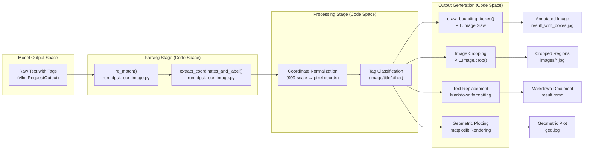
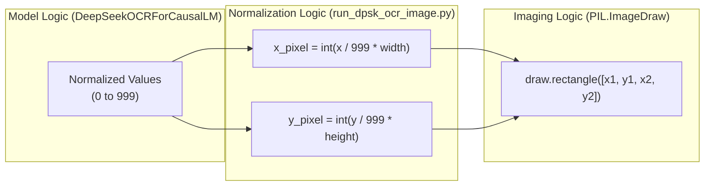
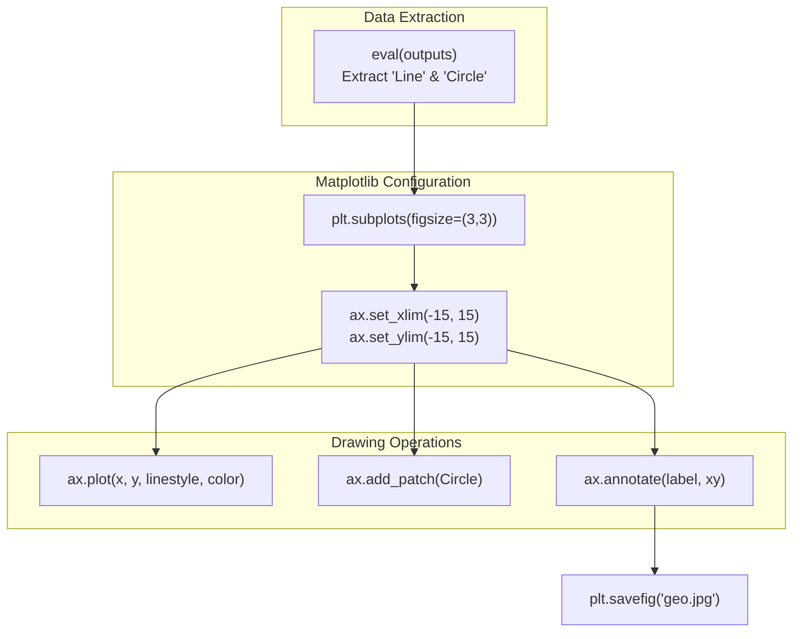

<!-- source: DeepWiki mcp.deepwiki.com · repo deepseek-ai/DeepSeek-OCR · page 5.5 Output Post-Processing · fetched 2026-10-30 -->

# Output Post-Processing

<details>
<summary>Relevant source files</summary>

The following files were used as context for generating this wiki page:

- [DeepSeek-OCR-master/DeepSeek-OCR-vllm/process/ngram_norepeat.py](DeepSeek-OCR-master/DeepSeek-OCR-vllm/process/ngram_norepeat.py)
- [DeepSeek-OCR-master/DeepSeek-OCR-vllm/run_dpsk_ocr_image.py](DeepSeek-OCR-master/DeepSeek-OCR-vllm/run_dpsk_ocr_image.py)

</details>


This document describes the post-processing pipeline for DeepSeek-OCR model outputs. Post-processing transforms raw model text containing structured reference tags into human-readable formats, visualizations, and extracted spatial data.

**Scope**: This page covers parsing reference tags, coordinate extraction, bounding box rendering, image cropping, format conversion, and specialized visualizations. For information about the model's inference process, see [vLLM Inference](). For configuration of inference parameters, see [Configuration System]().

---

## Overview

The DeepSeek-OCR model generates text output containing **special reference tags** that encode spatial information about detected elements. Post-processing extracts this structured data and transforms it into various output formats:

### Processing Data Flow


**Sources**: [DeepSeek-OCR-master/DeepSeek-OCR-vllm/run_dpsk_ocr_image.py:45-142](), [DeepSeek-OCR-master/DeepSeek-OCR-vllm/run_dpsk_ocr_image.py:223-301]()

---

## Reference Tag Format

The model outputs structured data using a nested tag syntax:

### Tag Structure
```
<|ref|>{label_type}<|/ref|><|det|>{coordinate_list}<|/det|>
```

**Components**:
- `<|ref|>...<|/ref|>`: Contains the label/type of the detected element [DeepSeek-OCR-master/DeepSeek-OCR-vllm/run_dpsk_ocr_image.py:46-46]().
- `<|det|>...<|/det|>`: Contains coordinate data as a Python list string [DeepSeek-OCR-master/DeepSeek-OCR-vllm/run_dpsk_ocr_image.py:46-46]().

### Common Label Types

| Label Type | Description | Visual Treatment |
|------------|-------------|------------------|
| `image` | Embedded images to be extracted | Width 2px boxes, cropped and saved [DeepSeek-OCR-master/DeepSeek-OCR-vllm/run_dpsk_ocr_image.py:105-112]() |
| `title` | Section headings | Width 4px boxes, emphasized [DeepSeek-OCR-master/DeepSeek-OCR-vllm/run_dpsk_ocr_image.py:115-117]() |
| `table` | Table regions | Width 2px boxes [DeepSeek-OCR-master/DeepSeek-OCR-vllm/run_dpsk_ocr_image.py:119-120]() |
| `formula` | Mathematical formulas | Width 2px boxes [DeepSeek-OCR-master/DeepSeek-OCR-vllm/run_dpsk_ocr_image.py:119-120]() |

**Sources**: [DeepSeek-OCR-master/DeepSeek-OCR-vllm/run_dpsk_ocr_image.py:45-57](), [DeepSeek-OCR-master/DeepSeek-OCR-vllm/run_dpsk_ocr_image.py:115-120]()

---

## Parsing Pipeline

### Pattern Matching with Regex

The `re_match()` function extracts all reference tags from model output using a specific regex pattern [DeepSeek-OCR-master/DeepSeek-OCR-vllm/run_dpsk_ocr_image.py:45-57]().

**Implementation Details**:
- **Pattern**: `r'(<\|ref\|>(.*?)<\|/ref\|><\|det\|>(.*?)<\|/det\|>)'` [DeepSeek-OCR-master/DeepSeek-OCR-vllm/run_dpsk_ocr_image.py:46-46]().
- Uses `re.DOTALL` to match newlines within tags [DeepSeek-OCR-master/DeepSeek-OCR-vllm/run_dpsk_ocr_image.py:47-47]().
- It categorizes matches into `mathes_image` (specifically for image extraction) and `mathes_other` (for layout visualization) [DeepSeek-OCR-master/DeepSeek-OCR-vllm/run_dpsk_ocr_image.py:50-56]().

### Coordinate Extraction

The `extract_coordinates_and_label()` function parses individual reference tags into usable Python types [DeepSeek-OCR-master/DeepSeek-OCR-vllm/run_dpsk_ocr_image.py:60-70]().

**Coordinate Format**: Coordinates are stored as nested lists representing bounding boxes `[x1, y1, x2, y2]` [DeepSeek-OCR-master/DeepSeek-OCR-vllm/run_dpsk_ocr_image.py:97-97](). The function uses `eval()` to convert the string representation of the list into a Python list object [DeepSeek-OCR-master/DeepSeek-OCR-vllm/run_dpsk_ocr_image.py:65-65]().

**Sources**: [DeepSeek-OCR-master/DeepSeek-OCR-vllm/run_dpsk_ocr_image.py:45-70]()

---

## Coordinate System and Normalization

### Normalized Coordinate Space

The model outputs coordinates in a **normalized 0-999 scale** independent of the original image resolution [DeepSeek-OCR-master/DeepSeek-OCR-vllm/run_dpsk_ocr_image.py:99-103]().

### Coordinate Mapping (Code Entity Space)


**Conversion Implementation**:
```python
x1 = int(x1 / 999 * image_width)
y1 = int(y1 / 999 * image_height)
x2 = int(x2 / 999 * image_width)
y2 = int(y2 / 999 * image_height)
```
[DeepSeek-OCR-master/DeepSeek-OCR-vllm/run_dpsk_ocr_image.py:99-103]()

**Sources**: [DeepSeek-OCR-master/DeepSeek-OCR-vllm/run_dpsk_ocr_image.py:99-103]()

---

## Bounding Box Visualization

### Rendering Pipeline

The `draw_bounding_boxes()` function creates annotated images using `PIL.ImageDraw` [DeepSeek-OCR-master/DeepSeek-OCR-vllm/run_dpsk_ocr_image.py:73-137]().

**Visual Styling**:
- **Random Colors**: Each reference gets a unique color `(np.random.randint(0, 200), ...)` [DeepSeek-OCR-master/DeepSeek-OCR-vllm/run_dpsk_ocr_image.py:93-93]().
- **Transparency**: Uses an `overlay` image with RGBA mode to draw semi-transparent fills [DeepSeek-OCR-master/DeepSeek-OCR-vllm/run_dpsk_ocr_image.py:79-80]().
- **Alpha Fill**: Rectangles are filled with `color_a` (alpha=20) to highlight regions without obscuring text [DeepSeek-OCR-master/DeepSeek-OCR-vllm/run_dpsk_ocr_image.py:95-117]().
- **Labeling**: Labels are drawn at `(x1, y1-15)` with a white background rectangle for readability [DeepSeek-OCR-master/DeepSeek-OCR-vllm/run_dpsk_ocr_image.py:122-131]().

**Sources**: [DeepSeek-OCR-master/DeepSeek-OCR-vllm/run_dpsk_ocr_image.py:73-137]()

---

## Output Filtering and Cleaning

### Logits Processing

During generation, the `NoRepeatNGramLogitsProcessor` is used to prevent the model from getting stuck in repetitive loops, which is common in OCR tasks [DeepSeek-OCR-master/DeepSeek-OCR-vllm/process/ngram_norepeat.py:7-40]().

- **Mechanism**: It calculates banned n-gram tokens based on a window size and sets their scores to `-inf` [DeepSeek-OCR-master/DeepSeek-OCR-vllm/process/ngram_norepeat.py:28-38]().
- **Whitelisting**: Specific tokens like `<td>` and `</td>` (IDs 128821, 128822) are whitelisted to allow valid structural repetitions in tables [DeepSeek-OCR-master/DeepSeek-OCR-vllm/run_dpsk_ocr_image.py:162-162]().

### Format Conversion

Post-processing converts reference tags into standard Markdown syntax for image embedding:
1. **Image Tags**: Replaced with `` [DeepSeek-OCR-master/DeepSeek-OCR-vllm/run_dpsk_ocr_image.py:241-241]().
2. **Layout Tags**: Removed from the final cleaned Markdown (`result.mmd`) but preserved in the original version (`result_ori.mmd`) [DeepSeek-OCR-master/DeepSeek-OCR-vllm/run_dpsk_ocr_image.py:245-249]().

**Sources**: [DeepSeek-OCR-master/DeepSeek-OCR-vllm/process/ngram_norepeat.py:7-40](), [DeepSeek-OCR-master/DeepSeek-OCR-vllm/run_dpsk_ocr_image.py:162-162](), [DeepSeek-OCR-master/DeepSeek-OCR-vllm/run_dpsk_ocr_image.py:232-249]()

---

## Geometric Plot Rendering

For geometric reasoning tasks, the model outputs structured JSON-like strings that are parsed and rendered using `matplotlib` [DeepSeek-OCR-master/DeepSeek-OCR-vllm/run_dpsk_ocr_image.py:251-301]().

### Geometry Rendering Pipeline


**Key Features**:
- **Line Parsing**: Parses strings like `(x1, y1) -- (x2, y2)` to extract numerical coordinates [DeepSeek-OCR-master/DeepSeek-OCR-vllm/run_dpsk_ocr_image.py:263-268]().
- **Styling**: Supports different line types (e.g., `--`, `==`) and endpoint labeling [DeepSeek-OCR-master/DeepSeek-OCR-vllm/run_dpsk_ocr_image.py:270-281]().
- **Circle Support**: Renders circles based on `circle_center` and `radius` parameters [DeepSeek-OCR-master/DeepSeek-OCR-vllm/run_dpsk_ocr_image.py:284-294]().

**Sources**: [DeepSeek-OCR-master/DeepSeek-OCR-vllm/run_dpsk_ocr_image.py:251-301]()

---

