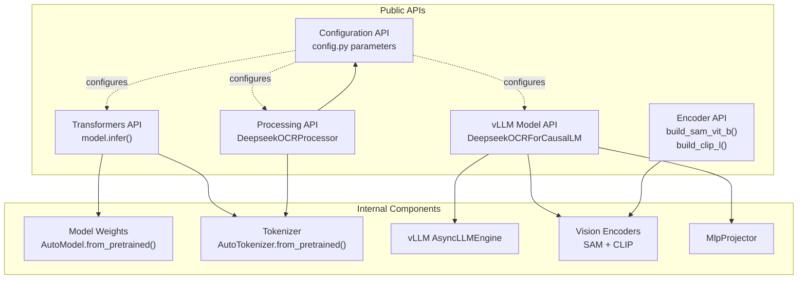
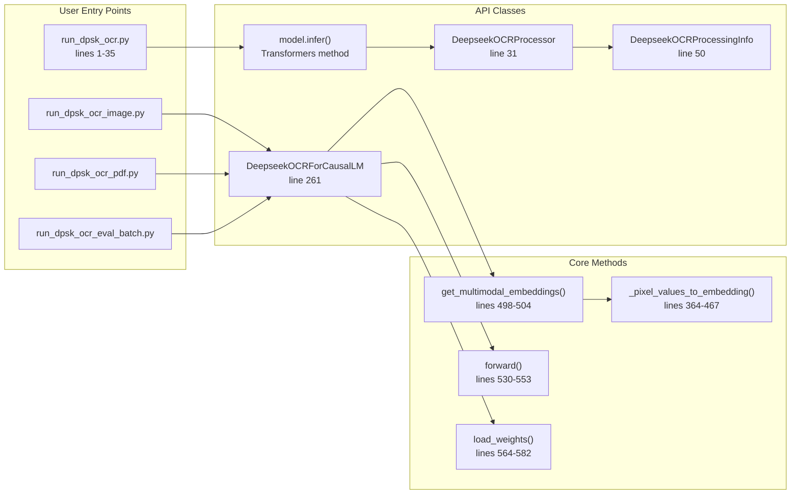
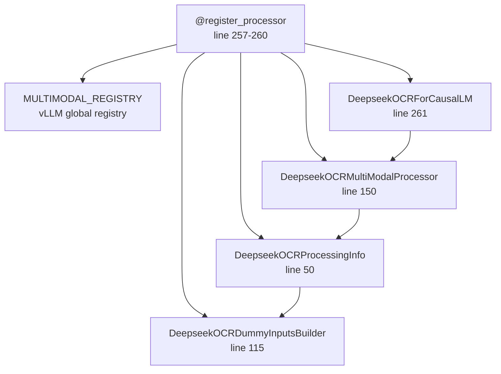
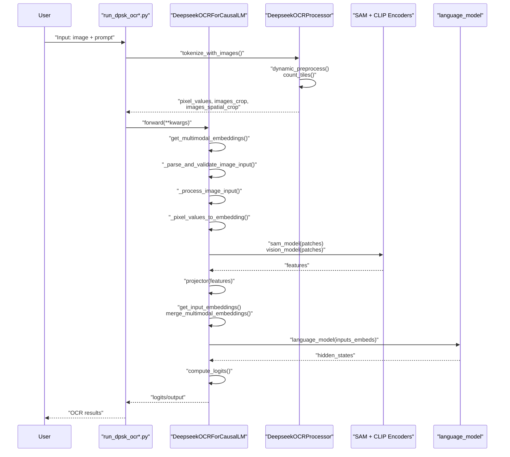

<!-- source: DeepWiki mcp.deepwiki.com · repo deepseek-ai/DeepSeek-OCR · page 6 API Reference · fetched 2026-10-30 -->

# API Reference

Relevant source files

The following files were used as context for generating this wiki page:

- [DeepSeek-OCR-master/DeepSeek-OCR-hf/run_dpsk_ocr.py](DeepSeek-OCR-master/DeepSeek-OCR-hf/run_dpsk_ocr.py)
- [DeepSeek-OCR-master/DeepSeek-OCR-vllm/deepseek_ocr.py](DeepSeek-OCR-master/DeepSeek-OCR-vllm/deepseek_ocr.py)

This document provides a complete reference for all public interfaces in the DeepSeek-OCR codebase. The API is organized into five main categories: Transformers interface for standard HuggingFace workflows, vLLM interface for production deployment, configuration system, image processing utilities, and vision encoder modules.

For implementation guides and usage patterns, see [User Guide](#3). For architectural details about how these APIs work internally, see [Architecture](#4).

## API Structure Overview

DeepSeek-OCR exposes two primary inference interfaces: a standard Transformers-based API for development and experimentation, and a vLLM-based API for high-throughput production use. Both interfaces share the same underlying model architecture and processing pipeline but differ in execution strategy.

**Sources:** [DeepSeek-OCR-master/DeepSeek-OCR-hf/run_dpsk_ocr.py:1-35](), [DeepSeek-OCR-master/DeepSeek-OCR-vllm/deepseek_ocr.py:1-583]()

## API Categories

### Transformers API ([Transformers API](#6.1))

The Transformers API provides a simple, synchronous interface for OCR inference using HuggingFace's standard model loading and inference patterns.

| Component | Purpose | Key Methods |
|-----------|---------|-------------|
| `AutoModel.from_pretrained()` | Load model from HuggingFace | Standard HF loading |
| `model.infer()` | Execute OCR inference | Single entry point for all OCR tasks |
| `AutoTokenizer.from_pretrained()` | Load tokenizer | Standard HF tokenizer loading |

**Primary Entry Point:** `model.infer(tokenizer, prompt, image_file, output_path, base_size, image_size, crop_mode, test_compress, save_results)` [DeepSeek-OCR-master/DeepSeek-OCR-hf/run_dpsk_ocr.py:25-34]()

**Sources:** [DeepSeek-OCR-master/DeepSeek-OCR-hf/run_dpsk_ocr.py:1-35]()

### vLLM Model API ([vLLM Model API](#6.2))

The vLLM API provides asynchronous, high-throughput inference capabilities with GPU memory optimization and batch processing.

| Component | Purpose | Key Methods |
|-----------|---------|-------------|
| `DeepseekOCRForCausalLM` | Main model class for vLLM | `forward()`, `get_multimodal_embeddings()`, `load_weights()` |
| `DeepseekOCRMultiModalProcessor` | Multimodal input processing | `_call_hf_processor()`, `_get_prompt_updates()` |
| `DeepseekOCRProcessingInfo` | vLLM configuration metadata | `get_num_image_tokens()`, `get_image_size_with_most_features()` |
| `DeepseekOCRDummyInputsBuilder` | Profiling support | `get_dummy_text()`, `get_dummy_mm_data()` |

**Primary Entry Point:** Registered with `@MULTIMODAL_REGISTRY.register_processor()` at [DeepSeek-OCR-master/DeepSeek-OCR-vllm/deepseek_ocr.py:257-260]()

**Sources:** [DeepSeek-OCR-master/DeepSeek-OCR-vllm/deepseek_ocr.py:50-583]()

### Configuration API ([Configuration API](#6.3))

Centralized configuration parameters that control all aspects of model behavior, from image preprocessing to inference settings.

| Parameter Category | Examples | Effect |
|-------------------|----------|--------|
| Image Resolution | `IMAGE_SIZE`, `BASE_SIZE` | Controls input image dimensions |
| Processing Mode | `CROP_MODE`, `MIN_CROPS`, `MAX_CROPS` | Enables/configures dynamic tiling |
| Model Selection | `MODEL_PATH`, `PROMPT` | Specifies model and task |

**Configuration Source:** `config.py` module (imported throughout codebase) [DeepSeek-OCR-master/DeepSeek-OCR-vllm/deepseek_ocr.py:45]()

**Sources:** [DeepSeek-OCR-master/DeepSeek-OCR-vllm/deepseek_ocr.py:45]()

### Processing API ([Processing API](#6.4))

The Processing API handles image preprocessing, tokenization, and conversion of raw inputs into model-ready tensors.

| Component | Purpose | Key Methods |
|-----------|---------|-------------|
| `DeepseekOCRProcessor` | Main processor class | `tokenize_with_images()`, `dynamic_preprocess()` |
| `count_tiles()` | Tile count calculation | Determines crop grid dimensions |

**Primary Entry Point:** `DeepseekOCRProcessor.tokenize_with_images(images, bos, eos, cropping)` [DeepSeek-OCR-master/DeepSeek-OCR-vllm/deepseek_ocr.py:138-140]()

**Sources:** [DeepSeek-OCR-master/DeepSeek-OCR-vllm/deepseek_ocr.py:30-31](), [DeepSeek-OCR-master/DeepSeek-OCR-vllm/deepseek_ocr.py:138-140]()

### Encoder API ([Encoder API](#6.5))

The Encoder API provides access to the dual vision encoding system that extracts visual features from images.

| Component | Purpose | Key Functions |
|-----------|---------|---------------|
| `build_sam_vit_b()` | Build SAM encoder | Returns SAM ViT-B model |
| `build_clip_l()` | Build CLIP encoder | Returns CLIP-L model |
| `MlpProjector` | Feature projection | Projects concatenated features to LLM space |

**Builder Functions:** Located in `deepencoder/` module [DeepSeek-OCR-master/DeepSeek-OCR-vllm/deepseek_ocr.py:40-42]()

**Sources:** [DeepSeek-OCR-master/DeepSeek-OCR-vllm/deepseek_ocr.py:40-42](), [DeepSeek-OCR-master/DeepSeek-OCR-vllm/deepseek_ocr.py:288-292]()

## Code-to-API Mapping

The following diagram maps user-facing entry points to internal code components:

**Sources:** [DeepSeek-OCR-master/DeepSeek-OCR-hf/run_dpsk_ocr.py:1-35](), [DeepSeek-OCR-master/DeepSeek-OCR-vllm/deepseek_ocr.py:261-582]()

## Special Tokens and Parameters

DeepSeek-OCR uses several special tokens and learnable parameters to structure multimodal information:

| Token/Parameter | Location | Purpose | Dimensions |
|----------------|----------|---------|-----------|
| `image_newline` | [DeepSeek-OCR-master/DeepSeek-OCR-vllm/deepseek_ocr.py:307]() | Row separator in image grids | `[n_embed]` |
| `view_seperator` | [DeepSeek-OCR-master/DeepSeek-OCR-vllm/deepseek_ocr.py:308]() | Separator between global/local views | `[n_embed]` |
| `image_token_id` | [DeepSeek-OCR-master/DeepSeek-OCR-vllm/deepseek_ocr.py:286]() | Placeholder for image embeddings | Scalar (from tokenizer) |
| `_IMAGE_TOKEN` | [DeepSeek-OCR-master/DeepSeek-OCR-vllm/deepseek_ocr.py:47]() | String token `"<image>"` | String constant |

**Initialization:** Special tokens are initialized as learnable parameters with standard deviation `1/sqrt(n_embed)` at [DeepSeek-OCR-master/DeepSeek-OCR-vllm/deepseek_ocr.py:304-312]()

**Sources:** [DeepSeek-OCR-master/DeepSeek-OCR-vllm/deepseek_ocr.py:47](), [DeepSeek-OCR-master/DeepSeek-OCR-vllm/deepseek_ocr.py:286](), [DeepSeek-OCR-master/DeepSeek-OCR-vllm/deepseek_ocr.py:304-312]()

## Model Registration and Integration

The vLLM integration uses a registration system to enable custom multimodal models:

**Registration Call:** `@MULTIMODAL_REGISTRY.register_processor(DeepseekOCRMultiModalProcessor, info=DeepseekOCRProcessingInfo, dummy_inputs=DeepseekOCRDummyInputsBuilder)` at [DeepSeek-OCR-master/DeepSeek-OCR-vllm/deepseek_ocr.py:257-260]()

**Sources:** [DeepSeek-OCR-master/DeepSeek-OCR-vllm/deepseek_ocr.py:257-260]()

## Weight Loading and Name Mapping

The model uses a custom weight mapper to handle differences between HuggingFace checkpoint names and vLLM internal structure:

| HuggingFace Name Pattern | vLLM Name Pattern | Transformation |
|-------------------------|-------------------|----------------|
| `language.*` | `language_model.*` | Prefix replacement |
| `sam_model.*` | `sam_model.*` | Direct (remove `model.` prefix) |
| `vision_model.*` | `vision_model.*` | Direct (remove `model.` prefix) |
| `projector.*` | `projector.*` | Direct (remove `model.` prefix) |
| `image_newline` | `image_newline` | Direct (remove `model.` prefix) |
| `view_seperator` | `view_seperator` | Direct (remove `model.` prefix) |

**Mapper Definition:** `hf_to_vllm_mapper = WeightsMapper(orig_to_new_prefix={"language.": "language_model."})` at [DeepSeek-OCR-master/DeepSeek-OCR-vllm/deepseek_ocr.py:263-265]()

**Weight Loading Logic:** [DeepSeek-OCR-master/DeepSeek-OCR-vllm/deepseek_ocr.py:564-582]()

**Sources:** [DeepSeek-OCR-master/DeepSeek-OCR-vllm/deepseek_ocr.py:263-265](), [DeepSeek-OCR-master/DeepSeek-OCR-vllm/deepseek_ocr.py:564-582]()

## Operational Modes Reference

DeepSeek-OCR supports five preconfigured operational modes with different resolution and cropping settings:

| Mode | `base_size` | `image_size` | `crop_mode` | Use Case |
|------|------------|--------------|-------------|----------|
| Tiny | 512 | 512 | False | Low-resource inference |
| Small | 640 | 640 | False | Standard single-view |
| Base | 1024 | 1024 | False | High-resolution single-view |
| Large | 1280 | 1280 | False | Very high-resolution single-view |
| Gundam | 1024 | 640 | True | Multi-scale with dynamic tiling (default) |

**Configuration Reference:** [DeepSeek-OCR-master/DeepSeek-OCR-hf/run_dpsk_ocr.py:27-32]()

**Sources:** [DeepSeek-OCR-master/DeepSeek-OCR-hf/run_dpsk_ocr.py:27-32]()

## Data Flow Through APIs

This diagram shows how data flows through the API layers:

**Sources:** [DeepSeek-OCR-master/DeepSeek-OCR-vllm/deepseek_ocr.py:261-583](), [DeepSeek-OCR-master/DeepSeek-OCR-hf/run_dpsk_ocr.py:1-35]()

## Detailed API References

For detailed documentation of each API category, see the following pages:

- **[Transformers API](#6.1)** - Complete reference for `model.infer()` and standard HuggingFace interface
- **[vLLM Model API](#6.2)** - Detailed documentation of `DeepseekOCRForCausalLM` and vLLM-specific classes
- **[Configuration API](#6.3)** - Comprehensive parameter reference with default values and effects
- **[Processing API](#6.4)** - Documentation for `DeepseekOCRProcessor`, image transforms, and utilities
- **[Encoder API](#6.5)** - Reference for vision encoder construction and usage

Each subsection provides method signatures, parameter descriptions, return types, and usage examples.

---

