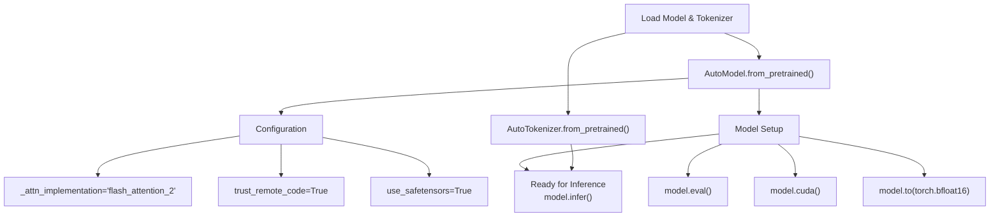
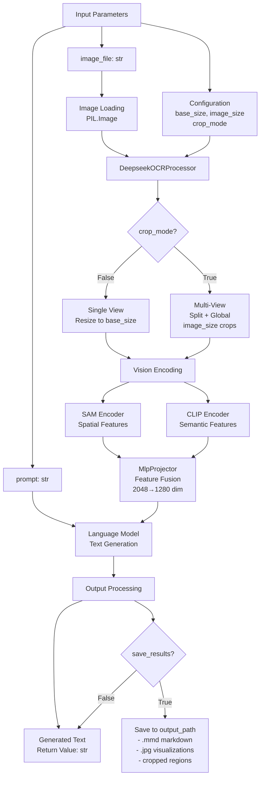
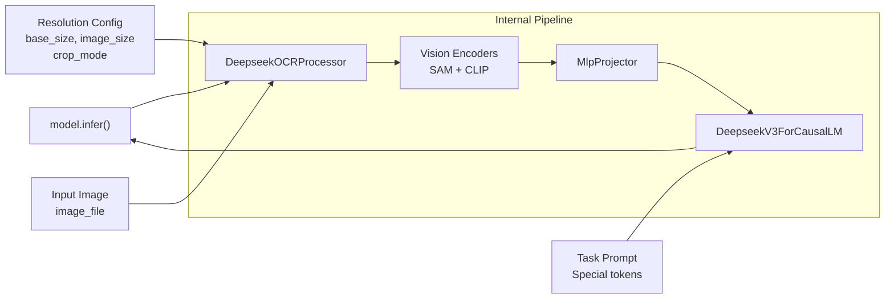

<!-- source: DeepWiki mcp.deepwiki.com · repo deepseek-ai/DeepSeek-OCR · page 6.1 Transformers API · fetched 2026-10-30 -->

# Transformers API

<details>
<summary>Relevant source files</summary>

The following files were used as context for generating this wiki page:

- [DeepSeek-OCR-master/DeepSeek-OCR-hf/run_dpsk_ocr.py](DeepSeek-OCR-master/DeepSeek-OCR-hf/run_dpsk_ocr.py)

</details>


This page documents the HuggingFace Transformers API for DeepSeek-OCR, which provides fine-grained control over model inference for research and development purposes. This interface is recommended for experimentation, custom parameter tuning, and single-image workflows where flexibility is more important than throughput.

For production-scale batch processing and high-throughput serving, see [vLLM Inference](#3.2). For detailed usage examples, see [Transformers Inference](#3.1). For the underlying model architecture details, see [Model Architecture](#4.2).

---

## API Overview

The Transformers API exposes DeepSeek-OCR through standard HuggingFace interfaces (`AutoModel`, `AutoTokenizer`) with a custom `infer()` method that handles the complete OCR pipeline from image input to structured output.

### Initialization Flow



Sources: [DeepSeek-OCR-master/DeepSeek-OCR-hf/run_dpsk_ocr.py:1-14]()

---

## Model and Tokenizer Loading

### AutoTokenizer.from_pretrained()

Loads the tokenizer for text processing and special token handling.

**Signature:**
```python
tokenizer = AutoTokenizer.from_pretrained(
    model_name: str,
    trust_remote_code: bool = True
)
```

**Parameters:**

| Parameter | Type | Required | Description |
|-----------|------|----------|-------------|
| `model_name` | `str` | Yes | Model identifier, typically `'deepseek-ai/DeepSeek-OCR'` |
| `trust_remote_code` | `bool` | Yes | Must be `True` to load custom tokenizer code |

**Example:**
```python
tokenizer = AutoTokenizer.from_pretrained(
    'deepseek-ai/DeepSeek-OCR',
    trust_remote_code=True
)
```

Sources: [DeepSeek-OCR-master/DeepSeek-OCR-hf/run_dpsk_ocr.py:12]()

---

### AutoModel.from_pretrained()

Loads the DeepSeek-OCR model with vision encoders and language model components.

**Signature:**
```python
model = AutoModel.from_pretrained(
    model_name: str,
    _attn_implementation: str = 'flash_attention_2',
    trust_remote_code: bool = True,
    use_safetensors: bool = True
)
```

**Parameters:**

| Parameter | Type | Required | Default | Description |
|-----------|------|----------|---------|-------------|
| `model_name` | `str` | Yes | - | Model identifier |
| `_attn_implementation` | `str` | Recommended | `'eager'` | Attention implementation. Use `'flash_attention_2'` for optimal performance |
| `trust_remote_code` | `bool` | Yes | `False` | Must be `True` to load custom model code |
| `use_safetensors` | `bool` | Recommended | `False` | Use safetensors format for safer model loading |

**Post-Initialization Setup:**

After loading, the model must be configured for inference:

```python
model = model.eval()              # Set to evaluation mode
model = model.cuda()              # Move to GPU
model = model.to(torch.bfloat16)  # Convert to bfloat16 precision
```

**Complete Example:**
```python
model = AutoModel.from_pretrained(
    'deepseek-ai/DeepSeek-OCR',
    _attn_implementation='flash_attention_2',
    trust_remote_code=True,
    use_safetensors=True
)
model = model.eval().cuda().to(torch.bfloat16)
```

Sources: [DeepSeek-OCR-master/DeepSeek-OCR-hf/run_dpsk_ocr.py:13-14]()

---

## Inference API: model.infer()

The `infer()` method is the primary interface for performing OCR on images. It handles image preprocessing, dynamic cropping, vision encoding, language model inference, and optional result saving.

### Method Signature

```python
# Defined in the model class loaded via AutoModel
def infer(
    self,
    tokenizer,
    prompt: str = '',
    image_file: str = '',
    output_path: str = ' ',
    base_size: int = 1024,
    image_size: int = 640,
    crop_mode: bool = True,
    test_compress: bool = False,
    save_results: bool = False
) -> str
```

### Inference Data Flow



Sources: [DeepSeek-OCR-master/DeepSeek-OCR-hf/run_dpsk_ocr.py:25-34]()

---

## Parameter Reference

### Core Parameters

#### tokenizer
- **Type:** `PreTrainedTokenizer`
- **Required:** Yes
- **Description:** The tokenizer instance returned by `AutoTokenizer.from_pretrained()`. Used for text encoding and special token handling. [DeepSeek-OCR-master/DeepSeek-OCR-hf/run_dpsk_ocr.py:25]()

#### prompt
- **Type:** `str`
- **Default:** `''`
- **Description:** Task instruction for the model. Common patterns:
  - `"<image>\nFree OCR. "` - Extract text without layout detection [DeepSeek-OCR-master/DeepSeek-OCR-hf/run_dpsk_ocr.py:18]()
  - `"<image>\n<|grounding|>Convert the document to markdown. "` - Document with layout [DeepSeek-OCR-master/DeepSeek-OCR-hf/run_dpsk_ocr.py:19]()

#### image_file
- **Type:** `str`
- **Default:** `''`
- **Required:** Yes
- **Description:** Path to the input image file. [DeepSeek-OCR-master/DeepSeek-OCR-hf/run_dpsk_ocr.py:25]()

#### output_path
- **Type:** `str`
- **Default:** `' '`
- **Description:** Directory path for saving results when `save_results=True`. [DeepSeek-OCR-master/DeepSeek-OCR-hf/run_dpsk_ocr.py:25]()

---

### Resolution Configuration

These parameters control the multi-scale processing strategy and determine the number of vision tokens generated.

#### base_size
- **Type:** `int`
- **Default:** `1024`
- **Description:** Resolution for the global view of the image. Used as the base resolution when `crop_mode=False`, or as the global context resolution when `crop_mode=True`. [DeepSeek-OCR-master/DeepSeek-OCR-hf/run_dpsk_ocr.py:25]()

#### image_size
- **Type:** `int`
- **Default:** `640`
- **Description:** Resolution for local view crops when `crop_mode=True`. Ignored when `crop_mode=False`. [DeepSeek-OCR-master/DeepSeek-OCR-hf/run_dpsk_ocr.py:25]()

#### crop_mode
- **Type:** `bool`
- **Default:** `True`
- **Description:** Enable dynamic cropping for large images.
  - `True`: Multi-scale processing with local crops + global view (Gundam mode)
  - `False`: Single-scale processing at `base_size` only [DeepSeek-OCR-master/DeepSeek-OCR-hf/run_dpsk_ocr.py:25]()

---

### Resolution Mode Presets

Common configurations for different use cases defined in the reference script:

| Mode | base_size | image_size | crop_mode | Use Case |
|------|-----------|------------|-----------|----------|
| **Tiny** | 512 | 512 | False | Fast inference, low memory |
| **Small** | 640 | 640 | False | Balanced speed/quality |
| **Base** | 1024 | 1024 | False | High quality, single scale |
| **Large** | 1280 | 1280 | False | Maximum quality, single scale |
| **Gundam** ⭐ | 1024 | 640 | True | Multi-scale, recommended default |

Sources: [DeepSeek-OCR-master/DeepSeek-OCR-hf/run_dpsk_ocr.py:27-32]()

---

### Output Control Parameters

#### test_compress
- **Type:** `bool`
- **Default:** `False`
- **Description:** Enable experimental compression features during inference. [DeepSeek-OCR-master/DeepSeek-OCR-hf/run_dpsk_ocr.py:25]()

#### save_results
- **Type:** `bool`
- **Default:** `False`
- **Description:** When `True`, saves multiple output artifacts to `output_path`. [DeepSeek-OCR-master/DeepSeek-OCR-hf/run_dpsk_ocr.py:25]()

---

## Complete Usage Example

```python
import torch
import os
from transformers import AutoModel, AutoTokenizer

# Environment setup
os.environ["CUDA_VISIBLE_DEVICES"] = '0'

# Model initialization
model_name = 'deepseek-ai/DeepSeek-OCR'
tokenizer = AutoTokenizer.from_pretrained(
    model_name,
    trust_remote_code=True
)
model = AutoModel.from_pretrained(
    model_name,
    _attn_implementation='flash_attention_2',
    trust_remote_code=True,
    use_safetensors=True
)
model = model.eval().cuda().to(torch.bfloat16)

# Inference with Gundam mode (recommended)
prompt = "<image>\n<|grounding|>Convert the document to markdown. "
image_file = 'your_image.jpg'
output_path = 'your/output/dir'

result = model.infer(
    tokenizer,
    prompt=prompt,
    image_file=image_file,
    output_path=output_path,
    base_size=1024,        # Global view resolution
    image_size=640,        # Local crop resolution
    crop_mode=True,        # Enable multi-scale processing
    save_results=True,     # Save output files
    test_compress=True     # Enable compression testing
)

print(result)  # Generated markdown text
```

Sources: [DeepSeek-OCR-master/DeepSeek-OCR-hf/run_dpsk_ocr.py:1-34]()

---

## Integration with Other Components

The Transformers API serves as the high-level interface to the complete DeepSeek-OCR pipeline:



- **Image Processing**: See [Image Processing Pipeline](#4.4) for details on `DeepseekOCRProcessor`.
- **Vision Encoding**: See [Vision Encoding System](#4.3) for dual-encoder architecture.
- **Multimodal Integration**: See [Multimodal Integration](#4.5) for embedding fusion.

Sources: [DeepSeek-OCR-master/DeepSeek-OCR-hf/run_dpsk_ocr.py:1-35]()

---

