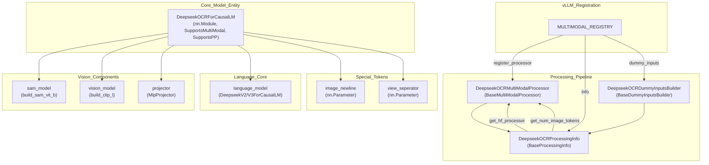
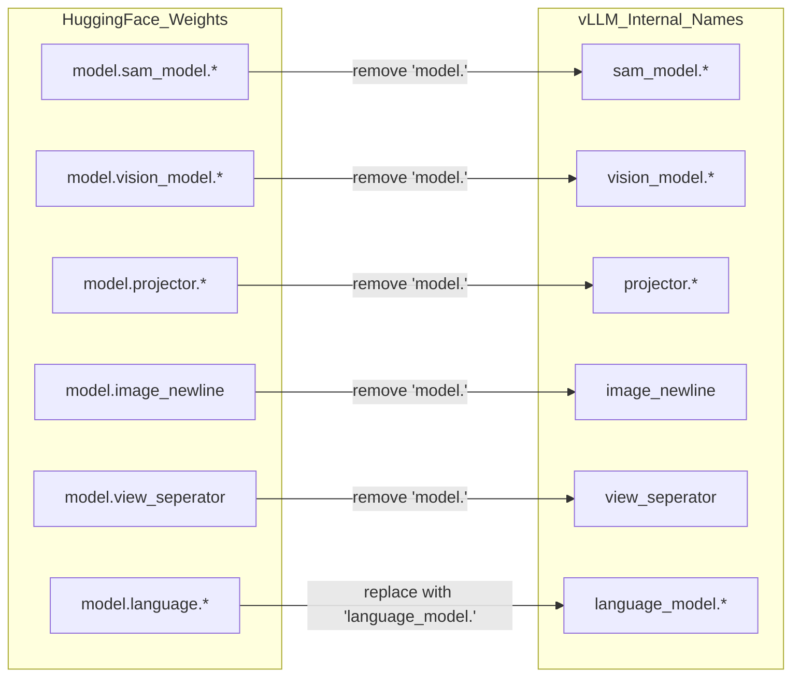
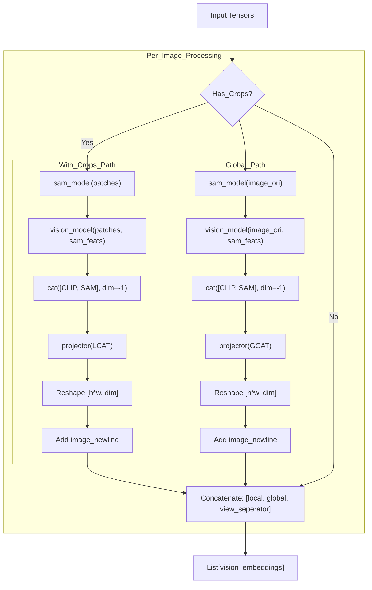

<!-- source: DeepWiki mcp.deepwiki.com · repo deepseek-ai/DeepSeek-OCR · page 6.2 vLLM Model API · fetched 2026-10-30 -->

# vLLM Model API

<details>
<summary>Relevant source files</summary>

The following files were used as context for generating this wiki page:

- [DeepSeek-OCR-master/DeepSeek-OCR-vllm/deepseek_ocr.py](DeepSeek-OCR-master/DeepSeek-OCR-vllm/deepseek_ocr.py)

</details>


This page documents the vLLM-specific model API for DeepSeek-OCR, focusing on the `DeepseekOCRForCausalLM` class and its associated processing components. These classes provide the integration layer between DeepSeek-OCR's vision-language architecture and vLLM's high-performance inference engine.

For information about using vLLM for inference, see [vLLM Inference](). For the Transformers-based API, see [Transformers API](). For details on the underlying model architecture, see [Model Architecture]().

## Model Class Overview

The vLLM integration consists of four primary classes that work together to enable efficient multimodal inference:

Title: vLLM Model Architecture Components


**Sources:** [DeepSeek-OCR-master/DeepSeek-OCR-vllm/deepseek_ocr.py:1-583]()

## DeepseekOCRForCausalLM

The main model class implementing vLLM's multimodal interface [DeepSeek-OCR-master/DeepSeek-OCR-vllm/deepseek_ocr.py:261]().

### Class Definition

```python
class DeepseekOCRForCausalLM(nn.Module, SupportsMultiModal, SupportsPP)
```

Inherits from:
- `nn.Module` - PyTorch module base.
- `SupportsMultiModal` - vLLM multimodal interface [DeepSeek-OCR-master/DeepSeek-OCR-vllm/deepseek_ocr.py:35]().
- `SupportsPP` - vLLM pipeline parallelism support [DeepSeek-OCR-master/DeepSeek-OCR-vllm/deepseek_ocr.py:35]().

**Sources:** [DeepSeek-OCR-master/DeepSeek-OCR-vllm/deepseek_ocr.py:261]()

### Constructor

```python
def __init__(self, *, vllm_config: VllmConfig, prefix: str = "")
```

**Parameters:**
- `vllm_config: VllmConfig` - vLLM configuration containing model config, quantization settings, and multimodal config [DeepSeek-OCR-master/DeepSeek-OCR-vllm/deepseek_ocr.py:267]().
- `prefix: str` - Optional prefix for parameter names (used in pipeline parallelism) [DeepSeek-OCR-master/DeepSeek-OCR-vllm/deepseek_ocr.py:268]().

**Initialized Components:**

| Component | Type | Purpose |
|-----------|------|---------|
| `sam_model` | SAM ViT-B | High-resolution feature extraction via `build_sam_vit_b` [DeepSeek-OCR-master/DeepSeek-OCR-vllm/deepseek_ocr.py:286]() |
| `vision_model` | CLIP-L | Semantic feature extraction via `build_clip_l` [DeepSeek-OCR-master/DeepSeek-OCR-vllm/deepseek_ocr.py:293]() |
| `projector` | MlpProjector | Projects vision features to LLM embedding space [DeepSeek-OCR-master/DeepSeek-OCR-vllm/deepseek_ocr.py:302]() |
| `image_newline` | nn.Parameter | Learnable token separating image rows [DeepSeek-OCR-master/DeepSeek-OCR-vllm/deepseek_ocr.py:314]() |
| `view_seperator` | nn.Parameter | Learnable token separating global and local views [DeepSeek-OCR-master/DeepSeek-OCR-vllm/deepseek_ocr.py:317]() |
| `language_model` | DeepseekV2/V3 | Language model component initialized via `init_vllm_registered_model` [DeepSeek-OCR-master/DeepSeek-OCR-vllm/deepseek_ocr.py:321]() |

**Sources:** [DeepSeek-OCR-master/DeepSeek-OCR-vllm/deepseek_ocr.py:267-330]()

### Weight Loading

```python
def load_weights(self, weights: Iterable[Tuple[str, torch.Tensor]]) -> Set[str]
```

Loads model weights with automatic prefix remapping for HuggingFace compatibility.

Title: Weight Mapping Logic


**Parameters:**
- `weights: Iterable[Tuple[str, torch.Tensor]]` - Iterator of (name, tensor) pairs [DeepSeek-OCR-master/DeepSeek-OCR-vllm/deepseek_ocr.py:564]().

**Sources:** [DeepSeek-OCR-master/DeepSeek-OCR-vllm/deepseek_ocr.py:564-582]()

### Multimodal Input Processing

#### Input Parsing

```python
def _parse_and_validate_image_input(self, **kwargs: object) -> Optional[List]
```

Extracts and validates multimodal inputs from keyword arguments.

**Expected Inputs:**
- `pixel_values: torch.Tensor` - Global view images [DeepSeek-OCR-master/DeepSeek-OCR-vllm/deepseek_ocr.py:335]().
- `images_spatial_crop: torch.Tensor` - Crop dimensions [DeepSeek-OCR-master/DeepSeek-OCR-vllm/deepseek_ocr.py:336]().
- `images_crop: torch.Tensor` - Local view patches [DeepSeek-OCR-master/DeepSeek-OCR-vllm/deepseek_ocr.py:337]().

**Sources:** [DeepSeek-OCR-master/DeepSeek-OCR-vllm/deepseek_ocr.py:333-360]()

#### Vision Embedding Generation

```python
def _pixel_values_to_embedding(
    self,
    pixel_values: torch.Tensor,
    images_crop: torch.Tensor,
    images_spatial_crop: torch.Tensor,
) -> NestedTensors
```

Converts pixel values to vision embeddings through the dual-encoder pipeline.

Title: Multimodal Embedding Data Flow


**Key Operations:**
1. Processes images using both `sam_model` and `vision_model` (CLIP) [DeepSeek-OCR-master/DeepSeek-OCR-vllm/deepseek_ocr.py:404-411]().
2. Concatenates features and projects via `projector` [DeepSeek-OCR-master/DeepSeek-OCR-vllm/deepseek_ocr.py:414-416]().
3. Inserts `image_newline` parameters at the end of each feature row [DeepSeek-OCR-master/DeepSeek-OCR-vllm/deepseek_ocr.py:423-424]().
4. Separates local and global views with `view_seperator` [DeepSeek-OCR-master/DeepSeek-OCR-vllm/deepseek_ocr.py:461]().

**Sources:** [DeepSeek-OCR-master/DeepSeek-OCR-vllm/deepseek_ocr.py:364-467]()

### Forward Pass

```python
def forward(
    self,
    input_ids: torch.Tensor,
    positions: torch.Tensor,
    intermediate_tensors: Optional[IntermediateTensors] = None,
    inputs_embeds: Optional[torch.Tensor] = None,
    **kwargs: object
)
```

Main forward pass for inference [DeepSeek-OCR-master/DeepSeek-OCR-vllm/deepseek_ocr.py:530]().

**Execution Flow:**
1. If `inputs_embeds` is missing, call `get_multimodal_embeddings` [DeepSeek-OCR-master/DeepSeek-OCR-vllm/deepseek_ocr.py:541]().
2. Merge text and vision embeddings via `get_input_embeddings` [DeepSeek-OCR-master/DeepSeek-OCR-vllm/deepseek_ocr.py:543]().
3. Pass merged embeddings to `language_model.forward` [DeepSeek-OCR-master/DeepSeek-OCR-vllm/deepseek_ocr.py:548]().

**Sources:** [DeepSeek-OCR-master/DeepSeek-OCR-vllm/deepseek_ocr.py:530-553]()

### Embedding Methods

#### Get Multimodal Embeddings

```python
def get_multimodal_embeddings(self, **kwargs: object) -> Optional[MultiModalEmbeddings]
```

Parses inputs and generates vision embeddings [DeepSeek-OCR-master/DeepSeek-OCR-vllm/deepseek_ocr.py:498]().

**Sources:** [DeepSeek-OCR-master/DeepSeek-OCR-vllm/deepseek_ocr.py:498-504]()

#### Get Input Embeddings

```python
def get_input_embeddings(
    self,
    input_ids: torch.Tensor,
    multimodal_embeddings: Optional[MultiModalEmbeddings] = None,
) -> torch.Tensor
```

Merges text token embeddings with vision embeddings using `merge_multimodal_embeddings` [DeepSeek-OCR-master/DeepSeek-OCR-vllm/deepseek_ocr.py:508-528]().

**Sources:** [DeepSeek-OCR-master/DeepSeek-OCR-vllm/deepseek_ocr.py:508-528]()

## DeepseekOCRProcessingInfo

Provides metadata for multimodal processing in vLLM.

### Calculate Image Token Count

```python
def get_num_image_tokens(
    self,
    *,
    image_width: int,
    image_height: int,
    cropping: bool = True
) -> int
```

Calculates vision tokens based on resolution and `CROP_MODE` [DeepSeek-OCR-master/DeepSeek-OCR-vllm/deepseek_ocr.py:61]().

**Token Calculation Logic:**
- `global_views_tokens`: Based on `BASE_SIZE` [DeepSeek-OCR-master/DeepSeek-OCR-vllm/deepseek_ocr.py:99]().
- `local_views_tokens`: Based on `IMAGE_SIZE` and tile count from `count_tiles` [DeepSeek-OCR-master/DeepSeek-OCR-vllm/deepseek_ocr.py:101]().
- Total includes `image_newline` and `view_seperator` overhead [DeepSeek-OCR-master/DeepSeek-OCR-vllm/deepseek_ocr.py:106]().

**Sources:** [DeepSeek-OCR-master/DeepSeek-OCR-vllm/deepseek_ocr.py:61-106]()

## DeepseekOCRMultiModalProcessor

Handles prompt token replacement for vLLM.

### Get Prompt Token Updates

```python
def _get_prompt_updates(
    self,
    mm_items: MultiModalDataItems,
    hf_processor_mm_kwargs: Mapping[str, object],
    out_mm_kwargs: MultiModalKwargs,
) -> Sequence[PromptUpdate]
```

Replaces `<image>` placeholders in text with the correct number of placeholder tokens for the scheduler [DeepSeek-OCR-master/DeepSeek-OCR-vllm/deepseek_ocr.py:190-229]().

**Sources:** [DeepSeek-OCR-master/DeepSeek-OCR-vllm/deepseek_ocr.py:190-229]()

## Configuration Parameters

The vLLM model API references several configuration parameters from `config.py`:

| Parameter | Type | Usage in API | Default |
|-----------|------|--------------|---------|
| `IMAGE_SIZE` | int | Local view size in token calculations [DeepSeek-OCR-master/DeepSeek-OCR-vllm/deepseek_ocr.py:73]() | 640 |
| `BASE_SIZE` | int | Global view size in token calculations [DeepSeek-OCR-master/DeepSeek-OCR-vllm/deepseek_ocr.py:74]() | 1024 |
| `CROP_MODE` | bool | Controls token count and processing path [DeepSeek-OCR-master/DeepSeek-OCR-vllm/deepseek_ocr.py:78]() | True |
| `PRINT_NUM_VIS_TOKENS` | bool | Debug output toggle [DeepSeek-OCR-master/DeepSeek-OCR-vllm/deepseek_ocr.py:45]() | False |

**Sources:** [DeepSeek-OCR-master/DeepSeek-OCR-vllm/deepseek_ocr.py:45-47]()

---

