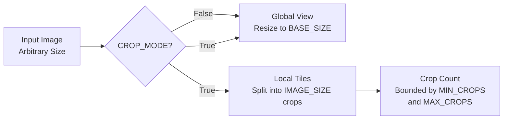
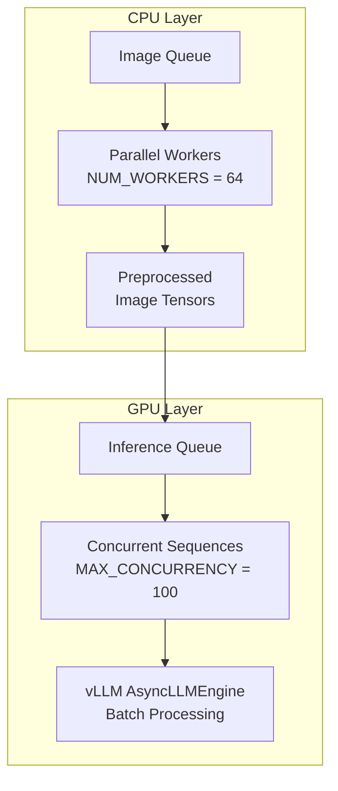
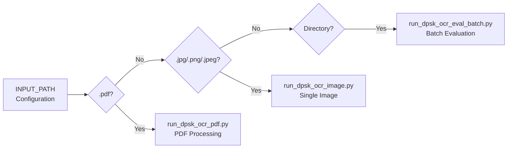
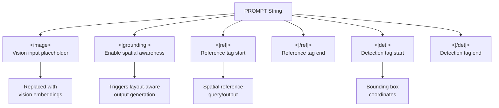

<!-- source: DeepWiki mcp.deepwiki.com · repo deepseek-ai/DeepSeek-OCR · page 6.3 Configuration API · fetched 2026-10-30 -->

# Configuration API

<details>
<summary>Relevant source files</summary>

The following files were used as context for generating this wiki page:

- [DeepSeek-OCR-master/DeepSeek-OCR-vllm/config.py](DeepSeek-OCR-master/DeepSeek-OCR-vllm/config.py)

</details>


This page provides the complete API reference for the configuration system defined in [DeepSeek-OCR-master/DeepSeek-OCR-vllm/config.py](). It documents all global configuration parameters, their types, default values, and effects on system behavior.

For a user-oriented guide on using the configuration system, see [Configuration System](#3.3). For details on resolution modes and performance tuning, see [Quick Start with vLLM](#2.3).

---

## Overview

The configuration system is implemented as a single Python module containing global constants that control all aspects of the DeepSeek-OCR system. These parameters affect:

- **Image processing**: Resolution, cropping strategy, aspect ratio handling
- **Resource management**: GPU memory utilization, parallelism levels
- **Model behavior**: Input/output paths, tokenization, prompts
- **Performance tuning**: Concurrency, worker counts, memory optimization

All configuration parameters are module-level constants defined in [DeepSeek-OCR-master/DeepSeek-OCR-vllm/config.py:1-43]() and are imported directly by other modules in the system.

**Sources:** [DeepSeek-OCR-master/DeepSeek-OCR-vllm/config.py:1-43]()

---

## Configuration Parameter Flow

The following diagram shows how configuration parameters from `config.py` flow to different components of the system:

**Title: Data Flow from Configuration to Code Entities**

```mermaid
graph TB
    CONFIG["config.py<br/>Module-Level Constants"]
    
    subgraph "Image Processing Parameters"
        BASE_SIZE["BASE_SIZE<br/>int = 1024"]
        IMAGE_SIZE["IMAGE_SIZE<br/>int = 640"]
        CROP_MODE["CROP_MODE<br/>bool = True"]
        MIN_CROPS["MIN_CROPS<br/>int = 2"]
        MAX_CROPS["MAX_CROPS<br/>int = 6"]
    end
    
    subgraph "Resource Management"
        MAX_CONCURRENCY["MAX_CONCURRENCY<br/>int = 100"]
        NUM_WORKERS["NUM_WORKERS<br/>int = 64"]
    end
    
    subgraph "Model Configuration"
        MODEL_PATH["MODEL_PATH<br/>str = deepseek-ai/DeepSeek-OCR"]
        TOKENIZER["TOKENIZER<br/>AutoTokenizer instance"]
        PROMPT["PROMPT<br/>str with special tokens"]
    end
    
    subgraph "I/O Configuration"
        INPUT_PATH["INPUT_PATH<br/>str = ''"]
        OUTPUT_PATH["OUTPUT_PATH<br/>str = ''"]
    end
    
    subgraph "Debug/Control"
        PRINT_NUM_VIS_TOKENS["PRINT_NUM_VIS_TOKENS<br/>bool = False"]
        SKIP_REPEAT["SKIP_REPEAT<br/>bool = True"]
    end
    
    CONFIG --> BASE_SIZE
    CONFIG --> IMAGE_SIZE
    CONFIG --> CROP_MODE
    CONFIG --> MIN_CROPS
    CONFIG --> MAX_CROPS
    CONFIG --> MAX_CONCURRENCY
    CONFIG --> NUM_WORKERS
    CONFIG --> MODEL_PATH
    CONFIG --> TOKENIZER
    CONFIG --> PROMPT
    CONFIG --> INPUT_PATH
    CONFIG --> OUTPUT_PATH
    CONFIG --> PRINT_NUM_VIS_TOKENS
    CONFIG --> SKIP_REPEAT
    
    subgraph "System Components"
        PROCESSOR["DeepseekOCRProcessor<br/>Image preprocessing"]
        ENGINE["AsyncLLMEngine<br/>vLLM inference"]
        SCRIPTS["Entry Scripts<br/>run_dpsk_ocr_*.py"]
    end
    
    BASE_SIZE --> PROCESSOR
    IMAGE_SIZE --> PROCESSOR
    CROP_MODE --> PROCESSOR
    MIN_CROPS --> PROCESSOR
    MAX_CROPS --> PROCESSOR
    
    MAX_CONCURRENCY --> ENGINE
    SKIP_REPEAT --> ENGINE
    
    MODEL_PATH --> ENGINE
    TOKENIZER --> PROCESSOR
    PROMPT --> SCRIPTS
    
    INPUT_PATH --> SCRIPTS
    OUTPUT_PATH --> SCRIPTS
    
    PRINT_NUM_VIS_TOKENS --> PROCESSOR
```


**Sources:** [DeepSeek-OCR-master/DeepSeek-OCR-vllm/config.py:1-43]()

---

## Resolution Mode Presets

The configuration file defines five standard resolution modes through combinations of `BASE_SIZE`, `IMAGE_SIZE`, and `CROP_MODE`. These modes are documented in comments at [DeepSeek-OCR-master/DeepSeek-OCR-vllm/config.py:1-6]():

| Mode | BASE_SIZE | IMAGE_SIZE | CROP_MODE | Token Count | Use Case |
|------|-----------|------------|-----------|-------------|----------|
| **Tiny** | 512 | 512 | False | ~64 | Quick testing, low memory |
| **Small** | 640 | 640 | False | ~100 | Lightweight documents |
| **Base** | 1024 | 1024 | False | ~256 | Standard single-scale processing |
| **Large** | 1280 | 1280 | False | ~400 | High-resolution documents |
| **Gundam** | 1024 | 640 | True | ~256-1600 | Multi-scale processing (default) |

The **Gundam mode** is currently set as the default [DeepSeek-OCR-master/DeepSeek-OCR-vllm/config.py:8-10]() and enables dynamic cropping for hierarchical document processing.

**Sources:** [DeepSeek-OCR-master/DeepSeek-OCR-vllm/config.py:1-10]()

---

## Parameter Reference

### Image Processing Parameters

These parameters control how images are preprocessed before being fed to the model:

| Parameter | Type | Default | Line | Description |
|-----------|------|---------|------|-------------|
| `BASE_SIZE` | `int` | `1024` | 8 | Global view resolution. Used for the full-image embedding regardless of crop mode. |
| `IMAGE_SIZE` | `int` | `640` | 9 | Local crop resolution. Used for individual tile size when `CROP_MODE = True`. |
| `CROP_MODE` | `bool` | `True` | 10 | Enable/disable dynamic cropping. When `True`, large images are split into tiles. |
| `MIN_CROPS` | `int` | `2` | 11 | Minimum number of crops for large images. Ensures at least basic multi-scale processing. |
| `MAX_CROPS` | `int` | `6` | 12 | Maximum number of crops to prevent OOM. Can be set to 9 on high-memory GPUs. |

#### Parameter Interactions

**Title: Image Processing Logic Flow**


**Token Count Calculation:**
- Global tokens: `⌈(BASE_SIZE / 16) / 4⌉²` where 16 is patch size, 4 is downsample ratio
- Local tokens per crop: `⌈(IMAGE_SIZE / 16) / 4⌉²`
- Total: `global_tokens + (n_crops × local_tokens)` where `MIN_CROPS ≤ n_crops ≤ MAX_CROPS`

**Sources:** [DeepSeek-OCR-master/DeepSeek-OCR-vllm/config.py:8-12]()

---

### Resource Management Parameters

These parameters control parallelism and resource utilization:

| Parameter | Type | Default | Line | Description |
|-----------|------|---------|------|-------------|
| `MAX_CONCURRENCY` | `int` | `100` | 13 | Maximum number of concurrent inference sequences in vLLM. Reduce on low-memory GPUs. |
| `NUM_WORKERS` | `int` | `64` | 14 | Number of CPU workers for parallel image preprocessing (resize, padding, cropping). |

#### Resource Allocation Diagram

**Title: Resource Management and Parallelism**


**Performance Notes:**
- `NUM_WORKERS` should match CPU core count for optimal preprocessing throughput [DeepSeek-OCR-master/DeepSeek-OCR-vllm/config.py:14]().
- `MAX_CONCURRENCY` is bounded by GPU memory; each sequence requires memory for KV cache [DeepSeek-OCR-master/DeepSeek-OCR-vllm/config.py:13]().
- Typical A100-40G can handle 100 concurrent sequences at Gundam mode settings.

**Sources:** [DeepSeek-OCR-master/DeepSeek-OCR-vllm/config.py:13-14]()

---

### Debug and Control Parameters

| Parameter | Type | Default | Line | Description |
|-----------|------|---------|------|-------------|
| `PRINT_NUM_VIS_TOKENS` | `bool` | `False` | 15 | Print the number of vision tokens generated per image. Useful for debugging token counts. |
| `SKIP_REPEAT` | `bool` | `True` | 16 | Enable `SKIP_REPEAT` policy in vLLM to handle incomplete outputs gracefully. |

**`SKIP_REPEAT` Behavior:**
- When `True`, vLLM skips sequences that encounter repetition issues during generation [DeepSeek-OCR-master/DeepSeek-OCR-vllm/config.py:16]().
- Prevents cascading errors in batch processing.
- Related to `NoRepeatNGramLogitsProcessor` (see [Custom Logits Processors](#5.2)).

**Sources:** [DeepSeek-OCR-master/DeepSeek-OCR-vllm/config.py:15-16]()

---

### Model Configuration Parameters

| Parameter | Type | Default | Line | Description |
|-----------|------|---------|------|-------------|
| `MODEL_PATH` | `str` | `'deepseek-ai/DeepSeek-OCR'` | 17 | HuggingFace model identifier or local path to model checkpoint. |
| `TOKENIZER` | `AutoTokenizer` | (initialized from `MODEL_PATH`) | 40-42 | Pre-initialized tokenizer instance used across all scripts. |

#### Tokenizer Initialization

The tokenizer is initialized as a module-level constant [DeepSeek-OCR-master/DeepSeek-OCR-vllm/config.py:40-42]():

```python
from transformers import AutoTokenizer

TOKENIZER = AutoTokenizer.from_pretrained(MODEL_PATH, trust_remote_code=True)
```

This ensures:
- Single tokenizer instance shared across all components.
- Consistent tokenization for preprocessing and model inference.
- Special token handling (`<image>`, `<|grounding|>`, `<|ref|>`, etc.) is properly configured.

**Sources:** [DeepSeek-OCR-master/DeepSeek-OCR-vllm/config.py:17-17](), [DeepSeek-OCR-master/DeepSeek-OCR-vllm/config.py:40-42]()

---

### I/O Path Parameters

| Parameter | Type | Default | Line | Description |
|-----------|------|---------|------|-------------|
| `INPUT_PATH` | `str` | `''` | 24 | Path to input file or directory. Format determines which script to use (PDF, image, or batch). |
| `OUTPUT_PATH` | `str` | `''` | 25 | Path for output files (markdown, annotated images, cropped regions, etc.). |

#### Input Path Routing

The file extension in `INPUT_PATH` determines which entry script should be used [DeepSeek-OCR-master/DeepSeek-OCR-vllm/config.py:19-22]():

**Title: Input Routing Logic**


**Sources:** [DeepSeek-OCR-master/DeepSeek-OCR-vllm/config.py:19-25]()

---

### Prompt Configuration

| Parameter | Type | Default | Line | Description |
|-----------|------|---------|------|-------------|
| `PROMPT` | `str` | `'<image>\n<|grounding|>Convert the document to markdown.'` | 27 | Default prompt template with special tokens. Controls task behavior. |

#### Prompt Templates

The configuration file provides several commonly-used prompt templates [DeepSeek-OCR-master/DeepSeek-OCR-vllm/config.py:27-37]():

| Task | Prompt Template | Description |
|------|-----------------|-------------|
| **Document OCR** | `<image>\n<|grounding|>Convert the document to markdown.` | Default. Structured markdown with layout preservation. |
| **Image OCR** | `<image>\n<|grounding|>OCR this image.` | General-purpose OCR for non-document images. |
| **Free OCR** | `<image>\nFree OCR.` | Text extraction without layout/structure. |
| **Figure Parsing** | `<image>\nParse the figure.` | Extract data from charts, plots, diagrams. |
| **Description** | `<image>\nDescribe this image in detail.` | General image captioning (not OCR-focused). |
| **Grounding** | `<image>\nLocate <|ref|>xxxx<|/ref|> in the image.` | Find specific text/objects with coordinates. |

#### Special Token Syntax

**Title: Prompt Token Semantics**


For details on prompt design and special token semantics, see [Working with Prompts](#3.4).

**Sources:** [DeepSeek-OCR-master/DeepSeek-OCR-vllm/config.py:27-37]()

---

## Configuration Usage Patterns

### Pattern 1: Direct Import

Most scripts import configuration parameters directly:

```python
from config import (
    BASE_SIZE, IMAGE_SIZE, CROP_MODE,
    MAX_CONCURRENCY, MODEL_PATH, TOKENIZER
)
```

This pattern is used throughout the vLLM scripts for accessing global settings.

### Pattern 2: Runtime Override

Configuration values can be overridden at runtime by modifying the imported values:

```python
import config
config.MAX_CROPS = 9  # Increase for high-memory GPUs
config.NUM_WORKERS = 128  # More parallelism
```

### Pattern 3: Mode Switching

To switch between resolution modes, modify the three key parameters [DeepSeek-OCR-master/DeepSeek-OCR-vllm/config.py:8-10]():

```python
# Switch to Base mode
config.BASE_SIZE = 1024
config.IMAGE_SIZE = 1024
config.CROP_MODE = False

# Switch to Gundam mode
config.BASE_SIZE = 1024
config.IMAGE_SIZE = 640
config.CROP_MODE = True
```

**Sources:** [DeepSeek-OCR-master/DeepSeek-OCR-vllm/config.py:1-43]()

---

## Configuration Impact Analysis

The following table summarizes how each parameter affects system behavior:

| Parameter | Affects | Impact on Performance | Impact on Quality | Impact on Memory |
|-----------|---------|----------------------|-------------------|------------------|
| `BASE_SIZE` | Global view resolution | Minimal (fixed per image) | Higher = better for small text | Linear in square |
| `IMAGE_SIZE` | Local crop resolution | Moderate (scales with crops) | Higher = better detail | Linear in square per crop |
| `CROP_MODE` | Processing strategy | Major (enables multi-scale) | Significant improvement | Major increase |
| `MIN_CROPS` | Minimum tiles | Minor | Ensures basic multi-scale | Minor increase |
| `MAX_CROPS` | Maximum tiles | Major (limits work) | Quality ceiling | Major impact (OOM risk) |
| `MAX_CONCURRENCY` | Batch throughput | Major (higher = more GPU util) | No direct impact | Major (KV cache) |
| `NUM_WORKERS` | Preprocessing speed | Major (CPU-bound) | No impact | Minor (CPU memory) |
| `SKIP_REPEAT` | Error handling | Minor (handles edge cases) | Prevents bad outputs | No impact |
| `MODEL_PATH` | Model selection | Depends on model size | Depends on model quality | Depends on model size |
| `PROMPT` | Task behavior | No impact | Major (task-specific) | No impact |

**Sources:** [DeepSeek-OCR-master/DeepSeek-OCR-vllm/config.py:1-43]()

---

## Memory Calculation

Given the configuration parameters, the approximate GPU memory requirement can be estimated:

**Vision Tokens per Image:**
- Global tokens: `(BASE_SIZE / 16 / 4)²`
- Local tokens: `n_crops × (IMAGE_SIZE / 16 / 4)²`
- Total: `T = (BASE_SIZE / 16 / 4)² + n_crops × (IMAGE_SIZE / 16 / 4)²`

**For Default Gundam Mode:**
- Global: `(1024 / 16 / 4)² = 16² = 256` tokens
- Local per crop: `(640 / 16 / 4)² = 10² = 100` tokens
- With 6 crops: `256 + 6 × 100 = 856` tokens

**Memory per Sequence:**
- Vision embedding: `T × 1280 × 2` bytes (FP16)
- KV cache: `~(T + generated_length) × num_layers × hidden_size × 2` bytes
- For typical 32-layer model with 2048 hidden size and 256 token output:
  - KV cache ≈ `(856 + 256) × 32 × 2048 × 2 ≈ 143 MB` per sequence

**Total GPU Memory (Gundam, MAX_CONCURRENCY=100):**
- Model weights: ~7-8 GB
- KV cache: ~14 GB
- Intermediate activations: ~8 GB
- **Total: ~30 GB** (fits A100-40G)

**Sources:** [DeepSeek-OCR-master/DeepSeek-OCR-vllm/config.py:8-13]()

---

## Best Practices

### For Memory-Constrained Environments

1. Reduce `MAX_CROPS` from 6 to 4 or lower [DeepSeek-OCR-master/DeepSeek-OCR-vllm/config.py:12]().
2. Reduce `MAX_CONCURRENCY` from 100 to 50 [DeepSeek-OCR-master/DeepSeek-OCR-vllm/config.py:13]().
3. Use smaller resolution mode (Base or Small) [DeepSeek-OCR-master/DeepSeek-OCR-vllm/config.py:2-5]().

### For High-Throughput Production

1. Maximize `MAX_CONCURRENCY` up to GPU memory limit [DeepSeek-OCR-master/DeepSeek-OCR-vllm/config.py:13]().
2. Increase `NUM_WORKERS` to match CPU core count [DeepSeek-OCR-master/DeepSeek-OCR-vllm/config.py:14]().
3. Use Gundam mode for best quality/speed tradeoff [DeepSeek-OCR-master/DeepSeek-OCR-vllm/config.py:6]().

### For Quality-Critical Applications

1. Use Large mode (`BASE_SIZE=1280, IMAGE_SIZE=1280, CROP_MODE=False`) [DeepSeek-OCR-master/DeepSeek-OCR-vllm/config.py:5]().
2. Or Gundam mode with `MAX_CROPS=9` on high-memory GPUs [DeepSeek-OCR-master/DeepSeek-OCR-vllm/config.py:12]().
3. Set task-specific `PROMPT` with `<|grounding|>` token [DeepSeek-OCR-master/DeepSeek-OCR-vllm/config.py:27-35]().

### For Debugging

1. Set `PRINT_NUM_VIS_TOKENS=True` to inspect token counts [DeepSeek-OCR-master/DeepSeek-OCR-vllm/config.py:15]().
2. Reduce `MAX_CONCURRENCY` to 1 for single-sequence debugging.
3. Use Tiny or Small mode for fast iteration [DeepSeek-OCR-master/DeepSeek-OCR-vllm/config.py:2-3]().

**Sources:** [DeepSeek-OCR-master/DeepSeek-OCR-vllm/config.py:1-43]()

---

## Related Documentation

- [Configuration System](#3.3) - User guide for configuration
- [Quick Start with vLLM](#2.3) - Using configuration in practice
- [Image Processing Pipeline](#4.4) - How parameters affect preprocessing
- [Processing API](#6.4) - Runtime APIs that use these parameters

---

