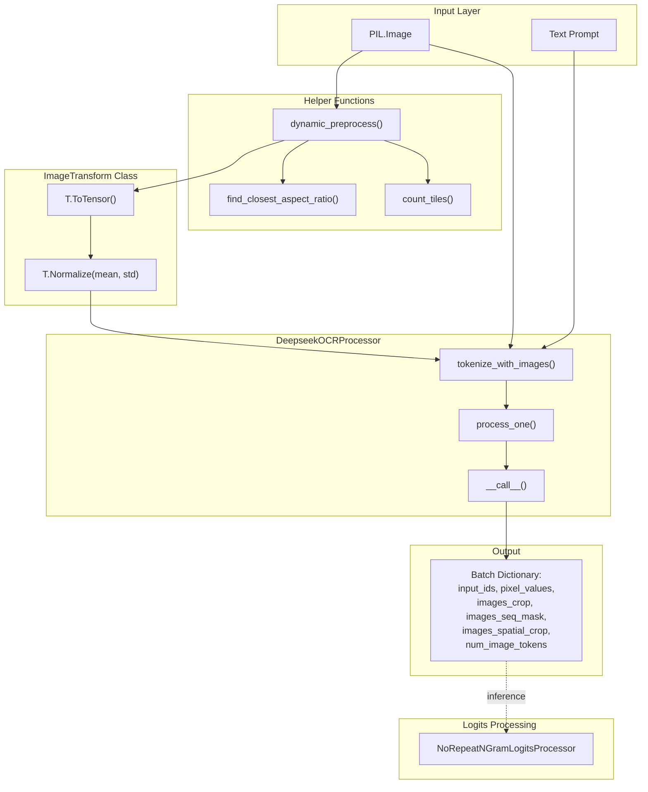
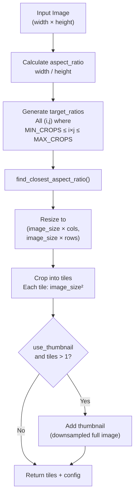
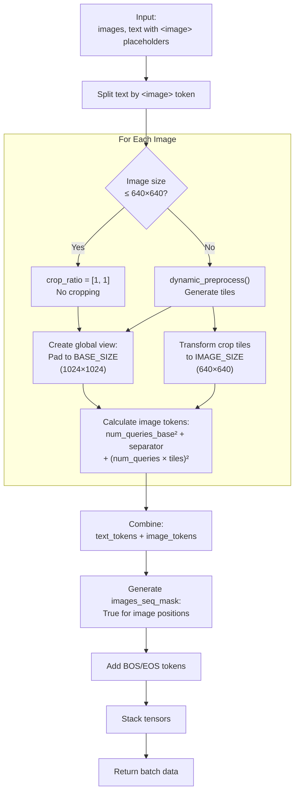

<!-- source: DeepWiki mcp.deepwiki.com · repo deepseek-ai/DeepSeek-OCR · page 6.4 Processing API · fetched 2026-10-30 -->

# Processing API

<details>
<summary>Relevant source files</summary>

The following files were used as context for generating this wiki page:

- [DeepSeek-OCR-master/DeepSeek-OCR-vllm/process/__init__.py](DeepSeek-OCR-master/DeepSeek-OCR-vllm/process/__init__.py)
- [DeepSeek-OCR-master/DeepSeek-OCR-vllm/process/image_process.py](DeepSeek-OCR-master/DeepSeek-OCR-vllm/process/image_process.py)
- [DeepSeek-OCR-master/DeepSeek-OCR-vllm/process/ngram_norepeat.py](DeepSeek-OCR-master/DeepSeek-OCR-vllm/process/ngram_norepeat.py)

</details>


This page provides a complete API reference for image processing and tokenization components in DeepSeek-OCR. These APIs handle the transformation of raw images into model-ready tensors, including dynamic cropping, normalization, and tokenization with multimodal embeddings.

For high-level usage patterns and integration examples, see [User Guide](#3). For extending or customizing these components, see [Extending Image Processing](#5.4).

---

## Overview

The processing API consists of four main components:

1.  **Helper Functions**: Low-level utilities for dynamic cropping and aspect ratio calculation.
2.  **ImageTransform**: Image normalization and tensor conversion.
3.  **DeepseekOCRProcessor**: High-level processor that orchestrates tokenization and image preprocessing.
4.  **NoRepeatNGramLogitsProcessor**: Logits processor for preventing repetitive output during generation.

Components are located in:
*   [DeepSeek-OCR-master/DeepSeek-OCR-vllm/process/image_process.py:1-503]()
*   [DeepSeek-OCR-master/DeepSeek-OCR-vllm/process/ngram_norepeat.py:1-40]()

**Processing Pipeline Architecture**



**Sources:** [DeepSeek-OCR-master/DeepSeek-OCR-vllm/process/image_process.py:1-503](), [DeepSeek-OCR-master/DeepSeek-OCR-vllm/process/ngram_norepeat.py:1-40]()

---

## Helper Functions

### `find_closest_aspect_ratio()`

Finds the optimal aspect ratio for tiling an image based on available target ratios.

**Signature:**
```python
def find_closest_aspect_ratio(
    aspect_ratio: float,
    target_ratios: Set[Tuple[int, int]],
    width: int,
    height: int,
    image_size: int
) -> Tuple[int, int]
```

**Parameters:**

| Parameter | Type | Description |
| :--- | :--- | :--- |
| `aspect_ratio` | `float` | Original image aspect ratio (width/height) |
| `target_ratios` | `Set[Tuple[int, int]]` | Set of candidate (cols, rows) tile configurations |
| `width` | `int` | Original image width in pixels |
| `height` | `int` | Original image height in pixels |
| `image_size` | `int` | Size of each tile (typically 640) |

**Returns:** `Tuple[int, int]` - Best matching (cols, rows) configuration.

**Algorithm:**
1.  Compares image aspect ratio against each target ratio [DeepSeek-OCR-master/DeepSeek-OCR-vllm/process/image_process.py:15-17]().
2.  Selects ratio with minimum difference [DeepSeek-OCR-master/DeepSeek-OCR-vllm/process/image_process.py:18-20]().
3.  For ties, prefers ratio that better utilizes image area (when area > 0.5 * target area) [DeepSeek-OCR-master/DeepSeek-OCR-vllm/process/image_process.py:21-23]().

**Sources:** [DeepSeek-OCR-master/DeepSeek-OCR-vllm/process/image_process.py:11-25]()

---

### `count_tiles()`

Calculates the optimal tile configuration for an image without performing the actual cropping.

**Signature:**
```python
def count_tiles(
    orig_width: int,
    orig_height: int,
    min_num: int = MIN_CROPS,
    max_num: int = MAX_CROPS,
    image_size: int = 640,
    use_thumbnail: bool = False
) -> Tuple[int, int]
```

**Parameters:**

| Parameter | Type | Default | Description |
| :--- | :--- | :--- | :--- |
| `orig_width` | `int` | - | Original image width |
| `orig_height` | `int` | - | Original image height |
| `min_num` | `int` | `MIN_CROPS` (2) | Minimum number of tiles |
| `max_num` | `int` | `MAX_CROPS` (6) | Maximum number of tiles |
| `image_size` | `int` | 640 | Tile size in pixels |
| `use_thumbnail` | `bool` | False | Whether to add thumbnail (unused) |

**Returns:** `Tuple[int, int]` - Optimal (width_tiles, height_tiles) configuration.

**Configuration Dependencies:**
*   Uses `MIN_CROPS` and `MAX_CROPS` from [config.py]() [DeepSeek-OCR-master/DeepSeek-OCR-vllm/process/image_process.py:28]().

**Sources:** [DeepSeek-OCR-master/DeepSeek-OCR-vllm/process/image_process.py:28-42]()

---

### `dynamic_preprocess()`

Performs adaptive image preprocessing by dividing images into optimal tile configurations.

**Signature:**
```python
def dynamic_preprocess(
    image: Image.Image,
    min_num: int = MIN_CROPS,
    max_num: int = MAX_CROPS,
    image_size: int = 640,
    use_thumbnail: bool = False
) -> Tuple[List[Image.Image], Tuple[int, int]]
```

**Parameters:**

| Parameter | Type | Default | Description |
| :--- | :--- | :--- | :--- |
| `image` | `Image.Image` | - | Input PIL image |
| `min_num` | `int` | `MIN_CROPS` | Minimum total tiles |
| `max_num` | `int` | `MAX_CROPS` | Maximum total tiles |
| `image_size` | `int` | 640 | Individual tile size |
| `use_thumbnail` | `bool` | False | Add downsampled thumbnail |

**Returns:**
*   `List[Image.Image]` - List of cropped image tiles.
*   `Tuple[int, int]` - (width_tiles, height_tiles) configuration used.

**Processing Steps:**



**Sources:** [DeepSeek-OCR-master/DeepSeek-OCR-vllm/process/image_process.py:45-83]()

---

## ImageTransform Class

Handles image normalization and conversion to PyTorch tensors.

### Constructor

```python
def __init__(
    self,
    mean: Tuple[float, float, float] = (0.5, 0.5, 0.5),
    std: Tuple[float, float, float] = (0.5, 0.5, 0.5),
    normalize: bool = True
)
```

**Transform Pipeline:**
1.  `T.ToTensor()` - Converts PIL Image to tensor, scales to [0, 1] [DeepSeek-OCR-master/DeepSeek-OCR-vllm/process/image_process.py:99]().
2.  `T.Normalize(mean, std)` - Normalizes: `(x - mean) / std` (if `normalize=True`) [DeepSeek-OCR-master/DeepSeek-OCR-vllm/process/image_process.py:102]().

**Sources:** [DeepSeek-OCR-master/DeepSeek-OCR-vllm/process/image_process.py:89-108]()

---

## DeepseekOCRProcessor Class

Main processor class that orchestrates image preprocessing and text tokenization for multimodal inputs.

### Class Definition

```python
class DeepseekOCRProcessor(ProcessorMixin):
    tokenizer_class = ("LlamaTokenizer", "LlamaTokenizerFast")
    attributes = ["tokenizer"]
```

**Inheritance:** `transformers.processing_utils.ProcessorMixin` [DeepSeek-OCR-master/DeepSeek-OCR-vllm/process/image_process.py:111]().

### Constructor

```python
def __init__(
    self,
    tokenizer: LlamaTokenizerFast = TOKENIZER,
    candidate_resolutions: Tuple[Tuple[int, int]] = [[1024, 1024]],
    patch_size: int = 16,
    downsample_ratio: int = 4,
    image_mean: Tuple[float, float, float] = (0.5, 0.5, 0.5),
    image_std: Tuple[float, float, float] = (0.5, 0.5, 0.5),
    normalize: bool = True,
    image_token: str = "<image>",
    pad_token: str = "<｜▁pad▁｜>",
    add_special_token: bool = False,
    sft_format: str = "deepseek",
    mask_prompt: bool = True,
    ignore_id: int = -100,
    **kwargs
)
```

**Initialization Steps:**
1.  Creates `ImageTransform` instance [DeepSeek-OCR-master/DeepSeek-OCR-vllm/process/image_process.py:144]().
2.  Configures tokenizer with left padding [DeepSeek-OCR-master/DeepSeek-OCR-vllm/process/image_process.py:149]().
3.  Adds pad token if not present [DeepSeek-OCR-master/DeepSeek-OCR-vllm/process/image_process.py:153]().
4.  Retrieves `<image>` token ID from vocabulary [DeepSeek-OCR-master/DeepSeek-OCR-vllm/process/image_process.py:161]().

**Sources:** [DeepSeek-OCR-master/DeepSeek-OCR-vllm/process/image_process.py:115-187]()

---

### Core Methods

#### `tokenize_with_images()`

**Primary method for converting images and text into model-ready inputs.**

**Processing Flow:**



**Image Token Calculation:**
The processor calculates tokens based on a global view (base size) and an optional local view (cropped tiles).
*   `num_queries_base` is derived from `BASE_SIZE` [DeepSeek-OCR-master/DeepSeek-OCR-vllm/process/image_process.py:387]().
*   `num_queries` is derived from `IMAGE_SIZE` [DeepSeek-OCR-master/DeepSeek-OCR-vllm/process/image_process.py:388]().
*   Global tokens include a newline separator for every `num_queries_base` tokens [DeepSeek-OCR-master/DeepSeek-OCR-vllm/process/image_process.py:392]().

**Sources:** [DeepSeek-OCR-master/DeepSeek-OCR-vllm/process/image_process.py:330-499]()

---

#### `__call__()`

Main entry point for the processor. Delegates to `process_one()` [DeepSeek-OCR-master/DeepSeek-OCR-vllm/process/image_process.py:328]().

**Sources:** [DeepSeek-OCR-master/DeepSeek-OCR-vllm/process/image_process.py:298-328]()

---

## NoRepeatNGramLogitsProcessor

A logits processor used to prevent the model from repeating the same n-gram during text generation.

### Constructor

```python
def __init__(self, ngram_size: int, window_size: int = 100, whitelist_token_ids: set = None)
```

**Parameters:**
*   `ngram_size`: The size of the n-gram to check for repetitions [DeepSeek-OCR-master/DeepSeek-OCR-vllm/process/ngram_norepeat.py:14]().
*   `window_size`: The lookback window in the sequence [DeepSeek-OCR-master/DeepSeek-OCR-vllm/process/ngram_norepeat.py:15]().
*   `whitelist_token_ids`: Set of tokens allowed to repeat regardless of n-gram constraints [DeepSeek-OCR-master/DeepSeek-OCR-vllm/process/ngram_norepeat.py:16]().

### Implementation Details

The processor identifies tokens that would complete an existing n-gram within the specified window and sets their logit scores to `-inf` [DeepSeek-OCR-master/DeepSeek-OCR-vllm/process/ngram_norepeat.py:38]().

**Data Flow:**
1.  Extracts the current prefix of length `ngram_size - 1` [DeepSeek-OCR-master/DeepSeek-OCR-vllm/process/ngram_norepeat.py:22]().
2.  Iterates through the `window_size` to find matches for the prefix [DeepSeek-OCR-master/DeepSeek-OCR-vllm/process/ngram_norepeat.py:28-31]().
3.  Filters out whitelisted tokens [DeepSeek-OCR-master/DeepSeek-OCR-vllm/process/ngram_norepeat.py:33]().
4.  Masks the scores for banned tokens [DeepSeek-OCR-master/DeepSeek-OCR-vllm/process/ngram_norepeat.py:37-38]().

**Sources:** [DeepSeek-OCR-master/DeepSeek-OCR-vllm/process/ngram_norepeat.py:7-40]()

---

## Configuration Dependencies

The Processing API depends on several global configuration parameters from `config.py`:

| Parameter | Default | Usage |
| :--- | :--- | :--- |
| `IMAGE_SIZE` | 640 | Tile size for local views [DeepSeek-OCR-master/DeepSeek-OCR-vllm/process/image_process.py:134]() |
| `BASE_SIZE` | 1024 | Global view resolution [DeepSeek-OCR-master/DeepSeek-OCR-vllm/process/image_process.py:135]() |
| `MIN_CROPS` | 2 | Minimum tiles in dynamic preprocessing [DeepSeek-OCR-master/DeepSeek-OCR-vllm/process/image_process.py:28]() |
| `MAX_CROPS` | 6 | Maximum tiles in dynamic preprocessing [DeepSeek-OCR-master/DeepSeek-OCR-vllm/process/image_process.py:28]() |
| `TOKENIZER` | - | Pre-initialized tokenizer instance [DeepSeek-OCR-master/DeepSeek-OCR-vllm/process/image_process.py:117]() |

**Sources:** [DeepSeek-OCR-master/DeepSeek-OCR-vllm/process/image_process.py:9-10]()

---

