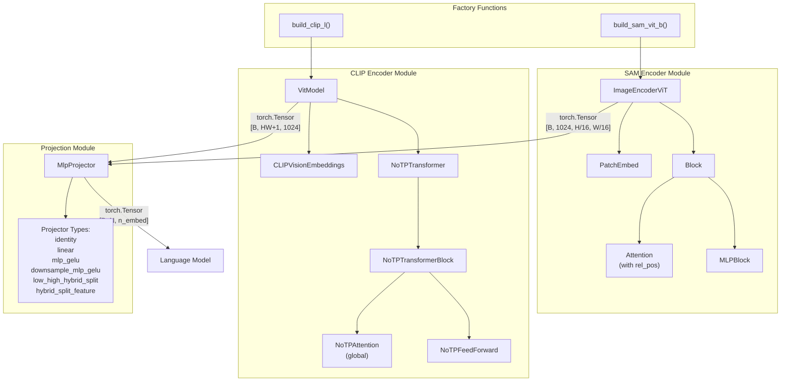
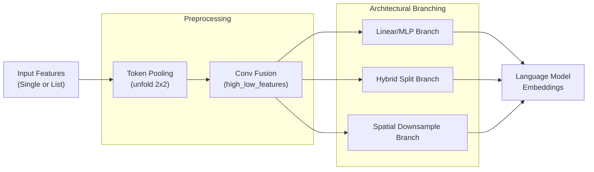

<!-- source: DeepWiki mcp.deepwiki.com · repo deepseek-ai/DeepSeek-OCR · page 6.5 Encoder API · fetched 2026-10-30 -->

# Encoder API

<details>
<summary>Relevant source files</summary>

The following files were used as context for generating this wiki page:

- [DeepSeek-OCR-master/DeepSeek-OCR-vllm/deepencoder/__init__.py](DeepSeek-OCR-master/DeepSeek-OCR-vllm/deepencoder/__init__.py)
- [DeepSeek-OCR-master/DeepSeek-OCR-vllm/deepencoder/build_linear.py](DeepSeek-OCR-master/DeepSeek-OCR-vllm/deepencoder/build_linear.py)
- [DeepSeek-OCR-master/DeepSeek-OCR-vllm/deepencoder/clip_sdpa.py](DeepSeek-OCR-master/DeepSeek-OCR-vllm/deepencoder/clip_sdpa.py)
- [DeepSeek-OCR-master/DeepSeek-OCR-vllm/deepencoder/sam_vary_sdpa.py](DeepSeek-OCR-master/DeepSeek-OCR-vllm/deepencoder/sam_vary_sdpa.py)

</details>


## Purpose

This page provides comprehensive API reference documentation for the vision encoder modules in DeepSeek-OCR. These modules are responsible for transforming raw images into feature embeddings that can be consumed by the language model.

The encoder system consists of three primary components:
- **SAM ViT-B Encoder**: Extracts high-resolution local features using window attention.
- **CLIP-L Encoder**: Extracts semantic global features using full attention.
- **MLP Projector**: Fuses and projects encoder outputs to the language model's embedding space.

For architectural context on how these encoders fit into the overall system, see [Vision Encoding System](#4.3). For implementation details on using these encoders in custom workflows, see [Model Components Reference](#5.1).

---

## System Overview

The following diagram shows the relationship between encoder components and their dependencies:

Title: Vision Encoder Component Architecture


**Sources:** [DeepSeek-OCR-master/DeepSeek-OCR-vllm/deepencoder/sam_vary_sdpa.py:77-184](), [DeepSeek-OCR-master/DeepSeek-OCR-vllm/deepencoder/clip_sdpa.py:359-424](), [DeepSeek-OCR-master/DeepSeek-OCR-vllm/deepencoder/build_linear.py:7-95]()

---

## SAM ViT-B Encoder API

### Factory Function

#### `build_sam_vit_b(checkpoint=None)`

Constructs a SAM (Segment Anything Model) ViT-B encoder configured for OCR tasks. [DeepSeek-OCR-master/DeepSeek-OCR-vllm/deepencoder/sam_vary_sdpa.py:481-528]()

**Parameters:**

| Parameter | Type | Default | Description |
|-----------|------|---------|-------------|
| `checkpoint` | `str` or `None` | `None` | Path to pretrained weights file. If provided, loads state dict with key prefix filtering. |

**Returns:**
- `ImageEncoderViT`: Configured SAM encoder instance. [DeepSeek-OCR-master/DeepSeek-OCR-vllm/deepencoder/sam_vary_sdpa.py:527]()

**Configuration:**
- `encoder_embed_dim = 768` [DeepSeek-OCR-master/DeepSeek-OCR-vllm/deepencoder/sam_vary_sdpa.py:491]()
- `encoder_depth = 12` [DeepSeek-OCR-master/DeepSeek-OCR-vllm/deepencoder/sam_vary_sdpa.py:492]()
- `encoder_num_heads = 12` [DeepSeek-OCR-master/DeepSeek-OCR-vllm/deepencoder/sam_vary_sdpa.py:493]()
- `encoder_global_attn_indexes = [2, 5, 8, 11]` [DeepSeek-OCR-master/DeepSeek-OCR-vllm/deepencoder/sam_vary_sdpa.py:494]()

---

### Core Class: `ImageEncoderViT`

The main SAM encoder class implementing a Vision Transformer with window attention and relative positional embeddings. [DeepSeek-OCR-master/DeepSeek-OCR-vllm/deepencoder/sam_vary_sdpa.py:77-184]()

#### Forward Method

```python
def forward(self, x: torch.Tensor) -> torch.Tensor
```

**Parameters:**
- `x`: Input tensor of shape `[B, 3, H, W]`. [DeepSeek-OCR-master/DeepSeek-OCR-vllm/deepencoder/sam_vary_sdpa.py:169]()

**Returns:**
- Output tensor of shape `[B, 1024, H/16, W/16]` after patch embedding, transformer blocks, and neck convolutions. [DeepSeek-OCR-master/DeepSeek-OCR-vllm/deepencoder/sam_vary_sdpa.py:183]()

**Processing Pipeline:**
1. **Patch embedding**: Converts images to patches. [DeepSeek-OCR-master/DeepSeek-OCR-vllm/deepencoder/sam_vary_sdpa.py:170]()
2. **Positional Embeddings**: Adds absolute positional embeddings, interpolated via `get_abs_pos` if sizes differ. [DeepSeek-OCR-master/DeepSeek-OCR-vllm/deepencoder/sam_vary_sdpa.py:171-173]()
3. **Transformer Blocks**: Applies 12 blocks (alternating window/global attention). [DeepSeek-OCR-master/DeepSeek-OCR-vllm/deepencoder/sam_vary_sdpa.py:175-176]()
4. **Neck Processing**: Applies 1x1 and 3x3 convolutions. [DeepSeek-OCR-master/DeepSeek-OCR-vllm/deepencoder/sam_vary_sdpa.py:178]()
5. **Conv Downsampling**: Further downsamples features to 1024 channels. [DeepSeek-OCR-master/DeepSeek-OCR-vllm/deepencoder/sam_vary_sdpa.py:179-181]()

**Sources:** [DeepSeek-OCR-master/DeepSeek-OCR-vllm/deepencoder/sam_vary_sdpa.py:77-184]()

---

## CLIP-L Encoder API

### Factory Function

#### `build_clip_l()`

Constructs a CLIP-L encoder for semantic feature extraction. [DeepSeek-OCR-master/DeepSeek-OCR-vllm/deepencoder/clip_sdpa.py:427-452]()

**Returns:**
- `VitModel`: Configured CLIP-L encoder instance. [DeepSeek-OCR-master/DeepSeek-OCR-vllm/deepencoder/clip_sdpa.py:452]()

**Sources:** [DeepSeek-OCR-master/DeepSeek-OCR-vllm/deepencoder/clip_sdpa.py:427-452]()

---

### Core Class: `VitModel`

CLIP Vision Transformer with global attention and absolute positional embeddings. [DeepSeek-OCR-master/DeepSeek-OCR-vllm/deepencoder/clip_sdpa.py:359-424]()

#### Forward Method

```python
def forward(self, x, patch_embeds) -> torch.Tensor
```

**Parameters:**
- `x`: Input images `[B, 3, H, W]`. [DeepSeek-OCR-master/DeepSeek-OCR-vllm/deepencoder/clip_sdpa.py:408]()
- `patch_embeds`: Pre-computed patch embeddings (optional). [DeepSeek-OCR-master/DeepSeek-OCR-vllm/deepencoder/clip_sdpa.py:408]()

**Returns:**
- Output features `[B, num_patches+1, hidden_size]` where the first token is the CLS token. [DeepSeek-OCR-master/DeepSeek-OCR-vllm/deepencoder/clip_sdpa.py:424]()

**Sources:** [DeepSeek-OCR-master/DeepSeek-OCR-vllm/deepencoder/clip_sdpa.py:359-424]()

---

## MLP Projector API

### Core Class: `MlpProjector`

Configurable projection module that transforms and fuses encoder features to language model embedding space. [DeepSeek-OCR-master/DeepSeek-OCR-vllm/deepencoder/build_linear.py:7-156]()

#### Supported Projector Types

The `MlpProjector` supports several architectures defined by `cfg.projector_type`: [DeepSeek-OCR-master/DeepSeek-OCR-vllm/deepencoder/build_linear.py:15-88]()

| Type | Description | Implementation |
|------|-------------|----------------|
| `identity` | Pass-through | `nn.Identity()` |
| `linear` | Single linear layer | `nn.Linear(input_dim, n_embed)` |
| `mlp_gelu` | Multi-layer MLP | `nn.Linear` + `nn.GELU` blocks |
| `downsample_mlp_gelu` | 4:1 spatial pooling + MLP | `F.unfold` with stride 2 then MLP |
| `low_high_hybrid_split_mlp_gelu` | Dual input projection | Separate `high_up_proj` and `low_up_proj` |

#### Forward Logic

Title: MlpProjector Data Flow and Feature Fusion


**Implementation Details:**
- **Token Pooling**: If `cfg.token_pooling` is True, it uses `unfold(2, 2, 2)` to pool 2x2 spatial regions into a single token via `self.token_pooling_layer`. [DeepSeek-OCR-master/DeepSeek-OCR-vllm/deepencoder/build_linear.py:98-113]()
- **Spatial Downsampling**: For `downsample_mlp_gelu`, it reshapes the sequence back to a 2D grid, pads if necessary, and uses `F.unfold` with `stride=downsample_ratio` to reduce sequence length. [DeepSeek-OCR-master/DeepSeek-OCR-vllm/deepencoder/build_linear.py:138-154]()
- **Hybrid Fusion**: For `low_high_hybrid_split_mlp_gelu`, it expects two inputs (high and low resolution), projects them to `n_embed // 2` separately, and concatenates the result. [DeepSeek-OCR-master/DeepSeek-OCR-vllm/deepencoder/build_linear.py:118-122]()

**Sources:** [DeepSeek-OCR-master/DeepSeek-OCR-vllm/deepencoder/build_linear.py:7-156]()

---

## Component Details

### `Attention` (SAM)
Multi-head attention with support for decomposed relative positional embeddings. [DeepSeek-OCR-master/DeepSeek-OCR-vllm/deepencoder/sam_vary_sdpa.py:252-323]()

- **Relative Positional Bias**: If `use_rel_pos` is enabled, it adds biases calculated via `add_decomposed_rel_pos`. [DeepSeek-OCR-master/DeepSeek-OCR-vllm/deepencoder/sam_vary_sdpa.py:317-318]()
- **Efficiency**: Uses `flash_attn_qkvpacked_func` for optimized computation. [DeepSeek-OCR-master/DeepSeek-OCR-vllm/deepencoder/sam_vary_sdpa.py:310-312]()

### `CLIPVisionEmbeddings` (CLIP)
Handles the initial conversion of images to token sequences. [DeepSeek-OCR-master/DeepSeek-OCR-vllm/deepencoder/clip_sdpa.py:107-156]()

- **CLS Token**: Prepends a learnable `class_embedding` to the patch sequence. [DeepSeek-OCR-master/DeepSeek-OCR-vllm/deepencoder/clip_sdpa.py:150-151]()
- **Positional Interpolation**: Uses `get_abs_pos` to resize learned `position_embedding` to match the current image resolution. [DeepSeek-OCR-master/DeepSeek-OCR-vllm/deepencoder/clip_sdpa.py:154]()

**Sources:** [DeepSeek-OCR-master/DeepSeek-OCR-vllm/deepencoder/sam_vary_sdpa.py:252-323](), [DeepSeek-OCR-master/DeepSeek-OCR-vllm/deepencoder/clip_sdpa.py:107-156]()

---

## Summary of Factory Configuration

Title: Encoder Factory Defaults
| Encoder | Hidden Dim | Depth | Attention Type | Patch Size |
|---------|------------|-------|----------------|------------|
| **SAM ViT-B** | 768 | 12 | Window/Global (Mixed) | 16x16 |
| **CLIP-L** | 1024 | 24 | Global | 14x14 |

**Sources:** [DeepSeek-OCR-master/DeepSeek-OCR-vllm/deepencoder/sam_vary_sdpa.py:491-494](), [DeepSeek-OCR-master/DeepSeek-OCR-vllm/deepencoder/clip_sdpa.py:427-440]()

---

