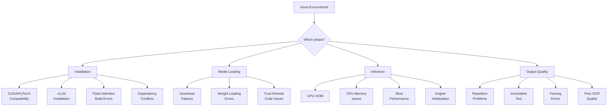
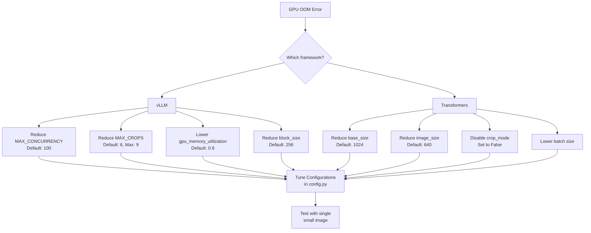
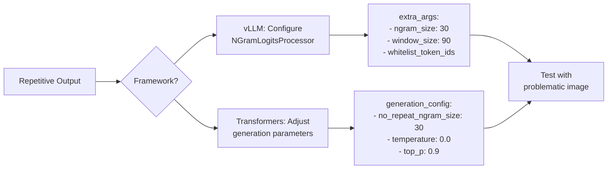
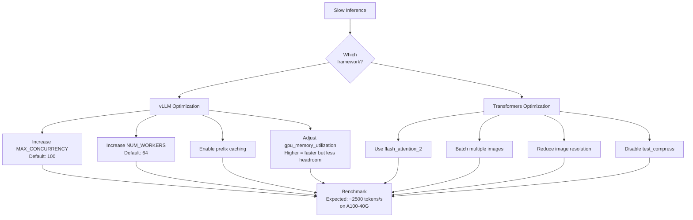

<!-- source: DeepWiki mcp.deepwiki.com · repo deepseek-ai/DeepSeek-OCR · page 7 Troubleshooting · fetched 2026-10-30 -->

# Troubleshooting

<details>
<summary>Relevant source files</summary>

The following files were used as context for generating this wiki page:

- [DeepSeek-OCR-master/DeepSeek-OCR-vllm/config.py](DeepSeek-OCR-master/DeepSeek-OCR-vllm/config.py)
- [README.md](README.md)
- [requirements.txt](requirements.txt)

</details>


This page provides solutions to common issues encountered when installing, configuring, and using DeepSeek-OCR. It covers problems specific to both the vLLM and Transformers inference frameworks, as well as general system issues.

For configuration details, see [Configuration System](#3.3). For framework-specific usage guidance, see [vLLM Inference](#3.2) or [Transformers Inference](#3.1). For model architecture details that may help diagnose issues, see [Model Architecture](#4.2).

---

## Diagnostic Overview



**Sources:** [README.md:68-106](), [DeepSeek-OCR-master/DeepSeek-OCR-vllm/config.py:1-43]()

---

## Installation Issues

### CUDA and PyTorch Compatibility

**Problem:** Version mismatches between CUDA, PyTorch, and vLLM cause import errors or runtime failures.

**Required Versions:**
| Component | Version | Notes |
|-----------|---------|-------|
| CUDA | 11.8 | Specified in README [README.md:69]() |
| PyTorch | 2.6.0 | Required for vLLM 0.8.5 [README.md:83]() |
| vLLM | 0.8.5+cu118 | CUDA 11.8 wheel [README.md:81-84]() |
| flash-attn | 2.7.3 | Must match CUDA version [README.md:86]() |

**Solution:**
```bash
# Exact installation sequence from README
pip install torch==2.6.0 torchvision==0.21.0 torchaudio==2.6.0 --index-url https://download.pytorch.org/whl/cu118
pip install vllm-0.8.5+cu118-cp38-abi3-manylinux1_x86_64.whl
pip install -r requirements.txt
pip install flash-attn==2.7.3 --no-build-isolation
```

**Common Error:**
```
ImportError: cannot import name 'flash_attn_cuda' from 'flash_attn'
```
This indicates CUDA version mismatch. Verify CUDA installation:
```bash
nvcc --version  # Should show 11.8
nvidia-smi      # Check driver compatibility
```

**Sources:** [README.md:68-86]()

---

### vLLM Installation Failures

**Problem 1:** Wrong wheel file for your Python version

The provided wheel `vllm-0.8.5+cu118-cp38-abi3-manylinux1_x86_64.whl` uses the stable ABI (`abi3`), which is compatible with Python 3.8+. However, download failures or architecture mismatches can occur.

**Solution:**
- Ensure Python 3.12.9 as specified in [README.md:76](): `python --version`
- Download the wheel from the official release: https://github.com/vllm-project/vllm/releases/tag/v0.8.5 [README.md:81]()
- Verify wheel compatibility: `pip debug --verbose | grep "Compatible tags"`

**Problem 2:** Transformers version conflict warning

The README notes:
> **Note:** if you want vLLM and transformers codes to run in the same environment, you don't need to worry about this installation error like: vllm 0.8.5+cu118 requires transformers>=4.51.1 [README.md:88]()

**Solution:**
This warning is expected and can be ignored. The DeepSeek-OCR implementation uses custom model code that bypasses the version check. Both frameworks will work in the same environment despite the warning.

**Sources:** [README.md:80-88]()

---

### Flash Attention Build Errors

**Problem:** Flash attention fails to compile with errors like:
```
error: 'cutlass' namespace not found
```

**Solution:**

1. **Ensure no build isolation:** The `--no-build-isolation` flag is critical [README.md:86]()
   ```bash
   pip install flash-attn==2.7.3 --no-build-isolation
   ```

2. **Verify CUDA toolkit availability:**
   ```bash
   echo $CUDA_HOME  # Should point to CUDA 11.8
   ```
   If not set:
   ```bash
   export CUDA_HOME=/usr/local/cuda-11.8
   export PATH=$CUDA_HOME/bin:$PATH
   export LD_LIBRARY_PATH=$CUDA_HOME/lib64:$LD_LIBRARY_PATH
   ```

3. **Check GCC version:** Flash attention requires GCC 7-11
   ```bash
   gcc --version
   ```

4. **Pre-built wheels alternative:** If compilation fails, use pre-built wheels:
   ```bash
   pip install flash-attn==2.7.3 --no-build-isolation --find-links https://github.com/Dao-AILab/flash-attention/releases
   ```

**Sources:** [README.md:85-86]()

---

## Model Loading Issues

### Download Failures

**Problem:** Model fails to download from Hugging Face Hub

**Common Errors:**
```
requests.exceptions.ConnectionError: HTTPSConnectionPool
OSError: We couldn't connect to 'https://huggingface.co'
```

**Solution 1: Network Configuration**
```python
import os
os.environ['HF_ENDPOINT'] = 'https://hf-mirror.com'  # Use mirror if needed
```

**Solution 2: Manual Download**
```bash
# Clone the repository
git lfs install
git clone https://huggingface.co/deepseek-ai/DeepSeek-OCR

# Update MODEL_PATH in config
# DeepSeek-OCR-master/DeepSeek-OCR-vllm/config.py:17
MODEL_PATH = '/path/to/local/DeepSeek-OCR'
```

**Solution 3: Use Snapshot Download**
```python
from huggingface_hub import snapshot_download
snapshot_download(
    repo_id="deepseek-ai/DeepSeek-OCR",
    local_dir="/path/to/cache",
    resume_download=True
)
```

**Sources:** [DeepSeek-OCR-master/DeepSeek-OCR-vllm/config.py:17]()

---

### Weight Loading Errors

**Problem:** Model weights fail to load with shape mismatches or missing keys

**Error Example:**
```
RuntimeError: Error(s) in loading state_dict for DeepseekOCRForCausalLM:
    size mismatch for vision.clip_model.embeddings.position_embedding
```

**Diagnostic Steps:**

1. **Verify model checkpoint integrity:**
   ```python
   import torch
   checkpoint = torch.load('model_path/pytorch_model.bin', map_location='cpu')
   print(checkpoint.keys())  # Should contain all expected keys
   ```

2. **Check for incomplete downloads:**
   ```bash
   # Verify file sizes match Hugging Face
   ls -lh /path/to/model/*.bin
   md5sum /path/to/model/*.bin
   ```

**Solution:**
```python
# Re-download specific files
from huggingface_hub import hf_hub_download
hf_hub_download(
    repo_id="deepseek-ai/DeepSeek-OCR",
    filename="pytorch_model.bin",
    force_download=True,
    local_dir="/path/to/cache"
)
```

**Sources:** [README.md:124-125](), [README.md:174-175]()

---

### Trust Remote Code Issues

**Problem:** Model fails to load without `trust_remote_code=True`

**Error:**
```
ValueError: Loading this model requires you to execute code in the model repository.
Set `trust_remote_code=True` to proceed.
```

**Explanation:**
DeepSeek-OCR uses custom model architecture code. Both loading methods require this flag:

**vLLM:**
```python
# Automatically handled by model registration in upstream or custom builds
llm = LLM(model="deepseek-ai/DeepSeek-OCR")
```

**Transformers:**
```python
# Must be explicitly set
tokenizer = AutoTokenizer.from_pretrained(model_name, trust_remote_code=True) [README.md:174]()
model = AutoModel.from_pretrained(model_name, trust_remote_code=True) [README.md:175]()
```

**Security Note:** Only set `trust_remote_code=True` for trusted model sources. Review custom code at: https://huggingface.co/deepseek-ai/DeepSeek-OCR/tree/main

**Sources:** [README.md:173-175]()

---

## Memory Issues

### GPU Out of Memory (OOM)



**Problem:** CUDA out of memory during inference

**Configuration Parameters:**

| Parameter | Location | Default | Memory Impact |
|-----------|----------|---------|---------------|
| `MAX_CROPS` | config.py:12 | 6 | High - Each crop adds ~256 tokens [DeepSeek-OCR-master/DeepSeek-OCR-vllm/config.py:12]() |
| `MAX_CONCURRENCY` | config.py:13 | 100 | High - Controls batch size [DeepSeek-OCR-master/DeepSeek-OCR-vllm/config.py:13]() |
| `BASE_SIZE` | config.py:8 | 1024 | Medium - Global view resolution [DeepSeek-OCR-master/DeepSeek-OCR-vllm/config.py:8]() |
| `IMAGE_SIZE` | config.py:9 | 640 | Medium - Local crop resolution [DeepSeek-OCR-master/DeepSeek-OCR-vllm/config.py:9]() |
| `CROP_MODE` | config.py:10 | True | High - Enables multi-crop processing [DeepSeek-OCR-master/DeepSeek-OCR-vllm/config.py:10]() |

**Solution Strategy:**

**Step 1: Reduce Concurrent Sequences (vLLM)**
```python
# DeepSeek-OCR-master/DeepSeek-OCR-vllm/config.py
MAX_CONCURRENCY = 50  # Reduce from 100 [DeepSeek-OCR-master/DeepSeek-OCR-vllm/config.py:13]()
```

**Step 2: Limit Maximum Crops**
```python
# For 16GB GPU
MAX_CROPS = 4  # Reduce from 6 [DeepSeek-OCR-master/DeepSeek-OCR-vllm/config.py:12]()

# For 12GB GPU or smaller
MAX_CROPS = 2
CROP_MODE = False  # Disable dynamic cropping [DeepSeek-OCR-master/DeepSeek-OCR-vllm/config.py:10]()
```

**Step 3: Use Smaller Resolution Mode**
```python
# Switch from Gundam to Base mode [DeepSeek-OCR-master/DeepSeek-OCR-vllm/config.py:4-6]()
BASE_SIZE = 1024
IMAGE_SIZE = 1024
CROP_MODE = False  # Single 1024×1024 image

# Or use Small mode [DeepSeek-OCR-master/DeepSeek-OCR-vllm/config.py:3]()
BASE_SIZE = 640
IMAGE_SIZE = 640
CROP_MODE = False  # Single 640×640 image
```

**Step 4: Adjust vLLM Memory Settings**
```python
llm = LLM(
    model="deepseek-ai/DeepSeek-OCR",
    gpu_memory_utilization=0.85,  # Reduce from 0.9
    max_model_len=8192,           # Reduce max tokens [README.md:149]()
    mm_processor_cache_gb=0       # Disable multimodal cache [README.md:127]()
)
```

**Sources:** [DeepSeek-OCR-master/DeepSeek-OCR-vllm/config.py:1-13](), [README.md:122-129]()

---

### CPU Memory Issues

**Problem:** Out of memory during image preprocessing with large datasets

**Error:**
```
MemoryError: Unable to allocate array with shape (4096, 4096, 3)
```

**Cause:** The `NUM_WORKERS` parameter controls parallel image preprocessing workers. Default is 64 [DeepSeek-OCR-master/DeepSeek-OCR-vllm/config.py:14]().

**Solution:**
```python
# DeepSeek-OCR-master/DeepSeek-OCR-vllm/config.py
NUM_WORKERS = 32  # Reduce from 64 for systems with <64GB RAM [DeepSeek-OCR-master/DeepSeek-OCR-vllm/config.py:14]()
NUM_WORKERS = 16  # For systems with <32GB RAM
```

**Memory Usage Estimate:**
- Each worker loads and processes one image via Pillow [requirements.txt:8]()
- Typical image: ~50MB in memory (4000×3000 RGB)
- 64 workers × 50MB = ~3.2GB minimum overhead.

**Sources:** [DeepSeek-OCR-master/DeepSeek-OCR-vllm/config.py:14](), [requirements.txt:8-9]()

---

## vLLM Specific Issues

### Engine Initialization Failures

**Problem:** AsyncLLMEngine fails to initialize

**Error:**
```
RuntimeError: CUDA error: out of memory during model loading
```

**Solution 1: Reduce Memory Footprint**
```python
llm = LLM(
    model="deepseek-ai/DeepSeek-OCR",
    enable_prefix_caching=False,  # Disable caching [README.md:126]()
    mm_processor_cache_gb=0,      # Disable multimodal cache [README.md:127]()
    gpu_memory_utilization=0.85
)
```

**Error:**
```
ValueError: Cannot find model 'deepseek-ai/DeepSeek-OCR' in vLLM registry
```

**Solution 2: Verify vLLM Version**
The model is supported in:
- vLLM 0.8.5+ (bundled version) [README.md:81]()
- vLLM nightly builds (upstream support as of 2025/10/23) [README.md:109-115]()

```bash
python -c "import vllm; print(vllm.__version__)"  # Should be 0.8.5 or higher
```

For upstream vLLM installation [README.md:111-115]():
```bash
uv venv
source .venv/bin/activate
uv pip install -U vllm --pre --extra-index-url https://wheels.vllm.ai/nightly
```

**Sources:** [README.md:108-115](), [README.md:122-128]()

---

### Logits Processor Errors

**Problem:** `NGramPerReqLogitsProcessor` causes warnings or unexpected behavior

**Error:**
```
UserWarning: NGramPerReqLogitsProcessor whitelist_token_ids not set
```

**Explanation:**
The `NGramPerReqLogitsProcessor` prevents repetitive n-gram sequences in output [README.md:120](). It requires configuration through `extra_args` in `SamplingParams`.

**Correct Configuration:**
```python
from vllm.model_executor.models.deepseek_ocr import NGramPerReqLogitsProcessor [README.md:120]()

sampling_param = SamplingParams(
    temperature=0.0,
    max_tokens=8192,
    extra_args=dict(
        ngram_size=30,              # Prevent 30-token repetitions [README.md:152]()
        window_size=90,             # Look back 90 tokens [README.md:153]()
        whitelist_token_ids={128821, 128822}  # Allow <td>, </td> repetition [README.md:154]()
    ),
    skip_special_tokens=False [README.md:156]()
)

llm = LLM(
    model="deepseek-ai/DeepSeek-OCR",
    logits_processors=[NGramPerReqLogitsProcessor] [README.md:128]()
)
```

**Common Mistakes:**
1. Not passing `whitelist_token_ids` for table tags [README.md:154]()
2. Setting `ngram_size` too small (< 20) - causes over-suppression.
3. Not including processor in `LLM` initialization [README.md:128]().

**Sources:** [README.md:119-128](), [README.md:146-157]()

---

### SKIP_REPEAT Policy Issues

**Problem:** Incomplete outputs are discarded entirely

The `SKIP_REPEAT` configuration in `config.py` controls handling of incomplete generations:

```python
# DeepSeek-OCR-master/DeepSeek-OCR-vllm/config.py
SKIP_REPEAT = True  # Default: skip sequences that hit max_tokens [DeepSeek-OCR-master/DeepSeek-OCR-vllm/config.py:16]()
```

**Behavior:**
- `True`: Sequences hitting `max_tokens` without proper termination are skipped.
- `False`: All outputs returned, even if truncated.

**Solution:**
For batch processing where some truncation is acceptable:
```python
SKIP_REPEAT = False
```

**Sources:** [DeepSeek-OCR-master/DeepSeek-OCR-vllm/config.py:16]()

---

## Transformers Specific Issues

### Attention Implementation Errors

**Problem:** Flash attention not working or causing errors

**Error:**
```
NotImplementedError: Flash Attention is not available for your configuration
```

**Cause:** `_attn_implementation='flash_attention_2'` [README.md:175]() requires:
1. Flash attention installed correctly [README.md:86]()
2. CUDA-compatible GPU (compute capability ≥ 8.0 for optimal performance)
3. Proper PyTorch version [README.md:83]()

**Solution:**

**Option 1: Verify Flash Attention**
```python
try:
    import flash_attn
    print(f"Flash Attention version: {flash_attn.__version__}")
except ImportError:
    print("Flash Attention not installed")
```

**Option 2: Fallback to Standard Attention**
```python
model = AutoModel.from_pretrained(
    model_name, 
    _attn_implementation='eager',  # or 'sdpa'
    trust_remote_code=True,
    use_safetensors=True
)
```

**Sources:** [README.md:83-86](), [README.md:174-175]()

---

### Device Placement Issues

**Problem:** Model not moving to GPU or CUDA errors

**Error:**
```
RuntimeError: Expected all tensors to be on the same device
```

**Solution:**

**Ensure proper device setup:**
```python
import torch
import os

# Set specific GPU [README.md:171]()
os.environ["CUDA_VISIBLE_DEVICES"] = '0'

# Load and place model [README.md:175-176]()
model = AutoModel.from_pretrained(model_name, trust_remote_code=True)
model = model.eval().cuda().to(torch.bfloat16)
```

**Mixed precision issues:**
```python
# Recommended dtype [README.md:176]()
model = model.to(torch.bfloat16) 
```

**Sources:** [README.md:170-176]()

---

## Image Processing Issues

### Unsupported Image Formats

**Problem:** Image fails to load or process

**Error:**
```
PIL.UnidentifiedImageError: cannot identify image file
```

**Supported Formats:**
- JPEG (.jpg, .jpeg) [DeepSeek-OCR-master/DeepSeek-OCR-vllm/config.py:21]()
- PNG (.png) [DeepSeek-OCR-master/DeepSeek-OCR-vllm/config.py:21]()
- PDF (.pdf) - via PyMuPDF [DeepSeek-OCR-master/DeepSeek-OCR-vllm/config.py:20](), [requirements.txt:3]()

**Solution:**
Ensure images are converted to RGB using Pillow [requirements.txt:8]() before processing [README.md:132-133]().

**Sources:** [DeepSeek-OCR-master/DeepSeek-OCR-vllm/config.py:19-22](), [README.md:132-133](), [requirements.txt:3,8]()

---

### Dynamic Cropping Failures

**Problem:** Image cropping produces unexpected results or errors

**Configuration Options:**

```python
# Disable dynamic cropping for problematic images [DeepSeek-OCR-master/DeepSeek-OCR-vllm/config.py:10]()
CROP_MODE = False  # Single-scale processing

# Or constrain crop count [DeepSeek-OCR-master/DeepSeek-OCR-vllm/config.py:11-12]()
MIN_CROPS = 2
MAX_CROPS = 6  # Reduce if GPU memory is small
```

**Diagnostic:**
```python
# Enable token counting [DeepSeek-OCR-master/DeepSeek-OCR-vllm/config.py:15]()
PRINT_NUM_VIS_TOKENS = True 
```

**Sources:** [DeepSeek-OCR-master/DeepSeek-OCR-vllm/config.py:8-15]()

---

## Output Quality Issues

### Repetitive Text Output



**Problem:** Model outputs repeated text patterns.

**vLLM Solution:**
Ensure `NGramPerReqLogitsProcessor` is properly configured in `SamplingParams` [README.md:147-157]().

**Transformers Solution:**
Use `model.infer` with specific parameters [README.md:183]():
```python
res = model.infer(
    tokenizer, 
    prompt=prompt, 
    image_file=image_file, 
    test_compress=True # Uses compression logic [README.md:183]()
)
```

**Sources:** [README.md:146-157](), [README.md:183]()

---

### Incomplete or Truncated Output

**Problem:** Output ends mid-sentence.

**Cause 1: Token Limit Reached**
Check `max_tokens` setting (default in example is 8192 [README.md:149]()).

**Cause 2: SKIP_REPEAT Policy**
If `SKIP_REPEAT = True`, vLLM may discard the output entirely if it hits `max_tokens` [DeepSeek-OCR-master/DeepSeek-OCR-vllm/config.py:16]().

**Sources:** [README.md:149](), [DeepSeek-OCR-master/DeepSeek-OCR-vllm/config.py:16]()

---

### Reference Tag Parsing Errors

**Problem:** Special tokens appear in output or coordinates are incorrect.

**Expected Behavior:**
- `<|ref|>...<|/ref|>`: Text reference markers [README.md:207]()
- `<|grounding|>`: Spatial awareness token [README.md:179, 202]()

**Prompt Examples for Reference:**
```python
# Localization prompt [README.md:207]()
prompt = "<image>\nLocate <|ref|>xxxx<|/ref|> in the image."

# Markdown conversion [README.md:202]()
prompt = "<image>\n<|grounding|>Convert the document to markdown."
```

**Sources:** [README.md:179-183](), [README.md:201-209]()

---

## Performance Issues

### Slow Inference Speed



**Problem:** Inference is slower than expected throughput.

**Expected Performance:**
- vLLM on A100-40G: ~2500 tokens/s for PDF processing [README.md:100]().

**vLLM Optimization:**
```python
# config.py tuning
MAX_CONCURRENCY = 100  # Increase for higher throughput [DeepSeek-OCR-master/DeepSeek-OCR-vllm/config.py:13]()
NUM_WORKERS = 64       # CPU preprocessing parallelism [DeepSeek-OCR-master/DeepSeek-OCR-vllm/config.py:14]()
```

**Sources:** [README.md:100](), [DeepSeek-OCR-master/DeepSeek-OCR-vllm/config.py:13-14]()

---

### Path Configuration Errors

**Problem:** Input/output paths not set or incorrect.

**Error:**
```
FileNotFoundError: INPUT_PATH is empty or does not exist
```

**Solution:**
Update `INPUT_PATH` and `OUTPUT_PATH` in `config.py` [DeepSeek-OCR-master/DeepSeek-OCR-vllm/config.py:24-25]().

**Script-Path Mapping [DeepSeek-OCR-master/DeepSeek-OCR-vllm/config.py:20-22]():**
| Script | Supported INPUT_PATH |
|--------|---------------------|
| `run_dpsk_ocr_image.py` | .jpg, .png, .jpeg |
| `run_dpsk_ocr_pdf.py` | .pdf |
| `run_dpsk_ocr_eval_batch.py` | Omnidocbench images path |

**Sources:** [DeepSeek-OCR-master/DeepSeek-OCR-vllm/config.py:19-25]()

---

## Getting Help

If you encounter issues not covered in this troubleshooting guide:

1. **Check the GitHub Issues:** https://github.com/deepseek-ai/DeepSeek-OCR/issues
2. **Join Discord:** https://discord.gg/Tc7c45Zzu5 [README.md:25]()
3. **Review the paper:** [DeepSeek_OCR_paper.pdf](https://github.com/deepseek-ai/DeepSeek-OCR/blob/main/DeepSeek_OCR_paper.pdf) [README.md:37]()

**Sources:** [README.md:24-39]()

---

