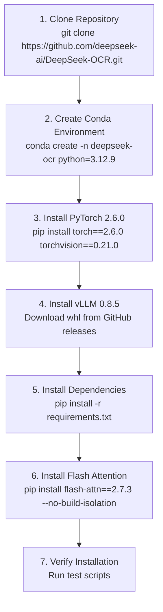
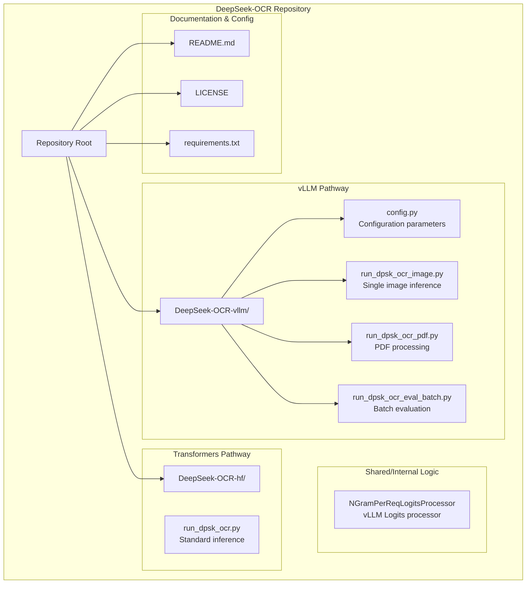
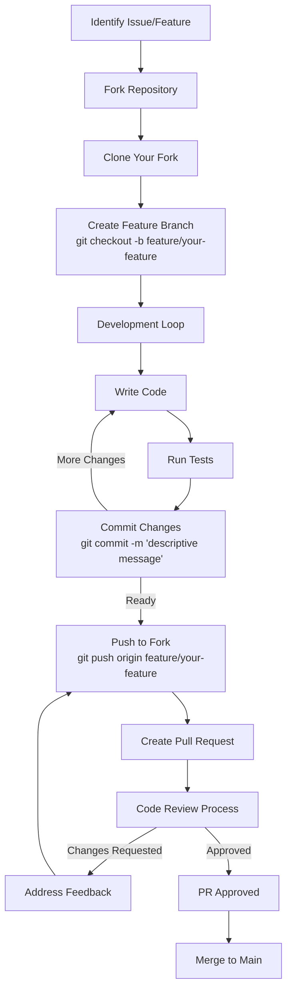
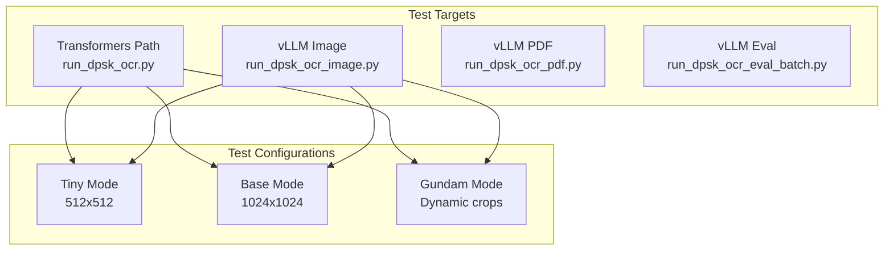

<!-- source: DeepWiki mcp.deepwiki.com · repo deepseek-ai/DeepSeek-OCR · page 8 Contributing · fetched 2026-10-30 -->

# Contributing

<details>
<summary>Relevant source files</summary>

The following files were used as context for generating this wiki page:

- [LICENSE](LICENSE)
- [README.md](README.md)

</details>


This page provides guidelines for contributing to the DeepSeek-OCR project, including development setup, coding standards, testing procedures, and the pull request process. Whether you're fixing bugs, adding features, improving documentation, or optimizing performance, this guide will help you make effective contributions.

For information about using DeepSeek-OCR as an end user, see [Getting Started](2). For extending the system with custom components, see [Developer Guide](5).

---

## Purpose and Scope

DeepSeek-OCR is an open-source project released under the MIT License, welcoming contributions from the community. This document covers:

- Development environment setup for contributors
- Code organization and where to make changes
- Testing and validation procedures
- Pull request guidelines and review process
- Coding standards and best practices

---

## License and Terms

DeepSeek-OCR is released under the MIT License, which grants broad permissions for use, modification, and distribution. All contributions must be compatible with this license.

**Key License Terms:**
- Permission to use, copy, modify, merge, publish, distribute, sublicense, and sell [LICENSE:5-9]()
- Requires attribution and license notice in all copies [LICENSE:12-13]()
- Provided "as is" without warranty [LICENSE:15-17]()
- No liability for damages or issues [LICENSE:17-21]()

Before contributing, ensure you have the right to submit your code and that your contribution complies with the MIT License terms.

**Sources:** [LICENSE:1-22]()

---

## Development Environment Setup

### Prerequisites

Before contributing, set up a complete development environment that supports both inference pathways (Transformers and vLLM).

**System Requirements:**
- CUDA 11.8 or higher [README.md:69]()
- Python 3.12.9 [README.md:76]()
- GPU with sufficient memory (A100-40G recommended for full testing) [README.md:100]()

### Environment Installation

Installation involves cloning the repository, setting up a Conda environment, and installing specific versions of PyTorch and vLLM.

**Installation Flow:**



**Installation Steps:**

1. **Clone the repository:** [README.md:72]()
   ```bash
   git clone https://github.com/deepseek-ai/DeepSeek-OCR.git
   cd DeepSeek-OCR
   ```

2. **Create isolated conda environment:** [README.md:76-77]()
   ```bash
   conda create -n deepseek-ocr python=3.12.9 -y
   conda activate deepseek-ocr
   ```

3. **Install PyTorch with CUDA support:** [README.md:83]()
   ```bash
   pip install torch==2.6.0 torchvision==0.21.0 torchaudio==2.6.0 --index-url https://download.pytorch.org/whl/cu118
   ```

4. **Install vLLM from wheel:** [README.md:81-84]()
   - Download vllm-0.8.5 wheel from [GitHub releases](https://github.com/vllm-project/vllm/releases/tag/v0.8.5)
   ```bash
   pip install vllm-0.8.5+cu118-cp38-abi3-manylinux1_x86_64.whl
   ```

5. **Install project dependencies:** [README.md:85]()
   ```bash
   pip install -r requirements.txt
   ```

6. **Install Flash Attention:** [README.md:86]()
   ```bash
   pip install flash-attn==2.7.3 --no-build-isolation
   ```

**Note:** You may see warnings about transformers version conflicts between vLLM and the Hugging Face implementation. This is expected and both will function correctly in the same environment [README.md:88]().

**Sources:** [README.md:66-86]()

---

## Code Organization

Understanding the codebase structure is essential for making targeted contributions. DeepSeek-OCR is organized into two main inference pathways with shared model components.

### Repository Structure



### Contribution Areas by Component

| Component Type | File Locations | Contribution Examples |
|---------------|----------------|----------------------|
| **vLLM Inference** | `DeepSeek-OCR-vllm/` | Add streaming features, optimize batching, improve concurrency [README.md:91-107]() |
| **Transformers Inference** | `DeepSeek-OCR-hf/` | Enhance API, add inference modes, improve error handling [README.md:165-189]() |
| **Configuration** | `DeepSeek-OCR-vllm/config.py` | Add parameters, create presets, improve validation [README.md:92]() |
| **Logits Processing** | `vllm.model_executor.models.deepseek_ocr` | Add filters, implement constraints, optimize generation [README.md:120]() |
| **Documentation** | `README.md` | Add examples, improve clarity, update installation guides [README.md:201-209]() |

**Sources:** [README.md:59-189]()

---

## Contribution Workflow

Follow this standard workflow for all contributions, from initial setup through merged pull request.

### Development Workflow Diagram



### Step-by-Step Process

**1. Identify the Contribution:**
- Check existing issues for bugs or feature requests.
- Discuss major changes before implementation.

**2. Fork and Clone:**
```bash
# Fork on GitHub web interface, then:
git clone https://github.com/YOUR_USERNAME/DeepSeek-OCR.git
cd DeepSeek-OCR
git remote add upstream https://github.com/deepseek-ai/DeepSeek-OCR.git
```

**3. Create Feature Branch:**
```bash
git checkout -b feature/descriptive-name
```

**4. Make Changes:**
- Follow coding standards.
- Add tests for new functionality.
- Update documentation as needed.

**5. Test Your Changes:**
```bash
# Test Transformers path
cd DeepSeek-OCR-hf
python run_dpsk_ocr.py

# Test vLLM path
cd ../DeepSeek-OCR-vllm
python run_dpsk_ocr_image.py
```

**6. Push and Create PR:**
```bash
git push origin feature/descriptive-name
# Then create PR on GitHub
```

**Sources:** [README.md:94-107](), [README.md:187-189]()

---

## Testing Guidelines

Comprehensive testing ensures contributions don't break existing functionality and work across different configurations.

### Testing Strategy



### Functional Testing

**Test Transformers Path:** [README.md:187-189]()
```bash
cd DeepSeek-OCR-hf
python run_dpsk_ocr.py
# Verify output results are saved correctly as per model.infer() parameters
```

**Test vLLM Path:** [README.md:94-107]()
```bash
cd DeepSeek-OCR-vllm

# Test image inference (streaming)
python run_dpsk_ocr_image.py

# Test PDF processing (concurrency)
python run_dpsk_ocr_pdf.py

# Test batch evaluation
python run_dpsk_ocr_eval_batch.py
```

### Validation Checklist
- [ ] Output format is correct (markdown, grounding tags, etc.) [README.md:179]()
- [ ] Special tokens like `<image>`, `<|grounding|>`, `<|ref|>` are handled correctly [README.md:202-207]()
- [ ] `NGramPerReqLogitsProcessor` effectively prevents repetition [README.md:120]()
- [ ] Performance meets expectations (e.g., ~2500 tokens/s on A100 for PDF) [README.md:100]()

**Sources:** [README.md:96-107](), [README.md:120-130](), [README.md:178-183]()

---

## Pull Request Guidelines

### PR Preparation

Before submitting a pull request:

1. **Ensure all tests pass** in both Transformers and vLLM paths.
2. **Update documentation** if behavior changes.
3. **Check code style** compliance.
4. **Rebase on latest main** to avoid merge conflicts.

### Code Review Process

**Review Criteria:**
- Code quality and readability.
- Test coverage and quality.
- Documentation completeness.
- Performance impact.
- Compatibility with existing features.

---

## Communication Channels

### Where to Discuss

**GitHub Issues:**
- Bug reports, feature requests, and technical questions.

**Discord:** [README.md:24-26]()
- Real-time chat: [https://discord.gg/Tc7c45Zzu5](https://discord.gg/Tc7c45Zzu5)

**Twitter:** [README.md:27-29]()
- Announcements: [@deepseek_ai](https://twitter.com/deepseek_ai)

**Sources:** [README.md:24-30]()

---

## Summary

Contributing to DeepSeek-OCR involves:

1. **Setup:** Fork repository, create development environment using Conda and specific wheel versions.
2. **Development:** Make focused changes in `DeepSeek-OCR-hf` or `DeepSeek-OCR-vllm`.
3. **Testing:** Validate using provided scripts (`run_dpsk_ocr_image.py`, `run_dpsk_ocr.py`, etc.).
4. **Documentation:** Update `README.md` or wiki pages.
5. **Submission:** Create detailed pull request and address feedback.

Every contribution helps make DeepSeek-OCR better for the community. Happy contributing!

---

