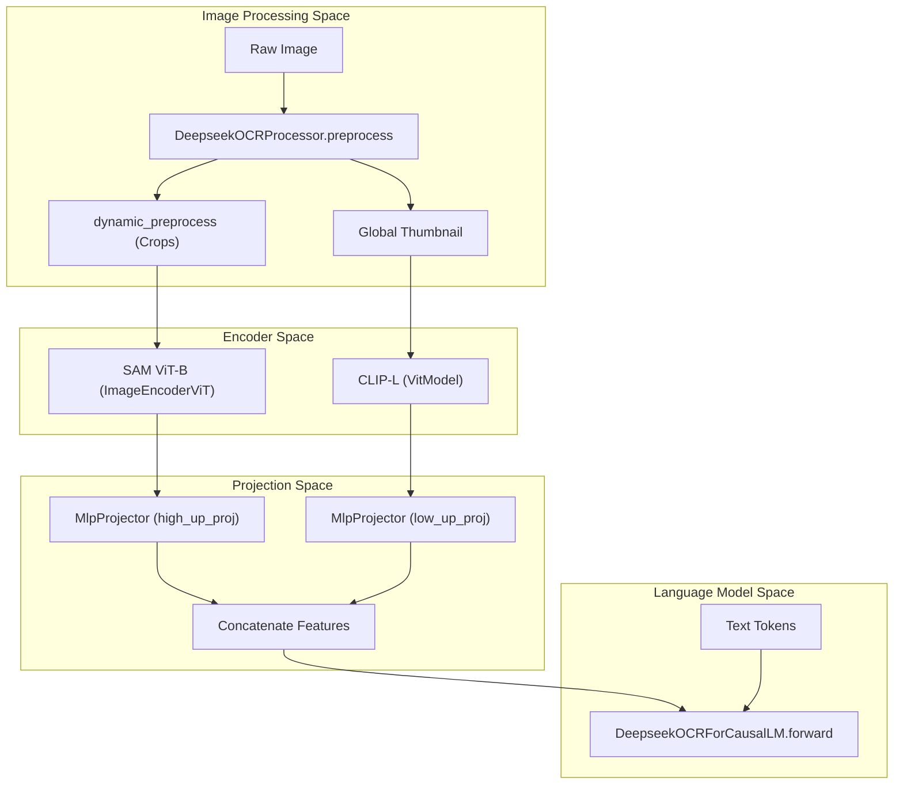
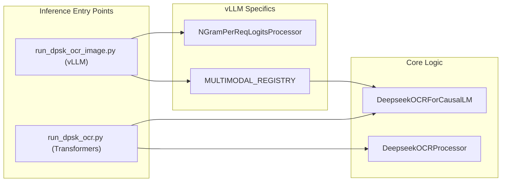

<!-- source: DeepWiki mcp.deepwiki.com · repo deepseek-ai/DeepSeek-OCR · page 9 Glossary · fetched 2026-10-30 -->

# Glossary

Relevant source files

The following files were used as context for generating this wiki page:

- [DeepSeek-OCR-master/DeepSeek-OCR-vllm/config.py](DeepSeek-OCR-master/DeepSeek-OCR-vllm/config.py)
- [DeepSeek-OCR-master/DeepSeek-OCR-vllm/deepencoder/build_linear.py](DeepSeek-OCR-master/DeepSeek-OCR-vllm/deepencoder/build_linear.py)
- [DeepSeek-OCR-master/DeepSeek-OCR-vllm/deepencoder/clip_sdpa.py](DeepSeek-OCR-master/DeepSeek-OCR-vllm/deepencoder/clip_sdpa.py)
- [DeepSeek-OCR-master/DeepSeek-OCR-vllm/deepencoder/sam_vary_sdpa.py](DeepSeek-OCR-master/DeepSeek-OCR-vllm/deepencoder/sam_vary_sdpa.py)
- [DeepSeek-OCR-master/DeepSeek-OCR-vllm/deepseek_ocr.py](DeepSeek-OCR-master/DeepSeek-OCR-vllm/deepseek_ocr.py)
- [DeepSeek-OCR-master/DeepSeek-OCR-vllm/process/image_process.py](DeepSeek-OCR-master/DeepSeek-OCR-vllm/process/image_process.py)
- [README.md](README.md)

This glossary provides definitions for codebase-specific terms, architectural components, and domain concepts used within the DeepSeek-OCR system. It is intended to assist onboarding engineers in navigating the vision-language model (VLM) and optical character recognition (OCR) implementations.

## Core Architectural Components

### DeepseekOCRForCausalLM
The primary model class that integrates the dual vision encoders with the language model backbone. It handles the fusion of visual features and text embeddings for causal language generation [DeepSeek-OCR-master/DeepSeek-OCR-vllm/deepseek_ocr.py:35-38]().

### Dual-Encoder System
DeepSeek-OCR utilizes two distinct vision encoders to capture different aspects of the input image:
*   **SAM (Segment Anything Model) ViT-B**: Used as a high-resolution spatial encoder to capture structural and layout information [DeepSeek-OCR-master/DeepSeek-OCR-vllm/deepencoder/sam_vary_sdpa.py:77-168]().
*   **CLIP-L (Contrastive Language-Image Pre-training)**: Used as a semantic encoder to provide high-level visual context [DeepSeek-OCR-master/DeepSeek-OCR-vllm/deepencoder/clip_sdpa.py:107-156]().

### MlpProjector
A modular component responsible for projecting vision encoder features into the language model's embedding space. It supports various architectures including linear, MLP with GELU activation, and downsampling variants [DeepSeek-OCR-master/DeepSeek-OCR-vllm/deepencoder/build_linear.py:7-95]().

### DeepseekOCRProcessor
The unified preprocessing class that handles image transformations, dynamic cropping, and tokenization. It ensures that images are correctly formatted for the dual encoders and that the text prompt is properly interleaved with vision tokens [DeepSeek-OCR-master/DeepSeek-OCR-vllm/process/image_process.py:111-179]().

## Vision-Language Concepts

### Vision Tokens
The sequence of embeddings generated from an image. In DeepSeek-OCR, the number of tokens varies based on the resolution mode (e.g., 1024x1024 produces 256 tokens after a 4x downsampling ratio) [README.md:192-196]().

### Dynamic Preprocessing (Gundam Mode)
A strategy where an image is split into multiple local "crops" (tiles) plus a global thumbnail. This allows the model to process high-resolution documents without exceeding the vision encoder's native input size [DeepSeek-OCR-master/DeepSeek-OCR-vllm/process/image_process.py:45-83]().

### Downsample Ratio
The factor by which the spatial resolution of vision features is reduced before being fed into the LLM. DeepSeek-OCR typically uses a ratio of 4, meaning a $16 \times 16$ patch grid is reduced to a smaller representation to save context window space [DeepSeek-OCR-master/DeepSeek-OCR-vllm/deepseek_ocr.py:76-98]().

## Special Tokens and Prompts

| Token | Description |
| :--- | :--- |
| `<image>` | Placeholder token in the text prompt where visual embeddings are inserted [DeepSeek-OCR-master/DeepSeek-OCR-vllm/deepseek_ocr.py:47](). |
| `<|grounding|>` | A trigger token used to signal the model to perform layout-aware OCR or document parsing [README.md:179-183](). |
| `<|ref|>` / `<|/ref|>` | Tags used to wrap text descriptions for visual grounding/localization tasks [README.md:207](). |
| `<td>`, `<tr>` | HTML-style tokens used for structured table parsing, often whitelisted in logits processors to prevent repetition [README.md:154-155](). |

## Code-to-System Mapping

### Data Flow: Image to Embeddings
The following diagram illustrates how an input image is processed through the `DeepseekOCRProcessor` and projected into the LLM space via the `MlpProjector`.

**Vision Processing Pipeline**

Sources: [DeepSeek-OCR-master/DeepSeek-OCR-vllm/process/image_process.py:45-111](), [DeepSeek-OCR-master/DeepSeek-OCR-vllm/deepencoder/build_linear.py:54-75](), [DeepSeek-OCR-master/DeepSeek-OCR-vllm/deepseek_ocr.py:35-43]()

### Logical Architecture: Framework Integration
DeepSeek-OCR supports both standard `transformers` and high-performance `vLLM` inference.

**Framework Integration Diagram**

Sources: [README.md:118-130](), [README.md:167-183](), [DeepSeek-OCR-master/DeepSeek-OCR-vllm/deepseek_ocr.py:17-24]()

## Configuration Parameters

### Resolution Settings
*   **BASE_SIZE**: The resolution used for the global thumbnail (e.g., 1024) [DeepSeek-OCR-master/DeepSeek-OCR-vllm/config.py:8]().
*   **IMAGE_SIZE**: The resolution used for individual local crops (e.g., 640) [DeepSeek-OCR-master/DeepSeek-OCR-vllm/config.py:9]().
*   **CROP_MODE**: Boolean flag to enable or disable dynamic resolution/cropping [DeepSeek-OCR-master/DeepSeek-OCR-vllm/config.py:10]().

### Resource Management
*   **MAX_CROPS**: The maximum number of tiles the `dynamic_preprocess` function is allowed to generate (typically 6-9) [DeepSeek-OCR-master/DeepSeek-OCR-vllm/config.py:12]().
*   **MAX_CONCURRENCY**: Controls the number of parallel requests in vLLM to manage VRAM usage [DeepSeek-OCR-master/DeepSeek-OCR-vllm/config.py:13]().

### Logits Processing
*   **NGramPerReqLogitsProcessor**: A custom vLLM logits processor used to suppress repetitive n-grams during long document OCR, improving output quality [README.md:120-128]().

Sources: [DeepSeek-OCR-master/DeepSeek-OCR-vllm/config.py:1-17](), [DeepSeek-OCR-master/DeepSeek-OCR-vllm/process/image_process.py:28-42]()