# Page: DeepSeek-OCR Overview

# DeepSeek-OCR Overview

<details>
<summary>Relevant source files</summary>

The following files were used as context for generating this wiki page:

- [DeepSeek_OCR_paper.pdf](DeepSeek_OCR_paper.pdf)
- [README.md](README.md)
- [assets/badge.svg](assets/badge.svg)
- [assets/fig1.png](assets/fig1.png)
- [assets/logo.svg](assets/logo.svg)

</details>


## Purpose and Scope

DeepSeek-OCR is a specialized vision-language model architecture designed for high-performance optical character recognition (OCR) and document understanding. It investigates the role of vision encoders from an LLM-centric viewpoint, specifically optimizing how visual features are compressed and presented to a Large Language Model (LLM) for text extraction and layout analysis [README.md:57-58]().

The system is designed with a dual-framework approach:
1.  **Production-oriented vLLM integration** for high-throughput processing (~2500 tokens/s on A100) [README.md:100-103]().
2.  **Research-oriented Transformers interface** for fine-grained control over image processing parameters [README.md:165-183]().

This page details the system's architecture, the relationship between its vision and language components, and the data flow through its processing pipeline.

**Sources:** [README.md:35-58](), [README.md:89-107]()

---

## Key Capabilities

DeepSeek-OCR supports multiple task-specific prompts that trigger different behaviors in the underlying `DeepseekOCRForCausalLM` model.

| Capability | Description | Prompt Template |
| :--- | :--- | :--- |
| **Document to Markdown** | Full document parsing with layout and formula preservation. | `<image>\n<|grounding|>Convert the document to markdown.` |
| **Free OCR** | Plain text extraction without structural layout overhead. | `<image>\nFree OCR.` |
| **Visual Grounding** | Localization of specific text elements using reference tags. | `<image>\nLocate <|ref|>text<|/ref|> in the image.` |
| **Figure Parsing** | Specialized extraction for charts and diagrams. | `<image>\nParse the figure.` |
| **General Description** | Detailed visual understanding of non-textual elements. | `<image>\nDescribe this image in detail.` |

**Sources:** [README.md:178-179](), [README.md:201-209]()

---

## System Architecture

### High-Level Design

The system architecture bridges "Natural Language Space" (prompts and generated text) with "Code Entity Space" (model classes and processing logic) through a unified `DeepseekOCRForCausalLM` backbone.

#### System Entry Points and Workflows
The following diagram illustrates how user-facing scripts interact with the core engine components.

Title: DeepSeek-OCR Execution Flow
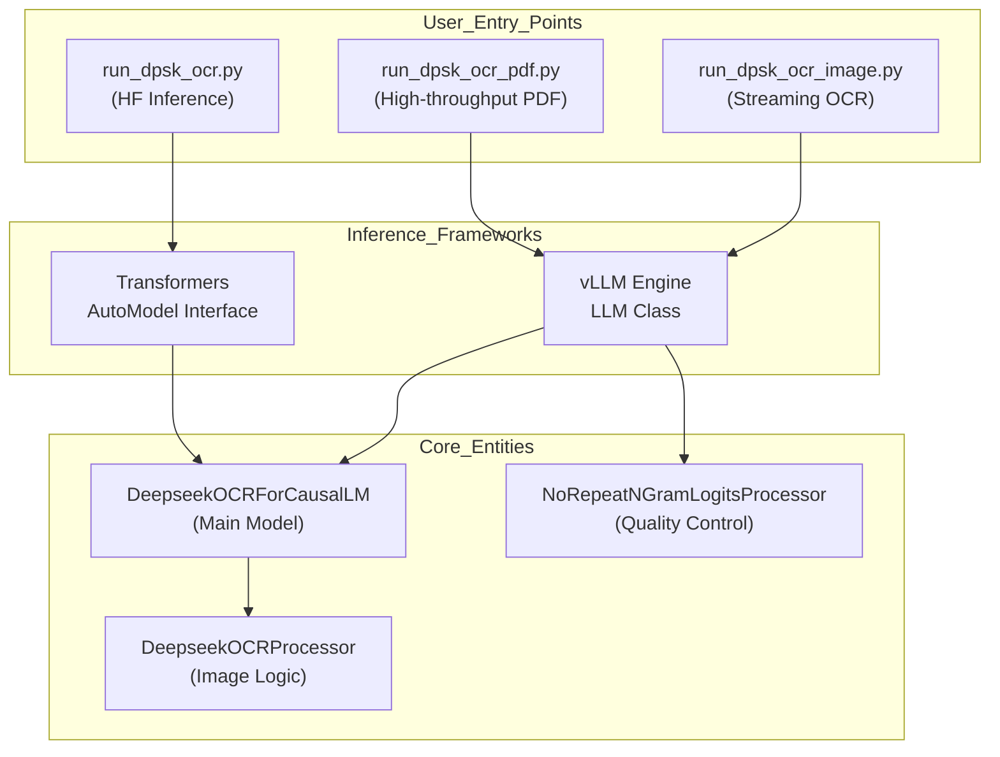
**Sources:** [README.md:91-107](), [README.md:119-129](), [README.md:168-176]()

---

### Dual Framework Approach

DeepSeek-OCR maintains two distinct implementation paths to satisfy different performance requirements.

#### 1. vLLM Framework (High Throughput)
The vLLM implementation is located in `DeepSeek-OCR-vllm/`. It is optimized for batch processing and high concurrency.
*   **Engine:** Uses the `vllm.LLM` class for execution [README.md:124-129]().
*   **Repetition Control:** Implements `NGramPerReqLogitsProcessor` (also referred to as `NoRepeatNGramLogitsProcessor`) to prevent the model from getting stuck in repetitive loops during long document generation [README.md:120-129]().
*   **Sampling:** Configured via `SamplingParams` with specific `extra_args` for n-gram windowing [README.md:147-157]().

#### 2. Transformers Framework (Research & Control)
The Transformers implementation is located in `DeepSeek-OCR-hf/`. It exposes the `model.infer()` method for direct manipulation of the vision pipeline.
*   **Model Loading:** Uses `AutoModel.from_pretrained` with `trust_remote_code=True` [README.md:174-175]().
*   **Inference Method:** The `model.infer()` function allows users to toggle `crop_mode`, `base_size`, and `test_compress` dynamically [README.md:183]().

**Sources:** [README.md:109-164](), [README.md:165-189]()

---

## Model Architecture: DeepseekOCRForCausalLM

The core of the system is the `DeepseekOCRForCausalLM` class. It employs a dual-encoder vision system to capture both high-level semantics and fine-grained spatial details.

Title: DeepseekOCRForCausalLM Internal Structure
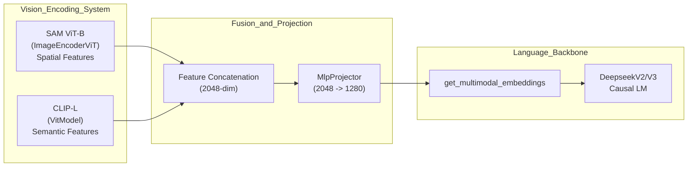

### Vision Encoders
1.  **SAM ViT-B:** Built via `build_sam_vit_b`. This encoder focuses on spatial features and fine-grained details necessary for character recognition [README.md:176-183]().
2.  **CLIP-L:** Built via `build_clip_l`. This encoder provides semantic context, helping the model understand the overall structure of the document or image [README.md:176-183]().

### Feature Projection
The `MlpProjector` handles the dimensionality reduction from the combined vision encoders (2048 dimensions) to the language model's embedding space (1280 dimensions). It supports different strategies such as `downsample`, `split`, and `hybrid` projection [README.md:183]().

**Sources:** [README.md:168-183]()

---

## Resolution and Processing Modes

DeepSeek-OCR handles images using several resolution modes, ranging from static native resolutions to a dynamic multi-scale approach.

### Native Resolution Modes
These modes process the image at a fixed size, resulting in a constant number of vision tokens:
*   **Tiny:** 512×512 (64 tokens) [README.md:193]()
*   **Small:** 640×640 (100 tokens) [README.md:194]()
*   **Base:** 1024×1024 (256 tokens) [README.md:195]()
*   **Large:** 1280×1280 (400 tokens) [README.md:196]()

### Dynamic Resolution (Gundam Mode)
The "Gundam" mode is the most advanced processing strategy. It uses an asymmetric approach:
1.  **Global View:** 1 view at `1024×1024` resolution to capture layout [README.md:198]().
2.  **Local Views:** `n` crops at `640×640` resolution to capture fine text [README.md:198]().
3.  **Integration:** The `DeepseekOCRProcessor` manages the cropping and inserts special tokens like `view_separator` and `image_newline` to maintain spatial relationships [README.md:183]().

**Sources:** [README.md:183](), [README.md:191-199]()

---

# Page: Getting Started

# Getting Started

<details>
<summary>Relevant source files</summary>

The following files were used as context for generating this wiki page:

- [README.md](README.md)
- [requirements.txt](requirements.txt)

</details>


This page guides you through installing DeepSeek-OCR and running your first inference. The system provides two parallel inference frameworks: **vLLM** for high-throughput production workloads and **Transformers** for research and experimentation. Both frameworks share the same underlying model checkpoint.

For detailed usage of each framework, see [Quick Start with Transformers](#2.2) and [Quick Start with vLLM](#2.3). For comprehensive configuration options, see [Configuration System](#3.3).

---

## Overview of Setup Process

The following diagram shows the installation and initialization workflow:

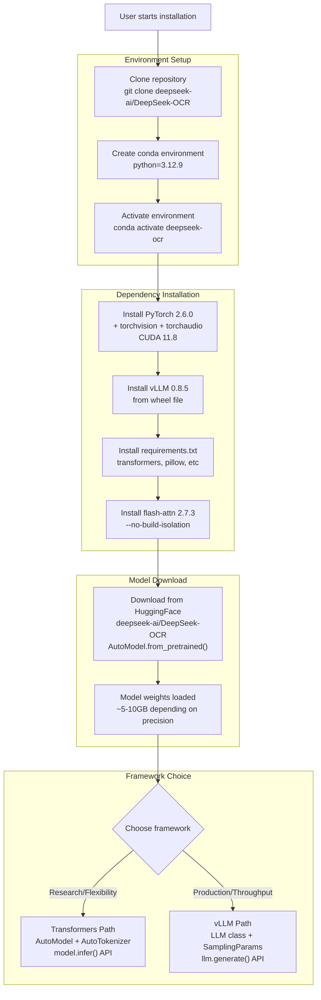

**Sources:** [README.md:67-88]()

---

## Prerequisites

### Hardware Requirements

| Component | Minimum | Recommended |
|-----------|---------|-------------|
| GPU | NVIDIA GPU with 24GB+ VRAM | A100 40GB or H100 |
| RAM | 32GB | 64GB+ |
| Storage | 20GB free space | 50GB+ for multiple models |
| CUDA | 11.8 | 11.8 or 12.x |

The model requires significant GPU memory, especially when using dynamic cropping (Gundam mode) with high-resolution images. For batch processing, memory requirements scale with batch size and image resolution.

### Software Requirements

| Software | Version | Notes |
|----------|---------|-------|
| Python | 3.12.9 | Tested version [README.md:76]() |
| CUDA | 11.8 | Required for GPU acceleration [README.md:69]() |
| PyTorch | 2.6.0 | Specific version for compatibility [README.md:83]() |
| vLLM | 0.8.5 | Custom build with DeepSeek-OCR support [README.md:81]() |
| flash-attn | 2.7.3 | Required for efficient attention [README.md:86]() |

**Sources:** [README.md:68-87]()

---

## Installation Steps

### Step 1: Clone Repository

```bash
git clone https://github.com/deepseek-ai/DeepSeek-OCR.git
cd DeepSeek-OCR
```

The repository structure includes two main directories:
- `DeepSeek-OCR-vllm/`: vLLM inference scripts and configuration [README.md:94]()
- `DeepSeek-OCR-hf/`: Transformers inference scripts [README.md:187]()

### Step 2: Create Conda Environment

```bash
conda create -n deepseek-ocr python=3.12.9 -y
conda activate deepseek-ocr
```

Using a dedicated conda environment prevents dependency conflicts with other projects. [README.md:74-78]()

### Step 3: Install PyTorch with CUDA 11.8

```bash
pip install torch==2.6.0 torchvision==0.21.0 torchaudio==2.6.0 \
    --index-url https://download.pytorch.org/whl/cu118
```

**Important:** The CUDA 11.8 version is required as per the official environment specification. [README.md:69](), [README.md:83]()

### Step 4: Install vLLM

Download the vLLM 0.8.5 wheel file from the [vLLM releases page](https://github.com/vllm-project/vllm/releases/tag/v0.8.5), then:

```bash
pip install vllm-0.8.5+cu118-cp38-abi3-manylinux1_x86_64.whl
```

**Note:** You may see a warning about transformers version compatibility: `vllm 0.8.5+cu118 requires transformers>=4.51.1`. This can be safely ignored if you're using both vLLM and Transformers in the same environment. [README.md:88]()

### Step 5: Install Additional Requirements

```bash
pip install -r requirements.txt
```

This installs packages including:
- `transformers`: For the HuggingFace API [requirements.txt:1]()
- `pillow`: Image processing [requirements.txt:8]()
- `PyMuPDF`: PDF handling [requirements.txt:3]()
- Additional utilities like `einops`, `easydict`, and `addict`. [requirements.txt:5-7]()

### Step 6: Install Flash Attention

```bash
pip install flash-attn==2.7.3 --no-build-isolation
```

Flash Attention is critical for performance. The `--no-build-isolation` flag ensures proper compilation. [README.md:86]()

**Sources:** [README.md:67-88](), [requirements.txt:1-10]()

---

## Model Download and Initialization

The model weights are automatically downloaded from HuggingFace on first use. The following diagram shows how model loading works:

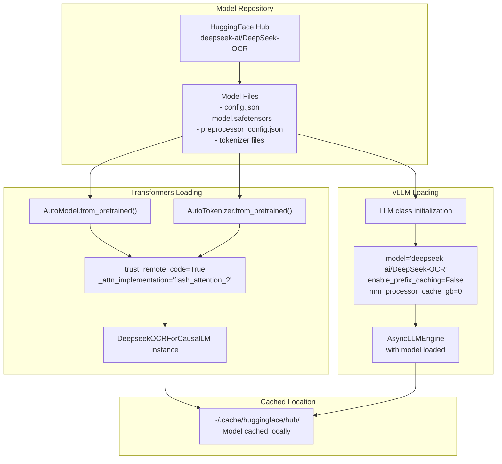

### Transformers Model Loading

```python
from transformers import AutoModel, AutoTokenizer
import torch

model_name = 'deepseek-ai/DeepSeek-OCR'

# Load tokenizer
tokenizer = AutoTokenizer.from_pretrained(
    model_name, 
    trust_remote_code=True
)

# Load model with flash attention
model = AutoModel.from_pretrained(
    model_name,
    _attn_implementation='flash_attention_2',
    trust_remote_code=True,
    use_safetensors=True
)

# Move to GPU and set dtype
model = model.eval().cuda().to(torch.bfloat16)
```

**Key Parameters:**
- `trust_remote_code=True`: Required because the model uses custom code. [README.md:174-175]()
- `_attn_implementation='flash_attention_2'`: Enables efficient attention. [README.md:175]()
- `use_safetensors=True`: Uses the safer safetensors format. [README.md:175]()
- `torch.bfloat16`: Reduces memory usage while maintaining quality. [README.md:176]()

### vLLM Model Loading

```python
from vllm import LLM, SamplingParams
from vllm.model_executor.models.deepseek_ocr import NGramPerReqLogitsProcessor

# Initialize vLLM engine
llm = LLM(
    model="deepseek-ai/DeepSeek-OCR",
    enable_prefix_caching=False,
    mm_processor_cache_gb=0,
    logits_processors=[NGramPerReqLogitsProcessor]
)
```

**Key Parameters:**
- `enable_prefix_caching=False`: Disables prefix caching for vision models. [README.md:126]()
- `mm_processor_cache_gb=0`: Controls multimodal processor cache size. [README.md:127]()
- `logits_processors`: Adds n-gram repetition prevention using `NGramPerReqLogitsProcessor`. [README.md:120](), [README.md:128]()

**Sources:** [README.md:117-130](), [README.md:168-176]()

---

## Framework Comparison

The following table summarizes when to use each framework:

| Aspect | Transformers | vLLM |
|--------|-------------|------|
| **Use Case** | Research, experimentation | Production serving, batch processing [README.md:100]() |
| **API Style** | `model.infer()` method [README.md:183]() | `llm.generate()` method [README.md:159]() |
| **Entry Points** | `run_dpsk_ocr.py` [README.md:188]() | `run_dpsk_ocr_image.py`, `run_dpsk_ocr_pdf.py` [README.md:98-102]() |
| **Throughput** | Single-image focus | ~2500 tokens/s on A100-40G [README.md:100]() |
| **Memory Efficiency** | Standard PyTorch | Optimized batching [README.md:131]() |
| **Streaming** | Not supported | Supported (image script) [README.md:96]() |

---

## Framework-Specific Entry Points

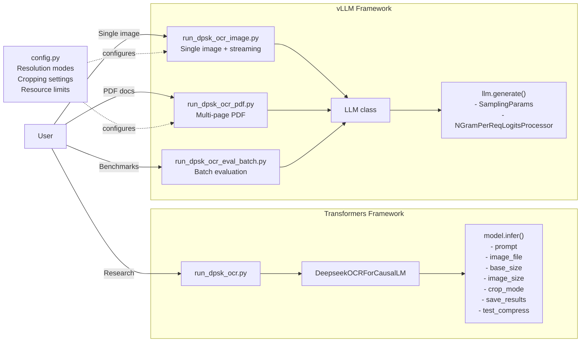

**Sources:** [README.md:89-107](), [README.md:117-163](), [README.md:164-188]()

---

## Resolution Modes

DeepSeek-OCR supports several native and dynamic resolution modes:

| Mode | Resolution | Vision Tokens |
|------|-----------|---------------|
| **Tiny** | 512×512 | 64 |
| **Small** | 640×640 | 100 |
| **Base** | 1024×1024 | 256 |
| **Large** | 1280×1280 | 400 |
| **Gundam** ⭐ | n×640×640 + 1×1024×1024 | Variable |

**Gundam mode** is the dynamic resolution setting that combines a global base view with multiple high-resolution crops. [README.md:191-198]()

---

## Common Prompts

DeepSeek-OCR uses task-specific prompts to guide generation:

```python
# Document OCR with layout preservation
prompt = "<image>\n<|grounding|>Convert the document to markdown. "

# General image OCR
prompt = "<image>\n<|grounding|>OCR this image."

# Simple text extraction (no layout)
prompt = "<image>\nFree OCR."

# Figure/chart parsing
prompt = "<image>\nParse the figure."

# Image description
prompt = "<image>\nDescribe this image in detail."

# Object localization/recognition
prompt = "<image>\nLocate <|ref|>text to find<|/ref|> in the image."
```

**Sources:** [README.md:199-208]()

---

## Next Steps

1. **Try Quick Examples:**
   - For research workflows, see [Quick Start with Transformers](#2.2).
   - For production workflows, see [Quick Start with vLLM](#2.3).
2. **Installation Troubleshooting:** If you encounter issues with dependencies or CUDA, refer to the [Installation](#2.1) child page.
3. **Advanced Configuration:** Adjust settings in `config.py` for vLLM or `model.infer()` parameters for Transformers. See [Configuration System](#3.3).

**Sources:** [README.md:1-239]()

---

# Page: Installation

# Installation

<details>
<summary>Relevant source files</summary>

The following files were used as context for generating this wiki page:

- [README.md](README.md)
- [requirements.txt](requirements.txt)

</details>


This page provides detailed instructions for installing DeepSeek-OCR and all required dependencies. Installation involves setting up a Python environment, installing GPU-accelerated deep learning libraries, and downloading the pre-trained model weights.

For instructions on running your first OCR inference after installation, see [Quick Start with Transformers]() or [Quick Start with vLLM](). For detailed configuration of the installed system, see [Configuration System]().

---

## Prerequisites

DeepSeek-OCR requires a CUDA-compatible GPU environment for inference. The system has been tested with the following specifications:

| Component | Requirement | Notes |
|-----------|-------------|-------|
| **CUDA Version** | 11.8 | Required for GPU acceleration |
| **Python Version** | 3.12.9 | Tested version; 3.8+ may work |
| **GPU Memory** | ≥40GB recommended | A100-40G tested; smaller GPUs may work with reduced batch sizes |
| **Operating System** | Linux | Primary development platform |

**Sources:** [README.md:69-69]()

---

## Installation Flow Overview

The installation process follows a specific sequence to ensure compatibility between PyTorch, vLLM, and other dependencies:

### Installation Sequence Diagram
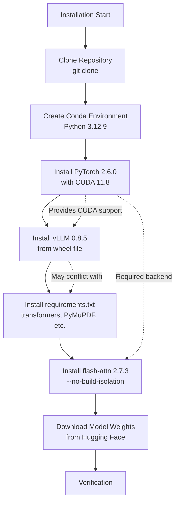

**Important:** The installation order is critical. Installing vLLM before PyTorch or flash-attention before other packages may cause compatibility issues.

**Sources:** [README.md:68-87]()

---

## Step 1: Clone Repository

Clone the DeepSeek-OCR repository from GitHub:

```bash
git clone https://github.com/deepseek-ai/DeepSeek-OCR.git
cd DeepSeek-OCR
```

This creates the following directory structure:

```
DeepSeek-OCR/
├── DeepSeek-OCR-master/
│   ├── DeepSeek-OCR-vllm/      # vLLM inference code
│   └── DeepSeek-OCR-hf/        # Transformers inference code
├── README.md
├── requirements.txt
└── assets/
```

**Sources:** [README.md:70-73]()

---

## Step 2: Create Conda Environment

Create a dedicated conda environment to isolate DeepSeek-OCR dependencies:

```bash
conda create -n deepseek-ocr python=3.12.9 -y
conda activate deepseek-ocr
```

The environment name `deepseek-ocr` can be customized, but all subsequent commands assume this environment is activated.

**Sources:** [README.md:74-78]()

---

## Step 3: Install Core Dependencies

### PyTorch with CUDA Support

Install PyTorch 2.6.0 with CUDA 11.8 support:

```bash
pip install torch==2.6.0 torchvision==0.21.0 torchaudio==2.6.0 --index-url https://download.pytorch.org/whl/cu118
```

This command:
- Installs PyTorch with CUDA 11.8 backend.
- Includes `torchvision` for image processing utilities.
- Uses the CUDA 11.8 wheel index for GPU acceleration.

**Sources:** [README.md:83-83]()

### vLLM Installation

vLLM 0.8.5 must be installed from a pre-built wheel file for CUDA 11.8 compatibility. Download the wheel from the [vLLM v0.8.5 release page](https://github.com/vllm-project/vllm/releases/tag/v0.8.5):

```bash
# Download the wheel file first (see link in README)
pip install vllm-0.8.5+cu118-cp38-abi3-manylinux1_x86_64.whl
```

Alternatively, for the upstream version of vLLM (supporting `NGramPerReqLogitsProcessor`), use the nightly build:

```bash
uv pip install -U vllm --pre --extra-index-url https://wheels.vllm.ai/nightly
```

**Sources:** [README.md:81-84](), [README.md:109-115]()

---

## Step 4: Install Python Dependencies

Install the remaining Python packages from `requirements.txt`:

```bash
pip install -r requirements.txt
```

### Dependency Map
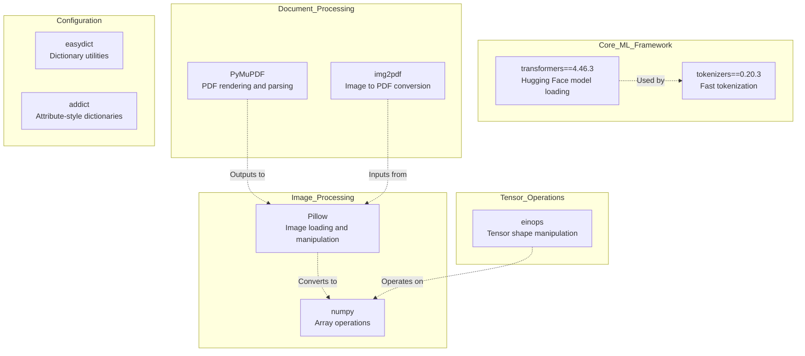

| Package | Version | Purpose in DeepSeek-OCR |
|---------|---------|-------------------------|
| `transformers` | 4.46.3 | Model loading, tokenization, Hugging Face integration |
| `tokenizers` | 0.20.3 | Fast text tokenization backend |
| `PyMuPDF` | Latest | PDF document rendering to images |
| `img2pdf` | Latest | Converting image outputs to PDF format |
| `einops` | Latest | Tensor manipulation in vision encoders |
| `easydict` / `addict` | Latest | Configuration management utilities |
| `Pillow` | Latest | Image loading and preprocessing |
| `numpy` | Latest | Numerical array operations |

**Important Compatibility Note:** The README warns about a potential version conflict:
> "if you want vLLM and transformers codes to run in the same environment, you don't need to worry about this installation error like: vllm 0.8.5+cu118 requires transformers>=4.51.1"

This warning indicates that while vLLM 0.8.5 officially requests a newer `transformers`, the project is verified to work with `transformers==4.46.3`.

**Sources:** [README.md:85-88](), [requirements.txt:1-10]()

---

## Step 5: Install Flash Attention

Flash Attention 2.7.3 provides optimized memory-efficient attention mechanisms:

```bash
pip install flash-attn==2.7.3 --no-build-isolation
```

The `--no-build-isolation` flag is critical:
- Allows the build process to access the conda environment's CUDA libraries.
- Flash Attention is used in the Transformers inference path when `_attn_implementation='flash_attention_2'` is specified.

**Sources:** [README.md:86-86](), [README.md:175-175]()

---

## Step 6: Download Model Weights

DeepSeek-OCR model weights are hosted on Hugging Face Hub at [`deepseek-ai/DeepSeek-OCR`](https://huggingface.co/deepseek-ai/DeepSeek-OCR).

### Automatic Download
When using the Transformers API, weights download automatically on first use:

```python
from transformers import AutoModel, AutoTokenizer

model_name = 'deepseek-ai/DeepSeek-OCR'
tokenizer = AutoTokenizer.from_pretrained(model_name, trust_remote_code=True)
model = AutoModel.from_pretrained(model_name, _attn_implementation='flash_attention_2', trust_remote_code=True, use_safetensors=True)
```

**Sources:** [README.md:168-175]()

---

## Installation Verification

### File Structure Check
After installation, verify the presence of key execution scripts:

```
DeepSeek-OCR/
├── DeepSeek-OCR-master/
│   ├── DeepSeek-OCR-vllm/
│   │   ├── run_dpsk_ocr_image.py
│   │   ├── run_dpsk_ocr_pdf.py
│   │   ├── run_dpsk_ocr_eval_batch.py
│   │   └── config.py
│   └── DeepSeek-OCR-hf/
│       └── run_dpsk_ocr.py
```

**Sources:** [README.md:94-106](), [README.md:187-188]()

### Quick Test: Transformers API
Verify the Transformers installation path:

```python
import torch
from transformers import AutoModel, AutoTokenizer

# Check CUDA availability
assert torch.cuda.is_available(), "CUDA not available"
print(f"CUDA version: {torch.version.cuda}")

# Load model
model_name = 'deepseek-ai/DeepSeek-OCR'
tokenizer = AutoTokenizer.from_pretrained(model_name, trust_remote_code=True)
model = AutoModel.from_pretrained(model_name, _attn_implementation='flash_attention_2', trust_remote_code=True, use_safetensors=True)
model = model.eval().cuda().to(torch.bfloat16)

print("✓ Model loaded successfully")
```

**Sources:** [README.md:168-176]()

---

## Troubleshooting Common Issues

### Issue: vLLM Transformer Version Warning
**Symptom:** `WARNING: vllm 0.8.5+cu118 requires transformers>=4.51.1`
**Solution:** This warning can be safely ignored. The codebase is tested with `transformers==4.46.3`.

### Issue: CUDA Version Mismatch
**Symptom:** `RuntimeError: CUDA error: no kernel image is available for execution`
**Solution:** Reinstall PyTorch with the correct CUDA 11.8 index:
```bash
pip install torch==2.6.0 --index-url https://download.pytorch.org/whl/cu118
```

**Sources:** [README.md:83-88]()

---

# Page: Quick Start with Transformers

# Quick Start with Transformers

<details>
<summary>Relevant source files</summary>

The following files were used as context for generating this wiki page:

- [DeepSeek-OCR-master/DeepSeek-OCR-hf/run_dpsk_ocr.py](DeepSeek-OCR-master/DeepSeek-OCR-hf/run_dpsk_ocr.py)
- [README.md](README.md)

</details>


This page provides a minimal working example for using DeepSeek-OCR with the HuggingFace Transformers interface. This approach is recommended for research, experimentation, and scenarios requiring fine-grained control over model parameters. For production deployments focused on throughput, see [Quick Start with vLLM](#2.3). For comprehensive parameter documentation, see [Transformers Inference](#3.1).

---

## Prerequisites

Before proceeding with this quick start, ensure you have completed the installation steps described in [Installation](#2.1). The Transformers interface requires:

- **Python**: 3.12.9+ [README.md:76-76]()
- **PyTorch**: 2.6.0 with CUDA 11.8 [README.md:83-83]()
- **Libraries**: `transformers`, `flash-attn==2.7.3` [README.md:85-86]()
- **Model**: Access to `deepseek-ai/DeepSeek-OCR` on HuggingFace Hub [README.md:172-172]()

**Sources**: [README.md:67-86](), [README.md:172-172]()

---

## Minimal Working Example

The following example demonstrates the core workflow for processing a single image using the Transformers interface:

```python
from transformers import AutoModel, AutoTokenizer
import torch
import os

os.environ["CUDA_VISIBLE_DEVICES"] = '0'
model_name = 'deepseek-ai/DeepSeek-OCR'

# Load tokenizer and model with remote code trust enabled
tokenizer = AutoTokenizer.from_pretrained(model_name, trust_remote_code=True)
model = AutoModel.from_pretrained(
    model_name, 
    _attn_implementation='flash_attention_2', 
    trust_remote_code=True, 
    use_safetensors=True
)
model = model.eval().cuda().to(torch.bfloat16)

# Define task and inputs
prompt = "<image>\n<|grounding|>Convert the document to markdown. "
image_file = 'your_image.jpg'
output_path = 'your/output/dir'

# Execute inference
res = model.infer(
    tokenizer, 
    prompt=prompt, 
    image_file=image_file, 
    output_path=output_path, 
    base_size=1024, 
    image_size=640, 
    crop_mode=True, 
    save_results=True, 
    test_compress=True
)
```

**Sources**: [README.md:166-183](), [DeepSeek-OCR-master/DeepSeek-OCR-hf/run_dpsk_ocr.py:1-34]()

---

## Code Walkthrough

### Transformers Inference Workflow

The diagram below illustrates the data flow from initialization to the final OCR output using the `model.infer()` method.

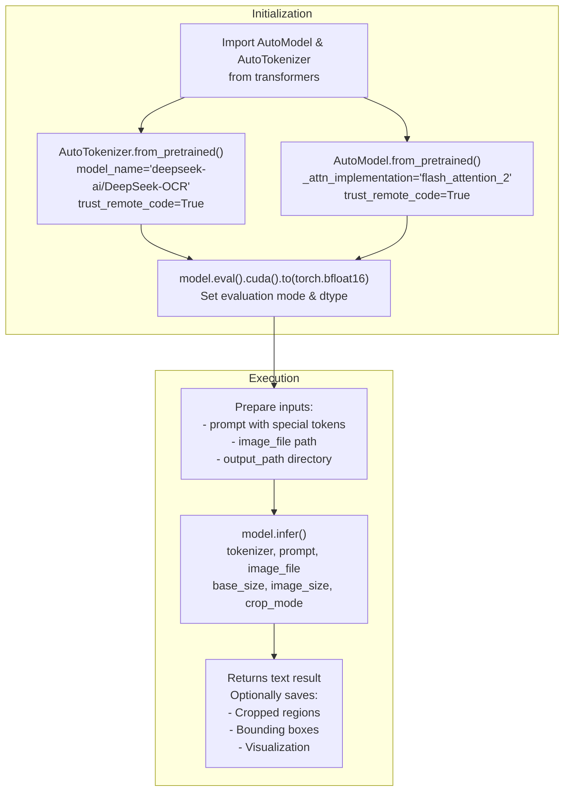

**Sources**: [README.md:166-183](), [DeepSeek-OCR-master/DeepSeek-OCR-hf/run_dpsk_ocr.py:1-34]()

### Component Mapping

This diagram maps high-level system concepts to specific classes and methods found in the codebase.

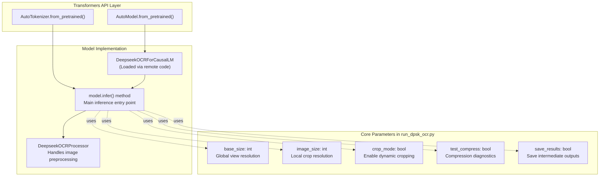

**Sources**: [README.md:166-183](), [DeepSeek-OCR-master/DeepSeek-OCR-hf/run_dpsk_ocr.py:1-34]()

---

## Resolution Modes

The `model.infer()` method supports multiple resolution configurations by adjusting `base_size`, `image_size`, and `crop_mode`. These settings directly impact the number of vision tokens generated.

| Mode | `base_size` | `image_size` | `crop_mode` | Vision Tokens | Use Case |
|------|-------------|--------------|-------------|---------------|----------|
| **Tiny** | 512 | 512 | False | 64 | Minimal resource usage [README.md:193]() |
| **Small** | 640 | 640 | False | 100 | Lightweight processing [README.md:194]() |
| **Base** | 1024 | 1024 | False | 256 | Standard single-scale [README.md:195]() |
| **Large** | 1280 | 1280 | False | 400 | High-resolution single-scale [README.md:196]() |
| **Gundam** ⭐ | 1024 | 640 | True | Variable | **Recommended default** [README.md:198]() |

### Gundam Mode (Recommended)

The Gundam mode implements **dynamic resolution** via an asymmetric cropping strategy:
- **Global view**: A `base_size` × `base_size` (1024×1024) version provides document-level context. [DeepSeek-OCR-master/DeepSeek-OCR-hf/run_dpsk_ocr.py:32]()
- **Local crops**: Multiple `image_size` × `image_size` (640×640) tiles preserve fine-grained details. [DeepSeek-OCR-master/DeepSeek-OCR-hf/run_dpsk_ocr.py:32]()
- **Adaptive**: The number of crops is determined dynamically based on the image aspect ratio. [README.md:198]()

**Sources**: [README.md:192-198](), [DeepSeek-OCR-master/DeepSeek-OCR-hf/run_dpsk_ocr.py:26-33]()

---

## Key Parameters

### Core Inference Parameters

The `model.infer()` signature allows for granular control over the OCR process.

| Parameter | Type | Default | Description |
|-----------|------|---------|-------------|
| `tokenizer` | `AutoTokenizer` | Required | Tokenizer instance for text processing [DeepSeek-OCR-master/DeepSeek-OCR-hf/run_dpsk_ocr.py:25]() |
| `prompt` | `str` | Required | Task prompt with special tokens [DeepSeek-OCR-master/DeepSeek-OCR-hf/run_dpsk_ocr.py:25]() |
| `image_file` | `str` | Required | Path to input image file [DeepSeek-OCR-master/DeepSeek-OCR-hf/run_dpsk_ocr.py:25]() |
| `output_path` | `str` | `' '` | Directory for saving intermediate results [DeepSeek-OCR-master/DeepSeek-OCR-hf/run_dpsk_ocr.py:25]() |
| `base_size` | `int` | 1024 | Resolution for global view processing [DeepSeek-OCR-master/DeepSeek-OCR-hf/run_dpsk_ocr.py:25]() |
| `image_size` | `int` | 640 | Resolution for local crop processing [DeepSeek-OCR-master/DeepSeek-OCR-hf/run_dpsk_ocr.py:25]() |
| `crop_mode` | `bool` | True | Enable dynamic multi-scale cropping [DeepSeek-OCR-master/DeepSeek-OCR-hf/run_dpsk_ocr.py:25]() |
| `test_compress` | `bool` | False | Enable compression ratio diagnostics [DeepSeek-OCR-master/DeepSeek-OCR-hf/run_dpsk_ocr.py:25]() |
| `save_results` | `bool` | False | Save cropped regions and visualizations [DeepSeek-OCR-master/DeepSeek-OCR-hf/run_dpsk_ocr.py:25]() |

**Sources**: [README.md:182-183](), [DeepSeek-OCR-master/DeepSeek-OCR-hf/run_dpsk_ocr.py:25-34]()

### Special Tokens in Prompts

Prompts must include the `<image>` placeholder to mark the vision embedding insertion point. [README.md:179]()

- `<image>`: Vision embedding placeholder. [README.md:179]()
- `<|grounding|>`: Triggers spatial output (coordinates/bounding boxes). [README.md:179]()
- `<|ref|>...<|/ref|>`: Used for text localization (REC) tasks. [README.md:207]()

**Example prompts**:
```python
# Markdown conversion with grounding
"<image>\n<|grounding|>Convert the document to markdown. "

# General OCR
"<image>\nFree OCR. "

# Detailed description
"<image>\nDescribe this image in detail. "
```

**Sources**: [README.md:179-179](), [README.md:201-209]()

---

## Flash Attention Configuration

The example explicitly specifies `_attn_implementation='flash_attention_2'` when loading the model to optimize performance. [README.md:175]()

```python
model = AutoModel.from_pretrained(
    model_name, 
    _attn_implementation='flash_attention_2', 
    trust_remote_code=True, 
    use_safetensors=True
)
```

Flash Attention 2 provides memory efficiency and speed improvements, essential for processing high-resolution images or multi-crop Gundam mode. This requires the `flash-attn` package. [README.md:86]()

**Sources**: [README.md:86-86](), [README.md:175-175](), [DeepSeek-OCR-master/DeepSeek-OCR-hf/run_dpsk_ocr.py:13-13]()

---

## Next Steps

- **Detailed Configuration**: See [Transformers Inference](#3.1) for comprehensive parameter documentation.
- **Batch Processing**: See [Batch Evaluation](#3.2.3) for processing multiple images efficiently.
- **vLLM Comparison**: See [Quick Start with vLLM](#2.3) for production-optimized inference.
- **Custom Prompts**: See [Working with Prompts](#3.4) for task-specific prompt engineering.
- **Output Parsing**: See [Understanding Output](#3.5) for extracting structured information.

**Sources**: [README.md:58-62]()

---

# Page: Quick Start with vLLM

# Quick Start with vLLM

<details>
<summary>Relevant source files</summary>

The following files were used as context for generating this wiki page:

- [DeepSeek-OCR-master/DeepSeek-OCR-vllm/config.py](DeepSeek-OCR-master/DeepSeek-OCR-vllm/config.py)
- [README.md](README.md)

</details>


This page provides a minimal working example for running DeepSeek-OCR inference using the vLLM framework. vLLM is optimized for high-throughput production serving with efficient memory management, batching, and optional streaming output. It achieves approximately 2500 tokens/s on an A100-40G GPU for PDF processing.

For research and development with fine-grained control over inference parameters, see [Quick Start with Transformers](#2.2). For detailed configuration options and performance tuning, see [Configuration System](#3.3). For production workflows including PDF and batch processing, see [vLLM Inference](#3.2).

**Sources**: [README.md:55-56](), [README.md:90-103]()

---

## Basic vLLM Inference

### Minimal Example

The simplest way to run inference with vLLM uses the synchronous `LLM` class with batched input. This approach utilizes the upstream vLLM integration (v0.11.1+), where the model is registered as `deepseek-ai/DeepSeek-OCR`.

```python
from vllm import LLM, SamplingParams
from vllm.model_executor.models.deepseek_ocr import NGramPerReqLogitsProcessor
from PIL import Image

# Initialize model
llm = LLM(
    model="deepseek-ai/DeepSeek-OCR",
    enable_prefix_caching=False,
    mm_processor_cache_gb=0,
    logits_processors=[NGramPerReqLogitsProcessor]
)

# Load images
image_1 = Image.open("path/to/image_1.png").convert("RGB")
image_2 = Image.open("path/to/image_2.png").convert("RGB")
prompt = "<image>\nFree OCR."

# Prepare batched input
model_input = [
    {
        "prompt": prompt,
        "multi_modal_data": {"image": image_1}
    },
    {
        "prompt": prompt,
        "multi_modal_data": {"image": image_2}
    }
]

# Configure sampling
sampling_param = SamplingParams(
    temperature=0.0,
    max_tokens=8192,
    # ngram logit processor args
    extra_args=dict(
        ngram_size=30,
        window_size=90,
        whitelist_token_ids={128821, 128822},  # whitelist: <td>, </td>
    ),
    skip_special_tokens=False,
)

# Generate output
model_outputs = llm.generate(model_input, sampling_param)

# Print output
for output in model_outputs:
    print(output.outputs[0].text)
```

**Sources**: [README.md:118-164]()

---

## vLLM Inference Workflow

The following diagram maps the high-level inference workflow to specific code entities within the vLLM framework.

### Logic to Code Mapping: vLLM Inference
| System Concept | Code Entity | File Reference |
| :--- | :--- | :--- |
| Model Runner | `vllm.LLM` | [README.md:124]() |
| Generation Config | `vllm.SamplingParams` | [README.md:147]() |
| Repetition Control | `NGramPerReqLogitsProcessor` | [README.md:120]() |
| Data Container | `multi_modal_data` | [README.md:139]() |

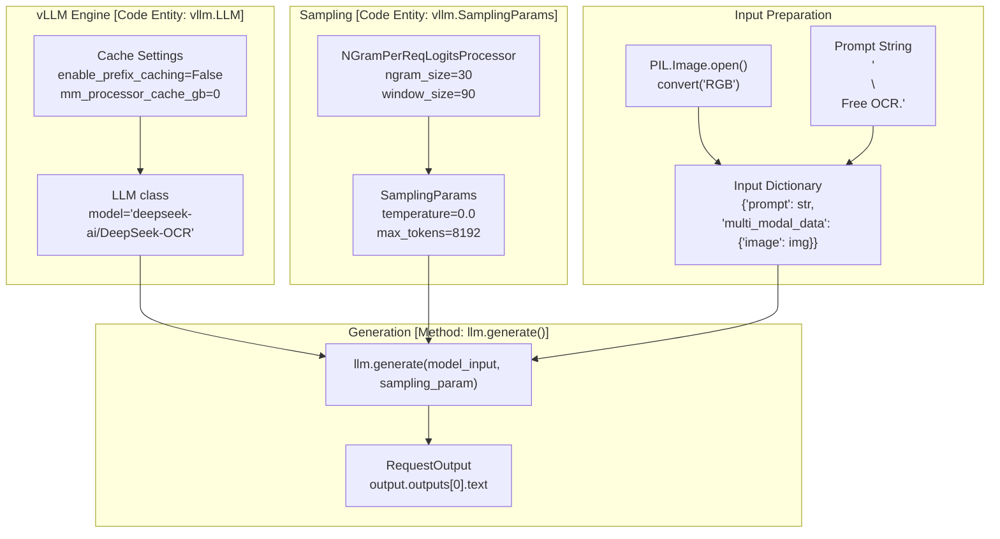

**Sources**: [README.md:118-164]()

---

## Configuration and Modes

The vLLM implementation supports multiple resolution modes, defined by `BASE_SIZE`, `IMAGE_SIZE`, and `CROP_MODE`. These are typically configured in the local `config.py`.

### Supported Modes
| Mode | Base Size | Image Size | Crop Mode | Vision Tokens |
| :--- | :--- | :--- | :--- | :--- |
| **Tiny** | 512 | 512 | False | 64 |
| **Small** | 640 | 640 | False | 100 |
| **Base** | 1024 | 1024 | False | 256 |
| **Large** | 1280 | 1280 | False | 400 |
| **Gundam** | 1024 | 640 | True | Dynamic |

**Sources**: [DeepSeek-OCR-master/DeepSeek-OCR-vllm/config.py:1-10](), [README.md:191-198]()

### Image Preprocessing Pipeline

When using the local scripts in `DeepSeek-OCR-vllm/`, images are handled via the `DeepseekOCRProcessor`.

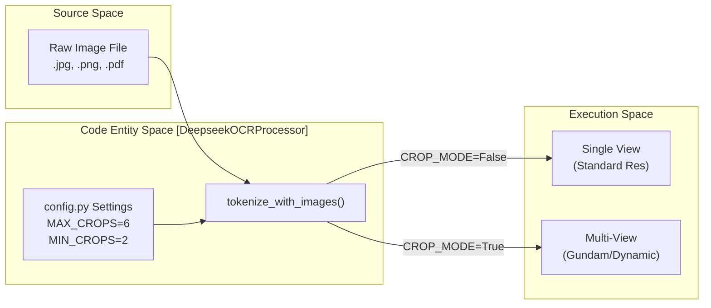

**Sources**: [DeepSeek-OCR-master/DeepSeek-OCR-vllm/config.py:8-12](), [README.md:191-198]()

---

## Local vLLM Scripts

The repository provides three entry point scripts for different use cases within the `DeepSeek-OCR-vllm` directory.

| Script | Purpose |
| :--- | :--- |
| `run_dpsk_ocr_image.py` | Single image processing with streaming output support. |
| `run_dpsk_ocr_pdf.py` | Multi-page PDF processing with high concurrency (~2500 tokens/s). |
| `run_dpsk_ocr_eval_batch.py` | Batch evaluation for benchmarks like Omnidocbench. |

**Usage Example**:
```bash
cd DeepSeek-OCR-master/DeepSeek-OCR-vllm
# Edit config.py to set INPUT_PATH and OUTPUT_PATH
python run_dpsk_ocr_image.py
```

**Sources**: [README.md:91-107](), [DeepSeek-OCR-master/DeepSeek-OCR-vllm/config.py:19-25]()

---

## Key Configuration Parameters

The `config.py` file controls both the vision processing and the vLLM engine resource allocation.

### Resource Management
- `MAX_CONCURRENCY`: Controls the number of concurrent requests. Lower this if GPU memory is limited. [DeepSeek-OCR-master/DeepSeek-OCR-vllm/config.py:13]()
- `NUM_WORKERS`: Number of CPU workers for image preprocessing (resize/padding). [DeepSeek-OCR-master/DeepSeek-OCR-vllm/config.py:14]()
- `MAX_CROPS`: Maximum number of crops for Gundam mode (default 6, max 9). [DeepSeek-OCR-master/DeepSeek-OCR-vllm/config.py:12]()

### Sampling and Logits
The `NGramPerReqLogitsProcessor` (or `NoRepeatNGramLogitsProcessor` in some versions) is used to prevent repetitive text generation, which is common in OCR tasks.

- `ngram_size`: The size of the n-gram to check for repetition (e.g., 30). [README.md:152]()
- `window_size`: The look-back window for checking repetitions (e.g., 90). [README.md:153]()
- `whitelist_token_ids`: Tokens exempt from the repetition penalty, such as HTML tags `<td>` (128821) and `</td>` (128822). [README.md:154]()

**Sources**: [DeepSeek-OCR-master/DeepSeek-OCR-vllm/config.py:11-14](), [README.md:147-157]()

---

## Next Steps

- For detailed vLLM usage patterns, see [vLLM Inference](#3.2)
- For configuration options and performance tuning, see [Configuration System](#3.3)
- For prompt engineering and task-specific examples, see [Working with Prompts](#3.4)
- For processing PDF documents, see [PDF Document Processing](#3.2.2)
- For batch evaluation workflows, see [Batch Evaluation](#3.2.3)

---

# Page: User Guide

# User Guide

<details>
<summary>Relevant source files</summary>

The following files were used as context for generating this wiki page:

- [DeepSeek-OCR-master/DeepSeek-OCR-vllm/config.py](DeepSeek-OCR-master/DeepSeek-OCR-vllm/config.py)
- [README.md](README.md)

</details>


This page provides a comprehensive guide for using DeepSeek-OCR in various scenarios. It covers the two main inference pathways (Transformers and vLLM), configuration options, prompt engineering, and output interpretation.

For installation instructions and first-time setup, see [Getting Started](#2). For deep technical details on the model architecture, see [Architecture](#4). For developers extending the system, see [Developer Guide](#5).

## Overview

DeepSeek-OCR provides two distinct inference pathways optimized for different use cases:

1.  **Transformers Inference** ([Transformers Inference](#3.1)) - Standard HuggingFace interface for development, experimentation, and single-image processing.
2.  **vLLM Inference** ([vLLM Inference](#3.2)) - High-throughput GPU-optimized path for production workloads, batch processing, and PDF documents.

Both pathways use the same underlying model architecture but provide different execution environments and APIs. The system is highly configurable through a centralized configuration file and supports multiple operational modes for different resolution/performance trade-offs.

## Inference Pathway Selection

The following decision tree helps determine which inference pathway to use:

Title: Inference Selection Logic
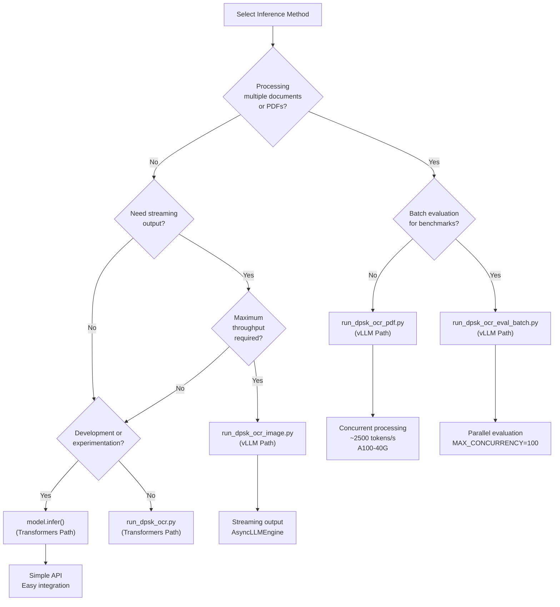

**Key Differences:**

| Aspect | Transformers | vLLM |
| :--- | :--- | :--- |
| **Entry Point** | `model.infer()` method | Script execution (`run_dpsk_ocr_*.py`) |
| **Configuration** | Function parameters | [DeepSeek-OCR-master/DeepSeek-OCR-vllm/config.py:1-43]() |
| **Output Mode** | Synchronous | Streaming or batch |
| **Throughput** | Standard | High (~2500 tokens/s) |
| **GPU Memory** | Standard | Optimized |
| **Use Case** | Development, single images | Production, PDFs, batches |

Sources: [README.md:90-107](), [DeepSeek-OCR-master/DeepSeek-OCR-vllm/config.py:1-43]()

## Common Usage Workflows

### Workflow 1: Single Image OCR (Transformers)

Title: Transformers Inference Workflow
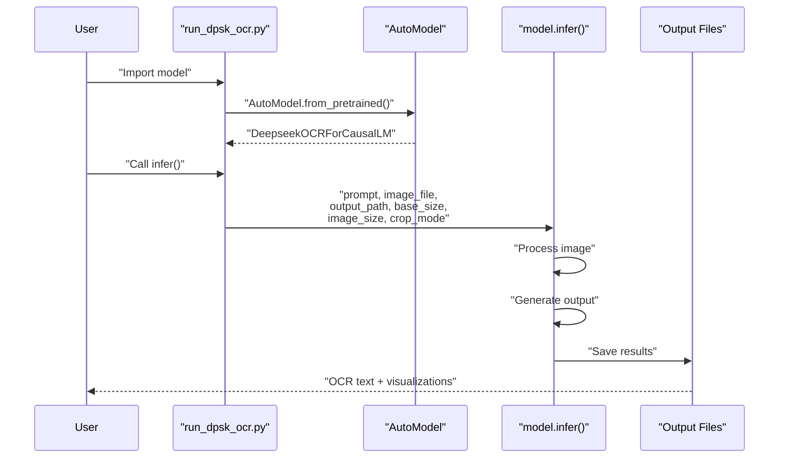

**Code Reference:**
```python
# [README.md:168-183]()
model = AutoModel.from_pretrained(model_name, 
    _attn_implementation='flash_attention_2', 
    trust_remote_code=True)

res = model.infer(tokenizer, 
    prompt="<image>\n<|grounding|>Convert the document to markdown. ", 
    image_file='your_image.jpg', 
    output_path='your/output/dir', 
    base_size=1024, 
    image_size=640, 
    crop_mode=True)
```

Sources: [README.md:168-183]()

### Workflow 2: PDF Document Processing (vLLM)

Title: vLLM PDF Pipeline
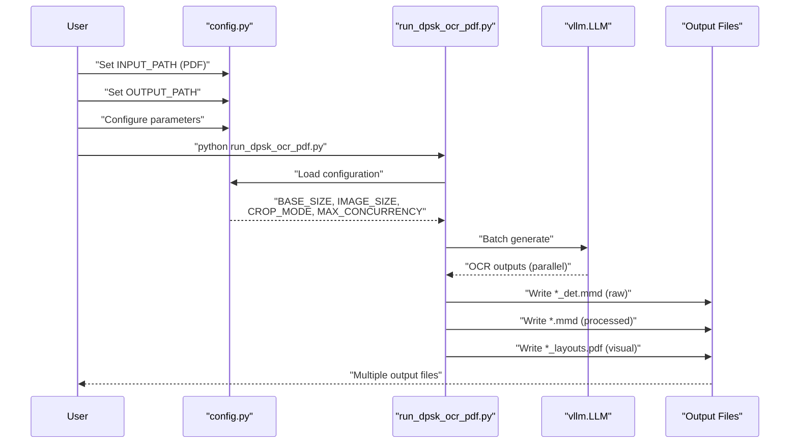

**Configuration Required:**
*   [DeepSeek-OCR-master/DeepSeek-OCR-vllm/config.py:24]() - `INPUT_PATH`: Path to PDF file.
*   [DeepSeek-OCR-master/DeepSeek-OCR-vllm/config.py:25]() - `OUTPUT_PATH`: Directory for outputs.
*   [DeepSeek-OCR-master/DeepSeek-OCR-vllm/config.py:8-12]() - Resolution and cropping settings.
*   [DeepSeek-OCR-master/DeepSeek-OCR-vllm/config.py:13]() - `MAX_CONCURRENCY`: Batch size control.

Sources: [README.md:100-103](), [DeepSeek-OCR-master/DeepSeek-OCR-vllm/config.py:1-43]()

### Workflow 3: Batch Evaluation (vLLM)

Title: Batch Evaluation Architecture
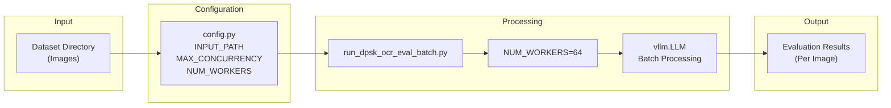

**Key Parameters:**
*   [DeepSeek-OCR-master/DeepSeek-OCR-vllm/config.py:13]() - `MAX_CONCURRENCY=100`: GPU memory-limited batch size.
*   [DeepSeek-OCR-master/DeepSeek-OCR-vllm/config.py:14]() - `NUM_WORKERS=64`: CPU-bound preprocessing parallelism.

Sources: [README.md:104-107](), [DeepSeek-OCR-master/DeepSeek-OCR-vllm/config.py:13-14]()

## Operational Modes

DeepSeek-OCR supports five operational modes that trade off between vision token count, image resolution, and GPU memory usage:

| Mode | Base Size | Image Size | Crop Mode | Vision Tokens | Use Case |
| :--- | :--- | :--- | :--- | :--- | :--- |
| **Tiny** | 512 | 512 | False | 64 | Extremely fast, low memory |
| **Small** | 640 | 640 | False | 100 | Quick processing |
| **Base** | 1024 | 1024 | False | 256 | Balanced |
| **Large** | 1280 | 1280 | False | 400 | High resolution |
| **Gundam** ⭐ | 1024 | 640 | True | 256 + n×100 | Adaptive, production-ready |

**Current Active Mode (Gundam):**
```python
# [DeepSeek-OCR-master/DeepSeek-OCR-vllm/config.py:8-12]()
BASE_SIZE = 1024      # Global view resolution
IMAGE_SIZE = 640      # Local crop resolution  
CROP_MODE = True      # Enable dynamic cropping
MIN_CROPS = 2         # Minimum number of crops
MAX_CROPS = 6         # Maximum crops (GPU memory limited)
```

The **Gundam mode** is recommended for production use. It processes images with one global view and multiple local crops.

Sources: [DeepSeek-OCR-master/DeepSeek-OCR-vllm/config.py:1-12](), [README.md:191-199]()

## Configuration-to-Code Mapping

The following diagram shows how configuration parameters in `config.py` affect system components:

Title: Config Entity Space Mapping
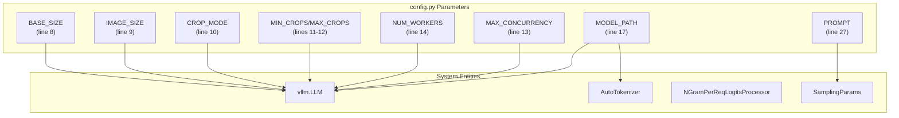

**Parameter Effects:**
*   **BASE_SIZE, IMAGE_SIZE**: Control vision encoder input dimensions.
*   **CROP_MODE**: Enables/disables dynamic cropping for multi-crop processing.
*   **MAX_CONCURRENCY**: Limits vLLM engine batch size to prevent GPU OOM.
*   **NUM_WORKERS**: Controls workers for image pre-processing (resize/padding).

Sources: [DeepSeek-OCR-master/DeepSeek-OCR-vllm/config.py:1-43]()

## Prompt Engineering

DeepSeek-OCR uses task-specific prompts to control output format and behavior.

### Common Prompt Templates

| Task | Prompt | Grounding |
| :--- | :--- | :--- |
| **Document Markdown** | `<image>\n<|grounding|>Convert the document to markdown.` | Yes |
| **General OCR** | `<image>\n<|grounding|>OCR this image.` | Yes |
| **Free OCR** | `<image>\nFree OCR.` | No |
| **Figure Parsing** | `<image>\nParse the figure.` | No |
| **Image Description** | `<image>\nDescribe this image in detail.` | No |
| **Text Localization** | `<image>\nLocate <|ref|>xxxx<|/ref|> in the image.` | Yes |

**Special Tokens:**
*   `<image>`: Required placeholder for image input.
*   `<|grounding|>`: Enables detection tags and coordinate output.
*   `<|ref|>...<|/ref|>`: Used to mark reference text for localization.

For detailed prompt usage and examples, see [Working with Prompts](#3.4).

Sources: [DeepSeek-OCR-master/DeepSeek-OCR-vllm/config.py:27-37](), [README.md:200-209]()

## Output Formats

The system generates different output formats depending on the inference pathway:

### Transformers Output
When using `model.infer()`:
*   **Text file**: Contains raw OCR output.
*   **Visualization**: Image with optional bounding boxes if `save_results=True`.

### vLLM Output
*   **Single Image**: Streaming output via `run_dpsk_ocr_image.py`.
*   **PDF Processing**: Generates `.mmd` (markdown), `_det.mmd` (raw with tags), and `_layouts.pdf` (visualizations).

### vLLM Specific: NGram Logits Processor
For vLLM inference, a specialized `NGramPerReqLogitsProcessor` is used to handle repetitive structures like table tags:
*   `ngram_size`: Size of n-gram to check.
*   `window_size`: Lookback window.
*   `whitelist_token_ids`: Tokens exempt from repetition penalties (e.g., `<td>`, `</td>`).

Sources: [README.md:96-107](), [README.md:119-164]()

## Next Steps

*   **For Transformers usage details**: See [Transformers Inference](#3.1)
*   **For vLLM usage details**: See [vLLM Inference](#3.2)
*   **For configuration tuning**: See [Configuration System](#3.3)
*   **For prompt examples**: See [Working with Prompts](#3.4)
*   **For output processing**: See [Understanding Output](#3.5)

---

# Page: Transformers Inference

# Transformers Inference

<details>
<summary>Relevant source files</summary>

The following files were used as context for generating this wiki page:

- [DeepSeek-OCR-master/DeepSeek-OCR-hf/run_dpsk_ocr.py](DeepSeek-OCR-master/DeepSeek-OCR-hf/run_dpsk_ocr.py)
- [README.md](README.md)

</details>


## Purpose and Scope

This page provides comprehensive documentation for using DeepSeek-OCR through the Transformers library interface. The Transformers inference pathway offers a standard HuggingFace-compatible API that is ideal for development, experimentation, and integration with existing ML workflows. It uses the `model.infer()` method as the primary inference interface.

For production deployments requiring high throughput and concurrent processing, see **3.2 vLLM Inference**. For a quick introduction to get started, see **2.2 Quick Start with Transformers**. For architectural details about how the model processes inputs, see **4.2 Model Architecture**.

**Sources:** [README.md:165-189](), [DeepSeek-OCR-master/DeepSeek-OCR-hf/run_dpsk_ocr.py:1-35]()

---

## Overview

The Transformers inference pathway provides a synchronous, easy-to-use interface for OCR tasks. It loads the model using HuggingFace's `AutoModel` and `AutoTokenizer` classes with custom remote code, enabling Flash Attention 2 for efficient computation. The inference is performed through a single `model.infer()` call that handles image preprocessing, tokenization, model forward pass, and output generation.

### Transformers Inference Flow

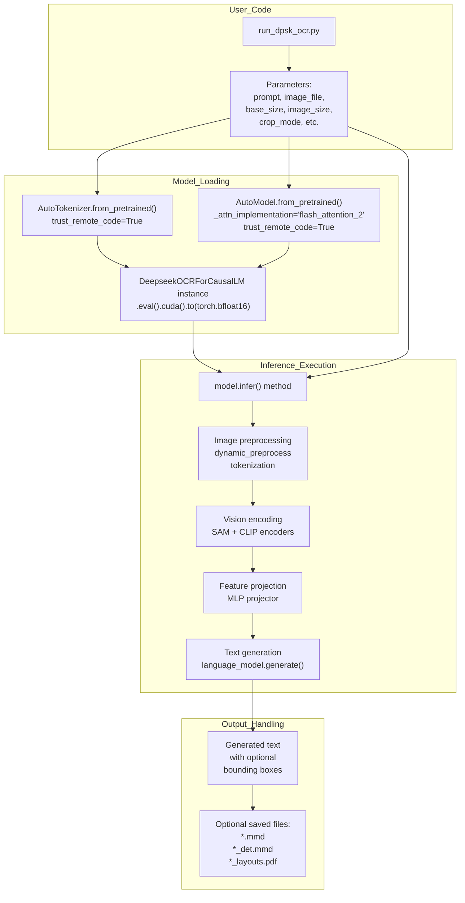

**Sources:** [DeepSeek-OCR-master/DeepSeek-OCR-hf/run_dpsk_ocr.py:1-35](), [README.md:167-183]()

---

## Basic Setup

### Model Loading

The Transformers interface requires loading both a tokenizer and model using HuggingFace's auto-loading utilities. The model must be moved to the GPU and cast to `bfloat16` for optimal performance.

```python
from transformers import AutoModel, AutoTokenizer
import torch
import os

os.environ["CUDA_VISIBLE_DEVICES"] = '0'

model_name = 'deepseek-ai/DeepSeek-OCR'

tokenizer = AutoTokenizer.from_pretrained(
    model_name, 
    trust_remote_code=True
)

model = AutoModel.from_pretrained(
    model_name, 
    _attn_implementation='flash_attention_2', 
    trust_remote_code=True, 
    use_safetensors=True
)

model = model.eval().cuda().to(torch.bfloat16)
```

Key loading parameters:
- `trust_remote_code=True`: Required to load custom model code (e.g., `DeepseekOCRForCausalLM`) from the repository. [README.md:174-175]()
- `_attn_implementation='flash_attention_2'`: Enables Flash Attention 2 for efficient memory usage. [README.md:175]()
- `use_safetensors=True`: Loads weights from the safer `safetensors` format. [README.md:175]()
- `.eval()`: Sets model to evaluation mode. [README.md:176]()
- `.cuda().to(torch.bfloat16)`: Moves model to GPU with `bfloat16` precision. [README.md:176]()

**Sources:** [DeepSeek-OCR-master/DeepSeek-OCR-hf/run_dpsk_ocr.py:1-14](), [README.md:167-176]()

### Initialization Sequence

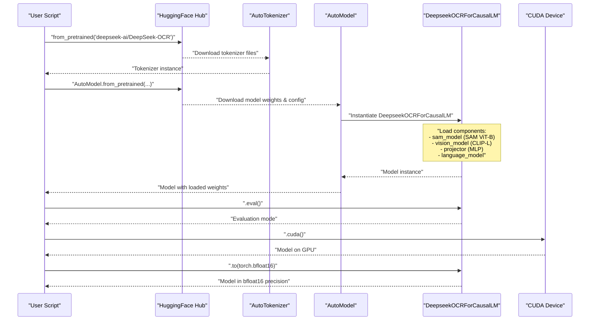

**Sources:** [DeepSeek-OCR-master/DeepSeek-OCR-hf/run_dpsk_ocr.py:9-14](), [README.md:174-176]()

---

## The `model.infer` API

The primary interface for Transformers inference is the `model.infer()` method. This method encapsulates the entire inference pipeline from image loading to text generation.

### Method Signature

```python
def infer(
    self, 
    tokenizer, 
    prompt='', 
    image_file='', 
    output_path=' ', 
    base_size=1024, 
    image_size=640, 
    crop_mode=True, 
    test_compress=False, 
    save_results=False
)
```

### Parameters Reference

| Parameter | Type | Default | Description |
|-----------|------|---------|-------------|
| `tokenizer` | `AutoTokenizer` | *Required* | The tokenizer instance loaded with `AutoTokenizer.from_pretrained()` |
| `prompt` | `str` | `''` | Task instruction prompt (e.g., `"<image>\n<|grounding|>Convert the document to markdown."`) |
| `image_file` | `str` | `''` | Path to input image file (JPG, PNG, etc.) |
| `output_path` | `str` | `' '` | Directory path for saving output files |
| `base_size` | `int` | `1024` | Resolution for the global view of the image (width/height after resize) |
| `image_size` | `int` | `640` | Resolution for local cropped views (when `crop_mode=True`) |
| `crop_mode` | `bool` | `True` | Whether to use dynamic cropping for multi-scale processing |
| `test_compress` | `bool` | `False` | Whether to calculate and display token compression statistics |
| `save_results` | `bool` | `False` | Whether to save output files to disk |

**Sources:** [DeepSeek-OCR-master/DeepSeek-OCR-hf/run_dpsk_ocr.py:25-34](), [README.md:183]()

### Return Value

The method returns a string containing the generated OCR output. The format depends on the prompt:
- Plain text transcription (with `"Free OCR"`) [README.md:204]()
- Markdown-formatted document (with `"Convert the document to markdown"`) [README.md:202]()
- Text with embedded bounding boxes using `<|ref|>` and `<|det|>` tags (with `<|grounding|>` prefix) [README.md:207]()

### Parameter Flow Diagram

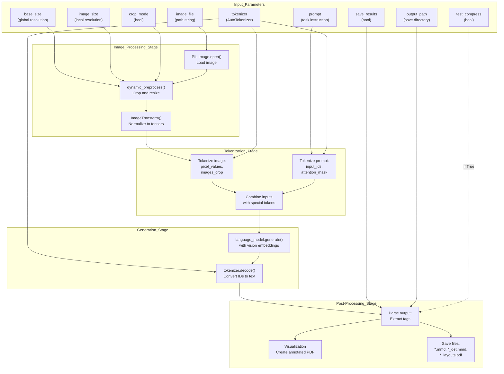

**Sources:** [DeepSeek-OCR-master/DeepSeek-OCR-hf/run_dpsk_ocr.py:25-34](), [README.md:183]()

---

## Operational Modes

DeepSeek-OCR supports multiple operational modes that control image resolution and cropping strategy. These modes balance between vision token count (affecting memory/speed) and OCR accuracy.

### Mode Configuration Table

| Mode | `base_size` | `image_size` | `crop_mode` | Vision Tokens | Use Case |
|------|-------------|--------------|-------------|---------------|----------|
| **Tiny** | 512 | 512 | `False` | 64 | Fast preview, low-res [README.md:193]() |
| **Small** | 640 | 640 | `False` | 100 | Standard documents [README.md:194]() |
| **Base** | 1024 | 1024 | `False` | 256 | High-quality documents [README.md:195]() |
| **Large** | 1280 | 1280 | `False` | 400 | Very high resolution [README.md:196]() |
| **Gundam** | 1024 | 640 | `True` | Variable | Adaptive multi-scale [README.md:198]() |

**Note:** Gundam mode is the recommended configuration as it provides both global context (1024×1024 base) and high-resolution local details (640×640 crops). [DeepSeek-OCR-master/DeepSeek-OCR-hf/run_dpsk_ocr.py:32]()

**Sources:** [DeepSeek-OCR-master/DeepSeek-OCR-hf/run_dpsk_ocr.py:27-32](), [README.md:191-198]()

---

## Common Usage Patterns

### Basic OCR with Markdown Conversion

```python
prompt = "<image>\n<|grounding|>Convert the document to markdown. "
image_file = 'your_image.jpg'
output_path = 'your/output/dir'

res = model.infer(
    tokenizer, 
    prompt=prompt, 
    image_file=image_file, 
    output_path=output_path, 
    base_size=1024, 
    image_size=640, 
    crop_mode=True, 
    save_results=True, 
    test_compress=True
)
```

**Sources:** [DeepSeek-OCR-master/DeepSeek-OCR-hf/run_dpsk_ocr.py:19-34](), [README.md:179-183]()

### Prompt Variants

The model's behavior is heavily influenced by the prompt prefix:
- **General OCR:** `<image>\n<|grounding|>OCR this image.` [README.md:203]()
- **Layout-free:** `<image>\nFree OCR.` [README.md:204]()
- **Figure Parsing:** `<image>\nParse the figure.` [README.md:205]()
- **Grounding/Detection:** `<image>\nLocate <|ref|>xxxx<|/ref|> in the image.` [README.md:207]()

---

## Advanced Options

### Token Compression Statistics

When `test_compress=True`, the method calculates and displays token compression statistics, which helps in evaluating the efficiency of the vision-to-text transformation. [DeepSeek-OCR-master/DeepSeek-OCR-hf/run_dpsk_ocr.py:34]()

### Saving Results to Disk

When `save_results=True`, the method saves several artifacts to the specified `output_path`:
1. **Markdown Results:** The extracted text content.
2. **Detection Data:** Files containing coordinate information.
3. **Visualizations:** PDF files showing layout detection results. [DeepSeek-OCR-master/DeepSeek-OCR-hf/run_dpsk_ocr.py:34]()

### Entry Point Script

The repository provides a standalone script at [DeepSeek-OCR-master/DeepSeek-OCR-hf/run_dpsk_ocr.py]() for executing these inferences. It is configured by default to use the "Gundam" mode. [DeepSeek-OCR-master/DeepSeek-OCR-hf/run_dpsk_ocr.py:34](), [README.md:187-189]()

**Sources:** [DeepSeek-OCR-master/DeepSeek-OCR-hf/run_dpsk_ocr.py:1-35](), [README.md:165-189]()

---

# Page: vLLM Inference

# vLLM Inference

<details>
<summary>Relevant source files</summary>

The following files were used as context for generating this wiki page:

- [DeepSeek-OCR-master/DeepSeek-OCR-vllm/config.py](DeepSeek-OCR-master/DeepSeek-OCR-vllm/config.py)
- [DeepSeek-OCR-master/DeepSeek-OCR-vllm/deepseek_ocr.py](DeepSeek-OCR-master/DeepSeek-OCR-vllm/deepseek_ocr.py)

</details>


This page provides an overview of using the vLLM inference framework with DeepSeek-OCR, including performance characteristics, architecture components, and when to use each processing mode. For detailed usage examples of specific workflows, see:
- [Single Image Processing](#3.2.1) — Guide for processing individual images with vLLM, including streaming output, bounding box rendering, and geometric visualization.
- [PDF Document Processing](#3.2.2) — Guide for processing multi-page PDFs, including page-by-page processing, layout detection, and output formats.
- [Batch Evaluation](#3.2.3) — Guide for batch processing multiple images, parallel preprocessing, and evaluation workflows.
- [Transformers Inference](#3.1) — Alternative framework for research and fine-tuning.

## Purpose and Design

The vLLM inference path is designed for **production-grade, high-throughput OCR workloads**. It uses the vLLM serving engine to achieve optimal GPU utilization and throughput through:

- **Asynchronous request processing** via `AsyncLLMEngine`.
- **Continuous batching** for efficient GPU memory utilization (90% by default).
- **PagedAttention** for KV cache management.
- **Parallel preprocessing** with configurable worker pools (defaulting to 64 workers).

The vLLM implementation achieves approximately **2,500 tokens/second** on an A100-40G GPU for PDF processing workloads, significantly outperforming sequential inference approaches.

Sources: [DeepSeek-OCR-master/DeepSeek-OCR-vllm/config.py:13-14](), [DeepSeek-OCR-master/DeepSeek-OCR-vllm/deepseek_ocr.py:13-39]()

## vLLM vs Transformers Comparison

| Aspect | vLLM | Transformers |
|--------|------|--------------|
| **Primary Use Case** | Production serving, batch processing | Research, experimentation, fine-tuning |
| **Throughput** | ~2,500 tokens/s (PDF, A100-40G) | Lower (sequential processing) |
| **Request Handling** | Async with continuous batching | Synchronous, single request |
| **GPU Utilization** | 90% (configurable via `gpu_memory_utilization`) | Depends on manual batching |
| **Concurrency** | 100 concurrent sequences (configurable via `MAX_CONCURRENCY`) | Single sequence at a time |
| **Custom Features** | `NoRepeatNGramLogitsProcessor`, streaming output | Full parameter control (`test_compress`, `crop_mode`) |
| **API Style** | `llm.generate()` with `SamplingParams` | `model.infer()` with direct parameters |
| **Entry Points** | `run_dpsk_ocr_image.py`, `run_dpsk_ocr_pdf.py` | `run_dpsk_ocr.py` |

Sources: [DeepSeek-OCR-master/DeepSeek-OCR-vllm/config.py:12-14](), [DeepSeek-OCR-master/DeepSeek-OCR-vllm/deepseek_ocr.py:2-10]()

## System Architecture

The vLLM inference system consists of multiple layers that transform raw images into structured OCR output:

Title: vLLM Inference Architecture
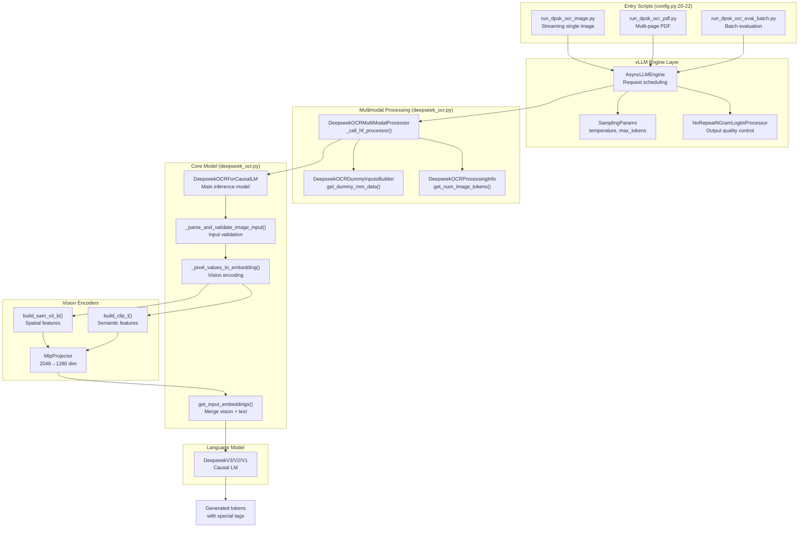

**Architecture Overview**: The vLLM path starts with entry scripts that configure the `AsyncLLMEngine`. The engine routes requests through the multimodal processor (`DeepseekOCRMultiModalProcessor`), which handles image tokenization and calculates vision token counts via `DeepseekOCRProcessingInfo`. The core model (`DeepseekOCRForCausalLM`) performs dual-encoder vision processing using SAM and CLIP, projects features via `MlpProjector`, and merges them with text embeddings before passing to the language model.

Sources: [DeepSeek-OCR-master/DeepSeek-OCR-vllm/deepseek_ocr.py:50-107](), [DeepSeek-OCR-master/DeepSeek-OCR-vllm/deepseek_ocr.py:150-176](), [DeepSeek-OCR-master/DeepSeek-OCR-vllm/deepseek_ocr.py:261-330]()

## Processing Pipeline with Code Entities

This diagram maps the data flow from raw inputs to final outputs, showing the key functions and classes involved:

Title: Data Flow and Code Entity Mapping
```mermaid
graph LR
    subgraph "Input Stage"
        RAW_IMG["PIL.Image or<br/>PDF pages"]
        RAW_PROMPT["Text prompt with<br/>&lt;image&gt; token"]
    end
    
    subgraph "Preprocessing (process.image_process)"
        TOKENIZE["DeepseekOCRProcessor<br/>tokenize_with_images()"]
        CROP["dynamic_preprocess()<br/>count_tiles()"]
    end
    
    subgraph "Multimodal Input Preparation (deepseek_ocr.py)"
        VALIDATE["_parse_and_validate_image_input()"]
        FIELD_CONFIG["_get_mm_fields_config()<br/>pixel_values, images_crop"]
        PROMPT_UPDATE["_get_prompt_updates()<br/>Replace &lt;image&gt; with tokens"]
    end
    
    subgraph "Vision Encoding (deepseek_ocr.py)"
        PIXEL_TO_EMB["_pixel_values_to_embedding()"]
        SAM_ENCODE["self.sam_model(patches)"]
        CLIP_ENCODE["self.vision_model(patches)"]
        PROJECT["self.projector(features)"]
        STRUCTURE["Add image_newline and<br/>view_seperator tokens"]
    end
    
    subgraph "Token Merging"
        GET_EMBED["get_input_embeddings()"]
        MERGE_MM["merge_multimodal_embeddings()"]
    end
    
    subgraph "Language Model Forward"
        FORWARD["forward()"]
        LM_FORWARD["self.language_model()"]
        COMPUTE_LOGITS["compute_logits()"]
    end
    
    subgraph "Output Stage"
        TOKENS["Generated token IDs"]
        DECODE["Decode with special tags<br/>&lt;|ref|&gt;, &lt;|det|&gt;, &lt;|grounding|&gt;"]
    end
    
    RAW_IMG --> TOKENIZE
    RAW_PROMPT --> TOKENIZE
    TOKENIZE --> CROP
    CROP --> VALIDATE
    
    VALIDATE --> FIELD_CONFIG
    FIELD_CONFIG --> PROMPT_UPDATE
    PROMPT_UPDATE --> PIXEL_TO_EMB
    
    PIXEL_TO_EMB --> SAM_ENCODE
    PIXEL_TO_EMB --> CLIP_ENCODE
    SAM_ENCODE --> PROJECT
    CLIP_ENCODE --> PROJECT
    PROJECT --> STRUCTURE
    STRUCTURE --> GET_EMBED
    
    GET_EMBED --> MERGE_MM
    MERGE_MM --> FORWARD
    FORWARD --> LM_FORWARD
    LM_FORWARD --> COMPUTE_LOGITS
    COMPUTE_LOGITS --> TOKENS
    TOKENS --> DECODE
```

**Code Entity Mapping**: This pipeline shows the complete flow through the vLLM system with specific function names. Key stages include:
1. **Preprocessing**: `DeepseekOCRProcessor` handles dynamic cropping via `count_tiles` [DeepSeek-OCR-master/DeepSeek-OCR-vllm/deepseek_ocr.py:30-31]().
2. **Input Validation**: `_parse_and_validate_image_input` extracts `pixel_values`, `images_crop`, and `images_spatial_crop`.
3. **Vision Encoding**: `_pixel_values_to_embedding` processes both global and local views through dual encoders (SAM/CLIP) [DeepSeek-OCR-master/DeepSeek-OCR-vllm/deepseek_ocr.py:364-467]().
4. **Embedding Merge**: `merge_multimodal_embeddings` replaces `<image>` tokens with vision features [DeepSeek-OCR-master/DeepSeek-OCR-vllm/deepseek_ocr.py:520-522]().

Sources: [DeepSeek-OCR-master/DeepSeek-OCR-vllm/deepseek_ocr.py:150-561]()

## Three Processing Modes

The vLLM implementation provides three specialized entry points for different use cases:

| Script | Primary Use Case | Key Features | Output Formats |
|--------|------------------|--------------|----------------|
| `run_dpsk_ocr_image.py` | Single image OCR | - Streaming output<br/>- Bounding box rendering<br/>- Real-time feedback | - Markdown text<br/>- Annotated image |
| `run_dpsk_ocr_pdf.py` | Multi-page documents | - Page-by-page processing<br/>- Layout detection<br/>- Concurrent processing | - Markdown per page<br/>- Structured layout data |
| `run_dpsk_ocr_eval_batch.py` | Benchmark evaluation | - Parallel preprocessing (64 workers)<br/>- Batch inference<br/>- Metrics collection | - JSON results<br/>- Evaluation metrics |

All three scripts share the same underlying `DeepseekOCRForCausalLM` model and configuration system.

Sources: [DeepSeek-OCR-master/DeepSeek-OCR-vllm/config.py:20-22](), [DeepSeek-OCR-master/DeepSeek-OCR-vllm/config.py:14]()

## Core Components

### DeepseekOCRForCausalLM

The main model class registered with vLLM's multimodal registry. Key responsibilities:

- **Initialization**: Loads vision encoders via `build_sam_vit_b()` and `build_clip_l()`, and initializes the `MlpProjector` [DeepSeek-OCR-master/DeepSeek-OCR-vllm/deepseek_ocr.py:267-330]().
- **Vision Processing**: Implements `_pixel_values_to_embedding()` to process global views and local patches, adding structural tokens like `image_newline` and `view_seperator` [DeepSeek-OCR-master/DeepSeek-OCR-vllm/deepseek_ocr.py:364-467]().
- **Weight Loading**: Uses a custom `hf_to_vllm_mapper` to route vision, projector, and language model weights correctly [DeepSeek-OCR-master/DeepSeek-OCR-vllm/deepseek_ocr.py:564-582]().

### Multimodal Processing Components

- **DeepseekOCRProcessingInfo**: Calculates the number of vision tokens via `get_num_image_tokens()`, accounting for cropping ratios and tile counts [DeepSeek-OCR-master/DeepSeek-OCR-vllm/deepseek_ocr.py:50-107]().
- **DeepseekOCRMultiModalProcessor**: Handles the high-level mapping of image data to multimodal fields like `pixel_values` and `images_crop` [DeepSeek-OCR-master/DeepSeek-OCR-vllm/deepseek_ocr.py:150-255]().
- **DeepseekOCRDummyInputsBuilder**: Generates dummy inputs for profiling based on the `PROMPT` and `IMAGE_SIZE` [DeepSeek-OCR-master/DeepSeek-OCR-vllm/deepseek_ocr.py:115-146]().

Sources: [DeepSeek-OCR-master/DeepSeek-OCR-vllm/deepseek_ocr.py:50-582]()

## Configuration System

vLLM inference is controlled through `config.py` parameters:

### Resolution Modes

| Parameter | Purpose | Default | Effect |
|-----------|---------|---------|--------|
| `IMAGE_SIZE` | Local view resolution | 640 | Size of cropped patches |
| `BASE_SIZE` | Global view resolution | 1024 | Size of full image representation |
| `CROP_MODE` | Enable dynamic cropping | True | Gundam mode: multi-scale processing |
| `MAX_CROPS` | Maximum crop count | 6 | Upper bound to control memory |

The current default configuration (Gundam mode) uses `IMAGE_SIZE = 640`, `BASE_SIZE = 1024`, and `CROP_MODE = True` [DeepSeek-OCR-master/DeepSeek-OCR-vllm/config.py:8-12]().

### Performance Tuning

| Parameter | Purpose | Default | Recommendation |
|-----------|---------|---------|----------------|
| `MAX_CONCURRENCY` | Max concurrent requests | 100 | Lower if GPU memory is limited |
| `NUM_WORKERS` | Preprocessing workers | 64 | Match to CPU core count |

Sources: [DeepSeek-OCR-master/DeepSeek-OCR-vllm/config.py:8-14]()

## Next Steps

For detailed usage instructions and code examples:
- [Single Image Processing](#3.2.1) — Streaming output with visualization.
- [PDF Document Processing](#3.2.2) — Multi-page workflow.
- [Batch Evaluation](#3.2.3) — Parallel processing setup.
- [Configuration System](#3.3) — Tuning performance parameters.
- [Working with Prompts](#3.4) — Effective prompt engineering.
- [Understanding Output](#3.5) — Parsing results and special tokens.

Sources: [DeepSeek-OCR-master/DeepSeek-OCR-vllm/config.py:1-43]()

---

# Page: Single Image Processing

# Single Image Processing

<details>
<summary>Relevant source files</summary>

The following files were used as context for generating this wiki page:

- [DeepSeek-OCR-master/DeepSeek-OCR-vllm/run_dpsk_ocr_image.py](DeepSeek-OCR-master/DeepSeek-OCR-vllm/run_dpsk_ocr_image.py)
- [assets/show1.jpg](assets/show1.jpg)
- [assets/show2.jpg](assets/show2.jpg)
- [assets/show3.jpg](assets/show3.jpg)
- [assets/show4.jpg](assets/show4.jpg)

</details>


This page documents the single image processing workflow using vLLM for real-time streaming OCR. The script `run_dpsk_ocr_image.py` provides an interactive way to process individual images with live output streaming, bounding box visualization, and support for geometric plot rendering.

For batch processing of multiple images, see [3.2.3](). For PDF document processing, see [3.2.2](). For the Transformers-based interface, see [3.1]().

**Sources:** [DeepSeek-OCR-master/DeepSeek-OCR-vllm/run_dpsk_ocr_image.py:1-304](), [README.md:95-98]()

## Processing Workflow Overview

The single image processing pipeline consists of five main stages: image loading with EXIF correction, preprocessing with dynamic cropping, vLLM engine initialization, async streaming generation, and post-processing with visualization.

### Data Flow and Code Entity Mapping
The following diagram maps the natural language processing stages to specific code entities and functions within the `run_dpsk_ocr_image.py` script and its dependencies.

```mermaid
graph TB
    subgraph "Stage 1: Image Loading"
        INPUT["INPUT_PATH<br/>(config.py)"]
        LOAD["load_image()<br/>[run_dpsk_ocr_image.py:28-42]"]
        EXIF["ImageOps.exif_transpose()<br/>[run_dpsk_ocr_image.py:33]"]
        RGB["PIL.Image.convert('RGB')<br/>[run_dpsk_ocr_image.py:209]"]
    end
    
    INPUT --> LOAD
    LOAD --> EXIF
    EXIF --> RGB
    
    subgraph "Stage 2: Image Preprocessing"
        PROMPT_CFG["PROMPT<br/>(config.py)"]
        CHECK_IMG{{"'<image>' in PROMPT?"}}
        PROCESSOR["DeepseekOCRProcessor()<br/>.tokenize_with_images()<br/>[run_dpsk_ocr_image.py:214]"]
        CROP_CFG["CROP_MODE<br/>(config.py)"]
    end
    
    RGB --> CHECK_IMG
    PROMPT_CFG --> CHECK_IMG
    CHECK_IMG -->|"Yes"| PROCESSOR
    CHECK_IMG -->|"No"| SKIP["Skip preprocessing<br/>image_features = ''"]
    CROP_CFG --> PROCESSOR
    
    subgraph "Stage 3: vLLM Engine Setup"
        ENGINE_ARGS["AsyncEngineArgs<br/>[run_dpsk_ocr_image.py:150-159]"]
        ENGINE["AsyncLLMEngine.from_engine_args()<br/>[run_dpsk_ocr_image.py:160]"]
        NGRAM["NoRepeatNGramLogitsProcessor<br/>[run_dpsk_ocr_image.py:162]"]
        SAMPLING["SamplingParams<br/>[run_dpsk_ocr_image.py:164-171]"]
    end
    
    ENGINE_ARGS --> ENGINE
    NGRAM --> SAMPLING
    
    subgraph "Stage 4: Streaming Generation"
        STREAM["stream_generate()<br/>[run_dpsk_ocr_image.py:147-199]"]
        ASYNC_LOOP["engine.generate()<br/>[run_dpsk_ocr_image.py:188-190]"]
        PRINT_STREAM["Incremental print<br/>[run_dpsk_ocr_image.py:194]"]
    end
    
    PROCESSOR --> STREAM
    SKIP --> STREAM
    ENGINE --> STREAM
    SAMPLING --> STREAM
    STREAM --> ASYNC_LOOP
    ASYNC_LOOP --> PRINT_STREAM
    
    subgraph "Stage 5: Post-Processing"
        RE_MATCH["re_match()<br/>[run_dpsk_ocr_image.py:45-57]"]
        DRAW_BOXES["draw_bounding_boxes()<br/>[run_dpsk_ocr_image.py:73-137]"]
        GEO_CHECK{{"'line_type' in output?"}}
        GEO_PLOT["matplotlib rendering<br/>[run_dpsk_ocr_image.py:252-301]"]
        SAVE["Save outputs:<br/>result.mmd, result_with_boxes.jpg"]
    end
    
    PRINT_STREAM --> RE_MATCH
    RE_MATCH --> DRAW_BOXES
    DRAW_BOXES --> GEO_CHECK
    GEO_CHECK -->|"Yes"| GEO_PLOT
    GEO_CHECK -->|"No"| SAVE
    GEO_PLOT --> SAVE
```

**Sources:** [DeepSeek-OCR-master/DeepSeek-OCR-vllm/run_dpsk_ocr_image.py:26-304](), [DeepSeek-OCR-master/DeepSeek-OCR-vllm/config.py:1-22]()

## Image Loading and Preprocessing

### Image Loading with EXIF Correction

The `load_image()` function handles image loading with automatic EXIF orientation correction using `ImageOps.exif_transpose()` [DeepSeek-OCR-master/DeepSeek-OCR-vllm/run_dpsk_ocr_image.py:33](). This ensures images are displayed in the correct orientation regardless of camera metadata. If the correction fails, the function falls back to a standard `Image.open()` [DeepSeek-OCR-master/DeepSeek-OCR-vllm/run_dpsk_ocr_image.py:40]().

**Sources:** [DeepSeek-OCR-master/DeepSeek-OCR-vllm/run_dpsk_ocr_image.py:28-42]()

### Image Preprocessing with DeepseekOCRProcessor

Images are preprocessed using `DeepseekOCRProcessor` if the prompt contains the `<image>` token [DeepSeek-OCR-master/DeepSeek-OCR-vllm/run_dpsk_ocr_image.py:212-214]().

| Configuration | Source | Effect |
|--------------|---------|--------|
| `CROP_MODE` | `config.py` | Enables/disables dynamic cropping (True for high-res documents) |
| `BASE_SIZE` | `config.py` | Global view resolution (e.g., 1024×1024) |
| `IMAGE_SIZE` | `config.py` | Local crop resolution (e.g., 640×640) |
| `MIN_CROPS`, `MAX_CROPS` | `config.py` | Bounds on number of crops (typically 2-6) |

**Sources:** [DeepSeek-OCR-master/DeepSeek-OCR-vllm/run_dpsk_ocr_image.py:214](), [DeepSeek-OCR-master/DeepSeek-OCR-vllm/config.py:10-16]()

## vLLM Engine Configuration

### AsyncLLMEngine Initialization

The script uses `AsyncLLMEngine` to enable streaming output. The model must be registered with the vLLM `ModelRegistry` before initialization [DeepSeek-OCR-master/DeepSeek-OCR-vllm/run_dpsk_ocr_image.py:26]().

**Key Configuration Parameters:**

| Parameter | Value | Purpose |
|-----------|-------|---------|
| `block_size` | 256 | KV cache blocking granularity [DeepSeek-OCR-master/DeepSeek-OCR-vllm/run_dpsk_ocr_image.py:153]() |
| `max_model_len` | 8192 | Maximum context length [DeepSeek-OCR-master/DeepSeek-OCR-vllm/run_dpsk_ocr_image.py:154]() |
| `gpu_memory_utilization` | 0.75 | 75% GPU memory allocation [DeepSeek-OCR-master/DeepSeek-OCR-vllm/run_dpsk_ocr_image.py:158]() |
| `tensor_parallel_size` | 1 | Single GPU mode [DeepSeek-OCR-master/DeepSeek-OCR-vllm/run_dpsk_ocr_image.py:157]() |

**Sources:** [DeepSeek-OCR-master/DeepSeek-OCR-vllm/run_dpsk_ocr_image.py:150-160]()

### Sampling and Logits Processing

A `NoRepeatNGramLogitsProcessor` is applied to prevent repetitive output sequences, with specific whitelist tokens for HTML table structures [DeepSeek-OCR-master/DeepSeek-OCR-vllm/run_dpsk_ocr_image.py:162]().

```mermaid
graph LR
    subgraph "Sampling Logic"
        TEMP["temperature: 0.0<br/>Deterministic output"]
        MAX_TOK["max_tokens: 8192"]
        NGRAM["NoRepeatNGramLogitsProcessor<br/>ngram_size=30, window_size=90"]
        WHITELIST["Whitelist: 128821, 128822<br/>(td tags)"]
    end
    
    TEMP --> PARAMS["SamplingParams"]
    MAX_TOK --> PARAMS
    NGRAM --> PARAMS
    WHITELIST --> NGRAM
```

**Sources:** [DeepSeek-OCR-master/DeepSeek-OCR-vllm/run_dpsk_ocr_image.py:162-171]()

## Async Streaming Generation

The `stream_generate()` function implements the async loop. It tracks `printed_length` to extract and print only the newly generated tokens from the full text returned by vLLM [DeepSeek-OCR-master/DeepSeek-OCR-vllm/run_dpsk_ocr_image.py:193-195]().

**Sources:** [DeepSeek-OCR-master/DeepSeek-OCR-vllm/run_dpsk_ocr_image.py:147-199]()

## Output Post-Processing

### Reference Tag Extraction System

The model outputs structured spatial information using `<|ref|>` and `<|det|>` tags. The `re_match()` function uses a regex pattern to extract these [DeepSeek-OCR-master/DeepSeek-OCR-vllm/run_dpsk_ocr_image.py:45-47]().

```python
# Regex pattern used in re_match()
pattern = r'(<\|ref\|>(.*?)<\|/ref\|><\|det\|>(.*?)<\|/det\|>)'
```

**Sources:** [DeepSeek-OCR-master/DeepSeek-OCR-vllm/run_dpsk_ocr_image.py:45-57]()

### Bounding Box Visualization

The `draw_bounding_boxes()` function renders annotations. It denormalizes coordinates from the 0-999 range used by the model back to the original image dimensions [DeepSeek-OCR-master/DeepSeek-OCR-vllm/run_dpsk_ocr_image.py:99-103]().

**Visual Style Rules:**
- **Titles**: Outline width 4 [DeepSeek-OCR-master/DeepSeek-OCR-vllm/run_dpsk_ocr_image.py:116]().
- **Other Elements**: Outline width 2 [DeepSeek-OCR-master/DeepSeek-OCR-vllm/run_dpsk_ocr_image.py:119]().
- **Fill**: Semi-transparent overlay (alpha=20) [DeepSeek-OCR-master/DeepSeek-OCR-vllm/run_dpsk_ocr_image.py:95]().
- **Image Cropping**: Regions labeled as 'image' are cropped and saved to `OUTPUT_PATH/images/` [DeepSeek-OCR-master/DeepSeek-OCR-vllm/run_dpsk_ocr_image.py:105-112]().

**Sources:** [DeepSeek-OCR-master/DeepSeek-OCR-vllm/run_dpsk_ocr_image.py:73-137]()

### Geometric Plot Rendering

If the output contains geometric primitives (lines, circles), the script uses `matplotlib` to render a visualization [DeepSeek-OCR-master/DeepSeek-OCR-vllm/run_dpsk_ocr_image.py:252-301]().

```mermaid
graph TB
    subgraph "Geometric Rendering Entity Mapping"
        OUT_DICT["Parsed Output Dict<br/>(eval(outputs))"]
        LINE_RENDER["ax.plot()<br/>[run_dpsk_ocr_image.py:270]"]
        CIRCLE_RENDER["ax.add_patch(Circle)<br/>[run_dpsk_ocr_image.py:288]"]
        POINT_RENDER["ax.scatter()<br/>[run_dpsk_ocr_image.py:277]"]
        LABEL_RENDER["ax.annotate()<br/>[run_dpsk_ocr_image.py:278]"]
    end
    
    OUT_DICT -->|"Line Data"| LINE_RENDER
    OUT_DICT -->|"Circle Data"| CIRCLE_RENDER
    OUT_DICT -->|"Endpoint Data"| POINT_RENDER
    POINT_RENDER --> LABEL_RENDER
```

**Sources:** [DeepSeek-OCR-master/DeepSeek-OCR-vllm/run_dpsk_ocr_image.py:251-301]()

## Output File Structure

| File Path | Purpose |
|-----------|---------|
| `result_ori.mmd` | Raw model output with tags [DeepSeek-OCR-master/DeepSeek-OCR-vllm/run_dpsk_ocr_image.py:236]() |
| `result.mmd` | Processed markdown with image links [DeepSeek-OCR-master/DeepSeek-OCR-vllm/run_dpsk_ocr_image.py:249]() |
| `result_with_boxes.jpg` | Annotated image visualization [DeepSeek-OCR-master/DeepSeek-OCR-vllm/run_dpsk_ocr_image.py:234]() |
| `geo.jpg` | Rendered geometric plot [DeepSeek-OCR-master/DeepSeek-OCR-vllm/run_dpsk_ocr_image.py:301]() |

**Sources:** [DeepSeek-OCR-master/DeepSeek-OCR-vllm/run_dpsk_ocr_image.py:225-304]()

---

# Page: PDF Document Processing

# PDF Document Processing

<details>
<summary>Relevant source files</summary>

The following files were used as context for generating this wiki page:

- [DeepSeek-OCR-master/DeepSeek-OCR-vllm/run_dpsk_ocr_pdf.py](DeepSeek-OCR-master/DeepSeek-OCR-vllm/run_dpsk_ocr_pdf.py)

</details>


This page describes how to process multi-page PDF documents using the vLLM inference path. The `run_dpsk_ocr_pdf.py` script provides a production-ready pipeline for converting PDF documents to structured markdown with layout information, bounding box annotations, and visual overlays.

For single image processing, see [Single Image Processing](3.2.1). For batch evaluation on datasets, see [Batch Evaluation](3.2.3). For general vLLM inference concepts, see [vLLM Inference](3.2).

## Purpose and Scope

The PDF processing pipeline is designed for:
- **Multi-page document processing**: Academic papers, reports, books, forms.
- **Concurrent page processing**: Parallel preprocessing with `ThreadPoolExecutor` [DeepSeek-OCR-master/DeepSeek-OCR-vllm/run_dpsk_ocr_pdf.py:248-251]().
- **Batch GPU inference**: Process all pages in a single vLLM batch [DeepSeek-OCR-master/DeepSeek-OCR-vllm/run_dpsk_ocr_pdf.py:268-271]().
- **Layout visualization**: Generate annotated PDFs with bounding boxes [DeepSeek-OCR-master/DeepSeek-OCR-vllm/run_dpsk_ocr_pdf.py:218-220]().
- **Image extraction**: Automatically extract and save figures/charts from documents [DeepSeek-OCR-master/DeepSeek-OCR-vllm/run_dpsk_ocr_pdf.py:183-190]().

The script produces three synchronized outputs: raw detection markup, cleaned markdown, and a visual layout PDF.

Sources: [DeepSeek-OCR-master/DeepSeek-OCR-vllm/run_dpsk_ocr_pdf.py:1-331]()

## PDF Processing Workflow

The following diagram shows the complete end-to-end workflow from PDF input to final outputs:

**Title: PDF Processing Pipeline**
```mermaid
graph TD
    INPUT["PDF Document<br/>(INPUT_PATH)"]
    
    CONVERT["pdf_to_images_high_quality()<br/>PyMuPDF/fitz<br/>DPI=144"]
    
    IMAGES["List[PIL.Image]<br/>One per page"]
    
    POOL["ThreadPoolExecutor<br/>max_workers=NUM_WORKERS<br/>(default: 64)"]
    
    PREPROC["process_single_image()<br/>Per-page preprocessing"]
    
    TOKENIZE["DeepseekOCRProcessor()<br/>.tokenize_with_images()<br/>CROP_MODE setting"]
    
    BATCH["batch_inputs<br/>List[dict]<br/>prompt + multi_modal_data"]
    
    VLLM["llm.generate()<br/>AsyncLLMEngine<br/>SamplingParams"]
    
    OUTPUTS["outputs_list<br/>Raw OCR with tags"]
    
    REMATCH["re_match()<br/>Extract bounding boxes"]
    
    DRAW["draw_bounding_boxes()<br/>Visual annotations"]
    
    EXTRACT["Extract cropped images<br/>Save to /images/"]
    
    CLEAN["Replace tags<br/>Clean markdown"]
    
    MMD_DET["*_det.mmd<br/>Raw detection output"]
    MMD["*.mmd<br/>Processed markdown"]
    PDF_OUT["*_layouts.pdf<br/>Visual annotations"]
    
    INPUT --> CONVERT
    CONVERT --> IMAGES
    IMAGES --> POOL
    POOL --> PREPROC
    PREPROC --> TOKENIZE
    TOKENIZE --> BATCH
    BATCH --> VLLM
    VLLM --> OUTPUTS
    OUTPUTS --> REMATCH
    REMATCH --> DRAW
    REMATCH --> EXTRACT
    REMATCH --> CLEAN
    DRAW --> PDF_OUT
    EXTRACT --> MMD
    CLEAN --> MMD
    OUTPUTS --> MMD_DET
```

Sources: [DeepSeek-OCR-master/DeepSeek-OCR-vllm/run_dpsk_ocr_pdf.py:64-330]()

## PDF to Image Conversion

The first stage converts PDF pages to high-quality images using PyMuPDF (`fitz`).

### Conversion Function

The `pdf_to_images_high_quality()` function handles PDF rendering:

**Function Signature**: [DeepSeek-OCR-master/DeepSeek-OCR-vllm/run_dpsk_ocr_pdf.py:64-95]()

| Parameter | Type | Default | Description |
|-----------|------|---------|-------------|
| `pdf_path` | str | Required | Path to input PDF file |
| `dpi` | int | 144 | Rendering resolution |
| `image_format` | str | "PNG" | Output image format |

**Key Implementation Details**:
- Uses `fitz.Matrix(zoom, zoom)` where `zoom = dpi / 72.0` [DeepSeek-OCR-master/DeepSeek-OCR-vllm/run_dpsk_ocr_pdf.py:72-73]().
- Renders with `page.get_pixmap(matrix=matrix, alpha=False)` [DeepSeek-OCR-master/DeepSeek-OCR-vllm/run_dpsk_ocr_pdf.py:78]().
- Disables image size limits with `Image.MAX_IMAGE_PIXELS = None` [DeepSeek-OCR-master/DeepSeek-OCR-vllm/run_dpsk_ocr_pdf.py:79]().
- Converts RGBA to RGB by pasting on white background [DeepSeek-OCR-master/DeepSeek-OCR-vllm/run_dpsk_ocr_pdf.py:87-90]().

**Title: PDF to PIL Image Conversion**
```mermaid
graph LR
    PDF["fitz.open(pdf_path)"]
    PAGES["Iterate pages<br/>page_count"]
    MATRIX["fitz.Matrix<br/>zoom = dpi/72"]
    PIXMAP["page.get_pixmap()"]
    CONVERT["pixmap.tobytes('png')"]
    PIL["PIL.Image.open()"]
    RGB["Convert RGBA→RGB<br/>White background"]
    OUTPUT["List[PIL.Image]"]
    
    PDF --> PAGES
    PAGES --> MATRIX
    MATRIX --> PIXMAP
    PIXMAP --> CONVERT
    CONVERT --> PIL
    PIL --> RGB
    RGB --> OUTPUT
```

Sources: [DeepSeek-OCR-master/DeepSeek-OCR-vllm/run_dpsk_ocr_pdf.py:64-95]()

## Concurrent Image Preprocessing

After PDF conversion, images are preprocessed in parallel using a thread pool.

### ThreadPoolExecutor Architecture

**Title: Concurrent Preprocessing Architecture**
```mermaid
graph TB
    IMAGES["List[PIL.Image]<br/>(N pages)"]
    
    EXECUTOR["ThreadPoolExecutor<br/>max_workers=NUM_WORKERS"]
    
    subgraph "Parallel Workers (64 threads default)"
        W1["Worker 1<br/>process_single_image()"]
        W2["Worker 2<br/>process_single_image()"]
        W3["Worker 3<br/>process_single_image()"]
        WN["Worker N<br/>process_single_image()"]
    end
    
    subgraph "Per-Worker Processing"
        PROC["DeepseekOCRProcessor()"]
        TOK["tokenize_with_images()<br/>bos=True, eos=True<br/>cropping=CROP_MODE"]
        CACHE["cache_item dict<br/>prompt + multi_modal_data"]
    end
    
    BATCH["batch_inputs<br/>List[dict]"]
    
    IMAGES --> EXECUTOR
    EXECUTOR --> W1
    EXECUTOR --> W2
    EXECUTOR --> W3
    EXECUTOR --> WN
    
    W1 --> PROC
    W2 --> PROC
    W3 --> PROC
    WN --> PROC
    
    PROC --> TOK
    TOK --> CACHE
    CACHE --> BATCH
```

### Process Single Image Function

The `process_single_image()` function [DeepSeek-OCR-master/DeepSeek-OCR-vllm/run_dpsk_ocr_pdf.py:223-230]() creates a batch input dictionary for each page by calling `DeepseekOCRProcessor().tokenize_with_images()` [DeepSeek-OCR-master/DeepSeek-OCR-vllm/run_dpsk_ocr_pdf.py:234-242]().

**Preprocessing Steps per Image**:
1. Call `DeepseekOCRProcessor().tokenize_with_images()`.
2. Apply dynamic cropping if `CROP_MODE=True`.
3. Generate global view and local crops as defined in `config.py`.
4. Return structured batch input dictionary `cache_item`.

Sources: [DeepSeek-OCR-master/DeepSeek-OCR-vllm/run_dpsk_ocr_pdf.py:223-245](), [DeepSeek-OCR-master/DeepSeek-OCR-vllm/run_dpsk_ocr_pdf.py:248-253]()

## Batch Inference with vLLM

Once all pages are preprocessed, they are passed to vLLM for batch inference.

### vLLM Engine Configuration

The LLM engine is initialized with production-optimized settings [DeepSeek-OCR-master/DeepSeek-OCR-vllm/run_dpsk_ocr_pdf.py:32-44]():

| Parameter | Value | Purpose |
|-----------|-------|---------|
| `model` | `MODEL_PATH` | Model identifier |
| `hf_overrides` | `{"architectures": ["DeepseekOCRForCausalLM"]}` | Custom model registration |
| `block_size` | 256 | KV cache block size |
| `enforce_eager` | False | Use CUDA graphs |
| `max_model_len` | 8192 | Maximum sequence length |
| `max_num_seqs` | `MAX_CONCURRENCY` (100) | Batch size limit |
| `gpu_memory_utilization` | 0.9 | GPU memory allocation |

### Sampling Parameters

The sampling configuration [DeepSeek-OCR-master/DeepSeek-OCR-vllm/run_dpsk_ocr_pdf.py:48-54]() controls output generation:
- **Deterministic output**: `temperature=0.0`.
- **Repetition Control**: `NoRepeatNGramLogitsProcessor` with `ngram_size=20` [DeepSeek-OCR-master/DeepSeek-OCR-vllm/run_dpsk_ocr_pdf.py:46]().
- **Whitelist**: Allows table tags `<td>` (128821) and `</td>` (128822) to repeat [DeepSeek-OCR-master/DeepSeek-OCR-vllm/run_dpsk_ocr_pdf.py:46]().

### Batch Generation Call

The inference is performed in a single batch for efficiency [DeepSeek-OCR-master/DeepSeek-OCR-vllm/run_dpsk_ocr_pdf.py:268-271]():

```python
outputs_list = llm.generate(
    batch_inputs,           
    sampling_params=sampling_params
)
```

**Title: Batch Inference Pipeline**
```mermaid
graph LR
    BATCH["batch_inputs<br/>[page0, page1, ..., pageN]"]
    
    ENGINE["vLLM AsyncLLMEngine<br/>max_num_seqs=100"]
    
    subgraph "GPU Processing"
        VISION["Vision Encoding<br/>SAM + CLIP"]
        PROJ["MLP Projection"]
        LLM["Language Model<br/>DeepseekV2/V3"]
        LOGITS["NoRepeatNGramLogitsProcessor<br/>ngram_size=20"]
    end
    
    OUTPUTS["outputs_list<br/>[output0, output1, ..., outputN]"]
    
    BATCH --> ENGINE
    ENGINE --> VISION
    VISION --> PROJ
    PROJ --> LLM
    LLM --> LOGITS
    LOGITS --> OUTPUTS
```

Sources: [DeepSeek-OCR-master/DeepSeek-OCR-vllm/run_dpsk_ocr_pdf.py:32-54](), [DeepSeek-OCR-master/DeepSeek-OCR-vllm/run_dpsk_ocr_pdf.py:268-271]()

## Post-Processing Pipeline

### Bounding Box Extraction

The `re_match()` function [DeepSeek-OCR-master/DeepSeek-OCR-vllm/run_dpsk_ocr_pdf.py:123-135]() extracts structured annotations using the regex: `<|ref|>(.*?)<|/ref|><|det|>(.*?)<|/det|>`.

### Coordinate Extraction

The `extract_coordinates_and_label()` function [DeepSeek-OCR-master/DeepSeek-OCR-vllm/run_dpsk_ocr_pdf.py:138-148]() parses the captured groups. Coordinates are denormalized from the [0, 999] range to pixel coordinates based on image size [DeepSeek-OCR-master/DeepSeek-OCR-vllm/run_dpsk_ocr_pdf.py:177-181]().

### Bounding Box Visualization

The `draw_bounding_boxes()` function [DeepSeek-OCR-master/DeepSeek-OCR-vllm/run_dpsk_ocr_pdf.py:151-215]() creates visual annotations.

**Title: Bounding Box Drawing Process**
```mermaid
graph TD
    IMAGE["Original PIL Image"]
    COPY["Create image copy"]
    DRAW1["ImageDraw.Draw()"]
    OVERLAY["Create RGBA overlay<br/>Transparent background"]
    DRAW2["ImageDraw.Draw(overlay)"]
    
    ITER["Iterate refs"]
    DENORM["Denormalize coordinates<br/>0-999 → pixel coords"]
    
    COLOR["Random color<br/>RGB + alpha"]
    
    RECT["Draw rectangle<br/>outline on main"]
    FILL["Draw filled rectangle<br/>on overlay (semi-transparent)"]
    TEXT["Draw label text<br/>with white background"]
    
    CROP{"label_type<br/>== 'image'?"}
    SAVE["Crop and save<br/>OUTPUT_PATH/images/"]
    
    PASTE["Paste overlay<br/>onto main image"]
    OUTPUT["Annotated Image"]
    
    IMAGE --> COPY
    COPY --> DRAW1
    COPY --> OVERLAY
    OVERLAY --> DRAW2
    
    DRAW1 --> ITER
    ITER --> DENORM
    DENORM --> COLOR
    
    COLOR --> RECT
    COLOR --> FILL
    COLOR --> TEXT
    
    DENORM --> CROP
    CROP -->|Yes| SAVE
    CROP -->|No| RECT
    
    RECT --> PASTE
    FILL --> PASTE
    TEXT --> PASTE
    PASTE --> OUTPUT
```

Sources: [DeepSeek-OCR-master/DeepSeek-OCR-vllm/run_dpsk_ocr_pdf.py:123-220]()

### Content Cleaning

The main loop [DeepSeek-OCR-master/DeepSeek-OCR-vllm/run_dpsk_ocr_pdf.py:286-320]() performs the following:
1. **Repetition Detection**: Skips pages where the end-of-sentence token is missing if `SKIP_REPEAT` is enabled [DeepSeek-OCR-master/DeepSeek-OCR-vllm/run_dpsk_ocr_pdf.py:289-293]().
2. **Tag Replacement**: Replaces `<|ref|>image<|/ref|>` tags with markdown image links [DeepSeek-OCR-master/DeepSeek-OCR-vllm/run_dpsk_ocr_pdf.py:302-306]().
3. **Symbol Cleanup**: Normalizes LaTeX-style operators like `\coloneqq` [DeepSeek-OCR-master/DeepSeek-OCR-vllm/run_dpsk_ocr_pdf.py:313-314]().

Sources: [DeepSeek-OCR-master/DeepSeek-OCR-vllm/run_dpsk_ocr_pdf.py:286-320]()

## Output Files and Formats

| File | Extension | Purpose |
|------|-----------|---------|
| Raw detection | `*_det.mmd` | Complete model output with all tags [DeepSeek-OCR-master/DeepSeek-OCR-vllm/run_dpsk_ocr_pdf.py:324-325](). |
| Processed markdown | `*.mmd` | Cleaned document with image links [DeepSeek-OCR-master/DeepSeek-OCR-vllm/run_dpsk_ocr_pdf.py:321-322](). |
| Layout PDF | `*_layouts.pdf` | Visual verification with bounding boxes [DeepSeek-OCR-master/DeepSeek-OCR-vllm/run_dpsk_ocr_pdf.py:328-329](). |
| Extracted images | `images/*.jpg` | Individual figures cropped from the PDF [DeepSeek-OCR-master/DeepSeek-OCR-vllm/run_dpsk_ocr_pdf.py:186](). |

Sources: [DeepSeek-OCR-master/DeepSeek-OCR-vllm/run_dpsk_ocr_pdf.py:321-329]()

## Configuration and Performance Tuning

**Title: Configuration Hierarchy**
```mermaid
graph TB
    subgraph "Image Processing"
        BASE["BASE_SIZE=1024<br/>Global view resolution"]
        IMG["IMAGE_SIZE=640<br/>Local crop resolution"]
        CROP["CROP_MODE=True<br/>Enable dynamic cropping"]
        MIN["MIN_CROPS=2<br/>Minimum crops per page"]
        MAX["MAX_CROPS=6<br/>Maximum crops per page"]
    end
    
    subgraph "Concurrency Control"
        CONC["MAX_CONCURRENCY=100<br/>vLLM batch size limit"]
        WORK["NUM_WORKERS=64<br/>Preprocessing threads"]
    end
    
    subgraph "Processing Behavior"
        SKIP["SKIP_REPEAT=True<br/>Skip infinite loops"]
        PROMPT["PROMPT<br/>Task instruction"]
    end
    
    subgraph "I/O Paths"
        IN["INPUT_PATH<br/>PDF file path"]
        OUT["OUTPUT_PATH<br/>Output directory"]
        MODEL["MODEL_PATH<br/>Model identifier"]
    end
    
    BASE --> CROP
    IMG --> CROP
    CROP --> MIN
    CROP --> MAX
    
    CONC -.->|"Limits batch size"| WORK
```

Sources: [DeepSeek-OCR-master/DeepSeek-OCR-vllm/config.py:1-43](), [DeepSeek-OCR-master/DeepSeek-OCR-vllm/run_dpsk_ocr_pdf.py:17-44]()

## Execution Flow

**Title: PDF Processing Sequence**
```mermaid
sequenceDiagram
    participant Main
    participant ThreadPool
    participant Workers
    participant vLLM
    participant PostProc
    
    Main->>Main: Load PDF → images (sequential)
    
    Main->>ThreadPool: Submit N images
    
    par Parallel Preprocessing
        ThreadPool->>Workers: process_single_image(image_0)
        ThreadPool->>Workers: process_single_image(image_1)
        ThreadPool->>Workers: process_single_image(image_N)
    end
    
    Workers-->>Main: batch_inputs (all pages)
    
    Main->>vLLM: llm.generate(batch_inputs)
    Note over vLLM: Single GPU batch<br/>Concurrent execution
    vLLM-->>Main: outputs_list
    
    loop For each page
        Main->>PostProc: re_match(output)
        PostProc-->>Main: bounding boxes
        Main->>PostProc: draw_bounding_boxes()
        PostProc-->>Main: annotated image
        Main->>PostProc: replace tags
        PostProc-->>Main: clean markdown
    end
    
    Main->>Main: Write output files
```

Sources: [DeepSeek-OCR-master/DeepSeek-OCR-vllm/run_dpsk_ocr_pdf.py:248-330]()

---

# Page: Batch Evaluation

# Batch Evaluation

<details>
<summary>Relevant source files</summary>

The following files were used as context for generating this wiki page:

- [DeepSeek-OCR-master/DeepSeek-OCR-vllm/run_dpsk_ocr_eval_batch.py](DeepSeek-OCR-master/DeepSeek-OCR-vllm/run_dpsk_ocr_eval_batch.py)

</details>


## Purpose and Scope

This page documents the batch evaluation workflow implemented in `run_dpsk_ocr_eval_batch.py`. This script processes multiple images in parallel for benchmarking and evaluation workloads.

Primary use cases:
- Benchmark dataset evaluation (e.g., OmniDocBench)
- High-throughput OCR processing with vLLM batch inference
- Parallel CPU preprocessing with `ThreadPoolExecutor`
- Generation of dual output files (raw detection + cleaned markdown)

For single image streaming, see page 3.2.1. For PDF document processing, see page 3.2.2.

**Sources:** [DeepSeek-OCR-master/DeepSeek-OCR-vllm/run_dpsk_ocr_eval_batch.py:1-162]()

---

## Configuration Requirements

Batch evaluation relies on centralized configuration in `config.py`. You must set the following parameters before execution:

| Parameter | Purpose | Default | Notes |
|-----------|---------|---------|-------|
| `MODEL_PATH` | Model identifier or path | `'deepseek-ai/DeepSeek-OCR'` | HuggingFace model or local path |
| `INPUT_PATH` | Directory containing images | Empty string | Must contain `.jpg`, `.png`, or `.jpeg` files |
| `OUTPUT_PATH` | Directory for results | Empty string | Created automatically if missing |
| `PROMPT` | OCR task instruction | `'<image>\n<|grounding|>Convert the document to markdown.'` | Task-specific prompt |
| `MAX_CONCURRENCY` | Maximum batch size | `100` | Reduce if GPU memory is limited |
| `NUM_WORKERS` | Preprocessing threads | `64` | CPU-bound parallelization |
| `CROP_MODE` | Enable dynamic cropping | `True` | Gundam mode (multi-scale) |

The script reads images from `INPUT_PATH` using glob pattern `INPUT_PATH/*` and processes all matching image files.

**Sources:** [DeepSeek-OCR-master/DeepSeek-OCR-vllm/config.py:8-27](), [DeepSeek-OCR-master/DeepSeek-OCR-vllm/run_dpsk_ocr_eval_batch.py:10]()

---

## Code Architecture

### Component Mapping

```mermaid
graph TB
    subgraph "Script: run_dpsk_ocr_eval_batch.py"
        Main["main execution<br/>(lines 91-162)"]
        PSI["process_single_image()<br/>(lines 81-88)"]
        CleanF["clean_formula()<br/>(lines 53-68)"]
        ReMatch["re_match()<br/>(lines 70-79)"]
    end
    
    subgraph "vLLM Components"
        LLM["vllm.LLM<br/>(initialization: lines 24-35)"]
        SP["SamplingParams<br/>(lines 39-44)"]
        MR["ModelRegistry.register_model<br/>(line 21)"]
    end
    
    subgraph "Model Components"
        DOCR["DeepseekOCRForCausalLM<br/>(from deepseek_ocr)"]
        Proc["DeepseekOCRProcessor<br/>(from process.image_process)"]
        NGram["NoRepeatNGramLogitsProcessor<br/>(from process.ngram_norepeat)"]
    end
    
    subgraph "Configuration"
        Config["config.py<br/>MODEL_PATH, MAX_CONCURRENCY,<br/>NUM_WORKERS, CROP_MODE"]
    end
    
    subgraph "Standard Library"
        TE["ThreadPoolExecutor<br/>(concurrent.futures)"]
        Glob["glob.glob"]
        PIL["PIL.Image"]
    end
    
    Main --> Config
    Main --> Glob
    Main --> PIL
    Main --> TE
    Main --> LLM
    Main --> CleanF
    Main --> ReMatch
    
    PSI --> Proc
    
    LLM --> MR
    LLM --> DOCR
    LLM --> SP
    SP --> NGram
    
    TE --> PSI
```

**Sources:** [DeepSeek-OCR-master/DeepSeek-OCR-vllm/run_dpsk_ocr_eval_batch.py:1-162]()

### Execution Sequence

```mermaid
sequenceDiagram
    participant Script as run_dpsk_ocr_eval_batch.py
    participant MR as ModelRegistry
    participant LLM as vllm.LLM
    participant Glob as glob.glob
    participant PIL as PIL.Image
    participant TE as ThreadPoolExecutor
    participant Proc as DeepseekOCRProcessor
    participant NG as NoRepeatNGramLogitsProcessor
    participant Model as DeepseekOCRForCausalLM
    
    Script->>MR: register_model("DeepseekOCRForCausalLM", DeepseekOCRForCausalLM)
    
    Script->>LLM: LLM(model, max_num_seqs=MAX_CONCURRENCY, gpu_memory_utilization=0.9)
    
    Script->>Glob: glob.glob(INPUT_PATH + '/*')
    Glob-->>Script: images_path list
    
    loop For each path
        Script->>PIL: Image.open(path).convert('RGB')
        PIL-->>Script: PIL.Image object
    end
    
    Script->>TE: ThreadPoolExecutor(max_workers=NUM_WORKERS)
    
    par Parallel Preprocessing
        TE->>Proc: process_single_image(image)
        Proc->>Proc: tokenize_with_images(images, cropping=CROP_MODE)
        Proc-->>TE: {"prompt": str, "multi_modal_data": {"image": tensors}}
    end
    
    TE-->>Script: batch_inputs list
    
    Script->>LLM: llm.generate(batch_inputs, sampling_params)
    LLM->>NG: Apply logits_processors
    LLM->>Model: Batch forward passes
    Model-->>LLM: Generated tokens
    LLM-->>Script: outputs_list
    
    loop For each output
        Script->>Script: clean_formula(output.outputs[0].text)
        Script->>Script: re_match(cleaned_text)
        Script->>Script: Replace matches, normalize newlines
        Script->>Script: Write *_det.md and *.md
    end
```

**Sources:** [DeepSeek-OCR-master/DeepSeek-OCR-vllm/run_dpsk_ocr_eval_batch.py:14-162]()

---

## Execution Flow

### Component Initialization

The script performs model registration and vLLM engine initialization:

**Model Registration** [run_dpsk_ocr_eval_batch.py:16-21]():
```python
from deepseek_ocr import DeepseekOCRForCausalLM
from vllm.model_executor.models.registry import ModelRegistry

ModelRegistry.register_model("DeepseekOCRForCausalLM", DeepseekOCRForCausalLM)
```

**vLLM Engine Parameters** [run_dpsk_ocr_eval_batch.py:24-35]():

| Parameter | Value | Purpose |
|-----------|-------|---------|
| `model` | `MODEL_PATH` | Model identifier |
| `hf_overrides` | `{"architectures": ["DeepseekOCRForCausalLM"]}` | Force model class |
| `block_size` | `256` | KV cache block size |
| `max_model_len` | `8192` | Maximum sequence length |
| `max_num_seqs` | `MAX_CONCURRENCY` | Batch size limit (default 100) |
| `gpu_memory_utilization` | `0.9` | GPU memory allocation (90%) |
| `swap_space` | `0` | Disable CPU-GPU swapping |
| `tensor_parallel_size` | `1` | Single GPU inference |

**Logits Processor Configuration** [run_dpsk_ocr_eval_batch.py:37-44]():

`NoRepeatNGramLogitsProcessor` prevents repetitive output:
- `ngram_size=40`: N-gram length to check
- `window_size=90`: Token window for repetition detection
- `whitelist_token_ids={128821, 128822}`: Allowed repeated tokens (`<td>`, `</td>`)

**Sources:** [DeepSeek-OCR-master/DeepSeek-OCR-vllm/run_dpsk_ocr_eval_batch.py:14-44]()

### Parallel Image Preprocessing

```mermaid
graph TB
    subgraph "Phase 1: Image Loading (lines 99-107)"
        Glob["glob.glob(INPUT_PATH + '/*')"]
        Loop["for image_path in images_path"]
        Open["PIL.Image.open(path).convert('RGB')"]
        List["images: List[PIL.Image]"]
        
        Glob --> Loop
        Loop --> Open
        Open --> List
    end
    
    subgraph "Phase 2: ThreadPoolExecutor (lines 125-130)"
        TE["ThreadPoolExecutor(max_workers=NUM_WORKERS)"]
        Map["executor.map(process_single_image, images)"]
        
        TE --> Map
    end
    
    subgraph "Phase 3: process_single_image (lines 81-88)"
        PSI["def process_single_image(image)"]
        Proc["DeepseekOCRProcessor()"]
        Tok["tokenize_with_images(images=[image], cropping=CROP_MODE)"]
        Dict["return {'prompt': str, 'multi_modal_data': {'image': tensors}}"]
        
        PSI --> Proc
        Proc --> Tok
        Tok --> Dict
    end
    
    subgraph "Phase 4: Batch Inference (lines 135-138)"
        Batch["batch_inputs: List[dict]"]
        Gen["llm.generate(batch_inputs, sampling_params)"]
        Out["outputs_list"]
        
        Batch --> Gen
        Gen --> Out
    end
    
    List --> Map
    Map --> PSI
    Dict --> Batch
```

**Image Loading** [run_dpsk_ocr_eval_batch.py:99-107]():
- Uses `glob.glob(INPUT_PATH + '/*')` to collect image paths
- Loads each image with `PIL.Image.open(path).convert('RGB')`
- Builds `images` list in memory

**Parallel Preprocessing** [run_dpsk_ocr_eval_batch.py:125-130]():
- Creates `ThreadPoolExecutor` with `NUM_WORKERS` threads (default 64)
- Maps `process_single_image` function over all images
- Uses `tqdm` for progress tracking

**process_single_image Function** [run_dpsk_ocr_eval_batch.py:81-88]():

Returns dictionary:
```python
{
    "prompt": prompt_string,
    "multi_modal_data": {
        "image": DeepseekOCRProcessor().tokenize_with_images(
            images=[image],
            bos=True,
            eos=True,
            cropping=CROP_MODE
        )
    }
}
```

The `tokenize_with_images` method:
- Applies dynamic cropping if `CROP_MODE=True`
- Generates `pixel_values`, `images_crop`, `images_spatial_crop` tensors
- Returns format compatible with vLLM batch input

**Sources:** [DeepSeek-OCR-master/DeepSeek-OCR-vllm/run_dpsk_ocr_eval_batch.py:81-130]()

### Batch Inference Execution

**vLLM Batch Generation** [run_dpsk_ocr_eval_batch.py:135-138]():

```python
outputs_list = llm.generate(
    batch_inputs,
    sampling_params=sampling_params
)
```

Processing steps:
1. vLLM loads up to `MAX_CONCURRENCY` sequences into GPU memory
2. Parallel forward passes through `DeepseekOCRForCausalLM`
3. Autoregressive generation with `NoRepeatNGramLogitsProcessor`
4. Returns `outputs_list` containing generated text with special tags

**SamplingParams Configuration** [run_dpsk_ocr_eval_batch.py:39-44]():
- `temperature=0.0`: Greedy decoding (deterministic)
- `max_tokens=8192`: Maximum generation length
- `skip_special_tokens=False`: Preserve `<|ref|>`, `<|det|>` tags
- `logits_processors`: List containing `NoRepeatNGramLogitsProcessor`

**Sources:** [DeepSeek-OCR-master/DeepSeek-OCR-vllm/run_dpsk_ocr_eval_batch.py:39-44](), [DeepSeek-OCR-master/DeepSeek-OCR-vllm/run_dpsk_ocr_eval_batch.py:135-138]()

---

## Output Processing

### File Generation

For each input `image_name.jpg`, two markdown files are generated:

| Filename | Content | Purpose |
|----------|---------|---------|
| `image_name_det.md` | Raw model output | Preserves `<|ref|>`, `<|det|>` tags for debugging |
| `image_name.md` | Cleaned markdown | Tags removed, formulas normalized |

### Post-Processing Functions

```mermaid
graph TB
    subgraph "Input (lines 145-146)"
        Out["output.outputs[0].text"]
        Path["image.split('/')[-1]"]
    end
    
    subgraph "clean_formula (lines 53-68)"
        CF["def clean_formula(text)"]
        Regex1["pattern = r'\\[(.*?)\\]'"]
        Sub["re.sub(pattern, process_formula, text)"]
        Quad["Remove \\quad commands"]
    end
    
    subgraph "re_match (lines 70-79)"
        RM["def re_match(text)"]
        Regex2["pattern = r'(<\\|ref\\|>(.*?)<\\|/ref\\|><\\|det\\|>(.*?)<\\|/det\\|>)'"]
        Find["re.findall(pattern, text)"]
        Return["return (matches, mathes_other)"]
    end
    
    subgraph "Tag Removal (lines 155-156)"
        Loop["for a_match_other in mathes_other"]
        Replace["content.replace(a_match_other, '')"]
        Norm["Normalize newlines, remove <center>"]
    end
    
    subgraph "File Writing (lines 148-161)"
        Det["Write *_det.md (raw)"]
        MD["Write *.md (processed)"]
    end
    
    Out --> Det
    Out --> CF
    CF --> RM
    RM --> Loop
    Loop --> Norm
    Norm --> MD
```

**clean_formula Function** [run_dpsk_ocr_eval_batch.py:53-68]():
- Regex pattern: `r'\\\[(.*?)\\\]'` matches LaTeX block formulas
- Removes `\quad` spacing commands with parenthetical content
- Normalizes whitespace within formulas

**re_match Function** [run_dpsk_ocr_eval_batch.py:70-79]():
- Regex pattern: `r'(<\|ref\|>(.*?)<\|/ref\|><\|det\|>(.*?)<\|/det\|>)'`
- Extracts bounding box reference tags
- Returns `(matches, mathes_other)` tuple:
  - `matches`: List of (full_tag, ref_content, det_content)
  - `mathes_other`: List of full tag strings for replacement

**Tag Removal Loop** [run_dpsk_ocr_eval_batch.py:155-156]():
- Iterates through `mathes_other`
- Replaces each tag with empty string
- Normalizes newlines: `\n\n\n\n` → `\n\n`
- Removes `<center>` and `</center>` tags

**Sources:** [DeepSeek-OCR-master/DeepSeek-OCR-vllm/run_dpsk_ocr_eval_batch.py:53-161]()

### File Writing Logic

**Path Construction** [run_dpsk_ocr_eval_batch.py:148-161]():

```python
# Raw detection output
mmd_det_path = output_path + image.split('/')[-1].replace('.jpg', '_det.md')
with open(mmd_det_path, 'w', encoding='utf-8') as afile:
    afile.write(content)

# Processed markdown
mmd_path = output_path + image.split('/')[-1].replace('.jpg', '.md')
with open(mmd_path, 'w', encoding='utf-8') as afile:
    afile.write(content)
```

Path construction:
1. Extract filename: `image.split('/')[-1]`
2. Replace extension: `.replace('.jpg', '_det.md')` or `.replace('.jpg', '.md')`
3. Prepend output directory: `output_path + filename`

**Sources:** [DeepSeek-OCR-master/DeepSeek-OCR-vllm/run_dpsk_ocr_eval_batch.py:145-161]()

---

## Performance Optimization

### Memory Management

**GPU Memory Configuration** [run_dpsk_ocr_eval_batch.py:24-35]():

| Parameter | Value | Effect |
|-----------|-------|--------|
| `gpu_memory_utilization` | `0.9` | Allocates 90% of GPU memory |
| `max_num_seqs` | `MAX_CONCURRENCY` (100) | Limits concurrent sequences |
| `swap_space` | `0` | Disables CPU-GPU swapping |
| `block_size` | `256` | KV cache block granularity |

For OOM errors, reduce `MAX_CONCURRENCY` in `config.py`. Comment at line 13 suggests lowering it for limited GPU memory.

**CPU Memory:**
- All images loaded into memory as `PIL.Image` objects [run_dpsk_ocr_eval_batch.py:104-107]()
- For large datasets, modify glob pattern to process in chunks

**Sources:** [DeepSeek-OCR-master/DeepSeek-OCR-vllm/run_dpsk_ocr_eval_batch.py:24-35](), [DeepSeek-OCR-master/DeepSeek-OCR-vllm/config.py:12-13]()

### Parallelization Strategy

```mermaid
graph TB
    subgraph "Stage 1: CPU Preprocessing"
        N["N images"]
        TE["ThreadPoolExecutor<br/>(max_workers=NUM_WORKERS)"]
        W1["Worker 1:<br/>process_single_image"]
        W2["Worker 2:<br/>process_single_image"]
        WN["Worker N:<br/>process_single_image"]
        Pre["batch_inputs list"]
        
        N --> TE
        TE --> W1
        TE --> W2
        TE --> WN
        W1 --> Pre
        W2 --> Pre
        WN --> Pre
    end
    
    subgraph "Stage 2: GPU Batch Inference"
        Gen["llm.generate()"]
        Batch["vLLM batches up to<br/>MAX_CONCURRENCY seqs"]
        Out["outputs_list"]
        
        Pre --> Gen
        Gen --> Batch
        Batch --> Out
    end
    
    subgraph "Stage 3: Serial Post-Processing"
        Loop["for output in outputs_list"]
        CF["clean_formula()"]
        RM["re_match()"]
        Write["Write *.md files"]
        
        Out --> Loop
        Loop --> CF
        Loop --> RM
        Loop --> Write
    end
```

**Stage 1:** CPU parallelization across `NUM_WORKERS` threads (default 64) for image preprocessing [run_dpsk_ocr_eval_batch.py:125-130]()

**Stage 2:** GPU batch inference with up to `MAX_CONCURRENCY` sequences (default 100) [run_dpsk_ocr_eval_batch.py:135-138]()

**Stage 3:** Serial post-processing and file I/O [run_dpsk_ocr_eval_batch.py:145-161]()

This design separates CPU, GPU, and I/O workloads to maximize throughput.

**Sources:** [DeepSeek-OCR-master/DeepSeek-OCR-vllm/run_dpsk_ocr_eval_batch.py:125-161]()

### Configuration Tuning

| Hardware Scenario | Parameter Settings | Notes |
|------------------|-------------------|-------|
| A100 80GB | `MAX_CONCURRENCY=100`, `MAX_CROPS=6` | Default configuration |
| RTX 3090 24GB | `MAX_CONCURRENCY=20-40`, `MAX_CROPS=4` | Reduce to prevent OOM |
| CPU bottleneck | `NUM_WORKERS=32-128` | Increase for preprocessing |
| Small dataset (<100) | `NUM_WORKERS=16`, `MAX_CONCURRENCY=50` | Reduce overhead |
| Large dataset (>10k) | Process in chunks | Avoid memory exhaustion |

Current defaults assume high-end GPU hardware. Adjust `MAX_CONCURRENCY` and `NUM_WORKERS` in `config.py` based on available resources.

**Sources:** [DeepSeek-OCR-master/DeepSeek-OCR-vllm/config.py:12-14]()

---

## Usage

### Basic Workflow

1. **Configure `config.py`**:
   ```python
   INPUT_PATH = '/path/to/images'  # Directory with .jpg/.png/.jpeg files
   OUTPUT_PATH = '/path/to/output'
   PROMPT = '<image>\n<|grounding|>Convert the document to markdown.'
   ```

2. **Execute script**:
   ```bash
   cd DeepSeek-OCR-master/DeepSeek-OCR-vllm
   python run_dpsk_ocr_eval_batch.py
   ```

3. **Progress indicators** [run_dpsk_ocr_eval_batch.py:99, 126-130, 155]():
   - `glob images.....` (red text) - Image collection
   - `Pre-processed images` - ThreadPoolExecutor progress
   - `other` - Post-processing loop

4. **Output files**: For `image.jpg`:
   - `image_det.md` - Raw output with `<|ref|>`, `<|det|>` tags
   - `image.md` - Cleaned markdown

The script processes all files matching `INPUT_PATH/*` glob pattern.

**Sources:** [DeepSeek-OCR-master/DeepSeek-OCR-vllm/run_dpsk_ocr_eval_batch.py:91-162]()

---

## Comparison with Other Inference Modes

| Feature | Batch Evaluation | Single Image | PDF Processing |
|---------|-----------------|--------------|----------------|
| **Script** | `run_dpsk_ocr_eval_batch.py` | `run_dpsk_ocr_image.py` | `run_dpsk_ocr_pdf.py` |
| **Input** | Directory of images | Single image file | PDF document |
| **Output** | 2 files per image (raw + processed) | 3 files (raw, processed, visual) | 3 files (raw, processed, visual PDF) |
| **Preprocessing** | Parallel (`ThreadPoolExecutor`) | Single-threaded | Parallel (`ThreadPoolExecutor`) |
| **Inference** | Batch (up to `MAX_CONCURRENCY`) | Streaming | Batch |
| **Visualization** | None | Bounding box overlay | Layout overlay PDF |
| **Use Case** | Benchmarking, evaluation | Interactive processing | Document digitization |

Batch evaluation is optimized for throughput and benchmarking. It omits visualization generation to maximize processing speed, making it ideal for evaluation on large datasets like OmniDocBench.

**Sources:** [DeepSeek-OCR-master/DeepSeek-OCR-vllm/run_dpsk_ocr_eval_batch.py:1-162](), [DeepSeek-OCR-master/DeepSeek-OCR-vllm/config.py:20-22]()

---

# Page: Configuration System

# Configuration System

<details>
<summary>Relevant source files</summary>

The following files were used as context for generating this wiki page:

- [DeepSeek-OCR-master/DeepSeek-OCR-vllm/config.py](DeepSeek-OCR-master/DeepSeek-OCR-vllm/config.py)

</details>


The configuration system controls all aspects of DeepSeek-OCR inference behavior, from resolution modes and resource allocation to prompt templates and output handling. All configuration is centralized in a single Python file that is imported by the vLLM inference scripts.

This page covers configuration for **vLLM-based inference only**. For Transformers-based inference parameters, see [3.1](). For understanding the output formats controlled by these configurations, see [3.5]().

**Sources:** [DeepSeek-OCR-master/DeepSeek-OCR-vllm/config.py:1-43]()

---

## Configuration File Location

The configuration system is implemented in `config.py` located in the vLLM inference directory:

```
DeepSeek-OCR-master/DeepSeek-OCR-vllm/config.py
```

This file is imported by the vLLM entry scripts to define runtime behavior for single images, PDFs, and batch evaluation.

**Configuration Flow Diagram**

Title: "DeepSeek-OCR Configuration Architecture"
```mermaid
graph TB
    subgraph "Configuration Source"
        CONFIG["DeepSeek-OCR-vllm/config.py"]
    end
    
    subgraph "Entry Scripts (Consumers)"
        IMG["run_dpsk_ocr_image.py"]
        PDF["run_dpsk_ocr_pdf.py"]
        BATCH["run_dpsk_ocr_eval_batch.py"]
    end
    
    subgraph "Configuration Categories"
        RESOLUTION["Resolution Settings<br/>'BASE_SIZE', 'IMAGE_SIZE', 'CROP_MODE'"]
        RESOURCES["Resource Management<br/>'MAX_CONCURRENCY', 'NUM_WORKERS'"]
        PATHS["Path Configuration<br/>'INPUT_PATH', 'OUTPUT_PATH', 'MODEL_PATH'"]
        PROCESSING["Processing Flags<br/>'SKIP_REPEAT', 'PRINT_NUM_VIS_TOKENS'"]
        CROPPING["Cropping Parameters<br/>'MIN_CROPS', 'MAX_CROPS'"]
        PROMPT_CFG["Prompt Template<br/>'PROMPT'"]
    end
    
    subgraph "Initialized Objects"
        TOKENIZER["'TOKENIZER'<br/>'AutoTokenizer.from_pretrained'"]
    end
    
    CONFIG --> RESOLUTION
    CONFIG --> RESOURCES
    CONFIG --> PATHS
    CONFIG --> PROCESSING
    CONFIG --> CROPPING
    CONFIG --> PROMPT_CFG
    CONFIG --> TOKENIZER
    
    IMG --> CONFIG
    PDF --> CONFIG
    BATCH --> CONFIG
```

**Sources:** [DeepSeek-OCR-master/DeepSeek-OCR-vllm/config.py:1-43]()

---

## Resolution Modes

DeepSeek-OCR supports five pre-defined resolution modes that balance quality, speed, and memory consumption. Each mode is configured by setting three primary parameters: `BASE_SIZE`, `IMAGE_SIZE`, and `CROP_MODE`.

### Mode Configuration Table

| Mode | `BASE_SIZE` | `IMAGE_SIZE` | `CROP_MODE` | Use Case |
|------|-----------|------------|-----------|----------|
| **Tiny** | 512 | 512 | False | Quick preview, low-resolution documents |
| **Small** | 640 | 640 | False | Standard documents, faster processing |
| **Base** | 1024 | 1024 | False | High-quality documents, single-scale |
| **Large** | 1280 | 1280 | False | Very high resolution, single-scale |
| **Gundam** ⭐ | 1024 | 640 | True | **Default: Multi-scale with cropping** |

**Sources:** [DeepSeek-OCR-master/DeepSeek-OCR-vllm/config.py:1-10]()

### Current Default Configuration

The default configuration uses **Gundam mode**, which employs dynamic cropping to handle high-resolution documents without losing detail:

```python
BASE_SIZE = 1024      # Global view resolution
IMAGE_SIZE = 640      # Local crop resolution  
CROP_MODE = True      # Enable dynamic cropping
```

**Sources:** [DeepSeek-OCR-master/DeepSeek-OCR-vllm/config.py:8-10]()

### Resolution Mode Selection Diagram

Title: "Image Processing Logic by Configuration Mode"
```mermaid
graph TD
    INPUT["Input Image"]
    
    subgraph "Resolution Mode Logic"
        MODE_CHECK{"'CROP_MODE' == True?"}
        
        SINGLE_SCALE["Single-Scale Mode<br/>(Tiny, Small, Base, Large)"]
        MULTI_SCALE["Multi-Scale Mode<br/>(Gundam)"]
        
        MODE_CHECK -->|"False"| SINGLE_SCALE
        MODE_CHECK -->|"True"| MULTI_SCALE
    end
    
    subgraph "Data Transformation"
        RESIZE["Resize to 'BASE_SIZE'"]
        CROP_GEN["Generate 'n' crops at 'IMAGE_SIZE'<br/>+ 1 global at 'BASE_SIZE'"]
    end
    
    SINGLE_SCALE --> RESIZE
    MULTI_SCALE --> CROP_GEN
    
    subgraph "Code Entity Space"
        PROCESSOR["'DeepseekOCRProcessor'"]
        MODEL["'DeepseekOCRForCausalLM'"]
    end
    
    RESIZE --> PROCESSOR
    CROP_GEN --> PROCESSOR
    PROCESSOR --> MODEL
```

**Sources:** [DeepSeek-OCR-master/DeepSeek-OCR-vllm/config.py:1-10]()

---

## Cropping Parameters

When `CROP_MODE = True` (Gundam mode), these parameters control the dynamic cropping behavior:

### Cropping Configuration

```python
MIN_CROPS = 2   # Minimum number of crops
MAX_CROPS = 6   # Maximum number of crops (max: 9)
```

**Sources:** [DeepSeek-OCR-master/DeepSeek-OCR-vllm/config.py:11-12]()

| Parameter | Type | Default | Description |
|-----------|------|---------|-------------|
| `MIN_CROPS` | int | 2 | Minimum number of high-resolution crops to generate |
| `MAX_CROPS` | int | 6 | Maximum number of crops (reduce if GPU memory is limited) |

**Memory Considerations:**
The configuration file notes that the maximum value is 9, but recommends 6 for environments with limited GPU memory to prevent Out-Of-Memory (OOM) errors [DeepSeek-OCR-master/DeepSeek-OCR-vllm/config.py:12-12]().

---

## Resource Management

These parameters control parallelism and concurrency for optimal throughput during inference:

### Resource Configuration Parameters

```python
MAX_CONCURRENCY = 100  # GPU-side concurrent sequences
NUM_WORKERS = 64       # CPU-side image pre-process workers
```

**Sources:** [DeepSeek-OCR-master/DeepSeek-OCR-vllm/config.py:13-14]()

| Parameter | Type | Default | Description | Impact |
|-----------|------|---------|-------------|--------|
| `MAX_CONCURRENCY` | int | 100 | Maximum concurrent sequences in vLLM engine | GPU memory, throughput |
| `NUM_WORKERS` | int | 64 | Number of parallel workers for image preprocessing | CPU utilization, I/O speed |

### Resource Allocation Diagram

Title: "Resource Flow and Parallelism"
```mermaid
graph LR
    subgraph "CPU Pre-processing"
        INPUT["Input Path"]
        WORKERS["'NUM_WORKERS'<br/>(Default: 64)"]
        PRE["Resize/Padding"]
        
        INPUT --> WORKERS
        WORKERS --> PRE
    end
    
    subgraph "GPU Inference"
        ENGINE["vLLM Engine"]
        CONC["'MAX_CONCURRENCY'<br/>(Default: 100)"]
        
        PRE --> ENGINE
        ENGINE --> CONC
    end
```

**Sources:** [DeepSeek-OCR-master/DeepSeek-OCR-vllm/config.py:13-14]()

---

## Path Configuration

Path variables must be configured before running inference scripts. These paths determine where the model is loaded from and where data is read/written.

### Path Parameters

```python
MODEL_PATH = 'deepseek-ai/DeepSeek-OCR'  # Model checkpoint location
INPUT_PATH = ''                          # Source image(s) or PDF
OUTPUT_PATH = ''                         # Results directory
```

**Sources:** [DeepSeek-OCR-master/DeepSeek-OCR-vllm/config.py:17-25]()

| Parameter | Type | Description |
|-----------|------|-------------|
| `MODEL_PATH` | str | Path to local model directory or HuggingFace ID |
| `INPUT_PATH` | str | Path to input file (PDF/Image) or directory (Batch) |
| `OUTPUT_PATH` | str | Directory where OCR results will be saved |

---

## Prompt Configuration

The `PROMPT` variable defines the default instruction template. The system provides several commonly used prompts for different OCR tasks.

### Default Prompt

```python
PROMPT = '<image>\n<|grounding|>Convert the document to markdown.'
```

**Sources:** [DeepSeek-OCR-master/DeepSeek-OCR-vllm/config.py:27-27]()

### Common Prompt Templates

| Task | Prompt Template |
|------|-----------------|
| **Document OCR** | `<image>\n<|grounding|>Convert the document to markdown.` |
| **Standard OCR** | `<image>\n<|grounding|>OCR this image.` |
| **No Layout** | `<image>\nFree OCR.` |
| **Figure Parsing** | `<image>\nParse the figure.` |
| **Description** | `<image>\nDescribe this image in detail.` |
| **Localization** | `<image>\nLocate <|ref|>xxxx<|/ref|> in the image.` |

**Sources:** [DeepSeek-OCR-master/DeepSeek-OCR-vllm/config.py:30-35]()

---

## Processing Behavior Flags

Two boolean flags control debugging and output quality:

### Behavior Configuration

```python
PRINT_NUM_VIS_TOKENS = False  # Debug: print vision token count
SKIP_REPEAT = True            # Enable n-gram repetition prevention
```

**Sources:** [DeepSeek-OCR-master/DeepSeek-OCR-vllm/config.py:15-16]()

| Parameter | Type | Default | Description |
|-----------|------|---------|-------------|
| `PRINT_NUM_VIS_TOKENS` | bool | False | When True, logs the number of vision tokens generated for each image |
| `SKIP_REPEAT` | bool | True | Enables `NoRepeatNGramLogitsProcessor` to prevent repetitive text generation |

**Sources:** [DeepSeek-OCR-master/DeepSeek-OCR-vllm/config.py:15-16]()

---

## Tokenizer Initialization

The configuration file initializes the `TOKENIZER` object using `AutoTokenizer` from the `transformers` library. This instance is shared across the vLLM inference scripts.

```python
from transformers import AutoTokenizer

TOKENIZER = AutoTokenizer.from_pretrained(MODEL_PATH, trust_remote_code=True)
```

**Sources:** [DeepSeek-OCR-master/DeepSeek-OCR-vllm/config.py:40-42]()

---

# Page: Working with Prompts

# Working with Prompts

<details>
<summary>Relevant source files</summary>

The following files were used as context for generating this wiki page:

- [DeepSeek-OCR-master/DeepSeek-OCR-vllm/config.py](DeepSeek-OCR-master/DeepSeek-OCR-vllm/config.py)
- [DeepSeek-OCR-master/DeepSeek-OCR-vllm/process/image_process.py](DeepSeek-OCR-master/DeepSeek-OCR-vllm/process/image_process.py)
- [README.md](README.md)

</details>


## Purpose and Scope

This page provides a technical guide to the prompt system in DeepSeek-OCR. Prompts serve as the primary interface for guiding the model's multimodal capabilities, ranging from layout-aware document conversion to raw text extraction. This page details the prompt structure, the role of special tokens like `<image>`, `<|grounding|>`, and `<|ref|>`, and the configuration workflows across different inference frameworks.

For details on how the model processes these prompts internally, see [Multimodal Integration](4.5). For information on interpreting the resulting strings, see [Understanding Output](3.5).

---

## Prompt Structure and Components

DeepSeek-OCR prompts are composed of a mandatory image placeholder followed by task instructions and optional control tokens.

### Standard Format

```text
<image>\n[control_tokens]task_instruction
```

| Component | Code Entity / Token | Description | Required |
|-----------|---------------------|-------------|----------|
| **Image Placeholder** | `<image>` | Marks the insertion point for visual embeddings. | Yes |
| **Separator** | `\n` | Standard newline character separating image context from text. | Yes |
| **Control Tokens** | `<|grounding|>` | Modifiers that activate specific architectural behaviors (e.g., spatial awareness). | Optional |
| **Instruction** | Natural Language | The specific command (e.g., "Convert the document to markdown"). | Yes |

**Sources:** [DeepSeek-OCR-master/DeepSeek-OCR-vllm/config.py:27-35](), [README.md:178-179](), [DeepSeek-OCR-master/DeepSeek-OCR-vllm/process/image_process.py:124-177]()

---

## Task-Specific Prompt Templates

The model is optimized for several distinct OCR and vision-language tasks based on the instruction provided.

### Document and Layout Tasks

These tasks utilize the `<|grounding|>` token to enable the model's spatial coordinate system.

*   **Full Document Conversion:** `<image>\n<|grounding|>Convert the document to markdown.`
    *   **Behavior:** Produces hierarchical Markdown with tables, lists, and bounding boxes via `<|ref|>` and `<|det|>` tags. [DeepSeek-OCR-master/DeepSeek-OCR-vllm/config.py:27-30]()
*   **General OCR:** `<image>\n<|grounding|>OCR this image.`
    *   **Behavior:** Flexible text extraction with layout awareness for non-document images. [DeepSeek-OCR-master/DeepSeek-OCR-vllm/config.py:31]()
*   **Text Localization:** `<image>\nLocate <|ref|>target_text<|/ref|> in the image.`
    *   **Behavior:** Returns coordinates for specific text strings. [DeepSeek-OCR-master/DeepSeek-OCR-vllm/config.py:35]()

### Content Analysis and Raw Extraction

These tasks typically omit grounding tokens for faster, text-centric output.

*   **Free OCR:** `<image>\nFree OCR.`
    *   **Behavior:** High-speed raw text extraction without layout or coordinate metadata. [DeepSeek-OCR-master/DeepSeek-OCR-vllm/config.py:28-32]()
*   **Figure Parsing:** `<image>\nParse the figure.`
    *   **Behavior:** Specialized analysis of charts, plots, and diagrams. [DeepSeek-OCR-master/DeepSeek-OCR-vllm/config.py:33]()
*   **Image Description:** `<image>\nDescribe this image in detail.`
    *   **Behavior:** General-purpose captioning and visual understanding. [DeepSeek-OCR-master/DeepSeek-OCR-vllm/config.py:34]()

---

## Special Tokens Technical Reference

The `DeepseekOCRProcessor` handles several reserved tokens that trigger specific logic during tokenization and feature projection.

### Multimodal Tokens

*   **`<image>` (ID: 128812):** Used by `DeepseekOCRProcessor` to identify where to inject the visual token sequence. The number of tokens injected depends on the resolution mode (e.g., 64 for Tiny, 400 for Large). [README.md:192-198](), [DeepSeek-OCR-master/DeepSeek-OCR-vllm/process/image_process.py:161-177]()
*   **`<|grounding|>`:** Acts as a task-prefix that shifts the model into a coordinate-aware generation mode. [DeepSeek-OCR-master/DeepSeek-OCR-vllm/config.py:27-31]()

### Structural and Reference Tags

*   **`<|ref|>` / `<|/ref|>`:** Used to wrap text segments that correspond to specific regions in the image. [DeepSeek-OCR-master/DeepSeek-OCR-vllm/config.py:35]()
*   **`<|det|>` / `<|/det|>`:** Encapsulates the normalized coordinates `[[x1,y1,x2,y2]]` (0-1000 scale) for the preceding `<|ref|>` segment. [README.md:207-209]()
*   **`<td>`, `</td>`, `<tr>`, `</tr>`:** HTML-style tags used for table structure. These are often added to the `whitelist_token_ids` in `SamplingParams` to ensure structural integrity during generation. [README.md:154-155]()

**Sources:** [DeepSeek-OCR-master/DeepSeek-OCR-vllm/process/image_process.py:161-177](), [README.md:154-155](), [DeepSeek-OCR-master/DeepSeek-OCR-vllm/config.py:35-37]()

---

## Data Flow: From Prompt to Model Input

The following diagram illustrates how the `DeepseekOCRProcessor` and the inference scripts transform a text prompt into the multimodal sequence required by the `DeepseekOCRForCausalLM`.

### Prompt Processing Pipeline

```mermaid
graph TD
    subgraph "Input Space"
        U_Prompt["User Prompt String"]
        U_Image["Input Image (PIL)"]
    end

    subgraph "Code Entity: DeepseekOCRProcessor"
        Proc_Tokenize["tokenizer.encode()"]
        Proc_Img["dynamic_preprocess()"]
        Proc_Find["find_closest_aspect_ratio()"]
    end

    subgraph "Natural Language Space"
        T_Img["<image> token"]
        T_Inst["Task Instruction"]
    end

    subgraph "Code Entity Space"
        V_Enc["Vision Encoders (SAM/CLIP)"]
        Proj["MlpProjector"]
        Final_Inp["model_input (Tokens + Embeds)"]
    end

    U_Prompt --> T_Img
    U_Prompt --> T_Inst
    T_Img --> Proc_Tokenize
    T_Inst --> Proc_Tokenize
    
    U_Image --> Proc_Img
    Proc_Img --> Proc_Find
    Proc_Img --> V_Enc
    V_Enc --> Proj
    
    Proj --> Final_Inp
    Proc_Tokenize --> Final_Inp
```

**Sources:** [DeepSeek-OCR-master/DeepSeek-OCR-vllm/process/image_process.py:11-83](), [DeepSeek-OCR-master/DeepSeek-OCR-vllm/process/image_process.py:111-180](), [README.md:134-145]()

---

## Framework Integration

The method for applying prompts varies between the Transformers and vLLM implementations.

### vLLM Configuration (Centralized)

In the vLLM setup, prompts are typically defined in a global configuration file and consumed by various run scripts.

**File:** [DeepSeek-OCR-master/DeepSeek-OCR-vllm/config.py:27]()
```python
PROMPT = '<image>\n<|grounding|>Convert the document to markdown.'
```

**Workflow:**
1.  **Modify `config.py`**: Update the `PROMPT` variable. [DeepSeek-OCR-master/DeepSeek-OCR-vllm/config.py:27]()
2.  **Run Script**: Execute `run_dpsk_ocr_image.py` or `run_dpsk_ocr_pdf.py`. These scripts import `PROMPT` from `config`. [DeepSeek-OCR-master/DeepSeek-OCR-vllm/config.py:9-27]()

### Transformers Configuration (Direct)

In the Transformers interface, the prompt is passed as a direct argument to the `model.infer()` method.

**Example Implementation:**
```python
# Defined in inference script
prompt = "<image>\n<|grounding|>Convert the document to markdown."
image_file = 'document.jpg'

# model.infer handles tokenization and image processing internally
res = model.infer(
    tokenizer, 
    prompt=prompt, 
    image_file=image_file, 
    crop_mode=True, 
    base_size=1024, 
    image_size=640
)
```

**Sources:** [README.md:178-183](), [DeepSeek-OCR-master/DeepSeek-OCR-vllm/config.py:27-42]()

---

## Best Practices and Constraints

### Resolution and Token Limits
The choice of prompt is often constrained by the resolution mode configured. Higher complexity prompts (like Document Conversion) benefit from "Gundam" mode (dynamic resolution) to capture fine-grained text details.

| Mode | Base Size | Image Size | Vision Tokens | Recommended Prompt |
|------|-----------|------------|---------------|--------------------|
| Tiny | 512 | 512 | 64 | Free OCR |
| Base | 1024 | 1024 | 256 | General OCR |
| Gundam | 1024 | 640 | Dynamic | Markdown Conversion |

**Sources:** [README.md:192-198](), [DeepSeek-OCR-master/DeepSeek-OCR-vllm/config.py:2-6]()

### Logits Processing
When using structural prompts (like table conversion), it is recommended to use the `NGramPerReqLogitsProcessor` (or `NoRepeatNGramLogitsProcessor`) to prevent repetitive loops in the OCR output while whitelisting essential structural tokens like `<td>`.

**Implementation Detail:**
```python
sampling_param = SamplingParams(
    extra_args=dict(
        ngram_size=30,
        window_size=90,
        whitelist_token_ids={128821, 128822}, # <td>, </td>
    )
)
```
**Sources:** [README.md:150-157]()

### System Interaction Diagram

```mermaid
sequenceDiagram
    participant U as User
    participant C as config.py
    participant P as DeepseekOCRProcessor
    participant M as DeepseekOCRForCausalLM

    U->>C: Set PROMPT = "<image>\n<|grounding|>..."
    U->>P: Provide Image + Prompt
    P->>P: dynamic_preprocess() (crop/resize)
    P->>P: tokenizer.encode(Prompt)
    P->>M: Forward(Input_IDs, Pixel_Values)
    M->>M: Replace <image> ID with Vision Embeddings
    M-->>U: Return OCR Text with <|ref|> tags
```

**Sources:** [DeepSeek-OCR-master/DeepSeek-OCR-vllm/config.py:27-42](), [DeepSeek-OCR-master/DeepSeek-OCR-vllm/process/image_process.py:111-180](), [README.md:158-164]()

---

# Page: Understanding Output

# Understanding Output

<details>
<summary>Relevant source files</summary>

The following files were used as context for generating this wiki page:

- [DeepSeek-OCR-master/DeepSeek-OCR-vllm/process/ngram_norepeat.py](DeepSeek-OCR-master/DeepSeek-OCR-vllm/process/ngram_norepeat.py)
- [README.md](README.md)

</details>


This page explains the output formats produced by DeepSeek-OCR, how to interpret structured tags, and how the system post-processes model generations into multiple output formats. It covers the raw model output structure, bounding box formats, coordinate systems, and the creation of visualizations.

For information about configuring output generation parameters, see **3.3 Configuration System**. For details on processing model outputs programmatically, see **5.5 Output Post-Processing**.

## Output Format Overview

DeepSeek-OCR generates structured text output containing both OCR content and spatial information. The model produces special markup tags that encode bounding boxes and element classifications, which are then post-processed into multiple output formats.

### Output Modalities

The system produces three primary output types depending on the inference script used:

| Output Type | File Extension | Description | Generated By |
|-------------|----------------|-------------|--------------|
| Raw Detection Output | `*_det.mmd` or `result_ori.mmd` | Complete model output with all markup tags preserved | `run_dpsk_ocr_image.py`, `run_dpsk_ocr_pdf.py` |
| Processed Markdown | `*.mmd` or `result.mmd` | Cleaned markdown with image references and tags removed | `run_dpsk_ocr_image.py`, `run_dpsk_ocr_pdf.py` |
| Visual Annotations | `*_layouts.pdf` or `result_with_boxes.jpg` | Original document/image with bounding boxes overlaid | `run_dpsk_ocr_image.py`, `run_dpsk_ocr_pdf.py` |

**Sources:** [DeepSeek-OCR-master/DeepSeek-OCR-vllm/run_dpsk_ocr_image.py:232-303](), [DeepSeek-OCR-master/DeepSeek-OCR-vllm/run_dpsk_ocr_pdf.py:279-329]()

## Raw Output Structure

### Special Markup Tags

The model generates output with embedded XML-like tags that encode spatial and semantic information. These tags follow a specific pattern:

```
<|ref|>LABEL<|/ref|><|det|>COORDINATES<|/det|>
```

Where:
- `LABEL` is the element type (e.g., `title`, `text`, `image`, `table`, `formula`)
- `COORDINATES` is a Python-style list of bounding boxes in normalized format.

**Example Raw Output:**
```markdown
<|ref|>title<|/ref|><|det|>[[120, 45, 880, 95]]<|/det|>Introduction

This document contains <|ref|>image<|/ref|><|det|>[[100, 150, 900, 600]]<|/det|> 
showing the system architecture.
```

### Tag Detection Logic

The system uses regular expressions to extract these structured tags for further processing.

**Tag Processing Data Flow**
```mermaid
graph LR
    RAW["Raw Model Output<br/>(complete text)"]
    REGEX["re_match()<br/>Pattern: &lt;|ref|&gt;...&lt;/det|&gt;"]
    MATCHES["Extracted Matches"]
    IMAGE_TAGS["Image Tags<br/>(contains 'image')"]
    OTHER_TAGS["Other Tags<br/>(title, text, etc.)"]
    
    RAW --> REGEX
    REGEX --> MATCHES
    MATCHES --> IMAGE_TAGS
    MATCHES --> OTHER_TAGS
```

**Sources:** [DeepSeek-OCR-master/DeepSeek-OCR-vllm/run_dpsk_ocr_image.py:45-57](), [DeepSeek-OCR-master/DeepSeek-OCR-vllm/run_dpsk_ocr_pdf.py:123-135]()

## Bounding Box Format

### Normalized Coordinate System

Bounding boxes use a normalized coordinate system where coordinates range from 0 to 999, independent of the actual image resolution. This allows the same coordinates to work across different image sizes.

**Coordinate Transformation**
```mermaid
graph TD
    subgraph "Normalized Space (0-999)"
        N["x1, y1, x2, y2<br/>All values: 0-999"]
    end
    
    subgraph "Physical Image Space"
        P["Actual pixels<br/>Width × Height"]
    end
    
    N -->|"x_pixel = (x_norm / 999) * image_width<br/>y_pixel = (y_norm / 999) * image_height"| P
```

**Coordinate Conversion Formula:**
```python
# From normalized to pixel coordinates
x_pixel = int(x_normalized / 999 * image_width)
y_pixel = int(y_normalized / 999 * image_height)
```

**Sources:** [DeepSeek-OCR-master/DeepSeek-OCR-vllm/run_dpsk_ocr_image.py:99-103](), [DeepSeek-OCR-master/DeepSeek-OCR-vllm/run_dpsk_ocr_pdf.py:177-181]()

### Label Types and Rendering

The `extract_coordinates_and_label()` function extracts label types and coordinates.

| Label Type | Description | Rendering Style |
|------------|-------------|-----------------|
| `title` | Document titles, headings | Thicker border (width=4) |
| `text` | Body text, paragraphs | Standard border (width=2) |
| `image` | Embedded images, figures | Standard border, auto-extracted |
| `table` | Tables and structured data | Standard border |
| `formula` | Mathematical formulas | Standard border |

**Sources:** [DeepSeek-OCR-master/DeepSeek-OCR-vllm/run_dpsk_ocr_image.py:60-71](), [DeepSeek-OCR-master/DeepSeek-OCR-vllm/run_dpsk_ocr_pdf.py:138-148]()

## Output File Generation

### Single Image Processing Output

When processing a single image using `run_dpsk_ocr_image.py`, the following pipeline is executed:

**Image Processing Pipeline**
```mermaid
graph TB
    MODEL["Model Generation<br/>stream_generate()"]
    RAW["result_ori.mmd<br/>(Raw output)"]
    PROC["result.mmd<br/>(Processed)"]
    VIS["result_with_boxes.jpg<br/>(Annotated image)"]
    IMGS["images/ directory<br/>(Extracted images)"]
    
    MODEL --> RAW
    MODEL --> PROC
    MODEL --> VIS
    MODEL --> IMGS
    
    subgraph "Post-Processing Functions"
        MATCH["re_match()<br/>Extract tags"]
        DRAW["draw_bounding_boxes()<br/>Create annotations"]
        REPLACE["String replacement<br/>Clean tags"]
    end
    
    MODEL --> MATCH
    MATCH --> DRAW
    MATCH --> REPLACE
    DRAW --> VIS
    REPLACE --> PROC
```

**File Descriptions:**

1. **`result_ori.mmd`**: Contains the complete raw output including all `<|ref|>` and `<|det|>` tags.
2. **`result.mmd`**: Processed markdown with image tags replaced by ``, other tags removed, and LaTeX symbols normalized.
3. **`result_with_boxes.jpg`**: Original image with colored bounding boxes and labels overlaid.
4. **`images/` directory**: Contains cropped image regions for elements tagged as `<|ref|>image<|/ref|>`.

**Sources:** [DeepSeek-OCR-master/DeepSeek-OCR-vllm/run_dpsk_ocr_image.py:223-249]()

### PDF Processing Output

When processing PDF documents using `run_dpsk_ocr_pdf.py`, the system generates files per document:

1. **`{filename}_det.mmd`**: Concatenated raw output from all pages with `<--- Page Split --->` markers.
2. **`{filename}.mmd`**: Processed markdown from all pages with image tags replaced by ``.
3. **`{filename}_layouts.pdf`**: Multi-page PDF with bounding boxes and labels drawn on each page.
4. **`images/` directory**: Contains extracted images named as `{page_idx}_{img_idx}.jpg`.

**Sources:** [DeepSeek-OCR-master/DeepSeek-OCR-vllm/run_dpsk_ocr_pdf.py:279-329]()

## Repetition Control (Logits Processing)

To ensure high-quality output and prevent infinite loops in structured OCR (like table cells), DeepSeek-OCR implements a custom logits processor in the vLLM environment.

### NoRepeatNGramLogitsProcessor

The `NoRepeatNGramLogitsProcessor` prevents the model from repeating the same n-gram within a specified window, while allowing exceptions for necessary structural tokens.

**Logits Processing Flow**
```mermaid
graph TD
    INPUT["input_ids<br/>scores"]
    WINDOW["Check window_size<br/>(default 100)"]
    PREFIX["Extract current_prefix<br/>(last ngram_size - 1 tokens)"]
    SEARCH["Search for prefix in window"]
    BANNED["Identify banned_tokens<br/>(tokens following prefix)"]
    WHITE["Remove whitelist_token_ids<br/>(e.g., &lt;td&gt;, &lt;/td&gt;)"]
    APPLY["Set banned scores to -inf"]
    
    INPUT --> WINDOW
    WINDOW --> PREFIX
    PREFIX --> SEARCH
    SEARCH --> BANNED
    BANNED --> WHITE
    WHITE --> APPLY
```

**Key Parameters:**
- `ngram_size`: The size of the n-gram to check for repetition. [DeepSeek-OCR-master/DeepSeek-OCR-vllm/process/ngram_norepeat.py:14]()
- `window_size`: The look-back window for checking repetitions. [DeepSeek-OCR-master/DeepSeek-OCR-vllm/process/ngram_norepeat.py:15]()
- `whitelist_token_ids`: Tokens allowed to repeat (e.g., HTML table tags). [DeepSeek-OCR-master/DeepSeek-OCR-vllm/process/ngram_norepeat.py:16]()

**Sources:** [DeepSeek-OCR-master/DeepSeek-OCR-vllm/process/ngram_norepeat.py:7-40]()

## Visual Annotation Generation

The `draw_bounding_boxes()` function creates annotated images using the following logic:

1. **Coordinate Conversion**: Normalized coordinates (0-999) are scaled to actual image pixels. [DeepSeek-OCR-master/DeepSeek-OCR-vllm/run_dpsk_ocr_image.py:99-103]()
2. **Color Assignment**: A random RGB color is generated for each detection. [DeepSeek-OCR-master/DeepSeek-OCR-vllm/run_dpsk_ocr_image.py:105]()
3. **Drawing**:
    - A rectangle is drawn on a semi-transparent overlay (alpha=20). [DeepSeek-OCR-master/DeepSeek-OCR-vllm/run_dpsk_ocr_image.py:108-112]()
    - A text label is placed above the box. [DeepSeek-OCR-master/DeepSeek-OCR-vllm/run_dpsk_ocr_image.py:118-124]()
4. **Cropping**: If the label is `image`, the region is cropped and saved to the `images/` folder. [DeepSeek-OCR-master/DeepSeek-OCR-vllm/run_dpsk_ocr_image.py:126-133]()

**Sources:** [DeepSeek-OCR-master/DeepSeek-OCR-vllm/run_dpsk_ocr_image.py:73-137](), [DeepSeek-OCR-master/DeepSeek-OCR-vllm/run_dpsk_ocr_pdf.py:151-220]()

## Code Entity Reference

### Key Functions

| Function | Purpose | Location |
|----------|---------|----------|
| `re_match()` | Extract structured tags from text using regex. | [run_dpsk_ocr_image.py:45]() |
| `extract_coordinates_and_label()` | Parse individual tag into label and list of coords. | [run_dpsk_ocr_image.py:60]() |
| `draw_bounding_boxes()` | Create annotated image with boxes and labels. | [run_dpsk_ocr_image.py:73]() |
| `NoRepeatNGramLogitsProcessor` | Prevent n-gram repetition during inference. | [process/ngram_norepeat.py:7]() |

**Sources:** [DeepSeek-OCR-master/DeepSeek-OCR-vllm/run_dpsk_ocr_image.py:45-73](), [DeepSeek-OCR-master/DeepSeek-OCR-vllm/process/ngram_norepeat.py:7]()

---

# Page: Architecture

# Architecture

<details>
<summary>Relevant source files</summary>

The following files were used as context for generating this wiki page:

- [DeepSeek-OCR-master/DeepSeek-OCR-vllm/deepseek_ocr.py](DeepSeek-OCR-master/DeepSeek-OCR-vllm/deepseek_ocr.py)
- [DeepSeek_OCR_paper.pdf](DeepSeek_OCR_paper.pdf)

</details>


## Purpose and Scope

This page provides a technical overview of DeepSeek-OCR's system architecture, focusing on the major structural components and how they relate to each other. It explains the dual-framework design (vLLM and Transformers), the layered component hierarchy, and the overall data flow through the system.

For detailed information about specific subsystems, see:
- Model architecture internals: [Model Architecture](#4.2)
- Vision encoders (SAM and CLIP): [Vision Encoding System](#4.3)
- Image preprocessing logic: [Image Processing Pipeline](#4.4)
- How vision and text tokens are merged: [Multimodal Integration](#4.5)

For practical usage guides, see:
- Configuration parameters: [Configuration System](#3.3)
- Running inference: [vLLM Inference](#3.2) and [Transformers Inference](#3.1)

---

## Architectural Principles

DeepSeek-OCR is designed around several key architectural principles:

1. **Dual-Framework Support**: The system provides both vLLM and Transformers inference paths that share the same underlying model weights, enabling production throughput optimization and research flexibility. [DeepSeek-OCR-master/DeepSeek-OCR-vllm/deepseek_ocr.py:2-38]()

2. **Dual-Encoder Vision**: Combines SAM (Segment Anything Model) for spatial detail with CLIP for semantic understanding, creating complementary feature representations. [DeepSeek-OCR-master/DeepSeek-OCR-vllm/deepseek_ocr.py:40-41]()

3. **Hierarchical Resolution Processing**: Implements dynamic cropping (Gundam mode) to process large documents as multiple high-resolution local views plus one global view, balancing detail preservation with memory constraints. [DeepSeek-OCR-master/DeepSeek-OCR-vllm/deepseek_ocr.py:78-106]()

4. **Token-Based Spatial Encoding**: Uses special learned embeddings (`image_newline`, `view_seperator`) to maintain 2D spatial relationships within the 1D token sequence fed to the language model. [DeepSeek-OCR-master/DeepSeek-OCR-vllm/deepseek_ocr.py:318-322]()

5. **Configurable Resolution Modes**: Offers processing modes defined in `config.py` with different quality/speed/memory tradeoffs. [DeepSeek-OCR-master/DeepSeek-OCR-vllm/deepseek_ocr.py:45]()

**Sources:** [DeepSeek-OCR-master/DeepSeek-OCR-vllm/deepseek_ocr.py:1-583]()

---

## System Layers

The DeepSeek-OCR system is organized into distinct layers with clear responsibilities:

DeepSeek-OCR Component Hierarchy
```mermaid
graph TB
    subgraph "Layer 1: Entry Points"
        run_dpsk_ocr_image["run_dpsk_ocr_image.py<br/>(Single image + streaming)"]
        run_dpsk_ocr_pdf["run_dpsk_ocr_pdf.py<br/>(Multi-page PDF)"]
        run_dpsk_ocr_eval_batch["run_dpsk_ocr_eval_batch.py<br/>(Batch evaluation)"]
    end
    
    subgraph "Layer 2: Configuration"
        config_py["config.py"]
        modes["Resolution modes:<br/>IMAGE_SIZE, BASE_SIZE,<br/>CROP_MODE"]
    end
    
    subgraph "Layer 3: Inference Frameworks"
        vllm_engine["vLLM:<br/>AsyncLLMEngine<br/>SamplingParams"]
        hf_api["Transformers:<br/>AutoModel<br/>model.infer()"]
    end
    
    subgraph "Layer 4: Multimodal Processing"
        DeepseekOCRMultiModalProcessor["DeepseekOCRMultiModalProcessor"]
        DeepseekOCRProcessor["DeepseekOCRProcessor<br/>(image tokenization)"]
        DeepseekOCRDummyInputsBuilder["DeepseekOCRDummyInputsBuilder"]
    end
    
    subgraph "Layer 5: Core Model"
        DeepseekOCRForCausalLM["DeepseekOCRForCausalLM"]
    end
    
    subgraph "Layer 6: Vision Encoders"
        build_sam_vit_b["build_sam_vit_b()<br/>ImageEncoderViT"]
        build_clip_l["build_clip_l()<br/>VitModel"]
    end
    
    subgraph "Layer 7: Feature Projection"
        MlpProjector["MlpProjector<br/>(2048 → 1280 dim)"]
        special_tokens["image_newline<br/>view_seperator"]
    end
    
    subgraph "Layer 8: Language Model"
        language_model["DeepseekV3/V2/V1<br/>ForCausalLM"]
    end
    
    run_dpsk_ocr_image --> config_py
    run_dpsk_ocr_pdf --> config_py
    run_dpsk_ocr_eval_batch --> config_py
    
    config_py --> modes
    modes --> vllm_engine
    modes --> hf_api
    
    vllm_engine --> DeepseekOCRMultiModalProcessor
    hf_api --> DeepseekOCRProcessor
    
    DeepseekOCRMultiModalProcessor --> DeepseekOCRForCausalLM
    DeepseekOCRProcessor --> DeepseekOCRForCausalLM
    DeepseekOCRDummyInputsBuilder --> DeepseekOCRMultiModalProcessor
    
    DeepseekOCRForCausalLM --> build_sam_vit_b
    DeepseekOCRForCausalLM --> build_clip_l
    
    build_sam_vit_b --> MlpProjector
    build_clip_l --> MlpProjector
    
    MlpProjector --> special_tokens
    special_tokens --> language_model
    
    DeepseekOCRForCausalLM --> language_model
```

**Layer Responsibilities:**

| Layer | Components | Purpose |
|-------|-----------|---------|
| 1: Entry Points | CLI scripts | User-facing interfaces for different use cases |
| 2: Configuration | `config.py` | Central parameter definition (resolution, cropping, workers) |
| 3: Inference Frameworks | vLLM, Transformers | Production serving vs. research/fine-tuning |
| 4: Multimodal Processing | Processor classes | Image tokenization, aspect ratio handling, dummy inputs |
| 5: Core Model | `DeepseekOCRForCausalLM` | Main orchestrator, weight loading, forward pass |
| 6: Vision Encoders | SAM, CLIP | Spatial and semantic feature extraction |
| 7: Feature Projection | `MlpProjector`, special tokens | Dimensionality reduction, spatial structure preservation |
| 8: Language Model | DeepseekV3/V2/V1 | Causal language modeling on fused multimodal tokens |

**Sources:** [DeepSeek-OCR-master/DeepSeek-OCR-vllm/deepseek_ocr.py:261-330](), [DeepSeek-OCR-master/DeepSeek-OCR-vllm/deepseek_ocr.py:50-255]()

---

## Dual-Framework Design

DeepSeek-OCR uniquely provides two parallel inference frameworks that operate on the same model checkpoint:

Framework Comparison and Data Paths
```mermaid
graph LR
    subgraph "vLLM Path"
        vllm_scripts["Entry scripts:<br/>run_dpsk_ocr_image.py<br/>run_dpsk_ocr_pdf.py"]
        vllm_config["vLLM-specific config"]
        AsyncLLMEngine["AsyncLLMEngine"]
        
        vllm_scripts --> vllm_config
        vllm_config --> AsyncLLMEngine
    end
    
    subgraph "Transformers Path"
        hf_script["run_dpsk_ocr.py"]
        AutoModel["AutoModel.from_pretrained()"]
        model_infer["model.infer()"]
        
        hf_script --> AutoModel
        AutoModel --> model_infer
    end
    
    shared_checkpoint["Shared Model Weights:<br/>deepseek-ai/DeepSeek-OCR"]
    
    AsyncLLMEngine --> DeepseekOCRForCausalLM
    model_infer --> DeepseekOCRForCausalLM
    
    DeepseekOCRForCausalLM --> shared_checkpoint
```

**Framework Comparison:**

| Aspect | vLLM | Transformers |
|--------|------|--------------|
| **Use Case** | Production serving, batch evaluation | Research, fine-tuning, experimentation |
| **Engine** | `AsyncLLMEngine` with batching | Direct `model.infer()` calls |
| **Implementation** | `DeepseekOCRMultiModalProcessor` | `DeepseekOCRProcessor` |
| **Special Features** | Streaming output, prefix caching | Direct logits access, `test_compress` |

The `DeepseekOCRForCausalLM` class is designed to work with both frameworks through:
- vLLM integration via `MULTIMODAL_REGISTRY.register_processor` decorator [DeepSeek-OCR-master/DeepSeek-OCR-vllm/deepseek_ocr.py:257-260]()
- Shared weight loading through `load_weights()` method [DeepSeek-OCR-master/DeepSeek-OCR-vllm/deepseek_ocr.py:564-582]()

**Sources:** [DeepSeek-OCR-master/DeepSeek-OCR-vllm/deepseek_ocr.py:257-261](), [DeepSeek-OCR-master/DeepSeek-OCR-vllm/deepseek_ocr.py:150-189]()

---

## Core Model Architecture

The `DeepseekOCRForCausalLM` class orchestrates all model components:

DeepseekOCRForCausalLM Internal Architecture
```mermaid
graph TB
    subgraph "DeepseekOCRForCausalLM Components"
        init["__init__()"]
        sam_model["self.sam_model<br/>= build_sam_vit_b()"]
        vision_model["self.vision_model<br/>= build_clip_l()"]
        projector["self.projector<br/>= MlpProjector()"]
        language_model["self.language_model<br/>= DeepseekV3/V2/V1"]
        
        init --> sam_model
        init --> vision_model
        init --> projector
        init --> language_model
    end
    
    subgraph "Forward Pass Methods"
        parse_validate["_parse_and_validate_image_input()"]
        pixel_to_embed["_pixel_values_to_embedding()"]
        process_image["_process_image_input()"]
        get_mm_embeds["get_multimodal_embeddings()"]
        forward["forward()"]
        
        parse_validate --> process_image
        pixel_to_embed --> process_image
        process_image --> get_mm_embeds
        get_mm_embeds --> forward
    end
```

**Key Methods:**

| Method | Location | Purpose |
|--------|----------|---------|
| `__init__()` | [DeepSeek-OCR-master/DeepSeek-OCR-vllm/deepseek_ocr.py:267-329]() | Initialize encoders, projector, and LLM |
| `_parse_and_validate_image_input()` | [DeepSeek-OCR-master/DeepSeek-OCR-vllm/deepseek_ocr.py:333-360]() | Validate `pixel_values` and `images_crop` |
| `_pixel_values_to_embedding()` | [DeepSeek-OCR-master/DeepSeek-OCR-vllm/deepseek_ocr.py:364-467]() | Vision encoding: SAM + CLIP → projection |
| `get_multimodal_embeddings()` | [DeepSeek-OCR-master/DeepSeek-OCR-vllm/deepseek_ocr.py:498-504]() | Public API for getting vision embeddings |
| `forward()` | [DeepSeek-OCR-master/DeepSeek-OCR-vllm/deepseek_ocr.py:530-553]() | Complete forward pass through LLM |

**Sources:** [DeepSeek-OCR-master/DeepSeek-OCR-vllm/deepseek_ocr.py:261-583]()

---

## Vision Encoding Pipeline

The vision encoding pipeline implements the dual-encoder architecture:

Vision Feature Extraction Pipeline
```mermaid
graph TB
    input["Input: pixel_values & images_crop"]
    
    subgraph "Encoding Step"
        sam_enc["SAM ViT-B:<br/>self.sam_model()"]
        clip_enc["CLIP-L:<br/>self.vision_model()"]
    end
    
    concat["Concatenate:<br/>CLIP + SAM features"]
    proj["MlpProjector:<br/>2048 -> 1280"]
    
    spatial["Spatial Structure:<br/>Add image_newline<br/>Add view_seperator"]
    
    input --> sam_enc
    input --> clip_enc
    sam_enc --> concat
    clip_enc --> concat
    concat --> proj
    proj --> spatial
```

**Encoding Steps:**

1. **Dual Encoding**: 
   - SAM extracts spatial features [DeepSeek-OCR-master/DeepSeek-OCR-vllm/deepseek_ocr.py:394]().
   - CLIP extracts semantic features [DeepSeek-OCR-master/DeepSeek-OCR-vllm/deepseek_ocr.py:397]().
2. **Feature Fusion**: Concatenates CLIP (1280) and SAM (768) features to form 2048-dim vectors [DeepSeek-OCR-master/DeepSeek-OCR-vllm/deepseek_ocr.py:400]().
3. **Projection**: `MlpProjector` reduces dimensions to match the language model (1280) [DeepSeek-OCR-master/DeepSeek-OCR-vllm/deepseek_ocr.py:401]().
4. **Spatial Structuring**: Reshapes the 1D token stream back to 2D rows and inserts `image_newline` and `view_seperator` tokens [DeepSeek-OCR-master/DeepSeek-OCR-vllm/deepseek_ocr.py:425-438]().

**Sources:** [DeepSeek-OCR-master/DeepSeek-OCR-vllm/deepseek_ocr.py:364-467]()

---

## Multimodal Processing Classes

The system uses specialized processor classes to manage the interface between raw images and model inputs:

| Class | Purpose | Key Methods |
|-------|---------|-------------|
| `DeepseekOCRProcessingInfo` | Metadata for vLLM | `get_num_image_tokens()` [DeepSeek-OCR-master/DeepSeek-OCR-vllm/deepseek_ocr.py:61-106]() |
| `DeepseekOCRDummyInputsBuilder` | Profiling utilities | `get_dummy_mm_data()` [DeepSeek-OCR-master/DeepSeek-OCR-vllm/deepseek_ocr.py:126-145]() |
| `DeepseekOCRMultiModalProcessor` | vLLM input handler | `_call_hf_processor()` [DeepSeek-OCR-master/DeepSeek-OCR-vllm/deepseek_ocr.py:154-176]() |
| `DeepseekOCRProcessor` | Core preprocessing | `tokenize_with_images()`, `count_tiles()` [DeepSeek-OCR-master/DeepSeek-OCR-vllm/deepseek_ocr.py:30-31]() |

**Sources:** [DeepSeek-OCR-master/DeepSeek-OCR-vllm/deepseek_ocr.py:50-255]()

---

## Weight Loading and Model Registration

The model uses custom weight loading to map checkpoint keys to the internal module structure:

Weight Mapping and Loading Flow
```mermaid
graph TB
    checkpoint["HF Checkpoint Weights"]
    
    subgraph "load_weights() Logic"
        vision_map["Vision Weights:<br/>model.sam_model -> sam_model"]
        llm_map["LLM Weights:<br/>model.layers -> language_model.model.layers"]
    end
    
    loader["AutoWeightsLoader"]
    
    checkpoint --> vision_map
    checkpoint --> llm_map
    vision_map --> loader
    llm_map --> loader
```

**Weight Loading Logic** [DeepSeek-OCR-master/DeepSeek-OCR-vllm/deepseek_ocr.py:564-582]():
The `load_weights` method remaps keys by checking if they belong to the vision system (SAM, CLIP, Projector) or the language model. Vision keys have their `model.` prefix removed, while LLM keys are prefixed with `language.` to route them to the `self.language_model` submodule.

**Sources:** [DeepSeek-OCR-master/DeepSeek-OCR-vllm/deepseek_ocr.py:564-582]()

---

# Page: System Design Overview

# System Design Overview

<details>
<summary>Relevant source files</summary>

The following files were used as context for generating this wiki page:

- [DeepSeek-OCR-master/DeepSeek-OCR-vllm/deepseek_ocr.py](DeepSeek-OCR-master/DeepSeek-OCR-vllm/deepseek_ocr.py)
- [README.md](README.md)

</details>


## Purpose and Scope

This page provides a high-level architectural overview of DeepSeek-OCR, explaining the major components, their relationships, and how data flows through the system. It covers the dual-framework design that enables both production deployment (vLLM) and research workflows (Transformers), the layered component architecture, and key design decisions.

For detailed information about specific subsystems:
- Model architecture internals: see [Model Architecture](#4.2)
- Vision encoding components: see [Vision Encoding System](#4.3)
- Image preprocessing pipeline: see [Image Processing Pipeline](#4.4)
- Configuration parameters: see [Configuration System](#3.3)

**Sources**: [README.md:1-189](), [DeepSeek-OCR-master/DeepSeek-OCR-vllm/deepseek_ocr.py:1-583]()

## Architectural Principles

DeepSeek-OCR is designed around three core principles:

1. **Dual-Framework Flexibility**: Parallel support for vLLM (production serving) and Transformers (research/development) with shared model weights [README.md:89-188]().
2. **Dual-Encoder Vision**: Complementary feature extraction using SAM (spatial/fine-grained) and CLIP (semantic/high-level) [DeepSeek-OCR-master/DeepSeek-OCR-vllm/deepseek_ocr.py:40-41]().
3. **Dynamic Multi-Scale Processing**: Hierarchical representation through local tile crops and global views [DeepSeek-OCR-master/DeepSeek-OCR-vllm/deepseek_ocr.py:78-106]().

**Sources**: [README.md:89-188](), [DeepSeek-OCR-master/DeepSeek-OCR-vllm/deepseek_ocr.py:40-106]()

## System Architecture Overview

```mermaid
graph TB
    subgraph EntryPoints["User Entry Points"]
        CLI_IMG["run_dpsk_ocr_image.py"]
        CLI_PDF["run_dpsk_ocr_pdf.py"]
        CLI_BATCH["run_dpsk_ocr_eval_batch.py"]
        CLI_HF["run_dpsk_ocr.py"]
    end
    
    subgraph ConfigLayer["Configuration Layer"]
        CONFIG["config.py<br/>IMAGE_SIZE<br/>BASE_SIZE<br/>CROP_MODE"]
        MODES["Resolution Modes:<br/>Tiny/Small/Base/Large/Gundam"]
    end
    
    subgraph Frameworks["Inference Frameworks"]
        VLLM_ENGINE["LLM<br/>vLLM Framework"]
        HF_INFER["model.infer()<br/>Transformers Framework"]
    end
    
    subgraph CoreModel["Core Model: DeepseekOCRForCausalLM"]
        PROCESSOR["DeepseekOCRProcessor<br/>tokenize_with_images"]
        
        subgraph VisionEncoders["Vision Encoders"]
            SAM["self.sam_model<br/>build_sam_vit_b()"]
            CLIP["self.vision_model<br/>build_clip_l()"]
        end
        
        PROJ["self.projector<br/>MlpProjector"]
        SPECIAL["Special Tokens:<br/>self.image_newline<br/>self.view_seperator"]
        LLM_INNER["self.language_model<br/>DeepseekV2/V3"]
    end
    
    CLI_IMG --> VLLM_ENGINE
    CLI_PDF --> VLLM_ENGINE
    CLI_BATCH --> VLLM_ENGINE
    CLI_HF --> HF_INFER
    
    CONFIG --> VLLM_ENGINE
    CONFIG --> HF_INFER
    CONFIG --> PROCESSOR
    MODES -.defines.-> CONFIG
    
    VLLM_ENGINE --> CoreModel
    HF_INFER --> CoreModel
    
    PROCESSOR --> SAM
    PROCESSOR --> CLIP
    SAM --> PROJ
    CLIP --> PROJ
    PROJ --> SPECIAL
    SPECIAL --> LLM_INNER
```

**System Architecture Diagram**: Maps user-facing scripts to core components, showing the separation between entry points, configuration, frameworks, and model layers.

The system follows a layered architecture with clear separation of concerns:

- **Entry Points**: Specialized scripts for different use cases [README.md:96-106]().
- **Configuration Layer**: Centralized parameter management via `config.py` [DeepSeek-OCR-master/DeepSeek-OCR-vllm/deepseek_ocr.py:45]().
- **Framework Layer**: Dual implementation paths (vLLM and Transformers) [README.md:90-188]().
- **Model Layer**: Shared vision-language model with dual encoders [DeepSeek-OCR-master/DeepSeek-OCR-vllm/deepseek_ocr.py:261-330]().

**Sources**: [README.md:90-188](), [DeepSeek-OCR-master/DeepSeek-OCR-vllm/deepseek_ocr.py:45-330]()

## Component Breakdown

### Entry Point Scripts

DeepSeek-OCR provides several entry points optimized for specific workflows:

| Script | Framework | Primary Use Case | Key Features |
|--------|-----------|------------------|--------------|
| `run_dpsk_ocr_image.py` | vLLM | Single image OCR | Streaming output [README.md:98]() |
| `run_dpsk_ocr_pdf.py` | vLLM | PDF document processing | High concurrency (~2500 tokens/s) [README.md:102]() |
| `run_dpsk_ocr_eval_batch.py` | vLLM | Batch evaluation | Benchmarking [README.md:106]() |
| `run_dpsk_ocr.py` | Transformers | Research/experimentation | Direct `model.infer()` API [README.md:188]() |

**Sources**: [README.md:96-106](), [README.md:188]()

### Configuration System

The `config.py` file centralizes all processing parameters used by both frameworks [DeepSeek-OCR-master/DeepSeek-OCR-vllm/deepseek_ocr.py:45]():

```python
# Key configuration parameters referenced throughout the codebase
IMAGE_SIZE      # Local tile size (e.g., 640)
BASE_SIZE       # Global view size (e.g., 1024)
CROP_MODE       # Enable/disable dynamic cropping
```

These parameters control resolution modes such as **Tiny**, **Small**, **Base**, **Large**, and the dynamic **Gundam** mode (n×640×640 + 1×1024×1024) [README.md:192-198]().

**Sources**: [README.md:192-198](), [DeepSeek-OCR-master/DeepSeek-OCR-vllm/deepseek_ocr.py:45-45](), [DeepSeek-OCR-master/DeepSeek-OCR-vllm/deepseek_ocr.py:73-97]()

### Inference Framework Layer

```mermaid
graph LR
    subgraph VLLM_Path["vLLM Path"]
        V_ENGINE["LLM class"]
        V_LOGITS["NGramPerReqLogitsProcessor"]
        V_PARAMS["SamplingParams:<br/>temperature=0.0<br/>max_tokens=8192"]
        
        V_ENGINE --> V_LOGITS
        V_ENGINE --> V_PARAMS
    end
    
    subgraph HF_Path["Transformers Path"]
        H_MODEL["AutoModel.from_pretrained()"]
        H_INFER["model.infer()"]
        H_PARAMS["Parameters:<br/>base_size<br/>image_size<br/>crop_mode"]
        
        H_MODEL --> H_INFER
        H_INFER --> H_PARAMS
    end
    
    SHARED["Shared Weights:<br/>deepseek-ai/DeepSeek-OCR"]
    
    VLLM_Path --> SHARED
    HF_Path --> SHARED
    
    CORE["DeepseekOCRForCausalLM"]
    
    SHARED --> CORE
```

**Dual Framework Design**: Both paths load the same model checkpoint but provide different interfaces and optimizations.

#### vLLM Framework
- **Purpose**: High-throughput production serving [README.md:56]().
- **Key Classes**: `LLM`, `NGramPerReqLogitsProcessor` [README.md:119-120]().
- **Performance**: Optimized for batch generation and streaming [README.md:96-106]().

#### Transformers Framework
- **Purpose**: Research and fine-tuning [README.md:165]().
- **Key Methods**: `model.infer()` with extensive parameters like `base_size`, `image_size`, and `crop_mode` [README.md:183]().

**Sources**: [README.md:56-183](), [DeepSeek-OCR-master/DeepSeek-OCR-vllm/deepseek_ocr.py:119-120]()

## Core Model Architecture

### DeepseekOCRForCausalLM Class Structure

```mermaid
graph TB
    subgraph DeepseekOCRForCausalLM["DeepseekOCRForCausalLM (deepseek_ocr.py:261-583)"]
        INIT["__init__():<br/>Lines 267-329"]
        
        subgraph Components["Component Initialization"]
            SAM_INIT["self.sam_model = build_sam_vit_b()<br/>Line 288"]
            CLIP_INIT["self.vision_model = build_clip_l()<br/>Line 289"]
            PROJ_INIT["self.projector = MlpProjector(...)<br/>Line 292"]
            NEWLINE["self.image_newline = nn.Parameter<br/>Line 307"]
            SEPARATOR["self.view_seperator = nn.Parameter<br/>Line 308"]
            LLM_INIT["self.language_model = init_vllm_registered_model<br/>Lines 321-326"]
        end
        
        subgraph Methods["Key Methods"]
            PARSE["_parse_and_validate_image_input()<br/>Lines 333-360"]
            PIXEL_TO_EMB["_pixel_values_to_embedding()<br/>Lines 364-467"]
            PROCESS["_process_image_input()<br/>Lines 469-493"]
            GET_MM_EMB["get_multimodal_embeddings()<br/>Lines 498-504"]
            GET_INPUT["get_input_embeddings()<br/>Lines 508-528"]
            FORWARD["forward()<br/>Lines 530-553"]
            LOAD["load_weights()<br/>Lines 564-582"]
        end
        
        INIT --> Components
        Components --> Methods
    end
    
    PARSE --> PIXEL_TO_EMB
    PIXEL_TO_EMB --> PROCESS
    PROCESS --> GET_MM_EMB
    GET_MM_EMB --> GET_INPUT
    GET_INPUT --> FORWARD
```

**DeepseekOCRForCausalLM Class Hierarchy**: Shows initialization flow and method relationships for the main model class.

The `DeepseekOCRForCausalLM` class implements the `SupportsMultiModal` and `SupportsPP` interfaces from vLLM, enabling seamless integration with vLLM's serving infrastructure [DeepSeek-OCR-master/DeepSeek-OCR-vllm/deepseek_ocr.py:35, 261]().

**Sources**: [DeepSeek-OCR-master/DeepSeek-OCR-vllm/deepseek_ocr.py:261-583]()

### Vision Processing Pipeline

```mermaid
graph TB
    INPUT["Input: pixel_values,<br/>images_crop,<br/>images_spatial_crop"]
    
    PARSE["_parse_and_validate_image_input()<br/>Lines 333-360"]
    
    INPUT --> PARSE
    
    subgraph PIXEL_TO_EMB["_pixel_values_to_embedding() (Lines 364-467)"]
        LOOP["For each image in batch"]
        
        CROP_CHECK{"Has crop patches?<br/>torch.sum(patches) != 0"}
        
        subgraph WithCrop["With Cropping"]
            LOCAL_SAM["local_features_1 = self.sam_model(patches)<br/>Line 394"]
            LOCAL_CLIP["local_features_2 = self.vision_model(patches, local_features_1)<br/>Line 397"]
            LOCAL_CONCAT["torch.cat((local_features_2[:, 1:], local_features_1.flatten(2)...))<br/>Line 400"]
            LOCAL_PROJ["local_features = self.projector(local_features)<br/>Line 401"]
            
            GLOBAL_SAM["global_features_1 = self.sam_model(image_ori)<br/>Line 404"]
            GLOBAL_CLIP["global_features_2 = self.vision_model(image_ori, global_features_1)<br/>Line 405"]
            GLOBAL_CONCAT["torch.cat((global_features_2[:, 1:], global_features_1.flatten(2)...))<br/>Line 406"]
            GLOBAL_PROJ["global_features = self.projector(global_features)<br/>Line 407"]
        end
        
        subgraph NoCrop["Without Cropping"]
            ONLY_SAM["global_features_1 = self.sam_model(image_ori)<br/>Line 441"]
            ONLY_CLIP["global_features_2 = self.vision_model(image_ori, global_features_1)<br/>Line 442"]
            ONLY_CONCAT["torch.cat((global_features_2[:, 1:], global_features_1.flatten(2)...))<br/>Line 443"]
            ONLY_PROJ["global_features = self.projector(global_features)<br/>Line 444"]
        end
        
        RESHAPE_LOCAL["Reshape local_features with image_newline<br/>Lines 432-436"]
        RESHAPE_GLOBAL["Reshape global_features with image_newline<br/>Lines 423-429"]
        CONCAT_VIEWS["torch.cat([local_features, global_features, self.view_seperator])<br/>Line 438"]
        
        RESHAPE_NO_CROP["Reshape with image_newline<br/>Lines 455-461"]
        CONCAT_NO_CROP["torch.cat([global_features, self.view_seperator])<br/>Line 463"]
        
        LOOP --> CROP_CHECK
        CROP_CHECK -->|Yes| WithCrop
        CROP_CHECK -->|No| NoCrop
        
        LOCAL_PROJ --> RESHAPE_LOCAL
        GLOBAL_PROJ --> RESHAPE_GLOBAL
        RESHAPE_LOCAL --> CONCAT_VIEWS
        RESHAPE_GLOBAL --> CONCAT_VIEWS
        
        ONLY_PROJ --> RESHAPE_NO_CROP
        RESHAPE_NO_CROP --> CONCAT_NO_CROP
    end
    
    PARSE --> PIXEL_TO_EMB
    
    OUTPUT["Output: List of vision embeddings<br/>per image in batch"]
    
    PIXEL_TO_EMB --> OUTPUT
```

**Vision Processing Data Flow**: Detailed flow through `_pixel_values_to_embedding()` showing dual-encoder architecture and multi-scale processing.

Key processing steps:
1. **Input Validation**: `_parse_and_validate_image_input()` extracts `pixel_values`, `images_crop`, and `images_spatial_crop` [DeepSeek-OCR-master/DeepSeek-OCR-vllm/deepseek_ocr.py:333-360]().
2. **Dual Encoding**: Each image passes through both `self.sam_model` (SAM) and `self.vision_model` (CLIP) [DeepSeek-OCR-master/DeepSeek-OCR-vllm/deepseek_ocr.py:394-405]().
3. **Feature Fusion**: SAM and CLIP features are concatenated along the feature dimension (2048-dim total) [DeepSeek-OCR-master/DeepSeek-OCR-vllm/deepseek_ocr.py:400, 406]().
4. **Projection**: `self.projector` reduces 2048-dim to 1280-dim for language model compatibility [DeepSeek-OCR-master/DeepSeek-OCR-vllm/deepseek_ocr.py:401, 407]().
5. **Spatial Structuring**: `self.image_newline` tokens inserted to maintain 2D grid structure [DeepSeek-OCR-master/DeepSeek-OCR-vllm/deepseek_ocr.py:423-436]().
6. **View Separation**: `self.view_seperator` token marks boundaries between local and global views [DeepSeek-OCR-master/DeepSeek-OCR-vllm/deepseek_ocr.py:438]().

**Sources**: [DeepSeek-OCR-master/DeepSeek-OCR-vllm/deepseek_ocr.py:333-493]()

## Multimodal Processing Architecture

```mermaid
graph TB
    subgraph Registration["vLLM Multimodal Registration"]
        PROCESSOR_REG["@MULTIMODAL_REGISTRY.register_processor<br/>Line 257"]
        PROC_CLASS["DeepseekOCRMultiModalProcessor<br/>Lines 150-254"]
        INFO_CLASS["DeepseekOCRProcessingInfo<br/>Lines 50-112"]
        DUMMY_CLASS["DeepseekOCRDummyInputsBuilder<br/>Lines 115-146"]
    end
    
    subgraph Processing["Processing Flow"]
        CALL_HF["_call_hf_processor()<br/>Lines 154-176"]
        GET_FIELDS["_get_mm_fields_config()<br/>Lines 178-188"]
        GET_UPDATES["_get_prompt_updates()<br/>Lines 190-229"]
    end
    
    subgraph TokenCalc["Token Count Calculation"]
        NUM_TOKENS["get_num_image_tokens()<br/>Lines 61-106"]
        COUNT_TILES_FUNC["count_tiles() from process.image_process<br/>Line 85"]
        FORMULA["global_tokens = h * (w + 1)<br/>local_tokens = (h_tiles * h2) * (w_tiles * w2 + 1)<br/>Lines 99-103"]
    end
    
    PROCESSOR_REG --> PROC_CLASS
    PROC_CLASS --> INFO_CLASS
    INFO_CLASS --> NUM_TOKENS
    NUM_TOKENS --> COUNT_TILES_FUNC
    COUNT_TILES_FUNC --> FORMULA
    
    PROC_CLASS --> CALL_HF
    PROC_CLASS --> GET_FIELDS
    PROC_CLASS --> GET_UPDATES
```

**Multimodal Registration System**: Shows how DeepSeek-OCR integrates with vLLM's multimodal framework through processor registration and token calculation.

The multimodal system handles:
- **Processor Registration**: Decorators connect custom processors to vLLM's `MULTIMODAL_REGISTRY` [DeepSeek-OCR-master/DeepSeek-OCR-vllm/deepseek_ocr.py:257]().
- **Token Counting**: Dynamic calculation based on `IMAGE_SIZE`, `BASE_SIZE`, `CROP_MODE`, and image dimensions [DeepSeek-OCR-master/DeepSeek-OCR-vllm/deepseek_ocr.py:61-106]().
- **Field Configuration**: Maps processor outputs (`pixel_values`, `images_spatial_crop`, `images_crop`) to vLLM's multimodal fields [DeepSeek-OCR-master/DeepSeek-OCR-vllm/deepseek_ocr.py:178-188]().

**Sources**: [DeepSeek-OCR-master/DeepSeek-OCR-vllm/deepseek_ocr.py:50-260]()

## Weight Loading and Model Initialization

```mermaid
graph TB
    subgraph WeightLoading["load_weights() Method (Lines 564-582)"]
        ITERATE["Iterate over weights"]
        
        CHECK{"Weight name<br/>contains vision/projector<br/>components?"}
        
        VISION_PATH["Remove 'model.' prefix:<br/>sam_model, vision_model,<br/>projector, image_newline,<br/>view_seperator<br/>Line 569"]
        
        LLM_PATH["Add 'language.' prefix<br/>Line 571"]
        
        MAPPER["Apply hf_to_vllm_mapper:<br/>language. → language_model.<br/>Lines 263-265"]
        
        AUTO_LOADER["AutoWeightsLoader(self).load_weights()<br/>Line 576"]
    end
    
    HF_CHECKPOINT["HuggingFace Checkpoint:<br/>deepseek-ai/DeepSeek-OCR"]
    
    HF_CHECKPOINT --> ITERATE
    ITERATE --> CHECK
    CHECK -->|Yes| VISION_PATH
    CHECK -->|No| LLM_PATH
    VISION_PATH --> MAPPER
    LLM_PATH --> MAPPER
    MAPPER --> AUTO_LOADER
    
    LOADED["Weights loaded into model"]
    AUTO_LOADER --> LOADED
```

**Weight Loading Process**: Shows how weights from HuggingFace checkpoint are mapped to vLLM model structure.

The weight loading system handles prefix transformations:
1. **Vision Components**: Strip `model.` prefix from SAM, CLIP, projector, and special token parameters [DeepSeek-OCR-master/DeepSeek-OCR-vllm/deepseek_ocr.py:569]().
2. **Language Model**: Add `language.` prefix, then apply mapper to transform to `language_model.` [DeepSeek-OCR-master/DeepSeek-OCR-vllm/deepseek_ocr.py:263-265, 571]().

**Sources**: [DeepSeek-OCR-master/DeepSeek-OCR-vllm/deepseek_ocr.py:263-265, 564-582]()

## Key Design Decisions

### Why Dual Encoders?

SAM and CLIP provide complementary features:
- **SAM (Segment Anything Model)**: excels at capturing fine-grained spatial details and boundaries—critical for OCR [DeepSeek-OCR-master/DeepSeek-OCR-vllm/deepseek_ocr.py:288]().
- **CLIP**: provides high-level semantic understanding [DeepSeek-OCR-master/DeepSeek-OCR-vllm/deepseek_ocr.py:289]().

The concatenation of features (2048-dim = SAM + CLIP) enables the model to leverage both spatial precision and semantic context [DeepSeek-OCR-master/DeepSeek-OCR-vllm/deepseek_ocr.py:400]().

### Why Special Tokens?

The `image_newline` and `view_seperator` tokens serve critical functions:
- **`image_newline` (line 307)**: Appended after each row of the vision feature grid, maintaining 2D spatial structure in the flattened 1D sequence [DeepSeek-OCR-master/DeepSeek-OCR-vllm/deepseek_ocr.py:423-429]().
- **`view_seperator` (line 308)**: Marks boundaries between local tile views and global view [DeepSeek-OCR-master/DeepSeek-OCR-vllm/deepseek_ocr.py:438]().

**Sources**: [DeepSeek-OCR-master/DeepSeek-OCR-vllm/deepseek_ocr.py:288-438]()

---

# Page: Model Architecture

# Model Architecture

<details>
<summary>Relevant source files</summary>

The following files were used as context for generating this wiki page:

- [DeepSeek-OCR-master/DeepSeek-OCR-vllm/deepseek_ocr.py](DeepSeek-OCR-master/DeepSeek-OCR-vllm/deepseek_ocr.py)

</details>


This document provides a detailed technical explanation of the `DeepseekOCRForCausalLM` model class, which is the core neural network architecture of DeepSeek-OCR. It describes how the model combines dual vision encoders (SAM and CLIP) with a causal language model to perform optical character recognition tasks.

**Scope**: This page focuses on the model's internal structure, component initialization, and data flow through the network. For high-level system design patterns, see [System Design Overview](#4.1). For detailed encoder implementations, see [Vision Encoding System](#4.3) and its subsections. For image preprocessing before model input, see [Image Processing Pipeline](#4.4).

---

## Model Class Structure

The `DeepseekOCRForCausalLM` class serves as the main entry point for inference, inheriting from PyTorch's `nn.Module` and implementing vLLM's multimodal interfaces.

### Class Relationship Diagram

```mermaid
classDiagram
    class DeepseekOCRForCausalLM {
        +config: DeepseekVLV2Config
        +sam_model: ImageEncoderViT
        +vision_model: VitModel
        +projector: MlpProjector
        +image_newline: Parameter
        +view_seperator: Parameter
        +language_model: DeepseekV3/V2/V1ForCausalLM
        +image_token_id: int
        +_parse_and_validate_image_input(**kwargs)
        +_pixel_values_to_embedding(pixel_values, images_crop, images_spatial_crop)
        +_process_image_input(image_input)
        +get_multimodal_embeddings(**kwargs)
        +get_input_embeddings(input_ids, multimodal_embeddings)
        +forward(input_ids, positions, **kwargs)
        +load_weights(weights)
    }
    
    class SupportsMultiModal {
        <<interface>>
        +get_multimodal_embeddings(**kwargs)
    }
    
    class SupportsPP {
        <<interface>>
        +make_empty_intermediate_tensors()
    }
    
    class ImageEncoderViT {
        +forward(x)
    }
    
    class VitModel {
        +forward(x, sam_features)
    }
    
    class MlpProjector {
        +forward(x)
    }
    
    class DeepseekForCausalLM {
        +forward(input_ids, positions, inputs_embeds)
        +compute_logits(hidden_states, sampling_metadata)
    }
    
    DeepseekOCRForCausalLM --|> SupportsMultiModal
    DeepseekOCRForCausalLM --|> SupportsPP
    DeepseekOCRForCausalLM --> ImageEncoderViT : "sam_model"
    DeepseekOCRForCausalLM --> VitModel : "vision_model"
    DeepseekOCRForCausalLM --> MlpProjector : "projector"
    DeepseekOCRForCausalLM --> DeepseekForCausalLM : "language_model"
```

**Sources**: [DeepSeek-OCR-master/DeepSeek-OCR-vllm/deepseek_ocr.py:261-330]()

---

## Component Initialization

The model initializes five main components during construction, each serving a distinct role in the vision-language pipeline.

### Initialization Sequence

| Component | Builder/Class | Input Dimension | Output Dimension | Purpose |
|-----------|--------------|-----------------|------------------|---------|
| `sam_model` | `build_sam_vit_b()` | [B, 3, H, W] | [B, 256, H/16, W/16] | Spatial feature extraction |
| `vision_model` | `build_clip_l()` | [B, 3, H, W] + SAM features | [B, N, 768] | Semantic feature extraction |
| `projector` | `MlpProjector` | 1024 (768+256) | 1280 | Dimension reduction to LLM space |
| `image_newline` | `nn.Parameter` | - | 1280 | 2D spatial layout token |
| `view_seperator` | `nn.Parameter` | - | 1280 | Multi-view boundary token |
| `language_model` | `init_vllm_registered_model()` | 1280 | vocab_size | Causal text generation |

### Component Instantiation Logic

```mermaid
graph TD
    INIT["DeepseekOCRForCausalLM.__init__()"]
    
    CONFIG["Load DeepseekVLV2Config<br/>vision_config<br/>projector_config<br/>text_config"]
    
    SAM["self.sam_model = build_sam_vit_b()<br/>File: deepencoder/sam_vary_sdpa.py"]
    CLIP["self.vision_model = build_clip_l()<br/>File: deepencoder/clip_sdpa.py"]
    PROJ["self.projector = MlpProjector<br/>input_dim=2048, n_embed=1280<br/>File: deepencoder/build_linear.py"]
    
    TOKENS["Special Tokens<br/>self.image_newline: Parameter(1280)<br/>self.view_seperator: Parameter(1280)"]
    
    LLM_TYPE{Text Config<br/>topk_method?}
    V3["DeepseekV3ForCausalLM"]
    V2["DeepseekV2ForCausalLM"]
    V1["DeepseekForCausalLM"]
    
    LLM["self.language_model<br/>init_vllm_registered_model()"]
    
    TOKEN_ID["self.image_token_id<br/>from tokenizer.vocab"]
    
    INIT --> CONFIG
    CONFIG --> SAM
    CONFIG --> CLIP
    CONFIG --> PROJ
    CONFIG --> TOKENS
    CONFIG --> LLM_TYPE
    
    LLM_TYPE -->|"topk_method == 'noaux_tc'"| V3
    LLM_TYPE -->|"not use_mla"| V1
    LLM_TYPE -->|"use_mla"| V2
    
    V3 --> LLM
    V2 --> LLM
    V1 --> LLM
    
    CONFIG --> TOKEN_ID
```

**Key Implementation Details**:

1. **SAM and CLIP encoders** are loaded from separate modules and operate independently on the same input images [DeepSeek-OCR-master/DeepSeek-OCR-vllm/deepseek_ocr.py:288-289]().
2. **MlpProjector configuration** uses a `Dict` wrapper with `projector_type="linear"`, which determines the projection architecture variant [DeepSeek-OCR-master/DeepSeek-OCR-vllm/deepseek_ocr.py:292]().
3. **Special token embeddings** are initialized with normal distribution scaled by `1/sqrt(n_embed)` to match the language model's embedding statistics [DeepSeek-OCR-master/DeepSeek-OCR-vllm/deepseek_ocr.py:304-308]().
4. **Language model selection** is determined by the text config's `topk_method` and `use_mla` flags, supporting three DeepSeek variants [DeepSeek-OCR-master/DeepSeek-OCR-vllm/deepseek_ocr.py:314-326]().

**Sources**: [DeepSeek-OCR-master/DeepSeek-OCR-vllm/deepseek_ocr.py:267-330]()

---

## Vision-to-Embedding Pipeline

The core of the model's multimodal capability is the conversion of pixel values into language model embeddings. This process involves three main stages: input validation, dual-encoder feature extraction, and spatial structuring.

### Data Flow Architecture

```mermaid
graph TB
    KWARGS["Input kwargs<br/>pixel_values<br/>images_crop<br/>images_spatial_crop"]
    
    PARSE["_parse_and_validate_image_input()<br/>Lines 333-360"]
    
    VALIDATE{Valid<br/>image input?}
    
    NONE["return None"]
    
    IMAGE_INPUT["image_input<br/>[pixel_values, images_crop, images_spatial_crop]"]
    
    PROCESS["_process_image_input()<br/>Lines 469-493"]
    
    CONVERT["_pixel_values_to_embedding()<br/>Lines 364-467"]
    
    BATCH_LOOP["For each image in batch"]
    
    CROP_CHECK{Has local<br/>crops?}
    
    GLOBAL_ONLY["Global view only path<br/>Lines 441-463"]
    LOCAL_GLOBAL["Local + Global view path<br/>Lines 387-438"]
    
    SAM_G["self.sam_model(image_ori)<br/>→ global_features_1"]
    CLIP_G["self.vision_model(image_ori, global_features_1)<br/>→ global_features_2"]
    CONCAT_G["torch.cat([CLIP[:, 1:], SAM.flatten], dim=-1)<br/>→ 1024 dim"]
    PROJ_G["self.projector(concat)<br/>→ 1280 dim"]
    
    SAM_L["self.sam_model(patches)<br/>→ local_features_1"]
    CLIP_L["self.vision_model(patches, local_features_1)<br/>→ local_features_2"]
    CONCAT_L["torch.cat([CLIP[:, 1:], SAM.flatten], dim=-1)<br/>→ 1024 dim"]
    PROJ_L["self.projector(concat)<br/>→ 1280 dim"]
    
    STRUCTURE_G["Add image_newline tokens<br/>Flatten to sequence"]
    STRUCTURE_L["Reshape to 2D grid<br/>Add image_newline tokens<br/>Flatten to sequence"]
    
    FINAL_G["global_features + view_seperator"]
    FINAL_L["local_features + global_features + view_seperator"]
    
    COLLECT["Collect all images<br/>return List[Tensor]"]
    
    GET_MM["get_multimodal_embeddings()<br/>Lines 498-504"]
    
    KWARGS --> PARSE
    PARSE --> VALIDATE
    VALIDATE -->|No| NONE
    VALIDATE -->|Yes| IMAGE_INPUT
    IMAGE_INPUT --> PROCESS
    PROCESS --> CONVERT
    CONVERT --> BATCH_LOOP
    
    BATCH_LOOP --> CROP_CHECK
    
    CROP_CHECK -->|No| GLOBAL_ONLY
    CROP_CHECK -->|Yes| LOCAL_GLOBAL
    
    GLOBAL_ONLY --> SAM_G
    SAM_G --> CLIP_G
    CLIP_G --> CONCAT_G
    CONCAT_G --> PROJ_G
    PROJ_G --> STRUCTURE_G
    STRUCTURE_G --> FINAL_G
    
    LOCAL_GLOBAL --> SAM_L
    SAM_L --> CLIP_L
    CLIP_L --> CONCAT_L
    CONCAT_L --> PROJ_L
    
    LOCAL_GLOBAL --> SAM_G
    
    PROJ_L --> STRUCTURE_L
    PROJ_G --> STRUCTURE_G
    
    STRUCTURE_L --> FINAL_L
    STRUCTURE_G --> FINAL_L
    
    FINAL_G --> COLLECT
    FINAL_L --> COLLECT
    
    COLLECT --> GET_MM
```

### Dual-Encoder Feature Fusion

The model concatenates SAM and CLIP features to create a combined representation before projection. This design captures both fine-grained spatial details (SAM) and high-level semantic understanding (CLIP).

**Feature concatenation logic** [DeepSeek-OCR-master/DeepSeek-OCR-vllm/deepseek_ocr.py:400]():
```python
# CLIP features (excluding CLS token) + SAM features (flattened)
local_features = torch.cat((local_features_2[:, 1:], 
                           local_features_1.flatten(2).permute(0, 2, 1)), 
                          dim=-1)
```

**Dimension breakdown**:
- `CLIP VitModel` output: `[B, N+1, 768]` where N = (H/16)×(W/16), CLS token at index 0.
- `SAM ImageEncoderViT` output: `[B, 256, H/16, W/16]`.
- After CLIP slicing: `[B, N, 768]`.
- After SAM flattening: `[B, N, 256]`.
- After concatenation: `[B, N, 1024]`.

**Sources**: [DeepSeek-OCR-master/DeepSeek-OCR-vllm/deepseek_ocr.py:333-504]()

---

## Special Token System

The model uses two learned embedding parameters to structure vision features into a 2D spatial layout that preserves document structure for the language model.

### Token Purposes

| Token | Parameter Name | Dimension | Usage | Insertion Points |
|-------|---------------|-----------|-------|-----------------|
| Image Newline | `image_newline` | 1280 | Marks end of each row in 2D grid | After each row of vision tokens |
| View Separator | `view_seperator` | 1280 | Separates local and global views | Between multi-view feature sequences |

### Spatial Structure Construction

The following diagram shows how vision features are structured with special tokens for a cropped image (local + global views):

```mermaid
graph LR
    subgraph "Local View Tokens"
        L_R1["Row 1: [h2×w2 tokens] + newline"]
        L_R2["Row 2: [h2×w2 tokens] + newline"]
        L_DOTS["..."]
        L_RN["Row N: [h2×w2 tokens] + newline"]
    end
    
    subgraph "Global View Tokens"
        G_R1["Row 1: [h×w tokens] + newline"]
        G_R2["Row 2: [h×w tokens] + newline"]
        G_DOTS["..."]
        G_RM["Row M: [h×w tokens] + newline"]
    end
    
    SEP["view_seperator"]
    
    L_R1 --> L_R2
    L_R2 --> L_DOTS
    L_DOTS --> L_RN
    L_RN --> G_R1
    G_R1 --> G_R2
    G_R2 --> G_DOTS
    G_DOTS --> G_RM
    G_RM --> SEP
```

**Implementation for global features** [DeepSeek-OCR-master/DeepSeek-OCR-vllm/deepseek_ocr.py:423-429]():
```python
# Reshape to 2D spatial grid
global_features = global_features.view(h, w, n_dim)

# Add newline token after each row
global_features = torch.cat(
    [global_features, self.image_newline[None, None, :].expand(h, 1, n_dim)], 
    dim=1
)

# Flatten to sequence
global_features = global_features.view(-1, n_dim)
```

**Implementation for local features** [DeepSeek-OCR-master/DeepSeek-OCR-vllm/deepseek_ocr.py:432-436]():
```python
# Reshape cropped patches to unified 2D grid
local_features = local_features.view(height_crop_num, width_crop_num, h2, w2, n_dim2)
                              .permute(0, 2, 1, 3, 4)
                              .reshape(height_crop_num*h2, width_crop_num*w2, n_dim2)

# Add newline token after each row
local_features = torch.cat(
    [local_features, self.image_newline[None, None, :].expand(height_crop_num * h2, 1, n_dim2)], 
    dim=1
)
local_features = local_features.view(-1, n_dim2)
```

**Sources**: [DeepSeek-OCR-master/DeepSeek-OCR-vllm/deepseek_ocr.py:304-308, 423-438, 456-463]()

---

## Input Embedding Integration

The `get_input_embeddings` method merges text token embeddings with vision embeddings by replacing image token placeholders in the input sequence.

### Embedding Merge Process

```mermaid
graph TD
    INPUT_IDS["input_ids<br/>Text token IDs including image_token_id placeholders"]
    MM_EMBEDS["multimodal_embeddings<br/>List of vision tensors from get_multimodal_embeddings()"]
    
    GET_TEXT["self.language_model.get_input_embeddings(input_ids)<br/>→ inputs_embeds<br/>Lines 516"]
    
    CHECK{multimodal_embeddings<br/>is not None?}
    
    MERGE["merge_multimodal_embeddings()<br/>input_ids, inputs_embeds, multimodal_embeddings, image_token_id<br/>Lines 520-522"]
    
    REPLACE["Replace image_token_id positions<br/>with corresponding vision tensors"]
    
    OUTPUT["inputs_embeds<br/>Unified text + vision sequence"]
    
    INPUT_IDS --> GET_TEXT
    MM_EMBEDS --> CHECK
    GET_TEXT --> CHECK
    
    CHECK -->|Yes| MERGE
    CHECK -->|No| OUTPUT
    
    MERGE --> REPLACE
    REPLACE --> OUTPUT
```

**Key implementation** [DeepSeek-OCR-master/DeepSeek-OCR-vllm/deepseek_ocr.py:508-528]():
```python
def get_input_embeddings(
    self,
    input_ids: torch.Tensor,
    multimodal_embeddings: Optional[MultiModalEmbeddings] = None,
) -> torch.Tensor:
    # Get text embeddings from language model
    inputs_embeds = self.language_model.get_input_embeddings(input_ids)
    
    # Replace image token positions with vision embeddings
    if multimodal_embeddings is not None:
        inputs_embeds = merge_multimodal_embeddings(
            input_ids, inputs_embeds, multimodal_embeddings,
            self.image_token_id)
    
    return inputs_embeds
```

**Sources**: [DeepSeek-OCR-master/DeepSeek-OCR-vllm/deepseek_ocr.py:508-528]()

---

## Forward Pass

The forward method orchestrates the complete inference pipeline, from multimodal input to logits generation.

### Forward Pass Flow

```mermaid
graph TD
    FORWARD["forward()<br/>input_ids, positions, intermediate_tensors, inputs_embeds, **kwargs"]
    
    CHECK_INTER{intermediate_tensors<br/>is not None?}
    
    PP_PATH["Pipeline Parallel Path<br/>inputs_embeds = None"]
    
    CHECK_EMBEDS{inputs_embeds<br/>is None?}
    
    GEN_EMBEDS["Generate Embeddings"]
    
    GET_MM["vision_embeddings = get_multimodal_embeddings(**kwargs)<br/>Lines 543"]
    
    GET_INPUT["inputs_embeds = get_input_embeddings(input_ids, vision_embeddings)<br/>Lines 544-545"]
    
    CLEAR_IDS["input_ids = None"]
    
    LM_FORWARD["hidden_states = self.language_model.forward()<br/>input_ids, positions, intermediate_tensors, inputs_embeds<br/>Lines 548-551"]
    
    OUTPUT["return hidden_states"]
    
    FORWARD --> CHECK_INTER
    
    CHECK_INTER -->|Yes| PP_PATH
    CHECK_INTER -->|No| CHECK_EMBEDS
    
    PP_PATH --> LM_FORWARD
    
    CHECK_EMBEDS -->|Yes| GEN_EMBEDS
    CHECK_EMBEDS -->|No| LM_FORWARD
    
    GEN_EMBEDS --> GET_MM
    GET_MM --> GET_INPUT
    GET_INPUT --> CLEAR_IDS
    CLEAR_IDS --> LM_FORWARD
    
    LM_FORWARD --> OUTPUT
```

**Sources**: [DeepSeek-OCR-master/DeepSeek-OCR-vllm/deepseek_ocr.py:530-561]()

---

## Weight Loading

The model implements custom weight loading logic to handle the different naming conventions between Hugging Face checkpoints and vLLM's internal structure.

### Weight Mapping Strategy

```mermaid
graph TD
    WEIGHTS["Input weights<br/>Iterable[(name, tensor)]"]
    
    PROCESS["Process each weight"]
    
    CHECK_VISION{"name contains<br/>'sam_model' or 'vision_model'<br/>or 'projector' or special tokens?"}
    
    VISION_PATH["Remove 'model.' prefix<br/>new_name = name.replace('model.', '', 1)"]
    
    LLM_PATH["Add 'language.' prefix<br/>new_name = 'language.' + name"]
    
    COLLECT["Collect processed_weights<br/>List[(new_name, tensor)]"]
    
    AUTOLOAD["AutoWeightsLoader(self)<br/>load_weights(processed_weights, mapper=hf_to_vllm_mapper)"]
    
    MAPPER["WeightsMapper<br/>orig_to_new_prefix: {{'language.': 'language_model.'}}"]
    
    FINAL["Return loaded weight names"]
    
    WEIGHTS --> PROCESS
    PROCESS --> CHECK_VISION
    
    CHECK_VISION -->|Yes| VISION_PATH
    CHECK_VISION -->|No| LLM_PATH
    
    VISION_PATH --> COLLECT
    LLM_PATH --> COLLECT
    
    COLLECT --> AUTOLOAD
    MAPPER --> AUTOLOAD
    AUTOLOAD --> FINAL
```

**Implementation Details**:
- Vision encoder weights (SAM, CLIP, Projector) have the `model.` prefix stripped [DeepSeek-OCR-master/DeepSeek-OCR-vllm/deepseek_ocr.py:571-574]().
- Language model weights are prefixed with `language.` and then mapped to `language_model.` via the `WeightsMapper` [DeepSeek-OCR-master/DeepSeek-OCR-vllm/deepseek_ocr.py:576, 263-265]().

**Sources**: [DeepSeek-OCR-master/DeepSeek-OCR-vllm/deepseek_ocr.py:263-265, 564-582]()

---

## Summary of Key Methods

| Method | Input | Output | Purpose |
|--------|-------|--------|---------|
| `__init__()` | `vllm_config, prefix` | - | Initialize all model components |
| `_parse_and_validate_image_input()` | `**kwargs` | `Optional[List[Tensor]]` | Extract and validate pixel_values, images_crop, images_spatial_crop |
| `_pixel_values_to_embedding()` | `pixel_values, images_crop, images_spatial_crop` | `List[Tensor]` | Run dual encoders and structure features |
| `get_multimodal_embeddings()` | `**kwargs` | `Optional[List[Tensor]]` | Public API for vision embedding generation |
| `get_input_embeddings()` | `input_ids, multimodal_embeddings` | `Tensor` | Merge text and vision embeddings |
| `forward()` | `input_ids, positions, inputs_embeds, **kwargs` | `Tensor` | Complete forward pass through model |
| `load_weights()` | `weights` | `Set[str]` | Load model weights from checkpoint |

**Sources**: [DeepSeek-OCR-master/DeepSeek-OCR-vllm/deepseek_ocr.py:261-583]()

---

# Page: Vision Encoding System

# Vision Encoding System

<details>
<summary>Relevant source files</summary>

The following files were used as context for generating this wiki page:

- [DeepSeek-OCR-master/DeepSeek-OCR-vllm/deepencoder/__init__.py](DeepSeek-OCR-master/DeepSeek-OCR-vllm/deepencoder/__init__.py)
- [DeepSeek-OCR-master/DeepSeek-OCR-vllm/deepseek_ocr.py](DeepSeek-OCR-master/DeepSeek-OCR-vllm/deepseek_ocr.py)

</details>


## Purpose and Scope

This document describes the dual-encoder vision system that extracts visual features from input images in DeepSeek-OCR. The system combines two complementary vision encoders—SAM (Segment Anything Model) ViT-B and CLIP-L—to capture both fine-grained spatial details and high-level semantic information. This page covers the overall architecture, feature extraction pipeline, and integration strategy. For implementation details of individual encoders, see [SAM ViT-B Encoder](#4.3.1) and [CLIP-L Encoder](#4.3.2). For information about feature projection to the language model dimension, see [Feature Projection](#4.3.3).

**Sources:** [DeepSeek-OCR-master/DeepSeek-OCR-vllm/deepseek_ocr.py:1-583]()

## Dual-Encoder Architecture

The vision encoding system employs a dual-encoder design where SAM and CLIP process the same input images in parallel. This architecture leverages complementary strengths:

- **SAM Encoder**: Extracts fine-grained spatial features with 1024 dimensions, optimized for detailed structure and layout recognition.
- **CLIP Encoder**: Extracts semantic features with 1024 dimensions, optimized for high-level content understanding.

Features from both encoders are concatenated to form 2048-dimensional representations, which are then projected to 1280 dimensions for the language model.

### Architecture Diagram

```mermaid
graph TB
    subgraph "Encoder_Initialization"
        ["build_sam_vit_b()"] --> SAM_MODEL["self.sam_model<br/>ImageEncoderViT"]
        ["build_clip_l()"] --> VISION_MODEL["self.vision_model<br/>VitModel"]
        ["MlpProjector"] --> PROJECTOR["self.projector<br/>2048 to 1280 dim"]
    end
    
    subgraph "Feature_Extraction_Pipeline"
        INPUT_IMG["Input Image<br/>torch.Tensor<br/>[B, 3, H, W]"]
        
        INPUT_IMG --> SAM_FWD["sam_model(image)<br/>Spatial Features"]
        INPUT_IMG --> CLIP_INPUT["vision_model(image,<br/>sam_features)"]
        SAM_FWD --> CLIP_INPUT
        
        SAM_FWD --> SAM_OUT["SAM Output<br/>[B, 1024, h, w]<br/>1024-dim spatial"]
        CLIP_INPUT --> CLIP_OUT["CLIP Output<br/>[B, L, 1024]<br/>1024-dim semantic"]
    end
    
    subgraph "Feature_Fusion"
        SAM_OUT --> FLATTEN["Flatten & Permute<br/>[B, h*w, 1024]"]
        CLIP_OUT --> CLIP_TOKENS["Remove CLS token<br/>[B, L-1, 1024]"]
        
        FLATTEN --> CONCAT["torch.cat(..., dim=-1)<br/>[B, h*w, 2048]"]
        CLIP_TOKENS --> CONCAT
        
        CONCAT --> PROJ_FWD["projector(features)<br/>[B, h*w, 1280]"]
    end
    
    PROJ_FWD --> OUTPUT["Vision Features<br/>1280-dim embeddings"]
```

**Sources:** [DeepSeek-OCR-master/DeepSeek-OCR-vllm/deepseek_ocr.py:288-298](), [DeepSeek-OCR-master/DeepSeek-OCR-vllm/deepseek_ocr.py:394-407]()

## Encoder Instantiation

The vision encoders are instantiated in the `DeepseekOCRForCausalLM.__init__` method as model attributes:

| Attribute | Builder Function | Implementation | Output Dimension |
|-----------|-----------------|----------------|------------------|
| `self.sam_model` | `build_sam_vit_b()` | `ImageEncoderViT` | 1024 |
| `self.vision_model` | `build_clip_l()` | `VitModel` | 1024 |
| `self.projector` | `MlpProjector(...)` | Linear/MLP projection | 1280 |

The encoders are initialized with fixed configurations defined in their respective builder functions. No runtime configuration is passed during instantiation.

**Sources:** [DeepSeek-OCR-master/DeepSeek-OCR-vllm/deepseek_ocr.py:288-292](), [DeepSeek-OCR-master/DeepSeek-OCR-vllm/deepencoder/sam_vary_sdpa.py:481-488](), [DeepSeek-OCR-master/DeepSeek-OCR-vllm/deepencoder/clip_sdpa.py:447-452]()

## Feature Extraction Pipeline

The `_pixel_values_to_embedding` method implements the core feature extraction logic. It processes each image through both encoders and handles both global and local views in dynamic cropping mode.

### Code Entity Mapping

```mermaid
graph LR
    subgraph "_pixel_values_to_embedding"
        METHOD_SIG["_pixel_values_to_embedding(<br/>pixel_values,<br/>images_crop,<br/>images_spatial_crop)"]
        
        METHOD_SIG --> LOCAL_BRANCH{{"Has local patches?"}}
        METHOD_SIG --> GLOBAL_BRANCH["Process global view"]
        
        LOCAL_BRANCH -->|"Yes"| LOCAL_PROC["Local Processing<br/>lines 394-401"]
        LOCAL_BRANCH -->|"No"| GLOBAL_ONLY["Global Only<br/>lines 441-444"]
        
        LOCAL_PROC --> LOCAL_SAM["local_features_1 =<br/>self.sam_model(patches)"]
        LOCAL_PROC --> LOCAL_CLIP["local_features_2 =<br/>self.vision_model(<br/>patches, local_features_1)"]
        LOCAL_PROC --> LOCAL_CAT["torch.cat((clip[:, 1:],<br/>sam.flatten...),<br/>dim=-1)"]
        LOCAL_PROC --> LOCAL_PROJ["self.projector(<br/>local_features)"]
        
        GLOBAL_BRANCH --> GLOBAL_SAM["global_features_1 =<br/>self.sam_model(image_ori)"]
        GLOBAL_BRANCH --> GLOBAL_CLIP["global_features_2 =<br/>self.vision_model(<br/>image_ori, global_features_1)"]
        GLOBAL_BRANCH --> GLOBAL_CAT["torch.cat((clip[:, 1:],<br/>sam.flatten...),<br/>dim=-1)"]
        GLOBAL_BRANCH --> GLOBAL_PROJ["self.projector(<br/>global_features)"]
    end
    
    LOCAL_PROJ --> RESHAPE["Reshape & Add<br/>newline tokens"]
    GLOBAL_PROJ --> RESHAPE
    GLOBAL_ONLY --> RESHAPE
    
    RESHAPE --> RETURN["Return list of<br/>vision embeddings"]
```

**Sources:** [DeepSeek-OCR-master/DeepSeek-OCR-vllm/deepseek_ocr.py:364-467]()

### Processing Steps

For each image in the batch, the pipeline executes:

1. **Check for local patches** [DeepSeek-OCR-master/DeepSeek-OCR-vllm/deepseek_ocr.py:391](): Determines if dynamic cropping produced local views.
2. **Process local views** [DeepSeek-OCR-master/DeepSeek-OCR-vllm/deepseek_ocr.py:394-401]() (if applicable):
   - Extract SAM features from patches: `local_features_1 = self.sam_model(patches)`
   - Extract CLIP features with SAM as input: `local_features_2 = self.vision_model(patches, local_features_1)`
   - Concatenate: Remove CLIP CLS token, flatten SAM output, concat along feature dimension.
   - Project: `local_features = self.projector(local_features)`
3. **Process global view** [DeepSeek-OCR-master/DeepSeek-OCR-vllm/deepseek_ocr.py:404-407]() or [DeepSeek-OCR-master/DeepSeek-OCR-vllm/deepseek_ocr.py:441-444]():
   - Same steps as local processing but applied to full-resolution base image.
4. **Reshape and add special tokens** [DeepSeek-OCR-master/DeepSeek-OCR-vllm/deepseek_ocr.py:423-438]():
   - Add `image_newline` tokens to maintain 2D spatial structure.
   - Add `view_separator` token between local and global views.

**Sources:** [DeepSeek-OCR-master/DeepSeek-OCR-vllm/deepseek_ocr.py:391-464]()

## Feature Fusion Strategy

### Concatenation Details

The feature fusion combines SAM and CLIP outputs through concatenation along the feature dimension:

```python
# CLIP tokens (excluding CLS): [B, L-1, 1024]
clip_features = features_2[:, 1:]

# SAM features flattened: [B, h*w, 1024]  
sam_features = features_1.flatten(2).permute(0, 2, 1)

# Concatenated: [B, L, 2048]
fused_features = torch.cat((clip_features, sam_features), dim=-1)
```

This produces 2048-dimensional features that capture both semantic and spatial information. The concatenation strategy preserves all information from both encoders without any intermediate fusion operations like addition or learned gating.

**Sources:** [DeepSeek-OCR-master/DeepSeek-OCR-vllm/deepseek_ocr.py:400](), [DeepSeek-OCR-master/DeepSeek-OCR-vllm/deepseek_ocr.py:406](), [DeepSeek-OCR-master/DeepSeek-OCR-vllm/deepseek_ocr.py:443]()

### Projection to Language Model Dimension

After concatenation, the `MlpProjector` reduces dimensionality from 2048 to 1280:

```python
self.projector = MlpProjector(Dict(
    projector_type="linear",
    input_dim=2048,
    n_embed=1280
))

# During forward pass
projected_features = self.projector(fused_features)  # [B, L, 1280]
```

This matches the embedding dimension of the language model for seamless multimodal integration.

**Sources:** [DeepSeek-OCR-master/DeepSeek-OCR-vllm/deepseek_ocr.py:292](), [DeepSeek-OCR-master/DeepSeek-OCR-vllm/deepseek_ocr.py:401](), [DeepSeek-OCR-master/DeepSeek-OCR-vllm/deepseek_ocr.py:407]()

## Feature Dimension Flow

The following table summarizes tensor shapes through the vision encoding pipeline for a single image:

| Stage | Tensor | Shape | Notes |
|-------|--------|-------|-------|
| Input | `image` | `[1, 3, H, W]` | Original image or cropped patch |
| SAM Output | `sam_features` | `[1, 1024, h, w]` | Spatial feature map, h=w=H/16/4 |
| SAM Flattened | `sam_features` | `[1, h*w, 1024]` | After flatten(2).permute(0,2,1) |
| CLIP Output | `clip_features` | `[1, L, 1024]` | L = h*w + 1 (includes CLS) |
| CLIP Tokens | `clip_features[:, 1:]` | `[1, h*w, 1024]` | CLS token removed |
| Concatenated | `fused_features` | `[1, h*w, 2048]` | SAM + CLIP concatenated |
| Projected | `projected_features` | `[1, h*w, 1280]` | After MlpProjector |
| With Newlines | `features_with_nl` | `[1, h*(w+1), 1280]` | Newline tokens inserted |
| Final Output | `global_local_features` | `[N, 1280]` | Flattened, N varies by image |

For images with dynamic cropping enabled, both local and global views follow this pipeline independently, then are concatenated with a view separator token.

**Sources:** [DeepSeek-OCR-master/DeepSeek-OCR-vllm/deepseek_ocr.py:394-438]()

## Special Token Integration

The vision encoding system adds two types of learned special tokens to structure the output:

| Token | Parameter | Purpose | Shape |
|-------|-----------|---------|-------|
| Image Newline | `self.image_newline` | Marks end of each spatial row | `[1280]` |
| View Separator | `self.view_seperator` | Separates local and global views | `[1280]` |

These tokens are initialized as parameters with normal distribution scaled by `embed_std = 1 / sqrt(1280)` and are learned during training [DeepSeek-OCR-master/DeepSeek-OCR-vllm/deepseek_ocr.py:304-308]():

```python
embed_std = 1 / torch.sqrt(torch.tensor(n_embed, dtype=torch.float32))
self.image_newline = nn.Parameter(torch.randn(n_embed) * embed_std)
self.view_seperator = nn.Parameter(torch.randn(n_embed) * embed_std)
```

The newline tokens maintain 2D spatial structure in the flattened token sequence, while the view separator enables the language model to distinguish between different views of the same image.

**Sources:** [DeepSeek-OCR-master/DeepSeek-OCR-vllm/deepseek_ocr.py:304-308](), [DeepSeek-OCR-master/DeepSeek-OCR-vllm/deepseek_ocr.py:426-427](), [DeepSeek-OCR-master/DeepSeek-OCR-vllm/deepseek_ocr.py:438]()

## Integration with Model Pipeline

The vision encoding system integrates with the broader model through the `get_multimodal_embeddings` method:

```mermaid
graph TB
    FORWARD["forward() method"]
    GET_MM["get_multimodal_embeddings()"]
    PARSE["_parse_and_validate_image_input()"]
    PROCESS["_process_image_input()"]
    PIXEL_TO_EMB["_pixel_values_to_embedding()"]
    GET_INPUT["get_input_embeddings()"]
    MERGE["merge_multimodal_embeddings()"]
    LLM["language_model()"]
    
    FORWARD --> GET_MM
    GET_MM --> PARSE
    PARSE --> PROCESS
    PROCESS --> PIXEL_TO_EMB
    PIXEL_TO_EMB --> GET_MM
    GET_MM --> FORWARD
    FORWARD --> GET_INPUT
    GET_INPUT --> MERGE
    MERGE --> LLM
    
    PARSE -.returns.-> PIXEL_VAL["[pixel_values,<br/>images_crop,<br/>images_spatial_crop]"]
    PIXEL_TO_EMB -.returns.-> VIS_FEATS["List[Tensor]<br/>vision embeddings"]
```

The `get_multimodal_embeddings` method serves as the public interface that:
1. Validates and parses image inputs via `_parse_and_validate_image_input` [DeepSeek-OCR-master/DeepSeek-OCR-vllm/deepseek_ocr.py:469-493]().
2. Routes them through the dual-encoder pipeline via `_process_image_input` [DeepSeek-OCR-master/DeepSeek-OCR-vllm/deepseek_ocr.py:498-504]().
3. Returns vision embeddings ready for merging with text tokens via `merge_multimodal_embeddings` [DeepSeek-OCR-master/DeepSeek-OCR-vllm/deepseek_ocr.py:530-553]().

**Sources:** [DeepSeek-OCR-master/DeepSeek-OCR-vllm/deepseek_ocr.py:469-553]()

## Gradient Behavior

Vision feature extraction is performed within a `torch.no_grad()` context [DeepSeek-OCR-master/DeepSeek-OCR-vllm/deepseek_ocr.py:384]():

```python
with torch.no_grad():
    for jdx in range(images_spatial_crop.size(0)):
        local_features_1 = self.sam_model(patches)
        local_features_2 = self.vision_model(patches, local_features_1)
        # ... processing continues
```

This disables gradient computation for the vision encoders during inference, reducing memory overhead. The special tokens (`image_newline`, `view_seperator`) and projector are not wrapped in `no_grad()` and can be fine-tuned if needed.

**Sources:** [DeepSeek-OCR-master/DeepSeek-OCR-vllm/deepseek_ocr.py:384-466]()

## Weight Loading

Vision encoder weights are loaded through the `load_weights` method with specific name mapping:

```python
def load_weights(self, weights: Iterable[Tuple[str, torch.Tensor]]) -> Set[str]:
    processed_weights = []
    
    for name, tensor in weights:
        if 'sam_model' in name or 'vision_model' in name or 'projector' in name \
           or 'image_newline' in name or 'view_seperator' in name:
            new_name = name.replace('model.', '', 1)
        else:
            new_name = 'language.' + name
        
        processed_weights.append((new_name, tensor))
```

This mapping removes the `model.` prefix from vision-related weights while adding `language.` prefix to language model weights, ensuring correct parameter assignment during checkpoint loading.

**Sources:** [DeepSeek-OCR-master/DeepSeek-OCR-vllm/deepseek_ocr.py:564-582]()

---

# Page: SAM ViT-B Encoder

# SAM ViT-B Encoder

<details>
<summary>Relevant source files</summary>

The following files were used as context for generating this wiki page:

- [DeepSeek-OCR-master/DeepSeek-OCR-vllm/deepencoder/sam_vary_sdpa.py](DeepSeek-OCR-master/DeepSeek-OCR-vllm/deepencoder/sam_vary_sdpa.py)

</details>


## Purpose

This document provides a technical deep-dive into the SAM (Segment Anything Model) ViT-B encoder used in DeepSeek-OCR's vision encoding system. The SAM encoder is one of two parallel vision encoders (the other being CLIP-L, see [4.3.2]()) that process image inputs. The SAM encoder specializes in extracting spatially-aware, high-resolution features using window attention and relative positional embeddings, making it particularly effective for document understanding tasks that require precise spatial layout comprehension.

For information about how SAM and CLIP features are combined, see [4.3.3](). For the overall vision encoding pipeline, see [4.3]().

**Sources:** [DeepSeek-OCR-master/DeepSeek-OCR-vllm/deepencoder/sam_vary_sdpa.py:1-528]()

## Architecture Overview

The SAM ViT-B encoder is implemented as the `ImageEncoderViT` class [DeepSeek-OCR-master/DeepSeek-OCR-vllm/deepencoder/sam_vary_sdpa.py:77-184]() and follows a Vision Transformer architecture adapted from Meta's Segment Anything Model. The encoder processes images through a hierarchical pipeline:

```mermaid
graph TD
    Input["Input Image<br/>(B, 3, H, W)"]
    PatchEmbed["PatchEmbed<br/>(DeepSeek-OCR-master/DeepSeek-OCR-vllm/deepencoder/sam_vary_sdpa.py:447)"]
    PosEmbed["Absolute Position Embedding<br/>(self.pos_embed)"]
    Blocks["12 Transformer Blocks<br/>(Block class: 186)"]
    Neck["Neck Module<br/>(self.neck: 148)"]
    Net2["net_2<br/>(Conv2d 256 to 512)"]
    Net3["net_3<br/>(Conv2d 512 to 1024)"]
    Output["Output Features<br/>(B, 1024, H/64, W/64)"]
    
    Input --> PatchEmbed
    PatchEmbed --> PosEmbed
    PosEmbed --> Blocks
    Blocks --> Neck
    Neck --> Net2
    Net2 --> Net3
    Net3 --> Output
```

**Key architectural parameters:**
| Parameter | Value | Description |
|-----------|-------|-------------|
| `img_size` | 1024 | Input image size [DeepSeek-OCR-master/DeepSeek-OCR-vllm/deepencoder/sam_vary_sdpa.py:80]() |
| `patch_size` | 16 | Patch embedding kernel size [DeepSeek-OCR-master/DeepSeek-OCR-vllm/deepencoder/sam_vary_sdpa.py:81]() |
| `embed_dim` | 768 | Transformer embedding dimension [DeepSeek-OCR-master/DeepSeek-OCR-vllm/deepencoder/sam_vary_sdpa.py:83]() |
| `depth` | 12 | Number of transformer blocks [DeepSeek-OCR-master/DeepSeek-OCR-vllm/deepencoder/sam_vary_sdpa.py:84]() |
| `num_heads` | 12 | Attention heads per block [DeepSeek-OCR-master/DeepSeek-OCR-vllm/deepencoder/sam_vary_sdpa.py:85]() |
| `mlp_ratio` | 4.0 | MLP hidden dimension ratio [DeepSeek-OCR-master/DeepSeek-OCR-vllm/deepencoder/sam_vary_sdpa.py:86]() |
| `window_size` | 14 | Window size for windowed attention [DeepSeek-OCR-master/DeepSeek-OCR-vllm/deepencoder/sam_vary_sdpa.py:491]() |
| `global_attn_indexes` | [2, 5, 8, 11] | Blocks using global attention [DeepSeek-OCR-master/DeepSeek-OCR-vllm/deepencoder/sam_vary_sdpa.py:492]() |

**Sources:** [DeepSeek-OCR-master/DeepSeek-OCR-vllm/deepencoder/sam_vary_sdpa.py:77-184](), [DeepSeek-OCR-master/DeepSeek-OCR-vllm/deepencoder/sam_vary_sdpa.py:481-528]()

## Patch Embedding

The `PatchEmbed` class [DeepSeek-OCR-master/DeepSeek-OCR-vllm/deepencoder/sam_vary_sdpa.py:447-478]() converts the input image into a sequence of patch embeddings using a convolutional projection:

```mermaid
graph LR
    Input["Image<br/>(B, 3, 1024, 1024)"]
    Conv["nn.Conv2d<br/>(proj: 465)"]
    Permute["Permute<br/>(B, H, W, C)"]
    Output["Patches<br/>(B, 64, 64, 768)"]
    
    Input --> Conv
    Conv --> Permute
    Permute --> Output
```

The patch embedding layer:
- Uses a `16×16` kernel with stride `16` to divide the `1024×1024` image into `64×64` patches [DeepSeek-OCR-master/DeepSeek-OCR-vllm/deepencoder/sam_vary_sdpa.py:119-120]().
- Projects each 3-channel patch to a 768-dimensional embedding [DeepSeek-OCR-master/DeepSeek-OCR-vllm/deepencoder/sam_vary_sdpa.py:122]().
- Outputs in `(B, H, W, C)` format, preserving spatial structure for subsequent processing [DeepSeek-OCR-master/DeepSeek-OCR-vllm/deepencoder/sam_vary_sdpa.py:477]().

**Sources:** [DeepSeek-OCR-master/DeepSeek-OCR-vllm/deepencoder/sam_vary_sdpa.py:447-478](), [DeepSeek-OCR-master/DeepSeek-OCR-vllm/deepencoder/sam_vary_sdpa.py:118-123]()

## Absolute Positional Embeddings

The encoder uses absolute positional embeddings to inject spatial information:

```python
# From ImageEncoderViT.__init__
self.pos_embed = nn.Parameter(
    torch.zeros(1, img_size // patch_size, img_size // patch_size, embed_dim)
)
```
[DeepSeek-OCR-master/DeepSeek-OCR-vllm/deepencoder/sam_vary_sdpa.py:128-130]()

**Adaptive interpolation:** The `get_abs_pos` function [DeepSeek-OCR-master/DeepSeek-OCR-vllm/deepencoder/sam_vary_sdpa.py:19-38]() dynamically interpolates positional embeddings when the input image size differs from the pretrained size:

```mermaid
graph TD
    Check{"src_size == tgt_size?"}
    Direct["Return original pos_embed"]
    Permute["Permute to (B, C, H, W)"]
    Interp["F.interpolate<br/>(bicubic: 31)"]
    PermuteBack["Permute back to (B, H, W, C)"]
    
    Check -->|Yes| Direct
    Check -->|No| Permute
    Permute --> Interp
    Interp --> PermuteBack
```

This allows the model to handle variable image resolutions at inference time while maintaining spatial awareness learned during pretraining [DeepSeek-OCR-master/DeepSeek-OCR-vllm/deepencoder/sam_vary_sdpa.py:173]().

**Sources:** [DeepSeek-OCR-master/DeepSeek-OCR-vllm/deepencoder/sam_vary_sdpa.py:19-38](), [DeepSeek-OCR-master/DeepSeek-OCR-vllm/deepencoder/sam_vary_sdpa.py:125-130](), [DeepSeek-OCR-master/DeepSeek-OCR-vllm/deepencoder/sam_vary_sdpa.py:171-173]()

## Transformer Block Structure

Each transformer block (`Block` class [DeepSeek-OCR-master/DeepSeek-OCR-vllm/deepencoder/sam_vary_sdpa.py:186]()) implements a residual architecture with pre-normalization:

```mermaid
graph TD
    Input["x (B, H, W, C)"]
    Norm1["LayerNorm (norm1)"]
    WindowPart["window_partition<br/>(if window_size > 0)"]
    Attn["Attention (attn)"]
    WindowUnpart["window_unpartition<br/>(if window_size > 0)"]
    Add1["Residual Add"]
    Norm2["LayerNorm (norm2)"]
    MLP["MLPBlock (248)"]
    Add2["Residual Add"]
    Output["x (B, H, W, C)"]
    
    Input --> Norm1
    Norm1 --> WindowPart
    WindowPart --> Attn
    Attn --> WindowUnpart
    WindowUnpart --> Add1
    Input --> Add1
    Add1 --> Norm2
    Norm2 --> MLP
    MLP --> Add2
    Add1 --> Add2
    Add2 --> Output
```

**Block configuration:**
- 8 of 12 blocks use **windowed attention** with `window_size=14` [DeepSeek-OCR-master/DeepSeek-OCR-vllm/deepencoder/sam_vary_sdpa.py:143]().
- 4 blocks (at indices 2, 5, 8, 11) use **global attention** with `window_size=0` [DeepSeek-OCR-master/DeepSeek-OCR-vllm/deepencoder/sam_vary_sdpa.py:492]().
- All blocks use **relative positional embeddings** (`use_rel_pos=True`) [DeepSeek-OCR-master/DeepSeek-OCR-vllm/deepencoder/sam_vary_sdpa.py:490]().

**Sources:** [DeepSeek-OCR-master/DeepSeek-OCR-vllm/deepencoder/sam_vary_sdpa.py:186-249](), [DeepSeek-OCR-master/DeepSeek-OCR-vllm/deepencoder/sam_vary_sdpa.py:43-56]()

## Window Attention Mechanism

Window attention partitions the spatial feature map into non-overlapping windows to reduce computational complexity:

```mermaid
graph TD
    subgraph "window_partition (326)"
        Input["Input x (B, H, W, C)"]
        Pad["Pad to window_size"]
        Reshape["Reshape (B, H/ws, ws, W/ws, ws, C)"]
        Permute["Permute (0,1,3,2,4,5)"]
        Windows["Windows (B*N, ws, ws, C)"]
        
        Input --> Pad
        Pad --> Reshape
        Reshape --> Permute
        Permute --> Windows
    end
    
    subgraph "window_unpartition (353)"
        WindowsIn["Windows (B*N, ws, ws, C)"]
        ReshapeBack["Reshape (B, H/ws, W/ws, ws, ws, C)"]
        PermuteBack["Permute (0,1,3,2,4,5)"]
        Unpad["Remove padding"]
        OutputUnpart["Output x (B, H, W, C)"]
        
        WindowsIn --> ReshapeBack
        ReshapeBack --> PermuteBack
        PermuteBack --> Unpad
        Unpad --> OutputUnpart
    end
```

**Example with `H=64, W=64, window_size=14`:**
- Padding: `64` is padded to `70` (multiple of 14) [DeepSeek-OCR-master/DeepSeek-OCR-vllm/deepencoder/sam_vary_sdpa.py:334-335]().
- Windows: Creates `5×5=25` windows per image [DeepSeek-OCR-master/DeepSeek-OCR-vllm/deepencoder/sam_vary_sdpa.py:341]().
- After attention: `window_unpartition` restores original `(B, 64, 64, 768)` shape [DeepSeek-OCR-master/DeepSeek-OCR-vllm/deepencoder/sam_vary_sdpa.py:371]().

**Sources:** [DeepSeek-OCR-master/DeepSeek-OCR-vllm/deepencoder/sam_vary_sdpa.py:326-372](), [DeepSeek-OCR-master/DeepSeek-OCR-vllm/deepencoder/sam_vary_sdpa.py:233-244]()

## Relative Positional Embeddings

The `Attention` module [DeepSeek-OCR-master/DeepSeek-OCR-vllm/deepencoder/sam_vary_sdpa.py:252]() uses **decomposed relative positional embeddings** that encode spatial relationships:

```mermaid
graph TD
    subgraph "Relative Position Encoding"
        RelH["rel_pos_h (2*H-1, head_dim)"]
        RelW["rel_pos_w (2*W-1, head_dim)"]
        Query["Query q (B, H, W, C)"]
        
        GetRelH["get_rel_pos (375)"]
        GetRelW["get_rel_pos (375)"]
        
        EinsumH["add_decomposed_rel_pos (410)"]
        EinsumW["add_decomposed_rel_pos (410)"]
        
        Combine["Combine rel_h + rel_w"]
        AttnBias["Attention Bias (444)"]
        
        RelH --> GetRelH
        RelW --> GetRelW
        Query --> EinsumH
        Query --> EinsumW
        GetRelH --> EinsumH
        GetRelW --> EinsumW
        EinsumH --> Combine
        EinsumW --> Combine
        Combine --> AttnBias
    end
```

**Key features:**
- **Decomposition:** Relative positions are factored into height and width components [DeepSeek-OCR-master/DeepSeek-OCR-vllm/deepencoder/sam_vary_sdpa.py:410-444]().
- **Interpolation:** The `get_rel_pos` function interpolates embeddings when query/key sizes differ from the initialized size [DeepSeek-OCR-master/DeepSeek-OCR-vllm/deepencoder/sam_vary_sdpa.py:375-407]().
- **Integration:** Relative position biases are added to the attention logits via `attn_mask` parameter in `scaled_dot_product_attention` [DeepSeek-OCR-master/DeepSeek-OCR-vllm/deepencoder/sam_vary_sdpa.py:314]().

**Sources:** [DeepSeek-OCR-master/DeepSeek-OCR-vllm/deepencoder/sam_vary_sdpa.py:282-289](), [DeepSeek-OCR-master/DeepSeek-OCR-vllm/deepencoder/sam_vary_sdpa.py:298-310](), [DeepSeek-OCR-master/DeepSeek-OCR-vllm/deepencoder/sam_vary_sdpa.py:410-444](), [DeepSeek-OCR-master/DeepSeek-OCR-vllm/deepencoder/sam_vary_sdpa.py:375-407]()

## Attention Implementation

The `Attention` class implements multi-head attention using PyTorch's optimized `scaled_dot_product_attention` [DeepSeek-OCR-master/DeepSeek-OCR-vllm/deepencoder/sam_vary_sdpa.py:314]():

```mermaid
graph LR
    Input["x (B, H, W, C)"]
    QKV["qkv linear (279)"]
    Reshape["Reshape & Permute"]
    
    subgraph "Attention Computation"
        Q["Query q"]
        K["Key k"]
        V["Value v"]
        RelPos["add_decomposed_rel_pos"]
        SDPA["scaled_dot_product_attention"]
    end
    
    Proj["proj linear (321)"]
    Output["output (B, H, W, C)"]
    
    Input --> QKV
    QKV --> Reshape
    Reshape --> Q
    Reshape --> K
    Reshape --> V
    RelPos --> SDPA
    Q --> SDPA
    K --> SDPA
    V --> SDPA
    SDPA --> Proj
    Proj --> Output
```

The use of `scaled_dot_product_attention` enables hardware-optimized implementations (Flash Attention, memory-efficient attention) [DeepSeek-OCR-master/DeepSeek-OCR-vllm/deepencoder/sam_vary_sdpa.py:314-319]().

**Sources:** [DeepSeek-OCR-master/DeepSeek-OCR-vllm/deepencoder/sam_vary_sdpa.py:252-323]()

## Neck and Downsampling

After the transformer blocks, a "neck" module [DeepSeek-OCR-master/DeepSeek-OCR-vllm/deepencoder/sam_vary_sdpa.py:148-164]() processes the features through multiple convolutional layers with progressive downsampling:

```mermaid
graph TD
    Input["Transformer Output (B, 64, 64, 768)"]
    Permute["Permute (0,3,1,2)"]
    
    subgraph "Neck Module (148)"
        Conv1["Conv2d 768 to 256"]
        LN1["LayerNorm2d"]
        Conv2["Conv2d 256 to 256"]
        LN2["LayerNorm2d"]
    end
    
    Net2["net_2 (166)<br/>Conv2d 256 to 512<br/>stride=2"]
    Net3["net_3 (167)<br/>Conv2d 512 to 1024<br/>stride=2"]
    
    Output["Final Features (B, 1024, 16, 16)"]
    
    Input --> Permute
    Permute --> Conv1
    Conv1 --> LN1
    LN1 --> Conv2
    Conv2 --> LN2
    LN2 --> Net2
    Net2 --> Net3
    Net3 --> Output
```

The final output is `(B, 1024, 16, 16)` for a `1024×1024` input image [DeepSeek-OCR-master/DeepSeek-OCR-vllm/deepencoder/sam_vary_sdpa.py:178-183]().

**Sources:** [DeepSeek-OCR-master/DeepSeek-OCR-vllm/deepencoder/sam_vary_sdpa.py:148-183](), [DeepSeek-OCR-master/DeepSeek-OCR-vllm/deepencoder/sam_vary_sdpa.py:61-73]()

## Model Construction and Weight Loading

The `build_sam_vit_b` function [DeepSeek-OCR-master/DeepSeek-OCR-vllm/deepencoder/sam_vary_sdpa.py:481]() constructs the SAM ViT-B encoder with predefined hyperparameters:

```mermaid
graph TD
    BuildCall["build_sam_vit_b (481)"]
    
    subgraph "Parameter Configuration"
        Embed["encoder_embed_dim=768"]
        Depth["encoder_depth=12"]
        Heads["encoder_num_heads=12"]
        GlobalIdx["encoder_global_attn_indexes=[2, 5, 8, 11]"]
    end
    
    BuildSam["_build_sam (497)"]
    
    subgraph "Weight Loading (515)"
        CheckCkpt{"checkpoint exists?"}
        LoadDict["torch.load"]
        FilterKeys["Filter 'vision_tower_high'"]
        StripPrefix["Strip prefix (k[30:])"]
        LoadState["load_state_dict"]
    end
    
    Return["Return image_encoder"]
    
    BuildCall --> Embed
    BuildCall --> Depth
    BuildCall --> Heads
    BuildCall --> GlobalIdx
    Embed --> BuildSam
    Depth --> BuildSam
    Heads --> BuildSam
    GlobalIdx --> BuildSam
    
    BuildSam --> CheckCkpt
    CheckCkpt -->|Yes| LoadDict
    LoadDict --> FilterKeys
    FilterKeys --> StripPrefix
    StripPrefix --> LoadState
    LoadState --> Return
```

**Sources:** [DeepSeek-OCR-master/DeepSeek-OCR-vllm/deepencoder/sam_vary_sdpa.py:481-528]()

## SAM vs CLIP Architecture Differences

| Feature | SAM ViT-B | CLIP-L |
|---------|-----------|---------|
| **Positional Embeddings** | Relative (decomposed) [DeepSeek-OCR-master/DeepSeek-OCR-vllm/deepencoder/sam_vary_sdpa.py:410]() | Absolute |
| **Attention Pattern** | Windowed + Global [DeepSeek-OCR-master/DeepSeek-OCR-vllm/deepencoder/sam_vary_sdpa.py:143]() | Fully Global |
| **Window Size** | 14×14 [DeepSeek-OCR-master/DeepSeek-OCR-vllm/deepencoder/sam_vary_sdpa.py:491]() | N/A |
| **Embedding Dimension** | 768 [DeepSeek-OCR-master/DeepSeek-OCR-vllm/deepencoder/sam_vary_sdpa.py:483]() | 1024 |
| **Number of Blocks** | 12 [DeepSeek-OCR-master/DeepSeek-OCR-vllm/deepencoder/sam_vary_sdpa.py:484]() | 24 |
| **Output Processing** | Neck + 2× downsampling [DeepSeek-OCR-master/DeepSeek-OCR-vllm/deepencoder/sam_vary_sdpa.py:178-181]() | Direct output |

**Sources:** [DeepSeek-OCR-master/DeepSeek-OCR-vllm/deepencoder/sam_vary_sdpa.py:77-184](), [DeepSeek-OCR-master/DeepSeek-OCR-vllm/deepencoder/sam_vary_sdpa.py:481-528]()

---

# Page: CLIP-L Encoder

# CLIP-L Encoder

<details>
<summary>Relevant source files</summary>

The following files were used as context for generating this wiki page:

- [DeepSeek-OCR-master/DeepSeek-OCR-vllm/deepencoder/clip_sdpa.py](DeepSeek-OCR-master/DeepSeek-OCR-vllm/deepencoder/clip_sdpa.py)

</details>


## Purpose and Scope

The CLIP-L Encoder is one of two vision encoders in the DeepSeek-OCR dual-encoder architecture. It provides semantic understanding and high-level visual features through a standard Vision Transformer (ViT) architecture with global attention mechanisms. This encoder complements the SAM encoder (see [4.3.1]()) by capturing semantic information that aids in understanding document structure and content.

This page covers the CLIP-L encoder's architecture, components, and processing pipeline. For information about how CLIP features are combined with SAM features, see [4.3.3](). For the overall vision encoding system, see [4.2]().

---

## Architecture Overview

The CLIP-L encoder is implemented as the `VitModel` class in [DeepSeek-OCR-master/DeepSeek-OCR-vllm/deepencoder/clip_sdpa.py:359-424](). It follows the CLIP Vision Transformer architecture with 24 layers, 1024 hidden dimensions, and 16 attention heads.

**CLIP-L Encoder Architecture**

```mermaid
graph TB
    subgraph Input["Input Processing"]
        IMG["Input Image<br/>(B, 3, H, W)"]
        PATCH_EMBED["Patch Embeddings<br/>Optional pre-computed<br/>from SAM encoder"]
    end
    
    subgraph Embeddings["CLIPVisionEmbeddings"]
        CONV["Conv2d Patch Projection<br/>kernel_size=14, stride=14<br/>(B, 1024, grid, grid)"]
        FLAT["Flatten & Transpose<br/>(B, num_patches, 1024)"]
        CLS["Class Token<br/>Learnable parameter"]
        CONCAT["Concatenate<br/>[CLS, patches]"]
        POS["Absolute Position Embedding<br/>get_abs_pos()<br/>Bicubic interpolation"]
        ADD["Element-wise Addition"]
    end
    
    subgraph PreNorm["Pre-Layer Normalization"]
        LN_PRE["LayerNorm or LayerNormfp32<br/>eps=1e-5"]
    end
    
    subgraph Transformer["NoTPTransformer<br/>24 Layers"]
        direction TB
        BLOCK1["NoTPTransformerBlock 1"]
        BLOCK2["NoTPTransformerBlock 2"]
        DOTS["..."]
        BLOCK24["NoTPTransformerBlock 24"]
        
        BLOCK1 --> BLOCK2
        BLOCK2 --> DOTS
        DOTS --> BLOCK24
    end
    
    subgraph TransformerBlock["Each NoTPTransformerBlock"]
        direction LR
        LN1["LayerNorm 1"]
        ATTN["NoTPAttention<br/>Global Self-Attention"]
        RES1["Residual Add"]
        LN2["LayerNorm 2"]
        MLP["NoTPFeedForward<br/>Quick-GELU activation"]
        RES2["Residual Add"]
        
        LN1 --> ATTN
        ATTN --> RES1
        RES1 --> LN2
        LN2 --> MLP
        MLP --> RES2
    end
    
    subgraph Output["Output"]
        FEAT["Vision Features<br/>(B, num_tokens, 1024)"]
    end
    
    IMG --> CONV
    PATCH_EMBED -.->|"Optional<br/>pre-computed"| FLAT
    CONV --> FLAT
    FLAT --> CONCAT
    CLS --> CONCAT
    CONCAT --> POS
    POS --> ADD
    ADD --> LN_PRE
    LN_PRE --> Transformer
    Transformer --> FEAT
    
    TransformerBlock -.->|"Repeated 24x"| Transformer
```

**Sources:** [DeepSeek-OCR-master/DeepSeek-OCR-vllm/deepencoder/clip_sdpa.py:359-424](), [DeepSeek-OCR-master/DeepSeek-OCR-vllm/deepencoder/clip_sdpa.py:107-156](), [DeepSeek-OCR-master/DeepSeek-OCR-vllm/deepencoder/clip_sdpa.py:286-309]()

---

## Key Components

### CLIPVisionEmbeddings

The `CLIPVisionEmbeddings` class [DeepSeek-OCR-master/DeepSeek-OCR-vllm/deepencoder/clip_sdpa.py:107-156]() converts input images into token embeddings with absolute positional information.

| Component | Type | Parameters | Purpose |
|-----------|------|------------|---------|
| `patch_embedding` | `Conv2d` | `in_channels=3`, `out_channels=1024`, `kernel_size=14`, `stride=14` | Converts image patches to embeddings |
| `class_embedding` | `Parameter` | `shape=(1024,)` | Learnable CLS token prepended to sequence |
| `position_embedding` | `Embedding` | `num_positions=257`, `embed_dim=1024` | Absolute position encodings |
| `position_ids` | Buffer | `shape=(1, 257)` | Fixed position indices [0, 1, ..., 256] |

**Absolute Positional Encoding Process:**

```mermaid
graph LR
    subgraph Input["Input"]
        POS_EMB["position_embedding<br/>weights<br/>(257, 1024)"]
        POS_IDS["position_ids<br/>(1, 257)"]
        TGT_SIZE["Target sequence<br/>length"]
    end
    
    subgraph GetAbsPos["get_abs_pos() Function"]
        EXTRACT["Extract CLS & spatial<br/>embeddings"]
        SQRT["Compute src_size<br/>sqrt(257-1) = 16"]
        RESHAPE["Reshape to 2D grid<br/>(1, 1024, 16, 16)"]
        INTERP["Bicubic Interpolation<br/>to target grid size"]
        RECON["Reconstruct sequence<br/>Concatenate CLS + spatial"]
    end
    
    subgraph Output["Output"]
        SCALED_POS["Scaled position<br/>embeddings<br/>(1, tgt_size, 1024)"]
    end
    
    POS_EMB --> EXTRACT
    POS_IDS --> EXTRACT
    TGT_SIZE --> SQRT
    EXTRACT --> SQRT
    SQRT --> RESHAPE
    RESHAPE --> INTERP
    INTERP --> RECON
    RECON --> SCALED_POS
```

The `get_abs_pos()` function [DeepSeek-OCR-master/DeepSeek-OCR-vllm/deepencoder/clip_sdpa.py:63-99]() handles dynamic resolution by interpolating the learned positional embeddings to match the actual sequence length. This allows the encoder to process images of varying resolutions while maintaining spatial position awareness.

**Sources:** [DeepSeek-OCR-master/DeepSeek-OCR-vllm/deepencoder/clip_sdpa.py:107-156](), [DeepSeek-OCR-master/DeepSeek-OCR-vllm/deepencoder/clip_sdpa.py:63-99]()

---

### NoTPAttention

The `NoTPAttention` module [DeepSeek-OCR-master/DeepSeek-OCR-vllm/deepencoder/clip_sdpa.py:227-284]() implements global self-attention with support for both Flash Attention and PyTorch's scaled dot-product attention.

**Attention Mechanism Flow:**

```mermaid
graph TB
    subgraph Input["Input"]
        X["Hidden States<br/>(B, S, 1024)"]
    end
    
    subgraph Projection["QKV Projection"]
        QKV_PROJ["qkv_proj<br/>Linear(1024, 3072)"]
        RESHAPE["Reshape<br/>(B, S, 3, 16, 64)"]
    end
    
    subgraph FlashPath["Flash Attention Path"]
        FLASH["flash_attn_qkvpacked_func<br/>Efficient fused kernel"]
        FLASH_OUT["Output<br/>(B, S, 1024)"]
    end
    
    subgraph SDPAPath["SDPA Path"]
        SPLIT["Split into Q, K, V<br/>(B, S, 16, 64) each"]
        PERMUTE["Permute to<br/>(B, 16, S, 64)"]
        SDPA["scaled_dot_product_attention<br/>Q @ K^T / sqrt(64), softmax, @ V"]
        SDPA_OUT["Permute & reshape<br/>(B, S, 1024)"]
    end
    
    subgraph OutProj["Output Projection"]
        OUT_PROJ["out_proj<br/>Linear(1024, 1024)"]
    end
    
    subgraph Output["Output"]
        OUT["Attention Output<br/>(B, S, 1024)"]
    end
    
    X --> QKV_PROJ
    QKV_PROJ --> RESHAPE
    RESHAPE -->|"use_flash_attn=True"| FLASH
    RESHAPE -->|"use_flash_attn=False"| SPLIT
    
    FLASH --> FLASH_OUT
    FLASH_OUT --> OUT_PROJ
    
    SPLIT --> PERMUTE
    PERMUTE --> SDPA
    SDPA --> SDPA_OUT
    SDPA_OUT --> OUT_PROJ
    
    OUT_PROJ --> OUT
```

**Key Characteristics:**

- **Global Attention:** Unlike SAM's window attention, CLIP uses full self-attention where each token attends to all other tokens.
- **Multi-Head:** 16 attention heads with 64-dimensional head size (1024 / 16 = 64).
- **Flexible Backend:** Supports `flash_attn_qkvpacked_func` [DeepSeek-OCR-master/DeepSeek-OCR-vllm/deepencoder/clip_sdpa.py:246]() for efficiency or PyTorch `scaled_dot_product_attention` [DeepSeek-OCR-master/DeepSeek-OCR-vllm/deepencoder/clip_sdpa.py:270]() for compatibility.
- **No Causal Masking:** All tokens can attend to all positions (bidirectional).

**Sources:** [DeepSeek-OCR-master/DeepSeek-OCR-vllm/deepencoder/clip_sdpa.py:227-284]()

---

### NoTPFeedForward

The `NoTPFeedForward` module [DeepSeek-OCR-master/DeepSeek-OCR-vllm/deepencoder/clip_sdpa.py:159-173]() implements a two-layer feed-forward network with Quick-GELU activation.

```mermaid
graph LR
    subgraph Input["Input"]
        X["Hidden State<br/>(B, S, 1024)"]
    end
    
    subgraph FFN["Feed-Forward Network"]
        FC1["fc1: Linear<br/>(1024, 4096)"]
        GELU["quick_gelu<br/>x * sigmoid(1.702 * x)"]
        FC2["fc2: Linear<br/>(4096, 1024)"]
    end
    
    subgraph Output["Output"]
        OUT["FFN Output<br/>(B, S, 1024)"]
    end
    
    X --> FC1
    FC1 --> GELU
    GELU --> FC2
    FC2 --> OUT
```

The Quick-GELU activation function [DeepSeek-OCR-master/DeepSeek-OCR-vllm/deepencoder/clip_sdpa.py:101-103]() is defined as `x * torch.sigmoid(1.702 * x)`, providing a computationally efficient approximation to the standard GELU activation.

**Sources:** [DeepSeek-OCR-master/DeepSeek-OCR-vllm/deepencoder/clip_sdpa.py:159-173](), [DeepSeek-OCR-master/DeepSeek-OCR-vllm/deepencoder/clip_sdpa.py:101-103]()

---

### NoTPTransformerBlock

The `NoTPTransformerBlock` class [DeepSeek-OCR-master/DeepSeek-OCR-vllm/deepencoder/clip_sdpa.py:286-309]() combines attention and feed-forward layers with pre-normalization and residual connections.

**Transformer Block Architecture:**

```mermaid
graph TB
    subgraph Input["Input"]
        X_IN["x<br/>(B, S, 1024)"]
    end
    
    subgraph AttentionBranch["Attention Branch"]
        LN1["layer_norm1<br/>LayerNorm(1024)"]
        ATTN["self_attn<br/>NoTPAttention"]
        ADD1["Residual Add<br/>x + attn_out"]
    end
    
    subgraph FFNBranch["FFN Branch"]
        LN2["layer_norm2<br/>LayerNorm(1024)"]
        MLP["mlp<br/>NoTPFeedForward"]
        ADD2["Residual Add<br/>h + ffn_out"]
    end
    
    subgraph Output["Output"]
        X_OUT["out<br/>(B, S, 1024)"]
    end
    
    X_IN --> LN1
    LN1 --> ATTN
    ATTN --> ADD1
    X_IN --> ADD1
    ADD1 --> LN2
    LN2 --> MLP
    MLP --> ADD2
    ADD1 --> ADD2
    ADD2 --> X_OUT
```

The pre-normalization design (LayerNorm before attention/FFN) helps stabilize training and is standard in modern Vision Transformers.

**Sources:** [DeepSeek-OCR-master/DeepSeek-OCR-vllm/deepencoder/clip_sdpa.py:286-309]()

---

## Configuration

The CLIP-L encoder configuration is defined in `vit_model_cfg` [DeepSeek-OCR-master/DeepSeek-OCR-vllm/deepencoder/clip_sdpa.py:427-445]():

| Parameter | Value | Description |
|-----------|-------|-------------|
| `num_layers` | 24 | Number of transformer blocks |
| `hidden_size` | 1024 | Dimension of hidden representations (CLIP-L standard) |
| `num_attention_heads` | 16 | Number of attention heads per layer |
| `ffn_hidden_size` | 4096 | Feed-forward network intermediate dimension (4× hidden) |
| `seq_length` | 256 | Maximum sequence length |
| `image_size` | 224 | Input image size (can be interpolated) |
| `patch_size` | 14 | Size of each image patch (14×14 pixels) |
| `use_flash_attn` | False | Whether to use Flash Attention or SDPA |
| `layernorm_epsilon` | 1e-5 | Epsilon for LayerNorm stability |
| `attention_dropout` | 0.0 | Dropout rate in attention (disabled) |
| `hidden_dropout` | 0.0 | Dropout rate in hidden layers (disabled) |

**Patch Grid Calculation:**
- For a 224×224 image with 14×14 patches: `(224/14)² = 16² = 256` patches.
- With CLS token: `256 + 1 = 257` total tokens.

The `build_clip_l()` factory function [DeepSeek-OCR-master/DeepSeek-OCR-vllm/deepencoder/clip_sdpa.py:447-452]() instantiates the encoder with these settings and no frozen parameters.

**Sources:** [DeepSeek-OCR-master/DeepSeek-OCR-vllm/deepencoder/clip_sdpa.py:427-452]()

---

## Forward Pass

The `VitModel.forward()` method [DeepSeek-OCR-master/DeepSeek-OCR-vllm/deepencoder/clip_sdpa.py:411-424]() processes images through the following pipeline:

**Complete Forward Pass Data Flow:**

```mermaid
sequenceDiagram
    participant Input as "Input Image<br/>(B, 3, H, W)"
    participant Embed as "CLIPVisionEmbeddings"
    participant PreNorm as "pre_layrnorm"
    participant Trans as "NoTPTransformer"
    participant Block as "NoTPTransformerBlock"
    participant Output as "Output Features"
    
    Input->>Embed: forward(x, patch_embeds)
    
    Note over Embed: 1. patch_embedding(x) if needed<br/>2. Add class token<br/>3. Add position embeddings
    
    Embed->>PreNorm: embeddings (B, S, 1024)
    
    Note over PreNorm: LayerNorm normalization
    
    PreNorm->>Trans: hidden_states
    
    loop 24 Layers
        Trans->>Block: forward(hidden_states)
        Note over Block: 1. LayerNorm1 + Attention<br/>2. Residual add<br/>3. LayerNorm2 + FFN<br/>4. Residual add
        Block->>Trans: layer_output
    end
    
    Trans->>Output: final_output (B, S, 1024)
    
    Note over Output: All tokens including CLS<br/>Ready for feature fusion
```

**Key Processing Steps:**

1. **Embedding Generation** [DeepSeek-OCR-master/DeepSeek-OCR-vllm/deepencoder/clip_sdpa.py:416]():
   - Convert image to patch embeddings (or use pre-computed from SAM).
   - Prepend learnable CLS token.
   - Add interpolated absolute positional embeddings.

2. **Pre-Layer Normalization** [DeepSeek-OCR-master/DeepSeek-OCR-vllm/deepencoder/clip_sdpa.py:417]():
   - Apply LayerNorm (or `LayerNormfp32` if configured).
   - Normalizes before entering transformer stack.

3. **Transformer Processing** [DeepSeek-OCR-master/DeepSeek-OCR-vllm/deepencoder/clip_sdpa.py:420]():
   - Sequentially process through 24 transformer blocks via `self.transformer`.
   - Each block applies self-attention and feed-forward with residual connections.

4. **Output** [DeepSeek-OCR-master/DeepSeek-OCR-vllm/deepencoder/clip_sdpa.py:424]():
   - Returns full sequence of features `(batch_size, num_tokens, 1024)`.
   - Includes CLS token (position 0) and all patch tokens (positions 1+).

**Sources:** [DeepSeek-OCR-master/DeepSeek-OCR-vllm/deepencoder/clip_sdpa.py:411-424](), [DeepSeek-OCR-master/DeepSeek-OCR-vllm/deepencoder/clip_sdpa.py:329-354]()

---

## Integration with Dual-Encoder System

The CLIP-L encoder works in conjunction with the SAM encoder to provide complementary visual features. As demonstrated in the test code [DeepSeek-OCR-master/DeepSeek-OCR-vllm/deepencoder/clip_sdpa.py:495-504](), the typical usage pattern involves:

1. SAM encoder processes the image first.
2. These embeddings can optionally be reused as input to CLIP's `patch_embedding` [DeepSeek-OCR-master/DeepSeek-OCR-vllm/deepencoder/clip_sdpa.py:138-142]().
3. CLIP encoder processes with its global attention mechanism.
4. Features from both encoders are combined (typically element-wise addition after alignment).

**Sources:** [DeepSeek-OCR-master/DeepSeek-OCR-vllm/deepencoder/clip_sdpa.py:455-504]()

---

## Special Features

### FP32 Layer Normalization

The encoder supports optional FP32 LayerNorm [DeepSeek-OCR-master/DeepSeek-OCR-vllm/deepencoder/clip_sdpa.py:54-60]() through the `LayerNormfp32` class, which casts inputs to `float32` before normalization and then back to the original dtype. This can improve numerical stability during training while maintaining mixed-precision efficiency.

### Freezable Components

The `VitModel` constructor accepts `freeze_embed` and `freeze_pre_norm` parameters [DeepSeek-OCR-master/DeepSeek-OCR-vllm/deepencoder/clip_sdpa.py:363-398](), allowing selective freezing of:
- Patch embeddings, class token, and positional embeddings.
- Pre-transformer LayerNorm weights.

### Micro Data Parallelism Flag

All parameters are marked with `p.micro_dp = True` [DeepSeek-OCR-master/DeepSeek-OCR-vllm/deepencoder/clip_sdpa.py:400-401](), indicating support for micro-batch data parallelism during distributed training.

**Sources:** [DeepSeek-OCR-master/DeepSeek-OCR-vllm/deepencoder/clip_sdpa.py:54-60](), [DeepSeek-OCR-master/DeepSeek-OCR-vllm/deepencoder/clip_sdpa.py:363-401]()

---

# Page: Feature Projection

# Feature Projection

<details>
<summary>Relevant source files</summary>

The following files were used as context for generating this wiki page:

- [DeepSeek-OCR-master/DeepSeek-OCR-vllm/deepencoder/build_linear.py](DeepSeek-OCR-master/DeepSeek-OCR-vllm/deepencoder/build_linear.py)

</details>


## Purpose and Scope

This document describes the feature projection layer in DeepSeek-OCR, which bridges the vision encoders to the language model. The `MlpProjector` class [DeepSeek-OCR-master/DeepSeek-OCR-vllm/deepencoder/build_linear.py:7-174]() transforms concatenated vision features from the dual-encoder system (SAM + CLIP) into the language model's input dimension space. This page covers the various projection strategies, dimensionality reduction techniques (typically 2048 to 1280), and configuration options.

For information about the vision encoders that produce the input features, see **4.3.1 SAM ViT-B Encoder** and **4.3.2 CLIP-L Encoder**. For details on how projected features integrate with the language model, see **4.5 Multimodal Integration**.

---

## Architectural Role

The feature projection layer sits between the dual vision encoders and the language model, performing critical dimensionality alignment and feature transformation:

### Data Flow: Vision to Language Space
Title: "DeepSeek-OCR Feature Projection Pipeline"
```mermaid
graph LR
    SAM["SAM ImageEncoderViT<br/>Output: N × 1024 dim"]
    CLIP["CLIP VitModel<br/>Output: N × 1024 dim"]
    CONCAT["Feature Concatenation<br/>N × 2048 dim"]
    PROJECTOR["MlpProjector Class<br/>(build_linear.py)"]
    OUTPUT["LLM Input Embeddings<br/>N' × 1280 dim"]
    
    SAM --> CONCAT
    CLIP --> CONCAT
    CONCAT --> PROJECTOR
    PROJECTOR --> OUTPUT
    
    subgraph "Code Entity Space"
        SAM
        CLIP
        PROJECTOR
    end
    
    note1["N = spatial tokens"]
    note2["N' reduced via<br/>downsample_ratio"]
```
Sources: [DeepSeek-OCR-master/DeepSeek-OCR-vllm/deepencoder/build_linear.py:7-96](), [DeepSeek-OCR-master/DeepSeek-OCR-vllm/deepencoder/build_linear.py:138-156]()

The projection layer performs three key functions:
1.  **Dimensionality Reduction**: Reduces concatenated 2048-dimensional features (1024 from SAM + 1024 from CLIP) to 1280 dimensions (the LLM embedding size).
2.  **Feature Transformation**: Applies non-linear transformations using `GELU` activations [DeepSeek-OCR-master/DeepSeek-OCR-vllm/deepencoder/build_linear.py:25-25]() for expressive feature mapping.
3.  **Spatial Downsampling**: Optionally reduces the number of tokens by spatial pooling or unfolding for computational efficiency [DeepSeek-OCR-master/DeepSeek-OCR-vllm/deepencoder/build_linear.py:153-154]().

---

## MlpProjector Class Architecture

The `MlpProjector` class implements multiple projection strategies controlled by the `cfg.projector_type` parameter [DeepSeek-OCR-master/DeepSeek-OCR-vllm/deepencoder/build_linear.py:15-87]().

### Projection Strategy Selection
Title: "MlpProjector Strategy Dispatch"
```mermaid
graph TB
    CFG["cfg: MlpProjectorConfig"]
    INIT["MlpProjector.__init__"]
    
    INIT --> TYPE_CHECK{"cfg.projector_type"}
    
    TYPE_CHECK -->|"identity"| ID["nn.Identity"]
    TYPE_CHECK -->|"linear"| LIN["nn.Linear"]
    TYPE_CHECK -->|"mlp_gelu"| MLP["Sequential MLP<br/>with GELU"]
    TYPE_CHECK -->|"downsample_mlp_gelu"| DOWN["Unfold + MLP"]
    TYPE_CHECK -->|"normlayer_downsample_mlp_gelu"| NORM_DOWN["LayerNorm + Unfold + MLP"]
    TYPE_CHECK -->|"low_high_hybrid_split_mlp_gelu"| HYBRID["Separate Linear<br/>Shared MLP"]
    TYPE_CHECK -->|"hybrid_split_feature_mlp_gelu"| FEAT_SPLIT["Channel Split<br/>Separate Linear"]
    TYPE_CHECK -->|"low_high_split_mlp_gelu"| DUAL["Dual Independent<br/>MLP Stacks"]
    
    ID --> LAYERS["self.layers"]
    LIN --> LAYERS
    MLP --> LAYERS
    DOWN --> LAYERS
    NORM_DOWN --> LAYERS
    HYBRID --> LAYERS
    FEAT_SPLIT --> LAYERS
    DUAL --> LAYERS
```
Sources: [DeepSeek-OCR-master/DeepSeek-OCR-vllm/deepencoder/build_linear.py:15-87]()

### Key Configuration Parameters

| Parameter | Type | Description |
| :--- | :--- | :--- |
| `projector_type` | str | Strategy identifier (e.g., `mlp_gelu`, `downsample_mlp_gelu`) [DeepSeek-OCR-master/DeepSeek-OCR-vllm/deepencoder/build_linear.py:15-87]() |
| `input_dim` | int \| list | Input dimension, usually 2048 (concatenated) or [1024, 1024] (split) [DeepSeek-OCR-master/DeepSeek-OCR-vllm/deepencoder/build_linear.py:19-69]() |
| `n_embed` | int | Target dimension for LLM, typically 1280 [DeepSeek-OCR-master/DeepSeek-OCR-vllm/deepencoder/build_linear.py:19-19]() |
| `depth` | int | Number of layers in the MLP (default: 1) [DeepSeek-OCR-master/DeepSeek-OCR-vllm/deepencoder/build_linear.py:22-22]() |
| `downsample_ratio` | int | Factor for spatial token reduction (e.g., 2 or 4) [DeepSeek-OCR-master/DeepSeek-OCR-vllm/deepencoder/build_linear.py:33-33]() |
| `token_pooling` | bool | Enables 2x2 spatial patch merging before projection [DeepSeek-OCR-master/DeepSeek-OCR-vllm/deepencoder/build_linear.py:90-91]() |

Sources: [DeepSeek-OCR-master/DeepSeek-OCR-vllm/deepencoder/build_linear.py:9-95]()

---

## Projection Strategies

### 1. Identity and Linear
*   **identity**: Passes features through without modification [DeepSeek-OCR-master/DeepSeek-OCR-vllm/deepencoder/build_linear.py:15-16]().
*   **linear**: A single `nn.Linear(cfg.input_dim, cfg.n_embed)` layer [DeepSeek-OCR-master/DeepSeek-OCR-vllm/deepencoder/build_linear.py:18-19]().

### 2. Standard MLP (`mlp_gelu`)
A multi-layer perceptron with `GELU` activations. The first layer maps from `input_dim` to `n_embed`, and subsequent layers maintain the `n_embed` width [DeepSeek-OCR-master/DeepSeek-OCR-vllm/deepencoder/build_linear.py:21-27]().

### 3. Downsampling Projections
These strategies reduce the sequence length (number of tokens) while increasing the channel dimension before the final projection.

*   **downsample_mlp_gelu**: Uses `F.unfold` to group spatial patches (e.g., 2x2) into the channel dimension [DeepSeek-OCR-master/DeepSeek-OCR-vllm/deepencoder/build_linear.py:152-154]().
    *   Input shape: `(B, HW, C)`
    *   Unfold shape: `(B, C * r^2, HW / r^2)` where `r` is `downsample_ratio`.
*   **normlayer_downsample_mlp_gelu**: Prepends an `nn.LayerNorm` before the downsampling and MLP stack [DeepSeek-OCR-master/DeepSeek-OCR-vllm/deepencoder/build_linear.py:29-41]().

Sources: [DeepSeek-OCR-master/DeepSeek-OCR-vllm/deepencoder/build_linear.py:43-52](), [DeepSeek-OCR-master/DeepSeek-OCR-vllm/deepencoder/build_linear.py:138-156]()

### 4. Split-Path Hybrid Projections
These handle SAM (high-res) and CLIP (low-res) features with specialized sub-networks.

*   **low_high_hybrid_split_mlp_gelu**: Projects SAM and CLIP features separately using `high_up_proj` and `low_up_proj` (each to `n_embed // 2`) before concatenating them for a shared MLP [DeepSeek-OCR-master/DeepSeek-OCR-vllm/deepencoder/build_linear.py:54-63]().
*   **hybrid_split_feature_mlp_gelu**: Similar to above, but splits a single concatenated input tensor based on a `channel_div` ratio [DeepSeek-OCR-master/DeepSeek-OCR-vllm/deepencoder/build_linear.py:65-75]().
*   **low_high_split_mlp_gelu**: Maintains two completely independent MLP pipelines (`high_layers` and `low_layers`) that are only concatenated at the very end of the forward pass [DeepSeek-OCR-master/DeepSeek-OCR-vllm/deepencoder/build_linear.py:77-86]().

Sources: [DeepSeek-OCR-master/DeepSeek-OCR-vllm/deepencoder/build_linear.py:118-136]()

---

## Optional Feature Modules

### Token Pooling
When `token_pooling` is enabled, the model performs a 2x2 patch merge. It reshapes the sequence into a 2D grid, extracts patches using `unfold`, and projects the resulting `channels * 4` dimension back to the original `channels` using `self.token_pooling_layer` [DeepSeek-OCR-master/DeepSeek-OCR-vllm/deepencoder/build_linear.py:98-113]().

### Convolutional Fusion
If `conv_fusion_high_low_features` is active, the projector fuses dual features using a learnable linear layer: `self.fusion_layer(x[:, 0]) + x[:, 1]` [DeepSeek-OCR-master/DeepSeek-OCR-vllm/deepencoder/build_linear.py:115-116]().

---

## Forward Pass Execution

Title: "MlpProjector.forward Execution Flow"
```mermaid
graph TD
    IN["Input Tensor (x)"] --> POOL_CHECK{"token_pooling?"}
    POOL_CHECK -->|True| POOL_OP["Reshape to 2D<br/>Unfold 2x2<br/>Linear(C*4, C)"]
    POOL_CHECK -->|False| FUSE_CHECK{"conv_fusion?"}
    POOL_OP --> FUSE_CHECK
    
    FUSE_CHECK -->|True| FUSE_OP["x[1] + fusion_layer(x[0])"]
    FUSE_CHECK -->|False| TYPE_DISPATCH{"Check projector_type"}
    FUSE_OP --> TYPE_DISPATCH
    
    TYPE_DISPATCH -->|"downsample_*"| DS_OP["F.pad (if needed)<br/>F.unfold (ratio r)<br/>Permute(B, HW/r², C*r²)"]
    TYPE_DISPATCH -->|"low_high_split"| SPLIT_OP["high_layers(x[0])<br/>low_layers(x[1])<br/>concat(dim=-1)"]
    TYPE_DISPATCH -->|"others"| NO_PRE["No specific preprocessing"]
    
    DS_OP --> FINAL_MLP["self.layers(x)"]
    NO_PRE --> FINAL_MLP
    SPLIT_OP --> RETURN["Return Result"]
    FINAL_MLP --> RETURN
```
Sources: [DeepSeek-OCR-master/DeepSeek-OCR-vllm/deepencoder/build_linear.py:97-156]()

---

## Computational Analysis

The class includes a utility `get_flops_per_sample` to estimate the theoretical complexity of the projection [DeepSeek-OCR-master/DeepSeek-OCR-vllm/deepencoder/build_linear.py:158-172]().

*   **Linear**: `2 * input_dim * n_embed` [DeepSeek-OCR-master/DeepSeek-OCR-vllm/deepencoder/build_linear.py:161-161]().
*   **MLP**: Accounts for the `downsample_ratio` expansion and the `depth` of the network [DeepSeek-OCR-master/DeepSeek-OCR-vllm/deepencoder/build_linear.py:163-168]().
*   **Training Overhead**: Total FLOPs are multiplied by 3 to account for the backward pass [DeepSeek-OCR-master/DeepSeek-OCR-vllm/deepencoder/build_linear.py:172-172]().

Sources: [DeepSeek-OCR-master/DeepSeek-OCR-vllm/deepencoder/build_linear.py:158-172]()

---

# Page: Image Processing Pipeline

# Image Processing Pipeline

<details>
<summary>Relevant source files</summary>

The following files were used as context for generating this wiki page:

- [DeepSeek-OCR-master/DeepSeek-OCR-vllm/process/__init__.py](DeepSeek-OCR-master/DeepSeek-OCR-vllm/process/__init__.py)
- [DeepSeek-OCR-master/DeepSeek-OCR-vllm/process/image_process.py](DeepSeek-OCR-master/DeepSeek-OCR-vllm/process/image_process.py)

</details>


This document describes the image preprocessing pipeline in DeepSeek-OCR, which transforms raw input images into tokenized representations ready for vision encoding. The pipeline handles dynamic image cropping, normalization, and tokenization, producing structured inputs for the dual-encoder vision system.

For information about the vision encoders that process these preprocessed images, see [Vision Encoding System](#4.3). For details on how the tokenized images are integrated with text, see [Multimodal Integration](#4.5).

## Purpose and Scope

The image processing pipeline is responsible for:
- Loading and validating input images.
- Dynamically determining optimal cropping strategies based on image dimensions.
- Creating global and local image views at different resolutions.
- Normalizing pixel values.
- Generating tokenized sequences with special image tokens.
- Producing spatial metadata for the vision encoders.

The pipeline is implemented primarily in `DeepseekOCRProcessor` and supporting functions in [DeepSeek-OCR-master/DeepSeek-OCR-vllm/process/image_process.py:111-502]().

## Configuration-Driven Behavior

The image processing pipeline is controlled by centralized configuration parameters defined in [DeepSeek-OCR-master/DeepSeek-OCR-vllm/config.py:8-12]():

| Parameter | Default Value | Purpose |
|-----------|--------------|---------|
| `BASE_SIZE` | 1024 | Resolution for global view (full image) |
| `IMAGE_SIZE` | 640 | Resolution for local view tiles |
| `CROP_MODE` | True | Enable/disable dynamic cropping |
| `MIN_CROPS` | 2 | Minimum number of crop tiles |
| `MAX_CROPS` | 6 | Maximum number of crop tiles |

These parameters define the "Gundam" operational mode, which balances context preservation and detail capture by processing images at two scales.

**Sources:** [DeepSeek-OCR-master/DeepSeek-OCR-vllm/config.py:8-12](), [DeepSeek-OCR-master/DeepSeek-OCR-vllm/process/image_process.py:134-135]()

## Dynamic Preprocessing Strategy

### Overview

The preprocessing strategy adapts to each image's aspect ratio and size, determining whether to apply tiling and how many tiles to generate. This adaptive approach optimizes token usage while preserving visual information.

Title: Image Preprocessing Decision Flow
```mermaid
graph TD
    Input["Input Image<br/>(PIL.Image)"]
    SizeCheck{"Size <= 640x640?"}
    GlobalOnly["Single Global View<br/>crop_ratio = [1, 1]"]
    CropModeCheck{"CROP_MODE enabled?"}
    CalculateRatio["calculate aspect ratio<br/>find_closest_aspect_ratio()"]
    DynamicCrop["dynamic_preprocess()<br/>Generate tiles"]
    GlobalView["Create Global View<br/>Pad to BASE_SIZE"]
    LocalViews["Create Local Views<br/>Each IMAGE_SIZE tiles"]
    
    Input --> SizeCheck
    SizeCheck -->|Yes| GlobalOnly
    SizeCheck -->|No| CropModeCheck
    CropModeCheck -->|False| GlobalOnly
    CropModeCheck -->|True| CalculateRatio
    CalculateRatio --> DynamicCrop
    
    GlobalOnly --> GlobalView
    DynamicCrop --> GlobalView
    DynamicCrop --> LocalViews
    
    GlobalView --> Output["Tokenized Output"]
    LocalViews --> Output
```

**Sources:** [DeepSeek-OCR-master/DeepSeek-OCR-vllm/process/image_process.py:363-376]()

### Aspect Ratio Calculation

The `find_closest_aspect_ratio` function [DeepSeek-OCR-master/DeepSeek-OCR-vllm/process/image_process.py:11-25]() determines the optimal grid layout for tiling an image. It compares the input image aspect ratio against a set of target ratios generated based on `MIN_CROPS` and `MAX_CROPS` [DeepSeek-OCR-master/DeepSeek-OCR-vllm/process/image_process.py:32-36]().

Title: find_closest_aspect_ratio Logic
```mermaid
graph LR
    Input["Image<br/>width x height"]
    CalcRatio["aspect_ratio =<br/>width / height"]
    GenTargets["Generate target_ratios<br/>(i, j) where MIN_CROPS <= i*j <= MAX_CROPS"]
    FindBest["Find closest match<br/>minimize |aspect_ratio - target|"]
    Output["best_ratio<br/>(num_width_tiles, num_height_tiles)"]
    
    Input --> CalcRatio
    CalcRatio --> GenTargets
    GenTargets --> FindBest
    FindBest --> Output
```

The algorithm selects the configuration with the aspect ratio closest to the input image. If differences are equal, it prefers the ratio that covers more area relative to the base `image_size` [DeepSeek-OCR-master/DeepSeek-OCR-vllm/process/image_process.py:21-23]().

**Sources:** [DeepSeek-OCR-master/DeepSeek-OCR-vllm/process/image_process.py:11-25](), [DeepSeek-OCR-master/DeepSeek-OCR-vllm/process/image_process.py:32-42]()

### Dynamic Preprocessing Implementation

The `dynamic_preprocess` function [DeepSeek-OCR-master/DeepSeek-OCR-vllm/process/image_process.py:45-83]() performs the actual image tiling:

1. **Determine target dimensions:**
   - `target_width = image_size * target_aspect_ratio[0]` [DeepSeek-OCR-master/DeepSeek-OCR-vllm/process/image_process.py:62]()
   - `target_height = image_size * target_aspect_ratio[1]` [DeepSeek-OCR-master/DeepSeek-OCR-vllm/process/image_process.py:63]()

2. **Resize image** to target dimensions [DeepSeek-OCR-master/DeepSeek-OCR-vllm/process/image_process.py:67]().

3. **Extract tiles** using crop boxes [DeepSeek-OCR-master/DeepSeek-OCR-vllm/process/image_process.py:69-78]().

4. **Optional Thumbnail:** If `use_thumbnail` is enabled and multiple tiles are generated, a resized thumbnail of `image_size x image_size` is appended [DeepSeek-OCR-master/DeepSeek-OCR-vllm/process/image_process.py:80-82]().

**Sources:** [DeepSeek-OCR-master/DeepSeek-OCR-vllm/process/image_process.py:45-83]()

## ImageTransform Class

The `ImageTransform` class [DeepSeek-OCR-master/DeepSeek-OCR-vllm/process/image_process.py:89-109]() handles pixel-level normalization using `torchvision.transforms`.

Title: ImageTransform Structure
```mermaid
classDiagram
    class ImageTransform {
        +mean: Tuple[float, float, float]
        +std: Tuple[float, float, float]
        +normalize: bool
        +transform: T.Compose
        +__init__(mean, std, normalize)
        +__call__(pil_img) torch.Tensor
    }
    
    class TorchvisionTransforms {
        <<module>>
        T.ToTensor()
        T.Normalize(mean, std)
    }
    
    ImageTransform --> TorchvisionTransforms : uses "T.Compose"
```

The default configuration uses a mean and standard deviation of `(0.5, 0.5, 0.5)` [DeepSeek-OCR-master/DeepSeek-OCR-vllm/process/image_process.py:92-93](), effectively mapping pixel values from `[0, 1]` (after `ToTensor`) to `[-1, 1]`.

**Sources:** [DeepSeek-OCR-master/DeepSeek-OCR-vllm/process/image_process.py:89-109]()

## DeepseekOCRProcessor Class

The `DeepseekOCRProcessor` class [DeepSeek-OCR-master/DeepSeek-OCR-vllm/process/image_process.py:111-502]() is the central component that orchestrates the entire preprocessing pipeline. It inherits from `ProcessorMixin` and integrates tokenization with image processing.

### Initialization

The processor is initialized with configuration from [DeepSeek-OCR-master/DeepSeek-OCR-vllm/config.py]() [DeepSeek-OCR-master/DeepSeek-OCR-vllm/process/image_process.py:115-187]():

| Attribute | Value | Purpose |
|-----------|-------|---------|
| `image_size` | `IMAGE_SIZE` (640) | Local tile resolution |
| `base_size` | `BASE_SIZE` (1024) | Global view resolution |
| `patch_size` | 16 | Vision encoder patch size |
| `downsample_ratio` | 4 | Token pooling ratio |
| `image_token_id` | From tokenizer vocab | ID for `<image>` token |
| `pad_token` | `<｜▁pad▁｜>` | Padding token |

The processor sets `tokenizer.padding_side = 'left'` [DeepSeek-OCR-master/DeepSeek-OCR-vllm/process/image_process.py:149](), which is critical for batch inference.

**Sources:** [DeepSeek-OCR-master/DeepSeek-OCR-vllm/process/image_process.py:115-187]()

## Tokenization Process

The `tokenize_with_images` method [DeepSeek-OCR-master/DeepSeek-OCR-vllm/process/image_process.py:330-500]() is the core processing function that transforms images and text into tokenized sequences.

### Processing Flow

Title: tokenize_with_images Data Flow
```mermaid
sequenceDiagram
    participant Input as "Input<br/>(images, prompt)"
    participant Parser as "DeepseekOCRProcessor"
    participant Crop as "dynamic_preprocess()"
    participant Transform as "ImageTransform"
    participant TokenGen as "Token Sequence Builder"
    participant Output as "BatchFeature/Dict"
    
    Input->>Parser: tokenize_with_images(prompt, images)
    
    loop For each image in images
        Parser->>Crop: Check size & CROP_MODE
        alt Image > 640x640 and CROP_MODE
            Crop->>Crop: Calculate target_aspect_ratio
            Crop-->>Parser: processed_images (tiles), target_aspect_ratio
        else
            Crop-->>Parser: target_aspect_ratio = [1, 1]
        end
        
        Parser->>Transform: Process global view (BASE_SIZE)
        Transform-->>Parser: global_view tensor
        
        alt target_aspect_ratio != [1, 1]
            loop For each tile
                Parser->>Transform: Process tile (IMAGE_SIZE)
                Transform-->>Parser: tile tensor
            end
        end
    end
    
    Parser->>TokenGen: Insert <image> tokens & calculate offsets
    TokenGen-->>Parser: input_ids, images_seq_mask
    
    Parser->>Output: Return dict of tensors
```

**Sources:** [DeepSeek-OCR-master/DeepSeek-OCR-vllm/process/image_process.py:330-500]()

### Global and Local View Processing

- **Global View:** Every image generates a global view padded to `base_size x base_size` (1024x1024) [DeepSeek-OCR-master/DeepSeek-OCR-vllm/process/image_process.py:386-388](). Padding uses the mean color from the transform [DeepSeek-OCR-master/DeepSeek-OCR-vllm/process/image_process.py:384]().
- **Local View:** For images requiring tiling, `dynamic_preprocess()` creates tiles of `image_size x image_size` (640x640) [DeepSeek-OCR-master/DeepSeek-OCR-vllm/process/image_process.py:398-408]().

**Sources:** [DeepSeek-OCR-master/DeepSeek-OCR-vllm/process/image_process.py:386-408]()

### Image Token Generation

The number of image tokens is calculated based on the patch size and downsampling ratio [DeepSeek-OCR-master/DeepSeek-OCR-vllm/process/image_process.py:424-435]():

```python
num_queries = math.ceil((self.image_size // self.patch_size) / self.downsample_ratio)
num_queries_base = math.ceil((self.base_size // self.patch_size) / self.downsample_ratio)
```

The total number of tokens for an image includes the global view tokens and the local view tokens (if tiling is used), with additional tokens for row separators (`image_newline`) [DeepSeek-OCR-master/DeepSeek-OCR-vllm/process/image_process.py:424-435]().

**Sources:** [DeepSeek-OCR-master/DeepSeek-OCR-vllm/process/image_process.py:424-435]()

### Token Sequence Assembly

The final sequence interleaves text and image tokens. The `images_seq_mask` tensor [DeepSeek-OCR-master/DeepSeek-OCR-vllm/process/image_process.py:468]() tracks which positions in the sequence correspond to image embeddings versus text tokens.

Title: Multimodal Sequence Mapping
```mermaid
graph LR
    subgraph "Token IDs (input_ids)"
        BOS["[BOS]"]
        T1["Text Token"]
        IMG["<image> Token Placeholder"]
        T2["Text Token"]
    end
    
    subgraph "Sequence Mask (images_seq_mask)"
        M1["False"]
        M2["False"]
        M3["True (expanded by num_image_tokens)"]
        M4["False"]
    end
    
    BOS --> M1
    T1 --> M2
    IMG --> M3
    T2 --> M4
```

**Sources:** [DeepSeek-OCR-master/DeepSeek-OCR-vllm/process/image_process.py:438-448](), [DeepSeek-OCR-master/DeepSeek-OCR-vllm/process/image_process.py:468]()

## Output Format

The `tokenize_with_images` method returns a list of lists, where each inner list contains [DeepSeek-OCR-master/DeepSeek-OCR-vllm/process/image_process.py:499]():

| Field | Description |
|-------|-------------|
| `input_ids` | Token IDs for the sequence |
| `pixel_values` | Tensors for the global image views |
| `images_crop` | Tensors for the local image tiles |
| `images_seq_mask` | Boolean mask for image token positions |
| `images_spatial_crop` | Grid dimensions `[num_width_tiles, num_height_tiles]` |
| `num_image_tokens` | Count of tokens per image |
| `image_shapes` | Original image dimensions `(width, height)` |

**Sources:** [DeepSeek-OCR-master/DeepSeek-OCR-vllm/process/image_process.py:499]()

## Integration with vLLM

The processor is registered with the Transformers library to allow seamless loading [DeepSeek-OCR-master/DeepSeek-OCR-vllm/process/image_process.py:502]():

```python
AutoProcessor.register("DeepseekVLV2Processor", DeepseekOCRProcessor)
```

This registration enables the use of `AutoProcessor.from_pretrained()` to instantiate the specialized OCR processing logic.

**Sources:** [DeepSeek-OCR-master/DeepSeek-OCR-vllm/process/image_process.py:502]()

---

# Page: Multimodal Integration

# Multimodal Integration

<details>
<summary>Relevant source files</summary>

The following files were used as context for generating this wiki page:

- [DeepSeek-OCR-master/DeepSeek-OCR-vllm/deepseek_ocr.py](DeepSeek-OCR-master/DeepSeek-OCR-vllm/deepseek_ocr.py)
- [DeepSeek-OCR-master/DeepSeek-OCR-vllm/process/image_process.py](DeepSeek-OCR-master/DeepSeek-OCR-vllm/process/image_process.py)

</details>


This page explains how DeepSeek-OCR combines visual and textual information to create unified multimodal representations. The integration process involves replacing image token placeholders with vision embeddings, structuring spatial information using special learned tokens, and merging the multimodal embeddings into a single sequence for the language model.

For details on the vision encoding pipeline that generates the image features, see [Vision Encoding System](#4.3). For information on the image preprocessing and tokenization steps, see [Image Processing Pipeline](#4.4). For the overall model architecture context, see [Model Architecture](#4.2).

---

## Integration Overview

The multimodal integration system bridges the gap between visual and textual modalities by:

1.  **Token Placeholder System**: The input text contains `<image>` tokens that mark positions where vision embeddings should be inserted.
2.  **Vision Embedding Generation**: Images are encoded through dual encoders (SAM + CLIP) and projected to the language model's embedding space.
3.  **Spatial Structuring**: Special learned tokens (`image_newline`, `view_separator`) organize vision embeddings to preserve 2D spatial layout.
4.  **Embedding Fusion**: Vision embeddings replace image token placeholders in the text embedding sequence.
5.  **Multi-view Coordination**: Global and local image views are combined with appropriate separators.

### System Data Flow: Text to Unified Embeddings

The following diagram traces the transformation from raw inputs to the unified sequence passed to the `language_model`.

```mermaid
graph TB
    subgraph "Input Layer"
        TEXT["Text Prompt<br/>with &lt;image&gt; tokens"]
        IMG["Image Data<br/>pixel_values, images_crop"]
    end
    
    subgraph "Tokenization [DeepseekOCRProcessor]"
        TOKENIZE["tokenize_with_images()<br/>image_process.py:330-499"]
        CALC_TOKENS["Calculate num_image_tokens<br/>Based on crop_ratio"]
        PLACEHOLDER["Insert image_token_id<br/>placeholders"]
    end
    
    subgraph "Vision Processing [DeepseekOCRForCausalLM]"
        PARSE["_parse_and_validate_image_input()<br/>deepseek_ocr.py:333-360"]
        PROCESS["_process_image_input()<br/>deepseek_ocr.py:469-493"]
        PIXEL2EMB["_pixel_values_to_embedding()<br/>deepseek_ocr.py:364-467"]
    end
    
    subgraph "Embedding Generation"
        direction LR
        SAM["sam_model<br/>SAM ViT-B encoder"]
        CLIP["vision_model<br/>CLIP-L encoder"]
        PROJ["projector<br/>MlpProjector"]
    end
    
    subgraph "Special Token Insertion"
        NEWLINE["image_newline<br/>nn.Parameter<br/>deepseek_ocr.py:307"]
        SEPARATOR["view_seperator<br/>nn.Parameter<br/>deepseek_ocr.py:308"]
    end
    
    subgraph "Embedding Fusion [deepseek_ocr.py]"
        GET_MM["get_multimodal_embeddings()<br/>Lines 498-504"]
        TEXT_EMB["language_model.get_input_embeddings()<br/>Lines 516"]
        MERGE["merge_multimodal_embeddings()<br/>Lines 520-522"]
    end
    
    subgraph "Output"
        UNIFIED["Unified Embedding Sequence<br/>Text + Vision"]
        LLM["Language Model Forward Pass"]
    end
    
    TEXT --> TOKENIZE
    IMG --> TOKENIZE
    TOKENIZE --> CALC_TOKENS
    CALC_TOKENS --> PLACEHOLDER
    
    PLACEHOLDER --> PARSE
    IMG --> PARSE
    PARSE --> PROCESS
    PROCESS --> PIXEL2EMB
    
    PIXEL2EMB --> SAM
    PIXEL2EMB --> CLIP
    SAM --> PROJ
    CLIP --> PROJ
    
    PROJ --> NEWLINE
    NEWLINE --> SEPARATOR
    SEPARATOR --> GET_MM
    
    GET_MM --> MERGE
    PLACEHOLDER --> TEXT_EMB
    TEXT_EMB --> MERGE
    
    MERGE --> UNIFIED
    UNIFIED --> LLM
```

**Sources:** [DeepSeek-OCR-master/DeepSeek-OCR-vllm/deepseek_ocr.py:261-583](), [DeepSeek-OCR-master/DeepSeek-OCR-vllm/process/image_process.py:330-499]()

---

## Token Replacement Mechanism

The multimodal integration process begins during tokenization, where the system determines how many image tokens are needed and inserts placeholder token IDs in the input sequence.

### Image Token Calculation

The number of image tokens depends on the image's dimensions and cropping configuration. The `get_num_image_tokens` method in `DeepseekOCRProcessingInfo` calculates this dynamically.

```mermaid
graph LR
    subgraph "Input Parameters"
        W["image_width"]
        H["image_height"]
        CROP_MODE["CROP_MODE<br/>from config.py"]
    end
    
    subgraph "get_num_image_tokens() [deepseek_ocr.py:61-106]"
        CHECK{{"CROP_MODE<br/>enabled?"}}
        SIZE_CHECK{{"width ≤ 640<br/>AND<br/>height ≤ 640?"}}
        COUNT_TILES["count_tiles()<br/>image_process.py:28-42"]
        CROP_RATIO["crop_ratio = [w_tiles, h_tiles]"]
        SINGLE["crop_ratio = [1, 1]"]
    end
    
    subgraph "Token Count Calculation"
        GLOBAL["global_views_tokens =<br/>h * (w + 1)<br/>h = w = ceil(BASE_SIZE/16/4)"]
        LOCAL["local_views_tokens =<br/>(h2*h_tiles) * (w2*w_tiles + 1)<br/>h2 = w2 = ceil(IMAGE_SIZE/16/4)"]
        SUM["total = global + local + 1"]
    end
    
    W --> CHECK
    H --> CHECK
    CROP_MODE --> CHECK
    
    CHECK -->|"Yes"| SIZE_CHECK
    CHECK -->|"No"| SINGLE
    
    SIZE_CHECK -->|"Yes"| SINGLE
    SIZE_CHECK -->|"No"| COUNT_TILES
    
    COUNT_TILES --> CROP_RATIO
    
    SINGLE --> GLOBAL
    CROP_RATIO --> GLOBAL
    CROP_RATIO --> LOCAL
    
    GLOBAL --> SUM
    LOCAL --> SUM
```

**Sources:** [DeepSeek-OCR-master/DeepSeek-OCR-vllm/deepseek_ocr.py:61-106](), [DeepSeek-OCR-master/DeepSeek-OCR-vllm/process/image_process.py:28-42]()

### Token Insertion Process

The `tokenize_with_images()` method in `DeepseekOCRProcessor` handles the actual insertion of image token placeholders:

| Step | Operation | Code Reference |
| :--- | :--- | :--- |
| 1. Parse prompt | Split text by `<image>` token | [image_process.py:342-343]() |
| 2. Encode text segments | Tokenize each text segment separately | [image_process.py:349-353]() |
| 3. Calculate image tokens | Based on image dimensions and cropping | [image_process.py:424-435]() |
| 4. Insert placeholders | Add `image_token_id` for each image token | [image_process.py:428-435]() |
| 5. Add special tokens | Prepend BOS, append EOS if requested | [image_process.py:443-448]() |

The tokenization creates three parallel structures:
*   `tokenized_str`: Token IDs including `image_token_id` placeholders.
*   `images_seq_mask`: Boolean mask marking image token positions.
*   `masked_tokenized_str`: Target IDs with `ignore_id` for image positions.

**Sources:** [DeepSeek-OCR-master/DeepSeek-OCR-vllm/process/image_process.py:330-499]()

---

## Vision Embedding Generation

Once images are processed through the dual encoders, they must be transformed into embeddings compatible with the language model's embedding space.

### Dual Encoder Processing Sequence

The `_pixel_values_to_embedding()` method in `DeepseekOCRForCausalLM` coordinates the encoding process:

```mermaid
sequenceDiagram
    participant Input as pixel_values,<br/>images_crop,<br/>images_spatial_crop
    participant Loop as Image Loop<br/>(jdx in range)
    participant SAM as sam_model<br/>SAM ViT-B
    participant CLIP as vision_model<br/>CLIP-L
    participant Proj as projector<br/>MlpProjector
    participant Struct as Spatial Structuring
    participant Output as vision_embeddings<br/>List[Tensor]
    
    Input->>Loop: For each image
    
    alt Has local crops (patches != 0)
        Loop->>SAM: local_features_1 = sam_model(patches)
        SAM-->>Loop: [P, H*W, C]
        Loop->>CLIP: local_features_2 = vision_model(patches, local_features_1)
        CLIP-->>Loop: [P, N, C]
        Loop->>Loop: Concatenate features[:, 1:] + features_1.flatten
        Loop->>Proj: local_features = projector(concat)
        Proj-->>Loop: [P, H*W, n_embed]
        
        Loop->>SAM: global_features_1 = sam_model(image_ori)
        SAM-->>Loop: [1, H*W, C]
        Loop->>CLIP: global_features_2 = vision_model(image_ori, global_features_1)
        CLIP-->>Loop: [1, N, C]
        Loop->>Loop: Concatenate features[:, 1:] + features_1.flatten
        Loop->>Proj: global_features = projector(concat)
        Proj-->>Loop: [1, H*W, n_embed]
        
        Loop->>Struct: Reshape and add image_newline
        Struct-->>Loop: Structured local + global features
    else No crops (patches == 0)
        Loop->>SAM: global_features_1 = sam_model(image_ori)
        Loop->>CLIP: global_features_2 = vision_model(image_ori, global_features_1)
        Loop->>Proj: global_features = projector(concat)
        Loop->>Struct: Reshape and add image_newline
        Struct-->>Loop: Structured global features only
    end
    
    Loop->>Struct: Append view_seperator
    Struct->>Output: Append to images_in_this_batch
```

**Key operations at [deepseek_ocr.py:364-467]():**

1.  **Line 387-388**: Extract patches and original image for current batch item.
2.  **Lines 394-401**: Process local crops through SAM and CLIP, concatenate features, project.
3.  **Lines 404-407**: Process global view through SAM and CLIP, concatenate features, project.
4.  **Lines 423-437**: Reshape and structure features with `image_newline` tokens.
5.  **Line 438**: Concatenate local + global + `view_seperator`.

**Sources:** [DeepSeek-OCR-master/DeepSeek-OCR-vllm/deepseek_ocr.py:364-467]()

### Feature Concatenation Strategy

The system concatenates features from SAM and CLIP encoders before projection to leverage both high-resolution spatial features and semantic features.

*   **CLIP features**: Use tokens 1: onwards (skip CLS token), dimension matches CLIP output [deepseek_ocr.py:400]().
*   **SAM features**: Flatten spatial dimensions (H, W) → (H*W), permute to match sequence length [deepseek_ocr.py:400]().
*   **Concatenation**: Along feature dimension, creating input of `[batch, seq_len, 2048]` for `projector` [deepseek_ocr.py:400]().
*   **Projection**: `MlpProjector` projects to `n_embed=1280` dimensions matching language model [deepseek_ocr.py:401]().

**Sources:** [DeepSeek-OCR-master/DeepSeek-OCR-vllm/deepseek_ocr.py:400-407]()

---

## Special Tokens for Spatial Structure

Two learnable parameters structure the vision embeddings to preserve spatial layout information during the sequence generation.

### Token Definitions and Initialization

The tokens are initialized as `nn.Parameter` within `DeepseekOCRForCausalLM`.

```mermaid
graph TB
    subgraph "Special Token Initialization [deepseek_ocr.py:304-312]"
        EMBED_DIM["n_embed = 1280"]
        STD["embed_std = 1/sqrt(n_embed)"]
        
        NEWLINE["image_newline<br/>nn.Parameter<br/>torch.randn(n_embed) * embed_std"]
        SEPARATOR["view_seperator<br/>nn.Parameter<br/>torch.randn(n_embed) * embed_std"]
    end
    
    subgraph "Usage Patterns"
        NL_USE["image_newline Usage:<br/>Inserted at end of each row<br/>Marks line breaks in 2D grid"]
        SEP_USE["view_seperator Usage:<br/>Inserted between views<br/>Separates local from global"]
    end
    
    EMBED_DIM --> STD
    STD --> NEWLINE
    STD --> SEPARATOR
    
    NEWLINE --> NL_USE
    SEPARATOR --> SEP_USE
```

**Sources:** [DeepSeek-OCR-master/DeepSeek-OCR-vllm/deepseek_ocr.py:304-312]()

### Spatial Structuring Application

The special tokens are inserted during vision embedding generation to recreate the 2D layout in a 1D sequence.

**Global View Structuring (BASE_SIZE=1024, patch_size=16, downsample_ratio=4):**
1.  **Reshape**: Features are reshaped to a grid `(h, w)`.
2.  **Append Newline**: `image_newline` is appended to every row.
3.  **Flatten**: Grid is flattened back to a sequence.

**Code at [deepseek_ocr.py:423-429]():**
```python
global_features = global_features.view(h, w, n_dim)
global_features = torch.cat(
    [global_features, self.image_newline[None, None, :].expand(h, 1, n_dim)], dim=1
)
global_features = global_features.view(-1, n_dim)
```

**Local Views Structuring (IMAGE_SIZE=640):**
The system arranges crops based on `height_crop_num` and `width_crop_num`, then appends newlines to the combined grid.

**Code at [deepseek_ocr.py:432-436]():**
```python
local_features = local_features.view(height_crop_num, width_crop_num, h2, w2, n_dim2).permute(0, 2, 1, 3, 4).reshape(height_crop_num*h2, width_crop_num*w2, n_dim2)
local_features = torch.cat(
    [local_features, self.image_newline[None, None, :].expand(height_crop_num * h2, 1, n_dim2)], dim=1
)
local_features = local_features.view(-1, n_dim2)
```

**Final concatenation at [deepseek_ocr.py:438]():**
```python
global_local_features = torch.cat([local_features, global_features, self.view_seperator[None, :]], dim=0)
```

**Sources:** [DeepSeek-OCR-master/DeepSeek-OCR-vllm/deepseek_ocr.py:423-438]()

---

## Embedding Fusion and Merging

The final step combines vision embeddings with text embeddings to create a unified input sequence for the language model.

### Integration Pipeline in forward()

The `forward` pass coordinates the retrieval of vision embeddings and their fusion into the text sequence.

```mermaid
graph TB
    subgraph "get_multimodal_embeddings() [deepseek_ocr.py:498-504]"
        PARSE_INPUT["_parse_and_validate_image_input(**kwargs)<br/>Extract pixel_values, images_crop, images_spatial_crop"]
        CHECK{{"image_input<br/>is None?"}}
        PROCESS_IMG["_process_image_input(image_input)<br/>Returns List[Tensor]"]
        RETURN_VIS["Return vision_embeddings"]
        RETURN_NONE["Return None"]
    end
    
    subgraph "get_input_embeddings() [deepseek_ocr.py:508-528]"
        TEXT_EMB["inputs_embeds = language_model.get_input_embeddings(input_ids)"]
        MM_CHECK{{"multimodal_embeddings<br/>is not None?"}}
        MERGE_CALL["merge_multimodal_embeddings(<br/>input_ids, inputs_embeds,<br/>multimodal_embeddings,<br/>self.image_token_id)"]
        RETURN_EMB["Return inputs_embeds"]
    end
    
    subgraph "forward() [deepseek_ocr.py:530-553]"
        INTERMEDIATE{{"intermediate_tensors<br/>is not None?"}}
        EMB_CHECK{{"inputs_embeds<br/>is None?"}}
        GET_MM["vision_embeddings = get_multimodal_embeddings(**kwargs)"]
        GET_INP["inputs_embeds = get_input_embeddings(<br/>input_ids, vision_embeddings)"]
        CLEAR["input_ids = None"]
        LM_FORWARD["language_model(input_ids, positions,<br/>intermediate_tensors,<br/>inputs_embeds=inputs_embeds)"]
    end
    
    PARSE_INPUT --> CHECK
    CHECK -->|"Yes"| RETURN_NONE
    CHECK -->|"No"| PROCESS_IMG
    PROCESS_IMG --> RETURN_VIS
    
    TEXT_EMB --> MM_CHECK
    MM_CHECK -->|"Yes"| MERGE_CALL
    MM_CHECK -->|"No"| RETURN_EMB
    MERGE_CALL --> RETURN_EMB
    
    INTERMEDIATE -->|"Yes"| LM_FORWARD
    INTERMEDIATE -->|"No"| EMB_CHECK
    EMB_CHECK -->|"Yes"| GET_MM
    EMB_CHECK -->|"No"| LM_FORWARD
    GET_MM --> GET_INP
    GET_INP --> CLEAR
    CLEAR --> LM_FORWARD
```

**Sources:** [DeepSeek-OCR-master/DeepSeek-OCR-vllm/deepseek_ocr.py:498-553]()

### merge_multimodal_embeddings Function

The `merge_multimodal_embeddings` utility performs the actual tensor splicing.

**Behavior:**
1.  Identifies positions in `input_ids` where `input_ids[i] == image_token_id`.
2.  Replaces corresponding positions in `inputs_embeds` with vision embeddings.
3.  Vision embeddings are consumed sequentially from the `multimodal_embeddings` list.

**Call site at [deepseek_ocr.py:520-522]():**
```python
inputs_embeds = merge_multimodal_embeddings(
    input_ids, inputs_embeds, multimodal_embeddings,
    self.image_token_id)
```

**Sources:** [DeepSeek-OCR-master/DeepSeek-OCR-vllm/deepseek_ocr.py:520-522]()

---

## Multi-view Coordination

When processing images with both global and local views, the system coordinates multiple perspectives into a cohesive representation.

### View Ordering and Structure

The vision embeddings are organized in a specific order to optimize processing:

| Order | Component | Token Count Formula | Purpose |
| :--- | :--- | :--- | :--- |
| 1 | Local views (if present) | `(h_tiles * h2) * (w_tiles * w2 + 1)` | High-resolution details from crops |
| 2 | Global view | `h * (w + 1)` | Full image context |
| 3 | View separator | `1` | Boundary marker between images/views |

**Rationale for ordering (local → global → separator):**
1.  **Local-first processing**: The language model encounters fine-grained details before global context.
2.  **Global context enrichment**: Global view provides document-level understanding after details.
3.  **Clear boundaries**: `view_seperator` marks the end of image embeddings.

**Sources:** [DeepSeek-OCR-master/DeepSeek-OCR-vllm/deepseek_ocr.py:438]()

### Multi-image Batch Processing

The system handles multiple images in a single batch by accumulating vision embeddings into a list `images_in_this_batch` [deepseek_ocr.py:465](). Each image produces one tensor in the output list. The `merge_multimodal_embeddings()` function consumes these sequentially as it encounters `image_token_id` placeholders in the input sequence.

**Sources:** [DeepSeek-OCR-master/DeepSeek-OCR-vllm/deepseek_ocr.py:385-465]()

---

## vLLM Integration Pattern

DeepSeek-OCR integrates with vLLM's multimodal processing framework through custom processor classes.

### Processor Registration

The system registers key components with the vLLM multimodal registry:

```mermaid
graph TB
    subgraph "MULTIMODAL_REGISTRY [deepseek_ocr.py:257-260]"
        REG["@MULTIMODAL_REGISTRY.register_processor"]
        PROC["DeepseekOCRMultiModalProcessor"]
        INFO["info=DeepseekOCRProcessingInfo"]
        DUMMY["dummy_inputs=DeepseekOCRDummyInputsBuilder"]
    end
    
    subgraph "DeepseekOCRProcessingInfo [deepseek_ocr.py:50-113]"
        HF_CONFIG["get_hf_config() → DeepseekVLV2Config"]
        HF_PROC["get_hf_processor() → DeepseekOCRProcessor"]
        MM_LIMITS["get_supported_mm_limits() → {'image': None}"]
        NUM_TOKENS["get_num_image_tokens(width, height, cropping)"]
        IMG_SIZE["get_image_size_with_most_features()"]
    end
    
    subgraph "DeepseekOCRMultiModalProcessor [deepseek_ocr.py:150-254]"
        CALL_HF["_call_hf_processor(prompt, mm_data, mm_kwargs)"]
        MM_FIELDS["_get_mm_fields_config(hf_inputs, mm_kwargs)"]
        PROMPT_UPD["_get_prompt_updates(mm_items, mm_kwargs, out_mm_kwargs)"]
        CACHE["_cached_apply_hf_processor(prompt, mm_data_items, mm_kwargs)"]
    end
    
    REG --> PROC
    REG --> INFO
```

**Key methods:**

| Class | Method | Purpose |
| :--- | :--- | :--- |
| `DeepseekOCRProcessingInfo` | `get_num_image_tokens()` | Calculate image token count for memory allocation [deepseek_ocr.py:61](). |
| `DeepseekOCRMultiModalProcessor` | `_get_mm_fields_config()` | Define multimodal field mappings for `pixel_values`, `images_crop`, etc. [deepseek_ocr.py:178](). |
| `DeepseekOCRMultiModalProcessor` | `_get_prompt_updates()` | Generate token replacements for `<image>` placeholders [deepseek_ocr.py:190](). |

**Sources:** [DeepSeek-OCR-master/DeepSeek-OCR-vllm/deepseek_ocr.py:50-260]()

---

# Page: Developer Guide

# Developer Guide

<details>
<summary>Relevant source files</summary>

The following files were used as context for generating this wiki page:

- [DeepSeek-OCR-master/DeepSeek-OCR-vllm/deepencoder/build_linear.py](DeepSeek-OCR-master/DeepSeek-OCR-vllm/deepencoder/build_linear.py)
- [DeepSeek-OCR-master/DeepSeek-OCR-vllm/deepseek_ocr.py](DeepSeek-OCR-master/DeepSeek-OCR-vllm/deepseek_ocr.py)

</details>


This guide is for developers who want to extend, customize, or deeply understand the DeepSeek-OCR codebase. It covers the key architectural components, extension points, and common patterns for modifying the system.

**Scope**: This page provides an overview of the development architecture and common customization patterns. For detailed API references, see [API Reference](#6). For architectural deep-dives, see [Architecture](#4). For specific customization tasks:
- Model components and weight loading: [Model Components Reference](#5.1)
- Custom inference logic: [Custom Logits Processors](#5.2)
- Vision feature projection: [Custom Projector Architectures](#5.3)
- Image preprocessing: [Extending Image Processing](#5.4)
- Output parsing: [Output Post-Processing](#5.5)

---

## System Architecture for Developers

The DeepSeek-OCR codebase is structured around **two parallel inference frameworks** (vLLM and Transformers) that share a common model core. Understanding this dual-path architecture is essential for development work.

### Core Model Class Hierarchy

```mermaid
classDiagram
    class DeepseekOCRForCausalLM {
        +VllmConfig vllm_config
        +DeepseekVLV2Config config
        +Module sam_model
        +Module vision_model
        +Module projector
        +Module language_model
        +Parameter image_newline
        +Parameter view_seperator
        +int image_token_id
        +get_multimodal_embeddings()
        +get_input_embeddings()
        +forward()
        +load_weights()
    }
    
    class SupportsMultiModal {
        <<interface>>
        +get_multimodal_embeddings()
    }
    
    class SupportsPP {
        <<interface>>
        +make_empty_intermediate_tensors()
    }
    
    class DeepseekOCRMultiModalProcessor {
        +DeepseekOCRProcessingInfo info
        +_call_hf_processor()
        +_get_mm_fields_config()
        +_get_prompt_updates()
    }
    
    class DeepseekOCRProcessingInfo {
        +get_hf_config()
        +get_hf_processor()
        +get_num_image_tokens()
        +get_image_size_with_most_features()
    }
    
    class DeepseekOCRDummyInputsBuilder {
        +get_dummy_text()
        +get_dummy_mm_data()
    }
    
    DeepseekOCRForCausalLM ..|> SupportsMultiModal
    DeepseekOCRForCausalLM ..|> SupportsPP
    DeepseekOCRMultiModalProcessor --> DeepseekOCRProcessingInfo
    DeepseekOCRDummyInputsBuilder --> DeepseekOCRProcessingInfo
    DeepseekOCRForCausalLM --> DeepseekOCRMultiModalProcessor : "registered_with"
```

**Sources**: [DeepSeek-OCR-master/DeepSeek-OCR-vllm/deepseek_ocr.py:261-583]()

---

## Component Initialization Flow

Understanding the initialization order is critical when adding custom components or modifying the architecture.

```mermaid
graph TD
    subgraph "Initialization Phase"
        A["DeepseekOCRForCausalLM.__init__"] --> B["Load VllmConfig"]
        B --> C["Extract DeepseekVLV2Config"]
        C --> D["Cache tokenizer<br/>get image_token_id"]
        D --> E["build_sam_vit_b<br/>SAM ViT-B encoder"]
        D --> F["build_clip_l<br/>CLIP-L encoder"]
        D --> G["MlpProjector<br/>2048 to 1280 dim"]
        E --> H["Initialize special tokens"]
        F --> H
        G --> H
        H --> I["image_newline: Parameter(n_embed)"]
        H --> J["view_seperator: Parameter(n_embed)"]
        I --> K["init_vllm_registered_model<br/>Language Model"]
        J --> K
        K --> L["DeepseekV3/V2/V1ForCausalLM"]
    end
    
    subgraph "Weight Loading Phase"
        M["load_weights"] --> N["Process weight names"]
        N --> O{"Weight name contains<br/>vision/projector?"}
        O -->|Yes| P["Remove model prefix"]
        O -->|No| Q["Add language prefix"]
        P --> R["AutoWeightsLoader.load_weights"]
        Q --> R
        R --> S["hf_to_vllm_mapper<br/>orig_to_new_prefix"]
    end
    
    L --> M
```

**Key Configuration Points**:
- **Line 288-289**: Vision encoders are instantiated with `build_sam_vit_b()` and `build_clip_l()` [DeepSeek-OCR-master/DeepSeek-OCR-vllm/deepseek_ocr.py:288-289]().
- **Line 292**: Projector uses `MlpProjector` with configurable `projector_type` [DeepSeek-OCR-master/DeepSeek-OCR-vllm/deepseek_ocr.py:292]().
- **Line 307-308**: Special tokens `image_newline` and `view_seperator` are learnable parameters [DeepSeek-OCR-master/DeepSeek-OCR-vllm/deepseek_ocr.py:307-308]().
- **Line 321-326**: Language model is dynamically selected based on `text_config.topk_method` [DeepSeek-OCR-master/DeepSeek-OCR-vllm/deepseek_ocr.py:321-326]().

**Sources**: [DeepSeek-OCR-master/DeepSeek-OCR-vllm/deepseek_ocr.py:267-330](), [DeepSeek-OCR-master/DeepSeek-OCR-vllm/deepseek_ocr.py:564-582]()

---

## Extension Points

### 1. Vision Encoder Customization

The dual-encoder architecture can be extended or replaced. The system uses two separate encoders that are concatenated before projection.

```mermaid
graph LR
    subgraph "Current Implementation"
        A["pixel_values<br/>(N, 3, H, W)"] --> B["sam_model<br/>build_sam_vit_b"]
        A --> C["vision_model<br/>build_clip_l"]
        B --> D["SAM features<br/>(spatial)"]
        C --> E["CLIP features<br/>(semantic)"]
        D --> F["torch.cat(dim=-1)<br/>2048-dim"]
        E --> F
        F --> G["projector<br/>MlpProjector"]
    end
    
    subgraph "Extension Point"
        H["Custom encoder<br/>your_encoder"] -.-> F
        I["Custom concatenation<br/>custom_fusion"] -.-> G
    end
```

**Implementation locations**:
- SAM encoder instantiation: [DeepSeek-OCR-master/DeepSeek-OCR-vllm/deepseek_ocr.py:288]()
- CLIP encoder instantiation: [DeepSeek-OCR-master/DeepSeek-OCR-vllm/deepseek_ocr.py:289]()
- Feature concatenation: [DeepSeek-OCR-master/DeepSeek-OCR-vllm/deepseek_ocr.py:400](), [DeepSeek-OCR-master/DeepSeek-OCR-vllm/deepseek_ocr.py:406](), [DeepSeek-OCR-master/DeepSeek-OCR-vllm/deepseek_ocr.py:443]()

**Sources**: [DeepSeek-OCR-master/DeepSeek-OCR-vllm/deepseek_ocr.py:288-292](), [DeepSeek-OCR-master/DeepSeek-OCR-vllm/deepseek_ocr.py:394-407](), [DeepSeek-OCR-master/DeepSeek-OCR-vllm/deepseek_ocr.py:441-444]()

---

### 2. Projector Architecture Modification

The `MlpProjector` reduces vision features from 2048 to 1280 dimensions. This is a key bottleneck that can be customized.

| Projector Parameter | Location | Purpose |
|-------------------|----------|---------|
| `projector_type` | [deepseek_ocr.py:292]() | Determines projection architecture |
| `input_dim` | [deepseek_ocr.py:292]() | Input dimension (2048 for dual encoder) |
| `n_embed` | [deepseek_ocr.py:291-292]() | Output dimension matching LLM (1280) |

**Customization approach**: See [Custom Projector Architectures](#5.3) for implementing new projection strategies. The `MlpProjector` supports multiple types including `linear`, `mlp_gelu`, `downsample_mlp_gelu`, and hybrid split variants [DeepSeek-OCR-master/DeepSeek-OCR-vllm/deepencoder/build_linear.py:15-87]().

**Sources**: [DeepSeek-OCR-master/DeepSeek-OCR-vllm/deepseek_ocr.py:291-292](), [DeepSeek-OCR-master/DeepSeek-OCR-vllm/deepencoder/build_linear.py:7-96]()

---

### 3. Special Token Handling

The system uses learnable special tokens to structure the 2D image features into a 1D sequence.

```mermaid
graph TD
    subgraph "Special Token Architecture"
        A["image_newline<br/>Parameter(1280)"] --> B["Appended after each row<br/>preserves 2D layout"]
        C["view_seperator<br/>Parameter(1280)"] --> D["Separates local/global views<br/>multi-scale delimiter"]
        
        E["Vision features<br/>(H, W, 1280)"] --> F["Reshape with newlines"]
        F --> G["(H, W+1, 1280)"]
        G --> H["Flatten to (H*(W+1), 1280)"]
        H --> I["Append view_seperator"]
        I --> J["Final sequence for LLM"]
    end
    
    subgraph "Configuration"
        K["tile_tag config"] --> L{"tile_tag == 2D?"}
        L -->|Yes| A
        L -->|Yes| C
        L -->|No| M["ValueError"]
    end
```

**Implementation details**:
- Token initialization: [DeepSeek-OCR-master/DeepSeek-OCR-vllm/deepseek_ocr.py:304-312]()
- `image_newline` usage: [DeepSeek-OCR-master/DeepSeek-OCR-vllm/deepseek_ocr.py:426](), [DeepSeek-OCR-master/DeepSeek-OCR-vllm/deepseek_ocr.py:434](), [DeepSeek-OCR-master/DeepSeek-OCR-vllm/deepseek_ocr.py:458]()
- `view_seperator` usage: [DeepSeek-OCR-master/DeepSeek-OCR-vllm/deepseek_ocr.py:438](), [DeepSeek-OCR-master/DeepSeek-OCR-vllm/deepseek_ocr.py:463]()

**Extension**: Add new special tokens by modifying the initialization block at lines 304-312 and including them in weight loading at line 568.

**Sources**: [DeepSeek-OCR-master/DeepSeek-OCR-vllm/deepseek_ocr.py:304-312](), [DeepSeek-OCR-master/DeepSeek-OCR-vllm/deepseek_ocr.py:423-438](), [DeepSeek-OCR-master/DeepSeek-OCR-vllm/deepseek_ocr.py:455-463]()

---

## Forward Pass Pipeline

Understanding the complete forward pass is essential for debugging and adding custom processing logic.

```mermaid
graph TB
    subgraph "Input Processing"
        A["forward<br/>input_ids, positions, kwargs"] --> B{"inputs_embeds<br/>provided?"}
        B -->|No| C["_parse_and_validate_image_input"]
        B -->|Yes| D["Use provided embeddings"]
        C --> E{"Image input<br/>valid?"}
        E -->|Yes| F["_process_image_input"]
        E -->|No| G["Text-only mode"]
        F --> H["_pixel_values_to_embedding"]
    end
    
    subgraph "Vision Encoding (per image)"
        H --> I["Extract:<br/>pixel_values, images_crop,<br/>images_spatial_crop"]
        I --> J{Has crops?}
        J -->|Yes| K["Process local patches<br/>sam_model(patches)<br/>vision_model(patches)"]
        J -->|No| L["Process global only"]
        K --> M["Process global view<br/>sam_model(image_ori)<br/>vision_model(image_ori)"]
        L --> M
        M --> N["Concatenate SAM+CLIP<br/>(2048-dim)"]
        N --> O["projector<br/>2048 to 1280"]
        O --> P["Add image_newline tokens"]
        P --> Q["Add view_seperator"]
        Q --> R["Return feature list"]
    end
    
    subgraph "Embedding Merge"
        R --> S["get_input_embeddings"]
        D --> S
        G --> S
        S --> T["language_model.get_input_embeddings"]
        T --> U{"multimodal<br/>embeddings?"}
        U -->|Yes| V["merge_multimodal_embeddings<br/>Replace image_token_id"]
        U -->|No| W["Use text embeddings"]
    end
    
    subgraph "Language Model"
        V --> X["language_model.forward"]
        W --> X
        X --> Y["hidden_states"]
        Y --> Z["compute_logits"]
    end
```

**Key methods**:

| Method | Location | Purpose |
|--------|----------|---------|
| `forward()` | [deepseek_ocr.py:530-553]() | Main forward pass coordination |
| `_parse_and_validate_image_input()` | [deepseek_ocr.py:333-360]() | Extract and validate image tensors |
| `_pixel_values_to_embedding()` | [deepseek_ocr.py:364-467]() | Vision encoding per image |
| `_process_image_input()` | [deepseek_ocr.py:469-493]() | Batch vision processing |
| `get_multimodal_embeddings()` | [deepseek_ocr.py:498-504]() | Entry point for vision features |
| `get_input_embeddings()` | [deepseek_ocr.py:508-528]() | Merge vision and text embeddings |
| `compute_logits()` | [deepseek_ocr.py:555-561]() | Final logit computation |

**Sources**: [DeepSeek-OCR-master/DeepSeek-OCR-vllm/deepseek_ocr.py:530-561](), [DeepSeek-OCR-master/DeepSeek-OCR-vllm/deepseek_ocr.py:333-360](), [DeepSeek-OCR-master/DeepSeek-OCR-vllm/deepseek_ocr.py:364-467](), [DeepSeek-OCR-master/DeepSeek-OCR-vllm/deepseek_ocr.py:498-528]()

---

## Vision Feature Processing Details

The `_pixel_values_to_embedding()` method contains the core vision encoding logic. This is the primary extension point for custom vision processing.

### Processing Logic Flow

```mermaid
graph TD
    A["_pixel_values_to_embedding"] --> B["Loop over images in batch"]
    B --> C["Extract per-image tensors:<br/>patches, image_ori, crop_shape"]
    C --> D{"torch.sum(patches) != 0?"}
    
    subgraph "Cropped Image Path"
        D -->|Yes| E["LOCAL: sam_model(patches)"]
        E --> F["LOCAL: vision_model(patches, sam_features)"]
        F --> G["LOCAL: cat(clip[:, 1:], sam.flatten)"]
        G --> H["LOCAL: projector(features)"]
        H --> I["GLOBAL: sam_model(image_ori)"]
        I --> J["GLOBAL: vision_model(image_ori, sam_features)"]
        J --> K["GLOBAL: cat(clip[:, 1:], sam.flatten)"]
        K --> L["GLOBAL: projector(features)"]
        L --> M["Reshape local:<br/>(height_crop*h2, width_crop*w2+1, n_dim)"]
        M --> N["Reshape global:<br/>(h, w+1, n_dim)"]
        N --> O["Concatenate:<br/>local, global, view_seperator"]
    end
    
    subgraph "Non-cropped Image Path"
        D -->|No| P["GLOBAL: sam_model(image_ori)"]
        P --> Q["GLOBAL: vision_model(image_ori, sam_features)"]
        Q --> R["GLOBAL: cat(clip[:, 1:], sam.flatten)"]
        R --> S["GLOBAL: projector(features)"]
        S --> T["Reshape global:<br/>(h, w+1, n_dim)"]
        T --> U["Append view_seperator"]
    end
    
    O --> V["Append to batch list"]
    U --> V
    V --> W["Return list of feature tensors"]
```

**Critical implementation details**:
- **Dual encoder calls**: SAM encoder runs first, then CLIP encoder receives SAM features as additional input ([lines 394-397](), [404-405](), [441-442]()).
- **Feature concatenation**: CLIP tokens `[:, 1:]` (excluding CLS) + SAM spatial features ([lines 400](), [406](), [443]()).
- **Gradient context**: All vision encoding happens in `torch.no_grad()` context ([line 384]()).
- **Newline insertion**: `image_newline` is expanded and concatenated to maintain 2D structure ([lines 426](), [434](), [458]()).

**Sources**: [DeepSeek-OCR-master/DeepSeek-OCR-vllm/deepseek_ocr.py:364-467](), [DeepSeek-OCR-master/DeepSeek-OCR-vllm/deepseek_ocr.py:384-438](), [DeepSeek-OCR-master/DeepSeek-OCR-vllm/deepseek_ocr.py:440-463]()

---

## Multimodal Processing Pipeline

The vLLM integration requires specialized processing components to handle multimodal inputs correctly.

### Processor Registration Pattern

```mermaid
graph LR
    A["@MULTIMODAL_REGISTRY.register_processor"] --> B["DeepseekOCRMultiModalProcessor<br/>processing logic"]
    A --> C["info=DeepseekOCRProcessingInfo<br/>metadata & config"]
    A --> D["dummy_inputs=DeepseekOCRDummyInputsBuilder<br/>profiling support"]
    B --> E["_call_hf_processor<br/>tokenization"]
    B --> F["_get_mm_fields_config<br/>field mapping"]
    B --> G["_get_prompt_updates<br/>token replacement"]
    C --> H["get_num_image_tokens<br/>dynamic token count"]
    C --> I["get_image_size_with_most_features<br/>max size"]
```

**Processor methods**:

| Method | Location | Purpose |
|--------|----------|---------|
| `_call_hf_processor()` | [deepseek_ocr.py:154-176]() | Invoke HuggingFace processor for tokenization |
| `_get_mm_fields_config()` | [deepseek_ocr.py:178-188]() | Map BatchFeature fields to modality types |
| `_get_prompt_updates()` | [deepseek_ocr.py:190-229]() | Replace `<image>` with correct number of tokens |

**ProcessingInfo methods**:

| Method | Location | Purpose |
|--------|----------|---------|
| `get_num_image_tokens()` | [deepseek_ocr.py:61-106]() | Calculate tokens based on image size and cropping |
| `get_image_size_with_most_features()` | [deepseek_ocr.py:108-112]() | Return maximum supported image size |

**Sources**: [DeepSeek-OCR-master/DeepSeek-OCR-vllm/deepseek_ocr.py:257-260](), [DeepSeek-OCR-master/DeepSeek-OCR-vllm/deepseek_ocr.py:150-229](), [DeepSeek-OCR-master/DeepSeek-OCR-vllm/deepseek_ocr.py:50-112]()

---

## Token Count Calculation

Understanding how image tokens are counted is crucial for memory planning and prompt construction.

### Token Calculation Logic

The `get_num_image_tokens()` method implements the core token counting logic based on configuration and image dimensions:

```python
# Pseudocode representation of token calculation [deepseek_ocr.py:61-106]
def calculate_tokens(image_width, image_height):
    patch_size = 16
    downsample_ratio = 4
    
    # Determine cropping
    if CROP_MODE and (image_width > 640 or image_height > 640):
        crop_ratio = count_tiles(image_width, image_height, IMAGE_SIZE)
        num_width_tiles, num_height_tiles = crop_ratio
    else:
        num_width_tiles = num_height_tiles = 1
    
    # Global view tokens
    h = w = ceil((BASE_SIZE // patch_size) / downsample_ratio)
    global_tokens = h * (w + 1)  # +1 for newline per row
    
    # Local view tokens (if cropped)
    if num_width_tiles > 1 or num_height_tiles > 1:
        h2 = w2 = ceil((IMAGE_SIZE // patch_size) / downsample_ratio)
        local_tokens = (num_height_tiles * h2) * (num_width_tiles * w2 + 1)
    else:
        local_tokens = 0
    
    return global_tokens + local_tokens + 1  # +1 for view_seperator
```

**Configuration dependencies**:
- `IMAGE_SIZE`: Local crop resolution ([line 73]()).
- `BASE_SIZE`: Global view resolution ([line 74]()).
- `CROP_MODE`: Whether to enable dynamic cropping ([line 78]()).

**Sources**: [DeepSeek-OCR-master/DeepSeek-OCR-vllm/deepseek_ocr.py:61-106](), [DeepSeek-OCR-master/DeepSeek-OCR-vllm/deepseek_ocr.py:73-105]()

---

## Weight Loading Strategy

The weight loading mechanism handles the mapping between HuggingFace checkpoint names and vLLM internal names.

### Weight Name Mapping

```mermaid
graph TD
    A["load_weights"] --> B["Iterate over name, tensor pairs"]
    B --> C{Name contains<br/>sam_model, vision_model,<br/>projector, image_newline,<br/>view_seperator?}
    C -->|Yes| D["Vision/Projector component"]
    C -->|No| E["Language model component"]
    D --> F["Remove model prefix:<br/>new_name = name.replace('model.', '', 1)"]
    E --> G["Add language prefix:<br/>new_name = 'language.' + name"]
    F --> H["processed_weights.append((new_name, tensor))"]
    G --> H
    H --> I["AutoWeightsLoader.load_weights"]
    I --> J["Apply hf_to_vllm_mapper<br/>orig_to_new_prefix"]
    J --> K["language to language_model"]
```

**Mapping rules**:

| Original Name Pattern | New Name Pattern | Component |
|----------------------|------------------|-----------|
| `model.sam_model.*` | `sam_model.*` | SAM encoder |
| `model.vision_model.*` | `vision_model.*` | CLIP encoder |
| `model.projector.*` | `projector.*` | MLP projector |
| `model.image_newline` | `image_newline` | Special token |
| `model.view_seperator` | `view_seperator` | Special token |
| `*` (other) | `language.*` | Language model |
| `language.*` | `language_model.*` | vLLM mapping |

**Implementation**: [DeepSeek-OCR-master/DeepSeek-OCR-vllm/deepseek_ocr.py:564-582]()

**WeightsMapper configuration**: [DeepSeek-OCR-master/DeepSeek-OCR-vllm/deepseek_ocr.py:263-265]()

**Sources**: [DeepSeek-OCR-master/DeepSeek-OCR-vllm/deepseek_ocr.py:564-582](), [DeepSeek-OCR-master/DeepSeek-OCR-vllm/deepseek_ocr.py:263-265]()

---

## Development Best Practices

### 1. Adding Custom Vision Encoders

To add a new vision encoder:

1. **Import or define encoder**: Add builder function in `deepencoder/` directory.
2. **Instantiate in `__init__`**: Add encoder initialization at [deepseek_ocr.py:288-289]().
3. **Modify feature extraction**: Update `_pixel_values_to_embedding()` at [deepseek_ocr.py:394-407]().
4. **Update concatenation**: Adjust feature concatenation dimension at [deepseek_ocr.py:400]().
5. **Adjust projector**: Update `MlpProjector` `input_dim` at [deepseek_ocr.py:292]().
6. **Update weight loading**: Add encoder name to whitelist at [deepseek_ocr.py:568]().

### 2. Modifying Token Structure

To change how image features are structured:

1. **Define new special tokens**: Add parameters in `__init__` at [deepseek_ocr.py:304-312]().
2. **Update token usage**: Modify reshape/concatenation logic at [deepseek_ocr.py:423-438]().
3. **Adjust token counting**: Update `get_num_image_tokens()` at [deepseek_ocr.py:61-106]().
4. **Update weight loading**: Include new tokens in whitelist at [deepseek_ocr.py:568]().

### 3. Extending Multimodal Processing

To customize prompt processing:

1. **Modify processor**: Extend `DeepseekOCRMultiModalProcessor` methods at [deepseek_ocr.py:150-255]().
2. **Update field config**: Adjust `_get_mm_fields_config()` at [deepseek_ocr.py:178-188]().
3. **Customize prompt updates**: Modify `_get_prompt_updates()` at [deepseek_ocr.py:190-229]().
4. **Add dummy inputs**: Update `DeepseekOCRDummyInputsBuilder` at [deepseek_ocr.py:115-146]().

### 4. Debugging Vision Features

Key debugging points:

- **Print token counts**: Set `PRINT_NUM_VIS_TOKENS=True` in config ([lines 409-413](), [446-450]()).
- **Check feature dimensions**: Monitor concatenation shapes at [lines 400](), [406](), [443]().
- **Validate embeddings**: Inspect `get_multimodal_embeddings()` output at [line 504]().
- **Trace merge process**: Debug `merge_multimodal_embeddings()` at [line 520]().

**Sources**: [DeepSeek-OCR-master/DeepSeek-OCR-vllm/deepseek_ocr.py:288-292](), [DeepSeek-OCR-master/DeepSeek-OCR-vllm/deepseek_ocr.py:304-312](), [DeepSeek-OCR-master/DeepSeek-OCR-vllm/deepseek_ocr.py:394-463](), [DeepSeek-OCR-master/DeepSeek-OCR-vllm/deepseek_ocr.py:568]()

---

## Configuration Integration

The model integrates with global configuration from `config.py`:

| Config Variable | Usage Location | Purpose |
|----------------|----------------|---------|
| `IMAGE_SIZE` | [deepseek_ocr.py:73](), [85]() | Local crop resolution |
| `BASE_SIZE` | [deepseek_ocr.py:74](), [95]() | Global view resolution |
| `CROP_MODE` | [deepseek_ocr.py:78](), [140](), [219]() | Enable dynamic cropping |
| `PRINT_NUM_VIS_TOKENS` | [deepseek_ocr.py:409](), [446]() | Debug vision token counts |
| `PROMPT` | [deepseek_ocr.py:135]() | Default prompt template |

**Import statement**: [DeepSeek-OCR-master/DeepSeek-OCR-vllm/deepseek_ocr.py:45]()

See [Configuration System](#3.3) for detailed parameter documentation.

**Sources**: [DeepSeek-OCR-master/DeepSeek-OCR-vllm/deepseek_ocr.py:45](), [DeepSeek-OCR-master/DeepSeek-OCR-vllm/deepseek_ocr.py:73-106](), [DeepSeek-OCR-master/DeepSeek-OCR-vllm/deepseek_ocr.py:135](), [DeepSeek-OCR-master/DeepSeek-OCR-vllm/deepseek_ocr.py:409-450]()

---

## Common Development Patterns

### Pattern 1: Adding Pre/Post-Processing Hooks

To add custom processing before/after vision encoding:

```python
# In _pixel_values_to_embedding()
def _pixel_values_to_embedding(self, pixel_values, images_crop, images_spatial_crop):
    images_in_this_batch = []
    
    with torch.no_grad():
        for jdx in range(images_spatial_crop.size(0)):
            # Custom pre-processing
            patches = self._custom_preprocess(images_crop[jdx][0])
            
            # Standard encoding
            local_features = self.sam_model(patches)
            # ... rest of encoding
            
            # Custom post-processing
            global_local_features = self._custom_postprocess(global_local_features)
            images_in_this_batch.append(global_local_features)
    
    return images_in_this_batch
```

### Pattern 2: Adding Custom Special Tokens

To add a new structural token (e.g., for marking sections):

```python
# In __init__()
self.section_marker = nn.Parameter(torch.randn(n_embed) * embed_std)

# In _pixel_values_to_embedding()
section_features = torch.cat([
    local_features,
    self.section_marker[None, :],  # Add section marker
    global_features,
    self.view_seperator[None, :]
], dim=0)

# In load_weights()
if 'section_marker' in name:
    new_name = name.replace('model.', '', 1)
```

### Pattern 3: Multi-Resolution Encoding

To encode at multiple resolutions simultaneously:

```python
# Process at multiple scales
scales = [0.5, 1.0, 2.0]
multi_scale_features = []

for scale in scales:
    scaled_image = F.interpolate(image_ori, scale_factor=scale)
    sam_features = self.sam_model(scaled_image)
    clip_features = self.vision_model(scaled_image, sam_features)
    features = torch.cat((clip_features[:, 1:], sam_features.flatten(2).permute(0, 2, 1)), dim=-1)
    multi_scale_features.append(features)

# Aggregate features
aggregated = self._aggregate_multiscale(multi_scale_features)
projected = self.projector(aggregated)
```

**Sources**: [DeepSeek-OCR-master/DeepSeek-OCR-vllm/deepseek_ocr.py:364-467](), [DeepSeek-OCR-master/DeepSeek-OCR-vllm/deepseek_ocr.py:304-312]()

---

## Next Steps

For detailed implementation guides:
- **Model internals**: [Model Components Reference](#5.1)
- **Output processing**: [Custom Logits Processors](#5.2)
- **Feature projection**: [Custom Projector Architectures](#5.3)
- **Image preprocessing**: [Extending Image Processing](#5.4)
- **Result parsing**: [Output Post-Processing](#5.5)

For API specifications:
- **vLLM model API**: [vLLM Model API](#6.2)
- **Processing API**: [Processing API](#6.4)
- **Encoder API**: [Encoder API](#6.5)

---

# Page: Model Components Reference

# Model Components Reference

<details>
<summary>Relevant source files</summary>

The following files were used as context for generating this wiki page:

- [DeepSeek-OCR-master/DeepSeek-OCR-vllm/deepseek_ocr.py](DeepSeek-OCR-master/DeepSeek-OCR-vllm/deepseek_ocr.py)

</details>


This page provides a detailed technical reference for the core model components in DeepSeek-OCR's vLLM implementation. It covers the `DeepseekOCRForCausalLM` class structure, component initialization, weight loading mechanisms, and forward pass execution. This reference is intended for developers who need to understand, extend, or debug the model architecture.

For information about custom projector architectures, see [Custom Projector Architectures](). For details on image preprocessing and tokenization, see [Extending Image Processing](). For usage examples rather than internals, see [vLLM Inference]().

---

## Model Class Architecture

The `DeepseekOCRForCausalLM` class is the top-level model class that integrates all components and interfaces with vLLM's execution engine. It implements multiple vLLM interface protocols for multimodal support and pipeline parallelism.

```mermaid
classDiagram
    class DeepseekOCRForCausalLM {
        +sam_model: build_sam_vit_b
        +vision_model: build_clip_l
        +projector: MlpProjector
        +language_model: DeepseekV2ForCausalLM
        +image_newline: Parameter
        +view_seperator: Parameter
        +image_token_id: int
        +forward()
        +get_multimodal_embeddings()
        +get_input_embeddings()
        +load_weights()
    }
    
    class SupportsMultiModal {
        <<interface>>
        +get_multimodal_embeddings()
        +get_input_embeddings()
    }
    
    class SupportsPP {
        <<interface>>
        +make_empty_intermediate_tensors()
    }
    
    class Module {
        <<nn.Module>>
    }
    
    DeepseekOCRForCausalLM --|> Module
    DeepseekOCRForCausalLM ..|> SupportsMultiModal
    DeepseekOCRForCausalLM ..|> SupportsPP
    
    class DeepseekOCRMultiModalProcessor {
        +_call_hf_processor()
        +_get_mm_fields_config()
        +_get_prompt_updates()
    }
    
    class DeepseekOCRProcessingInfo {
        +get_hf_config()
        +get_hf_processor()
        +get_num_image_tokens()
        +get_image_size_with_most_features()
    }
    
    class DeepseekOCRDummyInputsBuilder {
        +get_dummy_text()
        +get_dummy_mm_data()
    }
    
    MULTIMODAL_REGISTRY --> DeepseekOCRMultiModalProcessor
    MULTIMODAL_REGISTRY --> DeepseekOCRProcessingInfo
    MULTIMODAL_REGISTRY --> DeepseekOCRDummyInputsBuilder
    DeepseekOCRMultiModalProcessor --> DeepseekOCRForCausalLM
```

**Sources:** [DeepSeek-OCR-master/DeepSeek-OCR-vllm/deepseek_ocr.py:261-583]()

---

## Core Components

### Component Inventory

The model comprises five primary components that work together to process multimodal inputs:

| Component | Type | Purpose | Initialization |
|-----------|------|---------|----------------|
| `sam_model` | `build_sam_vit_b()` | High-resolution local feature extraction with window attention | [Line 288]() |
| `vision_model` | `build_clip_l()` | Semantic feature extraction with global attention | [Line 289]() |
| `projector` | `MlpProjector` | Projects concatenated vision features to LLM embedding space | [Lines 291-292]() |
| `language_model` | `DeepseekV2/V3ForCausalLM` | Generates text output from multimodal embeddings | [Lines 321-326]() |
| Special Tokens | `nn.Parameter` | Spatial structuring tokens (`image_newline`, `view_seperator`) | [Lines 307-308]() |

### Vision Encoders

The dual-encoder architecture uses SAM and CLIP encoders in parallel to extract complementary features:

```mermaid
graph LR
    subgraph "Vision Encoding"
        IMG["Image Tensor<br/>(B, 3, H, W)"]
        
        SAM["sam_model<br/>build_sam_vit_b()"]
        CLIP["vision_model<br/>build_clip_l()"]
        
        SAM_OUT["SAM Features<br/>(B, H/16, W/16, 768)"]
        CLIP_OUT["CLIP Features<br/>(B, HW/256, 1024)"]
        
        CONCAT["torch.cat()<br/>Concatenate on dim=-1"]
        FUSED["Fused Features<br/>(B, HW/256, 2048)"]
        
        IMG --> SAM
        IMG --> CLIP
        SAM --> SAM_OUT
        CLIP --> CLIP_OUT
        SAM_OUT --> CONCAT
        CLIP_OUT --> CONCAT
        CONCAT --> FUSED
    end
```

**Implementation Details:**

- **SAM Encoder** ([Line 288]()): Produces spatially-aligned features with shape `(batch, height*width, 768)` after flattening and permuting [Lines 400, 405-406]()
- **CLIP Encoder** ([Line 289]()): Takes SAM features as auxiliary input and outputs `(batch, num_patches+1, 1024)`, where the first token is the CLS token that is discarded [Lines 397, 405]()
- **Feature Concatenation**: CLIP features (excluding CLS) are concatenated with flattened SAM features along the channel dimension to produce 2048-dimensional vectors [Lines 400, 406]()

**Sources:** [DeepSeek-OCR-master/DeepSeek-OCR-vllm/deepseek_ocr.py:288-289, 394-407]()

### Projector

The `MlpProjector` transforms concatenated vision features into the language model's embedding space:

```python
# Initialization
n_embed = 1280  # Target embedding dimension
self.projector = MlpProjector(Dict(
    projector_type="linear", 
    input_dim=2048,  # SAM (768) + CLIP (1280)
    n_embed=n_embed
))
```

The projector is applied to both global and local view features after concatenation [Lines 401, 407, 444]().

**Sources:** [DeepSeek-OCR-master/DeepSeek-OCR-vllm/deepseek_ocr.py:291-292, 401, 407, 444]()

### Language Model

The language model is dynamically initialized based on the configuration's `topk_method` and `use_mla` flags:

| Config Condition | Architecture | Class Name |
|------------------|--------------|------------|
| `topk_method == "noaux_tc"` | DeepSeek V3 | `DeepseekV3ForCausalLM` |
| `use_mla == False` | DeepSeek V1 | `DeepseekForCausalLM` |
| `use_mla == True` | DeepSeek V2 | `DeepseekV2ForCausalLM` |

The language model is initialized using vLLM's model registry with the appropriate architecture [Lines 314-326]().

**Sources:** [DeepSeek-OCR-master/DeepSeek-OCR-vllm/deepseek_ocr.py:314-326]()

### Special Tokens

Two learnable token embeddings structure the spatial layout of vision features:

```mermaid
graph TD
    subgraph "Special Token Usage"
        VISION["Vision Features<br/>(H, W, dim)"]
        
        NEWLINE["image_newline<br/>nn.Parameter(dim)"]
        SEPARATOR["view_seperator<br/>nn.Parameter(dim)"]
        
        ROW["Add to each row<br/>(H, W+1, dim)"]
        VIEW["Separate global/local views<br/>(total_tokens, dim)"]
        
        VISION --> ROW
        NEWLINE --> ROW
        ROW --> VIEW
        SEPARATOR --> VIEW
    end
```

- **`image_newline`** ([Line 307]()): Inserted at the end of each spatial row to indicate row boundaries, enabling the LLM to understand 2D layout [Lines 426-427, 434-435, 458-459]()
- **`view_seperator`** ([Line 308]()): Appended after all view features to mark the end of the image token sequence [Lines 438, 463]()

Both tokens are initialized with random values scaled by `1/√n_embed` [Line 304]().

**Sources:** [DeepSeek-OCR-master/DeepSeek-OCR-vllm/deepseek_ocr.py:304-312, 426-427, 438, 458-459, 463]()

---

## Initialization Flow

The initialization process follows a specific order to ensure proper dependency resolution:

```mermaid
flowchart TD
    START["__init__()<br/>Line 267"]
    
    CONFIG["Extract configs<br/>vision_config<br/>projector_config<br/>text_config<br/>Lines 280-282"]
    
    TOKEN["Get image_token_id<br/>from tokenizer<br/>Line 286"]
    
    VISION["Initialize encoders<br/>sam_model<br/>vision_model<br/>Lines 288-289"]
    
    PROJ["Initialize projector<br/>MlpProjector<br/>n_embed=1280<br/>Lines 291-292"]
    
    SPECIAL["Initialize special tokens<br/>image_newline<br/>view_seperator<br/>Lines 304-308"]
    
    LM_ARCH["Determine LM architecture<br/>Based on topk_method/use_mla<br/>Lines 314-319"]
    
    LM_INIT["Initialize language_model<br/>init_vllm_registered_model()<br/>Lines 321-326"]
    
    PROXY["Create method proxy<br/>make_empty_intermediate_tensors<br/>Lines 328-329"]
    
    START --> CONFIG
    CONFIG --> TOKEN
    TOKEN --> VISION
    VISION --> PROJ
    PROJ --> SPECIAL
    SPECIAL --> LM_ARCH
    LM_ARCH --> LM_INIT
    LM_INIT --> PROXY
```

**Key Initialization Steps:**

1. **Configuration Extraction** ([Lines 270-282]()): Extracts `vision_config`, `projector_config`, and `text_config` from the HuggingFace config
2. **Tokenizer Setup** ([Lines 284-286]()): Loads tokenizer and retrieves the `<image>` token ID for embedding merging
3. **Vision Components** ([Lines 288-292]()): Initializes SAM encoder, CLIP encoder, and projector in sequence
4. **Spatial Tokens** ([Lines 304-312]()): Creates learnable `image_newline` and `view_seperator` parameters with proper initialization
5. **Language Model** ([Lines 314-326]()): Determines architecture based on config flags and initializes via vLLM registry
6. **Method Proxying** ([Lines 328-329]()): Exposes `make_empty_intermediate_tensors` from language model for pipeline parallelism

**Sources:** [DeepSeek-OCR-master/DeepSeek-OCR-vllm/deepseek_ocr.py:267-329]()

---

## Weight Loading Mechanism

The `load_weights` method implements custom weight name mapping to handle differences between HuggingFace checkpoint names and vLLM's internal naming conventions:

```mermaid
flowchart LR
    WEIGHTS["Iterable weights<br/>(name, tensor)"]
    
    PROCESS["Process each weight<br/>Line 567"]
    
    CHECK{"Contains<br/>vision/projector<br/>keywords?"}
    
    STRIP["Strip 'model.' prefix<br/>Line 569"]
    PREFIX["Add 'language.' prefix<br/>Line 571"]
    
    COLLECT["Collect processed_weights<br/>Line 565"]
    
    AUTOLOAD["AutoWeightsLoader<br/>with mapper<br/>Lines 575-576"]
    
    RETURN["Return autoloaded_weights<br/>Line 582"]
    
    WEIGHTS --> PROCESS
    PROCESS --> CHECK
    CHECK -->|Yes| STRIP
    CHECK -->|No| PREFIX
    STRIP --> COLLECT
    PREFIX --> COLLECT
    COLLECT --> AUTOLOAD
    AUTOLOAD --> RETURN
```

### Weight Name Mapping Rules

The loading logic applies different transformations based on the weight name [Lines 568-572]():

| Weight Type | Original Prefix | Transformed Prefix | Purpose |
|-------------|----------------|-------------------|---------|
| Vision encoders | `model.sam_model.*` | `sam_model.*` | Remove `model.` prefix |
| Vision encoders | `model.vision_model.*` | `vision_model.*` | Remove `model.` prefix |
| Projector | `model.projector.*` | `projector.*` | Remove `model.` prefix |
| Special tokens | `model.image_newline` | `image_newline` | Remove `model.` prefix |
| Special tokens | `model.view_seperator` | `view_seperator` | Remove `model.` prefix |
| Language model | `lm_head.*` | `language.lm_head.*` | Add `language.` prefix |
| Language model | `model.layers.*` | `language.model.layers.*` | Add `language.` prefix |

### HF-to-vLLM Mapper

Additionally, the `hf_to_vllm_mapper` handles consistent prefix transformations [Lines 263-265]():

```python
hf_to_vllm_mapper = WeightsMapper(orig_to_new_prefix={
    "language.": "language_model.",
})
```

This mapper ensures `language.*` weights are correctly mapped to `language_model.*` in the vLLM model structure.

**Sources:** [DeepSeek-OCR-master/DeepSeek-OCR-vllm/deepseek_ocr.py:263-265, 564-582]()

---

## Forward Pass Execution

The forward pass orchestrates multimodal input processing through several stages:

```mermaid
sequenceDiagram
    participant Runner as "Model Runner"
    participant Model as "DeepseekOCRForCausalLM.forward()"
    participant GetMM as "get_multimodal_embeddings()"
    participant Parse as "_parse_and_validate_image_input()"
    participant Process as "_process_image_input()"
    participant Encode as "_pixel_values_to_embedding()"
    participant GetEmbed as "get_input_embeddings()"
    participant Merge as "merge_multimodal_embeddings()"
    participant LM as "language_model.forward()"
    
    Runner->>Model: "forward(input_ids, **kwargs)"
    
    alt inputs_embeds is None
        Model->>GetMM: "get_multimodal_embeddings(**kwargs)"
        GetMM->>Parse: "_parse_and_validate_image_input()"
        Parse-->>GetMM: "[pixel_values, images_crop, images_spatial_crop]"
        GetMM->>Process: "_process_image_input(image_input)"
        Process->>Encode: "_pixel_values_to_embedding()"
        
        loop For each image
            Encode->>Encode: "sam_model(patches)"
            Encode->>Encode: "vision_model(patches, sam_features)"
            Encode->>Encode: "projector(concat_features)"
            Encode->>Encode: "Add image_newline tokens"
            Encode->>Encode: "Add view_seperator token"
        end
        
        Encode-->>Process: "vision_features: List[Tensor]"
        Process-->>GetMM: "vision_features"
        GetMM-->>Model: "vision_embeddings"
        
        Model->>GetEmbed: "get_input_embeddings(input_ids, vision_embeddings)"
        GetEmbed->>Model: "language_model.get_input_embeddings(input_ids)"
        Model-->>GetEmbed: "inputs_embeds"
        GetEmbed->>Merge: "merge_multimodal_embeddings()"
        Merge-->>GetEmbed: "merged_inputs_embeds"
        GetEmbed-->>Model: "inputs_embeds"
        Model->>Model: "Set input_ids = None"
    end
    
    Model->>LM: "language_model.forward(input_ids=None, inputs_embeds=inputs_embeds)"
    LM-->>Model: "hidden_states"
    Model-->>Runner: "hidden_states"
```

### Key Methods

#### `forward()`

Entry point that coordinates the forward pass [Lines 530-553]():

1. Checks if `intermediate_tensors` exist (pipeline parallelism)
2. If `inputs_embeds` is None, generates multimodal embeddings
3. Merges vision and text embeddings
4. Passes merged embeddings to language model

#### `get_multimodal_embeddings()`

Extracts and processes vision features [Lines 498-504]():

1. Parses and validates image input tensors
2. Returns `None` if no image data present
3. Processes image input through vision encoders
4. Returns list of embedding tensors (one per image)

#### `_parse_and_validate_image_input()`

Validates multimodal inputs [Lines 333-360]():

- Extracts `pixel_values`, `images_spatial_crop`, `images_crop` from kwargs
- Validates tensor types and non-zero content
- Returns `None` if no valid image data, otherwise returns list of tensors

#### `_process_image_input()`

Converts inputs to proper dtypes and invokes encoding [Lines 469-493]():

- Converts `pixel_values` to `torch.bfloat16`
- Converts `images_spatial_crop` to `torch.long`
- Calls `_pixel_values_to_embedding()` with prepared tensors

#### `_pixel_values_to_embedding()`

Core vision encoding logic [Lines 364-467](). For each image:

1. **Extract local features** (if crops exist):
   - SAM encoding: `local_features_1 = self.sam_model(patches)` [Line 394]()
   - CLIP encoding: `local_features_2 = self.vision_model(patches, local_features_1)` [Line 397]()
   - Concatenate and project [Lines 400-401]()

2. **Extract global features**:
   - SAM encoding: `global_features_1 = self.sam_model(image_ori)` [Lines 404, 441]()
   - CLIP encoding: `global_features_2 = self.vision_model(image_ori, global_features_1)` [Lines 405, 442]()
   - Concatenate and project [Lines 406-407, 443-444]()

3. **Spatial restructuring**:
   - Reshape global features to 2D grid [Lines 423, 455]()
   - Add `image_newline` tokens to each row [Lines 426-427, 458-459]()
   - Flatten to 1D sequence [Lines 429, 461]()
   - Reshape local features (if exist) with same process [Lines 432-436]()

4. **View concatenation**:
   - Concatenate local + global + `view_seperator` [Lines 438, 463]()

#### `get_input_embeddings()`

Merges vision and text embeddings [Lines 508-528]():

1. Gets text embeddings: `self.language_model.get_input_embeddings(input_ids)` [Line 516]()
2. If multimodal embeddings exist, merges them using `merge_multimodal_embeddings()` [Lines 520-522]()
3. This function replaces `image_token_id` positions in text embeddings with corresponding vision embeddings

**Sources:** [DeepSeek-OCR-master/DeepSeek-OCR-vllm/deepseek_ocr.py:333-553]()

---

## Multimodal Processing Integration

### Processor Registration

The model is registered with vLLM's multimodal registry using a decorator [Lines 257-260]():

```python
@MULTIMODAL_REGISTRY.register_processor(
    DeepseekOCRMultiModalProcessor,
    info=DeepseekOCRProcessingInfo,
    dummy_inputs=DeepseekOCRDummyInputsBuilder
)
class DeepseekOCRForCausalLM(nn.Module, SupportsMultiModal, SupportsPP):
    ...
```

This registration connects three supporting classes:

### `DeepseekOCRProcessingInfo`

Provides metadata about multimodal processing capabilities [Lines 50-112]():

- **`get_num_image_tokens()`** ([Lines 61-106]()): Calculates the number of vision tokens based on image dimensions and cropping configuration
  - Global view tokens: `h * (w + 1)` where `h = w = ceil((BASE_SIZE / 16) / 4)` [Line 95, 99]()
  - Local view tokens (if cropped): `(num_height_tiles * h2) * (num_width_tiles * w2 + 1)` [Lines 101-103]()
  - Plus 1 for `view_seperator` token [Line 106]()
  
- **`get_image_size_with_most_features()`** ([Lines 108-112]()): Returns maximum image size for profiling based on `IMAGE_SIZE` and `BASE_SIZE` configs.

### `DeepseekOCRDummyInputsBuilder`

Generates dummy inputs for model profiling [Lines 115-146]():

- Creates dummy images at maximum resolution using `_get_dummy_images` [Lines 138-140]()
- Calls `DeepseekOCRProcessor().tokenize_with_images()` to generate realistic input structure [Line 138]()

### `DeepseekOCRMultiModalProcessor`

Handles multimodal data preprocessing for vLLM [Lines 150-254]():

- **`_call_hf_processor()`** ([Lines 154-176]()): Invokes HuggingFace processor (`DeepseekOCRProcessor`) or falls back to tokenizer.
- **`_get_mm_fields_config()`** ([Lines 178-188]()): Maps HF processor output fields (`pixel_values`, `images_spatial_crop`, `images_crop`) to vLLM's multimodal format.
- **`_get_prompt_updates()`** ([Lines 190-229]()): Replaces image token placeholders with calculated number of vision tokens using `PromptReplacement`.

**Processing Pipeline:**

```mermaid
graph TD
    INPUT["User prompt + images"]
    
    HF_PROC["_call_hf_processor()<br/>Tokenize and preprocess"]
    
    MM_CONFIG["_get_mm_fields_config()<br/>Map to MultiModalFieldConfig"]
    
    PROMPT_UPDATE["_get_prompt_updates()<br/>Replace placeholders"]
    
    TOKEN_CALC["get_num_image_tokens()<br/>Calculate vision token count"]
    
    REPLACE["PromptReplacement<br/>[image_token_id] * num_tokens"]
    
    OUTPUT["Final prompt_token_ids<br/>+ MultiModalKwargs"]
    
    INPUT --> HF_PROC
    HF_PROC --> MM_CONFIG
    MM_CONFIG --> PROMPT_UPDATE
    PROMPT_UPDATE --> TOKEN_CALC
    TOKEN_CALC --> REPLACE
    REPLACE --> OUTPUT
```

**Sources:** [DeepSeek-OCR-master/DeepSeek-OCR-vllm/deepseek_ocr.py:50-254, 257-260]()

---

## Component Interaction Summary

The following table summarizes how components interact during inference:

| Stage | Components Involved | Data Flow | Key Methods |
|-------|-------------------|-----------|-------------|
| **Input Parsing** | `DeepseekOCRMultiModalProcessor` | Prompt + images → BatchFeature | `_call_hf_processor()` |
| **Token Calculation** | `DeepseekOCRProcessingInfo` | Image dimensions → token count | `get_num_image_tokens()` |
| **Prompt Update** | `DeepseekOCRMultiModalProcessor` | Replace `<image>` with N tokens | `_get_prompt_updates()` |
| **Vision Encoding** | `sam_model`, `vision_model`, `projector` | Pixel tensors → embeddings | `_pixel_values_to_embedding()` |
| **Spatial Structuring** | `image_newline`, `view_seperator` | Add layout tokens | Within `_pixel_values_to_embedding()` |
| **Embedding Merge** | `language_model` | Text + vision → unified embeds | `get_input_embeddings()` + `merge_multimodal_embeddings()` |
| **Generation** | `language_model` | Embeddings → logits | `forward()`, `compute_logits()` |
| **Weight Loading** | `AutoWeightsLoader`, `hf_to_vllm_mapper` | Checkpoint → model params | `load_weights()` |

**Sources:** [DeepSeek-OCR-master/DeepSeek-OCR-vllm/deepseek_ocr.py:1-583]()

---

# Page: Custom Logits Processors

# Custom Logits Processors

<details>
<summary>Relevant source files</summary>

The following files were used as context for generating this wiki page:

- [DeepSeek-OCR-master/DeepSeek-OCR-vllm/process/ngram_norepeat.py](DeepSeek-OCR-master/DeepSeek-OCR-vllm/process/ngram_norepeat.py)

</details>


This page provides a guide for implementing custom logits processors in DeepSeek-OCR. Logits processors allow developers to modify the output probability distribution during text generation, enabling fine-grained control over model behavior such as preventing repetition, enforcing constraints, or biasing outputs toward specific patterns.

## Overview

Logits processors are callable objects that intercept and modify the raw logit scores produced by the language model before they are converted to token probabilities. They operate on a per-token basis during autoregressive generation, allowing dynamic control over which tokens can be generated at each step.

### When to Use Logits Processors

Common use cases include:

- **Repetition Prevention**: Block n-grams that have already appeared in the output.
- **Format Enforcement**: Ensure outputs follow specific syntax (e.g., JSON, markdown).
- **Vocabulary Constraints**: Restrict generation to specific token subsets.
- **Quality Control**: Prevent degenerate outputs like excessive whitespace or repetitive table cells.

In DeepSeek-OCR, logits processors are particularly useful for OCR tasks where repetitive patterns, table cell duplications, or formula artifacts need to be suppressed.

Sources: [DeepSeek-OCR-master/DeepSeek-OCR-vllm/process/ngram_norepeat.py:7-40]()

## Logits Processor Pipeline

The following diagram shows how logits processors fit into the token generation pipeline, associating the high-level generation flow with the specific `NoRepeatNGramLogitsProcessor` entity.

**Figure 1: Generation Pipeline with Logits Processors**

```mermaid
graph TB
    Input["Input Tokens<br/>(text + vision embeddings)"]
    Forward["Model Forward Pass<br/>DeepseekOCRForCausalLM"]
    RawLogits["Raw Logits<br/>(vocab_size floats)"]
    
    subgraph "Logits Processing Chain"
        direction TB
        Proc1["LogitsProcessor 1<br/>(e.g., temperature)"]
        Proc2["LogitsProcessor 2<br/>(e.g., top_p)"]
        ProcN["NoRepeatNGramLogitsProcessor<br/>ngram_norepeat.py:7"]
        
        Proc1 --> Proc2
        Proc2 --> ProcN
    end
    
    ModifiedLogits["Modified Logits"]
    Softmax["Softmax<br/>Convert to Probabilities"]
    Sample["Sampling<br/>(greedy/multinomial)"]
    Token["Next Token"]
    
    Input --> Forward
    Forward --> RawLogits
    RawLogits --> Proc1
    ProcN --> ModifiedLogits
    ModifiedLogits --> Softmax
    Softmax --> Sample
    Sample --> Token
    Token -->|"Append to input"| Input
```

Sources: [DeepSeek-OCR-master/DeepSeek-OCR-vllm/process/ngram_norepeat.py:7-40]()

## Interface Contract

All logits processors in this framework follow the interface derived from `transformers.LogitsProcessor`:

| Method | Signature | Purpose |
|--------|-----------|---------|
| `__init__` | `(ngram_size: int, ...)` | Initialize processor with configuration parameters [DeepSeek-OCR-master/DeepSeek-OCR-vllm/process/ngram_norepeat.py:9-16]() |
| `__call__` | `(input_ids: List[int], scores: torch.FloatTensor) -> torch.FloatTensor` | Process logits for a single generation step [DeepSeek-OCR-master/DeepSeek-OCR-vllm/process/ngram_norepeat.py:18-40]() |

### Input-Output Contract

**Inputs:**
- `input_ids`: List of token IDs generated so far (including prompt).
- `scores`: Raw logit tensor of shape `(vocab_size,)` for the next token.

**Output:**
- Modified logit tensor of shape `(vocab_size,)` with constraints applied.

**Requirements:**
- Must return a tensor with the same shape as input `scores`.
- Typically sets forbidden token scores to `-float("inf")` to prevent sampling [DeepSeek-OCR-master/DeepSeek-OCR-vllm/process/ngram_norepeat.py:38-38]().
- Should not modify the original `scores` tensor in-place; use `scores.clone()` [DeepSeek-OCR-master/DeepSeek-OCR-vllm/process/ngram_norepeat.py:36-36]().

Sources: [DeepSeek-OCR-master/DeepSeek-OCR-vllm/process/ngram_norepeat.py:7-40]()

## NoRepeatNGramLogitsProcessor: Reference Implementation

The `NoRepeatNGramLogitsProcessor` [DeepSeek-OCR-master/DeepSeek-OCR-vllm/process/ngram_norepeat.py:7-40]() serves as the primary example of a custom logits processor. It prevents repetitive n-gram patterns that commonly occur in OCR outputs.

### Architecture and Design

**Figure 2: NoRepeatNGramLogitsProcessor Logic Flow**

```mermaid
graph TB
    Init["__init__<br/>ngram_norepeat.py:9"]
    
    subgraph "Configuration State"
        NgramSize["self.ngram_size"]
        WindowSize["self.window_size"]
        Whitelist["self.whitelist_token_ids"]
    end
    
    Init --> NgramSize
    Init --> WindowSize
    Init --> Whitelist
    
    Call["__call__ Method<br/>ngram_norepeat.py:18"]
    
    subgraph "Processing Steps"
        Check["Length Check<br/>len(input_ids) < self.ngram_size"]
        Prefix["Extract Prefix<br/>input_ids[-(n-1):]"]
        SearchWindow["Define Search Window<br/>max(0, len-window_size)"]
        FindBanned["Scan for Banned Tokens<br/>ngram[:-1] == current_prefix"]
        ApplyWhitelist["Remove Whitelisted<br/>banned - whitelist"]
        SetInf["scores[token] = -inf"]
    end
    
    Call --> Check
    Check -->|"True"| Return["Return original scores"]
    Check -->|"False"| Prefix
    Prefix --> SearchWindow
    SearchWindow --> FindBanned
    FindBanned --> ApplyWhitelist
    ApplyWhitelist --> SetInf
    SetInf --> Return2["Return modified scores"]
```

Sources: [DeepSeek-OCR-master/DeepSeek-OCR-vllm/process/ngram_norepeat.py:7-40]()

### Implementation Details

#### Initialization

The constructor validates parameters and stores configuration [DeepSeek-OCR-master/DeepSeek-OCR-vllm/process/ngram_norepeat.py:9-16]():

- `ngram_size`: The length of the n-gram to check for repetition. Must be a strictly positive integer [DeepSeek-OCR-master/DeepSeek-OCR-vllm/process/ngram_norepeat.py:10-11]().
- `window_size`: The lookback distance in the history to search for repeating n-grams [DeepSeek-OCR-master/DeepSeek-OCR-vllm/process/ngram_norepeat.py:12-13]().
- `whitelist_token_ids`: A set of token IDs that are exempt from being banned, even if they form a repeating n-gram [DeepSeek-OCR-master/DeepSeek-OCR-vllm/process/ngram_norepeat.py:16-16]().

#### Core Processing Logic

The `__call__` method implements the following algorithm:

1. **Length Check**: If the generated sequence is shorter than the target n-gram size, it returns the scores unchanged [DeepSeek-OCR-master/DeepSeek-OCR-vllm/process/ngram_norepeat.py:19-20]().
2. **Prefix Extraction**: It extracts the last `ngram_size - 1` tokens as the `current_prefix` [DeepSeek-OCR-master/DeepSeek-OCR-vllm/process/ngram_norepeat.py:22-22]().
3. **Windowed Search**: It defines a search range based on `window_size` to identify historical n-grams that match the `current_prefix` [DeepSeek-OCR-master/DeepSeek-OCR-vllm/process/ngram_norepeat.py:24-31]().
4. **Token Banning**: If a match is found, the token following that historical prefix is added to `banned_tokens` [DeepSeek-OCR-master/DeepSeek-OCR-vllm/process/ngram_norepeat.py:31-31]().
5. **Whitelist Application**: Tokens in the `whitelist_token_ids` are removed from the banned set [DeepSeek-OCR-master/DeepSeek-OCR-vllm/process/ngram_norepeat.py:33-33]().
6. **Logit Modification**: It clones the scores and sets the value for all `banned_tokens` to `-inf` [DeepSeek-OCR-master/DeepSeek-OCR-vllm/process/ngram_norepeat.py:35-38]().

Sources: [DeepSeek-OCR-master/DeepSeek-OCR-vllm/process/ngram_norepeat.py:18-40]()

## Creating Custom Processors

### Implementation Checklist

To create a custom logits processor within the DeepSeek-OCR ecosystem:

1.  **Inherit from `LogitsProcessor`**: Import from `transformers` [DeepSeek-OCR-master/DeepSeek-OCR-vllm/process/ngram_norepeat.py:2-7]().
2.  **State Management**: Define any required configuration (like `ngram_size` or `window_size`) in `__init__` [DeepSeek-OCR-master/DeepSeek-OCR-vllm/process/ngram_norepeat.py:9-16]().
3.  **Logit Transformation**:
    *   Accept `input_ids` and `scores` in `__call__` [DeepSeek-OCR-master/DeepSeek-OCR-vllm/process/ngram_norepeat.py:18-18]().
    *   Perform a `.clone()` on the scores before modification to avoid side effects [DeepSeek-OCR-master/DeepSeek-OCR-vllm/process/ngram_norepeat.py:36-36]().
    *   Modify scores using `torch` operations (e.g., setting values to `-float("inf")`) [DeepSeek-OCR-master/DeepSeek-OCR-vllm/process/ngram_norepeat.py:38-38]().

### Performance Considerations

*   **Windowing**: In `NoRepeatNGramLogitsProcessor`, the `window_size` parameter [DeepSeek-OCR-master/DeepSeek-OCR-vllm/process/ngram_norepeat.py:15-15]() is critical for performance. Searching the entire history of a long document is computationally expensive; a sliding window limits the `range(search_start, search_end)` loop [DeepSeek-OCR-master/DeepSeek-OCR-vllm/process/ngram_norepeat.py:28-28]().
*   **Whitelisting**: Use a `set` for `whitelist_token_ids` [DeepSeek-OCR-master/DeepSeek-OCR-vllm/process/ngram_norepeat.py:16-16]() to ensure O(1) lookup time when calculating `banned_tokens - self.whitelist_token_ids` [DeepSeek-OCR-master/DeepSeek-OCR-vllm/process/ngram_norepeat.py:33-33]().

Sources: [DeepSeek-OCR-master/DeepSeek-OCR-vllm/process/ngram_norepeat.py:1-40]()

---

# Page: Custom Projector Architectures

# Custom Projector Architectures

<details>
<summary>Relevant source files</summary>

The following files were used as context for generating this wiki page:

- [DeepSeek-OCR-master/DeepSeek-OCR-vllm/deepencoder/build_linear.py](DeepSeek-OCR-master/DeepSeek-OCR-vllm/deepencoder/build_linear.py)

</details>


## Purpose and Scope

This page provides a guide for developers implementing custom projector architectures in DeepSeek-OCR. Projectors are critical components that transform concatenated vision encoder features (typically 2048 dimensions from SAM + CLIP) into the language model's embedding space (typically 1280 dimensions). 

For understanding the architectural role of projectors in the overall system, see [Feature Projection](). For general model component reference, see [Model Components Reference]().

This guide covers:
- The projector's role in the multimodal pipeline
- Seven built-in projector types and their characteristics
- Configuration patterns and parameters
- Implementation patterns for custom projectors
- Advanced features like token pooling and feature fusion

---

## The Projector's Role in the Pipeline

Projectors bridge the vision and language modalities by transforming high-dimensional vision features into the language model's embedding space. This transformation must preserve spatial information while adapting to the target dimensionality.

Title: Vision-to-Language Projection Flow
```mermaid
graph LR
    SAM["SAM Encoder<br/>ImageEncoderViT<br/>1280 dim"]
    CLIP["CLIP Encoder<br/>VitModel<br/>768 dim"]
    CONCAT["Concatenate<br/>2048 dim<br/>[SAM, CLIP]"]
    PROJ["MlpProjector<br/>build_linear.py<br/>2048 → 1280 dim"]
    LLM["Language Model<br/>DeepseekV3<br/>1280 dim embedding"]
    
    SAM --> CONCAT
    CLIP --> CONCAT
    CONCAT --> PROJ
    PROJ --> LLM
    
    SPATIAL["Spatial Information<br/>H × W tokens<br/>2D grid preserved"]
    CONCAT -.maintains.-> SPATIAL
    PROJ -.preserves.-> SPATIAL
```

**Sources:** [DeepSeek-OCR-master/DeepSeek-OCR-vllm/deepencoder/build_linear.py:1-175]()

---

## MlpProjector Class Structure

The `MlpProjector` class [DeepSeek-OCR-master/DeepSeek-OCR-vllm/deepencoder/build_linear.py:7-157]() implements all projector variants through a unified interface. The projector type is selected via `cfg.projector_type` [DeepSeek-OCR-master/DeepSeek-OCR-vllm/deepencoder/build_linear.py:15-88](), and the appropriate module architecture is constructed during initialization.

Title: MlpProjector Implementation Map
```mermaid
graph TB
    INIT["MlpProjector.__init__<br/>cfg: projector_type"]
    
    subgraph "Projector Types"
        IDENTITY["'identity'<br/>nn.Identity()"]
        LINEAR["'linear'<br/>nn.Linear()"]
        MLP["'mlp_gelu'<br/>Multi-layer MLP"]
        DOWNSAMPLE["'downsample_mlp_gelu'<br/>Spatial downsampling"]
        NORM_DOWN["'normlayer_downsample_mlp_gelu'<br/>LayerNorm + downsample"]
        HYBRID["'low_high_hybrid_split_mlp_gelu'<br/>Separate projections"]
        FEAT_SPLIT["'hybrid_split_feature_mlp_gelu'<br/>Channel split"]
        SPLIT["'low_high_split_mlp_gelu'<br/>Independent paths"]
    end
    
    INIT --> IDENTITY
    INIT --> LINEAR
    INIT --> MLP
    INIT --> DOWNSAMPLE
    INIT --> NORM_DOWN
    INIT --> HYBRID
    INIT --> FEAT_SPLIT
    INIT --> SPLIT
    
    FORWARD["MlpProjector.forward(x)<br/>Input: [B, H*W, C]<br/>Output: [B, tokens, n_embed]"]
    
    IDENTITY --> FORWARD
    LINEAR --> FORWARD
    MLP --> FORWARD
    DOWNSAMPLE --> FORWARD
    NORM_DOWN --> FORWARD
    HYBRID --> FORWARD
    FEAT_SPLIT --> FORWARD
    SPLIT --> FORWARD
    
    OPTIONAL["Optional Features<br/>token_pooling<br/>conv_fusion"]
    OPTIONAL -.may apply.-> FORWARD
```

**Sources:** [DeepSeek-OCR-master/DeepSeek-OCR-vllm/deepencoder/build_linear.py:7-96]()

---

## Built-in Projector Types

The following table summarizes the projector types implemented in `MlpProjector`. Each type is optimized for different feature characteristics and computational requirements.

| Projector Type | Input Dimensions | Output Dimensions | Key Features | Use Case |
|----------------|------------------|-------------------|--------------|----------|
| `identity` | `input_dim` | `input_dim` | Pass-through [DeepSeek-OCR-master/DeepSeek-OCR-vllm/deepencoder/build_linear.py:15-16]() | Testing, debugging |
| `linear` | `input_dim` | `n_embed` | Single linear layer [DeepSeek-OCR-master/DeepSeek-OCR-vllm/deepencoder/build_linear.py:18-19]() | Fastest, baseline |
| `mlp_gelu` | `input_dim` | `n_embed` | Multi-layer MLP with GELU [DeepSeek-OCR-master/DeepSeek-OCR-vllm/deepencoder/build_linear.py:21-27]() | Standard feature mixing |
| `downsample_mlp_gelu` | `input_dim × ratio²` | `n_embed` | Spatial 4-to-1 concatenation [DeepSeek-OCR-master/DeepSeek-OCR-vllm/deepencoder/build_linear.py:43-52]() | Reduces token count |
| `normlayer_downsample_mlp_gelu` | `input_dim × ratio²` | `n_embed` | LayerNorm before projection [DeepSeek-OCR-master/DeepSeek-OCR-vllm/deepencoder/build_linear.py:29-41]() | Better training stability |
| `low_high_hybrid_split_mlp_gelu` | `[dim, dim]` | `n_embed` | Separate initial projections [DeepSeek-OCR-master/DeepSeek-OCR-vllm/deepencoder/build_linear.py:54-63]() | Multi-encoder handling |
| `hybrid_split_feature_mlp_gelu` | `[dim0, dim1]` | `n_embed` | Channel-based splitting [DeepSeek-OCR-master/DeepSeek-OCR-vllm/deepencoder/build_linear.py:65-75]() | Configurable channel split |
| `low_high_split_mlp_gelu` | `[dim, dim]` | `n_embed` | Independent processing paths [DeepSeek-OCR-master/DeepSeek-OCR-vllm/deepencoder/build_linear.py:77-85]() | Maximum independence |

**Sources:** [DeepSeek-OCR-master/DeepSeek-OCR-vllm/deepencoder/build_linear.py:15-88]()

---

## Configuration Parameters

The projector is configured via a `cfg` object. Required parameters vary by projector type.

### Core Parameters
- `cfg.projector_type`: String identifier [DeepSeek-OCR-master/DeepSeek-OCR-vllm/deepencoder/build_linear.py:15]().
- `cfg.input_dim`: Input feature dimension(s). Can be `int` or `list` [DeepSeek-OCR-master/DeepSeek-OCR-vllm/deepencoder/build_linear.py:166]().
- `cfg.n_embed`: Target output dimension [DeepSeek-OCR-master/DeepSeek-OCR-vllm/deepencoder/build_linear.py:19]().
- `cfg.depth`: Number of layers for MLP types (defaults to 1) [DeepSeek-OCR-master/DeepSeek-OCR-vllm/deepencoder/build_linear.py:22]().
- `cfg.downsample_ratio`: Spatial reduction factor [DeepSeek-OCR-master/DeepSeek-OCR-vllm/deepencoder/build_linear.py:33,143]().

**Sources:** [DeepSeek-OCR-master/DeepSeek-OCR-vllm/deepencoder/build_linear.py:9-95]()

---

## Detailed Type Explanations

### Downsampling Projectors

These projectors reduce spatial dimensions by concatenating neighboring tokens before projection. This is critical for high-resolution OCR tasks to manage the LLM's sequence length.

The `forward` pass implements spatial concatenation using `F.unfold` [DeepSeek-OCR-master/DeepSeek-OCR-vllm/deepencoder/build_linear.py:153]():

```python
# Spatial downsampling logic (simplified)
bs, hw, input_dim = x.shape
h = w = int((hw) ** 0.5)

# Handle padding for non-divisible dimensions
if h % self.cfg.downsample_ratio:
    pad = self.cfg.downsample_ratio - h % self.cfg.downsample_ratio
x = x.reshape(bs, h, w, input_dim)
if pad > 0:
    x = F.pad(x, (0, 0, 0, pad, 0, pad), "constant", 0)

# 4 to 1 concat (ratio=2)
x = x.permute(0, 3, 1, 2)  # B, C, H, W
x = F.unfold(x, kernel_size=self.cfg.downsample_ratio, stride=self.cfg.downsample_ratio)
x = x.permute(0, 2, 1) # B, HW//4, C*4
```

**Sources:** [DeepSeek-OCR-master/DeepSeek-OCR-vllm/deepencoder/build_linear.py:138-156]()

### Feature Split Projectors

DeepSeek-OCR often uses dual encoders (SAM for spatial details, CLIP for semantics). Split projectors allow for encoder-specific transformations.

- **`low_high_hybrid_split_mlp_gelu`**: Uses `self.high_up_proj` and `self.low_up_proj` [DeepSeek-OCR-master/DeepSeek-OCR-vllm/deepencoder/build_linear.py:56-57]() to project two separate input streams (e.g., SAM and CLIP) into half the target dimension each, then concatenates them [DeepSeek-OCR-master/DeepSeek-OCR-vllm/deepencoder/build_linear.py:122]().
- **`hybrid_split_feature_mlp_gelu`**: Takes a single concatenated input and splits it based on `cfg.input_dim` list [DeepSeek-OCR-master/DeepSeek-OCR-vllm/deepencoder/build_linear.py:125-126](), then applies separate projections [DeepSeek-OCR-master/DeepSeek-OCR-vllm/deepencoder/build_linear.py:127-128]().

**Sources:** [DeepSeek-OCR-master/DeepSeek-OCR-vllm/deepencoder/build_linear.py:54-75,118-130]()

---

## Advanced Features

### Token Pooling
When `cfg.token_pooling` is `True`, the projector performs a 2x2 spatial unfold and projects the result through `self.token_pooling_layer` [DeepSeek-OCR-master/DeepSeek-OCR-vllm/deepencoder/build_linear.py:90-91](). This happens at the very beginning of the `forward` pass [DeepSeek-OCR-master/DeepSeek-OCR-vllm/deepencoder/build_linear.py:98-113]().

### Feature Fusion
The `conv_fusion_high_low_features` flag enables a residual-style fusion [DeepSeek-OCR-master/DeepSeek-OCR-vllm/deepencoder/build_linear.py:93-94,115-116]():
```python
# Fusion logic
x = self.fusion_layer(x[:, 0]) + x[:, 1]
```

**Sources:** [DeepSeek-OCR-master/DeepSeek-OCR-vllm/deepencoder/build_linear.py:90-117]()

---

## FLOPs Calculation

The `get_flops_per_sample` static method provides a technical estimate of the projector's computational cost [DeepSeek-OCR-master/DeepSeek-OCR-vllm/deepencoder/build_linear.py:158-175]().

```python
@staticmethod
def get_flops_per_sample(cfg):
    if cfg.projector_type == "linear":
        fwd = 2 * cfg.input_dim * cfg.n_embed
    elif "mlp_gelu" in cfg.projector_type:
        # Account for downsampling expansion
        input_dim = input_dim * downsample_ratio * downsample_ratio
        fwd = 2 * input_dim * cfg.n_embed + (mlp_depth - 1) * 2 * cfg.n_embed * cfg.n_embed
    # ...
    return fwd * 3 # Estimate for forward + backward
```

**Sources:** [DeepSeek-OCR-master/DeepSeek-OCR-vllm/deepencoder/build_linear.py:158-172]()

---

## Implementation Guidelines for Custom Variants

To implement a new projector architecture:

1.  **Modify `__init__`**: Add a new branch to the `if cfg.projector_type` block [DeepSeek-OCR-master/DeepSeek-OCR-vllm/deepencoder/build_linear.py:15-88](). Define your `nn.Module` components.
2.  **Modify `forward`**: Add a corresponding branch in the `forward` method [DeepSeek-OCR-master/DeepSeek-OCR-vllm/deepencoder/build_linear.py:97-156](). 
3.  **Handle Spatial Dimensions**: If your projector changes the number of tokens (like downsampling), ensure the output is a flattened token sequence `[Batch, Tokens, Dimension]` [DeepSeek-OCR-master/DeepSeek-OCR-vllm/deepencoder/build_linear.py:154-156]().
4.  **Update FLOPs**: Add your logic to `get_flops_per_sample` [DeepSeek-OCR-master/DeepSeek-OCR-vllm/deepencoder/build_linear.py:158-175]() for accurate profiling.

**Sources:** [DeepSeek-OCR-master/DeepSeek-OCR-vllm/deepencoder/build_linear.py:7-175]()

---

# Page: Extending Image Processing

# Extending Image Processing

<details>
<summary>Relevant source files</summary>

The following files were used as context for generating this wiki page:

- [DeepSeek-OCR-master/DeepSeek-OCR-vllm/process/image_process.py](DeepSeek-OCR-master/DeepSeek-OCR-vllm/process/image_process.py)

</details>


This page provides guidance for developers who need to customize or extend the image preprocessing pipeline in DeepSeek-OCR. It covers the core components involved in transforming raw images into tokenized inputs suitable for the vision encoders, including dynamic cropping strategies, image normalization, and spatial tokenization.

For information about customizing vision encoder outputs after preprocessing, see [Custom Projector Architectures](#5.3). For details on post-processing model outputs, see [Output Post-Processing](#5.5).

## Overview of the Image Processing System

The image processing system in [DeepSeek-OCR-master/DeepSeek-OCR-vllm/process/image_process.py:1-503]() transforms PIL images into structured tensor inputs for the vision encoders. The pipeline consists of three main stages: dynamic preprocessing (adaptive tiling via `dynamic_preprocess`), image transformation (normalization via `ImageTransform`), and tokenization (spatial structure generation via `DeepseekOCRProcessor`).

**Image Processing Pipeline**

```mermaid
graph TB
    RAW["PIL.Image"]
    
    subgraph "config.py parameters"
        CFG_BASE["BASE_SIZE=1024"]
        CFG_IMAGE["IMAGE_SIZE=640"]
        CFG_CROP["CROP_MODE=True"]
        CFG_MIN["MIN_CROPS=2"]
        CFG_MAX["MAX_CROPS=6"]
    end
    
    subgraph "process/image_process.py"
        PREPROC["dynamic_preprocess()<br/>lines 45-83"]
        FIND_AR["find_closest_aspect_ratio()<br/>lines 11-25"]
        TRANSFORM["ImageTransform.__call__()<br/>lines 106-108"]
        TOKENIZE["DeepseekOCRProcessor.tokenize_with_images()<br/>lines 330-499"]
    end
    
    OUTPUT["Outputs:<br/>input_ids, pixel_values,<br/>images_crop, images_seq_mask,<br/>images_spatial_crop"]
    
    RAW --> PREPROC
    CFG_CROP --> PREPROC
    CFG_IMAGE --> PREPROC
    CFG_MIN --> PREPROC
    CFG_MAX --> PREPROC
    
    PREPROC --> FIND_AR
    FIND_AR --> TRANSFORM
    CFG_BASE --> TRANSFORM
    
    TRANSFORM --> TOKENIZE
    TOKENIZE --> OUTPUT
```

The system uses configuration parameters from [DeepSeek-OCR-master/DeepSeek-OCR-vllm/config.py:8-12]() to control processing behavior. When `CROP_MODE=True` and images exceed 640×640 pixels, `dynamic_preprocess()` at [DeepSeek-OCR-master/DeepSeek-OCR-vllm/process/image_process.py:45-83]() tiles the image. All image tiles are normalized through `ImageTransform` at [DeepSeek-OCR-master/DeepSeek-OCR-vllm/process/image_process.py:89-109](), then tokenized into structured sequences by `DeepseekOCRProcessor` at [DeepSeek-OCR-master/DeepSeek-OCR-vllm/process/image_process.py:111-502]().

**Sources**: [DeepSeek-OCR-master/DeepSeek-OCR-vllm/config.py:8-12](), [DeepSeek-OCR-master/DeepSeek-OCR-vllm/process/image_process.py:1-503]()

## Dynamic Preprocessing System

The dynamic preprocessing system adaptively tiles large images to balance detail preservation with computational efficiency. This is the first extension point for customizing how images are processed.

### Aspect Ratio Selection via find_closest_aspect_ratio

**Function: find_closest_aspect_ratio**

```mermaid
graph TB
    INPUT["Input parameters:<br/>aspect_ratio, target_ratios,<br/>width, height, image_size"]
    
    INIT["Initialize:<br/>best_ratio_diff = inf<br/>best_ratio = (1,1)<br/>area = width * height"]
    
    LOOP["For each ratio in target_ratios"]
    
    CALC_TARGET["target_aspect_ratio<br/>= ratio[0] / ratio[1]"]
    
    CALC_DIFF["ratio_diff<br/>= abs(aspect_ratio - target_aspect_ratio)"]
    
    CHECK1{"ratio_diff <<br/>best_ratio_diff?"}
    
    UPDATE1["best_ratio_diff = ratio_diff<br/>best_ratio = ratio"]
    
    CHECK2{"ratio_diff ==<br/>best_ratio_diff?"}
    
    CHECK3{"area > 0.5 *<br/>image_size² *<br/>ratio[0] * ratio[1]?"}
    
    UPDATE2["best_ratio = ratio"]
    
    RETURN["return best_ratio"]
    
    INPUT --> INIT
    INIT --> LOOP
    LOOP --> CALC_TARGET
    CALC_TARGET --> CALC_DIFF
    CALC_DIFF --> CHECK1
    CHECK1 -->|"Yes"| UPDATE1
    CHECK1 -->|"No"| CHECK2
    CHECK2 -->|"Yes"| CHECK3
    CHECK2 -->|"No"| LOOP
    CHECK3 -->|"Yes"| UPDATE2
    CHECK3 -->|"No"| LOOP
    UPDATE1 --> LOOP
    UPDATE2 --> LOOP
    LOOP --> RETURN
```

The `find_closest_aspect_ratio` function at [DeepSeek-OCR-master/DeepSeek-OCR-vllm/process/image_process.py:11-25]() selects the optimal tiling grid configuration (e.g., 2×3, 3×2, 4×2) by matching the input image's aspect ratio to candidate ratios in `target_ratios`.

**Algorithm Details**:
- **Line 16**: Calculates `target_aspect_ratio = ratio[0] / ratio[1]` for each candidate [DeepSeek-OCR-master/DeepSeek-OCR-vllm/process/image_process.py:16-16]().
- **Line 17**: Computes `ratio_diff = abs(aspect_ratio - target_aspect_ratio)` [DeepSeek-OCR-master/DeepSeek-OCR-vllm/process/image_process.py:17-17]().
- **Line 18-20**: Updates `best_ratio` if `ratio_diff` is smaller [DeepSeek-OCR-master/DeepSeek-OCR-vllm/process/image_process.py:18-20]().
- **Line 21-23**: For equal `ratio_diff`, prefers configurations where image area exceeds `0.5 * image_size * image_size * ratio[0] * ratio[1]`, ensuring sufficient coverage [DeepSeek-OCR-master/DeepSeek-OCR-vllm/process/image_process.py:21-23]().

**Sources**: [DeepSeek-OCR-master/DeepSeek-OCR-vllm/process/image_process.py:11-25]()

### Tile Generation via dynamic_preprocess

**Function: dynamic_preprocess**

```mermaid
sequenceDiagram
    participant Caller
    participant dynamic_preprocess
    participant find_closest_aspect_ratio
    participant PIL.Image
    
    Caller->>dynamic_preprocess: "image, min_num, max_num, image_size"
    
    Note over dynamic_preprocess: "lines 46-47:<br/>orig_width, orig_height = image.size<br/>aspect_ratio = orig_width / orig_height"
    
    Note over dynamic_preprocess: "lines 50-54:<br/>Generate target_ratios set<br/>{(i,j) for n in range(min_num, max_num+1)<br/>for i,j in range(1, n+1)<br/>if min_num <= i*j <= max_num}"
    
    dynamic_preprocess->>find_closest_aspect_ratio: "aspect_ratio, target_ratios,<br/>orig_width, orig_height, image_size"
    
    find_closest_aspect_ratio-->>dynamic_preprocess: "target_aspect_ratio (e.g., (3, 2))"
    
    Note over dynamic_preprocess: "lines 62-63:<br/>target_width = image_size * ratio[0]<br/>target_height = image_size * ratio[1]"
    
    dynamic_preprocess->>PIL.Image: "resize((target_width, target_height))"
    PIL.Image-->>dynamic_preprocess: "resized_img"
    
    loop "lines 69-78: for i in range(blocks)"
        Note over dynamic_preprocess: "Calculate box:<br/>x0 = (i % cols) * image_size<br/>y0 = (i // cols) * image_size"
        dynamic_preprocess->>PIL.Image: "resized_img.crop(box)"
        PIL.Image-->>dynamic_preprocess: "split_img"
        Note over dynamic_preprocess: "processed_images.append(split_img)"
    end
    
    dynamic_preprocess-->>Caller: "processed_images, target_aspect_ratio"
```

The `dynamic_preprocess` function at [DeepSeek-OCR-master/DeepSeek-OCR-vllm/process/image_process.py:45-83]() implements adaptive tiling by determining the optimal grid configuration and extracting individual tiles.

**Process Breakdown**:
- **Lines 50-54**: Generates `target_ratios` set containing all valid (width, height) grid configurations between `min_num` and `max_num` tiles [DeepSeek-OCR-master/DeepSeek-OCR-vllm/process/image_process.py:50-54]().
- **Lines 57-58**: Calls `find_closest_aspect_ratio` to select the best grid [DeepSeek-OCR-master/DeepSeek-OCR-vllm/process/image_process.py:57-58]().
- **Lines 62-63**: Calculates `target_width = image_size * target_aspect_ratio[0]` and `target_height = image_size * target_aspect_ratio[1]` [DeepSeek-OCR-master/DeepSeek-OCR-vllm/process/image_process.py:62-63]().
- **Line 67**: Resizes image to target dimensions [DeepSeek-OCR-master/DeepSeek-OCR-vllm/process/image_process.py:67-67]().
- **Lines 69-78**: Crops resized image into `blocks = target_aspect_ratio[0] * target_aspect_ratio[1]` tiles using grid-based box coordinates [DeepSeek-OCR-master/DeepSeek-OCR-vllm/process/image_process.py:69-78]().
- **Lines 80-82**: Optionally appends a thumbnail view if `use_thumbnail=True` [DeepSeek-OCR-master/DeepSeek-OCR-vllm/process/image_process.py:80-82]().

**Sources**: [DeepSeek-OCR-master/DeepSeek-OCR-vllm/process/image_process.py:45-83]()

### Customizing Cropping Strategies

To implement a custom cropping strategy, you can extend or replace the `dynamic_preprocess` function:

| Extension Point | Location | Purpose |
|----------------|----------|---------|
| Target ratio generation | [DeepSeek-OCR-master/DeepSeek-OCR-vllm/process/image_process.py:32-36]() | Customize grid configurations |
| Aspect ratio matching | [DeepSeek-OCR-master/DeepSeek-OCR-vllm/process/image_process.py:39-40]() | Replace selection algorithm |
| Tile extraction | [DeepSeek-OCR-master/DeepSeek-OCR-vllm/process/image_process.py:69-78]() | Modify crop coordinates or overlap |
| Thumbnail generation | [DeepSeek-OCR-master/DeepSeek-OCR-vllm/process/image_process.py:80-82]() | Add/modify global thumbnail logic |

**Sources**: [DeepSeek-OCR-master/DeepSeek-OCR-vllm/process/image_process.py:45-83](), [DeepSeek-OCR-master/DeepSeek-OCR-vllm/config.py:8-12]()

## ImageTransform Component

The `ImageTransform` class at [DeepSeek-OCR-master/DeepSeek-OCR-vllm/process/image_process.py:89-109]() handles pixel-level normalization, converting PIL images to normalized tensors.

**ImageTransform Class Structure**

```mermaid
graph TB
    INIT["ImageTransform.__init__()<br/>lines 91-104"]
    
    PARAMS["Parameters:<br/>mean=(0.5, 0.5, 0.5)<br/>std=(0.5, 0.5, 0.5)<br/>normalize=True"]
    
    PIPELINE["T.Compose([<br/>T.ToTensor(),<br/>T.Normalize(mean, std)])<br/>lines 99-104"]
    
    CALL["__call__(pil_img: PIL.Image)<br/>lines 106-108<br/>Returns: torch.Tensor"]
    
    TO_TENSOR["T.ToTensor()<br/>PIL.Image → [0,1] float tensor<br/>shape: (C, H, W)"]
    
    NORMALIZE["T.Normalize(mean, std)<br/>(x - mean) / std<br/>Output: [-1, 1] range"]
    
    INIT --> PARAMS
    PARAMS --> PIPELINE
    PIPELINE --> CALL
    CALL --> TO_TENSOR
    TO_TENSOR --> NORMALIZE
```

**Implementation Details**:
- **Lines 92-94**: Stores `mean`, `std`, and `normalize` as instance attributes [DeepSeek-OCR-master/DeepSeek-OCR-vllm/process/image_process.py:92-94]().
- **Line 99**: Creates `transform_pipelines` list starting with `T.ToTensor()` [DeepSeek-OCR-master/DeepSeek-OCR-vllm/process/image_process.py:99-99]().
- **Lines 101-102**: If `normalize=True`, appends `T.Normalize(mean, std)` to pipeline [DeepSeek-OCR-master/DeepSeek-OCR-vllm/process/image_process.py:101-102]().
- **Line 104**: Composes transforms into `self.transform` [DeepSeek-OCR-master/DeepSeek-OCR-vllm/process/image_process.py:104-104]().
- **Lines 106-108**: `__call__` applies the composed transform to input PIL images [DeepSeek-OCR-master/DeepSeek-OCR-vllm/process/image_process.py:106-108]().

The default normalization with mean/std of (0.5, 0.5, 0.5) maps pixel values from [0, 1] to [-1, 1], providing zero-centered inputs for the vision encoders.

**Sources**: [DeepSeek-OCR-master/DeepSeek-OCR-vllm/process/image_process.py:89-109]()

## DeepseekOCRProcessor Architecture

The `DeepseekOCRProcessor` class is the central component that orchestrates image preprocessing, tokenization, and spatial structure generation.

```mermaid
graph TB
    subgraph "DeepseekOCRProcessor Class Hierarchy"
        PM["ProcessorMixin<br/>(transformers)"]
        PROC["DeepseekOCRProcessor<br/>Main processor class"]
        
        PM --> PROC
    end
    
    subgraph "Key Attributes"
        TOK["tokenizer<br/>LlamaTokenizerFast"]
        IMG_TRANSFORM["image_transform<br/>ImageTransform instance"]
        IMG_SIZE["image_size=640<br/>base_size=1024"]
        PATCH["patch_size=16<br/>downsample_ratio=4"]
        SPECIAL_TOK["image_token_id<br/>pad_token_id"]
    end
    
    subgraph "Core Methods"
        TOKEN_WITH_IMG["tokenize_with_images()<br/>Main entry point"]
        PROCESS_ONE["process_one()<br/>Single image processing"]
        ENCODE["encode()<br/>Text encoding"]
        DECODE["decode()<br/>Text decoding"]
    end
    
    PROC --> TOK
    PROC --> IMG_TRANSFORM
    PROC --> IMG_SIZE
    PROC --> PATCH
    PROC --> SPECIAL_TOK
    
    PROC --> TOKEN_WITH_IMG
    PROC --> PROCESS_ONE
    PROC --> ENCODE
    PROC --> DECODE
    
    TOKEN_WITH_IMG -.-> "Returns tuple with<br/>input_ids, pixel_values,<br/>images_crop, spatial_crop"
```

**Class Structure**: The `DeepseekOCRProcessor` class at [DeepSeek-OCR-master/DeepSeek-OCR-vllm/process/image_process.py:111-502]() inherits from `ProcessorMixin` and implements the full preprocessing pipeline. It is registered with the `AutoProcessor` at [DeepSeek-OCR-master/DeepSeek-OCR-vllm/process/image_process.py:502]().

**Key Responsibilities**:
1. Coordinate image cropping via `dynamic_preprocess` [DeepSeek-OCR-master/DeepSeek-OCR-vllm/process/image_process.py:371-371]().
2. Apply transformations via `ImageTransform` [DeepSeek-OCR-master/DeepSeek-OCR-vllm/process/image_process.py:388-388]().
3. Generate spatial token sequences [DeepSeek-OCR-master/DeepSeek-OCR-vllm/process/image_process.py:428-432]().
4. Insert special tokens for multimodal integration [DeepSeek-OCR-master/DeepSeek-OCR-vllm/process/image_process.py:152-161]().

**Sources**: [DeepSeek-OCR-master/DeepSeek-OCR-vllm/process/image_process.py:111-502]()

### Tokenization with Spatial Structure

The `tokenize_with_images` method at [DeepSeek-OCR-master/DeepSeek-OCR-vllm/process/image_process.py:330-499]() generates structured token sequences that preserve 2D spatial relationships.

**Token Generation Formulas** (lines 424-435):
- `num_queries_base = ceil((BASE_SIZE / patch_size) / downsample_ratio)` = ceil((1024/16)/4) = 16 [DeepSeek-OCR-master/DeepSeek-OCR-vllm/process/image_process.py:425-425]().
- `num_queries = ceil((IMAGE_SIZE / patch_size) / downsample_ratio)` = ceil((640/16)/4) = 10 [DeepSeek-OCR-master/DeepSeek-OCR-vllm/process/image_process.py:424-424]().

**Spatial Token Structure**:
- **Global view tokens** (line 428): `([image_token_id] * 16 + [image_token_id]) * 16 + [image_token_id]` = 273 tokens (includes newline tokens) [DeepSeek-OCR-master/DeepSeek-OCR-vllm/process/image_process.py:428-429]().
- **Local tile tokens** (lines 431-432): `([image_token_id] * (10 * num_width_tiles) + [image_token_id]) * (10 * num_height_tiles)` per image [DeepSeek-OCR-master/DeepSeek-OCR-vllm/process/image_process.py:431-432]().

The newline tokens (same as `self.image_token_id`) at the end of each row maintain the 2D spatial grid structure in the flattened token sequence.

**Sources**: [DeepSeek-OCR-master/DeepSeek-OCR-vllm/process/image_process.py:330-499]()

## Extension Points in DeepseekOCRProcessor

The `DeepseekOCRProcessor` class provides multiple extension points for customization:

**Extension Points by Category**

```mermaid
graph TB
    subgraph "Initialization Extensions"
        INIT["__init__() parameters<br/>lines 115-131<br/>image_size, base_size,<br/>patch_size, downsample_ratio"]
        TRANSFORM_INIT["image_transform instantiation<br/>line 144<br/>ImageTransform(mean, std, normalize)"]
        TOKENIZER_INIT["tokenizer configuration<br/>lines 147-161<br/>padding_side, pad_token,<br/>image_token_id"]
    end
    
    subgraph "Processing Extensions"
        CROP_DECISION["Cropping decision logic<br/>lines 363-375<br/>if image.size > (640, 640)"]
        CROP_EXEC["dynamic_preprocess call<br/>line 371<br/>images_crop_raw, crop_ratio"]
        GLOBAL_PROC["Global view processing<br/>lines 386-388<br/>ImageOps.pad + image_transform"]
        LOCAL_PROC["Local view loop<br/>lines 406-407<br/>image_transform(images_crop_raw[i])"]
    end
    
    subgraph "Token Generation Extensions"
        CALC_QUERIES["Query calculation<br/>lines 424-425<br/>num_queries, num_queries_base"]
        GEN_GLOBAL["Global token generation<br/>lines 428-429<br/>tokenized_image structure"]
        GEN_LOCAL["Local token addition<br/>lines 431-432<br/>conditional on crop_ratio"]
    end
    
    subgraph "Output Extensions"
        SEQ_MASK["images_seq_mask creation<br/>lines 353, 434, 440<br/>Boolean mask for image tokens"]
        SPATIAL_CROP["images_spatial_crop tracking<br/>line 393<br/>[num_width_tiles, num_height_tiles]"]
        TENSOR_STACK["Tensor stacking<br/>lines 489-494<br/>pixel_values, images_crop"]
    end
    
    INIT --> CROP_DECISION
    TRANSFORM_INIT --> GLOBAL_PROC
    TRANSFORM_INIT --> LOCAL_PROC
    TOKENIZER_INIT --> GEN_GLOBAL
    
    CROP_DECISION --> CROP_EXEC
    CROP_EXEC --> GLOBAL_PROC
    CROP_EXEC --> LOCAL_PROC
    
    GLOBAL_PROC --> CALC_QUERIES
    LOCAL_PROC --> CALC_QUERIES
    CALC_QUERIES --> GEN_GLOBAL
    GEN_GLOBAL --> GEN_LOCAL
    
    GEN_GLOBAL --> SEQ_MASK
    GEN_LOCAL --> SEQ_MASK
    CROP_EXEC --> SPATIAL_CROP
    
    SEQ_MASK --> TENSOR_STACK
    SPATIAL_CROP --> TENSOR_STACK
```

**Key Extension Points**:

| Extension Point | Location | Purpose |
|----------------|----------|---------|
| `__init__` parameters | [DeepSeek-OCR-master/DeepSeek-OCR-vllm/process/image_process.py:115-131]() | Customize processor initialization |
| `image_transform` | [DeepSeek-OCR-master/DeepSeek-OCR-vllm/process/image_process.py:144]() | Replace normalization pipeline |
| Cropping decision | [DeepSeek-OCR-master/DeepSeek-OCR-vllm/process/image_process.py:363-375]() | Modify when/how to crop |
| `dynamic_preprocess` call | [DeepSeek-OCR-master/DeepSeek-OCR-vllm/process/image_process.py:371]() | Replace tiling algorithm |
| Global view processing | [DeepSeek-OCR-master/DeepSeek-OCR-vllm/process/image_process.py:386-388]() | Customize padding and transform |
| Local view processing | [DeepSeek-OCR-master/DeepSeek-OCR-vllm/process/image_process.py:406-407]() | Modify tile transformation |
| Token calculation | [DeepSeek-OCR-master/DeepSeek-OCR-vllm/process/image_process.py:424-425]() | Change token count formulas |
| Token generation | [DeepSeek-OCR-master/DeepSeek-OCR-vllm/process/image_process.py:428-432]() | Modify spatial structure |

**Sources**: [DeepSeek-OCR-master/DeepSeek-OCR-vllm/process/image_process.py:111-502]()

## Configuration Integration

All image processing behavior is controlled by configuration parameters in `config.py`.

### Configuration Parameters Reference

| Parameter | Location | Purpose | Default |
|-----------|----------|---------|---------|
| `BASE_SIZE` | [DeepSeek-OCR-master/DeepSeek-OCR-vllm/config.py:8]() | Global view resolution | 1024 |
| `IMAGE_SIZE` | [DeepSeek-OCR-master/DeepSeek-OCR-vllm/config.py:9]() | Local tile resolution | 640 |
| `CROP_MODE` | [DeepSeek-OCR-master/DeepSeek-OCR-vllm/config.py:10]() | Enable dynamic cropping | True |
| `MIN_CROPS` | [DeepSeek-OCR-master/DeepSeek-OCR-vllm/config.py:11]() | Minimum tiles in grid | 2 |
| `MAX_CROPS` | [DeepSeek-OCR-master/DeepSeek-OCR-vllm/config.py:12]() | Maximum tiles in grid | 6 |
| `PRINT_NUM_VIS_TOKENS` | [DeepSeek-OCR-master/DeepSeek-OCR-vllm/config.py:15]() | Debug token count | False |

**Usage in Code**: These parameters are imported and used throughout `image_process.py`:
- [DeepSeek-OCR-master/DeepSeek-OCR-vllm/process/image_process.py:9](): Import statement.
- [DeepSeek-OCR-master/DeepSeek-OCR-vllm/process/image_process.py:28](): Used in `count_tiles`.
- [DeepSeek-OCR-master/DeepSeek-OCR-vllm/process/image_process.py:45](): Used in `dynamic_preprocess`.
- [DeepSeek-OCR-master/DeepSeek-OCR-vllm/process/image_process.py:134-135](): Used in `DeepseekOCRProcessor.__init__`.
- [DeepSeek-OCR-master/DeepSeek-OCR-vllm/process/image_process.py:371](): Used in cropping logic.

**Sources**: [DeepSeek-OCR-master/DeepSeek-OCR-vllm/config.py:8-15](), [DeepSeek-OCR-master/DeepSeek-OCR-vllm/process/image_process.py:9]()

## Processor Registration

The processor must be registered with the HuggingFace `AutoProcessor` system for automatic loading.

**AutoProcessor Registration System**

```mermaid
graph TB
    subgraph "Registration at line 502"
        REG["AutoProcessor.register()<br/>process/image_process.py:502"]
        NAME["Registered name:<br/>'DeepseekVLV2Processor'"]
        CLASS["Implementation class:<br/>DeepseekOCRProcessor"]
    end
    
    subgraph "Loading Process"
        FROM_PRE["AutoProcessor.from_pretrained(model_name)"]
        CONFIG_CHECK["Check model config for<br/>processor_class = 'DeepseekVLV2Processor'"]
        LOOKUP["AutoProcessor registry lookup"]
        INST["Returns DeepseekOCRProcessor instance"]
    end
    
    REG --> NAME
    REG --> CLASS
    
    FROM_PRE --> CONFIG_CHECK
    CONFIG_CHECK --> LOOKUP
    LOOKUP --> NAME
    NAME --> INST
    CLASS --> INST
```

The processor registration at [DeepSeek-OCR-master/DeepSeek-OCR-vllm/process/image_process.py:502]() enables automatic loading via `AutoProcessor.from_pretrained()`:

```python
AutoProcessor.register("DeepseekVLV2Processor", DeepseekOCRProcessor)
```

**Sources**: [DeepSeek-OCR-master/DeepSeek-OCR-vllm/process/image_process.py:502]()

## Summary

The image processing system provides several extension points:

1. **Dynamic Preprocessing**: Customize tiling via `dynamic_preprocess` or `find_closest_aspect_ratio`.
2. **Image Transformation**: Extend `ImageTransform` for custom normalization or augmentation.
3. **Tokenization**: Modify `DeepseekOCRProcessor.tokenize_with_images` for custom token generation.
4. **Configuration**: Add new parameters to `config.py` and integrate throughout the pipeline.

All extensions should maintain compatibility with the expected output format:
- `input_ids`: Token sequence with image token placeholders.
- `pixel_values`: Global view tensors [n_images, 3, BASE_SIZE, BASE_SIZE].
- `images_crop`: Local tile tensors [n_images, n_tiles, 3, IMAGE_SIZE, IMAGE_SIZE].
- `images_spatial_crop`: Grid dimensions [n_images, 2].
- `images_seq_mask`: Boolean mask marking image token positions.

**Sources**: [DeepSeek-OCR-master/DeepSeek-OCR-vllm/process/image_process.py:1-503](), [DeepSeek-OCR-master/DeepSeek-OCR-vllm/config.py:1-43]()

---

# Page: Output Post-Processing

# Output Post-Processing

<details>
<summary>Relevant source files</summary>

The following files were used as context for generating this wiki page:

- [DeepSeek-OCR-master/DeepSeek-OCR-vllm/process/ngram_norepeat.py](DeepSeek-OCR-master/DeepSeek-OCR-vllm/process/ngram_norepeat.py)
- [DeepSeek-OCR-master/DeepSeek-OCR-vllm/run_dpsk_ocr_image.py](DeepSeek-OCR-master/DeepSeek-OCR-vllm/run_dpsk_ocr_image.py)

</details>


This document describes the post-processing pipeline for DeepSeek-OCR model outputs. Post-processing transforms raw model text containing structured reference tags into human-readable formats, visualizations, and extracted spatial data.

**Scope**: This page covers parsing reference tags, coordinate extraction, bounding box rendering, image cropping, format conversion, and specialized visualizations. For information about the model's inference process, see [vLLM Inference](). For configuration of inference parameters, see [Configuration System]().

---

## Overview

The DeepSeek-OCR model generates text output containing **special reference tags** that encode spatial information about detected elements. Post-processing extracts this structured data and transforms it into various output formats:

### Processing Data Flow
```mermaid
graph LR
    subgraph "Model Output Space"
        RAW["Raw Text with Tags<br/>(vllm.RequestOutput)"]
    end
    
    subgraph "Parsing Stage (Code Space)"
        REGEX["re_match()<br/>run_dpsk_ocr_image.py"]
        EXTRACT["extract_coordinates_and_label()<br/>run_dpsk_ocr_image.py"]
    end
    
    subgraph "Processing Stage (Code Space)"
        NORM["Coordinate Normalization<br/>(999-scale → pixel coords)"]
        CLASSIFY["Tag Classification<br/>(image/title/other)"]
    end
    
    subgraph "Output Generation (Code Space)"
        VIS["draw_bounding_boxes()<br/>PIL.ImageDraw"]
        CROP["Image Cropping<br/>PIL.Image.crop()"]
        TEXT["Text Replacement<br/>Markdown formatting"]
        GEO["Geometric Plotting<br/>matplotlib Rendering"]
    end
    
    RAW --> REGEX
    REGEX --> EXTRACT
    EXTRACT --> NORM
    NORM --> CLASSIFY
    CLASSIFY --> VIS
    CLASSIFY --> CROP
    CLASSIFY --> TEXT
    CLASSIFY --> GEO
    
    VIS --> OUTPUT1["Annotated Image<br/>result_with_boxes.jpg"]
    CROP --> OUTPUT2["Cropped Regions<br/>images/*.jpg"]
    TEXT --> OUTPUT3["Markdown Document<br/>result.mmd"]
    GEO --> OUTPUT4["Geometric Plot<br/>geo.jpg"]
```

**Sources**: [DeepSeek-OCR-master/DeepSeek-OCR-vllm/run_dpsk_ocr_image.py:45-142](), [DeepSeek-OCR-master/DeepSeek-OCR-vllm/run_dpsk_ocr_image.py:223-301]()

---

## Reference Tag Format

The model outputs structured data using a nested tag syntax:

### Tag Structure
```
<|ref|>{label_type}<|/ref|><|det|>{coordinate_list}<|/det|>
```

**Components**:
- `<|ref|>...<|/ref|>`: Contains the label/type of the detected element [DeepSeek-OCR-master/DeepSeek-OCR-vllm/run_dpsk_ocr_image.py:46-46]().
- `<|det|>...<|/det|>`: Contains coordinate data as a Python list string [DeepSeek-OCR-master/DeepSeek-OCR-vllm/run_dpsk_ocr_image.py:46-46]().

### Common Label Types

| Label Type | Description | Visual Treatment |
|------------|-------------|------------------|
| `image` | Embedded images to be extracted | Width 2px boxes, cropped and saved [DeepSeek-OCR-master/DeepSeek-OCR-vllm/run_dpsk_ocr_image.py:105-112]() |
| `title` | Section headings | Width 4px boxes, emphasized [DeepSeek-OCR-master/DeepSeek-OCR-vllm/run_dpsk_ocr_image.py:115-117]() |
| `table` | Table regions | Width 2px boxes [DeepSeek-OCR-master/DeepSeek-OCR-vllm/run_dpsk_ocr_image.py:119-120]() |
| `formula` | Mathematical formulas | Width 2px boxes [DeepSeek-OCR-master/DeepSeek-OCR-vllm/run_dpsk_ocr_image.py:119-120]() |

**Sources**: [DeepSeek-OCR-master/DeepSeek-OCR-vllm/run_dpsk_ocr_image.py:45-57](), [DeepSeek-OCR-master/DeepSeek-OCR-vllm/run_dpsk_ocr_image.py:115-120]()

---

## Parsing Pipeline

### Pattern Matching with Regex

The `re_match()` function extracts all reference tags from model output using a specific regex pattern [DeepSeek-OCR-master/DeepSeek-OCR-vllm/run_dpsk_ocr_image.py:45-57]().

**Implementation Details**:
- **Pattern**: `r'(<\|ref\|>(.*?)<\|/ref\|><\|det\|>(.*?)<\|/det\|>)'` [DeepSeek-OCR-master/DeepSeek-OCR-vllm/run_dpsk_ocr_image.py:46-46]().
- Uses `re.DOTALL` to match newlines within tags [DeepSeek-OCR-master/DeepSeek-OCR-vllm/run_dpsk_ocr_image.py:47-47]().
- It categorizes matches into `mathes_image` (specifically for image extraction) and `mathes_other` (for layout visualization) [DeepSeek-OCR-master/DeepSeek-OCR-vllm/run_dpsk_ocr_image.py:50-56]().

### Coordinate Extraction

The `extract_coordinates_and_label()` function parses individual reference tags into usable Python types [DeepSeek-OCR-master/DeepSeek-OCR-vllm/run_dpsk_ocr_image.py:60-70]().

**Coordinate Format**: Coordinates are stored as nested lists representing bounding boxes `[x1, y1, x2, y2]` [DeepSeek-OCR-master/DeepSeek-OCR-vllm/run_dpsk_ocr_image.py:97-97](). The function uses `eval()` to convert the string representation of the list into a Python list object [DeepSeek-OCR-master/DeepSeek-OCR-vllm/run_dpsk_ocr_image.py:65-65]().

**Sources**: [DeepSeek-OCR-master/DeepSeek-OCR-vllm/run_dpsk_ocr_image.py:45-70]()

---

## Coordinate System and Normalization

### Normalized Coordinate Space

The model outputs coordinates in a **normalized 0-999 scale** independent of the original image resolution [DeepSeek-OCR-master/DeepSeek-OCR-vllm/run_dpsk_ocr_image.py:99-103]().

### Coordinate Mapping (Code Entity Space)
```mermaid
graph LR
    subgraph "Model Logic (DeepSeekOCRForCausalLM)"
        NORM_VALS["Normalized Values<br/>(0 to 999)"]
    end
    
    subgraph "Normalization Logic (run_dpsk_ocr_image.py)"
        X_CALC["x_pixel = int(x / 999 * width)"]
        Y_CALC["y_pixel = int(y / 999 * height)"]
    end
    
    subgraph "Imaging Logic (PIL.ImageDraw)"
        DRAW_RECT["draw.rectangle([x1, y1, x2, y2])"]
    end
    
    NORM_VALS --> X_CALC
    NORM_VALS --> Y_CALC
    X_CALC --> DRAW_RECT
    Y_CALC --> DRAW_RECT
```

**Conversion Implementation**:
```python
x1 = int(x1 / 999 * image_width)
y1 = int(y1 / 999 * image_height)
x2 = int(x2 / 999 * image_width)
y2 = int(y2 / 999 * image_height)
```
[DeepSeek-OCR-master/DeepSeek-OCR-vllm/run_dpsk_ocr_image.py:99-103]()

**Sources**: [DeepSeek-OCR-master/DeepSeek-OCR-vllm/run_dpsk_ocr_image.py:99-103]()

---

## Bounding Box Visualization

### Rendering Pipeline

The `draw_bounding_boxes()` function creates annotated images using `PIL.ImageDraw` [DeepSeek-OCR-master/DeepSeek-OCR-vllm/run_dpsk_ocr_image.py:73-137]().

**Visual Styling**:
- **Random Colors**: Each reference gets a unique color `(np.random.randint(0, 200), ...)` [DeepSeek-OCR-master/DeepSeek-OCR-vllm/run_dpsk_ocr_image.py:93-93]().
- **Transparency**: Uses an `overlay` image with RGBA mode to draw semi-transparent fills [DeepSeek-OCR-master/DeepSeek-OCR-vllm/run_dpsk_ocr_image.py:79-80]().
- **Alpha Fill**: Rectangles are filled with `color_a` (alpha=20) to highlight regions without obscuring text [DeepSeek-OCR-master/DeepSeek-OCR-vllm/run_dpsk_ocr_image.py:95-117]().
- **Labeling**: Labels are drawn at `(x1, y1-15)` with a white background rectangle for readability [DeepSeek-OCR-master/DeepSeek-OCR-vllm/run_dpsk_ocr_image.py:122-131]().

**Sources**: [DeepSeek-OCR-master/DeepSeek-OCR-vllm/run_dpsk_ocr_image.py:73-137]()

---

## Output Filtering and Cleaning

### Logits Processing

During generation, the `NoRepeatNGramLogitsProcessor` is used to prevent the model from getting stuck in repetitive loops, which is common in OCR tasks [DeepSeek-OCR-master/DeepSeek-OCR-vllm/process/ngram_norepeat.py:7-40]().

- **Mechanism**: It calculates banned n-gram tokens based on a window size and sets their scores to `-inf` [DeepSeek-OCR-master/DeepSeek-OCR-vllm/process/ngram_norepeat.py:28-38]().
- **Whitelisting**: Specific tokens like `<td>` and `</td>` (IDs 128821, 128822) are whitelisted to allow valid structural repetitions in tables [DeepSeek-OCR-master/DeepSeek-OCR-vllm/run_dpsk_ocr_image.py:162-162]().

### Format Conversion

Post-processing converts reference tags into standard Markdown syntax for image embedding:
1. **Image Tags**: Replaced with `` [DeepSeek-OCR-master/DeepSeek-OCR-vllm/run_dpsk_ocr_image.py:241-241]().
2. **Layout Tags**: Removed from the final cleaned Markdown (`result.mmd`) but preserved in the original version (`result_ori.mmd`) [DeepSeek-OCR-master/DeepSeek-OCR-vllm/run_dpsk_ocr_image.py:245-249]().

**Sources**: [DeepSeek-OCR-master/DeepSeek-OCR-vllm/process/ngram_norepeat.py:7-40](), [DeepSeek-OCR-master/DeepSeek-OCR-vllm/run_dpsk_ocr_image.py:162-162](), [DeepSeek-OCR-master/DeepSeek-OCR-vllm/run_dpsk_ocr_image.py:232-249]()

---

## Geometric Plot Rendering

For geometric reasoning tasks, the model outputs structured JSON-like strings that are parsed and rendered using `matplotlib` [DeepSeek-OCR-master/DeepSeek-OCR-vllm/run_dpsk_ocr_image.py:251-301]().

### Geometry Rendering Pipeline
```mermaid
graph TB
    subgraph "Data Extraction"
        JSON_PARSE["eval(outputs)<br/>Extract 'Line' & 'Circle'"]
    end
    
    subgraph "Matplotlib Configuration"
        FIG_INIT["plt.subplots(figsize=(3,3))"]
        AX_LIMITS["ax.set_xlim(-15, 15)<br/>ax.set_ylim(-15, 15)"]
    end
    
    subgraph "Drawing Operations"
        PLOT_LINE["ax.plot(x, y, linestyle, color)"]
        PLOT_CIRCLE["ax.add_patch(Circle)"]
        ANNOTATE["ax.annotate(label, xy)"]
    end
    
    JSON_PARSE --> FIG_INIT
    FIG_INIT --> AX_LIMITS
    AX_LIMITS --> PLOT_LINE
    AX_LIMITS --> PLOT_CIRCLE
    AX_LIMITS --> ANNOTATE
    
    ANNOTATE --> SAVE["plt.savefig('geo.jpg')"]
```

**Key Features**:
- **Line Parsing**: Parses strings like `(x1, y1) -- (x2, y2)` to extract numerical coordinates [DeepSeek-OCR-master/DeepSeek-OCR-vllm/run_dpsk_ocr_image.py:263-268]().
- **Styling**: Supports different line types (e.g., `--`, `==`) and endpoint labeling [DeepSeek-OCR-master/DeepSeek-OCR-vllm/run_dpsk_ocr_image.py:270-281]().
- **Circle Support**: Renders circles based on `circle_center` and `radius` parameters [DeepSeek-OCR-master/DeepSeek-OCR-vllm/run_dpsk_ocr_image.py:284-294]().

**Sources**: [DeepSeek-OCR-master/DeepSeek-OCR-vllm/run_dpsk_ocr_image.py:251-301]()

---

# Page: API Reference

# API Reference

<details>
<summary>Relevant source files</summary>

The following files were used as context for generating this wiki page:

- [DeepSeek-OCR-master/DeepSeek-OCR-hf/run_dpsk_ocr.py](DeepSeek-OCR-master/DeepSeek-OCR-hf/run_dpsk_ocr.py)
- [DeepSeek-OCR-master/DeepSeek-OCR-vllm/deepseek_ocr.py](DeepSeek-OCR-master/DeepSeek-OCR-vllm/deepseek_ocr.py)

</details>


This document provides a complete reference for all public interfaces in the DeepSeek-OCR codebase. The API is organized into five main categories: Transformers interface for standard HuggingFace workflows, vLLM interface for production deployment, configuration system, image processing utilities, and vision encoder modules.

For implementation guides and usage patterns, see [User Guide](#3). For architectural details about how these APIs work internally, see [Architecture](#4).

## API Structure Overview

DeepSeek-OCR exposes two primary inference interfaces: a standard Transformers-based API for development and experimentation, and a vLLM-based API for high-throughput production use. Both interfaces share the same underlying model architecture and processing pipeline but differ in execution strategy.

```mermaid
graph TB
    subgraph "Public APIs"
        TF_API["Transformers API<br/>model.infer()"]
        VLLM_API["vLLM Model API<br/>DeepseekOCRForCausalLM"]
        CONFIG_API["Configuration API<br/>config.py parameters"]
        PROC_API["Processing API<br/>DeepseekOCRProcessor"]
        ENC_API["Encoder API<br/>build_sam_vit_b()<br/>build_clip_l()"]
    end
    
    subgraph "Internal Components"
        MODEL["Model Weights<br/>AutoModel.from_pretrained()"]
        TOKENIZER["Tokenizer<br/>AutoTokenizer.from_pretrained()"]
        ENGINE["vLLM AsyncLLMEngine"]
        VISION["Vision Encoders<br/>SAM + CLIP"]
        PROJ["MlpProjector"]
    end
    
    TF_API --> MODEL
    TF_API --> TOKENIZER
    VLLM_API --> ENGINE
    VLLM_API --> VISION
    VLLM_API --> PROJ
    PROC_API --> TOKENIZER
    PROC_API --> CONFIG_API
    ENC_API --> VISION
    
    CONFIG_API -.->|"configures"| TF_API
    CONFIG_API -.->|"configures"| VLLM_API
    CONFIG_API -.->|"configures"| PROC_API
```

**Sources:** [DeepSeek-OCR-master/DeepSeek-OCR-hf/run_dpsk_ocr.py:1-35](), [DeepSeek-OCR-master/DeepSeek-OCR-vllm/deepseek_ocr.py:1-583]()

## API Categories

### Transformers API ([Transformers API](#6.1))

The Transformers API provides a simple, synchronous interface for OCR inference using HuggingFace's standard model loading and inference patterns.

| Component | Purpose | Key Methods |
|-----------|---------|-------------|
| `AutoModel.from_pretrained()` | Load model from HuggingFace | Standard HF loading |
| `model.infer()` | Execute OCR inference | Single entry point for all OCR tasks |
| `AutoTokenizer.from_pretrained()` | Load tokenizer | Standard HF tokenizer loading |

**Primary Entry Point:** `model.infer(tokenizer, prompt, image_file, output_path, base_size, image_size, crop_mode, test_compress, save_results)` [DeepSeek-OCR-master/DeepSeek-OCR-hf/run_dpsk_ocr.py:25-34]()

**Sources:** [DeepSeek-OCR-master/DeepSeek-OCR-hf/run_dpsk_ocr.py:1-35]()

### vLLM Model API ([vLLM Model API](#6.2))

The vLLM API provides asynchronous, high-throughput inference capabilities with GPU memory optimization and batch processing.

| Component | Purpose | Key Methods |
|-----------|---------|-------------|
| `DeepseekOCRForCausalLM` | Main model class for vLLM | `forward()`, `get_multimodal_embeddings()`, `load_weights()` |
| `DeepseekOCRMultiModalProcessor` | Multimodal input processing | `_call_hf_processor()`, `_get_prompt_updates()` |
| `DeepseekOCRProcessingInfo` | vLLM configuration metadata | `get_num_image_tokens()`, `get_image_size_with_most_features()` |
| `DeepseekOCRDummyInputsBuilder` | Profiling support | `get_dummy_text()`, `get_dummy_mm_data()` |

**Primary Entry Point:** Registered with `@MULTIMODAL_REGISTRY.register_processor()` at [DeepSeek-OCR-master/DeepSeek-OCR-vllm/deepseek_ocr.py:257-260]()

**Sources:** [DeepSeek-OCR-master/DeepSeek-OCR-vllm/deepseek_ocr.py:50-583]()

### Configuration API ([Configuration API](#6.3))

Centralized configuration parameters that control all aspects of model behavior, from image preprocessing to inference settings.

| Parameter Category | Examples | Effect |
|-------------------|----------|--------|
| Image Resolution | `IMAGE_SIZE`, `BASE_SIZE` | Controls input image dimensions |
| Processing Mode | `CROP_MODE`, `MIN_CROPS`, `MAX_CROPS` | Enables/configures dynamic tiling |
| Model Selection | `MODEL_PATH`, `PROMPT` | Specifies model and task |

**Configuration Source:** `config.py` module (imported throughout codebase) [DeepSeek-OCR-master/DeepSeek-OCR-vllm/deepseek_ocr.py:45]()

**Sources:** [DeepSeek-OCR-master/DeepSeek-OCR-vllm/deepseek_ocr.py:45]()

### Processing API ([Processing API](#6.4))

The Processing API handles image preprocessing, tokenization, and conversion of raw inputs into model-ready tensors.

| Component | Purpose | Key Methods |
|-----------|---------|-------------|
| `DeepseekOCRProcessor` | Main processor class | `tokenize_with_images()`, `dynamic_preprocess()` |
| `count_tiles()` | Tile count calculation | Determines crop grid dimensions |

**Primary Entry Point:** `DeepseekOCRProcessor.tokenize_with_images(images, bos, eos, cropping)` [DeepSeek-OCR-master/DeepSeek-OCR-vllm/deepseek_ocr.py:138-140]()

**Sources:** [DeepSeek-OCR-master/DeepSeek-OCR-vllm/deepseek_ocr.py:30-31](), [DeepSeek-OCR-master/DeepSeek-OCR-vllm/deepseek_ocr.py:138-140]()

### Encoder API ([Encoder API](#6.5))

The Encoder API provides access to the dual vision encoding system that extracts visual features from images.

| Component | Purpose | Key Functions |
|-----------|---------|---------------|
| `build_sam_vit_b()` | Build SAM encoder | Returns SAM ViT-B model |
| `build_clip_l()` | Build CLIP encoder | Returns CLIP-L model |
| `MlpProjector` | Feature projection | Projects concatenated features to LLM space |

**Builder Functions:** Located in `deepencoder/` module [DeepSeek-OCR-master/DeepSeek-OCR-vllm/deepseek_ocr.py:40-42]()

**Sources:** [DeepSeek-OCR-master/DeepSeek-OCR-vllm/deepseek_ocr.py:40-42](), [DeepSeek-OCR-master/DeepSeek-OCR-vllm/deepseek_ocr.py:288-292]()

## Code-to-API Mapping

The following diagram maps user-facing entry points to internal code components:

```mermaid
graph LR
    subgraph "User Entry Points"
        RUN_TF["run_dpsk_ocr.py<br/>lines 1-35"]
        RUN_IMG["run_dpsk_ocr_image.py"]
        RUN_PDF["run_dpsk_ocr_pdf.py"]
        RUN_EVAL["run_dpsk_ocr_eval_batch.py"]
    end
    
    subgraph "API Classes"
        INFER["model.infer()<br/>Transformers method"]
        CAUSAL_LM["DeepseekOCRForCausalLM<br/>line 261"]
        PROCESSOR["DeepseekOCRProcessor<br/>line 31"]
        INFO["DeepseekOCRProcessingInfo<br/>line 50"]
    end
    
    subgraph "Core Methods"
        GET_EMB["get_multimodal_embeddings()<br/>lines 498-504"]
        PIXEL_EMB["_pixel_values_to_embedding()<br/>lines 364-467"]
        FORWARD["forward()<br/>lines 530-553"]
        LOAD_W["load_weights()<br/>lines 564-582"]
    end
    
    RUN_TF --> INFER
    RUN_IMG --> CAUSAL_LM
    RUN_PDF --> CAUSAL_LM
    RUN_EVAL --> CAUSAL_LM
    
    INFER --> PROCESSOR
    CAUSAL_LM --> GET_EMB
    CAUSAL_LM --> FORWARD
    CAUSAL_LM --> LOAD_W
    
    GET_EMB --> PIXEL_EMB
    PROCESSOR --> INFO
```

**Sources:** [DeepSeek-OCR-master/DeepSeek-OCR-hf/run_dpsk_ocr.py:1-35](), [DeepSeek-OCR-master/DeepSeek-OCR-vllm/deepseek_ocr.py:261-582]()

## Special Tokens and Parameters

DeepSeek-OCR uses several special tokens and learnable parameters to structure multimodal information:

| Token/Parameter | Location | Purpose | Dimensions |
|----------------|----------|---------|-----------|
| `image_newline` | [DeepSeek-OCR-master/DeepSeek-OCR-vllm/deepseek_ocr.py:307]() | Row separator in image grids | `[n_embed]` |
| `view_seperator` | [DeepSeek-OCR-master/DeepSeek-OCR-vllm/deepseek_ocr.py:308]() | Separator between global/local views | `[n_embed]` |
| `image_token_id` | [DeepSeek-OCR-master/DeepSeek-OCR-vllm/deepseek_ocr.py:286]() | Placeholder for image embeddings | Scalar (from tokenizer) |
| `_IMAGE_TOKEN` | [DeepSeek-OCR-master/DeepSeek-OCR-vllm/deepseek_ocr.py:47]() | String token `"<image>"` | String constant |

**Initialization:** Special tokens are initialized as learnable parameters with standard deviation `1/sqrt(n_embed)` at [DeepSeek-OCR-master/DeepSeek-OCR-vllm/deepseek_ocr.py:304-312]()

**Sources:** [DeepSeek-OCR-master/DeepSeek-OCR-vllm/deepseek_ocr.py:47](), [DeepSeek-OCR-master/DeepSeek-OCR-vllm/deepseek_ocr.py:286](), [DeepSeek-OCR-master/DeepSeek-OCR-vllm/deepseek_ocr.py:304-312]()

## Model Registration and Integration

The vLLM integration uses a registration system to enable custom multimodal models:

```mermaid
graph TD
    REGISTRY["MULTIMODAL_REGISTRY<br/>vLLM global registry"]
    DECORATOR["@register_processor<br/>line 257-260"]
    MODEL_CLASS["DeepseekOCRForCausalLM<br/>line 261"]
    PROCESSOR_CLASS["DeepseekOCRMultiModalProcessor<br/>line 150"]
    INFO_CLASS["DeepseekOCRProcessingInfo<br/>line 50"]
    DUMMY_CLASS["DeepseekOCRDummyInputsBuilder<br/>line 115"]
    
    DECORATOR --> REGISTRY
    DECORATOR --> MODEL_CLASS
    DECORATOR --> PROCESSOR_CLASS
    DECORATOR --> INFO_CLASS
    DECORATOR --> DUMMY_CLASS
    
    MODEL_CLASS --> PROCESSOR_CLASS
    PROCESSOR_CLASS --> INFO_CLASS
    INFO_CLASS --> DUMMY_CLASS
```

**Registration Call:** `@MULTIMODAL_REGISTRY.register_processor(DeepseekOCRMultiModalProcessor, info=DeepseekOCRProcessingInfo, dummy_inputs=DeepseekOCRDummyInputsBuilder)` at [DeepSeek-OCR-master/DeepSeek-OCR-vllm/deepseek_ocr.py:257-260]()

**Sources:** [DeepSeek-OCR-master/DeepSeek-OCR-vllm/deepseek_ocr.py:257-260]()

## Weight Loading and Name Mapping

The model uses a custom weight mapper to handle differences between HuggingFace checkpoint names and vLLM internal structure:

| HuggingFace Name Pattern | vLLM Name Pattern | Transformation |
|-------------------------|-------------------|----------------|
| `language.*` | `language_model.*` | Prefix replacement |
| `sam_model.*` | `sam_model.*` | Direct (remove `model.` prefix) |
| `vision_model.*` | `vision_model.*` | Direct (remove `model.` prefix) |
| `projector.*` | `projector.*` | Direct (remove `model.` prefix) |
| `image_newline` | `image_newline` | Direct (remove `model.` prefix) |
| `view_seperator` | `view_seperator` | Direct (remove `model.` prefix) |

**Mapper Definition:** `hf_to_vllm_mapper = WeightsMapper(orig_to_new_prefix={"language.": "language_model."})` at [DeepSeek-OCR-master/DeepSeek-OCR-vllm/deepseek_ocr.py:263-265]()

**Weight Loading Logic:** [DeepSeek-OCR-master/DeepSeek-OCR-vllm/deepseek_ocr.py:564-582]()

**Sources:** [DeepSeek-OCR-master/DeepSeek-OCR-vllm/deepseek_ocr.py:263-265](), [DeepSeek-OCR-master/DeepSeek-OCR-vllm/deepseek_ocr.py:564-582]()

## Operational Modes Reference

DeepSeek-OCR supports five preconfigured operational modes with different resolution and cropping settings:

| Mode | `base_size` | `image_size` | `crop_mode` | Use Case |
|------|------------|--------------|-------------|----------|
| Tiny | 512 | 512 | False | Low-resource inference |
| Small | 640 | 640 | False | Standard single-view |
| Base | 1024 | 1024 | False | High-resolution single-view |
| Large | 1280 | 1280 | False | Very high-resolution single-view |
| Gundam | 1024 | 640 | True | Multi-scale with dynamic tiling (default) |

**Configuration Reference:** [DeepSeek-OCR-master/DeepSeek-OCR-hf/run_dpsk_ocr.py:27-32]()

**Sources:** [DeepSeek-OCR-master/DeepSeek-OCR-hf/run_dpsk_ocr.py:27-32]()

## Data Flow Through APIs

This diagram shows how data flows through the API layers:

```mermaid
sequenceDiagram
    participant User
    participant RunScript as "run_dpsk_ocr*.py"
    participant Model as "DeepseekOCRForCausalLM"
    participant Processor as "DeepseekOCRProcessor"
    participant Vision as "SAM + CLIP Encoders"
    participant LM as "language_model"
    
    User->>RunScript: "Input: image + prompt"
    RunScript->>Processor: "tokenize_with_images()"
    Processor->>Processor: "dynamic_preprocess()<br/>count_tiles()"
    Processor-->>RunScript: "pixel_values, images_crop,<br/>images_spatial_crop"
    
    RunScript->>Model: "forward(**kwargs)"
    Model->>Model: "get_multimodal_embeddings()"
    Model->>Model: "_parse_and_validate_image_input()"
    Model->>Model: "_process_image_input()"
    Model->>Model: "_pixel_values_to_embedding()"
    Model->>Vision: "sam_model(patches)<br/>vision_model(patches)"
    Vision-->>Model: "features"
    Model->>Model: "projector(features)"
    Model->>Model: "get_input_embeddings()<br/>merge_multimodal_embeddings()"
    Model->>LM: "language_model(inputs_embeds)"
    LM-->>Model: "hidden_states"
    Model->>Model: "compute_logits()"
    Model-->>RunScript: "logits/output"
    RunScript-->>User: "OCR results"
```

**Sources:** [DeepSeek-OCR-master/DeepSeek-OCR-vllm/deepseek_ocr.py:261-583](), [DeepSeek-OCR-master/DeepSeek-OCR-hf/run_dpsk_ocr.py:1-35]()

## Detailed API References

For detailed documentation of each API category, see the following pages:

- **[Transformers API](#6.1)** - Complete reference for `model.infer()` and standard HuggingFace interface
- **[vLLM Model API](#6.2)** - Detailed documentation of `DeepseekOCRForCausalLM` and vLLM-specific classes
- **[Configuration API](#6.3)** - Comprehensive parameter reference with default values and effects
- **[Processing API](#6.4)** - Documentation for `DeepseekOCRProcessor`, image transforms, and utilities
- **[Encoder API](#6.5)** - Reference for vision encoder construction and usage

Each subsection provides method signatures, parameter descriptions, return types, and usage examples.

---

# Page: Transformers API

# Transformers API

<details>
<summary>Relevant source files</summary>

The following files were used as context for generating this wiki page:

- [DeepSeek-OCR-master/DeepSeek-OCR-hf/run_dpsk_ocr.py](DeepSeek-OCR-master/DeepSeek-OCR-hf/run_dpsk_ocr.py)

</details>


This page documents the HuggingFace Transformers API for DeepSeek-OCR, which provides fine-grained control over model inference for research and development purposes. This interface is recommended for experimentation, custom parameter tuning, and single-image workflows where flexibility is more important than throughput.

For production-scale batch processing and high-throughput serving, see [vLLM Inference](#3.2). For detailed usage examples, see [Transformers Inference](#3.1). For the underlying model architecture details, see [Model Architecture](#4.2).

---

## API Overview

The Transformers API exposes DeepSeek-OCR through standard HuggingFace interfaces (`AutoModel`, `AutoTokenizer`) with a custom `infer()` method that handles the complete OCR pipeline from image input to structured output.

### Initialization Flow

```mermaid
graph TB
    Load["Load Model & Tokenizer"]
    AutoToken["AutoTokenizer.from_pretrained()"]
    AutoMod["AutoModel.from_pretrained()"]
    
    Config["Configuration"]
    AttnImpl["_attn_implementation='flash_attention_2'"]
    TrustCode["trust_remote_code=True"]
    SafeTensor["use_safetensors=True"]
    
    Setup["Model Setup"]
    EvalMode["model.eval()"]
    Device["model.cuda()"]
    Dtype["model.to(torch.bfloat16)"]
    
    Ready["Ready for Inference<br/>model.infer()"]
    
    Load --> AutoToken
    Load --> AutoMod
    
    AutoMod --> Config
    Config --> AttnImpl
    Config --> TrustCode
    Config --> SafeTensor
    
    AutoMod --> Setup
    Setup --> EvalMode
    Setup --> Device
    Setup --> Dtype
    
    AutoToken --> Ready
    Setup --> Ready
```

Sources: [DeepSeek-OCR-master/DeepSeek-OCR-hf/run_dpsk_ocr.py:1-14]()

---

## Model and Tokenizer Loading

### AutoTokenizer.from_pretrained()

Loads the tokenizer for text processing and special token handling.

**Signature:**
```python
tokenizer = AutoTokenizer.from_pretrained(
    model_name: str,
    trust_remote_code: bool = True
)
```

**Parameters:**

| Parameter | Type | Required | Description |
|-----------|------|----------|-------------|
| `model_name` | `str` | Yes | Model identifier, typically `'deepseek-ai/DeepSeek-OCR'` |
| `trust_remote_code` | `bool` | Yes | Must be `True` to load custom tokenizer code |

**Example:**
```python
tokenizer = AutoTokenizer.from_pretrained(
    'deepseek-ai/DeepSeek-OCR',
    trust_remote_code=True
)
```

Sources: [DeepSeek-OCR-master/DeepSeek-OCR-hf/run_dpsk_ocr.py:12]()

---

### AutoModel.from_pretrained()

Loads the DeepSeek-OCR model with vision encoders and language model components.

**Signature:**
```python
model = AutoModel.from_pretrained(
    model_name: str,
    _attn_implementation: str = 'flash_attention_2',
    trust_remote_code: bool = True,
    use_safetensors: bool = True
)
```

**Parameters:**

| Parameter | Type | Required | Default | Description |
|-----------|------|----------|---------|-------------|
| `model_name` | `str` | Yes | - | Model identifier |
| `_attn_implementation` | `str` | Recommended | `'eager'` | Attention implementation. Use `'flash_attention_2'` for optimal performance |
| `trust_remote_code` | `bool` | Yes | `False` | Must be `True` to load custom model code |
| `use_safetensors` | `bool` | Recommended | `False` | Use safetensors format for safer model loading |

**Post-Initialization Setup:**

After loading, the model must be configured for inference:

```python
model = model.eval()              # Set to evaluation mode
model = model.cuda()              # Move to GPU
model = model.to(torch.bfloat16)  # Convert to bfloat16 precision
```

**Complete Example:**
```python
model = AutoModel.from_pretrained(
    'deepseek-ai/DeepSeek-OCR',
    _attn_implementation='flash_attention_2',
    trust_remote_code=True,
    use_safetensors=True
)
model = model.eval().cuda().to(torch.bfloat16)
```

Sources: [DeepSeek-OCR-master/DeepSeek-OCR-hf/run_dpsk_ocr.py:13-14]()

---

## Inference API: model.infer()

The `infer()` method is the primary interface for performing OCR on images. It handles image preprocessing, dynamic cropping, vision encoding, language model inference, and optional result saving.

### Method Signature

```python
# Defined in the model class loaded via AutoModel
def infer(
    self,
    tokenizer,
    prompt: str = '',
    image_file: str = '',
    output_path: str = ' ',
    base_size: int = 1024,
    image_size: int = 640,
    crop_mode: bool = True,
    test_compress: bool = False,
    save_results: bool = False
) -> str
```

### Inference Data Flow

```mermaid
graph TB
    Input["Input Parameters"]
    ImageFile["image_file: str"]
    Prompt["prompt: str"]
    Config["Configuration<br/>base_size, image_size<br/>crop_mode"]
    
    Load["Image Loading<br/>PIL.Image"]
    
    Process["DeepseekOCRProcessor"]
    CropDecision{"crop_mode?"}
    SingleView["Single View<br/>Resize to base_size"]
    MultiView["Multi-View<br/>Split + Global<br/>image_size crops"]
    
    Encode["Vision Encoding"]
    SAM["SAM Encoder<br/>Spatial Features"]
    CLIP["CLIP Encoder<br/>Semantic Features"]
    
    Project["MlpProjector<br/>Feature Fusion<br/>2048→1280 dim"]
    
    Generate["Language Model<br/>Text Generation"]
    
    Output["Output Processing"]
    TextOut["Generated Text<br/>Return Value: str"]
    SaveOpt{"save_results?"}
    SaveFiles["Save to output_path<br/>- .mmd markdown<br/>- .jpg visualizations<br/>- cropped regions"]
    
    Input --> ImageFile
    Input --> Prompt
    Input --> Config
    
    ImageFile --> Load
    Load --> Process
    Config --> Process
    
    Process --> CropDecision
    CropDecision -->|False| SingleView
    CropDecision -->|True| MultiView
    
    SingleView --> Encode
    MultiView --> Encode
    
    Encode --> SAM
    Encode --> CLIP
    
    SAM --> Project
    CLIP --> Project
    
    Prompt --> Generate
    Project --> Generate
    
    Generate --> Output
    Output --> TextOut
    Output --> SaveOpt
    SaveOpt -->|True| SaveFiles
    SaveOpt -->|False| TextOut
```

Sources: [DeepSeek-OCR-master/DeepSeek-OCR-hf/run_dpsk_ocr.py:25-34]()

---

## Parameter Reference

### Core Parameters

#### tokenizer
- **Type:** `PreTrainedTokenizer`
- **Required:** Yes
- **Description:** The tokenizer instance returned by `AutoTokenizer.from_pretrained()`. Used for text encoding and special token handling. [DeepSeek-OCR-master/DeepSeek-OCR-hf/run_dpsk_ocr.py:25]()

#### prompt
- **Type:** `str`
- **Default:** `''`
- **Description:** Task instruction for the model. Common patterns:
  - `"<image>\nFree OCR. "` - Extract text without layout detection [DeepSeek-OCR-master/DeepSeek-OCR-hf/run_dpsk_ocr.py:18]()
  - `"<image>\n<|grounding|>Convert the document to markdown. "` - Document with layout [DeepSeek-OCR-master/DeepSeek-OCR-hf/run_dpsk_ocr.py:19]()

#### image_file
- **Type:** `str`
- **Default:** `''`
- **Required:** Yes
- **Description:** Path to the input image file. [DeepSeek-OCR-master/DeepSeek-OCR-hf/run_dpsk_ocr.py:25]()

#### output_path
- **Type:** `str`
- **Default:** `' '`
- **Description:** Directory path for saving results when `save_results=True`. [DeepSeek-OCR-master/DeepSeek-OCR-hf/run_dpsk_ocr.py:25]()

---

### Resolution Configuration

These parameters control the multi-scale processing strategy and determine the number of vision tokens generated.

#### base_size
- **Type:** `int`
- **Default:** `1024`
- **Description:** Resolution for the global view of the image. Used as the base resolution when `crop_mode=False`, or as the global context resolution when `crop_mode=True`. [DeepSeek-OCR-master/DeepSeek-OCR-hf/run_dpsk_ocr.py:25]()

#### image_size
- **Type:** `int`
- **Default:** `640`
- **Description:** Resolution for local view crops when `crop_mode=True`. Ignored when `crop_mode=False`. [DeepSeek-OCR-master/DeepSeek-OCR-hf/run_dpsk_ocr.py:25]()

#### crop_mode
- **Type:** `bool`
- **Default:** `True`
- **Description:** Enable dynamic cropping for large images.
  - `True`: Multi-scale processing with local crops + global view (Gundam mode)
  - `False`: Single-scale processing at `base_size` only [DeepSeek-OCR-master/DeepSeek-OCR-hf/run_dpsk_ocr.py:25]()

---

### Resolution Mode Presets

Common configurations for different use cases defined in the reference script:

| Mode | base_size | image_size | crop_mode | Use Case |
|------|-----------|------------|-----------|----------|
| **Tiny** | 512 | 512 | False | Fast inference, low memory |
| **Small** | 640 | 640 | False | Balanced speed/quality |
| **Base** | 1024 | 1024 | False | High quality, single scale |
| **Large** | 1280 | 1280 | False | Maximum quality, single scale |
| **Gundam** ⭐ | 1024 | 640 | True | Multi-scale, recommended default |

Sources: [DeepSeek-OCR-master/DeepSeek-OCR-hf/run_dpsk_ocr.py:27-32]()

---

### Output Control Parameters

#### test_compress
- **Type:** `bool`
- **Default:** `False`
- **Description:** Enable experimental compression features during inference. [DeepSeek-OCR-master/DeepSeek-OCR-hf/run_dpsk_ocr.py:25]()

#### save_results
- **Type:** `bool`
- **Default:** `False`
- **Description:** When `True`, saves multiple output artifacts to `output_path`. [DeepSeek-OCR-master/DeepSeek-OCR-hf/run_dpsk_ocr.py:25]()

---

## Complete Usage Example

```python
import torch
import os
from transformers import AutoModel, AutoTokenizer

# Environment setup
os.environ["CUDA_VISIBLE_DEVICES"] = '0'

# Model initialization
model_name = 'deepseek-ai/DeepSeek-OCR'
tokenizer = AutoTokenizer.from_pretrained(
    model_name,
    trust_remote_code=True
)
model = AutoModel.from_pretrained(
    model_name,
    _attn_implementation='flash_attention_2',
    trust_remote_code=True,
    use_safetensors=True
)
model = model.eval().cuda().to(torch.bfloat16)

# Inference with Gundam mode (recommended)
prompt = "<image>\n<|grounding|>Convert the document to markdown. "
image_file = 'your_image.jpg'
output_path = 'your/output/dir'

result = model.infer(
    tokenizer,
    prompt=prompt,
    image_file=image_file,
    output_path=output_path,
    base_size=1024,        # Global view resolution
    image_size=640,        # Local crop resolution
    crop_mode=True,        # Enable multi-scale processing
    save_results=True,     # Save output files
    test_compress=True     # Enable compression testing
)

print(result)  # Generated markdown text
```

Sources: [DeepSeek-OCR-master/DeepSeek-OCR-hf/run_dpsk_ocr.py:1-34]()

---

## Integration with Other Components

The Transformers API serves as the high-level interface to the complete DeepSeek-OCR pipeline:

```mermaid
graph LR
    API["model.infer()"]
    
    subgraph "Internal Pipeline"
        Proc["DeepseekOCRProcessor"]
        Vision["Vision Encoders<br/>SAM + CLIP"]
        Proj["MlpProjector"]
        LLM["DeepseekV3ForCausalLM"]
    end
    
    API --> Proc
    Proc --> Vision
    Vision --> Proj
    Proj --> LLM
    LLM --> API
    
    Config["Resolution Config<br/>base_size, image_size<br/>crop_mode"]
    Prompt["Task Prompt<br/>Special tokens"]
    Image["Input Image<br/>image_file"]
    
    Config --> Proc
    Prompt --> LLM
    Image --> Proc
```

- **Image Processing**: See [Image Processing Pipeline](#4.4) for details on `DeepseekOCRProcessor`.
- **Vision Encoding**: See [Vision Encoding System](#4.3) for dual-encoder architecture.
- **Multimodal Integration**: See [Multimodal Integration](#4.5) for embedding fusion.

Sources: [DeepSeek-OCR-master/DeepSeek-OCR-hf/run_dpsk_ocr.py:1-35]()

---

# Page: vLLM Model API

# vLLM Model API

<details>
<summary>Relevant source files</summary>

The following files were used as context for generating this wiki page:

- [DeepSeek-OCR-master/DeepSeek-OCR-vllm/deepseek_ocr.py](DeepSeek-OCR-master/DeepSeek-OCR-vllm/deepseek_ocr.py)

</details>


This page documents the vLLM-specific model API for DeepSeek-OCR, focusing on the `DeepseekOCRForCausalLM` class and its associated processing components. These classes provide the integration layer between DeepSeek-OCR's vision-language architecture and vLLM's high-performance inference engine.

For information about using vLLM for inference, see [vLLM Inference](). For the Transformers-based API, see [Transformers API](). For details on the underlying model architecture, see [Model Architecture]().

## Model Class Overview

The vLLM integration consists of four primary classes that work together to enable efficient multimodal inference:

Title: vLLM Model Architecture Components
```mermaid
graph TB
    subgraph "vLLM_Registration"
        REG["MULTIMODAL_REGISTRY"]
    end
    
    subgraph "Core_Model_Entity"
        MODEL["DeepseekOCRForCausalLM<br/>(nn.Module, SupportsMultiModal, SupportsPP)"]
    end
    
    subgraph "Processing_Pipeline"
        INFO["DeepseekOCRProcessingInfo<br/>(BaseProcessingInfo)"]
        DUMMY["DeepseekOCRDummyInputsBuilder<br/>(BaseDummyInputsBuilder)"]
        PROC["DeepseekOCRMultiModalProcessor<br/>(BaseMultiModalProcessor)"]
    end
    
    subgraph "Vision_Components"
        SAM["sam_model<br/>(build_sam_vit_b)"]
        CLIP["vision_model<br/>(build_clip_l)"]
        PROJ["projector<br/>(MlpProjector)"]
    end
    
    subgraph "Language_Core"
        LLM["language_model<br/>(DeepseekV2/V3ForCausalLM)"]
    end
    
    subgraph "Special_Tokens"
        NEWLINE["image_newline<br/>(nn.Parameter)"]
        SEP["view_seperator<br/>(nn.Parameter)"]
    end
    
    REG -->|"register_processor"| PROC
    REG -->|"info"| INFO
    REG -->|"dummy_inputs"| DUMMY
    
    PROC --> INFO
    DUMMY --> INFO
    
    MODEL --> SAM
    MODEL --> CLIP
    MODEL --> PROJ
    MODEL --> LLM
    MODEL --> NEWLINE
    MODEL --> SEP
    
    INFO -->|"get_hf_processor"| PROC
    INFO -->|"get_num_image_tokens"| PROC
```

**Sources:** [DeepSeek-OCR-master/DeepSeek-OCR-vllm/deepseek_ocr.py:1-583]()

## DeepseekOCRForCausalLM

The main model class implementing vLLM's multimodal interface [DeepSeek-OCR-master/DeepSeek-OCR-vllm/deepseek_ocr.py:261]().

### Class Definition

```python
class DeepseekOCRForCausalLM(nn.Module, SupportsMultiModal, SupportsPP)
```

Inherits from:
- `nn.Module` - PyTorch module base.
- `SupportsMultiModal` - vLLM multimodal interface [DeepSeek-OCR-master/DeepSeek-OCR-vllm/deepseek_ocr.py:35]().
- `SupportsPP` - vLLM pipeline parallelism support [DeepSeek-OCR-master/DeepSeek-OCR-vllm/deepseek_ocr.py:35]().

**Sources:** [DeepSeek-OCR-master/DeepSeek-OCR-vllm/deepseek_ocr.py:261]()

### Constructor

```python
def __init__(self, *, vllm_config: VllmConfig, prefix: str = "")
```

**Parameters:**
- `vllm_config: VllmConfig` - vLLM configuration containing model config, quantization settings, and multimodal config [DeepSeek-OCR-master/DeepSeek-OCR-vllm/deepseek_ocr.py:267]().
- `prefix: str` - Optional prefix for parameter names (used in pipeline parallelism) [DeepSeek-OCR-master/DeepSeek-OCR-vllm/deepseek_ocr.py:268]().

**Initialized Components:**

| Component | Type | Purpose |
|-----------|------|---------|
| `sam_model` | SAM ViT-B | High-resolution feature extraction via `build_sam_vit_b` [DeepSeek-OCR-master/DeepSeek-OCR-vllm/deepseek_ocr.py:286]() |
| `vision_model` | CLIP-L | Semantic feature extraction via `build_clip_l` [DeepSeek-OCR-master/DeepSeek-OCR-vllm/deepseek_ocr.py:293]() |
| `projector` | MlpProjector | Projects vision features to LLM embedding space [DeepSeek-OCR-master/DeepSeek-OCR-vllm/deepseek_ocr.py:302]() |
| `image_newline` | nn.Parameter | Learnable token separating image rows [DeepSeek-OCR-master/DeepSeek-OCR-vllm/deepseek_ocr.py:314]() |
| `view_seperator` | nn.Parameter | Learnable token separating global and local views [DeepSeek-OCR-master/DeepSeek-OCR-vllm/deepseek_ocr.py:317]() |
| `language_model` | DeepseekV2/V3 | Language model component initialized via `init_vllm_registered_model` [DeepSeek-OCR-master/DeepSeek-OCR-vllm/deepseek_ocr.py:321]() |

**Sources:** [DeepSeek-OCR-master/DeepSeek-OCR-vllm/deepseek_ocr.py:267-330]()

### Weight Loading

```python
def load_weights(self, weights: Iterable[Tuple[str, torch.Tensor]]) -> Set[str]
```

Loads model weights with automatic prefix remapping for HuggingFace compatibility.

Title: Weight Mapping Logic
```mermaid
graph LR
    subgraph "HuggingFace_Weights"
        HF1["model.sam_model.*"]
        HF2["model.vision_model.*"]
        HF3["model.projector.*"]
        HF4["model.image_newline"]
        HF5["model.view_seperator"]
        HF6["model.language.*"]
    end
    
    subgraph "vLLM_Internal_Names"
        V1["sam_model.*"]
        V2["vision_model.*"]
        V3["projector.*"]
        V4["image_newline"]
        V5["view_seperator"]
        V6["language_model.*"]
    end
    
    HF1 -->|"remove 'model.'"| V1
    HF2 -->|"remove 'model.'"| V2
    HF3 -->|"remove 'model.'"| V3
    HF4 -->|"remove 'model.'"| V4
    HF5 -->|"remove 'model.'"| V5
    HF6 -->|"replace with 'language_model.'"| V6
```

**Parameters:**
- `weights: Iterable[Tuple[str, torch.Tensor]]` - Iterator of (name, tensor) pairs [DeepSeek-OCR-master/DeepSeek-OCR-vllm/deepseek_ocr.py:564]().

**Sources:** [DeepSeek-OCR-master/DeepSeek-OCR-vllm/deepseek_ocr.py:564-582]()

### Multimodal Input Processing

#### Input Parsing

```python
def _parse_and_validate_image_input(self, **kwargs: object) -> Optional[List]
```

Extracts and validates multimodal inputs from keyword arguments.

**Expected Inputs:**
- `pixel_values: torch.Tensor` - Global view images [DeepSeek-OCR-master/DeepSeek-OCR-vllm/deepseek_ocr.py:335]().
- `images_spatial_crop: torch.Tensor` - Crop dimensions [DeepSeek-OCR-master/DeepSeek-OCR-vllm/deepseek_ocr.py:336]().
- `images_crop: torch.Tensor` - Local view patches [DeepSeek-OCR-master/DeepSeek-OCR-vllm/deepseek_ocr.py:337]().

**Sources:** [DeepSeek-OCR-master/DeepSeek-OCR-vllm/deepseek_ocr.py:333-360]()

#### Vision Embedding Generation

```python
def _pixel_values_to_embedding(
    self,
    pixel_values: torch.Tensor,
    images_crop: torch.Tensor,
    images_spatial_crop: torch.Tensor,
) -> NestedTensors
```

Converts pixel values to vision embeddings through the dual-encoder pipeline.

Title: Multimodal Embedding Data Flow
```mermaid
graph TD
    INPUT["Input Tensors"]
    
    subgraph "Per_Image_Processing"
        BRANCH{"Has_Crops?"}
        
        subgraph "With_Crops_Path"
            LC1["sam_model(patches)"]
            LC2["vision_model(patches, sam_feats)"]
            LCAT["cat([CLIP, SAM], dim=-1)"]
            LPROJ["projector(LCAT)"]
            LRESH["Reshape [h*w, dim]"]
            LNL["Add image_newline"]
        end
        
        subgraph "Global_Path"
            GC1["sam_model(image_ori)"]
            GC2["vision_model(image_ori, sam_feats)"]
            GCAT["cat([CLIP, SAM], dim=-1)"]
            GPROJ["projector(GCAT)"]
            GRESH["Reshape [h*w, dim]"]
            GNL["Add image_newline"]
        end
        
        CONCAT["Concatenate: [local, global, view_seperator]"]
    end
    
    OUTPUT["List[vision_embeddings]"]
    
    INPUT --> BRANCH
    BRANCH -->|"Yes"| LC1
    LC1 --> LC2
    LC2 --> LCAT
    LCAT --> LPROJ
    LPROJ --> LRESH
    LRESH --> LNL
    
    BRANCH --> GC1
    GC1 --> GC2
    GC2 --> GCAT
    GCAT --> GPROJ
    GPROJ --> GRESH
    GRESH --> GNL
    
    LNL --> CONCAT
    GNL --> CONCAT
    BRANCH -->|"No"| CONCAT
    
    CONCAT --> OUTPUT
```

**Key Operations:**
1. Processes images using both `sam_model` and `vision_model` (CLIP) [DeepSeek-OCR-master/DeepSeek-OCR-vllm/deepseek_ocr.py:404-411]().
2. Concatenates features and projects via `projector` [DeepSeek-OCR-master/DeepSeek-OCR-vllm/deepseek_ocr.py:414-416]().
3. Inserts `image_newline` parameters at the end of each feature row [DeepSeek-OCR-master/DeepSeek-OCR-vllm/deepseek_ocr.py:423-424]().
4. Separates local and global views with `view_seperator` [DeepSeek-OCR-master/DeepSeek-OCR-vllm/deepseek_ocr.py:461]().

**Sources:** [DeepSeek-OCR-master/DeepSeek-OCR-vllm/deepseek_ocr.py:364-467]()

### Forward Pass

```python
def forward(
    self,
    input_ids: torch.Tensor,
    positions: torch.Tensor,
    intermediate_tensors: Optional[IntermediateTensors] = None,
    inputs_embeds: Optional[torch.Tensor] = None,
    **kwargs: object
)
```

Main forward pass for inference [DeepSeek-OCR-master/DeepSeek-OCR-vllm/deepseek_ocr.py:530]().

**Execution Flow:**
1. If `inputs_embeds` is missing, call `get_multimodal_embeddings` [DeepSeek-OCR-master/DeepSeek-OCR-vllm/deepseek_ocr.py:541]().
2. Merge text and vision embeddings via `get_input_embeddings` [DeepSeek-OCR-master/DeepSeek-OCR-vllm/deepseek_ocr.py:543]().
3. Pass merged embeddings to `language_model.forward` [DeepSeek-OCR-master/DeepSeek-OCR-vllm/deepseek_ocr.py:548]().

**Sources:** [DeepSeek-OCR-master/DeepSeek-OCR-vllm/deepseek_ocr.py:530-553]()

### Embedding Methods

#### Get Multimodal Embeddings

```python
def get_multimodal_embeddings(self, **kwargs: object) -> Optional[MultiModalEmbeddings]
```

Parses inputs and generates vision embeddings [DeepSeek-OCR-master/DeepSeek-OCR-vllm/deepseek_ocr.py:498]().

**Sources:** [DeepSeek-OCR-master/DeepSeek-OCR-vllm/deepseek_ocr.py:498-504]()

#### Get Input Embeddings

```python
def get_input_embeddings(
    self,
    input_ids: torch.Tensor,
    multimodal_embeddings: Optional[MultiModalEmbeddings] = None,
) -> torch.Tensor
```

Merges text token embeddings with vision embeddings using `merge_multimodal_embeddings` [DeepSeek-OCR-master/DeepSeek-OCR-vllm/deepseek_ocr.py:508-528]().

**Sources:** [DeepSeek-OCR-master/DeepSeek-OCR-vllm/deepseek_ocr.py:508-528]()

## DeepseekOCRProcessingInfo

Provides metadata for multimodal processing in vLLM.

### Calculate Image Token Count

```python
def get_num_image_tokens(
    self,
    *,
    image_width: int,
    image_height: int,
    cropping: bool = True
) -> int
```

Calculates vision tokens based on resolution and `CROP_MODE` [DeepSeek-OCR-master/DeepSeek-OCR-vllm/deepseek_ocr.py:61]().

**Token Calculation Logic:**
- `global_views_tokens`: Based on `BASE_SIZE` [DeepSeek-OCR-master/DeepSeek-OCR-vllm/deepseek_ocr.py:99]().
- `local_views_tokens`: Based on `IMAGE_SIZE` and tile count from `count_tiles` [DeepSeek-OCR-master/DeepSeek-OCR-vllm/deepseek_ocr.py:101]().
- Total includes `image_newline` and `view_seperator` overhead [DeepSeek-OCR-master/DeepSeek-OCR-vllm/deepseek_ocr.py:106]().

**Sources:** [DeepSeek-OCR-master/DeepSeek-OCR-vllm/deepseek_ocr.py:61-106]()

## DeepseekOCRMultiModalProcessor

Handles prompt token replacement for vLLM.

### Get Prompt Token Updates

```python
def _get_prompt_updates(
    self,
    mm_items: MultiModalDataItems,
    hf_processor_mm_kwargs: Mapping[str, object],
    out_mm_kwargs: MultiModalKwargs,
) -> Sequence[PromptUpdate]
```

Replaces `<image>` placeholders in text with the correct number of placeholder tokens for the scheduler [DeepSeek-OCR-master/DeepSeek-OCR-vllm/deepseek_ocr.py:190-229]().

**Sources:** [DeepSeek-OCR-master/DeepSeek-OCR-vllm/deepseek_ocr.py:190-229]()

## Configuration Parameters

The vLLM model API references several configuration parameters from `config.py`:

| Parameter | Type | Usage in API | Default |
|-----------|------|--------------|---------|
| `IMAGE_SIZE` | int | Local view size in token calculations [DeepSeek-OCR-master/DeepSeek-OCR-vllm/deepseek_ocr.py:73]() | 640 |
| `BASE_SIZE` | int | Global view size in token calculations [DeepSeek-OCR-master/DeepSeek-OCR-vllm/deepseek_ocr.py:74]() | 1024 |
| `CROP_MODE` | bool | Controls token count and processing path [DeepSeek-OCR-master/DeepSeek-OCR-vllm/deepseek_ocr.py:78]() | True |
| `PRINT_NUM_VIS_TOKENS` | bool | Debug output toggle [DeepSeek-OCR-master/DeepSeek-OCR-vllm/deepseek_ocr.py:45]() | False |

**Sources:** [DeepSeek-OCR-master/DeepSeek-OCR-vllm/deepseek_ocr.py:45-47]()

---

# Page: Configuration API

# Configuration API

<details>
<summary>Relevant source files</summary>

The following files were used as context for generating this wiki page:

- [DeepSeek-OCR-master/DeepSeek-OCR-vllm/config.py](DeepSeek-OCR-master/DeepSeek-OCR-vllm/config.py)

</details>


This page provides the complete API reference for the configuration system defined in [DeepSeek-OCR-master/DeepSeek-OCR-vllm/config.py](). It documents all global configuration parameters, their types, default values, and effects on system behavior.

For a user-oriented guide on using the configuration system, see [Configuration System](#3.3). For details on resolution modes and performance tuning, see [Quick Start with vLLM](#2.3).

---

## Overview

The configuration system is implemented as a single Python module containing global constants that control all aspects of the DeepSeek-OCR system. These parameters affect:

- **Image processing**: Resolution, cropping strategy, aspect ratio handling
- **Resource management**: GPU memory utilization, parallelism levels
- **Model behavior**: Input/output paths, tokenization, prompts
- **Performance tuning**: Concurrency, worker counts, memory optimization

All configuration parameters are module-level constants defined in [DeepSeek-OCR-master/DeepSeek-OCR-vllm/config.py:1-43]() and are imported directly by other modules in the system.

**Sources:** [DeepSeek-OCR-master/DeepSeek-OCR-vllm/config.py:1-43]()

---

## Configuration Parameter Flow

The following diagram shows how configuration parameters from `config.py` flow to different components of the system:

**Title: Data Flow from Configuration to Code Entities**
```mermaid
graph TB
    CONFIG["config.py<br/>Module-Level Constants"]
    
    subgraph "Image Processing Parameters"
        BASE_SIZE["BASE_SIZE<br/>int = 1024"]
        IMAGE_SIZE["IMAGE_SIZE<br/>int = 640"]
        CROP_MODE["CROP_MODE<br/>bool = True"]
        MIN_CROPS["MIN_CROPS<br/>int = 2"]
        MAX_CROPS["MAX_CROPS<br/>int = 6"]
    end
    
    subgraph "Resource Management"
        MAX_CONCURRENCY["MAX_CONCURRENCY<br/>int = 100"]
        NUM_WORKERS["NUM_WORKERS<br/>int = 64"]
    end
    
    subgraph "Model Configuration"
        MODEL_PATH["MODEL_PATH<br/>str = deepseek-ai/DeepSeek-OCR"]
        TOKENIZER["TOKENIZER<br/>AutoTokenizer instance"]
        PROMPT["PROMPT<br/>str with special tokens"]
    end
    
    subgraph "I/O Configuration"
        INPUT_PATH["INPUT_PATH<br/>str = ''"]
        OUTPUT_PATH["OUTPUT_PATH<br/>str = ''"]
    end
    
    subgraph "Debug/Control"
        PRINT_NUM_VIS_TOKENS["PRINT_NUM_VIS_TOKENS<br/>bool = False"]
        SKIP_REPEAT["SKIP_REPEAT<br/>bool = True"]
    end
    
    CONFIG --> BASE_SIZE
    CONFIG --> IMAGE_SIZE
    CONFIG --> CROP_MODE
    CONFIG --> MIN_CROPS
    CONFIG --> MAX_CROPS
    CONFIG --> MAX_CONCURRENCY
    CONFIG --> NUM_WORKERS
    CONFIG --> MODEL_PATH
    CONFIG --> TOKENIZER
    CONFIG --> PROMPT
    CONFIG --> INPUT_PATH
    CONFIG --> OUTPUT_PATH
    CONFIG --> PRINT_NUM_VIS_TOKENS
    CONFIG --> SKIP_REPEAT
    
    subgraph "System Components"
        PROCESSOR["DeepseekOCRProcessor<br/>Image preprocessing"]
        ENGINE["AsyncLLMEngine<br/>vLLM inference"]
        SCRIPTS["Entry Scripts<br/>run_dpsk_ocr_*.py"]
    end
    
    BASE_SIZE --> PROCESSOR
    IMAGE_SIZE --> PROCESSOR
    CROP_MODE --> PROCESSOR
    MIN_CROPS --> PROCESSOR
    MAX_CROPS --> PROCESSOR
    
    MAX_CONCURRENCY --> ENGINE
    SKIP_REPEAT --> ENGINE
    
    MODEL_PATH --> ENGINE
    TOKENIZER --> PROCESSOR
    PROMPT --> SCRIPTS
    
    INPUT_PATH --> SCRIPTS
    OUTPUT_PATH --> SCRIPTS
    
    PRINT_NUM_VIS_TOKENS --> PROCESSOR
```

**Sources:** [DeepSeek-OCR-master/DeepSeek-OCR-vllm/config.py:1-43]()

---

## Resolution Mode Presets

The configuration file defines five standard resolution modes through combinations of `BASE_SIZE`, `IMAGE_SIZE`, and `CROP_MODE`. These modes are documented in comments at [DeepSeek-OCR-master/DeepSeek-OCR-vllm/config.py:1-6]():

| Mode | BASE_SIZE | IMAGE_SIZE | CROP_MODE | Token Count | Use Case |
|------|-----------|------------|-----------|-------------|----------|
| **Tiny** | 512 | 512 | False | ~64 | Quick testing, low memory |
| **Small** | 640 | 640 | False | ~100 | Lightweight documents |
| **Base** | 1024 | 1024 | False | ~256 | Standard single-scale processing |
| **Large** | 1280 | 1280 | False | ~400 | High-resolution documents |
| **Gundam** | 1024 | 640 | True | ~256-1600 | Multi-scale processing (default) |

The **Gundam mode** is currently set as the default [DeepSeek-OCR-master/DeepSeek-OCR-vllm/config.py:8-10]() and enables dynamic cropping for hierarchical document processing.

**Sources:** [DeepSeek-OCR-master/DeepSeek-OCR-vllm/config.py:1-10]()

---

## Parameter Reference

### Image Processing Parameters

These parameters control how images are preprocessed before being fed to the model:

| Parameter | Type | Default | Line | Description |
|-----------|------|---------|------|-------------|
| `BASE_SIZE` | `int` | `1024` | 8 | Global view resolution. Used for the full-image embedding regardless of crop mode. |
| `IMAGE_SIZE` | `int` | `640` | 9 | Local crop resolution. Used for individual tile size when `CROP_MODE = True`. |
| `CROP_MODE` | `bool` | `True` | 10 | Enable/disable dynamic cropping. When `True`, large images are split into tiles. |
| `MIN_CROPS` | `int` | `2` | 11 | Minimum number of crops for large images. Ensures at least basic multi-scale processing. |
| `MAX_CROPS` | `int` | `6` | 12 | Maximum number of crops to prevent OOM. Can be set to 9 on high-memory GPUs. |

#### Parameter Interactions

**Title: Image Processing Logic Flow**
```mermaid
graph LR
    INPUT["Input Image<br/>Arbitrary Size"]
    
    CHECK{"CROP_MODE?"}
    
    GLOBAL["Global View<br/>Resize to BASE_SIZE"]
    
    TILES["Local Tiles<br/>Split into IMAGE_SIZE crops"]
    
    BOUNDS["Crop Count<br/>Bounded by MIN_CROPS<br/>and MAX_CROPS"]
    
    INPUT --> CHECK
    CHECK -->|"False"| GLOBAL
    CHECK -->|"True"| GLOBAL
    CHECK -->|"True"| TILES
    TILES --> BOUNDS
```

**Token Count Calculation:**
- Global tokens: `⌈(BASE_SIZE / 16) / 4⌉²` where 16 is patch size, 4 is downsample ratio
- Local tokens per crop: `⌈(IMAGE_SIZE / 16) / 4⌉²`
- Total: `global_tokens + (n_crops × local_tokens)` where `MIN_CROPS ≤ n_crops ≤ MAX_CROPS`

**Sources:** [DeepSeek-OCR-master/DeepSeek-OCR-vllm/config.py:8-12]()

---

### Resource Management Parameters

These parameters control parallelism and resource utilization:

| Parameter | Type | Default | Line | Description |
|-----------|------|---------|------|-------------|
| `MAX_CONCURRENCY` | `int` | `100` | 13 | Maximum number of concurrent inference sequences in vLLM. Reduce on low-memory GPUs. |
| `NUM_WORKERS` | `int` | `64` | 14 | Number of CPU workers for parallel image preprocessing (resize, padding, cropping). |

#### Resource Allocation Diagram

**Title: Resource Management and Parallelism**
```mermaid
graph TB
    subgraph "CPU Layer"
        IMG_QUEUE["Image Queue"]
        WORKERS["Parallel Workers<br/>NUM_WORKERS = 64"]
        PREPROCESSED["Preprocessed<br/>Image Tensors"]
    end
    
    subgraph "GPU Layer"
        BATCH_QUEUE["Inference Queue"]
        CONCURRENT["Concurrent Sequences<br/>MAX_CONCURRENCY = 100"]
        GPU["vLLM AsyncLLMEngine<br/>Batch Processing"]
    end
    
    IMG_QUEUE --> WORKERS
    WORKERS --> PREPROCESSED
    PREPROCESSED --> BATCH_QUEUE
    BATCH_QUEUE --> CONCURRENT
    CONCURRENT --> GPU
```

**Performance Notes:**
- `NUM_WORKERS` should match CPU core count for optimal preprocessing throughput [DeepSeek-OCR-master/DeepSeek-OCR-vllm/config.py:14]().
- `MAX_CONCURRENCY` is bounded by GPU memory; each sequence requires memory for KV cache [DeepSeek-OCR-master/DeepSeek-OCR-vllm/config.py:13]().
- Typical A100-40G can handle 100 concurrent sequences at Gundam mode settings.

**Sources:** [DeepSeek-OCR-master/DeepSeek-OCR-vllm/config.py:13-14]()

---

### Debug and Control Parameters

| Parameter | Type | Default | Line | Description |
|-----------|------|---------|------|-------------|
| `PRINT_NUM_VIS_TOKENS` | `bool` | `False` | 15 | Print the number of vision tokens generated per image. Useful for debugging token counts. |
| `SKIP_REPEAT` | `bool` | `True` | 16 | Enable `SKIP_REPEAT` policy in vLLM to handle incomplete outputs gracefully. |

**`SKIP_REPEAT` Behavior:**
- When `True`, vLLM skips sequences that encounter repetition issues during generation [DeepSeek-OCR-master/DeepSeek-OCR-vllm/config.py:16]().
- Prevents cascading errors in batch processing.
- Related to `NoRepeatNGramLogitsProcessor` (see [Custom Logits Processors](#5.2)).

**Sources:** [DeepSeek-OCR-master/DeepSeek-OCR-vllm/config.py:15-16]()

---

### Model Configuration Parameters

| Parameter | Type | Default | Line | Description |
|-----------|------|---------|------|-------------|
| `MODEL_PATH` | `str` | `'deepseek-ai/DeepSeek-OCR'` | 17 | HuggingFace model identifier or local path to model checkpoint. |
| `TOKENIZER` | `AutoTokenizer` | (initialized from `MODEL_PATH`) | 40-42 | Pre-initialized tokenizer instance used across all scripts. |

#### Tokenizer Initialization

The tokenizer is initialized as a module-level constant [DeepSeek-OCR-master/DeepSeek-OCR-vllm/config.py:40-42]():

```python
from transformers import AutoTokenizer

TOKENIZER = AutoTokenizer.from_pretrained(MODEL_PATH, trust_remote_code=True)
```

This ensures:
- Single tokenizer instance shared across all components.
- Consistent tokenization for preprocessing and model inference.
- Special token handling (`<image>`, `<|grounding|>`, `<|ref|>`, etc.) is properly configured.

**Sources:** [DeepSeek-OCR-master/DeepSeek-OCR-vllm/config.py:17-17](), [DeepSeek-OCR-master/DeepSeek-OCR-vllm/config.py:40-42]()

---

### I/O Path Parameters

| Parameter | Type | Default | Line | Description |
|-----------|------|---------|------|-------------|
| `INPUT_PATH` | `str` | `''` | 24 | Path to input file or directory. Format determines which script to use (PDF, image, or batch). |
| `OUTPUT_PATH` | `str` | `''` | 25 | Path for output files (markdown, annotated images, cropped regions, etc.). |

#### Input Path Routing

The file extension in `INPUT_PATH` determines which entry script should be used [DeepSeek-OCR-master/DeepSeek-OCR-vllm/config.py:19-22]():

**Title: Input Routing Logic**
```mermaid
graph LR
    INPUT_PATH["INPUT_PATH<br/>Configuration"]
    
    PDF{".pdf?"}
    IMG{".jpg/.png/.jpeg?"}
    DIR{"Directory?"}
    
    SCRIPT_PDF["run_dpsk_ocr_pdf.py<br/>PDF Processing"]
    SCRIPT_IMG["run_dpsk_ocr_image.py<br/>Single Image"]
    SCRIPT_BATCH["run_dpsk_ocr_eval_batch.py<br/>Batch Evaluation"]
    
    INPUT_PATH --> PDF
    PDF -->|"Yes"| SCRIPT_PDF
    PDF -->|"No"| IMG
    IMG -->|"Yes"| SCRIPT_IMG
    IMG -->|"No"| DIR
    DIR -->|"Yes"| SCRIPT_BATCH
```

**Sources:** [DeepSeek-OCR-master/DeepSeek-OCR-vllm/config.py:19-25]()

---

### Prompt Configuration

| Parameter | Type | Default | Line | Description |
|-----------|------|---------|------|-------------|
| `PROMPT` | `str` | `'<image>\n<|grounding|>Convert the document to markdown.'` | 27 | Default prompt template with special tokens. Controls task behavior. |

#### Prompt Templates

The configuration file provides several commonly-used prompt templates [DeepSeek-OCR-master/DeepSeek-OCR-vllm/config.py:27-37]():

| Task | Prompt Template | Description |
|------|-----------------|-------------|
| **Document OCR** | `<image>\n<|grounding|>Convert the document to markdown.` | Default. Structured markdown with layout preservation. |
| **Image OCR** | `<image>\n<|grounding|>OCR this image.` | General-purpose OCR for non-document images. |
| **Free OCR** | `<image>\nFree OCR.` | Text extraction without layout/structure. |
| **Figure Parsing** | `<image>\nParse the figure.` | Extract data from charts, plots, diagrams. |
| **Description** | `<image>\nDescribe this image in detail.` | General image captioning (not OCR-focused). |
| **Grounding** | `<image>\nLocate <|ref|>xxxx<|/ref|> in the image.` | Find specific text/objects with coordinates. |

#### Special Token Syntax

**Title: Prompt Token Semantics**
```mermaid
graph TB
    PROMPT["PROMPT String"]
    
    IMAGE["&lt;image&gt;<br/>Vision input placeholder"]
    GROUNDING["&lt;|grounding|&gt;<br/>Enable spatial awareness"]
    REF_OPEN["&lt;|ref|&gt;<br/>Reference tag start"]
    REF_CLOSE["&lt;|/ref|&gt;<br/>Reference tag end"]
    DET_OPEN["&lt;|det|&gt;<br/>Detection tag start"]
    DET_CLOSE["&lt;|/det|&gt;<br/>Detection tag end"]
    
    PROMPT --> IMAGE
    PROMPT --> GROUNDING
    PROMPT --> REF_OPEN
    PROMPT --> REF_CLOSE
    PROMPT --> DET_OPEN
    PROMPT --> DET_CLOSE
    
    IMAGE --> REPLACE["Replaced with<br/>vision embeddings"]
    GROUNDING --> BEHAVIOR["Triggers layout-aware<br/>output generation"]
    REF_OPEN --> SPATIAL["Spatial reference<br/>query/output"]
    DET_OPEN --> BBOX["Bounding box<br/>coordinates"]
```

For details on prompt design and special token semantics, see [Working with Prompts](#3.4).

**Sources:** [DeepSeek-OCR-master/DeepSeek-OCR-vllm/config.py:27-37]()

---

## Configuration Usage Patterns

### Pattern 1: Direct Import

Most scripts import configuration parameters directly:

```python
from config import (
    BASE_SIZE, IMAGE_SIZE, CROP_MODE,
    MAX_CONCURRENCY, MODEL_PATH, TOKENIZER
)
```

This pattern is used throughout the vLLM scripts for accessing global settings.

### Pattern 2: Runtime Override

Configuration values can be overridden at runtime by modifying the imported values:

```python
import config
config.MAX_CROPS = 9  # Increase for high-memory GPUs
config.NUM_WORKERS = 128  # More parallelism
```

### Pattern 3: Mode Switching

To switch between resolution modes, modify the three key parameters [DeepSeek-OCR-master/DeepSeek-OCR-vllm/config.py:8-10]():

```python
# Switch to Base mode
config.BASE_SIZE = 1024
config.IMAGE_SIZE = 1024
config.CROP_MODE = False

# Switch to Gundam mode
config.BASE_SIZE = 1024
config.IMAGE_SIZE = 640
config.CROP_MODE = True
```

**Sources:** [DeepSeek-OCR-master/DeepSeek-OCR-vllm/config.py:1-43]()

---

## Configuration Impact Analysis

The following table summarizes how each parameter affects system behavior:

| Parameter | Affects | Impact on Performance | Impact on Quality | Impact on Memory |
|-----------|---------|----------------------|-------------------|------------------|
| `BASE_SIZE` | Global view resolution | Minimal (fixed per image) | Higher = better for small text | Linear in square |
| `IMAGE_SIZE` | Local crop resolution | Moderate (scales with crops) | Higher = better detail | Linear in square per crop |
| `CROP_MODE` | Processing strategy | Major (enables multi-scale) | Significant improvement | Major increase |
| `MIN_CROPS` | Minimum tiles | Minor | Ensures basic multi-scale | Minor increase |
| `MAX_CROPS` | Maximum tiles | Major (limits work) | Quality ceiling | Major impact (OOM risk) |
| `MAX_CONCURRENCY` | Batch throughput | Major (higher = more GPU util) | No direct impact | Major (KV cache) |
| `NUM_WORKERS` | Preprocessing speed | Major (CPU-bound) | No impact | Minor (CPU memory) |
| `SKIP_REPEAT` | Error handling | Minor (handles edge cases) | Prevents bad outputs | No impact |
| `MODEL_PATH` | Model selection | Depends on model size | Depends on model quality | Depends on model size |
| `PROMPT` | Task behavior | No impact | Major (task-specific) | No impact |

**Sources:** [DeepSeek-OCR-master/DeepSeek-OCR-vllm/config.py:1-43]()

---

## Memory Calculation

Given the configuration parameters, the approximate GPU memory requirement can be estimated:

**Vision Tokens per Image:**
- Global tokens: `(BASE_SIZE / 16 / 4)²`
- Local tokens: `n_crops × (IMAGE_SIZE / 16 / 4)²`
- Total: `T = (BASE_SIZE / 16 / 4)² + n_crops × (IMAGE_SIZE / 16 / 4)²`

**For Default Gundam Mode:**
- Global: `(1024 / 16 / 4)² = 16² = 256` tokens
- Local per crop: `(640 / 16 / 4)² = 10² = 100` tokens
- With 6 crops: `256 + 6 × 100 = 856` tokens

**Memory per Sequence:**
- Vision embedding: `T × 1280 × 2` bytes (FP16)
- KV cache: `~(T + generated_length) × num_layers × hidden_size × 2` bytes
- For typical 32-layer model with 2048 hidden size and 256 token output:
  - KV cache ≈ `(856 + 256) × 32 × 2048 × 2 ≈ 143 MB` per sequence

**Total GPU Memory (Gundam, MAX_CONCURRENCY=100):**
- Model weights: ~7-8 GB
- KV cache: ~14 GB
- Intermediate activations: ~8 GB
- **Total: ~30 GB** (fits A100-40G)

**Sources:** [DeepSeek-OCR-master/DeepSeek-OCR-vllm/config.py:8-13]()

---

## Best Practices

### For Memory-Constrained Environments

1. Reduce `MAX_CROPS` from 6 to 4 or lower [DeepSeek-OCR-master/DeepSeek-OCR-vllm/config.py:12]().
2. Reduce `MAX_CONCURRENCY` from 100 to 50 [DeepSeek-OCR-master/DeepSeek-OCR-vllm/config.py:13]().
3. Use smaller resolution mode (Base or Small) [DeepSeek-OCR-master/DeepSeek-OCR-vllm/config.py:2-5]().

### For High-Throughput Production

1. Maximize `MAX_CONCURRENCY` up to GPU memory limit [DeepSeek-OCR-master/DeepSeek-OCR-vllm/config.py:13]().
2. Increase `NUM_WORKERS` to match CPU core count [DeepSeek-OCR-master/DeepSeek-OCR-vllm/config.py:14]().
3. Use Gundam mode for best quality/speed tradeoff [DeepSeek-OCR-master/DeepSeek-OCR-vllm/config.py:6]().

### For Quality-Critical Applications

1. Use Large mode (`BASE_SIZE=1280, IMAGE_SIZE=1280, CROP_MODE=False`) [DeepSeek-OCR-master/DeepSeek-OCR-vllm/config.py:5]().
2. Or Gundam mode with `MAX_CROPS=9` on high-memory GPUs [DeepSeek-OCR-master/DeepSeek-OCR-vllm/config.py:12]().
3. Set task-specific `PROMPT` with `<|grounding|>` token [DeepSeek-OCR-master/DeepSeek-OCR-vllm/config.py:27-35]().

### For Debugging

1. Set `PRINT_NUM_VIS_TOKENS=True` to inspect token counts [DeepSeek-OCR-master/DeepSeek-OCR-vllm/config.py:15]().
2. Reduce `MAX_CONCURRENCY` to 1 for single-sequence debugging.
3. Use Tiny or Small mode for fast iteration [DeepSeek-OCR-master/DeepSeek-OCR-vllm/config.py:2-3]().

**Sources:** [DeepSeek-OCR-master/DeepSeek-OCR-vllm/config.py:1-43]()

---

## Related Documentation

- [Configuration System](#3.3) - User guide for configuration
- [Quick Start with vLLM](#2.3) - Using configuration in practice
- [Image Processing Pipeline](#4.4) - How parameters affect preprocessing
- [Processing API](#6.4) - Runtime APIs that use these parameters

---

# Page: Processing API

# Processing API

<details>
<summary>Relevant source files</summary>

The following files were used as context for generating this wiki page:

- [DeepSeek-OCR-master/DeepSeek-OCR-vllm/process/__init__.py](DeepSeek-OCR-master/DeepSeek-OCR-vllm/process/__init__.py)
- [DeepSeek-OCR-master/DeepSeek-OCR-vllm/process/image_process.py](DeepSeek-OCR-master/DeepSeek-OCR-vllm/process/image_process.py)
- [DeepSeek-OCR-master/DeepSeek-OCR-vllm/process/ngram_norepeat.py](DeepSeek-OCR-master/DeepSeek-OCR-vllm/process/ngram_norepeat.py)

</details>


This page provides a complete API reference for image processing and tokenization components in DeepSeek-OCR. These APIs handle the transformation of raw images into model-ready tensors, including dynamic cropping, normalization, and tokenization with multimodal embeddings.

For high-level usage patterns and integration examples, see [User Guide](#3). For extending or customizing these components, see [Extending Image Processing](#5.4).

---

## Overview

The processing API consists of four main components:

1.  **Helper Functions**: Low-level utilities for dynamic cropping and aspect ratio calculation.
2.  **ImageTransform**: Image normalization and tensor conversion.
3.  **DeepseekOCRProcessor**: High-level processor that orchestrates tokenization and image preprocessing.
4.  **NoRepeatNGramLogitsProcessor**: Logits processor for preventing repetitive output during generation.

Components are located in:
*   [DeepSeek-OCR-master/DeepSeek-OCR-vllm/process/image_process.py:1-503]()
*   [DeepSeek-OCR-master/DeepSeek-OCR-vllm/process/ngram_norepeat.py:1-40]()

**Processing Pipeline Architecture**

```mermaid
graph TB
    subgraph Input["Input Layer"]
        IMG["PIL.Image"]
        TEXT["Text Prompt"]
    end
    
    subgraph Helpers["Helper Functions<br/>(image_process.py)"]
        ASPECT["find_closest_aspect_ratio()"]
        COUNT["count_tiles()"]
        DYNAMIC["dynamic_preprocess()"]
    end
    
    subgraph Transform["ImageTransform Class"]
        TOTENSOR["T.ToTensor()"]
        NORMALIZE["T.Normalize(mean, std)"]
    end
    
    subgraph Processor["DeepseekOCRProcessor"]
        TOKENIZE["tokenize_with_images()"]
        PROCESS["process_one()"]
        CALL["__call__()"]
    end
    
    subgraph Logits["Logits Processing<br/>(ngram_norepeat.py)"]
        NGRAM["NoRepeatNGramLogitsProcessor"]
    end
    
    subgraph Output["Output"]
        BATCH["Batch Dictionary:<br/>input_ids, pixel_values,<br/>images_crop, images_seq_mask,<br/>images_spatial_crop,<br/>num_image_tokens"]
    end
    
    IMG --> DYNAMIC
    DYNAMIC --> ASPECT
    DYNAMIC --> COUNT
    DYNAMIC --> TOTENSOR
    TOTENSOR --> NORMALIZE
    
    TEXT --> TOKENIZE
    IMG --> TOKENIZE
    NORMALIZE --> TOKENIZE
    
    TOKENIZE --> PROCESS
    PROCESS --> CALL
    CALL --> BATCH
    
    BATCH -.inference.-> NGRAM
```

**Sources:** [DeepSeek-OCR-master/DeepSeek-OCR-vllm/process/image_process.py:1-503](), [DeepSeek-OCR-master/DeepSeek-OCR-vllm/process/ngram_norepeat.py:1-40]()

---

## Helper Functions

### `find_closest_aspect_ratio()`

Finds the optimal aspect ratio for tiling an image based on available target ratios.

**Signature:**
```python
def find_closest_aspect_ratio(
    aspect_ratio: float,
    target_ratios: Set[Tuple[int, int]],
    width: int,
    height: int,
    image_size: int
) -> Tuple[int, int]
```

**Parameters:**

| Parameter | Type | Description |
| :--- | :--- | :--- |
| `aspect_ratio` | `float` | Original image aspect ratio (width/height) |
| `target_ratios` | `Set[Tuple[int, int]]` | Set of candidate (cols, rows) tile configurations |
| `width` | `int` | Original image width in pixels |
| `height` | `int` | Original image height in pixels |
| `image_size` | `int` | Size of each tile (typically 640) |

**Returns:** `Tuple[int, int]` - Best matching (cols, rows) configuration.

**Algorithm:**
1.  Compares image aspect ratio against each target ratio [DeepSeek-OCR-master/DeepSeek-OCR-vllm/process/image_process.py:15-17]().
2.  Selects ratio with minimum difference [DeepSeek-OCR-master/DeepSeek-OCR-vllm/process/image_process.py:18-20]().
3.  For ties, prefers ratio that better utilizes image area (when area > 0.5 * target area) [DeepSeek-OCR-master/DeepSeek-OCR-vllm/process/image_process.py:21-23]().

**Sources:** [DeepSeek-OCR-master/DeepSeek-OCR-vllm/process/image_process.py:11-25]()

---

### `count_tiles()`

Calculates the optimal tile configuration for an image without performing the actual cropping.

**Signature:**
```python
def count_tiles(
    orig_width: int,
    orig_height: int,
    min_num: int = MIN_CROPS,
    max_num: int = MAX_CROPS,
    image_size: int = 640,
    use_thumbnail: bool = False
) -> Tuple[int, int]
```

**Parameters:**

| Parameter | Type | Default | Description |
| :--- | :--- | :--- | :--- |
| `orig_width` | `int` | - | Original image width |
| `orig_height` | `int` | - | Original image height |
| `min_num` | `int` | `MIN_CROPS` (2) | Minimum number of tiles |
| `max_num` | `int` | `MAX_CROPS` (6) | Maximum number of tiles |
| `image_size` | `int` | 640 | Tile size in pixels |
| `use_thumbnail` | `bool` | False | Whether to add thumbnail (unused) |

**Returns:** `Tuple[int, int]` - Optimal (width_tiles, height_tiles) configuration.

**Configuration Dependencies:**
*   Uses `MIN_CROPS` and `MAX_CROPS` from [config.py]() [DeepSeek-OCR-master/DeepSeek-OCR-vllm/process/image_process.py:28]().

**Sources:** [DeepSeek-OCR-master/DeepSeek-OCR-vllm/process/image_process.py:28-42]()

---

### `dynamic_preprocess()`

Performs adaptive image preprocessing by dividing images into optimal tile configurations.

**Signature:**
```python
def dynamic_preprocess(
    image: Image.Image,
    min_num: int = MIN_CROPS,
    max_num: int = MAX_CROPS,
    image_size: int = 640,
    use_thumbnail: bool = False
) -> Tuple[List[Image.Image], Tuple[int, int]]
```

**Parameters:**

| Parameter | Type | Default | Description |
| :--- | :--- | :--- | :--- |
| `image` | `Image.Image` | - | Input PIL image |
| `min_num` | `int` | `MIN_CROPS` | Minimum total tiles |
| `max_num` | `int` | `MAX_CROPS` | Maximum total tiles |
| `image_size` | `int` | 640 | Individual tile size |
| `use_thumbnail` | `bool` | False | Add downsampled thumbnail |

**Returns:**
*   `List[Image.Image]` - List of cropped image tiles.
*   `Tuple[int, int]` - (width_tiles, height_tiles) configuration used.

**Processing Steps:**

```mermaid
graph TD
    START["Input Image<br/>(width × height)"]
    CALC["Calculate aspect_ratio<br/>width / height"]
    GENERATE["Generate target_ratios<br/>All (i,j) where<br/>MIN_CROPS ≤ i×j ≤ MAX_CROPS"]
    FIND["find_closest_aspect_ratio()"]
    RESIZE["Resize to<br/>(image_size × cols,<br/>image_size × rows)"]
    CROP["Crop into tiles<br/>Each tile: image_size²"]
    THUMB{"use_thumbnail<br/>and tiles > 1?"}
    ADD["Add thumbnail<br/>(downsampled full image)"]
    RETURN["Return tiles + config"]
    
    START --> CALC
    CALC --> GENERATE
    GENERATE --> FIND
    FIND --> RESIZE
    RESIZE --> CROP
    CROP --> THUMB
    THUMB -->|Yes| ADD
    THUMB -->|No| RETURN
    ADD --> RETURN
```

**Sources:** [DeepSeek-OCR-master/DeepSeek-OCR-vllm/process/image_process.py:45-83]()

---

## ImageTransform Class

Handles image normalization and conversion to PyTorch tensors.

### Constructor

```python
def __init__(
    self,
    mean: Tuple[float, float, float] = (0.5, 0.5, 0.5),
    std: Tuple[float, float, float] = (0.5, 0.5, 0.5),
    normalize: bool = True
)
```

**Transform Pipeline:**
1.  `T.ToTensor()` - Converts PIL Image to tensor, scales to [0, 1] [DeepSeek-OCR-master/DeepSeek-OCR-vllm/process/image_process.py:99]().
2.  `T.Normalize(mean, std)` - Normalizes: `(x - mean) / std` (if `normalize=True`) [DeepSeek-OCR-master/DeepSeek-OCR-vllm/process/image_process.py:102]().

**Sources:** [DeepSeek-OCR-master/DeepSeek-OCR-vllm/process/image_process.py:89-108]()

---

## DeepseekOCRProcessor Class

Main processor class that orchestrates image preprocessing and text tokenization for multimodal inputs.

### Class Definition

```python
class DeepseekOCRProcessor(ProcessorMixin):
    tokenizer_class = ("LlamaTokenizer", "LlamaTokenizerFast")
    attributes = ["tokenizer"]
```

**Inheritance:** `transformers.processing_utils.ProcessorMixin` [DeepSeek-OCR-master/DeepSeek-OCR-vllm/process/image_process.py:111]().

### Constructor

```python
def __init__(
    self,
    tokenizer: LlamaTokenizerFast = TOKENIZER,
    candidate_resolutions: Tuple[Tuple[int, int]] = [[1024, 1024]],
    patch_size: int = 16,
    downsample_ratio: int = 4,
    image_mean: Tuple[float, float, float] = (0.5, 0.5, 0.5),
    image_std: Tuple[float, float, float] = (0.5, 0.5, 0.5),
    normalize: bool = True,
    image_token: str = "<image>",
    pad_token: str = "<｜▁pad▁｜>",
    add_special_token: bool = False,
    sft_format: str = "deepseek",
    mask_prompt: bool = True,
    ignore_id: int = -100,
    **kwargs
)
```

**Initialization Steps:**
1.  Creates `ImageTransform` instance [DeepSeek-OCR-master/DeepSeek-OCR-vllm/process/image_process.py:144]().
2.  Configures tokenizer with left padding [DeepSeek-OCR-master/DeepSeek-OCR-vllm/process/image_process.py:149]().
3.  Adds pad token if not present [DeepSeek-OCR-master/DeepSeek-OCR-vllm/process/image_process.py:153]().
4.  Retrieves `<image>` token ID from vocabulary [DeepSeek-OCR-master/DeepSeek-OCR-vllm/process/image_process.py:161]().

**Sources:** [DeepSeek-OCR-master/DeepSeek-OCR-vllm/process/image_process.py:115-187]()

---

### Core Methods

#### `tokenize_with_images()`

**Primary method for converting images and text into model-ready inputs.**

**Processing Flow:**

```mermaid
graph TD
    START["Input:<br/>images, text with &lt;image&gt; placeholders"]
    SPLIT["Split text by &lt;image&gt; token"]
    
    subgraph "For Each Image"
        SIZE{"Image size<br/>≤ 640×640?"}
        NOCROP["crop_ratio = [1, 1]<br/>No cropping"]
        DOCROP["dynamic_preprocess()<br/>Generate tiles"]
        
        GLOBAL["Create global view:<br/>Pad to BASE_SIZE<br/>(1024×1024)"]
        LOCAL["Transform crop tiles<br/>to IMAGE_SIZE<br/>(640×640)"]
        
        TOKENS["Calculate image tokens:<br/>num_queries_base² + separator<br/>+ (num_queries × tiles)²"]
    end
    
    COMBINE["Combine:<br/>text_tokens + image_tokens"]
    MASKS["Generate images_seq_mask:<br/>True for image positions"]
    ADDSPECIAL["Add BOS/EOS tokens"]
    STACK["Stack tensors"]
    RETURN["Return batch data"]
    
    START --> SPLIT
    SPLIT --> SIZE
    SIZE -->|Yes| NOCROP
    SIZE -->|No| DOCROP
    
    NOCROP --> GLOBAL
    DOCROP --> GLOBAL
    DOCROP --> LOCAL
    
    GLOBAL --> TOKENS
    LOCAL --> TOKENS
    
    TOKENS --> COMBINE
    COMBINE --> MASKS
    MASKS --> ADDSPECIAL
    ADDSPECIAL --> STACK
    STACK --> RETURN
```

**Image Token Calculation:**
The processor calculates tokens based on a global view (base size) and an optional local view (cropped tiles).
*   `num_queries_base` is derived from `BASE_SIZE` [DeepSeek-OCR-master/DeepSeek-OCR-vllm/process/image_process.py:387]().
*   `num_queries` is derived from `IMAGE_SIZE` [DeepSeek-OCR-master/DeepSeek-OCR-vllm/process/image_process.py:388]().
*   Global tokens include a newline separator for every `num_queries_base` tokens [DeepSeek-OCR-master/DeepSeek-OCR-vllm/process/image_process.py:392]().

**Sources:** [DeepSeek-OCR-master/DeepSeek-OCR-vllm/process/image_process.py:330-499]()

---

#### `__call__()`

Main entry point for the processor. Delegates to `process_one()` [DeepSeek-OCR-master/DeepSeek-OCR-vllm/process/image_process.py:328]().

**Sources:** [DeepSeek-OCR-master/DeepSeek-OCR-vllm/process/image_process.py:298-328]()

---

## NoRepeatNGramLogitsProcessor

A logits processor used to prevent the model from repeating the same n-gram during text generation.

### Constructor

```python
def __init__(self, ngram_size: int, window_size: int = 100, whitelist_token_ids: set = None)
```

**Parameters:**
*   `ngram_size`: The size of the n-gram to check for repetitions [DeepSeek-OCR-master/DeepSeek-OCR-vllm/process/ngram_norepeat.py:14]().
*   `window_size`: The lookback window in the sequence [DeepSeek-OCR-master/DeepSeek-OCR-vllm/process/ngram_norepeat.py:15]().
*   `whitelist_token_ids`: Set of tokens allowed to repeat regardless of n-gram constraints [DeepSeek-OCR-master/DeepSeek-OCR-vllm/process/ngram_norepeat.py:16]().

### Implementation Details

The processor identifies tokens that would complete an existing n-gram within the specified window and sets their logit scores to `-inf` [DeepSeek-OCR-master/DeepSeek-OCR-vllm/process/ngram_norepeat.py:38]().

**Data Flow:**
1.  Extracts the current prefix of length `ngram_size - 1` [DeepSeek-OCR-master/DeepSeek-OCR-vllm/process/ngram_norepeat.py:22]().
2.  Iterates through the `window_size` to find matches for the prefix [DeepSeek-OCR-master/DeepSeek-OCR-vllm/process/ngram_norepeat.py:28-31]().
3.  Filters out whitelisted tokens [DeepSeek-OCR-master/DeepSeek-OCR-vllm/process/ngram_norepeat.py:33]().
4.  Masks the scores for banned tokens [DeepSeek-OCR-master/DeepSeek-OCR-vllm/process/ngram_norepeat.py:37-38]().

**Sources:** [DeepSeek-OCR-master/DeepSeek-OCR-vllm/process/ngram_norepeat.py:7-40]()

---

## Configuration Dependencies

The Processing API depends on several global configuration parameters from `config.py`:

| Parameter | Default | Usage |
| :--- | :--- | :--- |
| `IMAGE_SIZE` | 640 | Tile size for local views [DeepSeek-OCR-master/DeepSeek-OCR-vllm/process/image_process.py:134]() |
| `BASE_SIZE` | 1024 | Global view resolution [DeepSeek-OCR-master/DeepSeek-OCR-vllm/process/image_process.py:135]() |
| `MIN_CROPS` | 2 | Minimum tiles in dynamic preprocessing [DeepSeek-OCR-master/DeepSeek-OCR-vllm/process/image_process.py:28]() |
| `MAX_CROPS` | 6 | Maximum tiles in dynamic preprocessing [DeepSeek-OCR-master/DeepSeek-OCR-vllm/process/image_process.py:28]() |
| `TOKENIZER` | - | Pre-initialized tokenizer instance [DeepSeek-OCR-master/DeepSeek-OCR-vllm/process/image_process.py:117]() |

**Sources:** [DeepSeek-OCR-master/DeepSeek-OCR-vllm/process/image_process.py:9-10]()

---

# Page: Encoder API

# Encoder API

<details>
<summary>Relevant source files</summary>

The following files were used as context for generating this wiki page:

- [DeepSeek-OCR-master/DeepSeek-OCR-vllm/deepencoder/__init__.py](DeepSeek-OCR-master/DeepSeek-OCR-vllm/deepencoder/__init__.py)
- [DeepSeek-OCR-master/DeepSeek-OCR-vllm/deepencoder/build_linear.py](DeepSeek-OCR-master/DeepSeek-OCR-vllm/deepencoder/build_linear.py)
- [DeepSeek-OCR-master/DeepSeek-OCR-vllm/deepencoder/clip_sdpa.py](DeepSeek-OCR-master/DeepSeek-OCR-vllm/deepencoder/clip_sdpa.py)
- [DeepSeek-OCR-master/DeepSeek-OCR-vllm/deepencoder/sam_vary_sdpa.py](DeepSeek-OCR-master/DeepSeek-OCR-vllm/deepencoder/sam_vary_sdpa.py)

</details>


## Purpose

This page provides comprehensive API reference documentation for the vision encoder modules in DeepSeek-OCR. These modules are responsible for transforming raw images into feature embeddings that can be consumed by the language model.

The encoder system consists of three primary components:
- **SAM ViT-B Encoder**: Extracts high-resolution local features using window attention.
- **CLIP-L Encoder**: Extracts semantic global features using full attention.
- **MLP Projector**: Fuses and projects encoder outputs to the language model's embedding space.

For architectural context on how these encoders fit into the overall system, see [Vision Encoding System](#4.3). For implementation details on using these encoders in custom workflows, see [Model Components Reference](#5.1).

---

## System Overview

The following diagram shows the relationship between encoder components and their dependencies:

Title: Vision Encoder Component Architecture
```mermaid
graph TB
    subgraph "Factory Functions"
        build_sam["build_sam_vit_b()"]
        build_clip["build_clip_l()"]
    end
    
    subgraph "SAM Encoder Module"
        ImageEncoderViT["ImageEncoderViT"]
        PatchEmbed_SAM["PatchEmbed"]
        Block_SAM["Block"]
        Attention_SAM["Attention<br/>(with rel_pos)"]
        MLPBlock_SAM["MLPBlock"]
        
        ImageEncoderViT --> PatchEmbed_SAM
        ImageEncoderViT --> Block_SAM
        Block_SAM --> Attention_SAM
        Block_SAM --> MLPBlock_SAM
    end
    
    subgraph "CLIP Encoder Module"
        VitModel["VitModel"]
        CLIPVisionEmbeddings["CLIPVisionEmbeddings"]
        NoTPTransformer["NoTPTransformer"]
        NoTPTransformerBlock["NoTPTransformerBlock"]
        NoTPAttention["NoTPAttention<br/>(global)"]
        NoTPFeedForward["NoTPFeedForward"]
        
        VitModel --> CLIPVisionEmbeddings
        VitModel --> NoTPTransformer
        NoTPTransformer --> NoTPTransformerBlock
        NoTPTransformerBlock --> NoTPAttention
        NoTPTransformerBlock --> NoTPFeedForward
    end
    
    subgraph "Projection Module"
        MlpProjector["MlpProjector"]
        ProjectorTypes["Projector Types:<br/>identity<br/>linear<br/>mlp_gelu<br/>downsample_mlp_gelu<br/>low_high_hybrid_split<br/>hybrid_split_feature"]
        
        MlpProjector --> ProjectorTypes
    end
    
    build_sam --> ImageEncoderViT
    build_clip --> VitModel
    
    ImageEncoderViT -->|"torch.Tensor<br/>[B, 1024, H/16, W/16]"| MlpProjector
    VitModel -->|"torch.Tensor<br/>[B, HW+1, 1024]"| MlpProjector
    
    MlpProjector -->|"torch.Tensor<br/>[B, N, n_embed]"| LLM["Language Model"]
```

**Sources:** [DeepSeek-OCR-master/DeepSeek-OCR-vllm/deepencoder/sam_vary_sdpa.py:77-184](), [DeepSeek-OCR-master/DeepSeek-OCR-vllm/deepencoder/clip_sdpa.py:359-424](), [DeepSeek-OCR-master/DeepSeek-OCR-vllm/deepencoder/build_linear.py:7-95]()

---

## SAM ViT-B Encoder API

### Factory Function

#### `build_sam_vit_b(checkpoint=None)`

Constructs a SAM (Segment Anything Model) ViT-B encoder configured for OCR tasks. [DeepSeek-OCR-master/DeepSeek-OCR-vllm/deepencoder/sam_vary_sdpa.py:481-528]()

**Parameters:**

| Parameter | Type | Default | Description |
|-----------|------|---------|-------------|
| `checkpoint` | `str` or `None` | `None` | Path to pretrained weights file. If provided, loads state dict with key prefix filtering. |

**Returns:**
- `ImageEncoderViT`: Configured SAM encoder instance. [DeepSeek-OCR-master/DeepSeek-OCR-vllm/deepencoder/sam_vary_sdpa.py:527]()

**Configuration:**
- `encoder_embed_dim = 768` [DeepSeek-OCR-master/DeepSeek-OCR-vllm/deepencoder/sam_vary_sdpa.py:491]()
- `encoder_depth = 12` [DeepSeek-OCR-master/DeepSeek-OCR-vllm/deepencoder/sam_vary_sdpa.py:492]()
- `encoder_num_heads = 12` [DeepSeek-OCR-master/DeepSeek-OCR-vllm/deepencoder/sam_vary_sdpa.py:493]()
- `encoder_global_attn_indexes = [2, 5, 8, 11]` [DeepSeek-OCR-master/DeepSeek-OCR-vllm/deepencoder/sam_vary_sdpa.py:494]()

---

### Core Class: `ImageEncoderViT`

The main SAM encoder class implementing a Vision Transformer with window attention and relative positional embeddings. [DeepSeek-OCR-master/DeepSeek-OCR-vllm/deepencoder/sam_vary_sdpa.py:77-184]()

#### Forward Method

```python
def forward(self, x: torch.Tensor) -> torch.Tensor
```

**Parameters:**
- `x`: Input tensor of shape `[B, 3, H, W]`. [DeepSeek-OCR-master/DeepSeek-OCR-vllm/deepencoder/sam_vary_sdpa.py:169]()

**Returns:**
- Output tensor of shape `[B, 1024, H/16, W/16]` after patch embedding, transformer blocks, and neck convolutions. [DeepSeek-OCR-master/DeepSeek-OCR-vllm/deepencoder/sam_vary_sdpa.py:183]()

**Processing Pipeline:**
1. **Patch embedding**: Converts images to patches. [DeepSeek-OCR-master/DeepSeek-OCR-vllm/deepencoder/sam_vary_sdpa.py:170]()
2. **Positional Embeddings**: Adds absolute positional embeddings, interpolated via `get_abs_pos` if sizes differ. [DeepSeek-OCR-master/DeepSeek-OCR-vllm/deepencoder/sam_vary_sdpa.py:171-173]()
3. **Transformer Blocks**: Applies 12 blocks (alternating window/global attention). [DeepSeek-OCR-master/DeepSeek-OCR-vllm/deepencoder/sam_vary_sdpa.py:175-176]()
4. **Neck Processing**: Applies 1x1 and 3x3 convolutions. [DeepSeek-OCR-master/DeepSeek-OCR-vllm/deepencoder/sam_vary_sdpa.py:178]()
5. **Conv Downsampling**: Further downsamples features to 1024 channels. [DeepSeek-OCR-master/DeepSeek-OCR-vllm/deepencoder/sam_vary_sdpa.py:179-181]()

**Sources:** [DeepSeek-OCR-master/DeepSeek-OCR-vllm/deepencoder/sam_vary_sdpa.py:77-184]()

---

## CLIP-L Encoder API

### Factory Function

#### `build_clip_l()`

Constructs a CLIP-L encoder for semantic feature extraction. [DeepSeek-OCR-master/DeepSeek-OCR-vllm/deepencoder/clip_sdpa.py:427-452]()

**Returns:**
- `VitModel`: Configured CLIP-L encoder instance. [DeepSeek-OCR-master/DeepSeek-OCR-vllm/deepencoder/clip_sdpa.py:452]()

**Sources:** [DeepSeek-OCR-master/DeepSeek-OCR-vllm/deepencoder/clip_sdpa.py:427-452]()

---

### Core Class: `VitModel`

CLIP Vision Transformer with global attention and absolute positional embeddings. [DeepSeek-OCR-master/DeepSeek-OCR-vllm/deepencoder/clip_sdpa.py:359-424]()

#### Forward Method

```python
def forward(self, x, patch_embeds) -> torch.Tensor
```

**Parameters:**
- `x`: Input images `[B, 3, H, W]`. [DeepSeek-OCR-master/DeepSeek-OCR-vllm/deepencoder/clip_sdpa.py:408]()
- `patch_embeds`: Pre-computed patch embeddings (optional). [DeepSeek-OCR-master/DeepSeek-OCR-vllm/deepencoder/clip_sdpa.py:408]()

**Returns:**
- Output features `[B, num_patches+1, hidden_size]` where the first token is the CLS token. [DeepSeek-OCR-master/DeepSeek-OCR-vllm/deepencoder/clip_sdpa.py:424]()

**Sources:** [DeepSeek-OCR-master/DeepSeek-OCR-vllm/deepencoder/clip_sdpa.py:359-424]()

---

## MLP Projector API

### Core Class: `MlpProjector`

Configurable projection module that transforms and fuses encoder features to language model embedding space. [DeepSeek-OCR-master/DeepSeek-OCR-vllm/deepencoder/build_linear.py:7-156]()

#### Supported Projector Types

The `MlpProjector` supports several architectures defined by `cfg.projector_type`: [DeepSeek-OCR-master/DeepSeek-OCR-vllm/deepencoder/build_linear.py:15-88]()

| Type | Description | Implementation |
|------|-------------|----------------|
| `identity` | Pass-through | `nn.Identity()` |
| `linear` | Single linear layer | `nn.Linear(input_dim, n_embed)` |
| `mlp_gelu` | Multi-layer MLP | `nn.Linear` + `nn.GELU` blocks |
| `downsample_mlp_gelu` | 4:1 spatial pooling + MLP | `F.unfold` with stride 2 then MLP |
| `low_high_hybrid_split_mlp_gelu` | Dual input projection | Separate `high_up_proj` and `low_up_proj` |

#### Forward Logic

Title: MlpProjector Data Flow and Feature Fusion
```mermaid
graph LR
    Input["Input Features<br/>(Single or List)"]
    
    subgraph "Preprocessing"
        Pooling["Token Pooling<br/>(unfold 2x2)"]
        Fusion["Conv Fusion<br/>(high_low_features)"]
    end
    
    subgraph "Architectural Branching"
        Linear["Linear/MLP Branch"]
        Hybrid["Hybrid Split Branch"]
        Downsample["Spatial Downsample Branch"]
    end
    
    Input --> Pooling
    Pooling --> Fusion
    Fusion --> Linear
    Fusion --> Hybrid
    Fusion --> Downsample
    
    Linear --> Output["Language Model<br/>Embeddings"]
    Hybrid --> Output
    Downsample --> Output
```

**Implementation Details:**
- **Token Pooling**: If `cfg.token_pooling` is True, it uses `unfold(2, 2, 2)` to pool 2x2 spatial regions into a single token via `self.token_pooling_layer`. [DeepSeek-OCR-master/DeepSeek-OCR-vllm/deepencoder/build_linear.py:98-113]()
- **Spatial Downsampling**: For `downsample_mlp_gelu`, it reshapes the sequence back to a 2D grid, pads if necessary, and uses `F.unfold` with `stride=downsample_ratio` to reduce sequence length. [DeepSeek-OCR-master/DeepSeek-OCR-vllm/deepencoder/build_linear.py:138-154]()
- **Hybrid Fusion**: For `low_high_hybrid_split_mlp_gelu`, it expects two inputs (high and low resolution), projects them to `n_embed // 2` separately, and concatenates the result. [DeepSeek-OCR-master/DeepSeek-OCR-vllm/deepencoder/build_linear.py:118-122]()

**Sources:** [DeepSeek-OCR-master/DeepSeek-OCR-vllm/deepencoder/build_linear.py:7-156]()

---

## Component Details

### `Attention` (SAM)
Multi-head attention with support for decomposed relative positional embeddings. [DeepSeek-OCR-master/DeepSeek-OCR-vllm/deepencoder/sam_vary_sdpa.py:252-323]()

- **Relative Positional Bias**: If `use_rel_pos` is enabled, it adds biases calculated via `add_decomposed_rel_pos`. [DeepSeek-OCR-master/DeepSeek-OCR-vllm/deepencoder/sam_vary_sdpa.py:317-318]()
- **Efficiency**: Uses `flash_attn_qkvpacked_func` for optimized computation. [DeepSeek-OCR-master/DeepSeek-OCR-vllm/deepencoder/sam_vary_sdpa.py:310-312]()

### `CLIPVisionEmbeddings` (CLIP)
Handles the initial conversion of images to token sequences. [DeepSeek-OCR-master/DeepSeek-OCR-vllm/deepencoder/clip_sdpa.py:107-156]()

- **CLS Token**: Prepends a learnable `class_embedding` to the patch sequence. [DeepSeek-OCR-master/DeepSeek-OCR-vllm/deepencoder/clip_sdpa.py:150-151]()
- **Positional Interpolation**: Uses `get_abs_pos` to resize learned `position_embedding` to match the current image resolution. [DeepSeek-OCR-master/DeepSeek-OCR-vllm/deepencoder/clip_sdpa.py:154]()

**Sources:** [DeepSeek-OCR-master/DeepSeek-OCR-vllm/deepencoder/sam_vary_sdpa.py:252-323](), [DeepSeek-OCR-master/DeepSeek-OCR-vllm/deepencoder/clip_sdpa.py:107-156]()

---

## Summary of Factory Configuration

Title: Encoder Factory Defaults
| Encoder | Hidden Dim | Depth | Attention Type | Patch Size |
|---------|------------|-------|----------------|------------|
| **SAM ViT-B** | 768 | 12 | Window/Global (Mixed) | 16x16 |
| **CLIP-L** | 1024 | 24 | Global | 14x14 |

**Sources:** [DeepSeek-OCR-master/DeepSeek-OCR-vllm/deepencoder/sam_vary_sdpa.py:491-494](), [DeepSeek-OCR-master/DeepSeek-OCR-vllm/deepencoder/clip_sdpa.py:427-440]()

---

# Page: Troubleshooting

# Troubleshooting

<details>
<summary>Relevant source files</summary>

The following files were used as context for generating this wiki page:

- [DeepSeek-OCR-master/DeepSeek-OCR-vllm/config.py](DeepSeek-OCR-master/DeepSeek-OCR-vllm/config.py)
- [README.md](README.md)
- [requirements.txt](requirements.txt)

</details>


This page provides solutions to common issues encountered when installing, configuring, and using DeepSeek-OCR. It covers problems specific to both the vLLM and Transformers inference frameworks, as well as general system issues.

For configuration details, see [Configuration System](#3.3). For framework-specific usage guidance, see [vLLM Inference](#3.2) or [Transformers Inference](#3.1). For model architecture details that may help diagnose issues, see [Model Architecture](#4.2).

---

## Diagnostic Overview

```mermaid
graph TB
    START["Issue Encountered"]
    
    PHASE{"Which phase?"}
    INSTALL["Installation"]
    LOADING["Model Loading"]
    INFERENCE["Inference"]
    OUTPUT["Output Quality"]
    
    START --> PHASE
    PHASE --> INSTALL
    PHASE --> LOADING
    PHASE --> INFERENCE
    PHASE --> OUTPUT
    
    INSTALL --> I1["CUDA/PyTorch<br/>Compatibility"]
    INSTALL --> I2["vLLM<br/>Installation"]
    INSTALL --> I3["Flash Attention<br/>Build Errors"]
    INSTALL --> I4["Dependency<br/>Conflicts"]
    
    LOADING --> L1["Download<br/>Failures"]
    LOADING --> L2["Weight Loading<br/>Errors"]
    LOADING --> L3["Trust Remote<br/>Code Issues"]
    
    INFERENCE --> R1["GPU OOM"]
    INFERENCE --> R2["CPU Memory<br/>Issues"]
    INFERENCE --> R3["Slow<br/>Performance"]
    INFERENCE --> R4["Engine<br/>Initialization"]
    
    OUTPUT --> O1["Repetition<br/>Problems"]
    OUTPUT --> O2["Incomplete<br/>Text"]
    OUTPUT --> O3["Parsing<br/>Errors"]
    OUTPUT --> O4["Poor OCR<br/>Quality"]
```

**Sources:** [README.md:68-106](), [DeepSeek-OCR-master/DeepSeek-OCR-vllm/config.py:1-43]()

---

## Installation Issues

### CUDA and PyTorch Compatibility

**Problem:** Version mismatches between CUDA, PyTorch, and vLLM cause import errors or runtime failures.

**Required Versions:**
| Component | Version | Notes |
|-----------|---------|-------|
| CUDA | 11.8 | Specified in README [README.md:69]() |
| PyTorch | 2.6.0 | Required for vLLM 0.8.5 [README.md:83]() |
| vLLM | 0.8.5+cu118 | CUDA 11.8 wheel [README.md:81-84]() |
| flash-attn | 2.7.3 | Must match CUDA version [README.md:86]() |

**Solution:**
```bash
# Exact installation sequence from README
pip install torch==2.6.0 torchvision==0.21.0 torchaudio==2.6.0 --index-url https://download.pytorch.org/whl/cu118
pip install vllm-0.8.5+cu118-cp38-abi3-manylinux1_x86_64.whl
pip install -r requirements.txt
pip install flash-attn==2.7.3 --no-build-isolation
```

**Common Error:**
```
ImportError: cannot import name 'flash_attn_cuda' from 'flash_attn'
```
This indicates CUDA version mismatch. Verify CUDA installation:
```bash
nvcc --version  # Should show 11.8
nvidia-smi      # Check driver compatibility
```

**Sources:** [README.md:68-86]()

---

### vLLM Installation Failures

**Problem 1:** Wrong wheel file for your Python version

The provided wheel `vllm-0.8.5+cu118-cp38-abi3-manylinux1_x86_64.whl` uses the stable ABI (`abi3`), which is compatible with Python 3.8+. However, download failures or architecture mismatches can occur.

**Solution:**
- Ensure Python 3.12.9 as specified in [README.md:76](): `python --version`
- Download the wheel from the official release: https://github.com/vllm-project/vllm/releases/tag/v0.8.5 [README.md:81]()
- Verify wheel compatibility: `pip debug --verbose | grep "Compatible tags"`

**Problem 2:** Transformers version conflict warning

The README notes:
> **Note:** if you want vLLM and transformers codes to run in the same environment, you don't need to worry about this installation error like: vllm 0.8.5+cu118 requires transformers>=4.51.1 [README.md:88]()

**Solution:**
This warning is expected and can be ignored. The DeepSeek-OCR implementation uses custom model code that bypasses the version check. Both frameworks will work in the same environment despite the warning.

**Sources:** [README.md:80-88]()

---

### Flash Attention Build Errors

**Problem:** Flash attention fails to compile with errors like:
```
error: 'cutlass' namespace not found
```

**Solution:**

1. **Ensure no build isolation:** The `--no-build-isolation` flag is critical [README.md:86]()
   ```bash
   pip install flash-attn==2.7.3 --no-build-isolation
   ```

2. **Verify CUDA toolkit availability:**
   ```bash
   echo $CUDA_HOME  # Should point to CUDA 11.8
   ```
   If not set:
   ```bash
   export CUDA_HOME=/usr/local/cuda-11.8
   export PATH=$CUDA_HOME/bin:$PATH
   export LD_LIBRARY_PATH=$CUDA_HOME/lib64:$LD_LIBRARY_PATH
   ```

3. **Check GCC version:** Flash attention requires GCC 7-11
   ```bash
   gcc --version
   ```

4. **Pre-built wheels alternative:** If compilation fails, use pre-built wheels:
   ```bash
   pip install flash-attn==2.7.3 --no-build-isolation --find-links https://github.com/Dao-AILab/flash-attention/releases
   ```

**Sources:** [README.md:85-86]()

---

## Model Loading Issues

### Download Failures

**Problem:** Model fails to download from Hugging Face Hub

**Common Errors:**
```
requests.exceptions.ConnectionError: HTTPSConnectionPool
OSError: We couldn't connect to 'https://huggingface.co'
```

**Solution 1: Network Configuration**
```python
import os
os.environ['HF_ENDPOINT'] = 'https://hf-mirror.com'  # Use mirror if needed
```

**Solution 2: Manual Download**
```bash
# Clone the repository
git lfs install
git clone https://huggingface.co/deepseek-ai/DeepSeek-OCR

# Update MODEL_PATH in config
# DeepSeek-OCR-master/DeepSeek-OCR-vllm/config.py:17
MODEL_PATH = '/path/to/local/DeepSeek-OCR'
```

**Solution 3: Use Snapshot Download**
```python
from huggingface_hub import snapshot_download
snapshot_download(
    repo_id="deepseek-ai/DeepSeek-OCR",
    local_dir="/path/to/cache",
    resume_download=True
)
```

**Sources:** [DeepSeek-OCR-master/DeepSeek-OCR-vllm/config.py:17]()

---

### Weight Loading Errors

**Problem:** Model weights fail to load with shape mismatches or missing keys

**Error Example:**
```
RuntimeError: Error(s) in loading state_dict for DeepseekOCRForCausalLM:
    size mismatch for vision.clip_model.embeddings.position_embedding
```

**Diagnostic Steps:**

1. **Verify model checkpoint integrity:**
   ```python
   import torch
   checkpoint = torch.load('model_path/pytorch_model.bin', map_location='cpu')
   print(checkpoint.keys())  # Should contain all expected keys
   ```

2. **Check for incomplete downloads:**
   ```bash
   # Verify file sizes match Hugging Face
   ls -lh /path/to/model/*.bin
   md5sum /path/to/model/*.bin
   ```

**Solution:**
```python
# Re-download specific files
from huggingface_hub import hf_hub_download
hf_hub_download(
    repo_id="deepseek-ai/DeepSeek-OCR",
    filename="pytorch_model.bin",
    force_download=True,
    local_dir="/path/to/cache"
)
```

**Sources:** [README.md:124-125](), [README.md:174-175]()

---

### Trust Remote Code Issues

**Problem:** Model fails to load without `trust_remote_code=True`

**Error:**
```
ValueError: Loading this model requires you to execute code in the model repository.
Set `trust_remote_code=True` to proceed.
```

**Explanation:**
DeepSeek-OCR uses custom model architecture code. Both loading methods require this flag:

**vLLM:**
```python
# Automatically handled by model registration in upstream or custom builds
llm = LLM(model="deepseek-ai/DeepSeek-OCR")
```

**Transformers:**
```python
# Must be explicitly set
tokenizer = AutoTokenizer.from_pretrained(model_name, trust_remote_code=True) [README.md:174]()
model = AutoModel.from_pretrained(model_name, trust_remote_code=True) [README.md:175]()
```

**Security Note:** Only set `trust_remote_code=True` for trusted model sources. Review custom code at: https://huggingface.co/deepseek-ai/DeepSeek-OCR/tree/main

**Sources:** [README.md:173-175]()

---

## Memory Issues

### GPU Out of Memory (OOM)

```mermaid
graph TB
    OOM["GPU OOM Error"]
    
    CHECK1{"Which framework?"}
    VLLM_PATH["vLLM"]
    HF_PATH["Transformers"]
    
    OOM --> CHECK1
    CHECK1 --> VLLM_PATH
    CHECK1 --> HF_PATH
    
    VLLM_PATH --> V1["Reduce MAX_CONCURRENCY<br/>Default: 100"]
    VLLM_PATH --> V2["Reduce MAX_CROPS<br/>Default: 6, Max: 9"]
    VLLM_PATH --> V3["Lower gpu_memory_utilization<br/>Default: 0.9"]
    VLLM_PATH --> V4["Reduce block_size<br/>Default: 256"]
    
    HF_PATH --> H1["Reduce base_size<br/>Default: 1024"]
    HF_PATH --> H2["Reduce image_size<br/>Default: 640"]
    HF_PATH --> H3["Disable crop_mode<br/>Set to False"]
    HF_PATH --> H4["Lower batch size"]
    
    V1 --> TUNE["Tune Configurations<br/>in config.py"]
    V2 --> TUNE
    V3 --> TUNE
    V4 --> TUNE
    H1 --> TUNE
    H2 --> TUNE
    H3 --> TUNE
    H4 --> TUNE
    
    TUNE --> TEST["Test with single<br/>small image"]
```

**Problem:** CUDA out of memory during inference

**Configuration Parameters:**

| Parameter | Location | Default | Memory Impact |
|-----------|----------|---------|---------------|
| `MAX_CROPS` | config.py:12 | 6 | High - Each crop adds ~256 tokens [DeepSeek-OCR-master/DeepSeek-OCR-vllm/config.py:12]() |
| `MAX_CONCURRENCY` | config.py:13 | 100 | High - Controls batch size [DeepSeek-OCR-master/DeepSeek-OCR-vllm/config.py:13]() |
| `BASE_SIZE` | config.py:8 | 1024 | Medium - Global view resolution [DeepSeek-OCR-master/DeepSeek-OCR-vllm/config.py:8]() |
| `IMAGE_SIZE` | config.py:9 | 640 | Medium - Local crop resolution [DeepSeek-OCR-master/DeepSeek-OCR-vllm/config.py:9]() |
| `CROP_MODE` | config.py:10 | True | High - Enables multi-crop processing [DeepSeek-OCR-master/DeepSeek-OCR-vllm/config.py:10]() |

**Solution Strategy:**

**Step 1: Reduce Concurrent Sequences (vLLM)**
```python
# DeepSeek-OCR-master/DeepSeek-OCR-vllm/config.py
MAX_CONCURRENCY = 50  # Reduce from 100 [DeepSeek-OCR-master/DeepSeek-OCR-vllm/config.py:13]()
```

**Step 2: Limit Maximum Crops**
```python
# For 16GB GPU
MAX_CROPS = 4  # Reduce from 6 [DeepSeek-OCR-master/DeepSeek-OCR-vllm/config.py:12]()

# For 12GB GPU or smaller
MAX_CROPS = 2
CROP_MODE = False  # Disable dynamic cropping [DeepSeek-OCR-master/DeepSeek-OCR-vllm/config.py:10]()
```

**Step 3: Use Smaller Resolution Mode**
```python
# Switch from Gundam to Base mode [DeepSeek-OCR-master/DeepSeek-OCR-vllm/config.py:4-6]()
BASE_SIZE = 1024
IMAGE_SIZE = 1024
CROP_MODE = False  # Single 1024×1024 image

# Or use Small mode [DeepSeek-OCR-master/DeepSeek-OCR-vllm/config.py:3]()
BASE_SIZE = 640
IMAGE_SIZE = 640
CROP_MODE = False  # Single 640×640 image
```

**Step 4: Adjust vLLM Memory Settings**
```python
llm = LLM(
    model="deepseek-ai/DeepSeek-OCR",
    gpu_memory_utilization=0.85,  # Reduce from 0.9
    max_model_len=8192,           # Reduce max tokens [README.md:149]()
    mm_processor_cache_gb=0       # Disable multimodal cache [README.md:127]()
)
```

**Sources:** [DeepSeek-OCR-master/DeepSeek-OCR-vllm/config.py:1-13](), [README.md:122-129]()

---

### CPU Memory Issues

**Problem:** Out of memory during image preprocessing with large datasets

**Error:**
```
MemoryError: Unable to allocate array with shape (4096, 4096, 3)
```

**Cause:** The `NUM_WORKERS` parameter controls parallel image preprocessing workers. Default is 64 [DeepSeek-OCR-master/DeepSeek-OCR-vllm/config.py:14]().

**Solution:**
```python
# DeepSeek-OCR-master/DeepSeek-OCR-vllm/config.py
NUM_WORKERS = 32  # Reduce from 64 for systems with <64GB RAM [DeepSeek-OCR-master/DeepSeek-OCR-vllm/config.py:14]()
NUM_WORKERS = 16  # For systems with <32GB RAM
```

**Memory Usage Estimate:**
- Each worker loads and processes one image via Pillow [requirements.txt:8]()
- Typical image: ~50MB in memory (4000×3000 RGB)
- 64 workers × 50MB = ~3.2GB minimum overhead.

**Sources:** [DeepSeek-OCR-master/DeepSeek-OCR-vllm/config.py:14](), [requirements.txt:8-9]()

---

## vLLM Specific Issues

### Engine Initialization Failures

**Problem:** AsyncLLMEngine fails to initialize

**Error:**
```
RuntimeError: CUDA error: out of memory during model loading
```

**Solution 1: Reduce Memory Footprint**
```python
llm = LLM(
    model="deepseek-ai/DeepSeek-OCR",
    enable_prefix_caching=False,  # Disable caching [README.md:126]()
    mm_processor_cache_gb=0,      # Disable multimodal cache [README.md:127]()
    gpu_memory_utilization=0.85
)
```

**Error:**
```
ValueError: Cannot find model 'deepseek-ai/DeepSeek-OCR' in vLLM registry
```

**Solution 2: Verify vLLM Version**
The model is supported in:
- vLLM 0.8.5+ (bundled version) [README.md:81]()
- vLLM nightly builds (upstream support as of 2025/10/23) [README.md:109-115]()

```bash
python -c "import vllm; print(vllm.__version__)"  # Should be 0.8.5 or higher
```

For upstream vLLM installation [README.md:111-115]():
```bash
uv venv
source .venv/bin/activate
uv pip install -U vllm --pre --extra-index-url https://wheels.vllm.ai/nightly
```

**Sources:** [README.md:108-115](), [README.md:122-128]()

---

### Logits Processor Errors

**Problem:** `NGramPerReqLogitsProcessor` causes warnings or unexpected behavior

**Error:**
```
UserWarning: NGramPerReqLogitsProcessor whitelist_token_ids not set
```

**Explanation:**
The `NGramPerReqLogitsProcessor` prevents repetitive n-gram sequences in output [README.md:120](). It requires configuration through `extra_args` in `SamplingParams`.

**Correct Configuration:**
```python
from vllm.model_executor.models.deepseek_ocr import NGramPerReqLogitsProcessor [README.md:120]()

sampling_param = SamplingParams(
    temperature=0.0,
    max_tokens=8192,
    extra_args=dict(
        ngram_size=30,              # Prevent 30-token repetitions [README.md:152]()
        window_size=90,             # Look back 90 tokens [README.md:153]()
        whitelist_token_ids={128821, 128822}  # Allow <td>, </td> repetition [README.md:154]()
    ),
    skip_special_tokens=False [README.md:156]()
)

llm = LLM(
    model="deepseek-ai/DeepSeek-OCR",
    logits_processors=[NGramPerReqLogitsProcessor] [README.md:128]()
)
```

**Common Mistakes:**
1. Not passing `whitelist_token_ids` for table tags [README.md:154]()
2. Setting `ngram_size` too small (< 20) - causes over-suppression.
3. Not including processor in `LLM` initialization [README.md:128]().

**Sources:** [README.md:119-128](), [README.md:146-157]()

---

### SKIP_REPEAT Policy Issues

**Problem:** Incomplete outputs are discarded entirely

The `SKIP_REPEAT` configuration in `config.py` controls handling of incomplete generations:

```python
# DeepSeek-OCR-master/DeepSeek-OCR-vllm/config.py
SKIP_REPEAT = True  # Default: skip sequences that hit max_tokens [DeepSeek-OCR-master/DeepSeek-OCR-vllm/config.py:16]()
```

**Behavior:**
- `True`: Sequences hitting `max_tokens` without proper termination are skipped.
- `False`: All outputs returned, even if truncated.

**Solution:**
For batch processing where some truncation is acceptable:
```python
SKIP_REPEAT = False
```

**Sources:** [DeepSeek-OCR-master/DeepSeek-OCR-vllm/config.py:16]()

---

## Transformers Specific Issues

### Attention Implementation Errors

**Problem:** Flash attention not working or causing errors

**Error:**
```
NotImplementedError: Flash Attention is not available for your configuration
```

**Cause:** `_attn_implementation='flash_attention_2'` [README.md:175]() requires:
1. Flash attention installed correctly [README.md:86]()
2. CUDA-compatible GPU (compute capability ≥ 8.0 for optimal performance)
3. Proper PyTorch version [README.md:83]()

**Solution:**

**Option 1: Verify Flash Attention**
```python
try:
    import flash_attn
    print(f"Flash Attention version: {flash_attn.__version__}")
except ImportError:
    print("Flash Attention not installed")
```

**Option 2: Fallback to Standard Attention**
```python
model = AutoModel.from_pretrained(
    model_name, 
    _attn_implementation='eager',  # or 'sdpa'
    trust_remote_code=True,
    use_safetensors=True
)
```

**Sources:** [README.md:83-86](), [README.md:174-175]()

---

### Device Placement Issues

**Problem:** Model not moving to GPU or CUDA errors

**Error:**
```
RuntimeError: Expected all tensors to be on the same device
```

**Solution:**

**Ensure proper device setup:**
```python
import torch
import os

# Set specific GPU [README.md:171]()
os.environ["CUDA_VISIBLE_DEVICES"] = '0'

# Load and place model [README.md:175-176]()
model = AutoModel.from_pretrained(model_name, trust_remote_code=True)
model = model.eval().cuda().to(torch.bfloat16)
```

**Mixed precision issues:**
```python
# Recommended dtype [README.md:176]()
model = model.to(torch.bfloat16) 
```

**Sources:** [README.md:170-176]()

---

## Image Processing Issues

### Unsupported Image Formats

**Problem:** Image fails to load or process

**Error:**
```
PIL.UnidentifiedImageError: cannot identify image file
```

**Supported Formats:**
- JPEG (.jpg, .jpeg) [DeepSeek-OCR-master/DeepSeek-OCR-vllm/config.py:21]()
- PNG (.png) [DeepSeek-OCR-master/DeepSeek-OCR-vllm/config.py:21]()
- PDF (.pdf) - via PyMuPDF [DeepSeek-OCR-master/DeepSeek-OCR-vllm/config.py:20](), [requirements.txt:3]()

**Solution:**
Ensure images are converted to RGB using Pillow [requirements.txt:8]() before processing [README.md:132-133]().

**Sources:** [DeepSeek-OCR-master/DeepSeek-OCR-vllm/config.py:19-22](), [README.md:132-133](), [requirements.txt:3,8]()

---

### Dynamic Cropping Failures

**Problem:** Image cropping produces unexpected results or errors

**Configuration Options:**

```python
# Disable dynamic cropping for problematic images [DeepSeek-OCR-master/DeepSeek-OCR-vllm/config.py:10]()
CROP_MODE = False  # Single-scale processing

# Or constrain crop count [DeepSeek-OCR-master/DeepSeek-OCR-vllm/config.py:11-12]()
MIN_CROPS = 2
MAX_CROPS = 6  # Reduce if GPU memory is small
```

**Diagnostic:**
```python
# Enable token counting [DeepSeek-OCR-master/DeepSeek-OCR-vllm/config.py:15]()
PRINT_NUM_VIS_TOKENS = True 
```

**Sources:** [DeepSeek-OCR-master/DeepSeek-OCR-vllm/config.py:8-15]()

---

## Output Quality Issues

### Repetitive Text Output

```mermaid
graph LR
    REP["Repetitive Output"]
    
    CHECK{"Framework?"}
    
    REP --> CHECK
    
    CHECK --> VLLM_FIX["vLLM: Configure<br/>NGramLogitsProcessor"]
    CHECK --> HF_FIX["Transformers: Adjust<br/>generation parameters"]
    
    VLLM_FIX --> V_PARAMS["extra_args:<br/>- ngram_size: 30<br/>- window_size: 90<br/>- whitelist_token_ids"]
    
    HF_FIX --> H_PARAMS["generation_config:<br/>- no_repeat_ngram_size: 30<br/>- temperature: 0.0<br/>- top_p: 0.9"]
    
    V_PARAMS --> TEST["Test with<br/>problematic image"]
    H_PARAMS --> TEST
```

**Problem:** Model outputs repeated text patterns.

**vLLM Solution:**
Ensure `NGramPerReqLogitsProcessor` is properly configured in `SamplingParams` [README.md:147-157]().

**Transformers Solution:**
Use `model.infer` with specific parameters [README.md:183]():
```python
res = model.infer(
    tokenizer, 
    prompt=prompt, 
    image_file=image_file, 
    test_compress=True # Uses compression logic [README.md:183]()
)
```

**Sources:** [README.md:146-157](), [README.md:183]()

---

### Incomplete or Truncated Output

**Problem:** Output ends mid-sentence.

**Cause 1: Token Limit Reached**
Check `max_tokens` setting (default in example is 8192 [README.md:149]()).

**Cause 2: SKIP_REPEAT Policy**
If `SKIP_REPEAT = True`, vLLM may discard the output entirely if it hits `max_tokens` [DeepSeek-OCR-master/DeepSeek-OCR-vllm/config.py:16]().

**Sources:** [README.md:149](), [DeepSeek-OCR-master/DeepSeek-OCR-vllm/config.py:16]()

---

### Reference Tag Parsing Errors

**Problem:** Special tokens appear in output or coordinates are incorrect.

**Expected Behavior:**
- `<|ref|>...<|/ref|>`: Text reference markers [README.md:207]()
- `<|grounding|>`: Spatial awareness token [README.md:179, 202]()

**Prompt Examples for Reference:**
```python
# Localization prompt [README.md:207]()
prompt = "<image>\nLocate <|ref|>xxxx<|/ref|> in the image."

# Markdown conversion [README.md:202]()
prompt = "<image>\n<|grounding|>Convert the document to markdown."
```

**Sources:** [README.md:179-183](), [README.md:201-209]()

---

## Performance Issues

### Slow Inference Speed

```mermaid
graph TB
    SLOW["Slow Inference"]
    
    FW{"Which<br/>framework?"}
    
    SLOW --> FW
    
    FW --> VLLM_OPT["vLLM Optimization"]
    FW --> HF_OPT["Transformers Optimization"]
    
    VLLM_OPT --> V1["Increase MAX_CONCURRENCY<br/>Default: 100"]
    VLLM_OPT --> V2["Increase NUM_WORKERS<br/>Default: 64"]
    VLLM_OPT --> V3["Enable prefix caching"]
    VLLM_OPT --> V4["Adjust gpu_memory_utilization<br/>Higher = faster but less headroom"]
    
    HF_OPT --> H1["Use flash_attention_2"]
    HF_OPT --> H2["Batch multiple images"]
    HF_OPT --> H3["Reduce image resolution"]
    HF_OPT --> H4["Disable test_compress"]
    
    V1 --> BENCH["Benchmark<br/>Expected: ~2500 tokens/s<br/>on A100-40G"]
    V2 --> BENCH
    V3 --> BENCH
    V4 --> BENCH
    H1 --> BENCH
    H2 --> BENCH
    H3 --> BENCH
    H4 --> BENCH
```

**Problem:** Inference is slower than expected throughput.

**Expected Performance:**
- vLLM on A100-40G: ~2500 tokens/s for PDF processing [README.md:100]().

**vLLM Optimization:**
```python
# config.py tuning
MAX_CONCURRENCY = 100  # Increase for higher throughput [DeepSeek-OCR-master/DeepSeek-OCR-vllm/config.py:13]()
NUM_WORKERS = 64       # CPU preprocessing parallelism [DeepSeek-OCR-master/DeepSeek-OCR-vllm/config.py:14]()
```

**Sources:** [README.md:100](), [DeepSeek-OCR-master/DeepSeek-OCR-vllm/config.py:13-14]()

---

### Path Configuration Errors

**Problem:** Input/output paths not set or incorrect.

**Error:**
```
FileNotFoundError: INPUT_PATH is empty or does not exist
```

**Solution:**
Update `INPUT_PATH` and `OUTPUT_PATH` in `config.py` [DeepSeek-OCR-master/DeepSeek-OCR-vllm/config.py:24-25]().

**Script-Path Mapping [DeepSeek-OCR-master/DeepSeek-OCR-vllm/config.py:20-22]():**
| Script | Supported INPUT_PATH |
|--------|---------------------|
| `run_dpsk_ocr_image.py` | .jpg, .png, .jpeg |
| `run_dpsk_ocr_pdf.py` | .pdf |
| `run_dpsk_ocr_eval_batch.py` | Omnidocbench images path |

**Sources:** [DeepSeek-OCR-master/DeepSeek-OCR-vllm/config.py:19-25]()

---

## Getting Help

If you encounter issues not covered in this troubleshooting guide:

1. **Check the GitHub Issues:** https://github.com/deepseek-ai/DeepSeek-OCR/issues
2. **Join Discord:** https://discord.gg/Tc7c45Zzu5 [README.md:25]()
3. **Review the paper:** [DeepSeek_OCR_paper.pdf](https://github.com/deepseek-ai/DeepSeek-OCR/blob/main/DeepSeek_OCR_paper.pdf) [README.md:37]()

**Sources:** [README.md:24-39]()

---

# Page: Contributing

# Contributing

<details>
<summary>Relevant source files</summary>

The following files were used as context for generating this wiki page:

- [LICENSE](LICENSE)
- [README.md](README.md)

</details>


This page provides guidelines for contributing to the DeepSeek-OCR project, including development setup, coding standards, testing procedures, and the pull request process. Whether you're fixing bugs, adding features, improving documentation, or optimizing performance, this guide will help you make effective contributions.

For information about using DeepSeek-OCR as an end user, see [Getting Started](2). For extending the system with custom components, see [Developer Guide](5).

---

## Purpose and Scope

DeepSeek-OCR is an open-source project released under the MIT License, welcoming contributions from the community. This document covers:

- Development environment setup for contributors
- Code organization and where to make changes
- Testing and validation procedures
- Pull request guidelines and review process
- Coding standards and best practices

---

## License and Terms

DeepSeek-OCR is released under the MIT License, which grants broad permissions for use, modification, and distribution. All contributions must be compatible with this license.

**Key License Terms:**
- Permission to use, copy, modify, merge, publish, distribute, sublicense, and sell [LICENSE:5-9]()
- Requires attribution and license notice in all copies [LICENSE:12-13]()
- Provided "as is" without warranty [LICENSE:15-17]()
- No liability for damages or issues [LICENSE:17-21]()

Before contributing, ensure you have the right to submit your code and that your contribution complies with the MIT License terms.

**Sources:** [LICENSE:1-22]()

---

## Development Environment Setup

### Prerequisites

Before contributing, set up a complete development environment that supports both inference pathways (Transformers and vLLM).

**System Requirements:**
- CUDA 11.8 or higher [README.md:69]()
- Python 3.12.9 [README.md:76]()
- GPU with sufficient memory (A100-40G recommended for full testing) [README.md:100]()

### Environment Installation

Installation involves cloning the repository, setting up a Conda environment, and installing specific versions of PyTorch and vLLM.

**Installation Flow:**

```mermaid
graph TD
    A["1. Clone Repository<br/>git clone https://github.com/deepseek-ai/DeepSeek-OCR.git"]
    B["2. Create Conda Environment<br/>conda create -n deepseek-ocr python=3.12.9"]
    C["3. Install PyTorch 2.6.0<br/>pip install torch==2.6.0 torchvision==0.21.0"]
    D["4. Install vLLM 0.8.5<br/>Download whl from GitHub releases"]
    E["5. Install Dependencies<br/>pip install -r requirements.txt"]
    F["6. Install Flash Attention<br/>pip install flash-attn==2.7.3 --no-build-isolation"]
    G["7. Verify Installation<br/>Run test scripts"]
    
    A --> B
    B --> C
    C --> D
    D --> E
    E --> F
    F --> G
```

**Installation Steps:**

1. **Clone the repository:** [README.md:72]()
   ```bash
   git clone https://github.com/deepseek-ai/DeepSeek-OCR.git
   cd DeepSeek-OCR
   ```

2. **Create isolated conda environment:** [README.md:76-77]()
   ```bash
   conda create -n deepseek-ocr python=3.12.9 -y
   conda activate deepseek-ocr
   ```

3. **Install PyTorch with CUDA support:** [README.md:83]()
   ```bash
   pip install torch==2.6.0 torchvision==0.21.0 torchaudio==2.6.0 --index-url https://download.pytorch.org/whl/cu118
   ```

4. **Install vLLM from wheel:** [README.md:81-84]()
   - Download vllm-0.8.5 wheel from [GitHub releases](https://github.com/vllm-project/vllm/releases/tag/v0.8.5)
   ```bash
   pip install vllm-0.8.5+cu118-cp38-abi3-manylinux1_x86_64.whl
   ```

5. **Install project dependencies:** [README.md:85]()
   ```bash
   pip install -r requirements.txt
   ```

6. **Install Flash Attention:** [README.md:86]()
   ```bash
   pip install flash-attn==2.7.3 --no-build-isolation
   ```

**Note:** You may see warnings about transformers version conflicts between vLLM and the Hugging Face implementation. This is expected and both will function correctly in the same environment [README.md:88]().

**Sources:** [README.md:66-86]()

---

## Code Organization

Understanding the codebase structure is essential for making targeted contributions. DeepSeek-OCR is organized into two main inference pathways with shared model components.

### Repository Structure

```mermaid
graph TD
    subgraph "DeepSeek-OCR Repository"
        ROOT["Repository Root"]
        
        subgraph "vLLM Pathway"
            VLLM_DIR["DeepSeek-OCR-vllm/"]
            CONFIG["config.py<br/>Configuration parameters"]
            RUN_IMG["run_dpsk_ocr_image.py<br/>Single image inference"]
            RUN_PDF["run_dpsk_ocr_pdf.py<br/>PDF processing"]
            RUN_EVAL["run_dpsk_ocr_eval_batch.py<br/>Batch evaluation"]
        end
        
        subgraph "Transformers Pathway"
            HF_DIR["DeepSeek-OCR-hf/"]
            RUN_HF["run_dpsk_ocr.py<br/>Standard inference"]
        end
        
        subgraph "Shared/Internal Logic"
            NGRAM["NGramPerReqLogitsProcessor<br/>vLLM Logits processor"]
        end
        
        subgraph "Documentation & Config"
            README["README.md"]
            LICENSE["LICENSE"]
            REQ["requirements.txt"]
        end
    end
    
    ROOT --> VLLM_DIR
    ROOT --> HF_DIR
    ROOT --> README
    ROOT --> LICENSE
    ROOT --> REQ
    
    VLLM_DIR --> CONFIG
    VLLM_DIR --> RUN_IMG
    VLLM_DIR --> RUN_PDF
    VLLM_DIR --> RUN_EVAL
```

### Contribution Areas by Component

| Component Type | File Locations | Contribution Examples |
|---------------|----------------|----------------------|
| **vLLM Inference** | `DeepSeek-OCR-vllm/` | Add streaming features, optimize batching, improve concurrency [README.md:91-107]() |
| **Transformers Inference** | `DeepSeek-OCR-hf/` | Enhance API, add inference modes, improve error handling [README.md:165-189]() |
| **Configuration** | `DeepSeek-OCR-vllm/config.py` | Add parameters, create presets, improve validation [README.md:92]() |
| **Logits Processing** | `vllm.model_executor.models.deepseek_ocr` | Add filters, implement constraints, optimize generation [README.md:120]() |
| **Documentation** | `README.md` | Add examples, improve clarity, update installation guides [README.md:201-209]() |

**Sources:** [README.md:59-189]()

---

## Contribution Workflow

Follow this standard workflow for all contributions, from initial setup through merged pull request.

### Development Workflow Diagram

```mermaid
graph TD
    START["Identify Issue/Feature"]
    FORK["Fork Repository"]
    CLONE["Clone Your Fork"]
    BRANCH["Create Feature Branch<br/>git checkout -b feature/your-feature"]
    
    DEV_LOOP["Development Loop"]
    CODE["Write Code"]
    TEST["Run Tests"]
    COMMIT["Commit Changes<br/>git commit -m 'descriptive message'"]
    
    PUSH["Push to Fork<br/>git push origin feature/your-feature"]
    PR["Create Pull Request"]
    REVIEW["Code Review Process"]
    ADDRESS["Address Feedback"]
    APPROVE["PR Approved"]
    MERGE["Merge to Main"]
    
    START --> FORK
    FORK --> CLONE
    CLONE --> BRANCH
    BRANCH --> DEV_LOOP
    
    DEV_LOOP --> CODE
    CODE --> TEST
    TEST --> COMMIT
    COMMIT -->|More Changes| CODE
    COMMIT -->|Ready| PUSH
    
    PUSH --> PR
    PR --> REVIEW
    REVIEW -->|Changes Requested| ADDRESS
    ADDRESS --> PUSH
    REVIEW -->|Approved| APPROVE
    APPROVE --> MERGE
```

### Step-by-Step Process

**1. Identify the Contribution:**
- Check existing issues for bugs or feature requests.
- Discuss major changes before implementation.

**2. Fork and Clone:**
```bash
# Fork on GitHub web interface, then:
git clone https://github.com/YOUR_USERNAME/DeepSeek-OCR.git
cd DeepSeek-OCR
git remote add upstream https://github.com/deepseek-ai/DeepSeek-OCR.git
```

**3. Create Feature Branch:**
```bash
git checkout -b feature/descriptive-name
```

**4. Make Changes:**
- Follow coding standards.
- Add tests for new functionality.
- Update documentation as needed.

**5. Test Your Changes:**
```bash
# Test Transformers path
cd DeepSeek-OCR-hf
python run_dpsk_ocr.py

# Test vLLM path
cd ../DeepSeek-OCR-vllm
python run_dpsk_ocr_image.py
```

**6. Push and Create PR:**
```bash
git push origin feature/descriptive-name
# Then create PR on GitHub
```

**Sources:** [README.md:94-107](), [README.md:187-189]()

---

## Testing Guidelines

Comprehensive testing ensures contributions don't break existing functionality and work across different configurations.

### Testing Strategy

```mermaid
graph TD
    subgraph "Test Targets"
        TRANS["Transformers Path<br/>run_dpsk_ocr.py"]
        VLLM_IMG["vLLM Image<br/>run_dpsk_ocr_image.py"]
        VLLM_PDF["vLLM PDF<br/>run_dpsk_ocr_pdf.py"]
        VLLM_EVAL["vLLM Eval<br/>run_dpsk_ocr_eval_batch.py"]
    end
    
    subgraph "Test Configurations"
        TINY["Tiny Mode<br/>512x512"]
        BASE["Base Mode<br/>1024x1024"]
        GUNDAM["Gundam Mode<br/>Dynamic crops"]
    end
    
    TRANS --> TINY
    TRANS --> BASE
    TRANS --> GUNDAM
    
    VLLM_IMG --> TINY
    VLLM_IMG --> BASE
    VLLM_IMG --> GUNDAM
```

### Functional Testing

**Test Transformers Path:** [README.md:187-189]()
```bash
cd DeepSeek-OCR-hf
python run_dpsk_ocr.py
# Verify output results are saved correctly as per model.infer() parameters
```

**Test vLLM Path:** [README.md:94-107]()
```bash
cd DeepSeek-OCR-vllm

# Test image inference (streaming)
python run_dpsk_ocr_image.py

# Test PDF processing (concurrency)
python run_dpsk_ocr_pdf.py

# Test batch evaluation
python run_dpsk_ocr_eval_batch.py
```

### Validation Checklist
- [ ] Output format is correct (markdown, grounding tags, etc.) [README.md:179]()
- [ ] Special tokens like `<image>`, `<|grounding|>`, `<|ref|>` are handled correctly [README.md:202-207]()
- [ ] `NGramPerReqLogitsProcessor` effectively prevents repetition [README.md:120]()
- [ ] Performance meets expectations (e.g., ~2500 tokens/s on A100 for PDF) [README.md:100]()

**Sources:** [README.md:96-107](), [README.md:120-130](), [README.md:178-183]()

---

## Pull Request Guidelines

### PR Preparation

Before submitting a pull request:

1. **Ensure all tests pass** in both Transformers and vLLM paths.
2. **Update documentation** if behavior changes.
3. **Check code style** compliance.
4. **Rebase on latest main** to avoid merge conflicts.

### Code Review Process

**Review Criteria:**
- Code quality and readability.
- Test coverage and quality.
- Documentation completeness.
- Performance impact.
- Compatibility with existing features.

---

## Communication Channels

### Where to Discuss

**GitHub Issues:**
- Bug reports, feature requests, and technical questions.

**Discord:** [README.md:24-26]()
- Real-time chat: [https://discord.gg/Tc7c45Zzu5](https://discord.gg/Tc7c45Zzu5)

**Twitter:** [README.md:27-29]()
- Announcements: [@deepseek_ai](https://twitter.com/deepseek_ai)

**Sources:** [README.md:24-30]()

---

## Summary

Contributing to DeepSeek-OCR involves:

1. **Setup:** Fork repository, create development environment using Conda and specific wheel versions.
2. **Development:** Make focused changes in `DeepSeek-OCR-hf` or `DeepSeek-OCR-vllm`.
3. **Testing:** Validate using provided scripts (`run_dpsk_ocr_image.py`, `run_dpsk_ocr.py`, etc.).
4. **Documentation:** Update `README.md` or wiki pages.
5. **Submission:** Create detailed pull request and address feedback.

Every contribution helps make DeepSeek-OCR better for the community. Happy contributing!

---

# Page: Glossary

# Glossary

<details>
<summary>Relevant source files</summary>

The following files were used as context for generating this wiki page:

- [DeepSeek-OCR-master/DeepSeek-OCR-vllm/config.py](DeepSeek-OCR-master/DeepSeek-OCR-vllm/config.py)
- [DeepSeek-OCR-master/DeepSeek-OCR-vllm/deepencoder/build_linear.py](DeepSeek-OCR-master/DeepSeek-OCR-vllm/deepencoder/build_linear.py)
- [DeepSeek-OCR-master/DeepSeek-OCR-vllm/deepencoder/clip_sdpa.py](DeepSeek-OCR-master/DeepSeek-OCR-vllm/deepencoder/clip_sdpa.py)
- [DeepSeek-OCR-master/DeepSeek-OCR-vllm/deepencoder/sam_vary_sdpa.py](DeepSeek-OCR-master/DeepSeek-OCR-vllm/deepencoder/sam_vary_sdpa.py)
- [DeepSeek-OCR-master/DeepSeek-OCR-vllm/deepseek_ocr.py](DeepSeek-OCR-master/DeepSeek-OCR-vllm/deepseek_ocr.py)
- [DeepSeek-OCR-master/DeepSeek-OCR-vllm/process/image_process.py](DeepSeek-OCR-master/DeepSeek-OCR-vllm/process/image_process.py)
- [README.md](README.md)

</details>


This glossary provides definitions for codebase-specific terms, architectural components, and domain concepts used within the DeepSeek-OCR system. It is intended to assist onboarding engineers in navigating the vision-language model (VLM) and optical character recognition (OCR) implementations.

## Core Architectural Components

### DeepseekOCRForCausalLM
The primary model class that integrates the dual vision encoders with the language model backbone. It handles the fusion of visual features and text embeddings for causal language generation [DeepSeek-OCR-master/DeepSeek-OCR-vllm/deepseek_ocr.py:35-38]().

### Dual-Encoder System
DeepSeek-OCR utilizes two distinct vision encoders to capture different aspects of the input image:
*   **SAM (Segment Anything Model) ViT-B**: Used as a high-resolution spatial encoder to capture structural and layout information [DeepSeek-OCR-master/DeepSeek-OCR-vllm/deepencoder/sam_vary_sdpa.py:77-168]().
*   **CLIP-L (Contrastive Language-Image Pre-training)**: Used as a semantic encoder to provide high-level visual context [DeepSeek-OCR-master/DeepSeek-OCR-vllm/deepencoder/clip_sdpa.py:107-156]().

### MlpProjector
A modular component responsible for projecting vision encoder features into the language model's embedding space. It supports various architectures including linear, MLP with GELU activation, and downsampling variants [DeepSeek-OCR-master/DeepSeek-OCR-vllm/deepencoder/build_linear.py:7-95]().

### DeepseekOCRProcessor
The unified preprocessing class that handles image transformations, dynamic cropping, and tokenization. It ensures that images are correctly formatted for the dual encoders and that the text prompt is properly interleaved with vision tokens [DeepSeek-OCR-master/DeepSeek-OCR-vllm/process/image_process.py:111-179]().

## Vision-Language Concepts

### Vision Tokens
The sequence of embeddings generated from an image. In DeepSeek-OCR, the number of tokens varies based on the resolution mode (e.g., 1024x1024 produces 256 tokens after a 4x downsampling ratio) [README.md:192-196]().

### Dynamic Preprocessing (Gundam Mode)
A strategy where an image is split into multiple local "crops" (tiles) plus a global thumbnail. This allows the model to process high-resolution documents without exceeding the vision encoder's native input size [DeepSeek-OCR-master/DeepSeek-OCR-vllm/process/image_process.py:45-83]().

### Downsample Ratio
The factor by which the spatial resolution of vision features is reduced before being fed into the LLM. DeepSeek-OCR typically uses a ratio of 4, meaning a $16 \times 16$ patch grid is reduced to a smaller representation to save context window space [DeepSeek-OCR-master/DeepSeek-OCR-vllm/deepseek_ocr.py:76-98]().

## Special Tokens and Prompts

| Token | Description |
| :--- | :--- |
| `<image>` | Placeholder token in the text prompt where visual embeddings are inserted [DeepSeek-OCR-master/DeepSeek-OCR-vllm/deepseek_ocr.py:47](). |
| `<|grounding|>` | A trigger token used to signal the model to perform layout-aware OCR or document parsing [README.md:179-183](). |
| `<|ref|>` / `<|/ref|>` | Tags used to wrap text descriptions for visual grounding/localization tasks [README.md:207](). |
| `<td>`, `<tr>` | HTML-style tokens used for structured table parsing, often whitelisted in logits processors to prevent repetition [README.md:154-155](). |

## Code-to-System Mapping

### Data Flow: Image to Embeddings
The following diagram illustrates how an input image is processed through the `DeepseekOCRProcessor` and projected into the LLM space via the `MlpProjector`.

**Vision Processing Pipeline**
```mermaid
graph TD
    subgraph "Image Processing Space"
        A["Raw Image"] --> B["DeepseekOCRProcessor.preprocess"]
        B --> C["dynamic_preprocess (Crops)"]
        B --> D["Global Thumbnail"]
    end

    subgraph "Encoder Space"
        C --> E["SAM ViT-B (ImageEncoderViT)"]
        D --> F["CLIP-L (VitModel)"]
    end

    subgraph "Projection Space"
        E --> G["MlpProjector (high_up_proj)"]
        F --> H["MlpProjector (low_up_proj)"]
        G --> I["Concatenate Features"]
        H --> I
    end

    subgraph "Language Model Space"
        I --> J["DeepseekOCRForCausalLM.forward"]
        K["Text Tokens"] --> J
    end
```
Sources: [DeepSeek-OCR-master/DeepSeek-OCR-vllm/process/image_process.py:45-111](), [DeepSeek-OCR-master/DeepSeek-OCR-vllm/deepencoder/build_linear.py:54-75](), [DeepSeek-OCR-master/DeepSeek-OCR-vllm/deepseek_ocr.py:35-43]()

### Logical Architecture: Framework Integration
DeepSeek-OCR supports both standard `transformers` and high-performance `vLLM` inference.

**Framework Integration Diagram**
```mermaid
graph LR
    subgraph "Inference Entry Points"
        T["run_dpsk_ocr.py (Transformers)"]
        V["run_dpsk_ocr_image.py (vLLM)"]
    end

    subgraph "Core Logic"
        M["DeepseekOCRForCausalLM"]
        P["DeepseekOCRProcessor"]
    end

    subgraph "vLLM Specifics"
        LP["NGramPerReqLogitsProcessor"]
        MM["MULTIMODAL_REGISTRY"]
    end

    T --> M
    T --> P
    V --> MM
    MM --> M
    V --> LP
```
Sources: [README.md:118-130](), [README.md:167-183](), [DeepSeek-OCR-master/DeepSeek-OCR-vllm/deepseek_ocr.py:17-24]()

## Configuration Parameters

### Resolution Settings
*   **BASE_SIZE**: The resolution used for the global thumbnail (e.g., 1024) [DeepSeek-OCR-master/DeepSeek-OCR-vllm/config.py:8]().
*   **IMAGE_SIZE**: The resolution used for individual local crops (e.g., 640) [DeepSeek-OCR-master/DeepSeek-OCR-vllm/config.py:9]().
*   **CROP_MODE**: Boolean flag to enable or disable dynamic resolution/cropping [DeepSeek-OCR-master/DeepSeek-OCR-vllm/config.py:10]().

### Resource Management
*   **MAX_CROPS**: The maximum number of tiles the `dynamic_preprocess` function is allowed to generate (typically 6-9) [DeepSeek-OCR-master/DeepSeek-OCR-vllm/config.py:12]().
*   **MAX_CONCURRENCY**: Controls the number of parallel requests in vLLM to manage VRAM usage [DeepSeek-OCR-master/DeepSeek-OCR-vllm/config.py:13]().

### Logits Processing
*   **NGramPerReqLogitsProcessor**: A custom vLLM logits processor used to suppress repetitive n-grams during long document OCR, improving output quality [README.md:120-128]().

Sources: [DeepSeek-OCR-master/DeepSeek-OCR-vllm/config.py:1-17](), [DeepSeek-OCR-master/DeepSeek-OCR-vllm/process/image_process.py:28-42]()