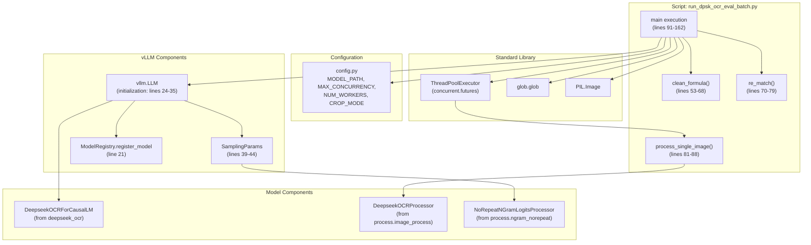
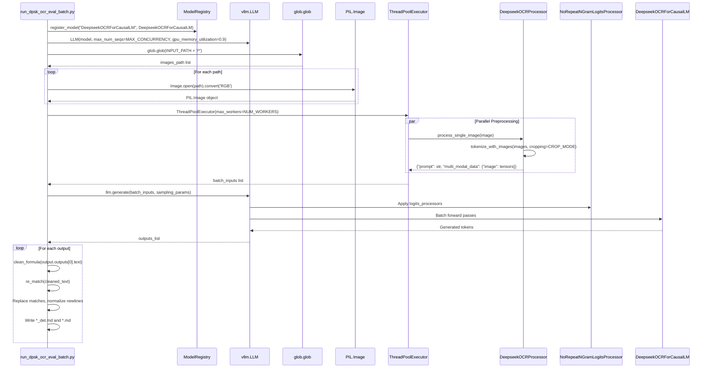
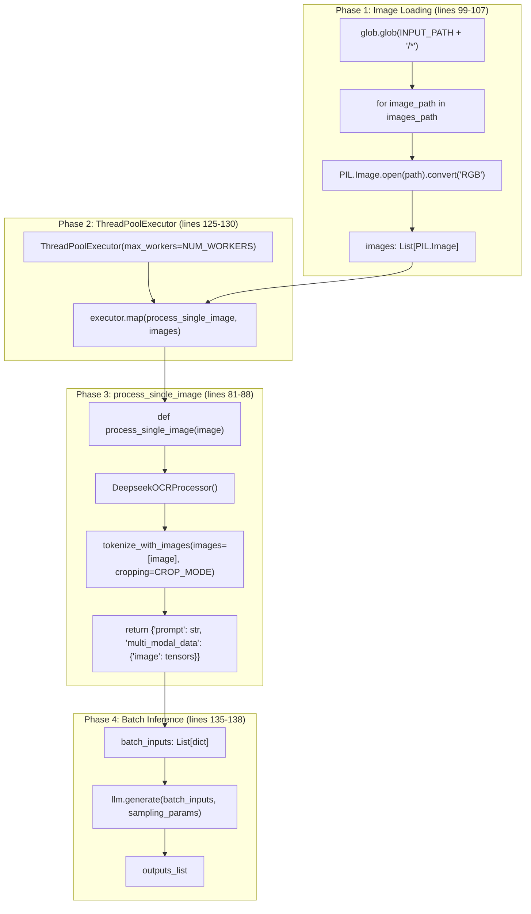
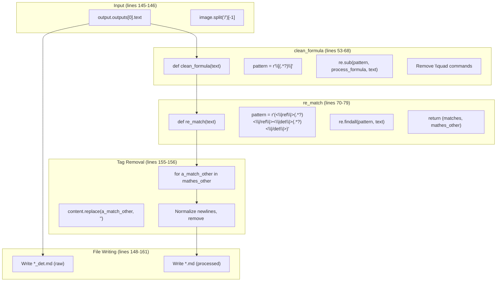
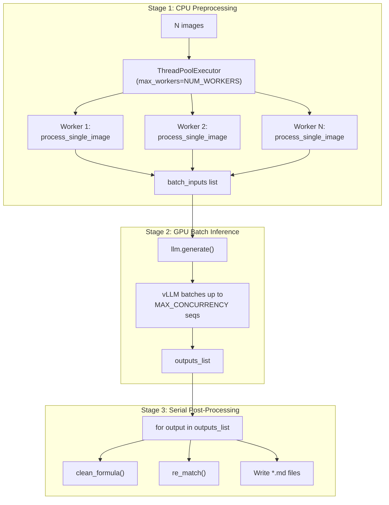

<!-- source: DeepWiki mcp.deepwiki.com · repo deepseek-ai/DeepSeek-OCR · extra page Batch Evaluation · fetched 2026-10-30 -->

# Batch Evaluation

<details>
<summary>Relevant source files</summary>

The following files were used as context for generating this wiki page:

- [DeepSeek-OCR-master/DeepSeek-OCR-vllm/run_dpsk_ocr_eval_batch.py](DeepSeek-OCR-master/DeepSeek-OCR-vllm/run_dpsk_ocr_eval_batch.py)

</details>


## Purpose and Scope

This page documents the batch evaluation workflow implemented in `run_dpsk_ocr_eval_batch.py`. This script processes multiple images in parallel for benchmarking and evaluation workloads.

Primary use cases:
- Benchmark dataset evaluation (e.g., OmniDocBench)
- High-throughput OCR processing with vLLM batch inference
- Parallel CPU preprocessing with `ThreadPoolExecutor`
- Generation of dual output files (raw detection + cleaned markdown)

For single image streaming, see page 3.2.1. For PDF document processing, see page 3.2.2.

**Sources:** [DeepSeek-OCR-master/DeepSeek-OCR-vllm/run_dpsk_ocr_eval_batch.py:1-162]()

---

## Configuration Requirements

Batch evaluation relies on centralized configuration in `config.py`. You must set the following parameters before execution:

| Parameter | Purpose | Default | Notes |
|-----------|---------|---------|-------|
| `MODEL_PATH` | Model identifier or path | `'deepseek-ai/DeepSeek-OCR'` | HuggingFace model or local path |
| `INPUT_PATH` | Directory containing images | Empty string | Must contain `.jpg`, `.png`, or `.jpeg` files |
| `OUTPUT_PATH` | Directory for results | Empty string | Created automatically if missing |
| `PROMPT` | OCR task instruction | `'<image>\n<|grounding|>Convert the document to markdown.'` | Task-specific prompt |
| `MAX_CONCURRENCY` | Maximum batch size | `100` | Reduce if GPU memory is limited |
| `NUM_WORKERS` | Preprocessing threads | `64` | CPU-bound parallelization |
| `CROP_MODE` | Enable dynamic cropping | `True` | Gundam mode (multi-scale) |

The script reads images from `INPUT_PATH` using glob pattern `INPUT_PATH/*` and processes all matching image files.

**Sources:** [DeepSeek-OCR-master/DeepSeek-OCR-vllm/config.py:8-27](), [DeepSeek-OCR-master/DeepSeek-OCR-vllm/run_dpsk_ocr_eval_batch.py:10]()

---

## Code Architecture

### Component Mapping



**Sources:** [DeepSeek-OCR-master/DeepSeek-OCR-vllm/run_dpsk_ocr_eval_batch.py:1-162]()

### Execution Sequence



**Sources:** [DeepSeek-OCR-master/DeepSeek-OCR-vllm/run_dpsk_ocr_eval_batch.py:14-162]()

---

## Execution Flow

### Component Initialization

The script performs model registration and vLLM engine initialization:

**Model Registration** [run_dpsk_ocr_eval_batch.py:16-21]():
```python
from deepseek_ocr import DeepseekOCRForCausalLM
from vllm.model_executor.models.registry import ModelRegistry

ModelRegistry.register_model("DeepseekOCRForCausalLM", DeepseekOCRForCausalLM)
```

**vLLM Engine Parameters** [run_dpsk_ocr_eval_batch.py:24-35]():

| Parameter | Value | Purpose |
|-----------|-------|---------|
| `model` | `MODEL_PATH` | Model identifier |
| `hf_overrides` | `{"architectures": ["DeepseekOCRForCausalLM"]}` | Force model class |
| `block_size` | `256` | KV cache block size |
| `max_model_len` | `8192` | Maximum sequence length |
| `max_num_seqs` | `MAX_CONCURRENCY` | Batch size limit (default 100) |
| `gpu_memory_utilization` | `0.9` | GPU memory allocation (90%) |
| `swap_space` | `0` | Disable CPU-GPU swapping |
| `tensor_parallel_size` | `1` | Single GPU inference |

**Logits Processor Configuration** [run_dpsk_ocr_eval_batch.py:37-44]():

`NoRepeatNGramLogitsProcessor` prevents repetitive output:
- `ngram_size=40`: N-gram length to check
- `window_size=90`: Token window for repetition detection
- `whitelist_token_ids={128821, 128822}`: Allowed repeated tokens (`<td>`, `</td>`)

**Sources:** [DeepSeek-OCR-master/DeepSeek-OCR-vllm/run_dpsk_ocr_eval_batch.py:14-44]()

### Parallel Image Preprocessing



**Image Loading** [run_dpsk_ocr_eval_batch.py:99-107]():
- Uses `glob.glob(INPUT_PATH + '/*')` to collect image paths
- Loads each image with `PIL.Image.open(path).convert('RGB')`
- Builds `images` list in memory

**Parallel Preprocessing** [run_dpsk_ocr_eval_batch.py:125-130]():
- Creates `ThreadPoolExecutor` with `NUM_WORKERS` threads (default 64)
- Maps `process_single_image` function over all images
- Uses `tqdm` for progress tracking

**process_single_image Function** [run_dpsk_ocr_eval_batch.py:81-88]():

Returns dictionary:
```python
{
    "prompt": prompt_string,
    "multi_modal_data": {
        "image": DeepseekOCRProcessor().tokenize_with_images(
            images=[image],
            bos=True,
            eos=True,
            cropping=CROP_MODE
        )
    }
}
```

The `tokenize_with_images` method:
- Applies dynamic cropping if `CROP_MODE=True`
- Generates `pixel_values`, `images_crop`, `images_spatial_crop` tensors
- Returns format compatible with vLLM batch input

**Sources:** [DeepSeek-OCR-master/DeepSeek-OCR-vllm/run_dpsk_ocr_eval_batch.py:81-130]()

### Batch Inference Execution

**vLLM Batch Generation** [run_dpsk_ocr_eval_batch.py:135-138]():

```python
outputs_list = llm.generate(
    batch_inputs,
    sampling_params=sampling_params
)
```

Processing steps:
1. vLLM loads up to `MAX_CONCURRENCY` sequences into GPU memory
2. Parallel forward passes through `DeepseekOCRForCausalLM`
3. Autoregressive generation with `NoRepeatNGramLogitsProcessor`
4. Returns `outputs_list` containing generated text with special tags

**SamplingParams Configuration** [run_dpsk_ocr_eval_batch.py:39-44]():
- `temperature=0.0`: Greedy decoding (deterministic)
- `max_tokens=8192`: Maximum generation length
- `skip_special_tokens=False`: Preserve `<|ref|>`, `<|det|>` tags
- `logits_processors`: List containing `NoRepeatNGramLogitsProcessor`

**Sources:** [DeepSeek-OCR-master/DeepSeek-OCR-vllm/run_dpsk_ocr_eval_batch.py:39-44](), [DeepSeek-OCR-master/DeepSeek-OCR-vllm/run_dpsk_ocr_eval_batch.py:135-138]()

---

## Output Processing

### File Generation

For each input `image_name.jpg`, two markdown files are generated:

| Filename | Content | Purpose |
|----------|---------|---------|
| `image_name_det.md` | Raw model output | Preserves `<|ref|>`, `<|det|>` tags for debugging |
| `image_name.md` | Cleaned markdown | Tags removed, formulas normalized |

### Post-Processing Functions



**clean_formula Function** [run_dpsk_ocr_eval_batch.py:53-68]():
- Regex pattern: `r'\\\[(.*?)\\\]'` matches LaTeX block formulas
- Removes `\quad` spacing commands with parenthetical content
- Normalizes whitespace within formulas

**re_match Function** [run_dpsk_ocr_eval_batch.py:70-79]():
- Regex pattern: `r'(<\|ref\|>(.*?)<\|/ref\|><\|det\|>(.*?)<\|/det\|>)'`
- Extracts bounding box reference tags
- Returns `(matches, mathes_other)` tuple:
  - `matches`: List of (full_tag, ref_content, det_content)
  - `mathes_other`: List of full tag strings for replacement

**Tag Removal Loop** [run_dpsk_ocr_eval_batch.py:155-156]():
- Iterates through `mathes_other`
- Replaces each tag with empty string
- Normalizes newlines: `\n\n\n\n` → `\n\n`
- Removes `<center>` and `</center>` tags

**Sources:** [DeepSeek-OCR-master/DeepSeek-OCR-vllm/run_dpsk_ocr_eval_batch.py:53-161]()

### File Writing Logic

**Path Construction** [run_dpsk_ocr_eval_batch.py:148-161]():

```python
# Raw detection output
mmd_det_path = output_path + image.split('/')[-1].replace('.jpg', '_det.md')
with open(mmd_det_path, 'w', encoding='utf-8') as afile:
    afile.write(content)

# Processed markdown
mmd_path = output_path + image.split('/')[-1].replace('.jpg', '.md')
with open(mmd_path, 'w', encoding='utf-8') as afile:
    afile.write(content)
```

Path construction:
1. Extract filename: `image.split('/')[-1]`
2. Replace extension: `.replace('.jpg', '_det.md')` or `.replace('.jpg', '.md')`
3. Prepend output directory: `output_path + filename`

**Sources:** [DeepSeek-OCR-master/DeepSeek-OCR-vllm/run_dpsk_ocr_eval_batch.py:145-161]()

---

## Performance Optimization

### Memory Management

**GPU Memory Configuration** [run_dpsk_ocr_eval_batch.py:24-35]():

| Parameter | Value | Effect |
|-----------|-------|--------|
| `gpu_memory_utilization` | `0.9` | Allocates 90% of GPU memory |
| `max_num_seqs` | `MAX_CONCURRENCY` (100) | Limits concurrent sequences |
| `swap_space` | `0` | Disables CPU-GPU swapping |
| `block_size` | `256` | KV cache block granularity |

For OOM errors, reduce `MAX_CONCURRENCY` in `config.py`. Comment at line 13 suggests lowering it for limited GPU memory.

**CPU Memory:**
- All images loaded into memory as `PIL.Image` objects [run_dpsk_ocr_eval_batch.py:104-107]()
- For large datasets, modify glob pattern to process in chunks

**Sources:** [DeepSeek-OCR-master/DeepSeek-OCR-vllm/run_dpsk_ocr_eval_batch.py:24-35](), [DeepSeek-OCR-master/DeepSeek-OCR-vllm/config.py:12-13]()

### Parallelization Strategy



**Stage 1:** CPU parallelization across `NUM_WORKERS` threads (default 64) for image preprocessing [run_dpsk_ocr_eval_batch.py:125-130]()

**Stage 2:** GPU batch inference with up to `MAX_CONCURRENCY` sequences (default 100) [run_dpsk_ocr_eval_batch.py:135-138]()

**Stage 3:** Serial post-processing and file I/O [run_dpsk_ocr_eval_batch.py:145-161]()

This design separates CPU, GPU, and I/O workloads to maximize throughput.

**Sources:** [DeepSeek-OCR-master/DeepSeek-OCR-vllm/run_dpsk_ocr_eval_batch.py:125-161]()

### Configuration Tuning

| Hardware Scenario | Parameter Settings | Notes |
|------------------|-------------------|-------|
| A100 80GB | `MAX_CONCURRENCY=100`, `MAX_CROPS=6` | Default configuration |
| RTX 3090 24GB | `MAX_CONCURRENCY=20-40`, `MAX_CROPS=4` | Reduce to prevent OOM |
| CPU bottleneck | `NUM_WORKERS=32-128` | Increase for preprocessing |
| Small dataset (<100) | `NUM_WORKERS=16`, `MAX_CONCURRENCY=50` | Reduce overhead |
| Large dataset (>10k) | Process in chunks | Avoid memory exhaustion |

Current defaults assume high-end GPU hardware. Adjust `MAX_CONCURRENCY` and `NUM_WORKERS` in `config.py` based on available resources.

**Sources:** [DeepSeek-OCR-master/DeepSeek-OCR-vllm/config.py:12-14]()

---

## Usage

### Basic Workflow

1. **Configure `config.py`**:
   ```python
   INPUT_PATH = '/path/to/images'  # Directory with .jpg/.png/.jpeg files
   OUTPUT_PATH = '/path/to/output'
   PROMPT = '<image>\n<|grounding|>Convert the document to markdown.'
   ```

2. **Execute script**:
   ```bash
   cd DeepSeek-OCR-master/DeepSeek-OCR-vllm
   python run_dpsk_ocr_eval_batch.py
   ```

3. **Progress indicators** [run_dpsk_ocr_eval_batch.py:99, 126-130, 155]():
   - `glob images.....` (red text) - Image collection
   - `Pre-processed images` - ThreadPoolExecutor progress
   - `other` - Post-processing loop

4. **Output files**: For `image.jpg`:
   - `image_det.md` - Raw output with `<|ref|>`, `<|det|>` tags
   - `image.md` - Cleaned markdown

The script processes all files matching `INPUT_PATH/*` glob pattern.

**Sources:** [DeepSeek-OCR-master/DeepSeek-OCR-vllm/run_dpsk_ocr_eval_batch.py:91-162]()

---

## Comparison with Other Inference Modes

| Feature | Batch Evaluation | Single Image | PDF Processing |
|---------|-----------------|--------------|----------------|
| **Script** | `run_dpsk_ocr_eval_batch.py` | `run_dpsk_ocr_image.py` | `run_dpsk_ocr_pdf.py` |
| **Input** | Directory of images | Single image file | PDF document |
| **Output** | 2 files per image (raw + processed) | 3 files (raw, processed, visual) | 3 files (raw, processed, visual PDF) |
| **Preprocessing** | Parallel (`ThreadPoolExecutor`) | Single-threaded | Parallel (`ThreadPoolExecutor`) |
| **Inference** | Batch (up to `MAX_CONCURRENCY`) | Streaming | Batch |
| **Visualization** | None | Bounding box overlay | Layout overlay PDF |
| **Use Case** | Benchmarking, evaluation | Interactive processing | Document digitization |

Batch evaluation is optimized for throughput and benchmarking. It omits visualization generation to maximize processing speed, making it ideal for evaluation on large datasets like OmniDocBench.

**Sources:** [DeepSeek-OCR-master/DeepSeek-OCR-vllm/run_dpsk_ocr_eval_batch.py:1-162](), [DeepSeek-OCR-master/DeepSeek-OCR-vllm/config.py:20-22]()

---

