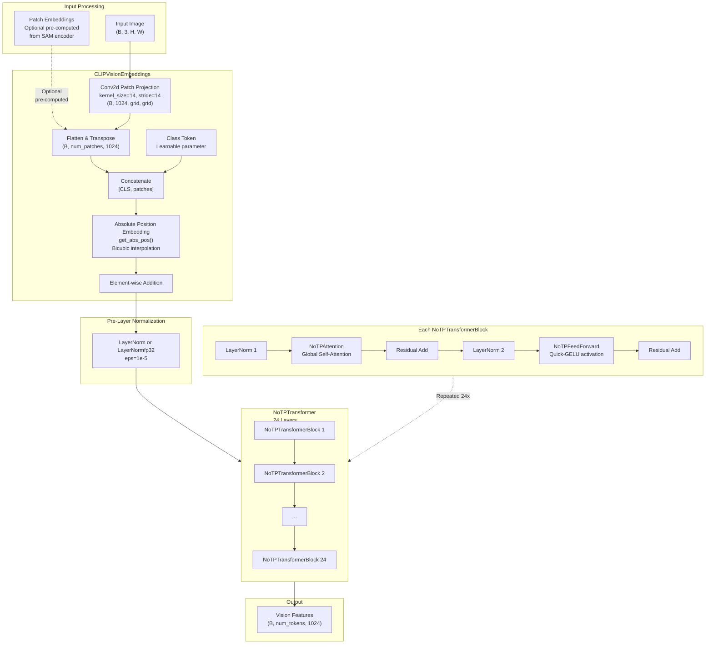
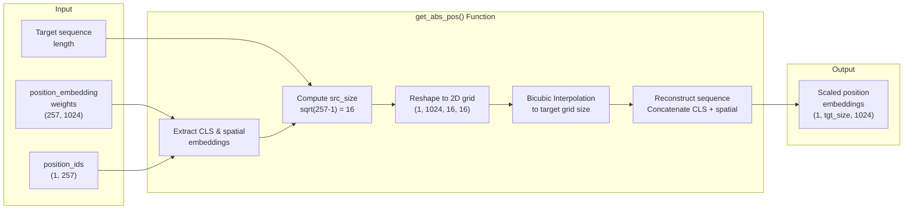
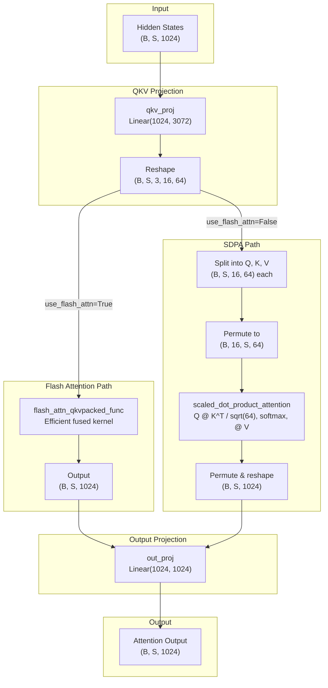
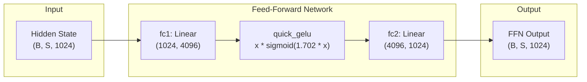
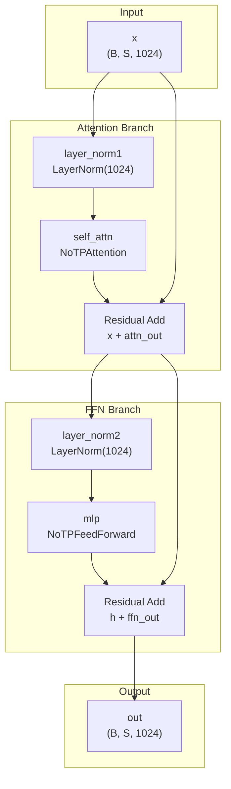
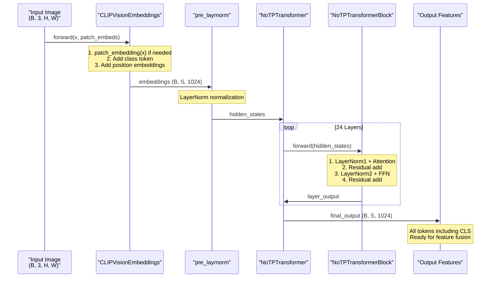

<!-- source: DeepWiki mcp.deepwiki.com · repo deepseek-ai/DeepSeek-OCR · extra page CLIP-L Encoder · fetched 2026-10-30 -->

# CLIP-L Encoder

Relevant source files

The following files were used as context for generating this wiki page:

- [DeepSeek-OCR-master/DeepSeek-OCR-vllm/deepencoder/clip_sdpa.py](DeepSeek-OCR-master/DeepSeek-OCR-vllm/deepencoder/clip_sdpa.py)

## Purpose and Scope

The CLIP-L Encoder is one of two vision encoders in the DeepSeek-OCR dual-encoder architecture. It provides semantic understanding and high-level visual features through a standard Vision Transformer (ViT) architecture with global attention mechanisms. This encoder complements the SAM encoder (see [4.3.1]()) by capturing semantic information that aids in understanding document structure and content.

This page covers the CLIP-L encoder's architecture, components, and processing pipeline. For information about how CLIP features are combined with SAM features, see [4.3.3](). For the overall vision encoding system, see [4.2]().

---

## Architecture Overview

The CLIP-L encoder is implemented as the `VitModel` class in [DeepSeek-OCR-master/DeepSeek-OCR-vllm/deepencoder/clip_sdpa.py:359-424](). It follows the CLIP Vision Transformer architecture with 24 layers, 1024 hidden dimensions, and 16 attention heads.

**CLIP-L Encoder Architecture**

**Sources:** [DeepSeek-OCR-master/DeepSeek-OCR-vllm/deepencoder/clip_sdpa.py:359-424](), [DeepSeek-OCR-master/DeepSeek-OCR-vllm/deepencoder/clip_sdpa.py:107-156](), [DeepSeek-OCR-master/DeepSeek-OCR-vllm/deepencoder/clip_sdpa.py:286-309]()

---

## Key Components

### CLIPVisionEmbeddings

The `CLIPVisionEmbeddings` class [DeepSeek-OCR-master/DeepSeek-OCR-vllm/deepencoder/clip_sdpa.py:107-156]() converts input images into token embeddings with absolute positional information.

| Component | Type | Parameters | Purpose |
|-----------|------|------------|---------|
| `patch_embedding` | `Conv2d` | `in_channels=3`, `out_channels=1024`, `kernel_size=14`, `stride=14` | Converts image patches to embeddings |
| `class_embedding` | `Parameter` | `shape=(1024,)` | Learnable CLS token prepended to sequence |
| `position_embedding` | `Embedding` | `num_positions=257`, `embed_dim=1024` | Absolute position encodings |
| `position_ids` | Buffer | `shape=(1, 257)` | Fixed position indices [0, 1, ..., 256] |

**Absolute Positional Encoding Process:**

The `get_abs_pos()` function [DeepSeek-OCR-master/DeepSeek-OCR-vllm/deepencoder/clip_sdpa.py:63-99]() handles dynamic resolution by interpolating the learned positional embeddings to match the actual sequence length. This allows the encoder to process images of varying resolutions while maintaining spatial position awareness.

**Sources:** [DeepSeek-OCR-master/DeepSeek-OCR-vllm/deepencoder/clip_sdpa.py:107-156](), [DeepSeek-OCR-master/DeepSeek-OCR-vllm/deepencoder/clip_sdpa.py:63-99]()

---

### NoTPAttention

The `NoTPAttention` module [DeepSeek-OCR-master/DeepSeek-OCR-vllm/deepencoder/clip_sdpa.py:227-284]() implements global self-attention with support for both Flash Attention and PyTorch's scaled dot-product attention.

**Attention Mechanism Flow:**

**Key Characteristics:**

- **Global Attention:** Unlike SAM's window attention, CLIP uses full self-attention where each token attends to all other tokens.
- **Multi-Head:** 16 attention heads with 64-dimensional head size (1024 / 16 = 64).
- **Flexible Backend:** Supports `flash_attn_qkvpacked_func` [DeepSeek-OCR-master/DeepSeek-OCR-vllm/deepencoder/clip_sdpa.py:246]() for efficiency or PyTorch `scaled_dot_product_attention` [DeepSeek-OCR-master/DeepSeek-OCR-vllm/deepencoder/clip_sdpa.py:270]() for compatibility.
- **No Causal Masking:** All tokens can attend to all positions (bidirectional).

**Sources:** [DeepSeek-OCR-master/DeepSeek-OCR-vllm/deepencoder/clip_sdpa.py:227-284]()

---

### NoTPFeedForward

The `NoTPFeedForward` module [DeepSeek-OCR-master/DeepSeek-OCR-vllm/deepencoder/clip_sdpa.py:159-173]() implements a two-layer feed-forward network with Quick-GELU activation.

The Quick-GELU activation function [DeepSeek-OCR-master/DeepSeek-OCR-vllm/deepencoder/clip_sdpa.py:101-103]() is defined as `x * torch.sigmoid(1.702 * x)`, providing a computationally efficient approximation to the standard GELU activation.

**Sources:** [DeepSeek-OCR-master/DeepSeek-OCR-vllm/deepencoder/clip_sdpa.py:159-173](), [DeepSeek-OCR-master/DeepSeek-OCR-vllm/deepencoder/clip_sdpa.py:101-103]()

---

### NoTPTransformerBlock

The `NoTPTransformerBlock` class [DeepSeek-OCR-master/DeepSeek-OCR-vllm/deepencoder/clip_sdpa.py:286-309]() combines attention and feed-forward layers with pre-normalization and residual connections.

**Transformer Block Architecture:**

The pre-normalization design (LayerNorm before attention/FFN) helps stabilize training and is standard in modern Vision Transformers.

**Sources:** [DeepSeek-OCR-master/DeepSeek-OCR-vllm/deepencoder/clip_sdpa.py:286-309]()

---

## Configuration

The CLIP-L encoder configuration is defined in `vit_model_cfg` [DeepSeek-OCR-master/DeepSeek-OCR-vllm/deepencoder/clip_sdpa.py:427-445]():

| Parameter | Value | Description |
|-----------|-------|-------------|
| `num_layers` | 24 | Number of transformer blocks |
| `hidden_size` | 1024 | Dimension of hidden representations (CLIP-L standard) |
| `num_attention_heads` | 16 | Number of attention heads per layer |
| `ffn_hidden_size` | 4096 | Feed-forward network intermediate dimension (4× hidden) |
| `seq_length` | 256 | Maximum sequence length |
| `image_size` | 224 | Input image size (can be interpolated) |
| `patch_size` | 14 | Size of each image patch (14×14 pixels) |
| `use_flash_attn` | False | Whether to use Flash Attention or SDPA |
| `layernorm_epsilon` | 1e-5 | Epsilon for LayerNorm stability |
| `attention_dropout` | 0.0 | Dropout rate in attention (disabled) |
| `hidden_dropout` | 0.0 | Dropout rate in hidden layers (disabled) |

**Patch Grid Calculation:**
- For a 224×224 image with 14×14 patches: `(224/14)² = 16² = 256` patches.
- With CLS token: `256 + 1 = 257` total tokens.

The `build_clip_l()` factory function [DeepSeek-OCR-master/DeepSeek-OCR-vllm/deepencoder/clip_sdpa.py:447-452]() instantiates the encoder with these settings and no frozen parameters.

**Sources:** [DeepSeek-OCR-master/DeepSeek-OCR-vllm/deepencoder/clip_sdpa.py:427-452]()

---

## Forward Pass

The `VitModel.forward()` method [DeepSeek-OCR-master/DeepSeek-OCR-vllm/deepencoder/clip_sdpa.py:411-424]() processes images through the following pipeline:

**Complete Forward Pass Data Flow:**

**Key Processing Steps:**

1. **Embedding Generation** [DeepSeek-OCR-master/DeepSeek-OCR-vllm/deepencoder/clip_sdpa.py:416]():
   - Convert image to patch embeddings (or use pre-computed from SAM).
   - Prepend learnable CLS token.
   - Add interpolated absolute positional embeddings.

2. **Pre-Layer Normalization** [DeepSeek-OCR-master/DeepSeek-OCR-vllm/deepencoder/clip_sdpa.py:417]():
   - Apply LayerNorm (or `LayerNormfp32` if configured).
   - Normalizes before entering transformer stack.

3. **Transformer Processing** [DeepSeek-OCR-master/DeepSeek-OCR-vllm/deepencoder/clip_sdpa.py:420]():
   - Sequentially process through 24 transformer blocks via `self.transformer`.
   - Each block applies self-attention and feed-forward with residual connections.

4. **Output** [DeepSeek-OCR-master/DeepSeek-OCR-vllm/deepencoder/clip_sdpa.py:424]():
   - Returns full sequence of features `(batch_size, num_tokens, 1024)`.
   - Includes CLS token (position 0) and all patch tokens (positions 1+).

**Sources:** [DeepSeek-OCR-master/DeepSeek-OCR-vllm/deepencoder/clip_sdpa.py:411-424](), [DeepSeek-OCR-master/DeepSeek-OCR-vllm/deepencoder/clip_sdpa.py:329-354]()

---

## Integration with Dual-Encoder System

The CLIP-L encoder works in conjunction with the SAM encoder to provide complementary visual features. As demonstrated in the test code [DeepSeek-OCR-master/DeepSeek-OCR-vllm/deepencoder/clip_sdpa.py:495-504](), the typical usage pattern involves:

1. SAM encoder processes the image first.
2. These embeddings can optionally be reused as input to CLIP's `patch_embedding` [DeepSeek-OCR-master/DeepSeek-OCR-vllm/deepencoder/clip_sdpa.py:138-142]().
3. CLIP encoder processes with its global attention mechanism.
4. Features from both encoders are combined (typically element-wise addition after alignment).

**Sources:** [DeepSeek-OCR-master/DeepSeek-OCR-vllm/deepencoder/clip_sdpa.py:455-504]()

---

## Special Features

### FP32 Layer Normalization

The encoder supports optional FP32 LayerNorm [DeepSeek-OCR-master/DeepSeek-OCR-vllm/deepencoder/clip_sdpa.py:54-60]() through the `LayerNormfp32` class, which casts inputs to `float32` before normalization and then back to the original dtype. This can improve numerical stability during training while maintaining mixed-precision efficiency.

### Freezable Components

The `VitModel` constructor accepts `freeze_embed` and `freeze_pre_norm` parameters [DeepSeek-OCR-master/DeepSeek-OCR-vllm/deepencoder/clip_sdpa.py:363-398](), allowing selective freezing of:
- Patch embeddings, class token, and positional embeddings.
- Pre-transformer LayerNorm weights.

### Micro Data Parallelism Flag

All parameters are marked with `p.micro_dp = True` [DeepSeek-OCR-master/DeepSeek-OCR-vllm/deepencoder/clip_sdpa.py:400-401](), indicating support for micro-batch data parallelism during distributed training.

**Sources:** [DeepSeek-OCR-master/DeepSeek-OCR-vllm/deepencoder/clip_sdpa.py:54-60](), [DeepSeek-OCR-master/DeepSeek-OCR-vllm/deepencoder/clip_sdpa.py:363-401]()

---

