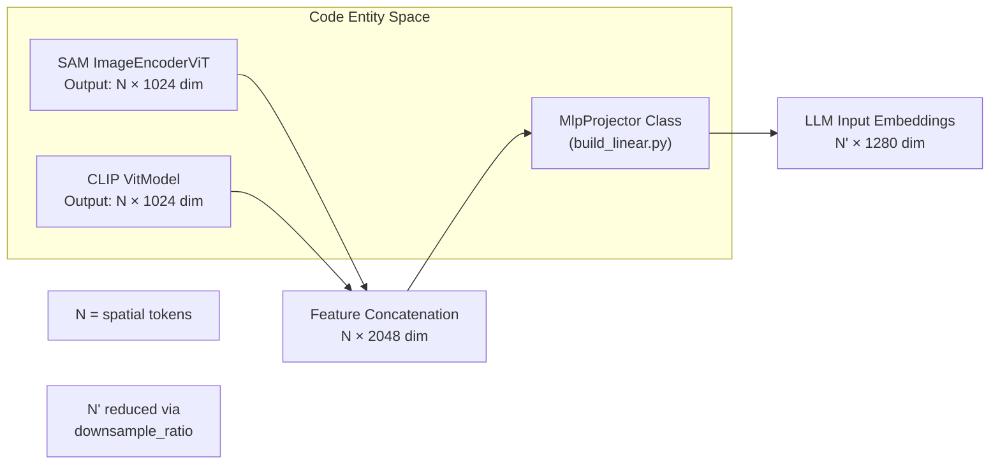
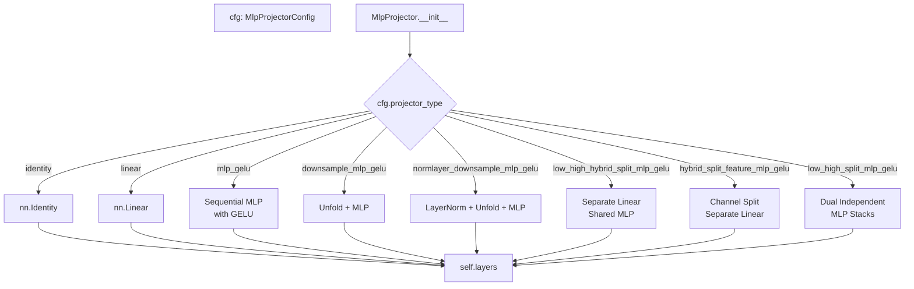
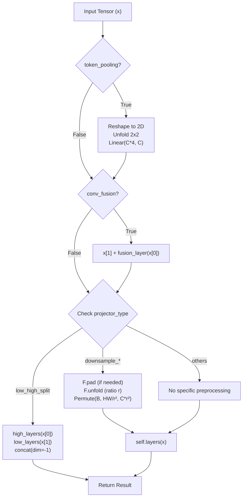

<!-- source: DeepWiki mcp.deepwiki.com · repo deepseek-ai/DeepSeek-OCR · extra page Feature Projection · fetched 2026-10-30 -->

# Feature Projection

Relevant source files

The following files were used as context for generating this wiki page:

- [DeepSeek-OCR-master/DeepSeek-OCR-vllm/deepencoder/build_linear.py](DeepSeek-OCR-master/DeepSeek-OCR-vllm/deepencoder/build_linear.py)

## Purpose and Scope

This document describes the feature projection layer in DeepSeek-OCR, which bridges the vision encoders to the language model. The `MlpProjector` class [DeepSeek-OCR-master/DeepSeek-OCR-vllm/deepencoder/build_linear.py:7-174]() transforms concatenated vision features from the dual-encoder system (SAM + CLIP) into the language model's input dimension space. This page covers the various projection strategies, dimensionality reduction techniques (typically 2048 to 1280), and configuration options.

For information about the vision encoders that produce the input features, see **4.3.1 SAM ViT-B Encoder** and **4.3.2 CLIP-L Encoder**. For details on how projected features integrate with the language model, see **4.5 Multimodal Integration**.

---

## Architectural Role

The feature projection layer sits between the dual vision encoders and the language model, performing critical dimensionality alignment and feature transformation:

### Data Flow: Vision to Language Space
Title: "DeepSeek-OCR Feature Projection Pipeline"

Sources: [DeepSeek-OCR-master/DeepSeek-OCR-vllm/deepencoder/build_linear.py:7-96](), [DeepSeek-OCR-master/DeepSeek-OCR-vllm/deepencoder/build_linear.py:138-156]()

The projection layer performs three key functions:
1.  **Dimensionality Reduction**: Reduces concatenated 2048-dimensional features (1024 from SAM + 1024 from CLIP) to 1280 dimensions (the LLM embedding size).
2.  **Feature Transformation**: Applies non-linear transformations using `GELU` activations [DeepSeek-OCR-master/DeepSeek-OCR-vllm/deepencoder/build_linear.py:25-25]() for expressive feature mapping.
3.  **Spatial Downsampling**: Optionally reduces the number of tokens by spatial pooling or unfolding for computational efficiency [DeepSeek-OCR-master/DeepSeek-OCR-vllm/deepencoder/build_linear.py:153-154]().

---

## MlpProjector Class Architecture

The `MlpProjector` class implements multiple projection strategies controlled by the `cfg.projector_type` parameter [DeepSeek-OCR-master/DeepSeek-OCR-vllm/deepencoder/build_linear.py:15-87]().

### Projection Strategy Selection
Title: "MlpProjector Strategy Dispatch"

Sources: [DeepSeek-OCR-master/DeepSeek-OCR-vllm/deepencoder/build_linear.py:15-87]()

### Key Configuration Parameters

| Parameter | Type | Description |
| :--- | :--- | :--- |
| `projector_type` | str | Strategy identifier (e.g., `mlp_gelu`, `downsample_mlp_gelu`) [DeepSeek-OCR-master/DeepSeek-OCR-vllm/deepencoder/build_linear.py:15-87]() |
| `input_dim` | int \| list | Input dimension, usually 2048 (concatenated) or [1024, 1024] (split) [DeepSeek-OCR-master/DeepSeek-OCR-vllm/deepencoder/build_linear.py:19-69]() |
| `n_embed` | int | Target dimension for LLM, typically 1280 [DeepSeek-OCR-master/DeepSeek-OCR-vllm/deepencoder/build_linear.py:19-19]() |
| `depth` | int | Number of layers in the MLP (default: 1) [DeepSeek-OCR-master/DeepSeek-OCR-vllm/deepencoder/build_linear.py:22-22]() |
| `downsample_ratio` | int | Factor for spatial token reduction (e.g., 2 or 4) [DeepSeek-OCR-master/DeepSeek-OCR-vllm/deepencoder/build_linear.py:33-33]() |
| `token_pooling` | bool | Enables 2x2 spatial patch merging before projection [DeepSeek-OCR-master/DeepSeek-OCR-vllm/deepencoder/build_linear.py:90-91]() |

Sources: [DeepSeek-OCR-master/DeepSeek-OCR-vllm/deepencoder/build_linear.py:9-95]()

---

## Projection Strategies

### 1. Identity and Linear
*   **identity**: Passes features through without modification [DeepSeek-OCR-master/DeepSeek-OCR-vllm/deepencoder/build_linear.py:15-16]().
*   **linear**: A single `nn.Linear(cfg.input_dim, cfg.n_embed)` layer [DeepSeek-OCR-master/DeepSeek-OCR-vllm/deepencoder/build_linear.py:18-19]().

### 2. Standard MLP (`mlp_gelu`)
A multi-layer perceptron with `GELU` activations. The first layer maps from `input_dim` to `n_embed`, and subsequent layers maintain the `n_embed` width [DeepSeek-OCR-master/DeepSeek-OCR-vllm/deepencoder/build_linear.py:21-27]().

### 3. Downsampling Projections
These strategies reduce the sequence length (number of tokens) while increasing the channel dimension before the final projection.

*   **downsample_mlp_gelu**: Uses `F.unfold` to group spatial patches (e.g., 2x2) into the channel dimension [DeepSeek-OCR-master/DeepSeek-OCR-vllm/deepencoder/build_linear.py:152-154]().
    *   Input shape: `(B, HW, C)`
    *   Unfold shape: `(B, C * r^2, HW / r^2)` where `r` is `downsample_ratio`.
*   **normlayer_downsample_mlp_gelu**: Prepends an `nn.LayerNorm` before the downsampling and MLP stack [DeepSeek-OCR-master/DeepSeek-OCR-vllm/deepencoder/build_linear.py:29-41]().

Sources: [DeepSeek-OCR-master/DeepSeek-OCR-vllm/deepencoder/build_linear.py:43-52](), [DeepSeek-OCR-master/DeepSeek-OCR-vllm/deepencoder/build_linear.py:138-156]()

### 4. Split-Path Hybrid Projections
These handle SAM (high-res) and CLIP (low-res) features with specialized sub-networks.

*   **low_high_hybrid_split_mlp_gelu**: Projects SAM and CLIP features separately using `high_up_proj` and `low_up_proj` (each to `n_embed // 2`) before concatenating them for a shared MLP [DeepSeek-OCR-master/DeepSeek-OCR-vllm/deepencoder/build_linear.py:54-63]().
*   **hybrid_split_feature_mlp_gelu**: Similar to above, but splits a single concatenated input tensor based on a `channel_div` ratio [DeepSeek-OCR-master/DeepSeek-OCR-vllm/deepencoder/build_linear.py:65-75]().
*   **low_high_split_mlp_gelu**: Maintains two completely independent MLP pipelines (`high_layers` and `low_layers`) that are only concatenated at the very end of the forward pass [DeepSeek-OCR-master/DeepSeek-OCR-vllm/deepencoder/build_linear.py:77-86]().

Sources: [DeepSeek-OCR-master/DeepSeek-OCR-vllm/deepencoder/build_linear.py:118-136]()

---

## Optional Feature Modules

### Token Pooling
When `token_pooling` is enabled, the model performs a 2x2 patch merge. It reshapes the sequence into a 2D grid, extracts patches using `unfold`, and projects the resulting `channels * 4` dimension back to the original `channels` using `self.token_pooling_layer` [DeepSeek-OCR-master/DeepSeek-OCR-vllm/deepencoder/build_linear.py:98-113]().

### Convolutional Fusion
If `conv_fusion_high_low_features` is active, the projector fuses dual features using a learnable linear layer: `self.fusion_layer(x[:, 0]) + x[:, 1]` [DeepSeek-OCR-master/DeepSeek-OCR-vllm/deepencoder/build_linear.py:115-116]().

---

## Forward Pass Execution

Title: "MlpProjector.forward Execution Flow"

Sources: [DeepSeek-OCR-master/DeepSeek-OCR-vllm/deepencoder/build_linear.py:97-156]()

---

## Computational Analysis

The class includes a utility `get_flops_per_sample` to estimate the theoretical complexity of the projection [DeepSeek-OCR-master/DeepSeek-OCR-vllm/deepencoder/build_linear.py:158-172]().

*   **Linear**: `2 * input_dim * n_embed` [DeepSeek-OCR-master/DeepSeek-OCR-vllm/deepencoder/build_linear.py:161-161]().
*   **MLP**: Accounts for the `downsample_ratio` expansion and the `depth` of the network [DeepSeek-OCR-master/DeepSeek-OCR-vllm/deepencoder/build_linear.py:163-168]().
*   **Training Overhead**: Total FLOPs are multiplied by 3 to account for the backward pass [DeepSeek-OCR-master/DeepSeek-OCR-vllm/deepencoder/build_linear.py:172-172]().

Sources: [DeepSeek-OCR-master/DeepSeek-OCR-vllm/deepencoder/build_linear.py:158-172]()

---

