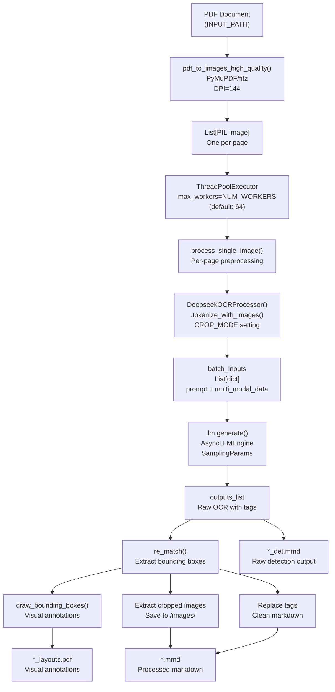
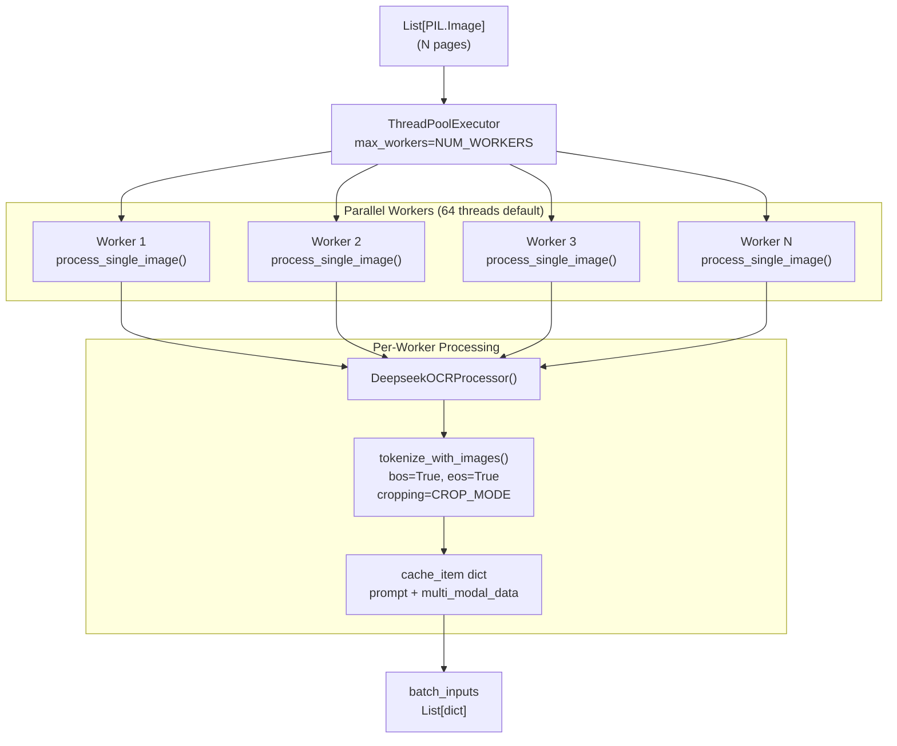
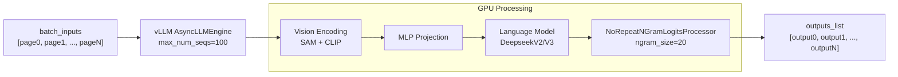
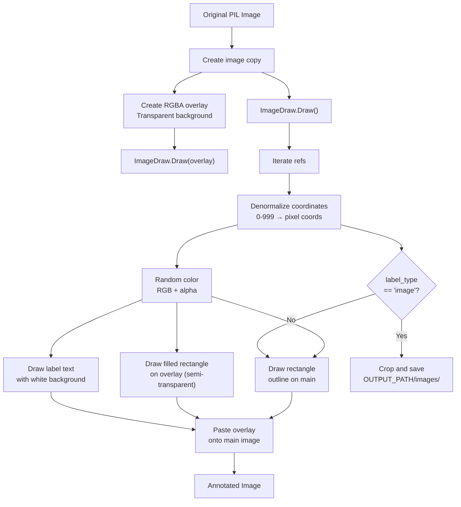
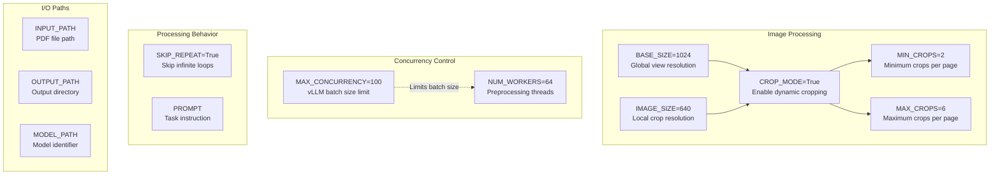
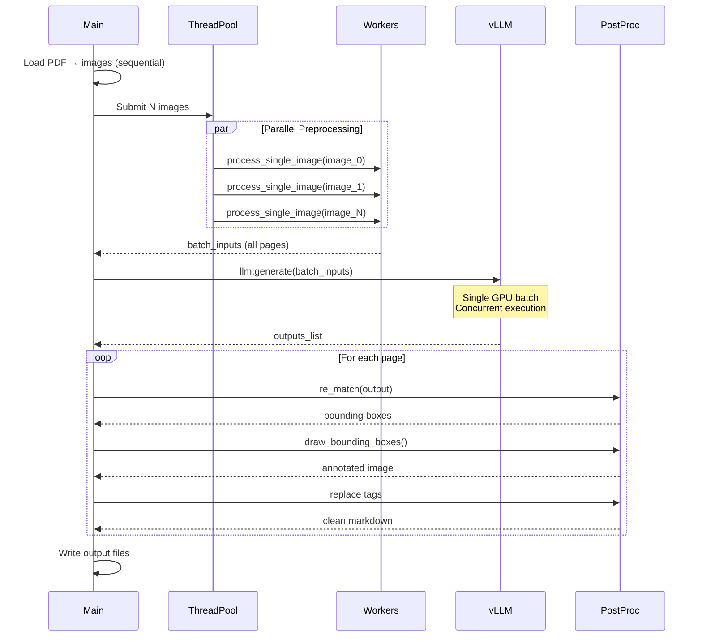

<!-- source: DeepWiki mcp.deepwiki.com · repo deepseek-ai/DeepSeek-OCR · extra page PDF Document Processing · fetched 2026-10-30 -->

# PDF Document Processing

<details>
<summary>Relevant source files</summary>

The following files were used as context for generating this wiki page:

- [DeepSeek-OCR-master/DeepSeek-OCR-vllm/run_dpsk_ocr_pdf.py](DeepSeek-OCR-master/DeepSeek-OCR-vllm/run_dpsk_ocr_pdf.py)

</details>


This page describes how to process multi-page PDF documents using the vLLM inference path. The `run_dpsk_ocr_pdf.py` script provides a production-ready pipeline for converting PDF documents to structured markdown with layout information, bounding box annotations, and visual overlays.

For single image processing, see [Single Image Processing](3.2.1). For batch evaluation on datasets, see [Batch Evaluation](3.2.3). For general vLLM inference concepts, see [vLLM Inference](3.2).

## Purpose and Scope

The PDF processing pipeline is designed for:
- **Multi-page document processing**: Academic papers, reports, books, forms.
- **Concurrent page processing**: Parallel preprocessing with `ThreadPoolExecutor` [DeepSeek-OCR-master/DeepSeek-OCR-vllm/run_dpsk_ocr_pdf.py:248-251]().
- **Batch GPU inference**: Process all pages in a single vLLM batch [DeepSeek-OCR-master/DeepSeek-OCR-vllm/run_dpsk_ocr_pdf.py:268-271]().
- **Layout visualization**: Generate annotated PDFs with bounding boxes [DeepSeek-OCR-master/DeepSeek-OCR-vllm/run_dpsk_ocr_pdf.py:218-220]().
- **Image extraction**: Automatically extract and save figures/charts from documents [DeepSeek-OCR-master/DeepSeek-OCR-vllm/run_dpsk_ocr_pdf.py:183-190]().

The script produces three synchronized outputs: raw detection markup, cleaned markdown, and a visual layout PDF.

Sources: [DeepSeek-OCR-master/DeepSeek-OCR-vllm/run_dpsk_ocr_pdf.py:1-331]()

## PDF Processing Workflow

The following diagram shows the complete end-to-end workflow from PDF input to final outputs:

**Title: PDF Processing Pipeline**


Sources: [DeepSeek-OCR-master/DeepSeek-OCR-vllm/run_dpsk_ocr_pdf.py:64-330]()

## PDF to Image Conversion

The first stage converts PDF pages to high-quality images using PyMuPDF (`fitz`).

### Conversion Function

The `pdf_to_images_high_quality()` function handles PDF rendering:

**Function Signature**: [DeepSeek-OCR-master/DeepSeek-OCR-vllm/run_dpsk_ocr_pdf.py:64-95]()

| Parameter | Type | Default | Description |
|-----------|------|---------|-------------|
| `pdf_path` | str | Required | Path to input PDF file |
| `dpi` | int | 144 | Rendering resolution |
| `image_format` | str | "PNG" | Output image format |

**Key Implementation Details**:
- Uses `fitz.Matrix(zoom, zoom)` where `zoom = dpi / 72.0` [DeepSeek-OCR-master/DeepSeek-OCR-vllm/run_dpsk_ocr_pdf.py:72-73]().
- Renders with `page.get_pixmap(matrix=matrix, alpha=False)` [DeepSeek-OCR-master/DeepSeek-OCR-vllm/run_dpsk_ocr_pdf.py:78]().
- Disables image size limits with `Image.MAX_IMAGE_PIXELS = None` [DeepSeek-OCR-master/DeepSeek-OCR-vllm/run_dpsk_ocr_pdf.py:79]().
- Converts RGBA to RGB by pasting on white background [DeepSeek-OCR-master/DeepSeek-OCR-vllm/run_dpsk_ocr_pdf.py:87-90]().

**Title: PDF to PIL Image Conversion**


Sources: [DeepSeek-OCR-master/DeepSeek-OCR-vllm/run_dpsk_ocr_pdf.py:64-95]()

## Concurrent Image Preprocessing

After PDF conversion, images are preprocessed in parallel using a thread pool.

### ThreadPoolExecutor Architecture

**Title: Concurrent Preprocessing Architecture**


### Process Single Image Function

The `process_single_image()` function [DeepSeek-OCR-master/DeepSeek-OCR-vllm/run_dpsk_ocr_pdf.py:223-230]() creates a batch input dictionary for each page by calling `DeepseekOCRProcessor().tokenize_with_images()` [DeepSeek-OCR-master/DeepSeek-OCR-vllm/run_dpsk_ocr_pdf.py:234-242]().

**Preprocessing Steps per Image**:
1. Call `DeepseekOCRProcessor().tokenize_with_images()`.
2. Apply dynamic cropping if `CROP_MODE=True`.
3. Generate global view and local crops as defined in `config.py`.
4. Return structured batch input dictionary `cache_item`.

Sources: [DeepSeek-OCR-master/DeepSeek-OCR-vllm/run_dpsk_ocr_pdf.py:223-245](), [DeepSeek-OCR-master/DeepSeek-OCR-vllm/run_dpsk_ocr_pdf.py:248-253]()

## Batch Inference with vLLM

Once all pages are preprocessed, they are passed to vLLM for batch inference.

### vLLM Engine Configuration

The LLM engine is initialized with production-optimized settings [DeepSeek-OCR-master/DeepSeek-OCR-vllm/run_dpsk_ocr_pdf.py:32-44]():

| Parameter | Value | Purpose |
|-----------|-------|---------|
| `model` | `MODEL_PATH` | Model identifier |
| `hf_overrides` | `{"architectures": ["DeepseekOCRForCausalLM"]}` | Custom model registration |
| `block_size` | 256 | KV cache block size |
| `enforce_eager` | False | Use CUDA graphs |
| `max_model_len` | 8192 | Maximum sequence length |
| `max_num_seqs` | `MAX_CONCURRENCY` (100) | Batch size limit |
| `gpu_memory_utilization` | 0.9 | GPU memory allocation |

### Sampling Parameters

The sampling configuration [DeepSeek-OCR-master/DeepSeek-OCR-vllm/run_dpsk_ocr_pdf.py:48-54]() controls output generation:
- **Deterministic output**: `temperature=0.0`.
- **Repetition Control**: `NoRepeatNGramLogitsProcessor` with `ngram_size=20` [DeepSeek-OCR-master/DeepSeek-OCR-vllm/run_dpsk_ocr_pdf.py:46]().
- **Whitelist**: Allows table tags `<td>` (128821) and `</td>` (128822) to repeat [DeepSeek-OCR-master/DeepSeek-OCR-vllm/run_dpsk_ocr_pdf.py:46]().

### Batch Generation Call

The inference is performed in a single batch for efficiency [DeepSeek-OCR-master/DeepSeek-OCR-vllm/run_dpsk_ocr_pdf.py:268-271]():

```python
outputs_list = llm.generate(
    batch_inputs,           
    sampling_params=sampling_params
)
```

**Title: Batch Inference Pipeline**


Sources: [DeepSeek-OCR-master/DeepSeek-OCR-vllm/run_dpsk_ocr_pdf.py:32-54](), [DeepSeek-OCR-master/DeepSeek-OCR-vllm/run_dpsk_ocr_pdf.py:268-271]()

## Post-Processing Pipeline

### Bounding Box Extraction

The `re_match()` function [DeepSeek-OCR-master/DeepSeek-OCR-vllm/run_dpsk_ocr_pdf.py:123-135]() extracts structured annotations using the regex: `<|ref|>(.*?)<|/ref|><|det|>(.*?)<|/det|>`.

### Coordinate Extraction

The `extract_coordinates_and_label()` function [DeepSeek-OCR-master/DeepSeek-OCR-vllm/run_dpsk_ocr_pdf.py:138-148]() parses the captured groups. Coordinates are denormalized from the [0, 999] range to pixel coordinates based on image size [DeepSeek-OCR-master/DeepSeek-OCR-vllm/run_dpsk_ocr_pdf.py:177-181]().

### Bounding Box Visualization

The `draw_bounding_boxes()` function [DeepSeek-OCR-master/DeepSeek-OCR-vllm/run_dpsk_ocr_pdf.py:151-215]() creates visual annotations.

**Title: Bounding Box Drawing Process**


Sources: [DeepSeek-OCR-master/DeepSeek-OCR-vllm/run_dpsk_ocr_pdf.py:123-220]()

### Content Cleaning

The main loop [DeepSeek-OCR-master/DeepSeek-OCR-vllm/run_dpsk_ocr_pdf.py:286-320]() performs the following:
1. **Repetition Detection**: Skips pages where the end-of-sentence token is missing if `SKIP_REPEAT` is enabled [DeepSeek-OCR-master/DeepSeek-OCR-vllm/run_dpsk_ocr_pdf.py:289-293]().
2. **Tag Replacement**: Replaces `<|ref|>image<|/ref|>` tags with markdown image links [DeepSeek-OCR-master/DeepSeek-OCR-vllm/run_dpsk_ocr_pdf.py:302-306]().
3. **Symbol Cleanup**: Normalizes LaTeX-style operators like `\coloneqq` [DeepSeek-OCR-master/DeepSeek-OCR-vllm/run_dpsk_ocr_pdf.py:313-314]().

Sources: [DeepSeek-OCR-master/DeepSeek-OCR-vllm/run_dpsk_ocr_pdf.py:286-320]()

## Output Files and Formats

| File | Extension | Purpose |
|------|-----------|---------|
| Raw detection | `*_det.mmd` | Complete model output with all tags [DeepSeek-OCR-master/DeepSeek-OCR-vllm/run_dpsk_ocr_pdf.py:324-325](). |
| Processed markdown | `*.mmd` | Cleaned document with image links [DeepSeek-OCR-master/DeepSeek-OCR-vllm/run_dpsk_ocr_pdf.py:321-322](). |
| Layout PDF | `*_layouts.pdf` | Visual verification with bounding boxes [DeepSeek-OCR-master/DeepSeek-OCR-vllm/run_dpsk_ocr_pdf.py:328-329](). |
| Extracted images | `images/*.jpg` | Individual figures cropped from the PDF [DeepSeek-OCR-master/DeepSeek-OCR-vllm/run_dpsk_ocr_pdf.py:186](). |

Sources: [DeepSeek-OCR-master/DeepSeek-OCR-vllm/run_dpsk_ocr_pdf.py:321-329]()

## Configuration and Performance Tuning

**Title: Configuration Hierarchy**


Sources: [DeepSeek-OCR-master/DeepSeek-OCR-vllm/config.py:1-43](), [DeepSeek-OCR-master/DeepSeek-OCR-vllm/run_dpsk_ocr_pdf.py:17-44]()

## Execution Flow

**Title: PDF Processing Sequence**


Sources: [DeepSeek-OCR-master/DeepSeek-OCR-vllm/run_dpsk_ocr_pdf.py:248-330]()

---

