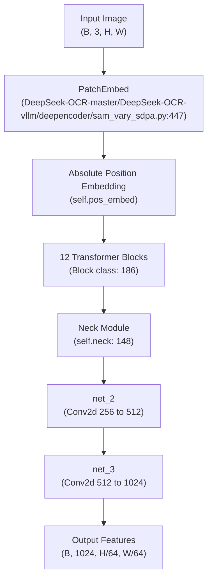
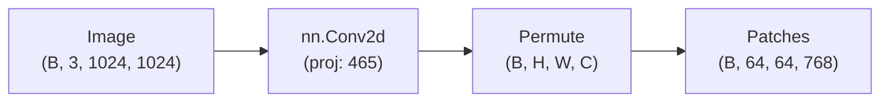
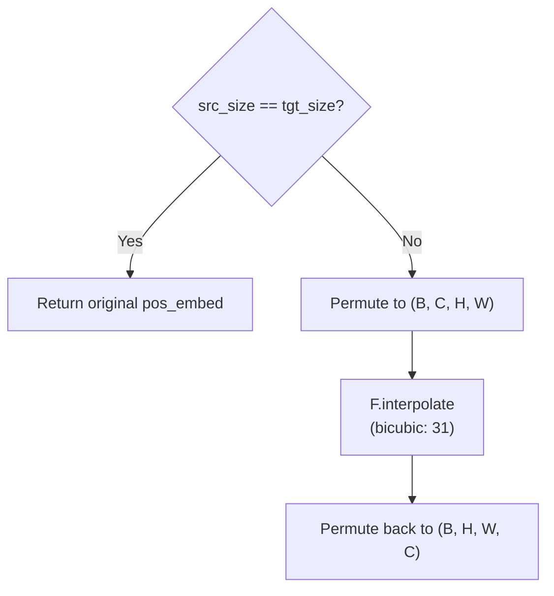
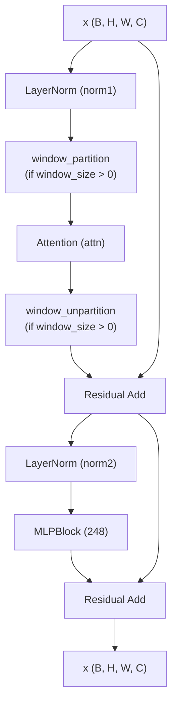
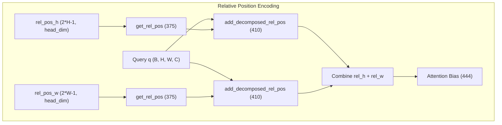
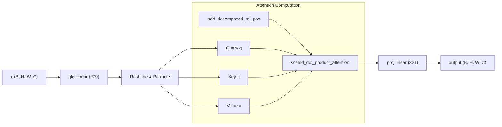
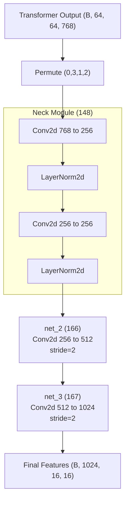
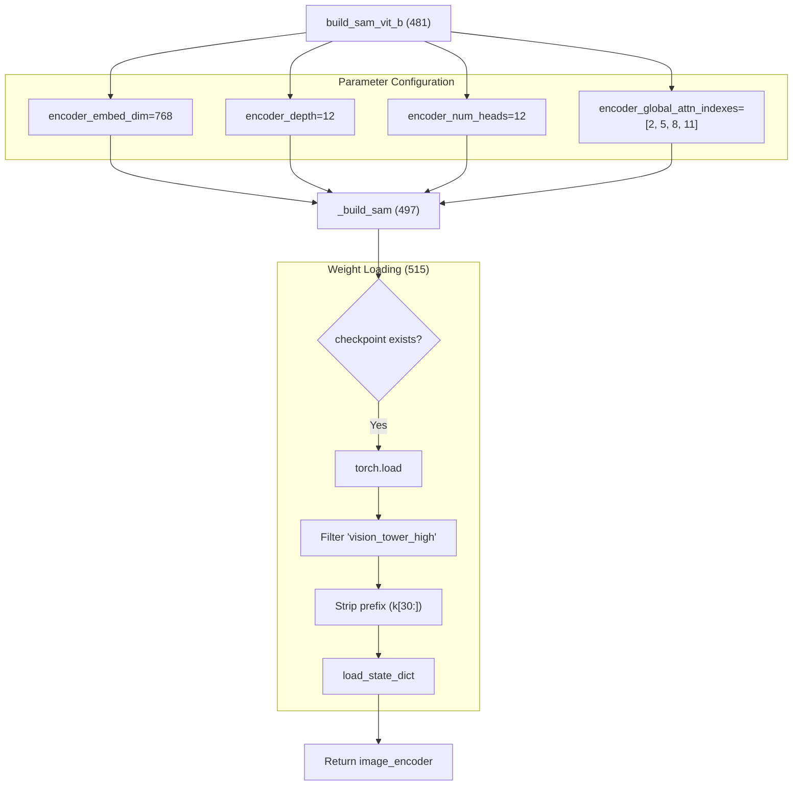

<!-- source: DeepWiki mcp.deepwiki.com · repo deepseek-ai/DeepSeek-OCR · extra page SAM ViT-B Encoder · fetched 2026-10-30 -->

# SAM ViT-B Encoder

<details>
<summary>Relevant source files</summary>

The following files were used as context for generating this wiki page:

- [DeepSeek-OCR-master/DeepSeek-OCR-vllm/deepencoder/sam_vary_sdpa.py](DeepSeek-OCR-master/DeepSeek-OCR-vllm/deepencoder/sam_vary_sdpa.py)

</details>


## Purpose

This document provides a technical deep-dive into the SAM (Segment Anything Model) ViT-B encoder used in DeepSeek-OCR's vision encoding system. The SAM encoder is one of two parallel vision encoders (the other being CLIP-L, see [4.3.2]()) that process image inputs. The SAM encoder specializes in extracting spatially-aware, high-resolution features using window attention and relative positional embeddings, making it particularly effective for document understanding tasks that require precise spatial layout comprehension.

For information about how SAM and CLIP features are combined, see [4.3.3](). For the overall vision encoding pipeline, see [4.3]().

**Sources:** [DeepSeek-OCR-master/DeepSeek-OCR-vllm/deepencoder/sam_vary_sdpa.py:1-528]()

## Architecture Overview

The SAM ViT-B encoder is implemented as the `ImageEncoderViT` class [DeepSeek-OCR-master/DeepSeek-OCR-vllm/deepencoder/sam_vary_sdpa.py:77-184]() and follows a Vision Transformer architecture adapted from Meta's Segment Anything Model. The encoder processes images through a hierarchical pipeline:



**Key architectural parameters:**
| Parameter | Value | Description |
|-----------|-------|-------------|
| `img_size` | 1024 | Input image size [DeepSeek-OCR-master/DeepSeek-OCR-vllm/deepencoder/sam_vary_sdpa.py:80]() |
| `patch_size` | 16 | Patch embedding kernel size [DeepSeek-OCR-master/DeepSeek-OCR-vllm/deepencoder/sam_vary_sdpa.py:81]() |
| `embed_dim` | 768 | Transformer embedding dimension [DeepSeek-OCR-master/DeepSeek-OCR-vllm/deepencoder/sam_vary_sdpa.py:83]() |
| `depth` | 12 | Number of transformer blocks [DeepSeek-OCR-master/DeepSeek-OCR-vllm/deepencoder/sam_vary_sdpa.py:84]() |
| `num_heads` | 12 | Attention heads per block [DeepSeek-OCR-master/DeepSeek-OCR-vllm/deepencoder/sam_vary_sdpa.py:85]() |
| `mlp_ratio` | 4.0 | MLP hidden dimension ratio [DeepSeek-OCR-master/DeepSeek-OCR-vllm/deepencoder/sam_vary_sdpa.py:86]() |
| `window_size` | 14 | Window size for windowed attention [DeepSeek-OCR-master/DeepSeek-OCR-vllm/deepencoder/sam_vary_sdpa.py:491]() |
| `global_attn_indexes` | [2, 5, 8, 11] | Blocks using global attention [DeepSeek-OCR-master/DeepSeek-OCR-vllm/deepencoder/sam_vary_sdpa.py:492]() |

**Sources:** [DeepSeek-OCR-master/DeepSeek-OCR-vllm/deepencoder/sam_vary_sdpa.py:77-184](), [DeepSeek-OCR-master/DeepSeek-OCR-vllm/deepencoder/sam_vary_sdpa.py:481-528]()

## Patch Embedding

The `PatchEmbed` class [DeepSeek-OCR-master/DeepSeek-OCR-vllm/deepencoder/sam_vary_sdpa.py:447-478]() converts the input image into a sequence of patch embeddings using a convolutional projection:



The patch embedding layer:
- Uses a `16×16` kernel with stride `16` to divide the `1024×1024` image into `64×64` patches [DeepSeek-OCR-master/DeepSeek-OCR-vllm/deepencoder/sam_vary_sdpa.py:119-120]().
- Projects each 3-channel patch to a 768-dimensional embedding [DeepSeek-OCR-master/DeepSeek-OCR-vllm/deepencoder/sam_vary_sdpa.py:122]().
- Outputs in `(B, H, W, C)` format, preserving spatial structure for subsequent processing [DeepSeek-OCR-master/DeepSeek-OCR-vllm/deepencoder/sam_vary_sdpa.py:477]().

**Sources:** [DeepSeek-OCR-master/DeepSeek-OCR-vllm/deepencoder/sam_vary_sdpa.py:447-478](), [DeepSeek-OCR-master/DeepSeek-OCR-vllm/deepencoder/sam_vary_sdpa.py:118-123]()

## Absolute Positional Embeddings

The encoder uses absolute positional embeddings to inject spatial information:

```python
# From ImageEncoderViT.__init__
self.pos_embed = nn.Parameter(
    torch.zeros(1, img_size // patch_size, img_size // patch_size, embed_dim)
)
```
[DeepSeek-OCR-master/DeepSeek-OCR-vllm/deepencoder/sam_vary_sdpa.py:128-130]()

**Adaptive interpolation:** The `get_abs_pos` function [DeepSeek-OCR-master/DeepSeek-OCR-vllm/deepencoder/sam_vary_sdpa.py:19-38]() dynamically interpolates positional embeddings when the input image size differs from the pretrained size:



This allows the model to handle variable image resolutions at inference time while maintaining spatial awareness learned during pretraining [DeepSeek-OCR-master/DeepSeek-OCR-vllm/deepencoder/sam_vary_sdpa.py:173]().

**Sources:** [DeepSeek-OCR-master/DeepSeek-OCR-vllm/deepencoder/sam_vary_sdpa.py:19-38](), [DeepSeek-OCR-master/DeepSeek-OCR-vllm/deepencoder/sam_vary_sdpa.py:125-130](), [DeepSeek-OCR-master/DeepSeek-OCR-vllm/deepencoder/sam_vary_sdpa.py:171-173]()

## Transformer Block Structure

Each transformer block (`Block` class [DeepSeek-OCR-master/DeepSeek-OCR-vllm/deepencoder/sam_vary_sdpa.py:186]()) implements a residual architecture with pre-normalization:



**Block configuration:**
- 8 of 12 blocks use **windowed attention** with `window_size=14` [DeepSeek-OCR-master/DeepSeek-OCR-vllm/deepencoder/sam_vary_sdpa.py:143]().
- 4 blocks (at indices 2, 5, 8, 11) use **global attention** with `window_size=0` [DeepSeek-OCR-master/DeepSeek-OCR-vllm/deepencoder/sam_vary_sdpa.py:492]().
- All blocks use **relative positional embeddings** (`use_rel_pos=True`) [DeepSeek-OCR-master/DeepSeek-OCR-vllm/deepencoder/sam_vary_sdpa.py:490]().

**Sources:** [DeepSeek-OCR-master/DeepSeek-OCR-vllm/deepencoder/sam_vary_sdpa.py:186-249](), [DeepSeek-OCR-master/DeepSeek-OCR-vllm/deepencoder/sam_vary_sdpa.py:43-56]()

## Window Attention Mechanism

Window attention partitions the spatial feature map into non-overlapping windows to reduce computational complexity:


**Example with `H=64, W=64, window_size=14`:**
- Padding: `64` is padded to `70` (multiple of 14) [DeepSeek-OCR-master/DeepSeek-OCR-vllm/deepencoder/sam_vary_sdpa.py:334-335]().
- Windows: Creates `5×5=25` windows per image [DeepSeek-OCR-master/DeepSeek-OCR-vllm/deepencoder/sam_vary_sdpa.py:341]().
- After attention: `window_unpartition` restores original `(B, 64, 64, 768)` shape [DeepSeek-OCR-master/DeepSeek-OCR-vllm/deepencoder/sam_vary_sdpa.py:371]().

**Sources:** [DeepSeek-OCR-master/DeepSeek-OCR-vllm/deepencoder/sam_vary_sdpa.py:326-372](), [DeepSeek-OCR-master/DeepSeek-OCR-vllm/deepencoder/sam_vary_sdpa.py:233-244]()

## Relative Positional Embeddings

The `Attention` module [DeepSeek-OCR-master/DeepSeek-OCR-vllm/deepencoder/sam_vary_sdpa.py:252]() uses **decomposed relative positional embeddings** that encode spatial relationships:



**Key features:**
- **Decomposition:** Relative positions are factored into height and width components [DeepSeek-OCR-master/DeepSeek-OCR-vllm/deepencoder/sam_vary_sdpa.py:410-444]().
- **Interpolation:** The `get_rel_pos` function interpolates embeddings when query/key sizes differ from the initialized size [DeepSeek-OCR-master/DeepSeek-OCR-vllm/deepencoder/sam_vary_sdpa.py:375-407]().
- **Integration:** Relative position biases are added to the attention logits via `attn_mask` parameter in `scaled_dot_product_attention` [DeepSeek-OCR-master/DeepSeek-OCR-vllm/deepencoder/sam_vary_sdpa.py:314]().

**Sources:** [DeepSeek-OCR-master/DeepSeek-OCR-vllm/deepencoder/sam_vary_sdpa.py:282-289](), [DeepSeek-OCR-master/DeepSeek-OCR-vllm/deepencoder/sam_vary_sdpa.py:298-310](), [DeepSeek-OCR-master/DeepSeek-OCR-vllm/deepencoder/sam_vary_sdpa.py:410-444](), [DeepSeek-OCR-master/DeepSeek-OCR-vllm/deepencoder/sam_vary_sdpa.py:375-407]()

## Attention Implementation

The `Attention` class implements multi-head attention using PyTorch's optimized `scaled_dot_product_attention` [DeepSeek-OCR-master/DeepSeek-OCR-vllm/deepencoder/sam_vary_sdpa.py:314]():



The use of `scaled_dot_product_attention` enables hardware-optimized implementations (Flash Attention, memory-efficient attention) [DeepSeek-OCR-master/DeepSeek-OCR-vllm/deepencoder/sam_vary_sdpa.py:314-319]().

**Sources:** [DeepSeek-OCR-master/DeepSeek-OCR-vllm/deepencoder/sam_vary_sdpa.py:252-323]()

## Neck and Downsampling

After the transformer blocks, a "neck" module [DeepSeek-OCR-master/DeepSeek-OCR-vllm/deepencoder/sam_vary_sdpa.py:148-164]() processes the features through multiple convolutional layers with progressive downsampling:



The final output is `(B, 1024, 16, 16)` for a `1024×1024` input image [DeepSeek-OCR-master/DeepSeek-OCR-vllm/deepencoder/sam_vary_sdpa.py:178-183]().

**Sources:** [DeepSeek-OCR-master/DeepSeek-OCR-vllm/deepencoder/sam_vary_sdpa.py:148-183](), [DeepSeek-OCR-master/DeepSeek-OCR-vllm/deepencoder/sam_vary_sdpa.py:61-73]()

## Model Construction and Weight Loading

The `build_sam_vit_b` function [DeepSeek-OCR-master/DeepSeek-OCR-vllm/deepencoder/sam_vary_sdpa.py:481]() constructs the SAM ViT-B encoder with predefined hyperparameters:



**Sources:** [DeepSeek-OCR-master/DeepSeek-OCR-vllm/deepencoder/sam_vary_sdpa.py:481-528]()

## SAM vs CLIP Architecture Differences

| Feature | SAM ViT-B | CLIP-L |
|---------|-----------|---------|
| **Positional Embeddings** | Relative (decomposed) [DeepSeek-OCR-master/DeepSeek-OCR-vllm/deepencoder/sam_vary_sdpa.py:410]() | Absolute |
| **Attention Pattern** | Windowed + Global [DeepSeek-OCR-master/DeepSeek-OCR-vllm/deepencoder/sam_vary_sdpa.py:143]() | Fully Global |
| **Window Size** | 14×14 [DeepSeek-OCR-master/DeepSeek-OCR-vllm/deepencoder/sam_vary_sdpa.py:491]() | N/A |
| **Embedding Dimension** | 768 [DeepSeek-OCR-master/DeepSeek-OCR-vllm/deepencoder/sam_vary_sdpa.py:483]() | 1024 |
| **Number of Blocks** | 12 [DeepSeek-OCR-master/DeepSeek-OCR-vllm/deepencoder/sam_vary_sdpa.py:484]() | 24 |
| **Output Processing** | Neck + 2× downsampling [DeepSeek-OCR-master/DeepSeek-OCR-vllm/deepencoder/sam_vary_sdpa.py:178-181]() | Direct output |

**Sources:** [DeepSeek-OCR-master/DeepSeek-OCR-vllm/deepencoder/sam_vary_sdpa.py:77-184](), [DeepSeek-OCR-master/DeepSeek-OCR-vllm/deepencoder/sam_vary_sdpa.py:481-528]()

---

