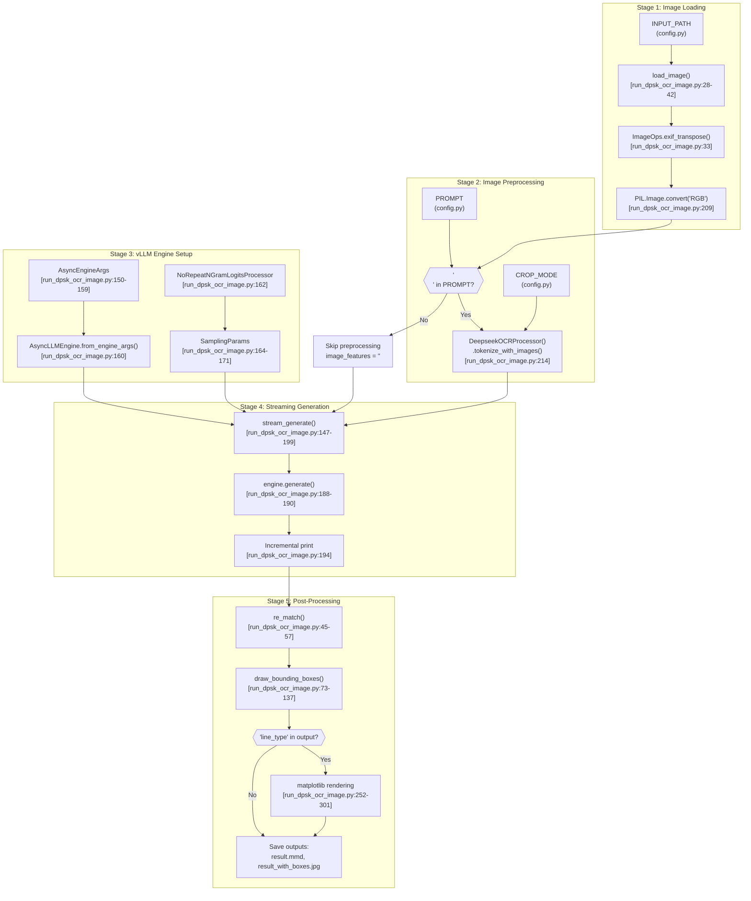
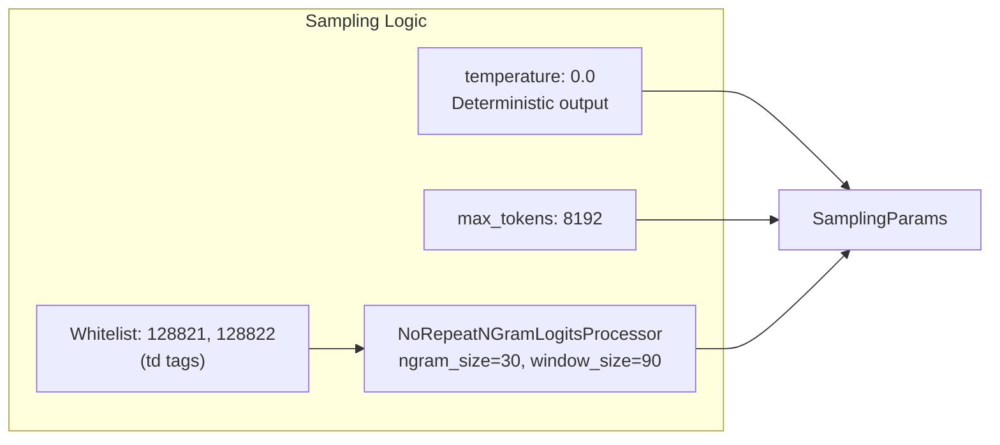
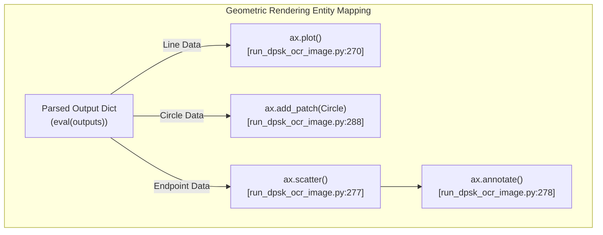

<!-- source: DeepWiki mcp.deepwiki.com · repo deepseek-ai/DeepSeek-OCR · extra page Single Image Processing · fetched 2026-10-30 -->

# Single Image Processing

<details>
<summary>Relevant source files</summary>

The following files were used as context for generating this wiki page:

- [DeepSeek-OCR-master/DeepSeek-OCR-vllm/run_dpsk_ocr_image.py](DeepSeek-OCR-master/DeepSeek-OCR-vllm/run_dpsk_ocr_image.py)
- [assets/show1.jpg](assets/show1.jpg)
- [assets/show2.jpg](assets/show2.jpg)
- [assets/show3.jpg](assets/show3.jpg)
- [assets/show4.jpg](assets/show4.jpg)

</details>


This page documents the single image processing workflow using vLLM for real-time streaming OCR. The script `run_dpsk_ocr_image.py` provides an interactive way to process individual images with live output streaming, bounding box visualization, and support for geometric plot rendering.

For batch processing of multiple images, see [3.2.3](). For PDF document processing, see [3.2.2](). For the Transformers-based interface, see [3.1]().

**Sources:** [DeepSeek-OCR-master/DeepSeek-OCR-vllm/run_dpsk_ocr_image.py:1-304](), [README.md:95-98]()

## Processing Workflow Overview

The single image processing pipeline consists of five main stages: image loading with EXIF correction, preprocessing with dynamic cropping, vLLM engine initialization, async streaming generation, and post-processing with visualization.

### Data Flow and Code Entity Mapping
The following diagram maps the natural language processing stages to specific code entities and functions within the `run_dpsk_ocr_image.py` script and its dependencies.



**Sources:** [DeepSeek-OCR-master/DeepSeek-OCR-vllm/run_dpsk_ocr_image.py:26-304](), [DeepSeek-OCR-master/DeepSeek-OCR-vllm/config.py:1-22]()

## Image Loading and Preprocessing

### Image Loading with EXIF Correction

The `load_image()` function handles image loading with automatic EXIF orientation correction using `ImageOps.exif_transpose()` [DeepSeek-OCR-master/DeepSeek-OCR-vllm/run_dpsk_ocr_image.py:33](). This ensures images are displayed in the correct orientation regardless of camera metadata. If the correction fails, the function falls back to a standard `Image.open()` [DeepSeek-OCR-master/DeepSeek-OCR-vllm/run_dpsk_ocr_image.py:40]().

**Sources:** [DeepSeek-OCR-master/DeepSeek-OCR-vllm/run_dpsk_ocr_image.py:28-42]()

### Image Preprocessing with DeepseekOCRProcessor

Images are preprocessed using `DeepseekOCRProcessor` if the prompt contains the `<image>` token [DeepSeek-OCR-master/DeepSeek-OCR-vllm/run_dpsk_ocr_image.py:212-214]().

| Configuration | Source | Effect |
|--------------|---------|--------|
| `CROP_MODE` | `config.py` | Enables/disables dynamic cropping (True for high-res documents) |
| `BASE_SIZE` | `config.py` | Global view resolution (e.g., 1024×1024) |
| `IMAGE_SIZE` | `config.py` | Local crop resolution (e.g., 640×640) |
| `MIN_CROPS`, `MAX_CROPS` | `config.py` | Bounds on number of crops (typically 2-6) |

**Sources:** [DeepSeek-OCR-master/DeepSeek-OCR-vllm/run_dpsk_ocr_image.py:214](), [DeepSeek-OCR-master/DeepSeek-OCR-vllm/config.py:10-16]()

## vLLM Engine Configuration

### AsyncLLMEngine Initialization

The script uses `AsyncLLMEngine` to enable streaming output. The model must be registered with the vLLM `ModelRegistry` before initialization [DeepSeek-OCR-master/DeepSeek-OCR-vllm/run_dpsk_ocr_image.py:26]().

**Key Configuration Parameters:**

| Parameter | Value | Purpose |
|-----------|-------|---------|
| `block_size` | 256 | KV cache blocking granularity [DeepSeek-OCR-master/DeepSeek-OCR-vllm/run_dpsk_ocr_image.py:153]() |
| `max_model_len` | 8192 | Maximum context length [DeepSeek-OCR-master/DeepSeek-OCR-vllm/run_dpsk_ocr_image.py:154]() |
| `gpu_memory_utilization` | 0.75 | 75% GPU memory allocation [DeepSeek-OCR-master/DeepSeek-OCR-vllm/run_dpsk_ocr_image.py:158]() |
| `tensor_parallel_size` | 1 | Single GPU mode [DeepSeek-OCR-master/DeepSeek-OCR-vllm/run_dpsk_ocr_image.py:157]() |

**Sources:** [DeepSeek-OCR-master/DeepSeek-OCR-vllm/run_dpsk_ocr_image.py:150-160]()

### Sampling and Logits Processing

A `NoRepeatNGramLogitsProcessor` is applied to prevent repetitive output sequences, with specific whitelist tokens for HTML table structures [DeepSeek-OCR-master/DeepSeek-OCR-vllm/run_dpsk_ocr_image.py:162]().



**Sources:** [DeepSeek-OCR-master/DeepSeek-OCR-vllm/run_dpsk_ocr_image.py:162-171]()

## Async Streaming Generation

The `stream_generate()` function implements the async loop. It tracks `printed_length` to extract and print only the newly generated tokens from the full text returned by vLLM [DeepSeek-OCR-master/DeepSeek-OCR-vllm/run_dpsk_ocr_image.py:193-195]().

**Sources:** [DeepSeek-OCR-master/DeepSeek-OCR-vllm/run_dpsk_ocr_image.py:147-199]()

## Output Post-Processing

### Reference Tag Extraction System

The model outputs structured spatial information using `<|ref|>` and `<|det|>` tags. The `re_match()` function uses a regex pattern to extract these [DeepSeek-OCR-master/DeepSeek-OCR-vllm/run_dpsk_ocr_image.py:45-47]().

```python
# Regex pattern used in re_match()
pattern = r'(<\|ref\|>(.*?)<\|/ref\|><\|det\|>(.*?)<\|/det\|>)'
```

**Sources:** [DeepSeek-OCR-master/DeepSeek-OCR-vllm/run_dpsk_ocr_image.py:45-57]()

### Bounding Box Visualization

The `draw_bounding_boxes()` function renders annotations. It denormalizes coordinates from the 0-999 range used by the model back to the original image dimensions [DeepSeek-OCR-master/DeepSeek-OCR-vllm/run_dpsk_ocr_image.py:99-103]().

**Visual Style Rules:**
- **Titles**: Outline width 4 [DeepSeek-OCR-master/DeepSeek-OCR-vllm/run_dpsk_ocr_image.py:116]().
- **Other Elements**: Outline width 2 [DeepSeek-OCR-master/DeepSeek-OCR-vllm/run_dpsk_ocr_image.py:119]().
- **Fill**: Semi-transparent overlay (alpha=20) [DeepSeek-OCR-master/DeepSeek-OCR-vllm/run_dpsk_ocr_image.py:95]().
- **Image Cropping**: Regions labeled as 'image' are cropped and saved to `OUTPUT_PATH/images/` [DeepSeek-OCR-master/DeepSeek-OCR-vllm/run_dpsk_ocr_image.py:105-112]().

**Sources:** [DeepSeek-OCR-master/DeepSeek-OCR-vllm/run_dpsk_ocr_image.py:73-137]()

### Geometric Plot Rendering

If the output contains geometric primitives (lines, circles), the script uses `matplotlib` to render a visualization [DeepSeek-OCR-master/DeepSeek-OCR-vllm/run_dpsk_ocr_image.py:252-301]().



**Sources:** [DeepSeek-OCR-master/DeepSeek-OCR-vllm/run_dpsk_ocr_image.py:251-301]()

## Output File Structure

| File Path | Purpose |
|-----------|---------|
| `result_ori.mmd` | Raw model output with tags [DeepSeek-OCR-master/DeepSeek-OCR-vllm/run_dpsk_ocr_image.py:236]() |
| `result.mmd` | Processed markdown with image links [DeepSeek-OCR-master/DeepSeek-OCR-vllm/run_dpsk_ocr_image.py:249]() |
| `result_with_boxes.jpg` | Annotated image visualization [DeepSeek-OCR-master/DeepSeek-OCR-vllm/run_dpsk_ocr_image.py:234]() |
| `geo.jpg` | Rendered geometric plot [DeepSeek-OCR-master/DeepSeek-OCR-vllm/run_dpsk_ocr_image.py:301]() |

**Sources:** [DeepSeek-OCR-master/DeepSeek-OCR-vllm/run_dpsk_ocr_image.py:225-304]()

---

