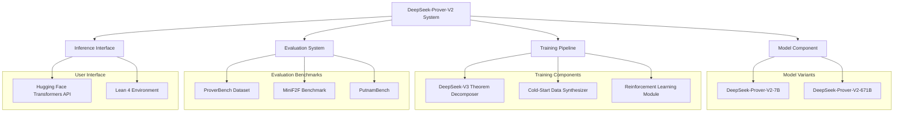
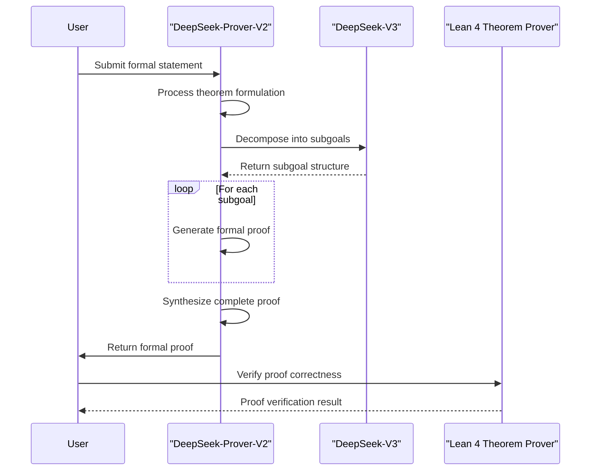
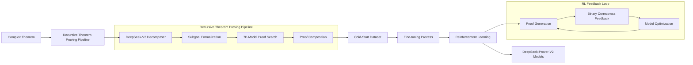
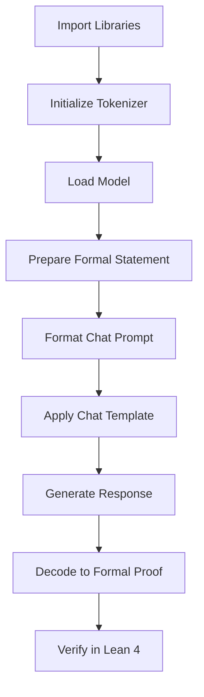

<!-- source: DeepWiki mcp.deepwiki.com · repo deepseek-ai/DeepSeek-Prover-V2 · page 1 Overview · fetched 2026-10-30 -->

# Overview

Relevant source files

The following files were used as context for generating this wiki page:

- [DeepSeek_Prover_V2.pdf](DeepSeek_Prover_V2.pdf)
- [README.md](README.md)

This page provides a comprehensive introduction to DeepSeek-Prover-V2, an open-source large language model specifically designed for formal theorem proving in Lean 4. This document explains the system's purpose, architecture, and key components, providing a foundation for understanding how the model bridges informal reasoning with formal proof construction.

For detailed information about the system architecture, see [System Architecture](#2). For model-specific details, see [Models](#3).

## Purpose and Scope

DeepSeek-Prover-V2 is a specialized language model for formal mathematical reasoning in Lean 4, focusing on advanced theorem proving capabilities through recursive subgoal decomposition and reinforcement learning. The system aims to formalize mathematical statements and generate verifiable proofs that can be checked by the Lean 4 theorem prover.

The key objectives of DeepSeek-Prover-V2 include:

1. Decomposing complex problems into manageable subgoals
2. Bridging informal mathematical reasoning with formal proof construction
3. Generating complete, verifiable proofs in Lean 4 notation
4. Providing state-of-the-art performance on formal mathematics benchmarks

Sources: [README.md:40-46]()

## System Components and Architecture

DeepSeek-Prover-V2 consists of several interconnected components that work together to facilitate formal theorem proving.

### High-Level System Architecture

Sources: [README.md:40-46](), [README.md:50-67](), [README.md:71-91](), [README.md:94-112]()

## Theorem Proving Process

The core innovation of DeepSeek-Prover-V2 is its recursive theorem proving pipeline, which breaks down complex problems into more manageable subgoals.

Sources: [README.md:54-59]()

## Model Variants and Capabilities

DeepSeek-Prover-V2 is available in two primary configurations, designed for different computational requirements and performance needs:

| Model | Parameters | Base Model | Context Length | Use Case |
|-------|------------|------------|----------------|----------|
| DeepSeek-Prover-V2-7B | 7 billion | DeepSeek-Prover-V1.5-Base | 32K tokens | Lightweight applications |
| DeepSeek-Prover-V2-671B | 671 billion | DeepSeek-V3-Base | Standard | High-performance theorem proving |

The 671B model represents the state-of-the-art in neural theorem proving, achieving an 88.9% pass ratio on the MiniF2F-test benchmark and solving 49 out of 658 problems from PutnamBench.

Sources: [README.md:94-96](), [README.md:97-104](), [README.md:66-67]()

## Training Methodology

The training process consists of two main phases:

1. **Cold-Start Data Synthesis**:
   - Complex theorems are decomposed into subgoals using DeepSeek-V3
   - A smaller 7B model handles proof search for individual subgoals
   - Successful subgoal proofs are combined into complete formal proofs
   - DeepSeek-V3's chain-of-thought reasoning is paired with formal proofs

2. **Reinforcement Learning**:
   - The model is fine-tuned on the synthesized cold-start data
   - Binary correct-or-incorrect feedback serves as reward supervision
   - This process enhances the model's ability to bridge informal reasoning with formal proof construction

Sources: [README.md:54-59](), [README.md:62-67]()

## Inference and Usage

DeepSeek-Prover-V2 can be used directly through the Hugging Face Transformers library, with the following basic workflow:

The model expects input in a specific format, with a formal statement in Lean 4 syntax followed by a prompt requesting a proof plan and formal proof. The output includes both a detailed proof strategy and the complete formal proof in Lean 4.

Sources: [README.md:114-163]()

## Evaluation Framework

DeepSeek-Prover-V2 is evaluated on three primary benchmarks:

1. **MiniF2F**: A standard benchmark for formal mathematics
2. **PutnamBench**: 658 challenging mathematical problems
3. **ProverBench**: A custom benchmark with 325 problems, including:
   - 15 problems from AIME (American Invitational Mathematics Examination)
   - 310 problems from various mathematical domains

The ProverBench dataset provides comprehensive coverage across multiple areas of mathematics:

| Mathematical Domain | Problem Count |
|---------------------|---------------|
| AIME 24 & 25 | 15 |
| Number Theory | 40 |
| Elementary Algebra | 30 |
| Linear Algebra | 50 |
| Abstract Algebra | 40 |
| Calculus | 90 |
| Real Analysis | 30 |
| Complex Analysis | 10 |
| Functional Analysis | 10 |
| Probability | 10 |
| **Total** | **325** |

Sources: [README.md:71-91](), [README.md:66-67]()

## License and Distribution

DeepSeek-Prover-V2 is available under the DeepSeek License Agreement, with specific terms governing usage and distribution. For detailed information about licensing, see [License and Legal Information](#5).

Sources: [README.md:166-166]()

---

