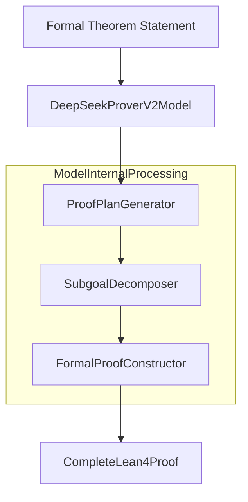
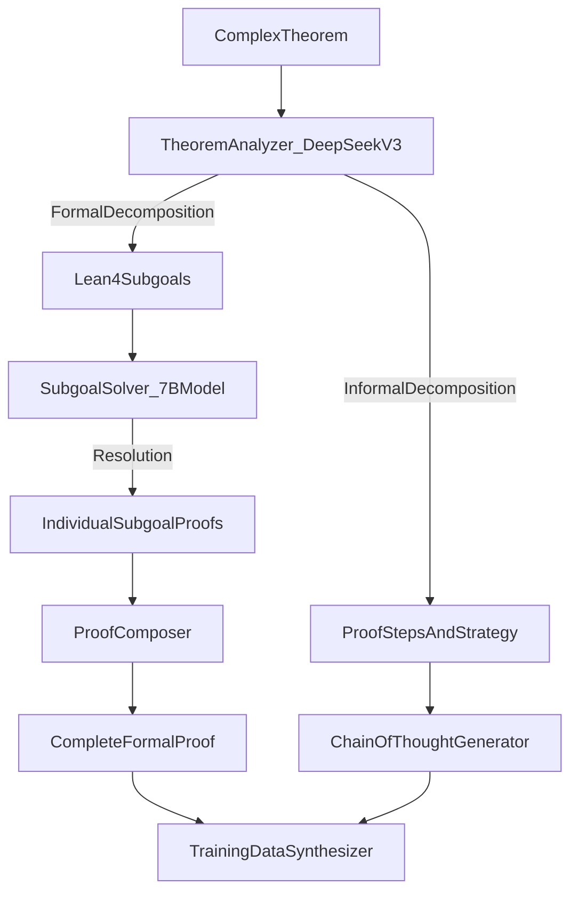
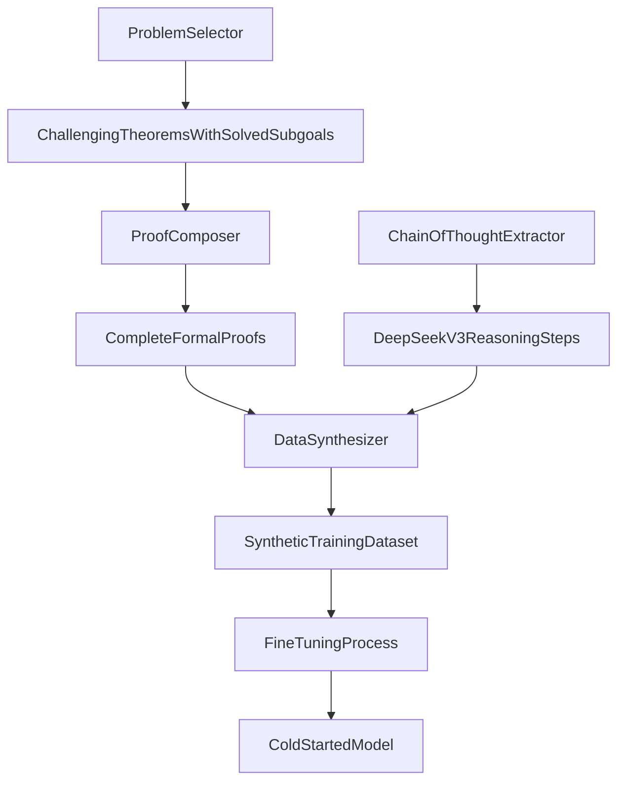
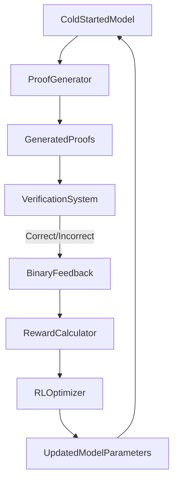
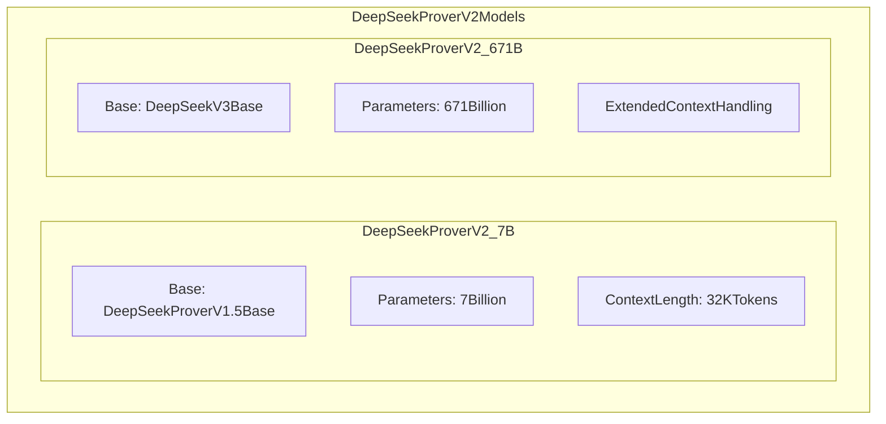
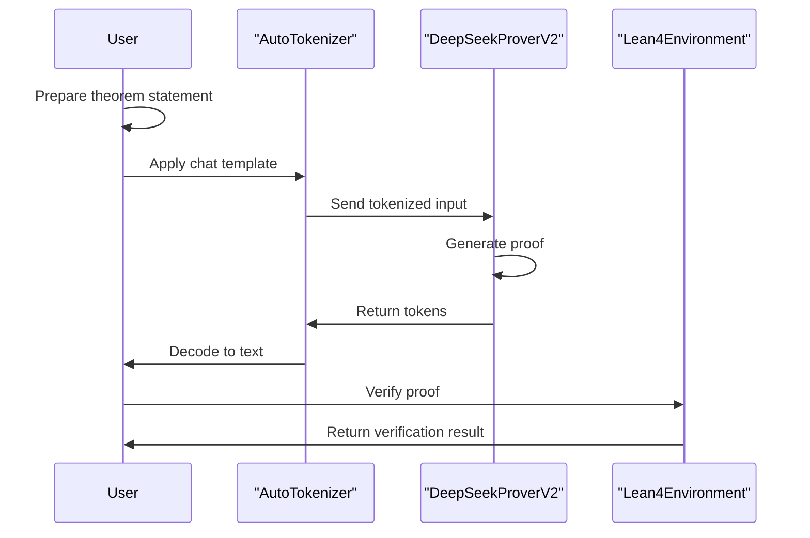
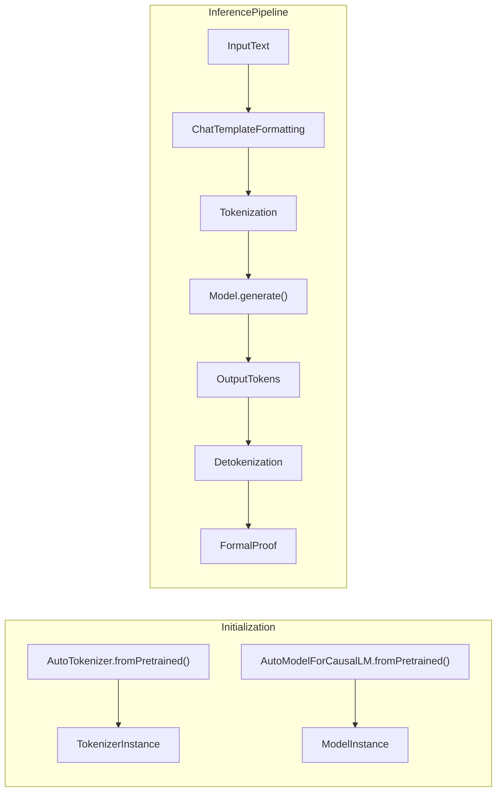
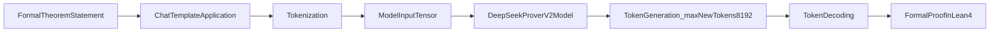
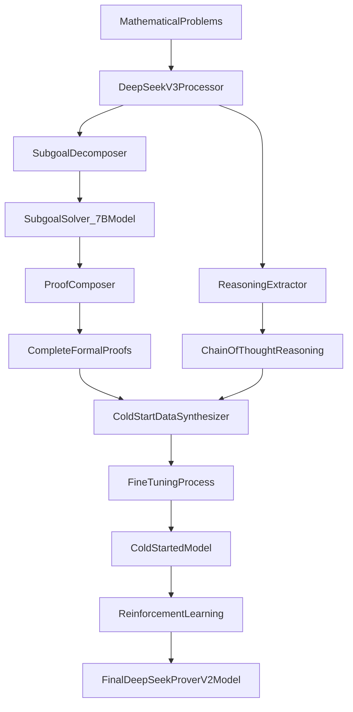
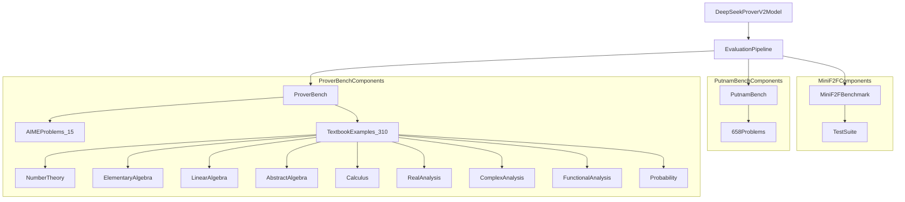

<!-- source: DeepWiki mcp.deepwiki.com · repo deepseek-ai/DeepSeek-Prover-V2 · page 2 System Architecture · fetched 2026-10-30 -->

# System Architecture

<details>
<summary>Relevant source files</summary>

The following files were used as context for generating this wiki page:

- [DeepSeek_Prover_V2.pdf](DeepSeek_Prover_V2.pdf)
- [README.md](README.md)

</details>


## Purpose and Scope

This document details the internal architecture of DeepSeek-Prover-V2, explaining how its components interact to enable formal theorem proving in Lean 4. We focus on the technical structure of the system and the relationships between components rather than usage instructions or performance metrics.

For information about using the models for inference, see [Inference Guide](#3.2). For details about the training methodology, see [Training Pipeline](#3.1). For performance evaluation, see [Evaluation and Benchmarks](#4).

## High-Level System Architecture

DeepSeek-Prover-V2 implements a recursive theorem proving architecture that bridges informal mathematical reasoning with formal proof construction through a specialized language model pipeline.

### System Components Overview



The high-level flow consists of:

1. A formal theorem statement in Lean 4 format is input to the system
2. The DeepSeek-Prover-V2 model processes the statement
3. A proof plan is generated with step-by-step reasoning
4. Complex theorems are decomposed into manageable subgoals
5. Formal proofs are constructed for each subgoal
6. The complete Lean 4 proof is produced as output

Sources: [README.md:42-44](), [README.md:54-58]()

## Core Components

### Recursive Theorem Proving Pipeline

The recursive theorem proving pipeline is a central architectural component that enables the system to tackle complex mathematical problems by breaking them down into manageable parts.



The pipeline functions as follows:

1. **Theorem Analysis**: DeepSeek-V3 analyzes a complex theorem
2. **Dual Decomposition**:
   - Informal: Creates high-level proof sketches with mathematical reasoning
   - Formal: Translates into precise Lean 4 subgoals
3. **Subgoal Solving**: The 7B parameter model handles proof search for each subgoal
4. **Proof Composition**: Individual subgoal proofs are combined into a complete proof
5. **Training Data Synthesis**: The formal proof is paired with the chain-of-thought reasoning

Sources: [README.md:54-58]()

### Cold-Start Training Component

The cold-start training component prepares the model for reinforcement learning by creating synthetic data that pairs informal reasoning with formal proof construction.



The component implements the following process:

1. **Problem Selection**: Curates challenging problems where all decomposed subgoals are successfully solved
2. **Proof Composition**: Constructs complete formal proofs by combining subgoal proofs
3. **Reasoning Extraction**: Obtains DeepSeek-V3's chain-of-thought reasoning
4. **Data Synthesis**: Pairs formal proofs with informal reasoning steps
5. **Fine-tuning**: Uses the synthetic data to initialize the prover model

Sources: [README.md:62-66]()

### Reinforcement Learning Component

After cold-start training, the reinforcement learning component further enhances the model's capabilities through feedback-based learning.



The reinforcement learning component:

1. **Proof Generation**: The cold-started model generates proof attempts
2. **Verification**: Proofs are checked for correctness
3. **Feedback**: Binary (correct/incorrect) feedback is provided
4. **Reward Calculation**: Feedback is translated into numerical rewards
5. **Optimization**: The model parameters are updated to maximize expected rewards
6. **Iteration**: The process repeats with the improved model

Sources: [README.md:66-67]()

## Model Architecture

DeepSeek-Prover-V2 is available in two variants, each with different parameter counts, base models, and capabilities.



### Technical Specifications

| Model | Parameters | Base Model | Context Length | Model ID |
|-------|------------|------------|----------------|----------|
| DeepSeek-Prover-V2-7B | 7 Billion | DeepSeek-Prover-V1.5-Base | 32K tokens | deepseek-ai/DeepSeek-Prover-V2-7B |
| DeepSeek-Prover-V2-671B | 671 Billion | DeepSeek-V3-Base | Extended | deepseek-ai/DeepSeek-Prover-V2-671B |

Sources: [README.md:95-104]()

## Integration Points

### Lean 4 Integration

The system directly integrates with the Lean 4 formal verification environment, enabling automatic verification of generated proofs.



The integration with Lean 4 enables:

1. Direct verification of generated proofs
2. Compatibility with the Lean 4 ecosystem
3. Integration with existing mathematical libraries
4. Formal guarantees of proof correctness

Sources: [README.md:115-119]()

### Transformers Library Integration

DeepSeek-Prover-V2 models are designed to work seamlessly with Hugging Face's Transformers library, following standard inference patterns.



The integration process involves:

1. **Initialization**: Loading the tokenizer and model from Hugging Face
2. **Input Preparation**: Formatting the input as a chat prompt
3. **Tokenization**: Converting text to token IDs
4. **Generation**: Running the model with appropriate parameters (max_new_tokens=8192)
5. **Output Processing**: Decoding token IDs back to text

Sources: [README.md:115-163]()

## Inference Data Flow

The inference process follows a structured flow from input theorem statement to formal proof output.



### Inference Process Steps:

1. **Input Preparation**: A theorem statement in Lean 4 format is prepared
2. **Chat Formatting**: The statement is formatted using the model's chat template
3. **Tokenization**: The formatted input is converted to token IDs
4. **Model Processing**: The model generates output tokens (up to 8192 new tokens)
5. **Decoding**: Output tokens are converted back to text
6. **Verification**: The generated proof can be verified in Lean 4

Example code pattern for inference:

```python
# Load model and tokenizer
tokenizer = AutoTokenizer.from_pretrained("DeepSeek-Prover-V2-7B")
model = AutoModelForCausalLM.from_pretrained("DeepSeek-Prover-V2-7B", 
                                             device_map="auto", 
                                             torch_dtype=torch.bfloat16)

# Format input as chat
chat = [{"role": "user", "content": prompt.format(formal_statement)}]
inputs = tokenizer.apply_chat_template(chat, 
                                       tokenize=True, 
                                       add_generation_prompt=True, 
                                       return_tensors="pt").to(model.device)

# Generate proof
outputs = model.generate(inputs, max_new_tokens=8192)
proof = tokenizer.batch_decode(outputs)[0]
```

Sources: [README.md:118-163]()

## Training Data Flow

The training process involves multiple stages to prepare the model for formal theorem proving.



The training data flow consists of:

1. **Problem Processing**: Mathematical problems are analyzed by DeepSeek-V3
2. **Dual Extraction**:
   - Subgoal decomposition for formal proof structure
   - Chain-of-thought reasoning for informal mathematical insight
3. **Subgoal Resolution**: The 7B model solves individual subgoals
4. **Proof Composition**: Individual proofs are combined into complete solutions
5. **Data Synthesis**: Formal proofs are paired with informal reasoning
6. **Cold-Start Training**: The model is fine-tuned on the synthetic data
7. **Reinforcement Learning**: Further training with binary feedback

Sources: [README.md:54-67]()

## Integration with Benchmarks and Evaluation

The DeepSeek-Prover-V2 system is designed to integrate with multiple evaluation benchmarks to assess model performance.



The model evaluation architecture enables comprehensive assessment across multiple benchmarks, including:

1. **MiniF2F**: Standard benchmark for formal mathematics
2. **PutnamBench**: Collection of 658 challenging mathematical problems
3. **ProverBench**: Newly introduced benchmark with 325 problems:
   - 15 problems from AIME competitions
   - 310 examples from various mathematical domains

Sources: [README.md:71-91]()

---

