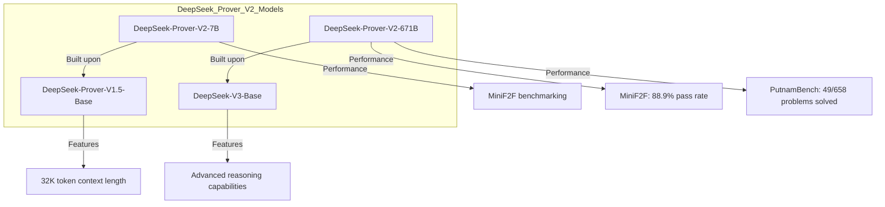
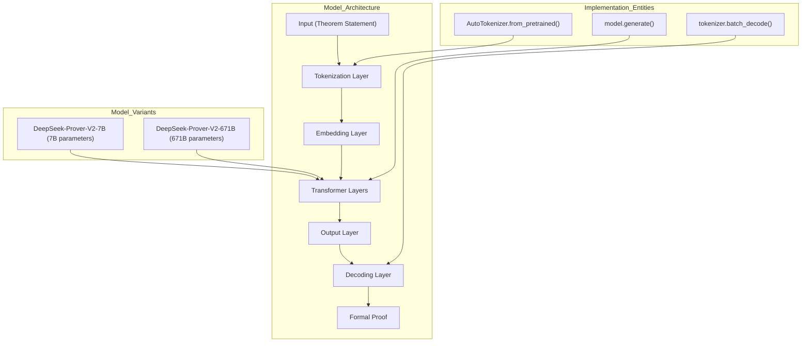
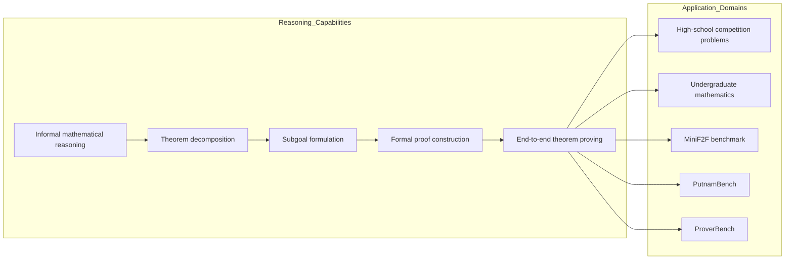
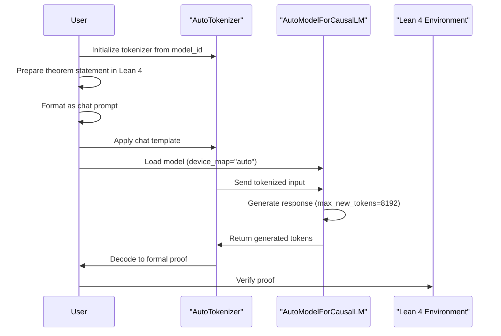
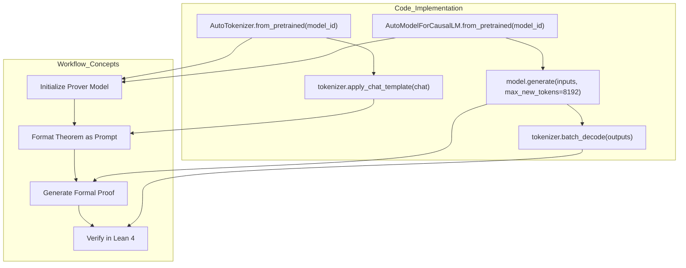

<!-- source: DeepWiki mcp.deepwiki.com · repo deepseek-ai/DeepSeek-Prover-V2 · page 3 Models · fetched 2026-10-30 -->

# Models

Relevant source files

The following files were used as context for generating this wiki page:

- [DeepSeek_Prover_V2.pdf](DeepSeek_Prover_V2.pdf)
- [README.md](README.md)

This page provides a comprehensive overview of the available models in the DeepSeek-Prover-V2 system, including their architectures, capabilities, and specifications. For information about the training methodology, see [Training Pipeline](#3.1), and for detailed usage instructions, see [Inference Guide](#3.2).

## Model Overview

DeepSeek-Prover-V2 is a family of large language models specifically designed for formal theorem proving in Lean 4. The system is released in two model sizes: 7B and 671B parameters, each built upon different base models with specialized capabilities for mathematical reasoning.

### Model Variants and Specifications

Sources: [README.md:94-103]()

The following table provides a detailed comparison of the two model variants:

| Model | Parameters | Base Model | Context Length | Primary Use Cases |
|-------|------------|------------|----------------|-------------------|
| DeepSeek-Prover-V2-7B | 7 billion | DeepSeek-Prover-V1.5-Base | Up to 32K tokens | Formal theorem proving, moderate complexity problems |
| DeepSeek-Prover-V2-671B | 671 billion | DeepSeek-V3-Base | Standard | Advanced reasoning, complex theorem proving, competition-level problems |

Sources: [README.md:94-96]()

## Model Architecture

The DeepSeek-Prover-V2 models are transformer-based language models optimized for mathematical reasoning tasks, with specific architectural enhancements that enable formal theorem proving capabilities.

### Architecture Components

Sources: [README.md:94-96](), [README.md:114-163]()

## Model Capabilities

DeepSeek-Prover-V2 models combine informal mathematical reasoning with formal proof construction, enabling them to tackle complex mathematical problems through a process of decomposition, reasoning, and formalization.

### Key Capabilities

Sources: [README.md:40-67](), [README.md:71-91]()

### Performance Benchmarks

The models have been evaluated on multiple mathematical benchmarks:

- **MiniF2F-test**: DeepSeek-Prover-V2-671B achieves 88.9% pass ratio
- **PutnamBench**: Solves 49 out of 658 problems
- **ProverBench**: Comprehensive evaluation on 325 problems including:
  - 15 AIME competition problems
  - 310 undergraduate-level problems across various mathematical domains

Sources: [README.md:67-68](), [README.md:71-91]()

## Model Inference Process

The following sequence diagram illustrates the typical workflow for using DeepSeek-Prover-V2 models for formal theorem proving:

Sources: [README.md:114-163]()

## Model Integration with Code

This diagram shows how the natural language concepts map to specific code implementations when working with DeepSeek-Prover-V2 models:

Sources: [README.md:114-163]()

## Accessing the Models

Both DeepSeek-Prover-V2 models are available for download from Hugging Face:

| Model | Download Link |
|-------|---------------|
| DeepSeek-Prover-V2-7B | HuggingFace: deepseek-ai/DeepSeek-Prover-V2-7B |
| DeepSeek-Prover-V2-671B | HuggingFace: deepseek-ai/DeepSeek-Prover-V2-671B |

The models can be directly loaded using the Hugging Face Transformers library as shown in the inference process diagram above.

Sources: [README.md:97-103]()

## Usage Guidelines

When using the DeepSeek-Prover-V2 models for theorem proving:

1. **Context Length**: The 7B model supports up to 32K tokens, making it suitable for longer proofs
2. **Prompt Format**: Include a clear theorem statement formatted in Lean 4 syntax
3. **Proof Planning**: Request a detailed proof plan before the formal proof for better results
4. **Token Generation**: Set a high value for `max_new_tokens` (e.g., 8192) to allow for complete proofs
5. **Model Selection**: Use the 671B model for more complex theorems and competition-level problems

Sources: [README.md:114-163]()

## License Information

The use of DeepSeek-Prover-V2 models is subject to the Model License. For complete details on licensing, see [License and Legal Information](#5).

Sources: [README.md:166]()

---

