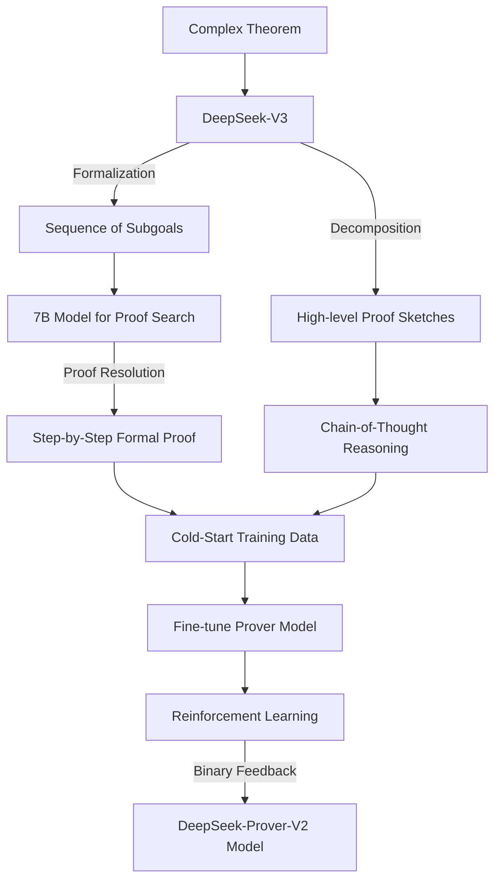
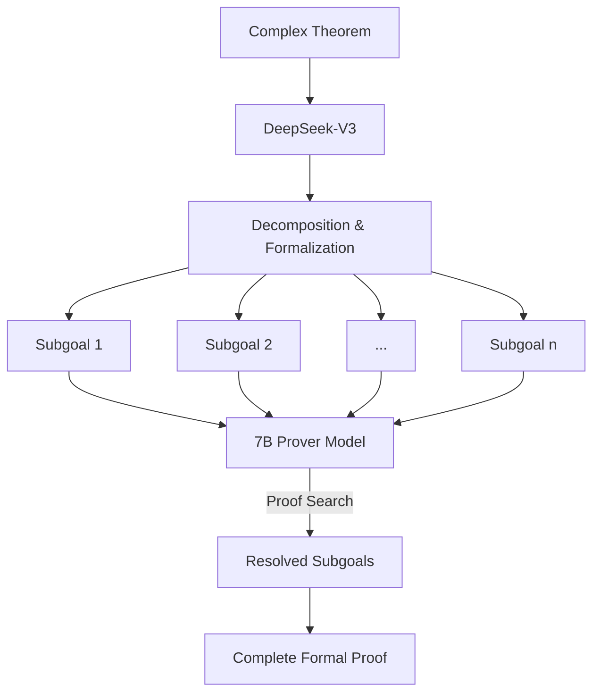
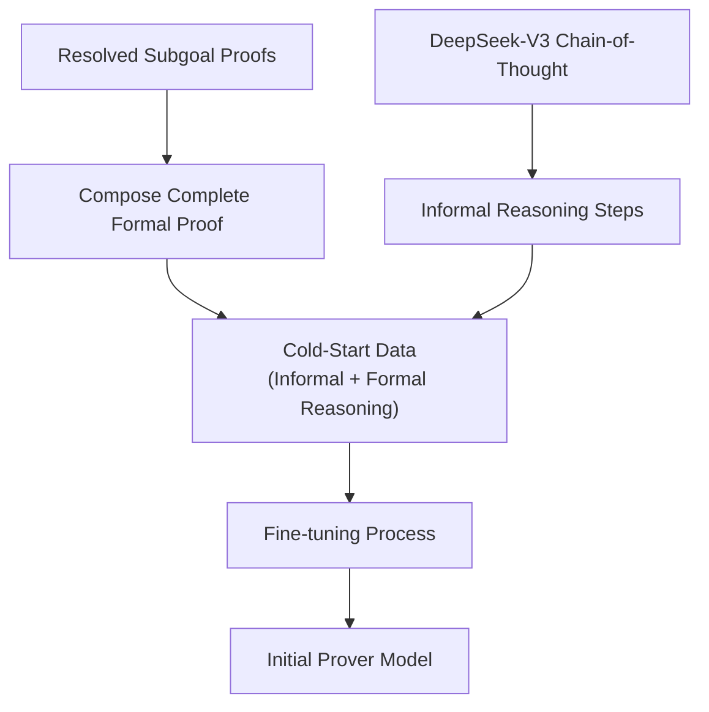
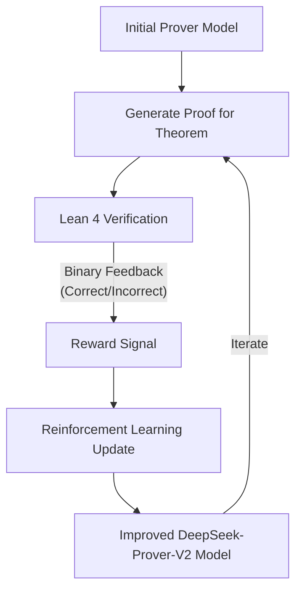
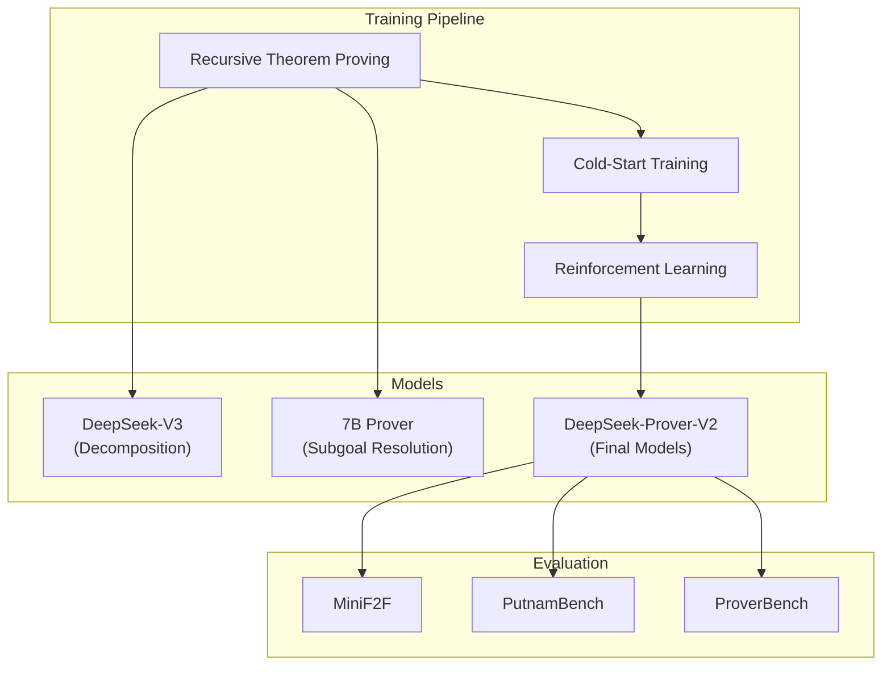

<!-- source: DeepWiki mcp.deepwiki.com · repo deepseek-ai/DeepSeek-Prover-V2 · page 3.1 Training Pipeline · fetched 2026-10-30 -->

# Training Pipeline

Relevant source files

The following files were used as context for generating this wiki page:

- [DeepSeek_Prover_V2.pdf](DeepSeek_Prover_V2.pdf)
- [README.md](README.md)
- [figures/performance.png](figures/performance.png)

## Purpose and Scope

The Training Pipeline is a core component of the DeepSeek-Prover-V2 system, responsible for developing models capable of formal theorem proving in Lean 4. It integrates both informal mathematical reasoning with formal proof construction through a recursive theorem proving approach, cold-start training, and reinforcement learning. This page explains the pipeline components and how they work together to create effective theorem provers.

For information about model architecture and available models, see [Models](#3). For evaluation results, see [Evaluation and Benchmarks](#4).

## Pipeline Overview

The DeepSeek-Prover-V2 training pipeline consists of three primary stages:

1. **Recursive Theorem Proving**: Using DeepSeek-V3 to decompose complex problems into manageable subgoals
2. **Cold-Start Training**: Fine-tuning models on synthetic data that combines formal proofs with chain-of-thought reasoning
3. **Reinforcement Learning**: Further enhancing model capabilities using binary feedback

The following diagram illustrates the overall training flow:

Sources: [README.md:44-44](), [README.md:54-58]()

## Recursive Theorem Proving Process

The recursive theorem proving process handles complex mathematical problems by breaking them down into more manageable parts.

### Process Flow

1. **Problem Decomposition**: Complex theorems are input to DeepSeek-V3, which:
   - Decomposes problems into high-level proof sketches
   - Formalizes these steps in Lean 4, resulting in a sequence of subgoals

2. **Subgoal Resolution**: A smaller 7B model handles proof search for each subgoal, reducing computational burden

3. **Proof Composition**: When all subgoals are successfully proven, they're combined to create a complete formal proof

Sources: [README.md:54-58]()

## Cold-Start Training

The cold-start training phase creates and utilizes synthetic data that bridges informal mathematical reasoning with formal proof construction.

### Data Generation Process

The training pipeline identifies challenging problems with these characteristics:
- Not solvable end-to-end by the 7B prover model
- All decomposed subgoals have been successfully resolved through the recursive proving process

### Data Structure and Usage

Cold-start training data is created by:
1. Composing proofs of all successfully resolved subgoals into a complete formal proof
2. Pairing this formal proof with DeepSeek-V3's chain-of-thought reasoning that outlines the lemma decomposition

This creates a synthesis of:
- Informal reasoning (via DeepSeek-V3's natural language understanding)
- Formal reasoning (via composed Lean 4 proofs)

Sources: [README.md:62-65]()

## Reinforcement Learning

After cold-start training, reinforcement learning further enhances the model's ability to bridge informal reasoning with formal proof construction.

### Training Objective and Process

- **Feedback Mechanism**: Binary correct-or-incorrect feedback serves as the primary reward signal
- **Verification**: Proofs are verified in Lean 4 to determine correctness
- **Model Improvement**: The model learns to generate more accurate formal proofs based on this feedback

Sources: [README.md:66-67]()

## Performance Results

This training pipeline produces models with state-of-the-art performance in neural theorem proving:

| Model | MiniF2F-test Pass Rate | PutnamBench Problems Solved |
|-------|------------------------|----------------------------|
| DeepSeek-Prover-V2-671B | 88.9% | 49 out of 658 |
| DeepSeek-Prover-V2-7B | - | - |

The effectiveness of the training pipeline is demonstrated by these results, showing the models' ability to successfully bridge informal reasoning with formal proof construction.

Sources: [README.md:67]()

## Pipeline Components Relationship

The following diagram shows how the training pipeline components interact with the broader DeepSeek-Prover-V2 system:

Sources: [README.md:44-67]()

---

