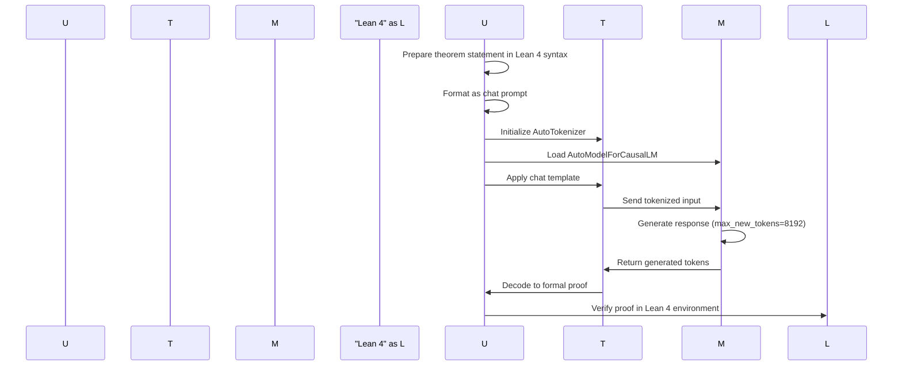
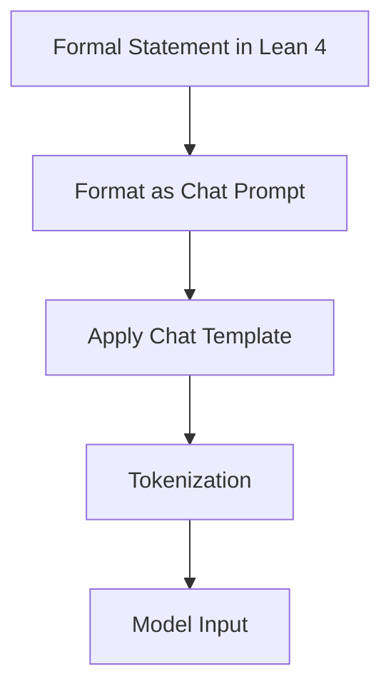
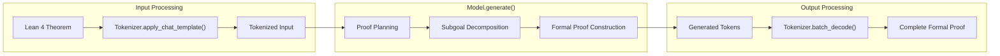

<!-- source: DeepWiki mcp.deepwiki.com · repo deepseek-ai/DeepSeek-Prover-V2 · page 3.2 Inference Guide · fetched 2026-10-30 -->

# Inference Guide

<details>
<summary>Relevant source files</summary>

The following files were used as context for generating this wiki page:

- [DeepSeek_Prover_V2.pdf](DeepSeek_Prover_V2.pdf)
- [README.md](README.md)

</details>


This guide provides detailed instructions for using DeepSeek-Prover-V2 models to generate formal mathematical proofs in Lean 4. It covers model loading, input formatting, inference execution, and output processing. For information about the training methodology and architecture, see the [Training Pipeline](#3.1) page.

## Model Overview

DeepSeek-Prover-V2 is available in two variants:

| Model | Parameters | Base Architecture | Context Length | Features |
|-------|------------|-------------------|----------------|----------|
| DeepSeek-Prover-V2-7B | 7 billion | DeepSeek-Prover-V1.5-Base | 32K tokens | Efficient, suitable for most proofs |
| DeepSeek-Prover-V2-671B | 671 billion | DeepSeek-V3-Base | Standard | State-of-the-art performance |

Sources: [README.md:94-97]()

## Inference Process

The following diagram illustrates the end-to-end inference process for generating formal proofs with DeepSeek-Prover-V2:



Sources: [README.md:114-163]()

## Basic Usage

### Setup and Installation

First, ensure you have the necessary dependencies installed:

```python
pip install torch transformers
```

### Loading the Model

The following code demonstrates how to load a DeepSeek-Prover-V2 model:

```python
from transformers import AutoModelForCausalLM, AutoTokenizer
import torch

# Set seed for reproducibility
torch.manual_seed(30)

# Select model size based on your hardware capabilities
model_id = "DeepSeek-Prover-V2-7B"  # or "DeepSeek-Prover-V2-671B"

# Initialize tokenizer
tokenizer = AutoTokenizer.from_pretrained(model_id)

# Load model with appropriate settings
model = AutoModelForCausalLM.from_pretrained(
    model_id, 
    device_map="auto",  # Automatically distribute across available GPUs
    torch_dtype=torch.bfloat16,  # Use BF16 for memory efficiency
    trust_remote_code=True  # Required for model-specific code
)
```

Sources: [README.md:124-126](), [README.md:155-156]()

### Input Preparation

The input to DeepSeek-Prover-V2 consists of a theorem statement in Lean 4 syntax. The model is designed to accept inputs formatted as chat messages:



Here's how to prepare the input:

```python
# 1. Prepare the formal statement
formal_statement = """
import Mathlib
import Aesop

set_option maxHeartbeats 0

open BigOperators Real Nat Topology Rat

/-- What is the positive difference between $120\%$ of 30 and $130\%$ of 20? Show that it is 10.-/
theorem mathd_algebra_10 : abs ((120 : ℝ) / 100 * 30 - 130 / 100 * 20) = 10 := by
  sorry
""".strip()

# 2. Create a prompt template
prompt = """
Complete the following Lean 4 code:

```lean4
{}
```

Before producing the Lean 4 code to formally prove the given theorem, provide a detailed proof plan outlining the main proof steps and strategies.
The plan should highlight key ideas, intermediate lemmas, and proof structures that will guide the construction of the final formal proof.
""".strip()

# 3. Format as chat message
chat = [
  {"role": "user", "content": prompt.format(formal_statement)},
]
```

Sources: [README.md:127-153]()

### Generating Proofs

Once the input is prepared, you can generate the proof as follows:

```python
# 1. Apply the chat template and tokenize
inputs = tokenizer.apply_chat_template(
    chat,
    tokenize=True,
    add_generation_prompt=True,
    return_tensors="pt"
).to(model.device)

# 2. Generate the response
outputs = model.generate(
    inputs,
    max_new_tokens=8192  # Ensure enough tokens for complete proofs
)

# 3. Decode the output
proof = tokenizer.batch_decode(outputs)[0]
print(proof)
```

Sources: [README.md:156-162]()

### Complete Example

Here's a full example demonstrating the entire inference process:

```python
from transformers import AutoModelForCausalLM, AutoTokenizer
import torch
import time

torch.manual_seed(30)

# 1. Load model and tokenizer
model_id = "DeepSeek-Prover-V2-7B"
tokenizer = AutoTokenizer.from_pretrained(model_id)
model = AutoModelForCausalLM.from_pretrained(
    model_id,
    device_map="auto",
    torch_dtype=torch.bfloat16,
    trust_remote_code=True
)

# 2. Prepare formal statement
formal_statement = """
import Mathlib
import Aesop

set_option maxHeartbeats 0

open BigOperators Real Nat Topology Rat

/-- What is the positive difference between $120\%$ of 30 and $130\%$ of 20? Show that it is 10.-/
theorem mathd_algebra_10 : abs ((120 : ℝ) / 100 * 30 - 130 / 100 * 20) = 10 := by
  sorry
""".strip()

# 3. Format prompt
prompt = """
Complete the following Lean 4 code:

```lean4
{}
```

Before producing the Lean 4 code to formally prove the given theorem, provide a detailed proof plan outlining the main proof steps and strategies.
The plan should highlight key ideas, intermediate lemmas, and proof structures that will guide the construction of the final formal proof.
""".strip()

# 4. Create chat message
chat = [
  {"role": "user", "content": prompt.format(formal_statement)},
]

# 5. Process and generate
inputs = tokenizer.apply_chat_template(chat, tokenize=True, add_generation_prompt=True, return_tensors="pt").to(model.device)

start = time.time()
outputs = model.generate(inputs, max_new_tokens=8192)
print(f"Generation time: {time.time() - start} seconds")

# 6. Print result
proof = tokenizer.batch_decode(outputs)[0]
print(proof)
```

Sources: [README.md:119-163]()

## Advanced Configuration

### Model Architecture and Processing Flow

The following diagram illustrates how DeepSeek-Prover-V2 processes inputs and generates formal proofs:



Sources: [README.md:44-67](), [README.md:155-162]()

### Generation Parameters

You can customize the proof generation process by adjusting the following parameters:

```python
outputs = model.generate(
    inputs,
    max_new_tokens=8192,      # Maximum number of tokens to generate
    temperature=0.7,          # Controls randomness (lower = more deterministic)
    top_p=0.9,                # Nucleus sampling parameter
    top_k=50,                 # Limit vocabulary to top k tokens
    do_sample=True,           # Enable sampling for more diverse outputs
    repetition_penalty=1.1    # Discourage repetition
)
```

### Memory Requirements and Optimization

The memory requirements vary significantly between model sizes:

| Model | Approximate Memory Usage (BF16) | Recommended GPU Configuration |
|-------|----------------------------------|-------------------------------|
| DeepSeek-Prover-V2-7B | 14-16 GB | Single GPU with 16+ GB VRAM |
| DeepSeek-Prover-V2-671B | 1.2+ TB | Multi-GPU system or cloud setup |

For memory-constrained environments, consider these optimizations:
- Use `device_map="auto"` for automatic model sharding across GPUs
- Use BF16 or FP16 precision with `torch_dtype=torch.bfloat16`
- For 671B model, consider cloud solutions with sufficient GPU memory

## Troubleshooting

### Common Issues

1. **Out of Memory Errors**
   - Switch to a smaller model variant
   - Reduce batch size to 1
   - Use lower precision (BF16/FP16)
   - Use `device_map="auto"` for multi-GPU usage

2. **Incomplete or Incorrect Proofs**
   - Increase `max_new_tokens` beyond the default 8192
   - Use a lower temperature (0.1-0.3) for more deterministic outputs
   - Provide more detailed instructions in the prompt
   - Include relevant mathematical background in the prompt

3. **Slow Generation**
   - Proof generation can take several minutes, especially for complex theorems
   - Generation time increases with `max_new_tokens`
   - The 7B model offers faster generation at the cost of some performance

Sources: [README.md:66-67](), [README.md:160]()

## Integration with Lean 4

To verify the generated proofs, you need to have Lean 4 installed. The typical workflow is:

1. Generate the proof using DeepSeek-Prover-V2
2. Save the complete proof (including the initial imports and theorem statement) to a `.lean` file
3. Verify the proof using Lean 4's verification tools

For complex proofs, DeepSeek-Prover-V2 implements a recursive theorem proving approach, breaking down complex problems into manageable subgoals. This technique is especially effective for challenging theorems that would be difficult to prove directly.

Sources: [README.md:54-59]()

---

