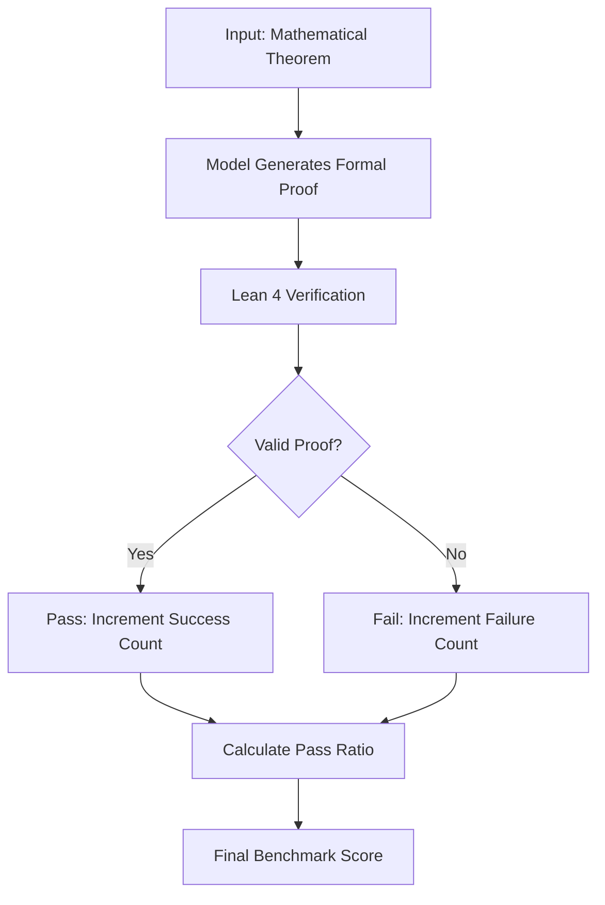
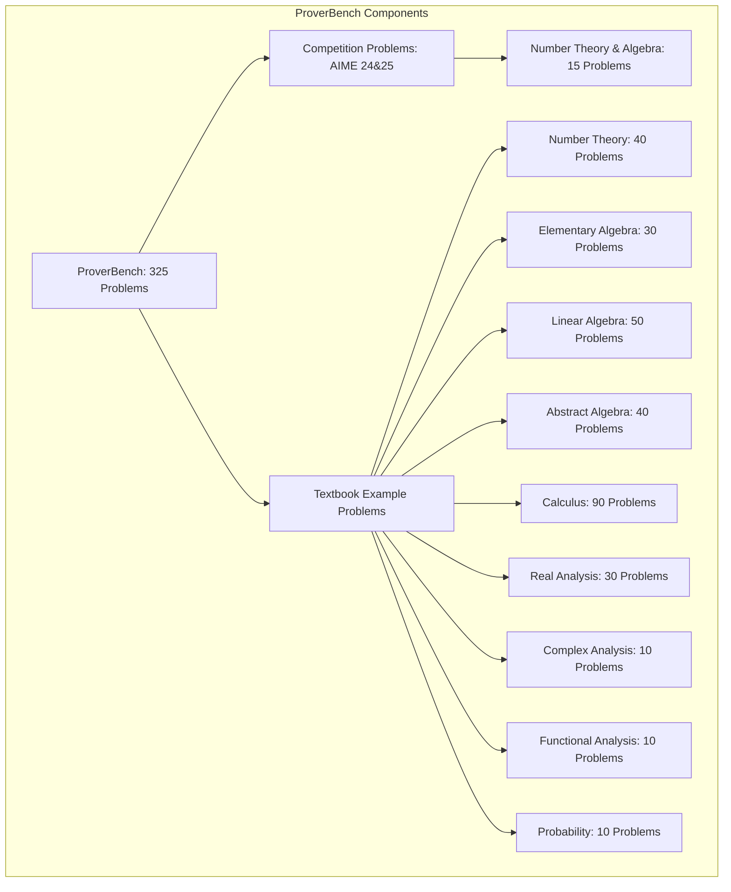
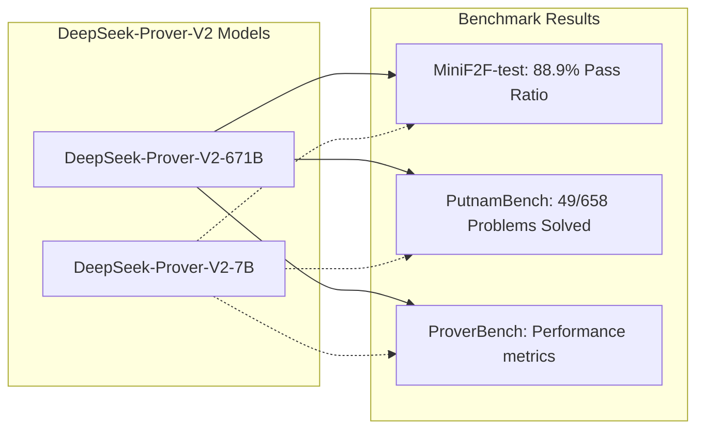
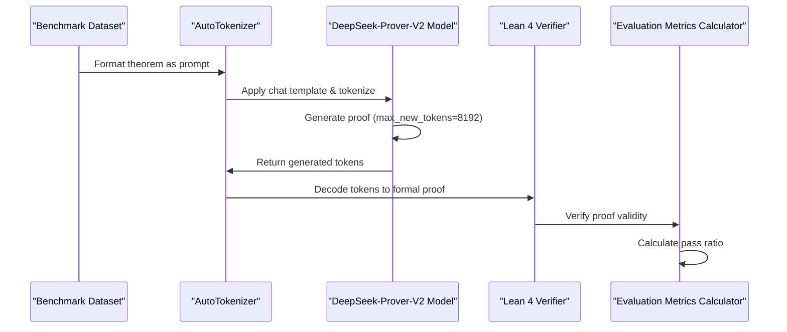

<!-- source: DeepWiki mcp.deepwiki.com · repo deepseek-ai/DeepSeek-Prover-V2 · page 4 Evaluation and Benchmarks · fetched 2026-10-30 -->

# Evaluation and Benchmarks

<details>
<summary>Relevant source files</summary>

The following files were used as context for generating this wiki page:

- [README.md](README.md)
- [figures/performance.png](figures/performance.png)

</details>


This document provides a comprehensive overview of the evaluation methodologies and benchmarking approaches used to assess the DeepSeek-Prover-V2 models' performance in formal theorem proving. It covers the benchmark datasets, evaluation metrics, and performance results of the released models. For detailed information about the models themselves, see [Models](#3), and for information about the training pipeline, see [Training Pipeline](#3.1).

## Evaluation Methodology

DeepSeek-Prover-V2 models are evaluated on their ability to generate valid formal proofs in Lean 4. The evaluation process follows a standardized procedure to ensure consistency and reliability of results.



The primary evaluation metric is the **pass ratio**, calculated as the percentage of problems for which the model can generate a formally verified proof. A proof is considered valid if it can be verified by the Lean 4 theorem prover without errors or timeouts.

Sources: [README.md:44-48]()

## Benchmark Datasets

DeepSeek-Prover-V2 is evaluated on three main benchmark datasets, each testing different aspects of formal mathematical reasoning capabilities.

### MiniF2F

MiniF2F (Mini Formal to Formal) is a standard benchmark in the formal theorem proving community. It contains mathematical theorems formalized in Lean and serves as a key metric for comparing different theorem provers.

### PutnamBench

PutnamBench consists of 658 problems from the William Lowell Putnam Mathematical Competition, which is renowned for its challenging undergraduate-level mathematics problems. This benchmark tests the model's ability to solve complex, competition-level mathematical problems.

### ProverBench

ProverBench is a new benchmark dataset introduced alongside DeepSeek-Prover-V2, comprising 325 problems across various mathematical domains.



The breakdown of ProverBench problems by mathematical domain is as follows:

| Domain | Number of Problems |
|--------|-------------------|
| AIME 24&25 | 15 |
| Number Theory | 40 |
| Elementary Algebra | 30 |
| Linear Algebra | 50 |
| Abstract Algebra | 40 |
| Calculus | 90 |
| Real Analysis | 30 |
| Complex Analysis | 10 |
| Functional Analysis | 10 |
| Probability | 10 |
| **Total** | **325** |

ProverBench is designed to enable comprehensive evaluation across both high-school competition problems and undergraduate-level mathematics, providing a diverse testing ground for formal proving capabilities.

Sources: [README.md:71-91]()

## Performance Results

The DeepSeek-Prover-V2 models demonstrate strong performance across all benchmark datasets, with the larger 671B parameter model achieving state-of-the-art results in neural theorem proving.



### MiniF2F Results

DeepSeek-Prover-V2-671B achieves a pass ratio of 88.9% on the MiniF2F-test, setting a new state-of-the-art for neural theorem provers. This significant improvement demonstrates the effectiveness of the reinforcement learning approach with subgoal decomposition.

### PutnamBench Results

On the challenging PutnamBench dataset, DeepSeek-Prover-V2-671B successfully solves 49 out of 658 problems, showcasing its ability to handle complex competition-level mathematical problems.

The proofs generated by DeepSeek-Prover-V2 for the MiniF2F dataset are available for download as a ZIP archive in the repository.

Sources: [README.md:67-68]()

## Evaluation Interface

The evaluation process uses the Hugging Face Transformers library for model inference, followed by verification in the Lean 4 environment. Here's how the evaluation flow is typically implemented:



A standard evaluation prompt template for the model looks like:

```
Complete the following Lean 4 code:

```lean4
import Mathlib
import Aesop

set_option maxHeartbeats 0

open BigOperators Real Nat Topology Rat

/-- [Problem statement] -/
theorem [theorem_name] : [formal_statement] := by
  sorry
```

Before producing the Lean 4 code to formally prove the given theorem, provide a detailed proof plan outlining the main proof steps and strategies.
The plan should highlight key ideas, intermediate lemmas, and proof structures that will guide the construction of the final formal proof.
```

This structured approach encourages the model to first develop a proof plan before generating the formal proof in Lean 4 syntax.

Sources: [README.md:115-163]()

## Benchmark Comparison and Significance

The three benchmark datasets used for evaluation cover different aspects of mathematical reasoning:

| Benchmark | Focus | Difficulty Level | Size | Key Strength |
|-----------|-------|------------------|------|--------------|
| MiniF2F | Formalized mathematical theorems | Mixed | Standard test set | Industry standard for comparison |
| PutnamBench | Competition problems | High (undergraduate competition) | 658 problems | Tests complex problem-solving ability |
| ProverBench | Diverse mathematical domains | High school to undergraduate | 325 problems | Broad coverage of mathematical areas |

Together, these benchmarks provide a comprehensive evaluation of the model's capabilities across different mathematical domains, problem types, and difficulty levels.

Sources: [README.md:40-48](), [README.md:71-91]()

---

