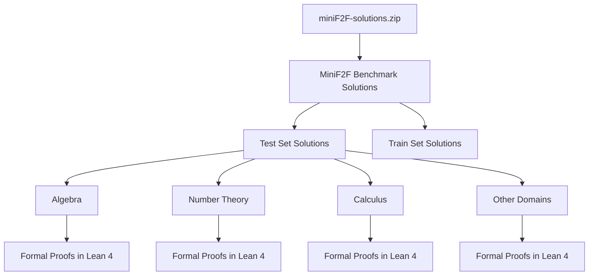
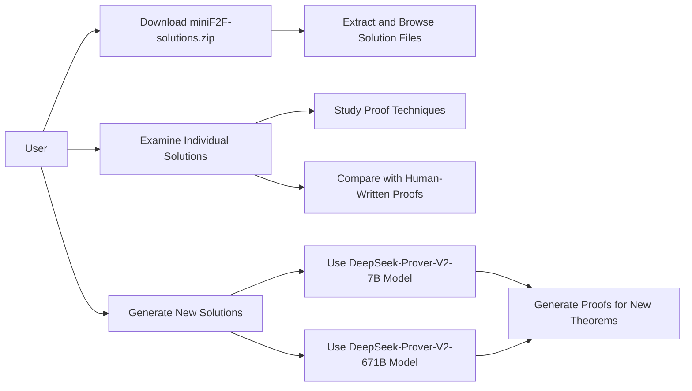
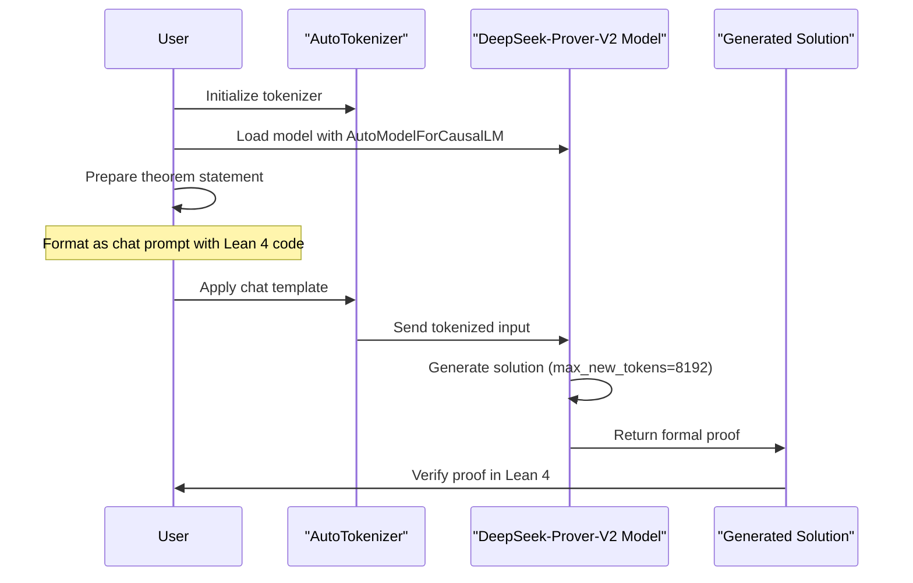
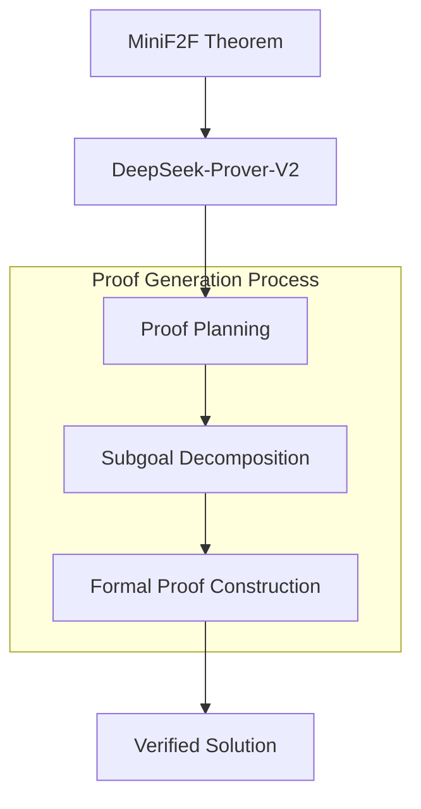
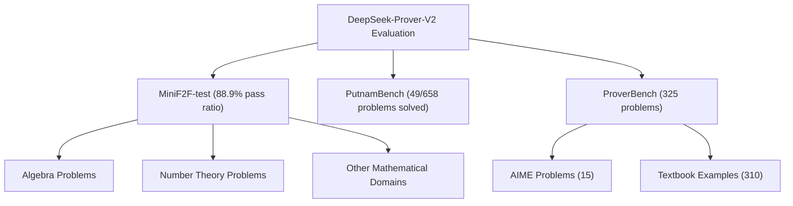

<!-- source: DeepWiki mcp.deepwiki.com · repo deepseek-ai/DeepSeek-Prover-V2 · page 4.2 MiniF2F Solutions · fetched 2026-10-30 -->

# MiniF2F Solutions

<details>
<summary>Relevant source files</summary>

The following files were used as context for generating this wiki page:

- [README.md](README.md)
- [figures/performance.png](figures/performance.png)
- [minif2f-solutions.zip](minif2f-solutions.zip)

</details>


This page documents the MiniF2F benchmark solutions provided by the DeepSeek-Prover-V2 models. It covers what MiniF2F is, how to access the solutions, their structure, and how they reflect the model's theorem proving capabilities. For information about the general evaluation approach and other benchmarks, see [Evaluation and Benchmarks](#4).

## 1. What is MiniF2F?

MiniF2F (miniF2F) is a benchmark dataset of formal mathematical statements and their proofs designed to evaluate the theorem-proving capabilities of AI systems. It contains a collection of mathematical theorems from different fields formalized in Lean 4 that serve as standardized problems for assessing the performance of formal theorem proving systems.

The benchmark consists of two main splits:
- **MiniF2F-test**: The primary evaluation benchmark used to assess model performance
- **MiniF2F-train**: Additional problems that can be used for model training or development

Sources: [README.md:67-67]()

## 2. DeepSeek-Prover-V2 Solutions Overview

DeepSeek-Prover-V2 has achieved state-of-the-art performance on the MiniF2F benchmark, with DeepSeek-Prover-V2-671B achieving an 88.9% pass ratio on the MiniF2F-test set.

All the proofs generated by DeepSeek-Prover-V2 for the MiniF2F dataset are available for download as a ZIP archive from the repository. These solutions represent formal, machine-verified proofs of mathematical theorems expressed in the Lean 4 theorem prover.



Sources: [README.md:67-67]()

## 3. Solution Structure and Format

Each solution in the MiniF2F collection consists of a Lean 4 formal proof that addresses the mathematical theorem stated in the benchmark. The solutions follow a consistent structure:

1. **Import statements**: Libraries and modules required for the proof
2. **Theorem statement**: The formal mathematical statement to be proven
3. **Proof body**: The step-by-step formal proof constructed using Lean 4 tactics

A typical solution follows this format:

```
import Mathlib
import Aesop

set_option maxHeartbeats 0

open [relevant mathematical structures]

/-- [Informal description of the theorem] -/
theorem [theorem_name] : [formal mathematical statement] := by
  [proof steps using Lean 4 tactics]
```

Sources: [README.md:126-138]()

## 4. Accessing and Using the Solutions

The MiniF2F solutions generated by DeepSeek-Prover-V2 can be accessed and utilized in several ways:



To download the solutions:
1. Access the ZIP archive from the [repository](https://github.com/deepseek-ai/DeepSeek-Prover-V2/blob/master/minif2f-solutions.zip)
2. Extract the contents to examine individual solution files

To generate new solutions using the DeepSeek-Prover-V2 models:
1. Load the model using Hugging Face Transformers
2. Format the theorem statement as a Lean 4 code block
3. Use the chat template to generate a proof

Sources: [README.md:117-163]()

## 5. Example Solution Generation Process

The following diagram illustrates the process of generating a solution for a MiniF2F problem using the DeepSeek-Prover-V2 model:



The example below shows how to generate a proof for a problem from the MiniF2F dataset using the DeepSeek-Prover-V2-7B model:

1. Import the necessary libraries
2. Initialize the tokenizer and model
3. Format the formal statement and prompt
4. Generate the proof using the model

Sources: [README.md:119-163]()

## 6. Solution Quality and Performance

DeepSeek-Prover-V2 models have demonstrated strong performance on the MiniF2F benchmark, with the following metrics:

| Model | MiniF2F-test Pass Rate |
|-------|--------------------------|
| DeepSeek-Prover-V2-7B | (Not specified in provided files) |
| DeepSeek-Prover-V2-671B | 88.9% |

The solutions generated by these models exhibit several characteristics that contribute to their effectiveness:

1. **Subgoal decomposition**: Breaking complex theorems into manageable subgoals
2. **Chain-of-thought reasoning**: Integrating informal mathematical reasoning with formal proof steps
3. **Proof automation**: Leveraging Lean 4's proof automation capabilities when appropriate



Solutions in the collection represent the current state-of-the-art in automated formal theorem proving, bridging the gap between informal mathematical reasoning and rigorous formal proofs.

Sources: [README.md:44-48](), [README.md:52-66]()

## 7. Relationship to Other Benchmarks

MiniF2F is one of several benchmarks used to evaluate DeepSeek-Prover-V2. The following diagram shows the relationship between the different benchmarks:



The solutions for MiniF2F complement the solutions for other benchmarks, providing a comprehensive view of the model's theorem-proving capabilities across different mathematical domains and difficulty levels.

Sources: [README.md:67-67](), [README.md:71-91]()

## 8. Practical Applications

The MiniF2F solutions provided by DeepSeek-Prover-V2 have several practical applications:

1. **Educational resource**: Studying the solutions can help mathematics students and researchers understand formal proof techniques
2. **Benchmark for other systems**: Other theorem-proving systems can be compared against these solutions
3. **Reference for theorem formalization**: The solutions demonstrate how to formalize various mathematical concepts in Lean 4
4. **Starting point for complex proofs**: The solutions can serve as building blocks for more complex formal proofs

Through these applications, the MiniF2F solutions contribute to advancing the field of formal theorem proving and the integration of AI with formal mathematics.

Sources: [README.md:42-48](), [README.md:52-67]()

---

