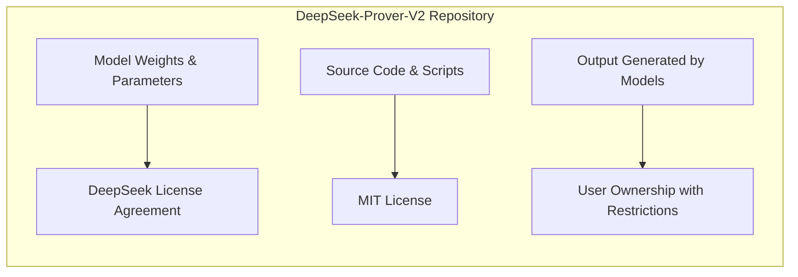
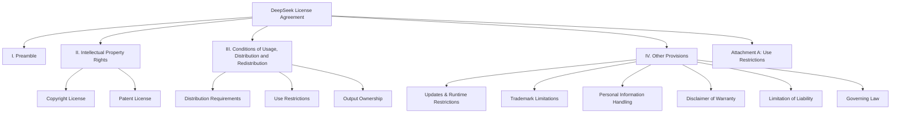
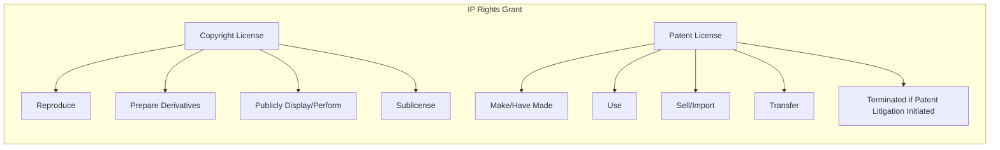
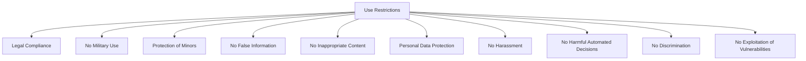
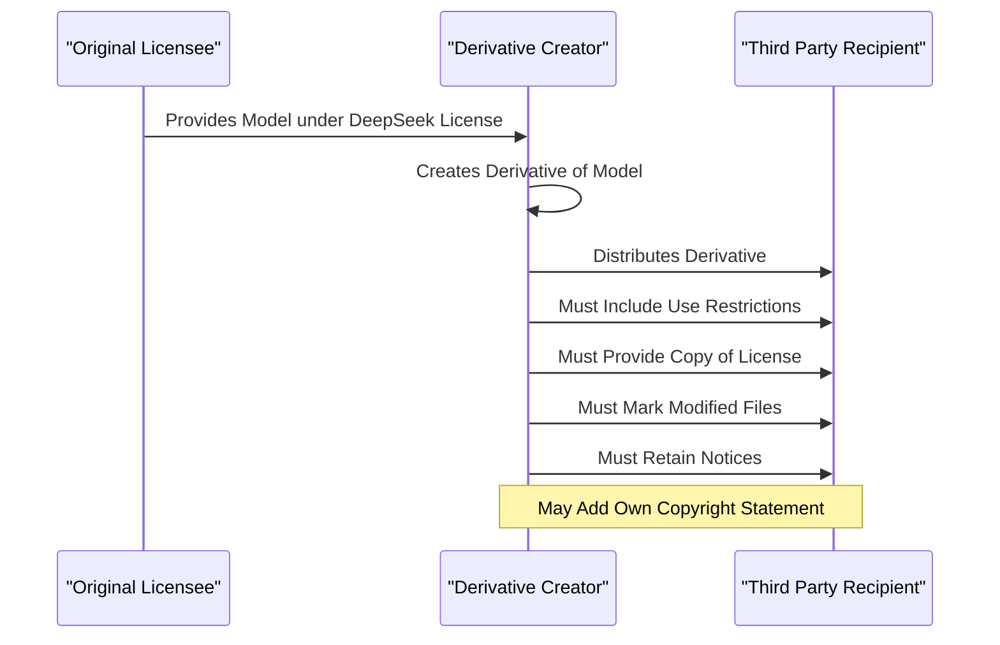
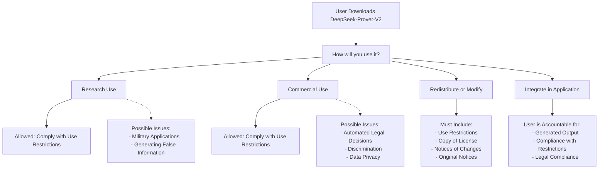

<!-- source: DeepWiki mcp.deepwiki.com · repo deepseek-ai/DeepSeek-Prover-V2 · page 5 License and Legal Information · fetched 2026-10-30 -->

# License and Legal Information

Relevant source files

The following files were used as context for generating this wiki page:

- [LICENSE-MODEL](LICENSE-MODEL)
- [README.md](README.md)

This document outlines the licensing terms, legal restrictions, and usage conditions that govern the DeepSeek-Prover-V2 models and associated components. It provides essential information for users who wish to utilize, modify, or distribute these models in compliance with applicable legal requirements.

## License Structure Overview

DeepSeek-Prover-V2 uses a dual licensing approach with different licenses applying to different repository components:

1. **Model License**: The DeepSeek License Agreement governs the use of the model weights and parameters
2. **Code License**: MIT License covers the accompanying source code and scripts

This page focuses on the Model License. For information about the source code licensing, please refer to the repository's MIT license.

Sources: [README.md:166-166](), [README.md:24-27]()

## DeepSeek License Agreement Structure

The DeepSeek License Agreement (Version 1.0, October 23, 2023) is structured into four main sections that govern different aspects of model usage and distribution.

Sources: [LICENSE-MODEL:1-73]()

## License Scope and Definitions

The license applies to the Model, Derivatives of the Model, and Complementary Material with specific definitions for each term:

| Term | Definition |
|------|------------|
| Model | Machine-learning based assemblies consisting of learned weights, parameters (including optimizer states) trained on the Data |
| Derivatives of the Model | All modifications to the Model, works based on the Model, or models created by transfer of patterns |
| Complementary Material | Accompanying source code, scripts, documentation, tutorials, and examples |
| Data | Collection of information extracted from the dataset used to train the Model |
| Output | The results of operating a Model as embodied in informational content resulting therefrom |

Sources: [LICENSE-MODEL:19-31]()

## Intellectual Property Rights

The DeepSeek License Agreement grants users both copyright and patent licenses:

### Copyright License

The license grants a perpetual, worldwide, non-exclusive, no-charge, royalty-free, irrevocable copyright license to:
- Reproduce the Model and Complementary Material
- Prepare and distribute Derivatives of the Model
- Publicly display and perform the Model and Derivatives
- Sublicense the above rights

### Patent License

The license includes a patent license to make, use, sell, and transfer the Model and Complementary Material. This patent license is revoked if the licensee initiates patent litigation against DeepSeek regarding the licensed material.

Sources: [LICENSE-MODEL:33-40]()

## Usage Conditions and Restrictions

### Use-Based Restrictions

The DeepSeek License Agreement prohibits using the Model or Derivatives of the Model for several specific purposes outlined in Attachment A, including:

- Any use that violates applicable laws or regulations
- Military applications
- Exploiting or harming minors
- Generating false information intended to harm others
- Generating inappropriate content
- Generating personal identifiable information without authorization
- Defaming or harassing others
- Fully automated decision-making with legal impacts
- Discriminatory applications
- Exploiting vulnerabilities of specific groups
- Uses that discriminate based on legally protected characteristics

Sources: [LICENSE-MODEL:50-91]()

## Distribution Requirements

When distributing the Model or Derivatives of the Model, users must:

1. Include the use-based restrictions as an enforceable provision in any legal agreement
2. Provide recipients with a copy of the DeepSeek License
3. Mark any modified files with prominent notices of changes
4. Retain all copyright, patent, trademark, and attribution notices
5. Include their own copyright statement for modifications if desired

Sources: [LICENSE-MODEL:44-49]()

## Output Ownership and Accountability

DeepSeek claims no rights to the output generated by users with the Model. However:

1. Users are accountable for the output they generate and its subsequent uses
2. No use of the output can contravene any provision stated in the License
3. Users must comply with applicable laws when handling personal information or IP rights that may be contained in the output

Sources: [LICENSE-MODEL:52-61]()

## Disclaimer of Warranty and Liability Limitations

The DeepSeek License Agreement includes standard disclaimers that:

1. The Model and Complementary Material are provided "AS IS" without warranties of any kind
2. DeepSeek is not liable for any damages arising from the use of the Model
3. Users are solely responsible for determining the appropriateness of using or redistributing the Model

Sources: [LICENSE-MODEL:62-67]()

## Accepting Additional Liability and Support

When redistributing the Model, users may offer support, warranty, indemnity, or other liability obligations, but:

1. Users may act only on their own behalf and responsibility 
2. Users must indemnify and hold DeepSeek harmless for any liability incurred
3. Users cannot act on behalf of DeepSeek when accepting such obligations

Sources: [LICENSE-MODEL:68-72]()

## Governing Law and Jurisdiction

The DeepSeek License Agreement is governed by:

1. PRC laws without regard to choice of law principles
2. The UN Convention on Contracts for the International Sale of Goods does not apply
3. Courts located in the domicile of Hangzhou DeepSeek Artificial Intelligence Fundamental Technology Research Co., Ltd. have exclusive jurisdiction over disputes

Sources: [LICENSE-MODEL:73-73]()

## Practical License Application

The following diagram illustrates how the license applies to various scenarios when using DeepSeek-Prover-V2:

## How to Comply with the License

Users of DeepSeek-Prover-V2 should take the following steps to ensure compliance with the license:

1. Review the Use Restrictions in Attachment A to ensure your use case is permitted
2. When distributing the Model or Derivatives, include all required notices and the license itself
3. Maintain accountability for the output generated and its uses
4. Respect trademark rights and do not suggest endorsement by DeepSeek
5. Comply with applicable privacy laws and IP rights when handling model outputs
6. Consider seeking legal advice for commercial applications

Sources: [LICENSE-MODEL:1-91](), [README.md:166-166]()