# Page: Overview

# Overview

<details>
<summary>Relevant source files</summary>

The following files were used as context for generating this wiki page:

- [DeepSeek_Prover_V2.pdf](DeepSeek_Prover_V2.pdf)
- [README.md](README.md)

</details>


This page provides a comprehensive introduction to DeepSeek-Prover-V2, an open-source large language model specifically designed for formal theorem proving in Lean 4. This document explains the system's purpose, architecture, and key components, providing a foundation for understanding how the model bridges informal reasoning with formal proof construction.

For detailed information about the system architecture, see [System Architecture](#2). For model-specific details, see [Models](#3).

## Purpose and Scope

DeepSeek-Prover-V2 is a specialized language model for formal mathematical reasoning in Lean 4, focusing on advanced theorem proving capabilities through recursive subgoal decomposition and reinforcement learning. The system aims to formalize mathematical statements and generate verifiable proofs that can be checked by the Lean 4 theorem prover.

The key objectives of DeepSeek-Prover-V2 include:

1. Decomposing complex problems into manageable subgoals
2. Bridging informal mathematical reasoning with formal proof construction
3. Generating complete, verifiable proofs in Lean 4 notation
4. Providing state-of-the-art performance on formal mathematics benchmarks

Sources: [README.md:40-46]()

## System Components and Architecture

DeepSeek-Prover-V2 consists of several interconnected components that work together to facilitate formal theorem proving.

### High-Level System Architecture

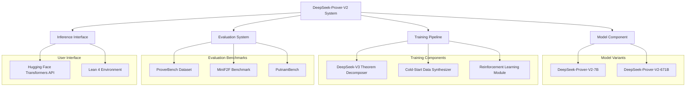

Sources: [README.md:40-46](), [README.md:50-67](), [README.md:71-91](), [README.md:94-112]()

## Theorem Proving Process

The core innovation of DeepSeek-Prover-V2 is its recursive theorem proving pipeline, which breaks down complex problems into more manageable subgoals.

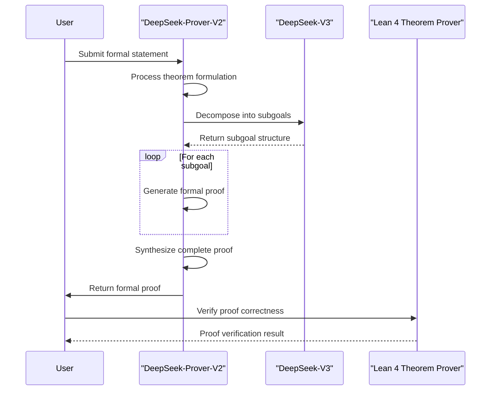

Sources: [README.md:54-59]()

## Model Variants and Capabilities

DeepSeek-Prover-V2 is available in two primary configurations, designed for different computational requirements and performance needs:

| Model | Parameters | Base Model | Context Length | Use Case |
|-------|------------|------------|----------------|----------|
| DeepSeek-Prover-V2-7B | 7 billion | DeepSeek-Prover-V1.5-Base | 32K tokens | Lightweight applications |
| DeepSeek-Prover-V2-671B | 671 billion | DeepSeek-V3-Base | Standard | High-performance theorem proving |

The 671B model represents the state-of-the-art in neural theorem proving, achieving an 88.9% pass ratio on the MiniF2F-test benchmark and solving 49 out of 658 problems from PutnamBench.

Sources: [README.md:94-96](), [README.md:97-104](), [README.md:66-67]()

## Training Methodology

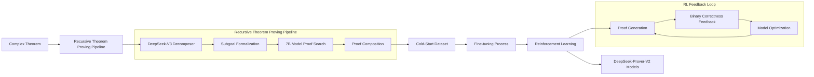

The training process consists of two main phases:

1. **Cold-Start Data Synthesis**:
   - Complex theorems are decomposed into subgoals using DeepSeek-V3
   - A smaller 7B model handles proof search for individual subgoals
   - Successful subgoal proofs are combined into complete formal proofs
   - DeepSeek-V3's chain-of-thought reasoning is paired with formal proofs

2. **Reinforcement Learning**:
   - The model is fine-tuned on the synthesized cold-start data
   - Binary correct-or-incorrect feedback serves as reward supervision
   - This process enhances the model's ability to bridge informal reasoning with formal proof construction

Sources: [README.md:54-59](), [README.md:62-67]()

## Inference and Usage

DeepSeek-Prover-V2 can be used directly through the Hugging Face Transformers library, with the following basic workflow:

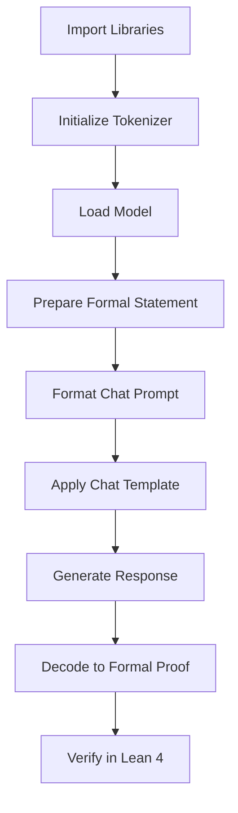

The model expects input in a specific format, with a formal statement in Lean 4 syntax followed by a prompt requesting a proof plan and formal proof. The output includes both a detailed proof strategy and the complete formal proof in Lean 4.

Sources: [README.md:114-163]()

## Evaluation Framework

DeepSeek-Prover-V2 is evaluated on three primary benchmarks:

1. **MiniF2F**: A standard benchmark for formal mathematics
2. **PutnamBench**: 658 challenging mathematical problems
3. **ProverBench**: A custom benchmark with 325 problems, including:
   - 15 problems from AIME (American Invitational Mathematics Examination)
   - 310 problems from various mathematical domains

The ProverBench dataset provides comprehensive coverage across multiple areas of mathematics:

| Mathematical Domain | Problem Count |
|---------------------|---------------|
| AIME 24 & 25 | 15 |
| Number Theory | 40 |
| Elementary Algebra | 30 |
| Linear Algebra | 50 |
| Abstract Algebra | 40 |
| Calculus | 90 |
| Real Analysis | 30 |
| Complex Analysis | 10 |
| Functional Analysis | 10 |
| Probability | 10 |
| **Total** | **325** |

Sources: [README.md:71-91](), [README.md:66-67]()

## License and Distribution

DeepSeek-Prover-V2 is available under the DeepSeek License Agreement, with specific terms governing usage and distribution. For detailed information about licensing, see [License and Legal Information](#5).

Sources: [README.md:166-166]()

---

# Page: System Architecture

# System Architecture

<details>
<summary>Relevant source files</summary>

The following files were used as context for generating this wiki page:

- [DeepSeek_Prover_V2.pdf](DeepSeek_Prover_V2.pdf)
- [README.md](README.md)

</details>


## Purpose and Scope

This document details the internal architecture of DeepSeek-Prover-V2, explaining how its components interact to enable formal theorem proving in Lean 4. We focus on the technical structure of the system and the relationships between components rather than usage instructions or performance metrics.

For information about using the models for inference, see [Inference Guide](#3.2). For details about the training methodology, see [Training Pipeline](#3.1). For performance evaluation, see [Evaluation and Benchmarks](#4).

## High-Level System Architecture

DeepSeek-Prover-V2 implements a recursive theorem proving architecture that bridges informal mathematical reasoning with formal proof construction through a specialized language model pipeline.

### System Components Overview

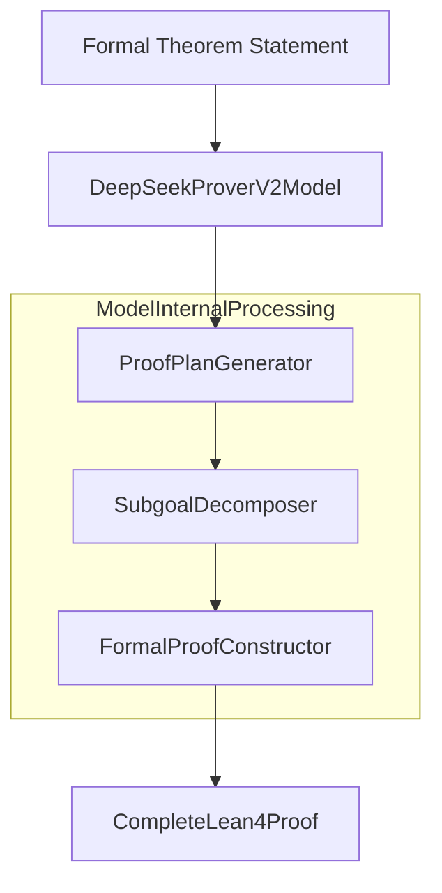

The high-level flow consists of:

1. A formal theorem statement in Lean 4 format is input to the system
2. The DeepSeek-Prover-V2 model processes the statement
3. A proof plan is generated with step-by-step reasoning
4. Complex theorems are decomposed into manageable subgoals
5. Formal proofs are constructed for each subgoal
6. The complete Lean 4 proof is produced as output

Sources: [README.md:42-44](), [README.md:54-58]()

## Core Components

### Recursive Theorem Proving Pipeline

The recursive theorem proving pipeline is a central architectural component that enables the system to tackle complex mathematical problems by breaking them down into manageable parts.

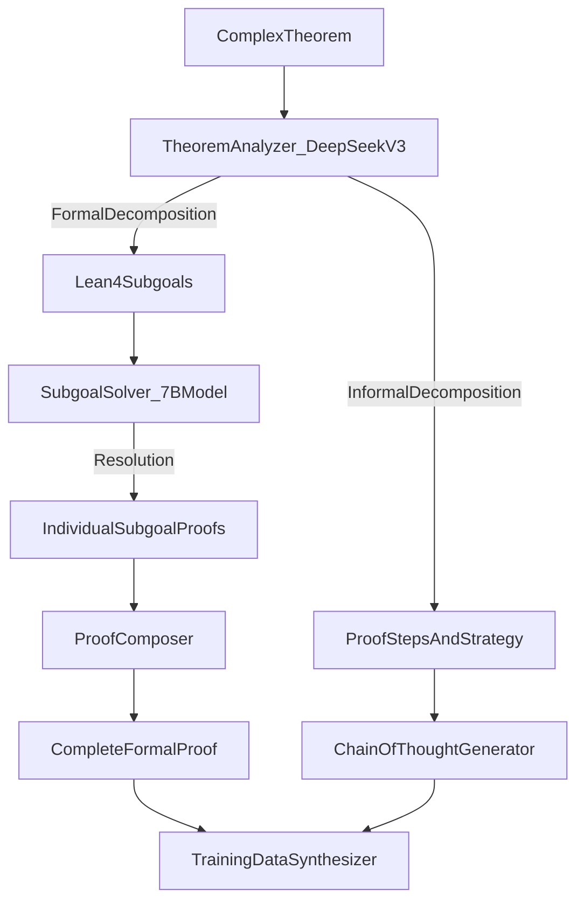

The pipeline functions as follows:

1. **Theorem Analysis**: DeepSeek-V3 analyzes a complex theorem
2. **Dual Decomposition**:
   - Informal: Creates high-level proof sketches with mathematical reasoning
   - Formal: Translates into precise Lean 4 subgoals
3. **Subgoal Solving**: The 7B parameter model handles proof search for each subgoal
4. **Proof Composition**: Individual subgoal proofs are combined into a complete proof
5. **Training Data Synthesis**: The formal proof is paired with the chain-of-thought reasoning

Sources: [README.md:54-58]()

### Cold-Start Training Component

The cold-start training component prepares the model for reinforcement learning by creating synthetic data that pairs informal reasoning with formal proof construction.

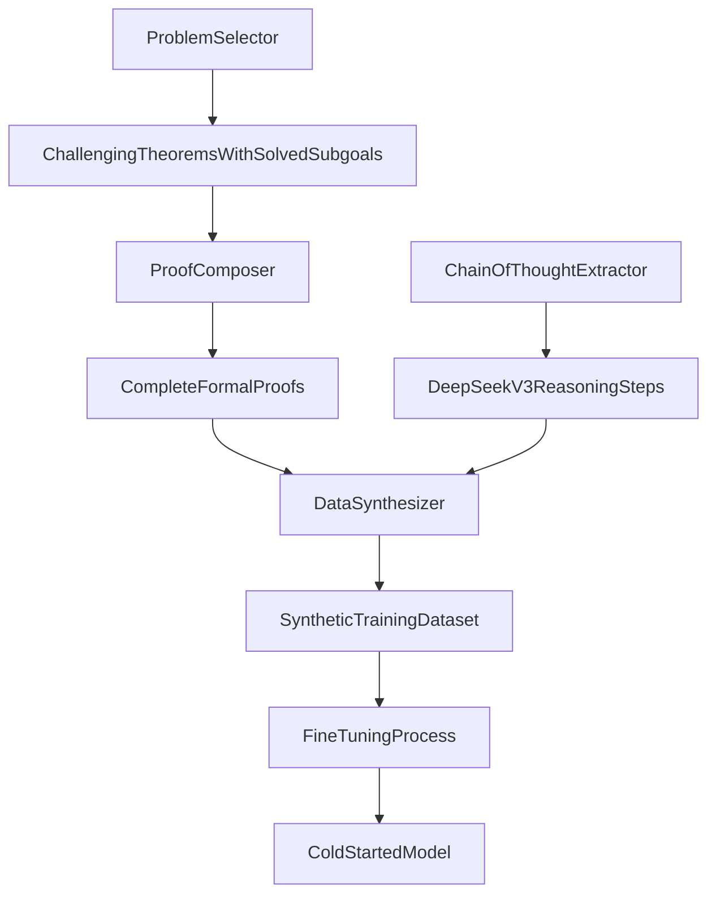

The component implements the following process:

1. **Problem Selection**: Curates challenging problems where all decomposed subgoals are successfully solved
2. **Proof Composition**: Constructs complete formal proofs by combining subgoal proofs
3. **Reasoning Extraction**: Obtains DeepSeek-V3's chain-of-thought reasoning
4. **Data Synthesis**: Pairs formal proofs with informal reasoning steps
5. **Fine-tuning**: Uses the synthetic data to initialize the prover model

Sources: [README.md:62-66]()

### Reinforcement Learning Component

After cold-start training, the reinforcement learning component further enhances the model's capabilities through feedback-based learning.

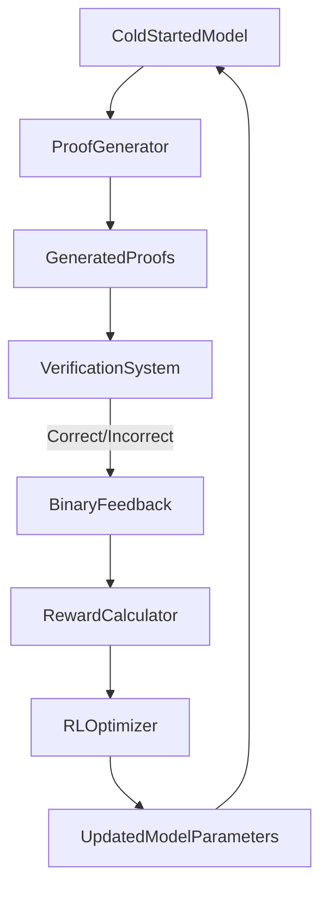

The reinforcement learning component:

1. **Proof Generation**: The cold-started model generates proof attempts
2. **Verification**: Proofs are checked for correctness
3. **Feedback**: Binary (correct/incorrect) feedback is provided
4. **Reward Calculation**: Feedback is translated into numerical rewards
5. **Optimization**: The model parameters are updated to maximize expected rewards
6. **Iteration**: The process repeats with the improved model

Sources: [README.md:66-67]()

## Model Architecture

DeepSeek-Prover-V2 is available in two variants, each with different parameter counts, base models, and capabilities.

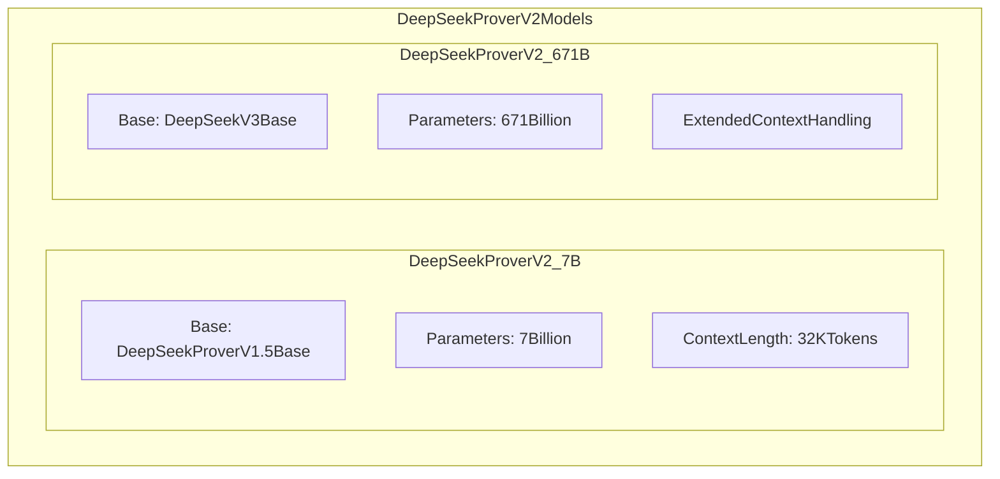

### Technical Specifications

| Model | Parameters | Base Model | Context Length | Model ID |
|-------|------------|------------|----------------|----------|
| DeepSeek-Prover-V2-7B | 7 Billion | DeepSeek-Prover-V1.5-Base | 32K tokens | deepseek-ai/DeepSeek-Prover-V2-7B |
| DeepSeek-Prover-V2-671B | 671 Billion | DeepSeek-V3-Base | Extended | deepseek-ai/DeepSeek-Prover-V2-671B |

Sources: [README.md:95-104]()

## Integration Points

### Lean 4 Integration

The system directly integrates with the Lean 4 formal verification environment, enabling automatic verification of generated proofs.

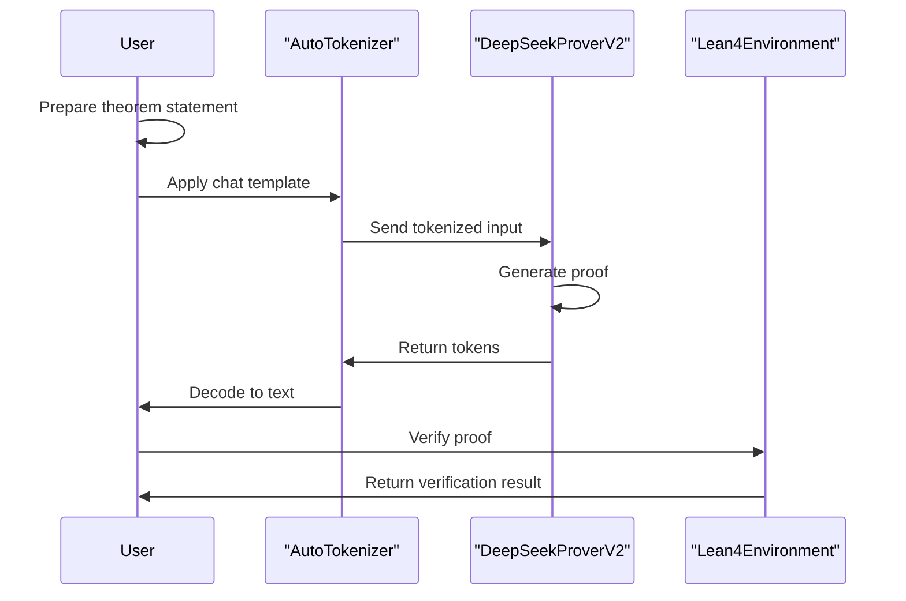

The integration with Lean 4 enables:

1. Direct verification of generated proofs
2. Compatibility with the Lean 4 ecosystem
3. Integration with existing mathematical libraries
4. Formal guarantees of proof correctness

Sources: [README.md:115-119]()

### Transformers Library Integration

DeepSeek-Prover-V2 models are designed to work seamlessly with Hugging Face's Transformers library, following standard inference patterns.

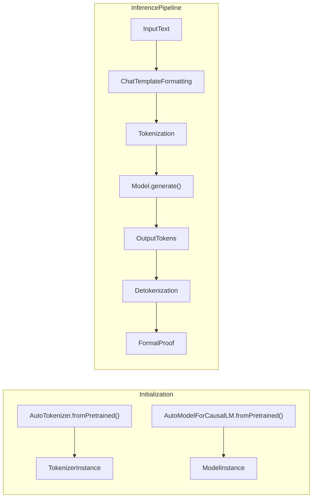

The integration process involves:

1. **Initialization**: Loading the tokenizer and model from Hugging Face
2. **Input Preparation**: Formatting the input as a chat prompt
3. **Tokenization**: Converting text to token IDs
4. **Generation**: Running the model with appropriate parameters (max_new_tokens=8192)
5. **Output Processing**: Decoding token IDs back to text

Sources: [README.md:115-163]()

## Inference Data Flow

The inference process follows a structured flow from input theorem statement to formal proof output.


### Inference Process Steps:

1. **Input Preparation**: A theorem statement in Lean 4 format is prepared
2. **Chat Formatting**: The statement is formatted using the model's chat template
3. **Tokenization**: The formatted input is converted to token IDs
4. **Model Processing**: The model generates output tokens (up to 8192 new tokens)
5. **Decoding**: Output tokens are converted back to text
6. **Verification**: The generated proof can be verified in Lean 4

Example code pattern for inference:

```python
# Load model and tokenizer
tokenizer = AutoTokenizer.from_pretrained("DeepSeek-Prover-V2-7B")
model = AutoModelForCausalLM.from_pretrained("DeepSeek-Prover-V2-7B", 
                                             device_map="auto", 
                                             torch_dtype=torch.bfloat16)

# Format input as chat
chat = [{"role": "user", "content": prompt.format(formal_statement)}]
inputs = tokenizer.apply_chat_template(chat, 
                                       tokenize=True, 
                                       add_generation_prompt=True, 
                                       return_tensors="pt").to(model.device)

# Generate proof
outputs = model.generate(inputs, max_new_tokens=8192)
proof = tokenizer.batch_decode(outputs)[0]
```

Sources: [README.md:118-163]()

## Training Data Flow

The training process involves multiple stages to prepare the model for formal theorem proving.

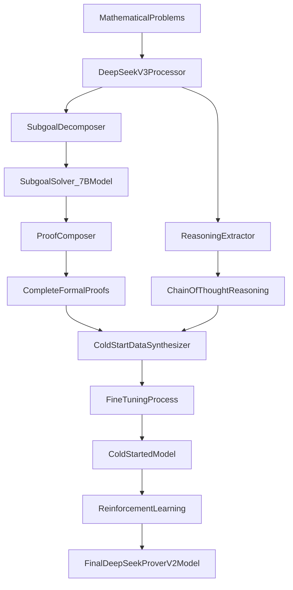

The training data flow consists of:

1. **Problem Processing**: Mathematical problems are analyzed by DeepSeek-V3
2. **Dual Extraction**:
   - Subgoal decomposition for formal proof structure
   - Chain-of-thought reasoning for informal mathematical insight
3. **Subgoal Resolution**: The 7B model solves individual subgoals
4. **Proof Composition**: Individual proofs are combined into complete solutions
5. **Data Synthesis**: Formal proofs are paired with informal reasoning
6. **Cold-Start Training**: The model is fine-tuned on the synthetic data
7. **Reinforcement Learning**: Further training with binary feedback

Sources: [README.md:54-67]()

## Integration with Benchmarks and Evaluation

The DeepSeek-Prover-V2 system is designed to integrate with multiple evaluation benchmarks to assess model performance.

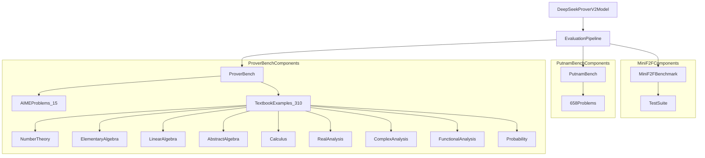

The model evaluation architecture enables comprehensive assessment across multiple benchmarks, including:

1. **MiniF2F**: Standard benchmark for formal mathematics
2. **PutnamBench**: Collection of 658 challenging mathematical problems
3. **ProverBench**: Newly introduced benchmark with 325 problems:
   - 15 problems from AIME competitions
   - 310 examples from various mathematical domains

Sources: [README.md:71-91]()

---

# Page: Models

# Models

<details>
<summary>Relevant source files</summary>

The following files were used as context for generating this wiki page:

- [DeepSeek_Prover_V2.pdf](DeepSeek_Prover_V2.pdf)
- [README.md](README.md)

</details>


This page provides a comprehensive overview of the available models in the DeepSeek-Prover-V2 system, including their architectures, capabilities, and specifications. For information about the training methodology, see [Training Pipeline](#3.1), and for detailed usage instructions, see [Inference Guide](#3.2).

## Model Overview

DeepSeek-Prover-V2 is a family of large language models specifically designed for formal theorem proving in Lean 4. The system is released in two model sizes: 7B and 671B parameters, each built upon different base models with specialized capabilities for mathematical reasoning.

### Model Variants and Specifications

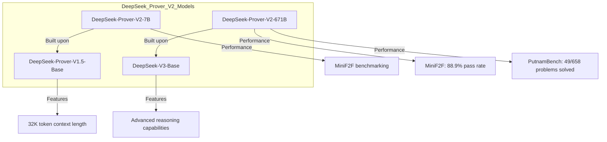

Sources: [README.md:94-103]()

The following table provides a detailed comparison of the two model variants:

| Model | Parameters | Base Model | Context Length | Primary Use Cases |
|-------|------------|------------|----------------|-------------------|
| DeepSeek-Prover-V2-7B | 7 billion | DeepSeek-Prover-V1.5-Base | Up to 32K tokens | Formal theorem proving, moderate complexity problems |
| DeepSeek-Prover-V2-671B | 671 billion | DeepSeek-V3-Base | Standard | Advanced reasoning, complex theorem proving, competition-level problems |

Sources: [README.md:94-96]()

## Model Architecture

The DeepSeek-Prover-V2 models are transformer-based language models optimized for mathematical reasoning tasks, with specific architectural enhancements that enable formal theorem proving capabilities.

### Architecture Components

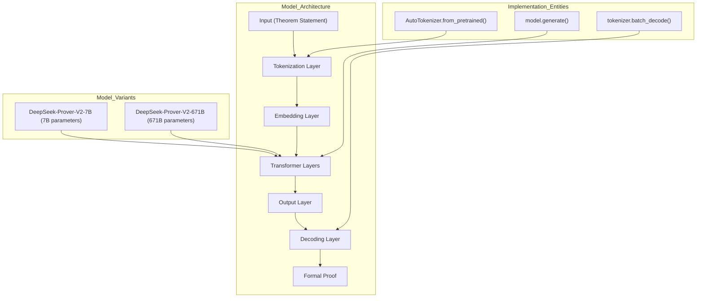

Sources: [README.md:94-96](), [README.md:114-163]()

## Model Capabilities

DeepSeek-Prover-V2 models combine informal mathematical reasoning with formal proof construction, enabling them to tackle complex mathematical problems through a process of decomposition, reasoning, and formalization.

### Key Capabilities

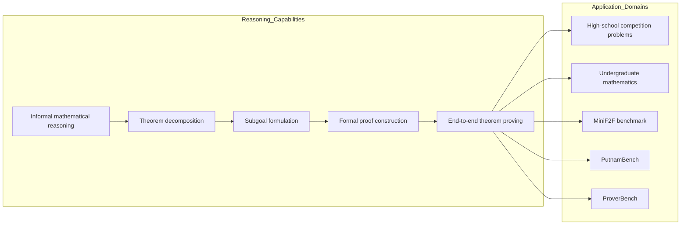

Sources: [README.md:40-67](), [README.md:71-91]()

### Performance Benchmarks

The models have been evaluated on multiple mathematical benchmarks:

- **MiniF2F-test**: DeepSeek-Prover-V2-671B achieves 88.9% pass ratio
- **PutnamBench**: Solves 49 out of 658 problems
- **ProverBench**: Comprehensive evaluation on 325 problems including:
  - 15 AIME competition problems
  - 310 undergraduate-level problems across various mathematical domains

Sources: [README.md:67-68](), [README.md:71-91]()

## Model Inference Process

The following sequence diagram illustrates the typical workflow for using DeepSeek-Prover-V2 models for formal theorem proving:

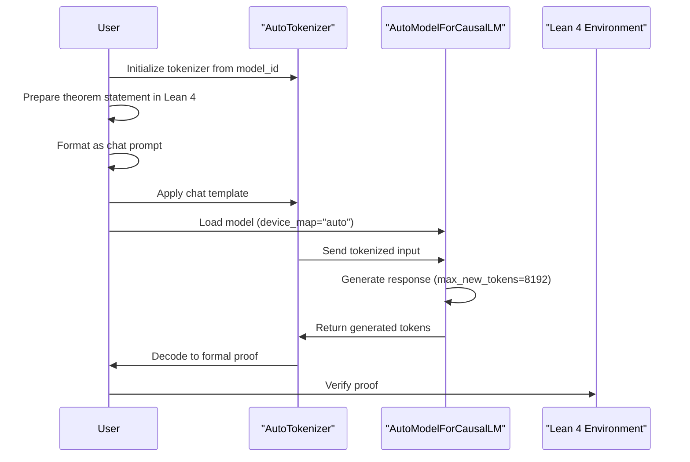

Sources: [README.md:114-163]()

## Model Integration with Code

This diagram shows how the natural language concepts map to specific code implementations when working with DeepSeek-Prover-V2 models:

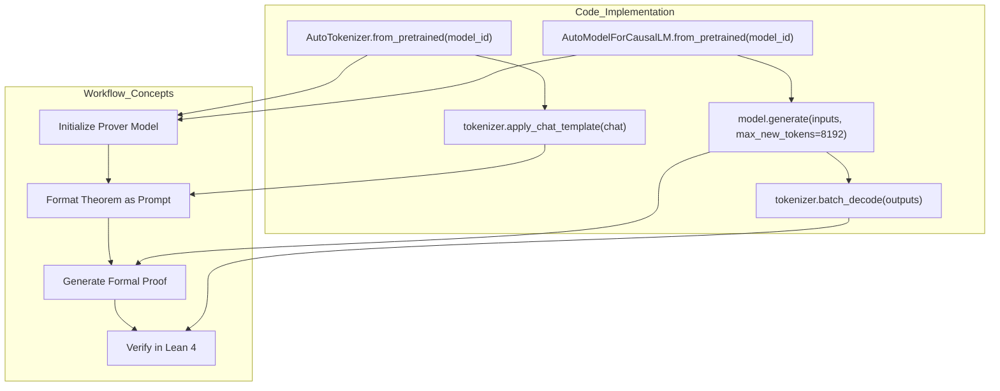

Sources: [README.md:114-163]()

## Accessing the Models

Both DeepSeek-Prover-V2 models are available for download from Hugging Face:

| Model | Download Link |
|-------|---------------|
| DeepSeek-Prover-V2-7B | HuggingFace: deepseek-ai/DeepSeek-Prover-V2-7B |
| DeepSeek-Prover-V2-671B | HuggingFace: deepseek-ai/DeepSeek-Prover-V2-671B |

The models can be directly loaded using the Hugging Face Transformers library as shown in the inference process diagram above.

Sources: [README.md:97-103]()

## Usage Guidelines

When using the DeepSeek-Prover-V2 models for theorem proving:

1. **Context Length**: The 7B model supports up to 32K tokens, making it suitable for longer proofs
2. **Prompt Format**: Include a clear theorem statement formatted in Lean 4 syntax
3. **Proof Planning**: Request a detailed proof plan before the formal proof for better results
4. **Token Generation**: Set a high value for `max_new_tokens` (e.g., 8192) to allow for complete proofs
5. **Model Selection**: Use the 671B model for more complex theorems and competition-level problems

Sources: [README.md:114-163]()

## License Information

The use of DeepSeek-Prover-V2 models is subject to the Model License. For complete details on licensing, see [License and Legal Information](#5).

Sources: [README.md:166]()

---

# Page: Training Pipeline

# Training Pipeline

<details>
<summary>Relevant source files</summary>

The following files were used as context for generating this wiki page:

- [DeepSeek_Prover_V2.pdf](DeepSeek_Prover_V2.pdf)
- [README.md](README.md)
- [figures/performance.png](figures/performance.png)

</details>


## Purpose and Scope

The Training Pipeline is a core component of the DeepSeek-Prover-V2 system, responsible for developing models capable of formal theorem proving in Lean 4. It integrates both informal mathematical reasoning with formal proof construction through a recursive theorem proving approach, cold-start training, and reinforcement learning. This page explains the pipeline components and how they work together to create effective theorem provers.

For information about model architecture and available models, see [Models](#3). For evaluation results, see [Evaluation and Benchmarks](#4).

## Pipeline Overview

The DeepSeek-Prover-V2 training pipeline consists of three primary stages:

1. **Recursive Theorem Proving**: Using DeepSeek-V3 to decompose complex problems into manageable subgoals
2. **Cold-Start Training**: Fine-tuning models on synthetic data that combines formal proofs with chain-of-thought reasoning
3. **Reinforcement Learning**: Further enhancing model capabilities using binary feedback

The following diagram illustrates the overall training flow:

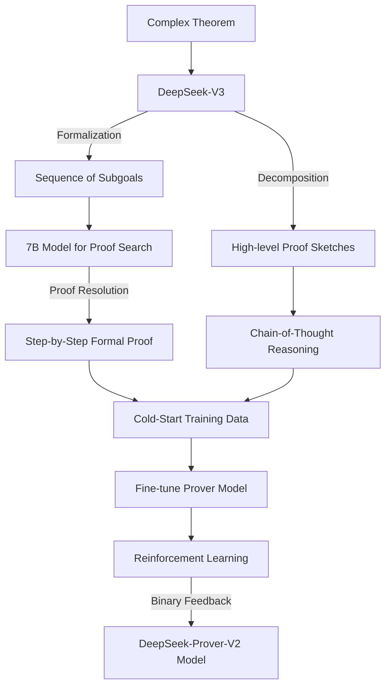

Sources: [README.md:44-44](), [README.md:54-58]()

## Recursive Theorem Proving Process

The recursive theorem proving process handles complex mathematical problems by breaking them down into more manageable parts.

### Process Flow

1. **Problem Decomposition**: Complex theorems are input to DeepSeek-V3, which:
   - Decomposes problems into high-level proof sketches
   - Formalizes these steps in Lean 4, resulting in a sequence of subgoals

2. **Subgoal Resolution**: A smaller 7B model handles proof search for each subgoal, reducing computational burden

3. **Proof Composition**: When all subgoals are successfully proven, they're combined to create a complete formal proof

```mermaid
flowchart TD
    A["Complex Theorem"] --> B["DeepSeek-V3"]
    B --> C["Decomposition & Formalization"]
    C --> D["Subgoal 1"]
    C --> E["Subgoal 2"]
    C --> F["..."]
    C --> G["Subgoal n"]
    D --> H["7B Prover Model"]
    E --> H
    F --> H
    G --> H
    H -->|"Proof Search"| I["Resolved Subgoals"]
    I --> J["Complete Formal Proof"]
```

Sources: [README.md:54-58]()

## Cold-Start Training

The cold-start training phase creates and utilizes synthetic data that bridges informal mathematical reasoning with formal proof construction.

### Data Generation Process

The training pipeline identifies challenging problems with these characteristics:
- Not solvable end-to-end by the 7B prover model
- All decomposed subgoals have been successfully resolved through the recursive proving process

### Data Structure and Usage

Cold-start training data is created by:
1. Composing proofs of all successfully resolved subgoals into a complete formal proof
2. Pairing this formal proof with DeepSeek-V3's chain-of-thought reasoning that outlines the lemma decomposition

This creates a synthesis of:
- Informal reasoning (via DeepSeek-V3's natural language understanding)
- Formal reasoning (via composed Lean 4 proofs)

```mermaid
flowchart TD
    A["Resolved Subgoal Proofs"] --> B["Compose Complete Formal Proof"]
    C["DeepSeek-V3 Chain-of-Thought"] --> D["Informal Reasoning Steps"]
    B --> E["Cold-Start Data<br>(Informal + Formal Reasoning)"]
    D --> E
    E --> F["Fine-tuning Process"]
    F --> G["Initial Prover Model"]
```

Sources: [README.md:62-65]()

## Reinforcement Learning

After cold-start training, reinforcement learning further enhances the model's ability to bridge informal reasoning with formal proof construction.

### Training Objective and Process

- **Feedback Mechanism**: Binary correct-or-incorrect feedback serves as the primary reward signal
- **Verification**: Proofs are verified in Lean 4 to determine correctness
- **Model Improvement**: The model learns to generate more accurate formal proofs based on this feedback

```mermaid
flowchart TD
    A["Initial Prover Model"] --> B["Generate Proof for Theorem"]
    B --> C["Lean 4 Verification"]
    C -->|"Binary Feedback<br>(Correct/Incorrect)"| D["Reward Signal"]
    D --> E["Reinforcement Learning Update"]
    E --> F["Improved DeepSeek-Prover-V2 Model"]
    F -->|"Iterate"| B
```

Sources: [README.md:66-67]()

## Performance Results

This training pipeline produces models with state-of-the-art performance in neural theorem proving:

| Model | MiniF2F-test Pass Rate | PutnamBench Problems Solved |
|-------|------------------------|----------------------------|
| DeepSeek-Prover-V2-671B | 88.9% | 49 out of 658 |
| DeepSeek-Prover-V2-7B | - | - |

The effectiveness of the training pipeline is demonstrated by these results, showing the models' ability to successfully bridge informal reasoning with formal proof construction.

Sources: [README.md:67]()

## Pipeline Components Relationship

The following diagram shows how the training pipeline components interact with the broader DeepSeek-Prover-V2 system:

```mermaid
flowchart TD
    subgraph "Training Pipeline"
        A["Recursive Theorem Proving"]
        B["Cold-Start Training"]
        C["Reinforcement Learning"]
        A --> B --> C
    end

    subgraph "Models"
        D["DeepSeek-V3<br>(Decomposition)"]
        E["7B Prover<br>(Subgoal Resolution)"]
        F["DeepSeek-Prover-V2<br>(Final Models)"]
    end

    subgraph "Evaluation"
        G["MiniF2F"]
        H["PutnamBench"]
        I["ProverBench"]
    end

    A --> D
    A --> E
    C --> F
    F --> G
    F --> H
    F --> I
```

Sources: [README.md:44-67]()

---

# Page: Inference Guide

# Inference Guide

<details>
<summary>Relevant source files</summary>

The following files were used as context for generating this wiki page:

- [DeepSeek_Prover_V2.pdf](DeepSeek_Prover_V2.pdf)
- [README.md](README.md)

</details>


This guide provides detailed instructions for using DeepSeek-Prover-V2 models to generate formal mathematical proofs in Lean 4. It covers model loading, input formatting, inference execution, and output processing. For information about the training methodology and architecture, see the [Training Pipeline](#3.1) page.

## Model Overview

DeepSeek-Prover-V2 is available in two variants:

| Model | Parameters | Base Architecture | Context Length | Features |
|-------|------------|-------------------|----------------|----------|
| DeepSeek-Prover-V2-7B | 7 billion | DeepSeek-Prover-V1.5-Base | 32K tokens | Efficient, suitable for most proofs |
| DeepSeek-Prover-V2-671B | 671 billion | DeepSeek-V3-Base | Standard | State-of-the-art performance |

Sources: [README.md:94-97]()

## Inference Process

The following diagram illustrates the end-to-end inference process for generating formal proofs with DeepSeek-Prover-V2:

```mermaid
sequenceDiagram
    participant "User" as U
    participant "Tokenizer" as T
    participant "Model" as M
    participant "Lean 4" as L

    U->>U: Prepare theorem statement in Lean 4 syntax
    U->>U: Format as chat prompt
    U->>T: Initialize AutoTokenizer
    U->>M: Load AutoModelForCausalLM
    U->>T: Apply chat template
    T->>M: Send tokenized input
    M->>M: Generate response (max_new_tokens=8192)
    M->>T: Return generated tokens
    T->>U: Decode to formal proof
    U->>L: Verify proof in Lean 4 environment
```

Sources: [README.md:114-163]()

## Basic Usage

### Setup and Installation

First, ensure you have the necessary dependencies installed:

```python
pip install torch transformers
```

### Loading the Model

The following code demonstrates how to load a DeepSeek-Prover-V2 model:

```python
from transformers import AutoModelForCausalLM, AutoTokenizer
import torch

# Set seed for reproducibility
torch.manual_seed(30)

# Select model size based on your hardware capabilities
model_id = "DeepSeek-Prover-V2-7B"  # or "DeepSeek-Prover-V2-671B"

# Initialize tokenizer
tokenizer = AutoTokenizer.from_pretrained(model_id)

# Load model with appropriate settings
model = AutoModelForCausalLM.from_pretrained(
    model_id, 
    device_map="auto",  # Automatically distribute across available GPUs
    torch_dtype=torch.bfloat16,  # Use BF16 for memory efficiency
    trust_remote_code=True  # Required for model-specific code
)
```

Sources: [README.md:124-126](), [README.md:155-156]()

### Input Preparation

The input to DeepSeek-Prover-V2 consists of a theorem statement in Lean 4 syntax. The model is designed to accept inputs formatted as chat messages:

```mermaid
flowchart TD
    A["Formal Statement in Lean 4"] --> B["Format as Chat Prompt"]
    B --> C["Apply Chat Template"]
    C --> D["Tokenization"]
    D --> E["Model Input"]
```

Here's how to prepare the input:

```python
# 1. Prepare the formal statement
formal_statement = """
import Mathlib
import Aesop

set_option maxHeartbeats 0

open BigOperators Real Nat Topology Rat

/-- What is the positive difference between $120\%$ of 30 and $130\%$ of 20? Show that it is 10.-/
theorem mathd_algebra_10 : abs ((120 : ℝ) / 100 * 30 - 130 / 100 * 20) = 10 := by
  sorry
""".strip()

# 2. Create a prompt template
prompt = """
Complete the following Lean 4 code:

```lean4
{}
```

Before producing the Lean 4 code to formally prove the given theorem, provide a detailed proof plan outlining the main proof steps and strategies.
The plan should highlight key ideas, intermediate lemmas, and proof structures that will guide the construction of the final formal proof.
""".strip()

# 3. Format as chat message
chat = [
  {"role": "user", "content": prompt.format(formal_statement)},
]
```

Sources: [README.md:127-153]()

### Generating Proofs

Once the input is prepared, you can generate the proof as follows:

```python
# 1. Apply the chat template and tokenize
inputs = tokenizer.apply_chat_template(
    chat,
    tokenize=True,
    add_generation_prompt=True,
    return_tensors="pt"
).to(model.device)

# 2. Generate the response
outputs = model.generate(
    inputs,
    max_new_tokens=8192  # Ensure enough tokens for complete proofs
)

# 3. Decode the output
proof = tokenizer.batch_decode(outputs)[0]
print(proof)
```

Sources: [README.md:156-162]()

### Complete Example

Here's a full example demonstrating the entire inference process:

```python
from transformers import AutoModelForCausalLM, AutoTokenizer
import torch
import time

torch.manual_seed(30)

# 1. Load model and tokenizer
model_id = "DeepSeek-Prover-V2-7B"
tokenizer = AutoTokenizer.from_pretrained(model_id)
model = AutoModelForCausalLM.from_pretrained(
    model_id,
    device_map="auto",
    torch_dtype=torch.bfloat16,
    trust_remote_code=True
)

# 2. Prepare formal statement
formal_statement = """
import Mathlib
import Aesop

set_option maxHeartbeats 0

open BigOperators Real Nat Topology Rat

/-- What is the positive difference between $120\%$ of 30 and $130\%$ of 20? Show that it is 10.-/
theorem mathd_algebra_10 : abs ((120 : ℝ) / 100 * 30 - 130 / 100 * 20) = 10 := by
  sorry
""".strip()

# 3. Format prompt
prompt = """
Complete the following Lean 4 code:

```lean4
{}
```

Before producing the Lean 4 code to formally prove the given theorem, provide a detailed proof plan outlining the main proof steps and strategies.
The plan should highlight key ideas, intermediate lemmas, and proof structures that will guide the construction of the final formal proof.
""".strip()

# 4. Create chat message
chat = [
  {"role": "user", "content": prompt.format(formal_statement)},
]

# 5. Process and generate
inputs = tokenizer.apply_chat_template(chat, tokenize=True, add_generation_prompt=True, return_tensors="pt").to(model.device)

start = time.time()
outputs = model.generate(inputs, max_new_tokens=8192)
print(f"Generation time: {time.time() - start} seconds")

# 6. Print result
proof = tokenizer.batch_decode(outputs)[0]
print(proof)
```

Sources: [README.md:119-163]()

## Advanced Configuration

### Model Architecture and Processing Flow

The following diagram illustrates how DeepSeek-Prover-V2 processes inputs and generates formal proofs:

```mermaid
flowchart LR
    subgraph "Input Processing"
        A["Lean 4 Theorem"] --> B["Tokenizer.apply_chat_template()"]
        B --> C["Tokenized Input"]
    end
    
    subgraph "Model.generate()"
        C --> D["Proof Planning"]
        D --> E["Subgoal Decomposition"]
        E --> F["Formal Proof Construction"]
    end
    
    subgraph "Output Processing"
        F --> G["Generated Tokens"]
        G --> H["Tokenizer.batch_decode()"]
        H --> I["Complete Formal Proof"]
    end
```

Sources: [README.md:44-67](), [README.md:155-162]()

### Generation Parameters

You can customize the proof generation process by adjusting the following parameters:

```python
outputs = model.generate(
    inputs,
    max_new_tokens=8192,      # Maximum number of tokens to generate
    temperature=0.7,          # Controls randomness (lower = more deterministic)
    top_p=0.9,                # Nucleus sampling parameter
    top_k=50,                 # Limit vocabulary to top k tokens
    do_sample=True,           # Enable sampling for more diverse outputs
    repetition_penalty=1.1    # Discourage repetition
)
```

### Memory Requirements and Optimization

The memory requirements vary significantly between model sizes:

| Model | Approximate Memory Usage (BF16) | Recommended GPU Configuration |
|-------|----------------------------------|-------------------------------|
| DeepSeek-Prover-V2-7B | 14-16 GB | Single GPU with 16+ GB VRAM |
| DeepSeek-Prover-V2-671B | 1.2+ TB | Multi-GPU system or cloud setup |

For memory-constrained environments, consider these optimizations:
- Use `device_map="auto"` for automatic model sharding across GPUs
- Use BF16 or FP16 precision with `torch_dtype=torch.bfloat16`
- For 671B model, consider cloud solutions with sufficient GPU memory

## Troubleshooting

### Common Issues

1. **Out of Memory Errors**
   - Switch to a smaller model variant
   - Reduce batch size to 1
   - Use lower precision (BF16/FP16)
   - Use `device_map="auto"` for multi-GPU usage

2. **Incomplete or Incorrect Proofs**
   - Increase `max_new_tokens` beyond the default 8192
   - Use a lower temperature (0.1-0.3) for more deterministic outputs
   - Provide more detailed instructions in the prompt
   - Include relevant mathematical background in the prompt

3. **Slow Generation**
   - Proof generation can take several minutes, especially for complex theorems
   - Generation time increases with `max_new_tokens`
   - The 7B model offers faster generation at the cost of some performance

Sources: [README.md:66-67](), [README.md:160]()

## Integration with Lean 4

To verify the generated proofs, you need to have Lean 4 installed. The typical workflow is:

1. Generate the proof using DeepSeek-Prover-V2
2. Save the complete proof (including the initial imports and theorem statement) to a `.lean` file
3. Verify the proof using Lean 4's verification tools

For complex proofs, DeepSeek-Prover-V2 implements a recursive theorem proving approach, breaking down complex problems into manageable subgoals. This technique is especially effective for challenging theorems that would be difficult to prove directly.

Sources: [README.md:54-59]()

---

# Page: Evaluation and Benchmarks

# Evaluation and Benchmarks

<details>
<summary>Relevant source files</summary>

The following files were used as context for generating this wiki page:

- [README.md](README.md)
- [figures/performance.png](figures/performance.png)

</details>


This document provides a comprehensive overview of the evaluation methodologies and benchmarking approaches used to assess the DeepSeek-Prover-V2 models' performance in formal theorem proving. It covers the benchmark datasets, evaluation metrics, and performance results of the released models. For detailed information about the models themselves, see [Models](#3), and for information about the training pipeline, see [Training Pipeline](#3.1).

## Evaluation Methodology

DeepSeek-Prover-V2 models are evaluated on their ability to generate valid formal proofs in Lean 4. The evaluation process follows a standardized procedure to ensure consistency and reliability of results.

```mermaid
flowchart TD
    A["Input: Mathematical Theorem"] --> B["Model Generates Formal Proof"]
    B --> C["Lean 4 Verification"]
    C --> D{Valid Proof?}
    D -->|Yes| E["Pass: Increment Success Count"]
    D -->|No| F["Fail: Increment Failure Count"]
    E --> G["Calculate Pass Ratio"]
    F --> G
    G --> H["Final Benchmark Score"]
```

The primary evaluation metric is the **pass ratio**, calculated as the percentage of problems for which the model can generate a formally verified proof. A proof is considered valid if it can be verified by the Lean 4 theorem prover without errors or timeouts.

Sources: [README.md:44-48]()

## Benchmark Datasets

DeepSeek-Prover-V2 is evaluated on three main benchmark datasets, each testing different aspects of formal mathematical reasoning capabilities.

### MiniF2F

MiniF2F (Mini Formal to Formal) is a standard benchmark in the formal theorem proving community. It contains mathematical theorems formalized in Lean and serves as a key metric for comparing different theorem provers.

### PutnamBench

PutnamBench consists of 658 problems from the William Lowell Putnam Mathematical Competition, which is renowned for its challenging undergraduate-level mathematics problems. This benchmark tests the model's ability to solve complex, competition-level mathematical problems.

### ProverBench

ProverBench is a new benchmark dataset introduced alongside DeepSeek-Prover-V2, comprising 325 problems across various mathematical domains.

```mermaid
graph TD
    subgraph "ProverBench Components"
        A["ProverBench: 325 Problems"] --> B["Competition Problems: AIME 24&25"]
        A --> C["Textbook Example Problems"]
        
        B --> B1["Number Theory & Algebra: 15 Problems"]
        
        C --> C1["Number Theory: 40 Problems"]
        C --> C2["Elementary Algebra: 30 Problems"]
        C --> C3["Linear Algebra: 50 Problems"]
        C --> C4["Abstract Algebra: 40 Problems"]
        C --> C5["Calculus: 90 Problems"]
        C --> C6["Real Analysis: 30 Problems"]
        C --> C7["Complex Analysis: 10 Problems"]
        C --> C8["Functional Analysis: 10 Problems"]
        C --> C9["Probability: 10 Problems"]
    end
```

The breakdown of ProverBench problems by mathematical domain is as follows:

| Domain | Number of Problems |
|--------|-------------------|
| AIME 24&25 | 15 |
| Number Theory | 40 |
| Elementary Algebra | 30 |
| Linear Algebra | 50 |
| Abstract Algebra | 40 |
| Calculus | 90 |
| Real Analysis | 30 |
| Complex Analysis | 10 |
| Functional Analysis | 10 |
| Probability | 10 |
| **Total** | **325** |

ProverBench is designed to enable comprehensive evaluation across both high-school competition problems and undergraduate-level mathematics, providing a diverse testing ground for formal proving capabilities.

Sources: [README.md:71-91]()

## Performance Results

The DeepSeek-Prover-V2 models demonstrate strong performance across all benchmark datasets, with the larger 671B parameter model achieving state-of-the-art results in neural theorem proving.

```mermaid
flowchart LR
    subgraph "DeepSeek-Prover-V2 Models"
        A["DeepSeek-Prover-V2-7B"]
        B["DeepSeek-Prover-V2-671B"]
    end
    
    subgraph "Benchmark Results"
        C["MiniF2F-test: 88.9% Pass Ratio"]
        D["PutnamBench: 49/658 Problems Solved"]
        E["ProverBench: Performance metrics"]
    end
    
    B --> C
    B --> D
    B --> E
    A -.-> C
    A -.-> D
    A -.-> E
```

### MiniF2F Results

DeepSeek-Prover-V2-671B achieves a pass ratio of 88.9% on the MiniF2F-test, setting a new state-of-the-art for neural theorem provers. This significant improvement demonstrates the effectiveness of the reinforcement learning approach with subgoal decomposition.

### PutnamBench Results

On the challenging PutnamBench dataset, DeepSeek-Prover-V2-671B successfully solves 49 out of 658 problems, showcasing its ability to handle complex competition-level mathematical problems.

The proofs generated by DeepSeek-Prover-V2 for the MiniF2F dataset are available for download as a ZIP archive in the repository.

Sources: [README.md:67-68]()

## Evaluation Interface

The evaluation process uses the Hugging Face Transformers library for model inference, followed by verification in the Lean 4 environment. Here's how the evaluation flow is typically implemented:

```mermaid
sequenceDiagram
    participant Benchmark as "Benchmark Dataset"
    participant Tokenizer as "AutoTokenizer"
    participant Model as "DeepSeek-Prover-V2 Model"
    participant Lean4 as "Lean 4 Verifier"
    participant Evaluator as "Evaluation Metrics Calculator"
    
    Benchmark->>Tokenizer: Format theorem as prompt
    Tokenizer->>Model: Apply chat template & tokenize
    Model->>Model: Generate proof (max_new_tokens=8192)
    Model->>Tokenizer: Return generated tokens
    Tokenizer->>Lean4: Decode tokens to formal proof
    Lean4->>Evaluator: Verify proof validity
    Evaluator->>Evaluator: Calculate pass ratio
```

A standard evaluation prompt template for the model looks like:

```
Complete the following Lean 4 code:

```lean4
import Mathlib
import Aesop

set_option maxHeartbeats 0

open BigOperators Real Nat Topology Rat

/-- [Problem statement] -/
theorem [theorem_name] : [formal_statement] := by
  sorry
```

Before producing the Lean 4 code to formally prove the given theorem, provide a detailed proof plan outlining the main proof steps and strategies.
The plan should highlight key ideas, intermediate lemmas, and proof structures that will guide the construction of the final formal proof.
```

This structured approach encourages the model to first develop a proof plan before generating the formal proof in Lean 4 syntax.

Sources: [README.md:115-163]()

## Benchmark Comparison and Significance

The three benchmark datasets used for evaluation cover different aspects of mathematical reasoning:

| Benchmark | Focus | Difficulty Level | Size | Key Strength |
|-----------|-------|------------------|------|--------------|
| MiniF2F | Formalized mathematical theorems | Mixed | Standard test set | Industry standard for comparison |
| PutnamBench | Competition problems | High (undergraduate competition) | 658 problems | Tests complex problem-solving ability |
| ProverBench | Diverse mathematical domains | High school to undergraduate | 325 problems | Broad coverage of mathematical areas |

Together, these benchmarks provide a comprehensive evaluation of the model's capabilities across different mathematical domains, problem types, and difficulty levels.

Sources: [README.md:40-48](), [README.md:71-91]()

---

# Page: ProverBench Dataset

# ProverBench Dataset

<details>
<summary>Relevant source files</summary>

The following files were used as context for generating this wiki page:

- [README.md](README.md)
- [figures/performance.png](figures/performance.png)

</details>


This document details the ProverBench dataset, a benchmark collection developed for evaluating formal theorem proving capabilities in the DeepSeek-Prover-V2 system. For information about other evaluation benchmarks like MiniF2F, see [MiniF2F Solutions](#4.2).

## 1. Overview

ProverBench is a comprehensive benchmark dataset comprising 325 formally verified mathematical problems implemented in Lean 4. It was designed to provide a diverse evaluation framework that spans both high-school competition problems and undergraduate-level mathematics across multiple domains.

The dataset serves as a key evaluation metric for the DeepSeek-Prover-V2 models, offering a standardized way to assess their formal theorem proving capabilities across varied mathematical domains and difficulty levels.

```mermaid
flowchart TD
    A["ProverBench Dataset (325 Problems)"] --> B["High School Competition Problems"]
    A --> C["Undergraduate Mathematics Problems"]
    
    B --> D["AIME Problems (15)"]
    
    C --> E["Number Theory (40)"]
    C --> F["Elementary Algebra (30)"]
    C --> G["Linear Algebra (50)"]
    C --> H["Abstract Algebra (40)"]
    C --> I["Calculus (90)"]
    C --> J["Real Analysis (30)"]
    C --> K["Complex Analysis (10)"]
    C --> L["Functional Analysis (10)"]
    C --> M["Probability (10)"]
```

Sources: [README.md:71-92]()

## 2. Dataset Composition

ProverBench consists of two main categories of problems:

1. **AIME Competition Problems (15)**: Formalized problems from the American Invitational Mathematics Examination (AIME) competitions, specifically from AIME 24 and 25. These problems represent authentic high-school competition-level challenges, primarily focused on number theory and algebra.

2. **Textbook Examples (310)**: Problems drawn from curated textbooks and educational tutorials, covering a wide range of undergraduate-level mathematics domains.

The dataset's domain distribution is carefully balanced to ensure comprehensive coverage across mathematical fields:

| Domain | Number of Problems |
|--------|-------------------|
| AIME 24 & 25 | 15 |
| Number Theory | 40 |
| Elementary Algebra | 30 |
| Linear Algebra | 50 |
| Abstract Algebra | 40 |
| Calculus | 90 |
| Real Analysis | 30 |
| Complex Analysis | 10 |
| Functional Analysis | 10 |
| Probability | 10 |
| **Total** | **325** |

Sources: [README.md:71-92]()

## 3. Problem Structure and Formalization

Each problem in ProverBench is formalized in Lean 4, a dependently typed functional programming language and theorem prover. Problems follow a standard structure that includes:

1. Required imports from Mathlib (Lean's mathematical library)
2. A natural language description of the problem
3. A formal theorem statement in Lean 4 syntax
4. A `sorry` placeholder to be replaced with the formal proof

```mermaid
flowchart LR
    A["Natural Language Problem"] --> B["Lean 4 Formalization"]
    B --> C["Theorem Statement"]
    B --> D["Required Imports"]
    
    E["DeepSeek-Prover-V2"] --> F["Generated Proof"]
    
    subgraph "ProverBench Problem Structure"
        C
        D
    end
    
    C --> G["Evaluation"]
    F --> G
```

The problems range from high-school competition level (AIME) to advanced undergraduate mathematics, with formalized theorem statements that capture the essence of the mathematical problems while adhering to Lean 4's type system and syntax requirements.

Example problem structure:
```
import Mathlib
import Aesop

set_option maxHeartbeats 0

open BigOperators Real Nat Topology Rat

/-- What is the positive difference between $120\%$ of 30 and $130\%$ of 20? Show that it is 10.-/
theorem mathd_algebra_10 : abs ((120 : ℝ) / 100 * 30 - 130 / 100 * 20) = 10 := by
  sorry
```

Sources: [README.md:126-138]()

## 4. Usage in Model Evaluation

ProverBench serves as a critical evaluation benchmark for assessing the theorem-proving capabilities of models like DeepSeek-Prover-V2. The evaluation process generally follows these steps:

1. The model is presented with a formalized theorem statement from ProverBench
2. The model generates a formal proof in Lean 4
3. The generated proof is verified for correctness using the Lean 4 theorem prover
4. Performance is measured by the pass ratio (percentage of successfully proven theorems)

```mermaid
sequenceDiagram
    participant P as "ProverBench Dataset"
    participant M as "DeepSeek-Prover-V2 Model"
    participant V as "Lean 4 Verifier"
    participant E as "Evaluation Metrics"
    
    P->>M: Formalized Theorem Statement
    M->>M: Generate Formal Proof
    M->>V: Submit Generated Proof
    V->>V: Verify Proof Correctness
    V->>E: Report Verification Results
    E->>E: Calculate Pass Ratio
```

ProverBench complements other standard benchmarks in the formal theorem proving domain, such as:

- **MiniF2F**: A collection of formal mathematics statement translations from informal mathematics
- **PutnamBench**: Problems from the William Lowell Putnam Mathematical Competition

Together, these benchmarks provide a comprehensive evaluation suite for assessing the capabilities of formal theorem proving models across various difficulty levels and mathematical domains.

Sources: [README.md:44-48](), [README.md:117-163]()

## 5. Dataset Access and Usage

The ProverBench dataset is publicly available through Hugging Face Datasets:

```
deepseek-ai/DeepSeek-ProverBench
```

The dataset can be used to:

1. Evaluate theorem-proving models like DeepSeek-Prover-V2
2. Train new models or fine-tune existing ones
3. Benchmark progress in formal mathematical reasoning capabilities
4. Study patterns in formal theorem proving

The following code demonstrates how to load a problem from ProverBench and use DeepSeek-Prover-V2 to generate a proof:

```python
from transformers import AutoModelForCausalLM, AutoTokenizer
import torch

# Initialize tokenizer and model
tokenizer = AutoTokenizer.from_pretrained("DeepSeek-Prover-V2-7B")
model = AutoModelForCausalLM.from_pretrained("DeepSeek-Prover-V2-7B", 
                                            device_map="auto", 
                                            torch_dtype=torch.bfloat16, 
                                            trust_remote_code=True)

# Load a problem from ProverBench
formal_statement = """
import Mathlib
import Aesop

set_option maxHeartbeats 0

open BigOperators Real Nat Topology Rat

/-- What is the positive difference between $120\%$ of 30 and $130\%$ of 20? Show that it is 10.-/
theorem mathd_algebra_10 : abs ((120 : ℝ) / 100 * 30 - 130 / 100 * 20) = 10 := by
  sorry
"""

# Format prompt and generate proof
prompt = """
Complete the following Lean 4 code:

```lean4
{}
```

Before producing the Lean 4 code to formally prove the given theorem, provide a detailed proof plan outlining the main proof steps and strategies.
The plan should highlight key ideas, intermediate lemmas, and proof structures that will guide the construction of the final formal proof.
"""

chat = [
  {"role": "user", "content": prompt.format(formal_statement)},
]

inputs = tokenizer.apply_chat_template(chat, tokenize=True, add_generation_prompt=True, return_tensors="pt").to(model.device)
outputs = model.generate(inputs, max_new_tokens=8192)
proof = tokenizer.batch_decode(outputs)[0]
```

Sources: [README.md:107-112](), [README.md:117-163]()

## 6. Significance and Role in the Ecosystem

ProverBench plays a vital role in the DeepSeek-Prover-V2 ecosystem by providing:

1. **Diverse Evaluation**: Spans multiple mathematical domains and difficulty levels, offering a comprehensive assessment of model capabilities
2. **Educational Progression**: Covers the progression from high-school competition problems to undergraduate mathematics
3. **Standardized Benchmarking**: Enables consistent comparison between different models and approaches
4. **Domain Coverage**: Ensures models can handle varying mathematical domains, from elementary algebra to advanced topics like functional analysis

```mermaid
flowchart TD
    A["DeepSeek-Prover-V2 Ecosystem"] --> B["Models"]
    A --> C["Training Pipeline"]
    A --> D["Evaluation Benchmarks"]
    
    B --> B1["DeepSeek-Prover-V2-7B"]
    B --> B2["DeepSeek-Prover-V2-671B"]
    
    C --> C1["DeepSeek-V3 Initialization"]
    C --> C2["Cold-Start Training"]
    C --> C3["Reinforcement Learning"]
    
    D --> D1["ProverBench"]
    D --> D2["MiniF2F"]
    D --> D3["PutnamBench"]
    
    D1 --> E1["AIME Problems"]
    D1 --> E2["Textbook Examples"]
    
    E1 --> F1["High School Competition Level"]
    E2 --> F2["Undergraduate Mathematics"]
    
    D1 --> G["Performance Metrics"]
    D2 --> G
    D3 --> G
    
    G --> H["Pass Ratio"]
```

The inclusion of both competition problems and textbook examples makes ProverBench particularly valuable for evaluating how well models can bridge the gap between competition-style mathematical reasoning and more structured academic mathematical knowledge.

Sources: [README.md:40-68](), [README.md:71-92]()

---

# Page: MiniF2F Solutions

# MiniF2F Solutions

<details>
<summary>Relevant source files</summary>

The following files were used as context for generating this wiki page:

- [README.md](README.md)
- [figures/performance.png](figures/performance.png)
- [minif2f-solutions.zip](minif2f-solutions.zip)

</details>


This page documents the MiniF2F benchmark solutions provided by the DeepSeek-Prover-V2 models. It covers what MiniF2F is, how to access the solutions, their structure, and how they reflect the model's theorem proving capabilities. For information about the general evaluation approach and other benchmarks, see [Evaluation and Benchmarks](#4).

## 1. What is MiniF2F?

MiniF2F (miniF2F) is a benchmark dataset of formal mathematical statements and their proofs designed to evaluate the theorem-proving capabilities of AI systems. It contains a collection of mathematical theorems from different fields formalized in Lean 4 that serve as standardized problems for assessing the performance of formal theorem proving systems.

The benchmark consists of two main splits:
- **MiniF2F-test**: The primary evaluation benchmark used to assess model performance
- **MiniF2F-train**: Additional problems that can be used for model training or development

Sources: [README.md:67-67]()

## 2. DeepSeek-Prover-V2 Solutions Overview

DeepSeek-Prover-V2 has achieved state-of-the-art performance on the MiniF2F benchmark, with DeepSeek-Prover-V2-671B achieving an 88.9% pass ratio on the MiniF2F-test set.

All the proofs generated by DeepSeek-Prover-V2 for the MiniF2F dataset are available for download as a ZIP archive from the repository. These solutions represent formal, machine-verified proofs of mathematical theorems expressed in the Lean 4 theorem prover.

```mermaid
flowchart TD
    A["miniF2F-solutions.zip"] --> B["MiniF2F Benchmark Solutions"]
    B --> C["Test Set Solutions"]
    B --> D["Train Set Solutions"]
    C --> E["Algebra"]
    C --> F["Number Theory"]
    C --> G["Calculus"]
    C --> H["Other Domains"]
    
    E --> E1["Formal Proofs in Lean 4"]
    F --> F1["Formal Proofs in Lean 4"]
    G --> G1["Formal Proofs in Lean 4"]
    H --> H1["Formal Proofs in Lean 4"]
```

Sources: [README.md:67-67]()

## 3. Solution Structure and Format

Each solution in the MiniF2F collection consists of a Lean 4 formal proof that addresses the mathematical theorem stated in the benchmark. The solutions follow a consistent structure:

1. **Import statements**: Libraries and modules required for the proof
2. **Theorem statement**: The formal mathematical statement to be proven
3. **Proof body**: The step-by-step formal proof constructed using Lean 4 tactics

A typical solution follows this format:

```
import Mathlib
import Aesop

set_option maxHeartbeats 0

open [relevant mathematical structures]

/-- [Informal description of the theorem] -/
theorem [theorem_name] : [formal mathematical statement] := by
  [proof steps using Lean 4 tactics]
```

Sources: [README.md:126-138]()

## 4. Accessing and Using the Solutions

The MiniF2F solutions generated by DeepSeek-Prover-V2 can be accessed and utilized in several ways:

```mermaid
flowchart LR
    A["User"] --> B["Download miniF2F-solutions.zip"]
    A --> C["Examine Individual Solutions"]
    A --> D["Generate New Solutions"]
    
    B --> B1["Extract and Browse Solution Files"]
    C --> C1["Study Proof Techniques"]
    C --> C2["Compare with Human-Written Proofs"]
    D --> D1["Use DeepSeek-Prover-V2-7B Model"]
    D --> D2["Use DeepSeek-Prover-V2-671B Model"]
    
    D1 --> E["Generate Proofs for New Theorems"]
    D2 --> E
```

To download the solutions:
1. Access the ZIP archive from the [repository](https://github.com/deepseek-ai/DeepSeek-Prover-V2/blob/master/minif2f-solutions.zip)
2. Extract the contents to examine individual solution files

To generate new solutions using the DeepSeek-Prover-V2 models:
1. Load the model using Hugging Face Transformers
2. Format the theorem statement as a Lean 4 code block
3. Use the chat template to generate a proof

Sources: [README.md:117-163]()

## 5. Example Solution Generation Process

The following diagram illustrates the process of generating a solution for a MiniF2F problem using the DeepSeek-Prover-V2 model:

```mermaid
sequenceDiagram
    participant User
    participant Tokenizer as "AutoTokenizer"
    participant Model as "DeepSeek-Prover-V2 Model"
    participant Output as "Generated Solution"
    
    User->>Tokenizer: Initialize tokenizer
    User->>Model: Load model with AutoModelForCausalLM
    User->>User: Prepare theorem statement
    Note over User: Format as chat prompt with Lean 4 code
    User->>Tokenizer: Apply chat template
    Tokenizer->>Model: Send tokenized input
    Model->>Model: Generate solution (max_new_tokens=8192)
    Model->>Output: Return formal proof
    Output->>User: Verify proof in Lean 4
```

The example below shows how to generate a proof for a problem from the MiniF2F dataset using the DeepSeek-Prover-V2-7B model:

1. Import the necessary libraries
2. Initialize the tokenizer and model
3. Format the formal statement and prompt
4. Generate the proof using the model

Sources: [README.md:119-163]()

## 6. Solution Quality and Performance

DeepSeek-Prover-V2 models have demonstrated strong performance on the MiniF2F benchmark, with the following metrics:

| Model | MiniF2F-test Pass Rate |
|-------|--------------------------|
| DeepSeek-Prover-V2-7B | (Not specified in provided files) |
| DeepSeek-Prover-V2-671B | 88.9% |

The solutions generated by these models exhibit several characteristics that contribute to their effectiveness:

1. **Subgoal decomposition**: Breaking complex theorems into manageable subgoals
2. **Chain-of-thought reasoning**: Integrating informal mathematical reasoning with formal proof steps
3. **Proof automation**: Leveraging Lean 4's proof automation capabilities when appropriate

```mermaid
flowchart TD
    A["MiniF2F Theorem"] --> B["DeepSeek-Prover-V2"]
    B --> C["Proof Planning"]
    C --> D["Subgoal Decomposition"]
    D --> E["Formal Proof Construction"]
    E --> F["Verified Solution"]
    
    subgraph "Proof Generation Process"
        C
        D
        E
    end
```

Solutions in the collection represent the current state-of-the-art in automated formal theorem proving, bridging the gap between informal mathematical reasoning and rigorous formal proofs.

Sources: [README.md:44-48](), [README.md:52-66]()

## 7. Relationship to Other Benchmarks

MiniF2F is one of several benchmarks used to evaluate DeepSeek-Prover-V2. The following diagram shows the relationship between the different benchmarks:

```mermaid
graph TD
    A["DeepSeek-Prover-V2 Evaluation"] --> B["MiniF2F-test (88.9% pass ratio)"]
    A --> C["PutnamBench (49/658 problems solved)"]
    A --> D["ProverBench (325 problems)"]
    
    D --> D1["AIME Problems (15)"]
    D --> D2["Textbook Examples (310)"]
    
    B --> B1["Algebra Problems"]
    B --> B2["Number Theory Problems"]
    B --> B3["Other Mathematical Domains"]
```

The solutions for MiniF2F complement the solutions for other benchmarks, providing a comprehensive view of the model's theorem-proving capabilities across different mathematical domains and difficulty levels.

Sources: [README.md:67-67](), [README.md:71-91]()

## 8. Practical Applications

The MiniF2F solutions provided by DeepSeek-Prover-V2 have several practical applications:

1. **Educational resource**: Studying the solutions can help mathematics students and researchers understand formal proof techniques
2. **Benchmark for other systems**: Other theorem-proving systems can be compared against these solutions
3. **Reference for theorem formalization**: The solutions demonstrate how to formalize various mathematical concepts in Lean 4
4. **Starting point for complex proofs**: The solutions can serve as building blocks for more complex formal proofs

Through these applications, the MiniF2F solutions contribute to advancing the field of formal theorem proving and the integration of AI with formal mathematics.

Sources: [README.md:42-48](), [README.md:52-67]()

---

# Page: License and Legal Information

# License and Legal Information

<details>
<summary>Relevant source files</summary>

The following files were used as context for generating this wiki page:

- [LICENSE-MODEL](LICENSE-MODEL)
- [README.md](README.md)

</details>


This document outlines the licensing terms, legal restrictions, and usage conditions that govern the DeepSeek-Prover-V2 models and associated components. It provides essential information for users who wish to utilize, modify, or distribute these models in compliance with applicable legal requirements.

## License Structure Overview

DeepSeek-Prover-V2 uses a dual licensing approach with different licenses applying to different repository components:

1. **Model License**: The DeepSeek License Agreement governs the use of the model weights and parameters
2. **Code License**: MIT License covers the accompanying source code and scripts

This page focuses on the Model License. For information about the source code licensing, please refer to the repository's MIT license.

Sources: [README.md:166-166](), [README.md:24-27]()

```mermaid
flowchart LR
    subgraph "DeepSeek-Prover-V2 Repository"
        A["Model Weights & Parameters"] --> B["DeepSeek License Agreement"]
        C["Source Code & Scripts"] --> D["MIT License"]
        E["Output Generated by Models"] --> F["User Ownership with Restrictions"]
    end
```

## DeepSeek License Agreement Structure

The DeepSeek License Agreement (Version 1.0, October 23, 2023) is structured into four main sections that govern different aspects of model usage and distribution.

Sources: [LICENSE-MODEL:1-73]()

```mermaid
flowchart TD
    root["DeepSeek License Agreement"] --> section1["I. Preamble"]
    root --> section2["II. Intellectual Property Rights"]
    root --> section3["III. Conditions of Usage, Distribution and Redistribution"]
    root --> section4["IV. Other Provisions"]
    root --> attachment["Attachment A: Use Restrictions"]
    
    section2 --> ip1["Copyright License"]
    section2 --> ip2["Patent License"]
    
    section3 --> cond1["Distribution Requirements"]
    section3 --> cond2["Use Restrictions"]
    section3 --> cond3["Output Ownership"]
    
    section4 --> other1["Updates & Runtime Restrictions"]
    section4 --> other2["Trademark Limitations"]
    section4 --> other3["Personal Information Handling"]
    section4 --> other4["Disclaimer of Warranty"]
    section4 --> other5["Limitation of Liability"]
    section4 --> other6["Governing Law"]
```

## License Scope and Definitions

The license applies to the Model, Derivatives of the Model, and Complementary Material with specific definitions for each term:

| Term | Definition |
|------|------------|
| Model | Machine-learning based assemblies consisting of learned weights, parameters (including optimizer states) trained on the Data |
| Derivatives of the Model | All modifications to the Model, works based on the Model, or models created by transfer of patterns |
| Complementary Material | Accompanying source code, scripts, documentation, tutorials, and examples |
| Data | Collection of information extracted from the dataset used to train the Model |
| Output | The results of operating a Model as embodied in informational content resulting therefrom |

Sources: [LICENSE-MODEL:19-31]()

## Intellectual Property Rights

The DeepSeek License Agreement grants users both copyright and patent licenses:

### Copyright License

The license grants a perpetual, worldwide, non-exclusive, no-charge, royalty-free, irrevocable copyright license to:
- Reproduce the Model and Complementary Material
- Prepare and distribute Derivatives of the Model
- Publicly display and perform the Model and Derivatives
- Sublicense the above rights

### Patent License

The license includes a patent license to make, use, sell, and transfer the Model and Complementary Material. This patent license is revoked if the licensee initiates patent litigation against DeepSeek regarding the licensed material.

Sources: [LICENSE-MODEL:33-40]()

```mermaid
flowchart LR
    subgraph "IP Rights Grant"
        A["Copyright License"] --> A1["Reproduce"]
        A --> A2["Prepare Derivatives"]
        A --> A3["Publicly Display/Perform"]
        A --> A4["Sublicense"]
        
        B["Patent License"] --> B1["Make/Have Made"]
        B --> B2["Use"]
        B --> B3["Sell/Import"]
        B --> B4["Transfer"]
        B --> B5["Terminated if Patent Litigation Initiated"]
    end
```

## Usage Conditions and Restrictions

### Use-Based Restrictions

The DeepSeek License Agreement prohibits using the Model or Derivatives of the Model for several specific purposes outlined in Attachment A, including:

- Any use that violates applicable laws or regulations
- Military applications
- Exploiting or harming minors
- Generating false information intended to harm others
- Generating inappropriate content
- Generating personal identifiable information without authorization
- Defaming or harassing others
- Fully automated decision-making with legal impacts
- Discriminatory applications
- Exploiting vulnerabilities of specific groups
- Uses that discriminate based on legally protected characteristics

Sources: [LICENSE-MODEL:50-91]()

```mermaid
flowchart TD
    root["Use Restrictions"] --> r1["Legal Compliance"]
    root --> r2["No Military Use"]
    root --> r3["Protection of Minors"]
    root --> r4["No False Information"]
    root --> r5["No Inappropriate Content"]
    root --> r6["Personal Data Protection"]
    root --> r7["No Harassment"]
    root --> r8["No Harmful Automated Decisions"]
    root --> r9["No Discrimination"]
    root --> r10["No Exploitation of Vulnerabilities"]
```

## Distribution Requirements

When distributing the Model or Derivatives of the Model, users must:

1. Include the use-based restrictions as an enforceable provision in any legal agreement
2. Provide recipients with a copy of the DeepSeek License
3. Mark any modified files with prominent notices of changes
4. Retain all copyright, patent, trademark, and attribution notices
5. Include their own copyright statement for modifications if desired

Sources: [LICENSE-MODEL:44-49]()

```mermaid
sequenceDiagram
    participant Original as "Original Licensee"
    participant Derivative as "Derivative Creator"
    participant Recipient as "Third Party Recipient"
    
    Original->>Derivative: Provides Model under DeepSeek License
    Derivative->>Derivative: Creates Derivative of Model
    Derivative->>Recipient: Distributes Derivative
    Derivative->>Recipient: Must Include Use Restrictions
    Derivative->>Recipient: Must Provide Copy of License
    Derivative->>Recipient: Must Mark Modified Files
    Derivative->>Recipient: Must Retain Notices
    Note over Derivative,Recipient: May Add Own Copyright Statement
```

## Output Ownership and Accountability

DeepSeek claims no rights to the output generated by users with the Model. However:

1. Users are accountable for the output they generate and its subsequent uses
2. No use of the output can contravene any provision stated in the License
3. Users must comply with applicable laws when handling personal information or IP rights that may be contained in the output

Sources: [LICENSE-MODEL:52-61]()

## Disclaimer of Warranty and Liability Limitations

The DeepSeek License Agreement includes standard disclaimers that:

1. The Model and Complementary Material are provided "AS IS" without warranties of any kind
2. DeepSeek is not liable for any damages arising from the use of the Model
3. Users are solely responsible for determining the appropriateness of using or redistributing the Model

Sources: [LICENSE-MODEL:62-67]()

## Accepting Additional Liability and Support

When redistributing the Model, users may offer support, warranty, indemnity, or other liability obligations, but:

1. Users may act only on their own behalf and responsibility 
2. Users must indemnify and hold DeepSeek harmless for any liability incurred
3. Users cannot act on behalf of DeepSeek when accepting such obligations

Sources: [LICENSE-MODEL:68-72]()

## Governing Law and Jurisdiction

The DeepSeek License Agreement is governed by:

1. PRC laws without regard to choice of law principles
2. The UN Convention on Contracts for the International Sale of Goods does not apply
3. Courts located in the domicile of Hangzhou DeepSeek Artificial Intelligence Fundamental Technology Research Co., Ltd. have exclusive jurisdiction over disputes

Sources: [LICENSE-MODEL:73-73]()

## Practical License Application

The following diagram illustrates how the license applies to various scenarios when using DeepSeek-Prover-V2:

```mermaid
flowchart TD
    start["User Downloads DeepSeek-Prover-V2"] --> usage["How will you use it?"]
    
    usage --> research["Research Use"]
    usage --> commercial["Commercial Use"]
    usage --> distribute["Redistribute or Modify"]
    usage --> integrate["Integrate in Application"]
    
    research --> allowed1["Allowed: Comply with Use Restrictions"]
    commercial --> allowed2["Allowed: Comply with Use Restrictions"]
    distribute --> requirements["Must Include:
    - Use Restrictions
    - Copy of License
    - Notices of Changes
    - Original Notices"]
    integrate --> accountable["User is Accountable for:
    - Generated Output
    - Compliance with Restrictions
    - Legal Compliance"]
    
    research -.-> possible1["Possible Issues:
    - Military Applications
    - Generating False Information"]
    commercial -.-> possible2["Possible Issues:
    - Automated Legal Decisions
    - Discrimination
    - Data Privacy"]
```

## How to Comply with the License

Users of DeepSeek-Prover-V2 should take the following steps to ensure compliance with the license:

1. Review the Use Restrictions in Attachment A to ensure your use case is permitted
2. When distributing the Model or Derivatives, include all required notices and the license itself
3. Maintain accountability for the output generated and its uses
4. Respect trademark rights and do not suggest endorsement by DeepSeek
5. Comply with applicable privacy laws and IP rights when handling model outputs
6. Consider seeking legal advice for commercial applications

Sources: [LICENSE-MODEL:1-91](), [README.md:166-166]()