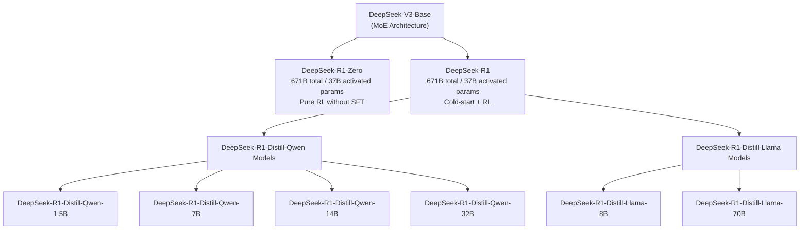
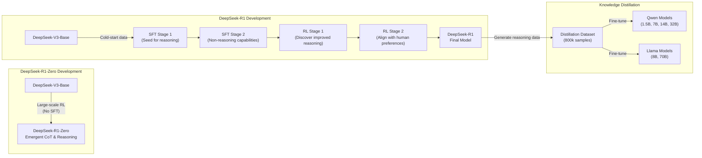
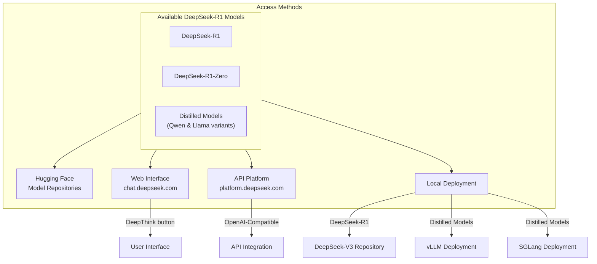

<!-- source: DeepWiki mcp.deepwiki.com · repo deepseek-ai/DeepSeek-R1 · page 1 Overview · fetched 2026-10-30 -->

# Overview

Relevant source files

The following files were used as context for generating this wiki page:

- [DeepSeek_R1.pdf](DeepSeek_R1.pdf)
- [README.md](README.md)

This document provides a comprehensive technical overview of the DeepSeek-R1 repository, which contains a family of reasoning-specialized large language models. It covers the model architectures, training methodologies, deployment options, and usage guidelines.

For detailed information about specific model architectures, refer to [Model Architecture](#2). For model usage instructions, see [Model Usage](#3).

## Model Family

DeepSeek-R1 is a family of reasoning-specialized language models built on the DeepSeek-V3 MoE (Mixture of Experts) architecture. The family consists of two large foundation models and several distilled variants.

**Model Hierarchy Diagram**

Sources: [README.md:67-96]()

### Foundation Models

- **DeepSeek-R1-Zero**: A 671B parameter MoE model (37B activated parameters) trained through reinforcement learning without supervised fine-tuning
- **DeepSeek-R1**: A 671B parameter MoE model (37B activated parameters) incorporating both cold-start data and reinforcement learning

Both foundation models support a 128K token context length and are based on the DeepSeek-V3 architecture.

### Distilled Models

The distilled models transfer the reasoning capabilities of DeepSeek-R1 to smaller, more efficient architectures:

| Model | Base Architecture | Parameters |
|-------|------------------|------------|
| DeepSeek-R1-Distill-Qwen-1.5B | Qwen2.5-Math-1.5B | 1.5B |
| DeepSeek-R1-Distill-Qwen-7B | Qwen2.5-Math-7B | 7B |
| DeepSeek-R1-Distill-Llama-8B | Llama-3.1-8B | 8B |
| DeepSeek-R1-Distill-Qwen-14B | Qwen2.5-14B | 14B |
| DeepSeek-R1-Distill-Qwen-32B | Qwen2.5-32B | 32B |
| DeepSeek-R1-Distill-Llama-70B | Llama-3.3-70B-Instruct | 70B |

Sources: [README.md:82-96]()

## Training Methodologies

The DeepSeek-R1 models employ distinctive training approaches that differentiate them from traditional language models.

**Training Pipeline Diagram**

Sources: [README.md:31-63]()

### DeepSeek-R1-Zero Approach

DeepSeek-R1-Zero explores a novel training paradigm by directly applying reinforcement learning to the base model without supervised fine-tuning. This approach allowed the model to develop emergent reasoning capabilities including:

- Self-verification mechanisms
- Reflection capabilities
- Extended chain-of-thought reasoning

### DeepSeek-R1 Approach

DeepSeek-R1 incorporates a more structured pipeline:

1. **SFT Stage 1**: Initial supervised fine-tuning to seed reasoning capabilities
2. **SFT Stage 2**: Additional fine-tuning for non-reasoning capabilities
3. **RL Stage 1**: Reinforcement learning to discover improved reasoning patterns
4. **RL Stage 2**: Further reinforcement learning to align with human preferences

This comprehensive approach addresses limitations observed in DeepSeek-R1-Zero, such as repetitive outputs, poor readability, and language mixing.

### Distillation Process

The distillation process involves:

1. Using DeepSeek-R1 to generate 800,000 high-quality reasoning samples
2. Fine-tuning smaller foundation models (Qwen and Llama variants) on this dataset
3. Preserving the reasoning capabilities while reducing computational requirements

Sources: [README.md:60-63]()

## Model Access and Deployment

DeepSeek-R1 models are available through multiple channels to accommodate different usage scenarios.

**Deployment Options Diagram**

Sources: [README.md:157-169](), [README.md:170-184]()

### Web and API Access

- **Web Interface**: Available at chat.deepseek.com with a "DeepThink" button to activate reasoning capabilities
- **API Platform**: OpenAI-compatible API available at platform.deepseek.com

### Local Deployment

- **DeepSeek-R1 and DeepSeek-R1-Zero**: Deployable using the DeepSeek-V3 repository
- **Distilled Models**: Deployable using standard frameworks such as:
  - vLLM: `vllm serve deepseek-ai/DeepSeek-R1-Distill-Qwen-32B --tensor-parallel-size 2 --max-model-len 32768 --enforce-eager`
  - SGLang: `python3 -m sglang.launch_server --model deepseek-ai/DeepSeek-R1-Distill-Qwen-32B --trust-remote-code --tp 2`

Sources: [README.md:170-184]()

## Usage Recommendations

For optimal performance with DeepSeek-R1 models, follow these technical guidelines:

1. Set temperature between 0.5-0.7 (0.6 recommended) to prevent repetitions or incoherent outputs
2. Avoid system prompts; include all instructions in the user prompt
3. For mathematical problems, include the directive: "Please reason step by step, and put your final answer within \boxed{}"
4. For thorough reasoning, enforce the model to start with "\<think\>\n" at the beginning of outputs

The models have specific prompt templates for file uploads and web search functionality, detailed in the README.

Sources: [README.md:186-254]()

## Performance and Benchmarks

DeepSeek-R1 models have been evaluated across multiple domains including:

1. **English Language Benchmarks**: MMLU, MMLU-Redux, MMLU-Pro, DROP, IF-Eval, etc.
2. **Code Generation**: LiveCodeBench, Codeforces, SWE Verified, etc.
3. **Mathematical Reasoning**: AIME 2024, MATH-500, CNMO 2024
4. **Chinese Language Benchmarks**: CLUEWSC, C-Eval, C-SimpleQA

The models achieve performance comparable to OpenAI-o1 across various reasoning tasks, with the distilled DeepSeek-R1-Distill-Qwen-32B outperforming OpenAI-o1-mini.

Sources: [README.md:101-153]()

## License Information

The DeepSeek-R1 repository, including model weights, is licensed under the MIT License, allowing commercial use and derivative works. The distilled models inherit licensing terms from their base models:

- Qwen-based models: Originally under Apache 2.0 License
- Llama-based models: Originally under Llama3.1/3.3 licenses

Sources: [README.md:256-262]()

---

