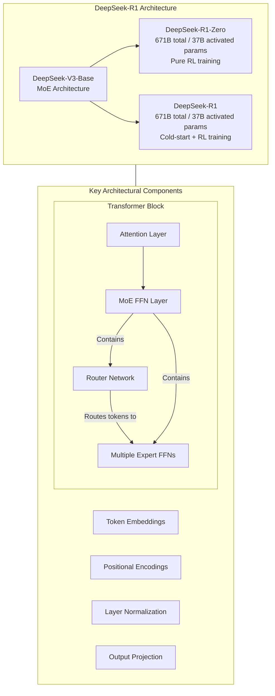
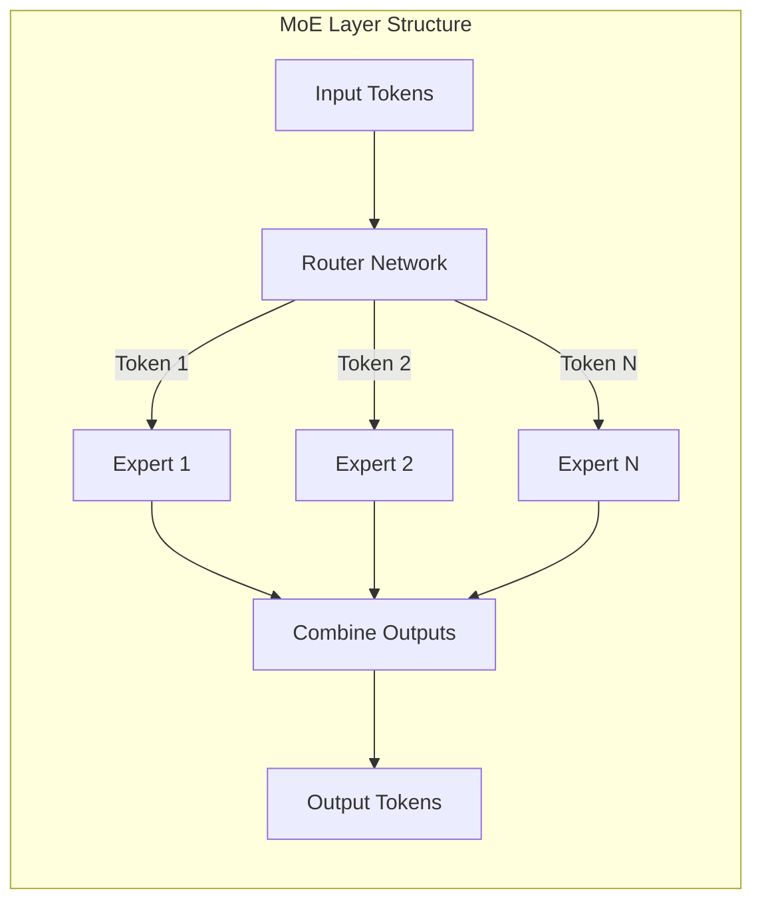
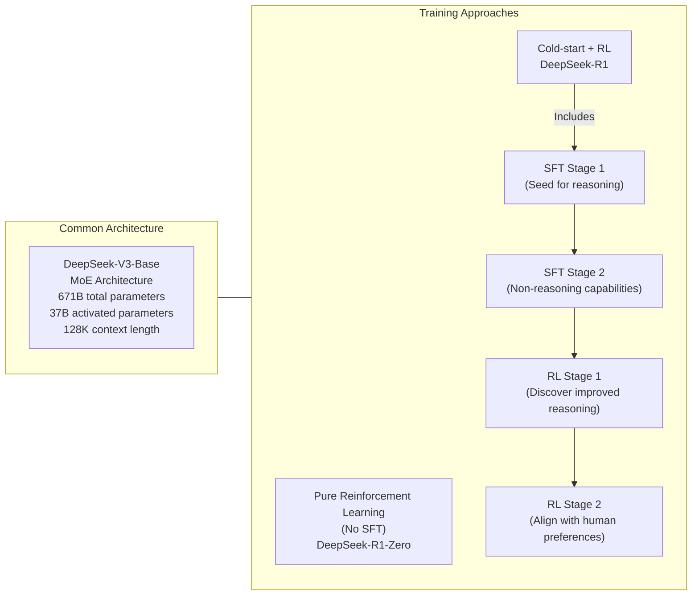
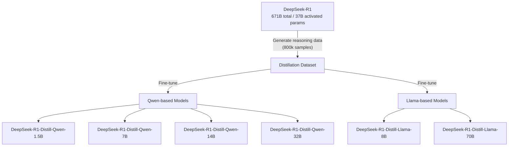
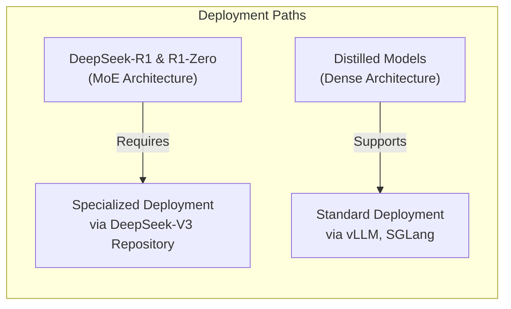

<!-- source: DeepWiki mcp.deepwiki.com · repo deepseek-ai/DeepSeek-R1 · page 2 Model Architecture · fetched 2026-10-30 -->

# Model Architecture

Relevant source files

The following files were used as context for generating this wiki page:

- [DeepSeek_R1.pdf](DeepSeek_R1.pdf)
- [README.md](README.md)

This document provides a technical overview of the DeepSeek-R1 model architecture, explaining its fundamental design, key components, and architectural characteristics. It covers the base architecture that underpins both DeepSeek-R1-Zero and DeepSeek-R1, as well as their architectural similarities and differences. For specific details about individual models, see [DeepSeek-R1-Zero](#2.1) and [DeepSeek-R1](#2.2). For information about the distilled models derived from DeepSeek-R1, see [Distilled Models](#2.3).

## Base Architecture Overview

DeepSeek-R1 and DeepSeek-R1-Zero are built upon the DeepSeek-V3-Base architecture, which utilizes a Mixture of Experts (MoE) design. This architecture enables these models to have a massive parameter count while maintaining computational efficiency during inference.

**Key Architectural Specifications:**
- **Total Parameters**: 671 billion
- **Activated Parameters**: 37 billion (per forward pass)
- **Context Length**: 128K tokens
- **Architecture Type**: Sparse Mixture of Experts (MoE)

The following diagram illustrates the high-level architecture of the DeepSeek-R1 model family:

Sources: [README.md:78-79]()

## Mixture of Experts Architecture

The core innovation in the DeepSeek-R1 models is the Mixture of Experts (MoE) architecture, which allows the model to have a large total parameter count (671B) while only activating a small portion (37B) during each forward pass.

The MoE architecture works as follows:

1. A router network determines which expert should process each token
2. Each token is sent to only a subset of the available experts
3. The outputs from the selected experts are combined to produce the final output
4. This approach enables the model to have specialized expert networks that can focus on specific types of tokens or tasks

This architecture offers several advantages:
- Significantly increased model capacity without proportional increase in computation
- Ability to develop specialized experts for different tasks or domains
- Improved reasoning capabilities through specialized expert networks

Sources: [README.md:71-79]()

## Training Approach Impact on Architecture

The architectural differences between DeepSeek-R1-Zero and DeepSeek-R1 are primarily in their training methodologies rather than their fundamental architecture. Both models share the same DeepSeek-V3-Base MoE architecture but differ in how they were trained, which affects their behavior and capabilities.

Sources: [README.md:31-38](), [README.md:52-56]()

## Distillation Process Architecture

The distilled models are derived from DeepSeek-R1 but are based on different architectural families (Qwen and Llama). The distillation process transfers the reasoning capabilities of DeepSeek-R1 to smaller, more efficient models.

Sources: [README.md:60-63](), [README.md:82-97]()

## Model Architecture Comparison

The following table provides a comparative overview of the model architectures in the DeepSeek-R1 family:

| Model | Base Architecture | Total Parameters | Activated Parameters | Context Length | Training Approach |
|-------|------------------|-----------------|---------------------|---------------|------------------|
| DeepSeek-R1-Zero | DeepSeek-V3 MoE | 671B | 37B | 128K | Pure RL (No SFT) |
| DeepSeek-R1 | DeepSeek-V3 MoE | 671B | 37B | 128K | Cold-start + RL |
| DeepSeek-R1-Distill-Qwen-1.5B | Qwen2.5-Math-1.5B | 1.5B | 1.5B | - | Distillation from DeepSeek-R1 |
| DeepSeek-R1-Distill-Qwen-7B | Qwen2.5-Math-7B | 7B | 7B | - | Distillation from DeepSeek-R1 |
| DeepSeek-R1-Distill-Llama-8B | Llama-3.1-8B | 8B | 8B | - | Distillation from DeepSeek-R1 |
| DeepSeek-R1-Distill-Qwen-14B | Qwen2.5-14B | 14B | 14B | - | Distillation from DeepSeek-R1 |
| DeepSeek-R1-Distill-Qwen-32B | Qwen2.5-32B | 32B | 32B | - | Distillation from DeepSeek-R1 |
| DeepSeek-R1-Distill-Llama-70B | Llama-3.3-70B-Instruct | 70B | 70B | - | Distillation from DeepSeek-R1 |

Sources: [README.md:67-96]()

## Architectural Implications for Deployment

The MoE architecture of DeepSeek-R1 and DeepSeek-R1-Zero has specific implications for deployment:

1. **Specialized Deployment**: Due to the MoE architecture, these models require specialized deployment methods as noted in the documentation, which directs users to the DeepSeek-V3 repository for deployment instructions.

2. **Distilled Model Efficiency**: The distilled models, being based on dense architectures like Qwen and Llama, can be deployed using standard frameworks such as vLLM and SGLang.

Sources: [README.md:164-168](), [README.md:170-184]()

## Usage Considerations Related to Architecture

The architectural design of DeepSeek-R1 models influences several usage considerations:

1. **Temperature Settings**: Due to the MoE architecture, a temperature range of 0.5-0.7 (0.6 recommended) is suggested to prevent endless repetitions or incoherent outputs.

2. **Prompt Format**: The architecture is optimized for user prompts without system prompts, affecting how instructions should be provided.

3. **Thinking Pattern**: The models are designed to utilize a thinking pattern approach using `` tags, which is an architectural consideration for achieving optimal reasoning performance.

Sources: [README.md:186-197]()

---

