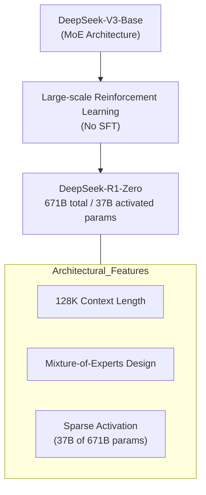
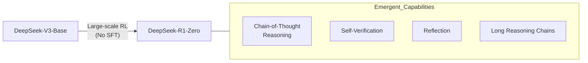
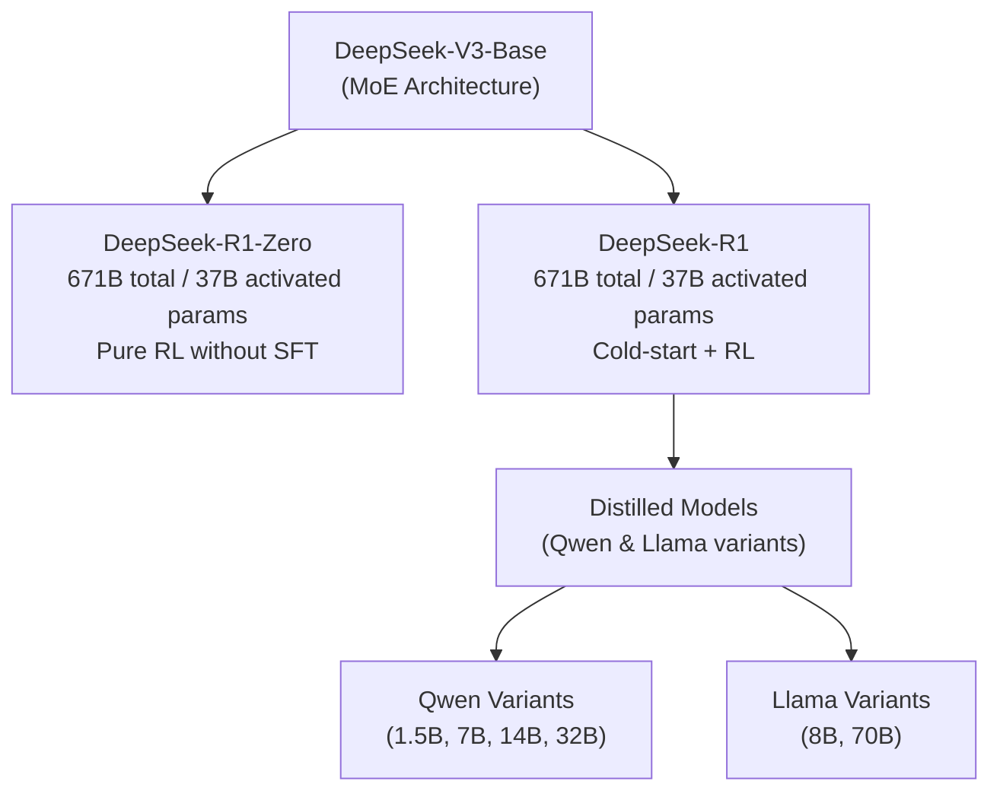

<!-- source: DeepWiki mcp.deepwiki.com · repo deepseek-ai/DeepSeek-R1 · page 2.1 DeepSeek-R1-Zero · fetched 2026-10-30 -->

# DeepSeek-R1-Zero

<details>
<summary>Relevant source files</summary>

The following files were used as context for generating this wiki page:

- [DeepSeek_R1.pdf](DeepSeek_R1.pdf)
- [README.md](README.md)

</details>


## Purpose and Scope

This document provides a comprehensive overview of DeepSeek-R1-Zero, a large language model trained via pure reinforcement learning without supervised fine-tuning. It covers the model architecture, training methodology, emergent reasoning capabilities, and usage recommendations. For information about DeepSeek-R1, which incorporates cold-start data before reinforcement learning, see [DeepSeek-R1](#2.2).

Sources: [README.md:33-37]()

## Model Overview

DeepSeek-R1-Zero is a 671B parameter Mixture-of-Experts (MoE) language model with 37B activated parameters per token. It represents a significant milestone in AI research as the first open research model to validate that reasoning capabilities in large language models can be incentivized purely through reinforcement learning, without relying on supervised fine-tuning (SFT) as a preliminary step.

The model features:
- 671B total parameters (37B activated per token)
- 128K context length
- MoE architecture based on DeepSeek-V3-Base

Despite its innovative training approach, DeepSeek-R1-Zero faces challenges including endless repetition, poor readability, and language mixing, which led to the development of its successor, DeepSeek-R1.

Sources: [README.md:33-37](), [README.md:68-79](), [README.md:51-53]()

## Architecture and Technical Details

DeepSeek-R1-Zero is built upon the DeepSeek-V3-Base architecture, utilizing a Mixture-of-Experts (MoE) design. This architecture allows the model to maintain a large total parameter count (671B) while only activating a fraction (37B) during each forward pass, significantly improving computational efficiency.

### Model Architecture Diagram



Sources: [README.md:68-79]()

## Training Methodology

Unlike traditional language models that rely on supervised fine-tuning before reinforcement learning, DeepSeek-R1-Zero was trained directly with large-scale reinforcement learning on the base model. This approach represents a novel training paradigm:

### Training Process Diagram



The pure reinforcement learning approach allowed the model to naturally discover and develop reasoning capabilities without being explicitly taught reasoning patterns through supervised examples. This makes DeepSeek-R1-Zero particularly notable for studying how reasoning emerges in large language models.

Sources: [README.md:51-53]()

## Emergent Reasoning Capabilities

Through pure reinforcement learning, DeepSeek-R1-Zero developed several sophisticated reasoning behaviors:

1. **Chain-of-Thought (CoT) Reasoning**: The ability to break down complex problems into step-by-step reasoning processes
2. **Self-Verification**: The capacity to check its own work and validate conclusions
3. **Reflection**: The capability to reconsider initial approaches and refine reasoning paths
4. **Long Reasoning Chains**: The ability to maintain coherent reasoning over extended sequences

These capabilities emerged organically through reinforcement learning incentives rather than being explicitly taught through supervised examples.

Sources: [README.md:33-35](), [README.md:51-53]()

## Performance and Benchmarks

DeepSeek-R1-Zero demonstrates strong performance across various reasoning benchmarks, particularly in mathematical reasoning tasks. The table below shows selected performance metrics:

| Benchmark Category | Test | Score |
|-------------------|------|-------|
| Math | AIME 2024 (Pass@1) | High performance |
| Math | MATH-500 (Pass@1) | Strong results |
| Math | CNMO 2024 (Pass@1) | Advanced capabilities |
| Reasoning | GPQA-Diamond (Pass@1) | Competitive performance |
| Reasoning | DROP (3-shot F1) | Strong performance |

The model's pure reinforcement learning approach resulted in impressive reasoning capabilities, though its successor DeepSeek-R1 generally achieves higher scores across benchmarks.

Sources: [README.md:101-133]()

## Challenges and Limitations

Despite its strong reasoning capabilities, DeepSeek-R1-Zero exhibits several notable limitations:

1. **Endless Repetition**: The model can sometimes get caught in repetitive reasoning loops
2. **Poor Readability**: Outputs can be less structured and harder to follow than models with supervised training
3. **Language Mixing**: The model occasionally mixes different languages within responses

These challenges led to the development of DeepSeek-R1, which incorporates cold-start data before reinforcement learning to address these issues while maintaining strong reasoning capabilities.

Sources: [README.md:36-37]()

## Relationship to Other Models

### DeepSeek Model Family Hierarchy



DeepSeek-R1-Zero represents a distinct branch in the DeepSeek model family, focusing on pure reinforcement learning. Its capabilities and limitations informed the development of DeepSeek-R1, which incorporates cold-start data before RL to address issues like endless repetition and poor readability.

Sources: [README.md:33-39](), [README.md:51-56]()

## Usage Recommendations

To achieve optimal performance with DeepSeek-R1-Zero, follow these recommendations:

1. **Temperature Setting**: Use a temperature of 0.6 (range 0.5-0.7) to prevent endless repetitions
2. **User Prompts**: Avoid system prompts; include all instructions in the user prompt
3. **Mathematical Problems**: Include directives like "Please reason step by step, and put your final answer within \boxed{}"
4. **Thinking Pattern**: Enforce thinking patterns by having the model start responses with "\<think\>\n"

### Sample Prompting Structure

```
User: Solve the following problem step by step: 
If 3x + 4y = 10 and 2x - 5y = 7, find the values of x and y.
Please reason step by step, and put your final answer within \boxed{}.

---

