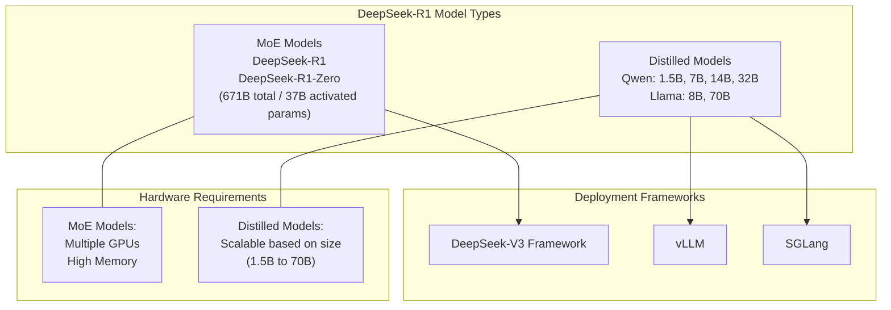
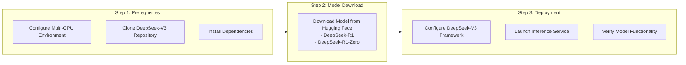
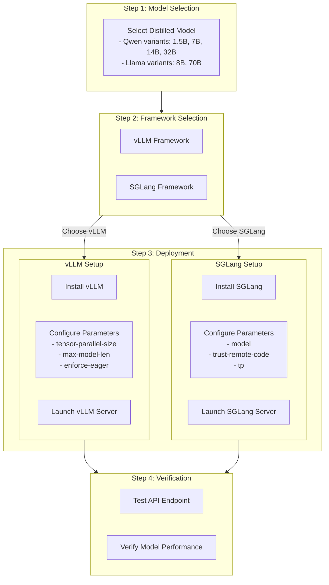
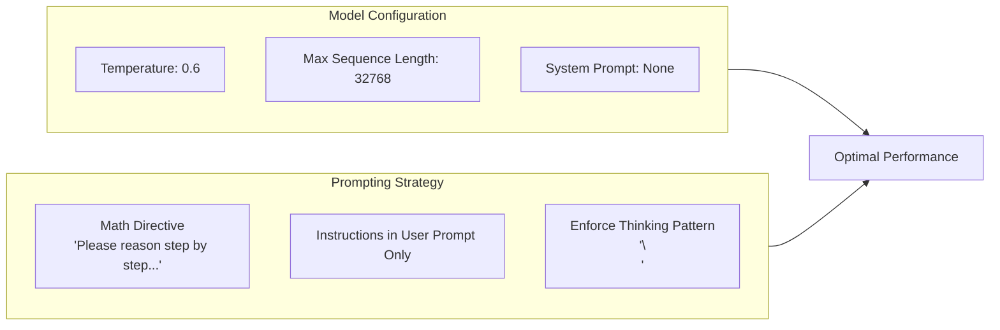

<!-- source: DeepWiki mcp.deepwiki.com · repo deepseek-ai/DeepSeek-R1 · page 3.2 Local Deployment · fetched 2026-10-30 -->

# Local Deployment

<details>
<summary>Relevant source files</summary>

The following files were used as context for generating this wiki page:

- [README.md](README.md)

</details>


This page provides comprehensive instructions for deploying DeepSeek-R1 models locally on your own infrastructure. It covers deployment methods for both the full-sized MoE models (DeepSeek-R1 and DeepSeek-R1-Zero) and the distilled model variants based on Qwen and Llama architectures. For information about accessing the models through web interfaces or API platforms, see [Model Access](#3.1).

## Deployment Options Overview

DeepSeek-R1 models can be deployed locally using different methods depending on the specific model variant:

### Deployment Methods Diagram



Sources: [README.md:164-169](). [README.md:170-184]()

## MoE Models Deployment (DeepSeek-R1 and DeepSeek-R1-Zero)

The full-sized DeepSeek-R1 and DeepSeek-R1-Zero models are Mixture of Experts (MoE) models with 671B total parameters and 37B activated parameters. These models require specific deployment methods due to their architecture.

### DeepSeek-V3 Framework

To deploy the MoE models locally:

1. Visit the [DeepSeek-V3](https://github.com/deepseek-ai/DeepSeek-V3) repository for detailed instructions
2. Follow the specific deployment guidelines for MoE models
3. Note that Hugging Face's Transformers library is not directly supported for these models yet

### MoE Deployment Process



Sources: [README.md:164-169]()

## Distilled Models Deployment

The distilled models are smaller, dense models based on the Qwen and Llama architectures. These models are more lightweight and can be deployed using standard frameworks like vLLM and SGLang.

### Available Distilled Models

| Model | Base Architecture | Parameters | Hugging Face Repository |
|-------|------------------|------------|-------------------------|
| DeepSeek-R1-Distill-Qwen-1.5B | Qwen2.5-Math-1.5B | 1.5B | deepseek-ai/DeepSeek-R1-Distill-Qwen-1.5B |
| DeepSeek-R1-Distill-Qwen-7B | Qwen2.5-Math-7B | 7B | deepseek-ai/DeepSeek-R1-Distill-Qwen-7B |
| DeepSeek-R1-Distill-Qwen-14B | Qwen2.5-14B | 14B | deepseek-ai/DeepSeek-R1-Distill-Qwen-14B |
| DeepSeek-R1-Distill-Qwen-32B | Qwen2.5-32B | 32B | deepseek-ai/DeepSeek-R1-Distill-Qwen-32B |
| DeepSeek-R1-Distill-Llama-8B | Llama-3.1-8B | 8B | deepseek-ai/DeepSeek-R1-Distill-Llama-8B |
| DeepSeek-R1-Distill-Llama-70B | Llama-3.3-70B-Instruct | 70B | deepseek-ai/DeepSeek-R1-Distill-Llama-70B |

Sources: [README.md:82-97]()

### vLLM Deployment

[vLLM](https://github.com/vllm-project/vllm) is a high-performance inference framework for LLMs that supports efficient serving through PagedAttention. To deploy a distilled DeepSeek-R1 model using vLLM:

1. Install vLLM:
   ```bash
   pip install vllm
   ```

2. Launch the vLLM server with your chosen model:
   ```bash
   vllm serve deepseek-ai/DeepSeek-R1-Distill-Qwen-32B --tensor-parallel-size 2 --max-model-len 32768 --enforce-eager
   ```

Key parameters:
- `--tensor-parallel-size`: Number of GPUs to distribute the model across
- `--max-model-len`: Maximum sequence length (32768 for DeepSeek-R1 models)
- `--enforce-eager`: Use eager mode for execution

Sources: [README.md:174-178]()

### SGLang Deployment

[SGLang](https://github.com/sgl-project/sglang) is another framework for deploying language models with structured generation capabilities. To deploy a distilled DeepSeek-R1 model using SGLang:

1. Install SGLang:
   ```bash
   pip install sglang
   ```

2. Launch the SGLang server:
   ```bash
   python3 -m sglang.launch_server --model deepseek-ai/DeepSeek-R1-Distill-Qwen-32B --trust-remote-code --tp 2
   ```

Key parameters:
- `--model`: Path to the Hugging Face model repository
- `--trust-remote-code`: Allow execution of custom code from the model repository
- `--tp`: Tensor parallelism degree (number of GPUs)

Sources: [README.md:180-184]()

### Distilled Models Deployment Process



Sources: [README.md:170-184]()

## Model Configuration and Usage Recommendations

To achieve optimal performance with DeepSeek-R1 models, certain configuration settings and prompting patterns are recommended. These apply to both MoE and distilled variants.

### Configuration Parameters

| Parameter | Recommended Value | Description |
|-----------|------------------|-------------|
| Temperature | 0.5-0.7 (0.6 recommended) | Controls randomness in generation; 0.6 prevents endless repetitions |
| Max sequence length | 32768 | Maximum context window size for these models |
| System prompt | None | Avoid system prompts; include all instructions in user prompts |
| Thinking pattern | Enforce `<think>\n` | Consider enforcing thinking pattern at beginning of responses |

### Prompting Guidelines

For best results with DeepSeek-R1 models, follow these guidelines:

1. **Avoid system prompts**: Include all instructions within the user prompt
2. **Mathematical problems**: Include directives like "Please reason step by step, and put your final answer within \boxed{}."
3. **Enforce thinking pattern**: To ensure thorough reasoning, consider enforcing the model to start responses with `<think>\n`
4. **Evaluation**: When benchmarking, conduct multiple tests and average the results

### Configuration Diagram



Sources: [README.md:186-197]()

## Performance Considerations

When deploying DeepSeek-R1 models locally, hardware requirements and performance characteristics vary significantly between model types.

### Hardware Requirements Comparison

| Model Type | Parameters | Minimum GPU Memory | Recommended Setup | Inference Speed |
|------------|------------|-------------------|-------------------|----------------|
| DeepSeek-R1 / R1-Zero | 671B total / 37B activated | Multiple high-end GPUs | Multi-GPU system with NVLink | Lower due to model size |
| Distilled Qwen-1.5B | 1.5B | ~3GB | Single GPU | High |
| Distilled Qwen-7B | 7B | ~14GB | Single GPU | Medium-High |
| Distilled Qwen-14B | 14B | ~28GB | 1-2 GPUs | Medium |
| Distilled Qwen-32B | 32B | ~64GB | 2-4 GPUs | Medium-Low |
| Distilled Llama-8B | 8B | ~16GB | Single GPU | Medium-High |
| Distilled Llama-70B | 70B | ~140GB | 4+ GPUs | Low |

Sources: [README.md:138-154]()

## Specific Use Cases

### File Upload Processing

When deploying models that need to process file uploads, use the following prompt template pattern:

```
[file name]: {file_name}
[file content begin]
{file_content}
[file content end]
{question}
```

### Web Search Integration

For deployments integrating with web search functionality, specific prompt templates are recommended for both Chinese and English queries. Refer to the README for the detailed templates.

Sources: [README.md:198-254]()

## License Considerations

When deploying DeepSeek-R1 models locally, be aware of the license considerations:

- DeepSeek-R1 and DeepSeek-R1-Zero are licensed under MIT License
- Distilled Qwen models are derived from Qwen-2.5 series (Apache 2.0 License)
- Distilled Llama-8B is derived from Llama3.1-8B-Base (Llama3.1 license)
- Distilled Llama-70B is derived from Llama3.3-70B-Instruct (Llama3.3 license)

All models support commercial use and allow modifications and derivative works.

Sources: [README.md:256-261]()

---

