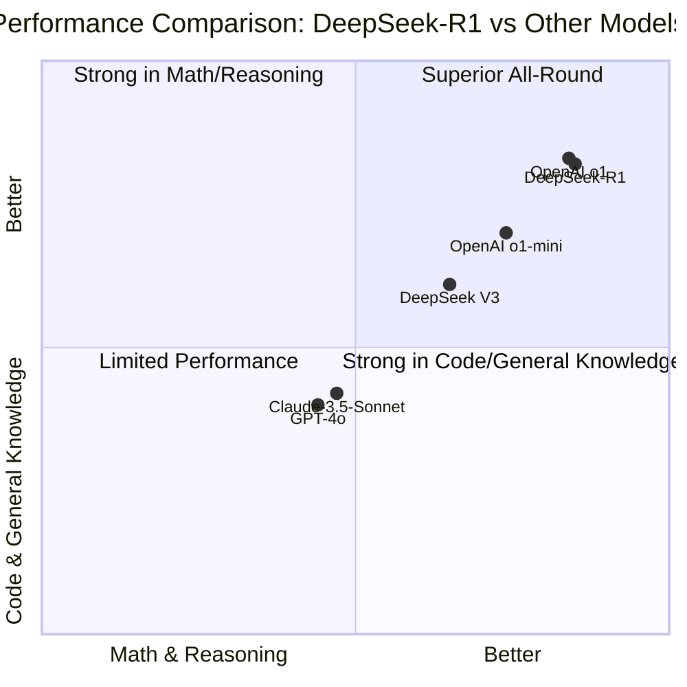
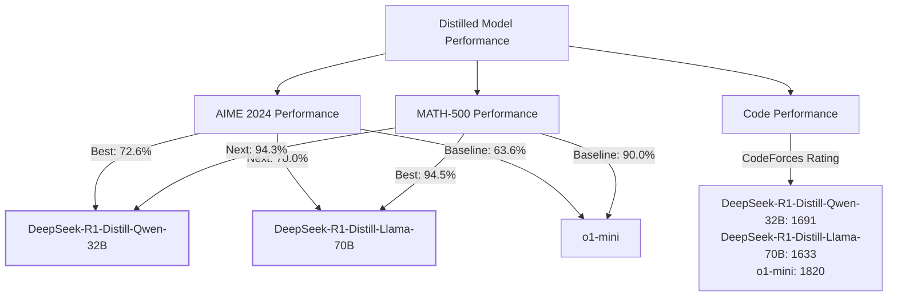

<!-- source: DeepWiki mcp.deepwiki.com · repo deepseek-ai/DeepSeek-R1 · page 4 Performance and Benchmarks · fetched 2026-10-30 -->

# Performance and Benchmarks

Relevant source files

The following files were used as context for generating this wiki page:

- [README.md](README.md)
- [figures/benchmark.jpg](figures/benchmark.jpg)

This document provides a comprehensive overview of DeepSeek-R1 model family performance across various benchmarks spanning English language understanding, mathematics, code generation, and Chinese language tasks. For information about model architecture, see [Model Architecture](#2), and for usage guidelines, see [Model Usage](#3).

## Evaluation Methodology

DeepSeek-R1 models are evaluated using consistent methodology across all benchmarks to ensure fair comparison:

- Maximum generation length: 32,768 tokens
- Temperature: 0.6 (recommended for optimal performance)
- Top-p value: 0.95
- For benchmarks requiring sampling, 64 responses per query are generated to estimate pass@1

These parameters balance exploration during generation while avoiding repetitive outputs or inconsistent performance.

Sources: [README.md:102-103]()

## Benchmark Categories and Results

The evaluation framework covers four main categories of benchmarks, testing a wide range of capabilities:

```mermaid
flowchart TD
    Benchmarks["DeepSeek-R1 Benchmark Framework"]
    
    Benchmarks --> EnglishBenchmarks["English Benchmarks"]
    Benchmarks --> CodeBenchmarks["Code Benchmarks"]
    Benchmarks --> MathBenchmarks["Math Benchmarks"]
    Benchmarks --> ChineseBenchmarks["Chinese Benchmarks"]
    
    EnglishBenchmarks --> MMLU["MMLU (Massive Multitask Language Understanding)"]
    EnglishBenchmarks --> MMLU_Redux["MMLU-Redux"]
    EnglishBenchmarks --> MMLU_Pro["MMLU-Pro"]
    EnglishBenchmarks --> DROP["DROP (Reading Comprehension)"]
    EnglishBenchmarks --> IF_Eval["IF-Eval"]
    EnglishBenchmarks --> GPQA["GPQA-Diamond"]
    EnglishBenchmarks --> SimpleQA["SimpleQA"]
    EnglishBenchmarks --> FRAMES["FRAMES"]
    EnglishBenchmarks --> AlpacaEval["AlpacaEval2.0"]
    EnglishBenchmarks --> ArenaHard["ArenaHard"]
    
    CodeBenchmarks --> LiveCodeBench["LiveCodeBench"]
    CodeBenchmarks --> Codeforces["Codeforces"]
    CodeBenchmarks --> SWE_Verified["SWE Verified"]
    CodeBenchmarks --> Aider_Polyglot["Aider-Polyglot"]
    
    MathBenchmarks --> AIME["AIME 2024"]
    MathBenchmarks --> MATH500["MATH-500"]
    MathBenchmarks --> CNMO["CNMO 2024"]
    
    ChineseBenchmarks --> CLUEWSC["CLUEWSC"]
    ChineseBenchmarks --> C_Eval["C-Eval"]
    ChineseBenchmarks --> C_SimpleQA["C-SimpleQA"]
```

Sources: [README.md:101-133]()

### DeepSeek-R1 Performance Highlights

DeepSeek-R1 demonstrates competitive or superior performance compared to leading models across benchmark categories:

| Category | Key Achievement |
|----------|----------------|
| English | 90.8% on MMLU, 92.9% on MMLU-Redux, 84.0% on MMLU-Pro |
| Code | 65.9% on LiveCodeBench, 2029 rating on Codeforces |
| Math | 79.8% on AIME 2024, 97.3% on MATH-500, 78.8% on CNMO 2024 |
| Chinese | 92.8% on CLUEWSC, 91.8% on C-Eval |

Notable strengths include:
1. Exceptional reasoning capabilities, particularly in mathematics
2. Strong code generation and problem-solving performance
3. High performance on complex question-answering benchmarks
4. Effective cross-lingual capabilities in Chinese

Sources: [README.md:111-132]()

### Comparative Analysis

The following diagram illustrates DeepSeek-R1's position relative to other leading models across benchmark categories:

Sources: [README.md:106-132]()

## English Language Benchmark Performance

DeepSeek-R1 achieves strong results across English language benchmarks that test both general knowledge and reasoning capabilities:

| Benchmark | Metric | DeepSeek-R1 Score | Best Competitor | Best Score |
|-----------|--------|-------------------|----------------|------------|
| MMLU | Pass@1 | 90.8 | OpenAI o1-1217 | 91.8 |
| MMLU-Redux | EM | **92.9** | - | - |
| MMLU-Pro | EM | **84.0** | OpenAI o1-mini | 80.3 |
| DROP | 3-shot F1 | **92.2** | OpenAI o1-1217 | 90.2 |
| FRAMES | Acc. | **82.5** | GPT-4o | 80.5 |
| AlpacaEval2.0 | LC-winrate | **87.6** | DeepSeek V3 | 70.0 |
| ArenaHard | GPT-4-1106 | **92.3** | OpenAI o1-mini | 92.0 |

Sources: [README.md:111-120]()

## Code Benchmark Performance

DeepSeek-R1 demonstrates exceptional programming capabilities across various code benchmarks:

| Benchmark | Metric | DeepSeek-R1 Score | Best Competitor | Best Score |
|-----------|--------|-------------------|----------------|------------|
| LiveCodeBench | Pass@1-COT | **65.9** | OpenAI o1-1217 | 63.4 |
| Codeforces | Percentile | 96.3 | OpenAI o1-1217 | 96.6 |
| Codeforces | Rating | 2029 | OpenAI o1-1217 | 2061 |
| SWE Verified | Resolved | 49.2 | Claude-3.5-Sonnet | 50.8 |
| Aider-Polyglot | Acc. | 53.3 | OpenAI o1-1217 | 61.7 |

Sources: [README.md:121-125]()

## Math Benchmark Performance

Mathematical reasoning is one of DeepSeek-R1's strongest capabilities, demonstrating superior performance across challenging math benchmarks:

| Benchmark | Metric | DeepSeek-R1 Score | Best Competitor | Best Score |
|-----------|--------|-------------------|----------------|------------|
| AIME 2024 | Pass@1 | **79.8** | OpenAI o1-1217 | 79.2 |
| MATH-500 | Pass@1 | **97.3** | OpenAI o1-1217 | 96.4 |
| CNMO 2024 | Pass@1 | **78.8** | OpenAI o1-mini | 67.6 |

Sources: [README.md:126-128]()

## Chinese Language Benchmark Performance

DeepSeek-R1 shows strong multilingual capabilities with exceptional performance on Chinese language benchmarks:

| Benchmark | Metric | DeepSeek-R1 Score | Best Competitor | Best Score |
|-----------|--------|-------------------|----------------|------------|
| CLUEWSC | EM | **92.8** | DeepSeek V3 | 90.9 |
| C-Eval | EM | **91.8** | DeepSeek V3 | 86.5 |
| C-SimpleQA | Correct | 63.7 | DeepSeek V3 | 68.0 |

Sources: [README.md:129-132]()

## Distilled Model Performance

DeepSeek-R1's reasoning capabilities have been effectively transferred to smaller, more efficient models through distillation. The following compares the performance of distilled models across key benchmarks:

Sources: [README.md:136-154]()

### Detailed Distilled Model Comparison

The table below provides a comprehensive comparison of distilled models against leading commercial models:

| Model | AIME 2024 pass@1 | MATH-500 pass@1 | GPQA Diamond pass@1 | LiveCodeBench pass@1 | CodeForces rating |
|-------|------------------|-----------------|---------------------|----------------------|-------------------|
| GPT-4o-0513 | 9.3 | 74.6 | 49.9 | 32.9 | 759 |
| Claude-3.5-Sonnet-1022 | 16.0 | 78.3 | 65.0 | 38.9 | 717 |
| o1-mini | 63.6 | 90.0 | 60.0 | 53.8 | **1820** |
| DeepSeek-R1-Distill-Qwen-1.5B | 28.9 | 83.9 | 33.8 | 16.9 | 954 |
| DeepSeek-R1-Distill-Qwen-7B | 55.5 | 92.8 | 49.1 | 37.6 | 1189 |
| DeepSeek-R1-Distill-Qwen-14B | 69.7 | 93.9 | 59.1 | 53.1 | 1481 |
| DeepSeek-R1-Distill-Qwen-32B | **72.6** | 94.3 | 62.1 | 57.2 | 1691 |
| DeepSeek-R1-Distill-Llama-8B | 50.4 | 89.1 | 49.0 | 39.6 | 1205 |
| DeepSeek-R1-Distill-Llama-70B | 70.0 | **94.5** | **65.2** | **57.5** | 1633 |

Key observations:
- DeepSeek-R1-Distill-Qwen-32B outperforms o1-mini on AIME 2024 and MATH-500
- DeepSeek-R1-Distill-Llama-70B achieves the best overall performance among distilled models
- Even smaller models like DeepSeek-R1-Distill-Qwen-14B demonstrate strong mathematical reasoning capabilities

Sources: [README.md:140-153]()

## Evaluation Recommendations

To accurately reproduce or compare against the reported benchmark results, follow these evaluation guidelines:

1. **Temperature Setting**: Use temperature 0.6 (range 0.5-0.7) to avoid repetitions or incoherent outputs
2. **Prompting Format**: Avoid system prompts; include all instructions in the user prompt
3. **Math Problem Approach**: For mathematical problems, include a directive like "Please reason step by step, and put your final answer within \boxed{}"
4. **Multiple Evaluations**: Conduct multiple tests and average the results for more reliable evaluation
5. **Thinking Pattern**: To ensure thorough reasoning, enforce the model to begin its response with "\<think\>\n"

Following these guidelines will help ensure consistent evaluation and comparison with the reported benchmark results.

Sources: [README.md:188-196]()

---

