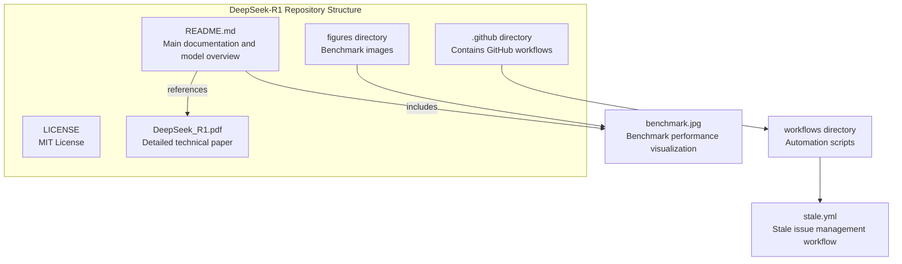
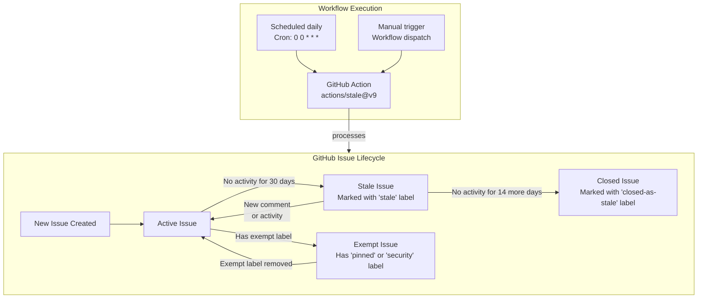
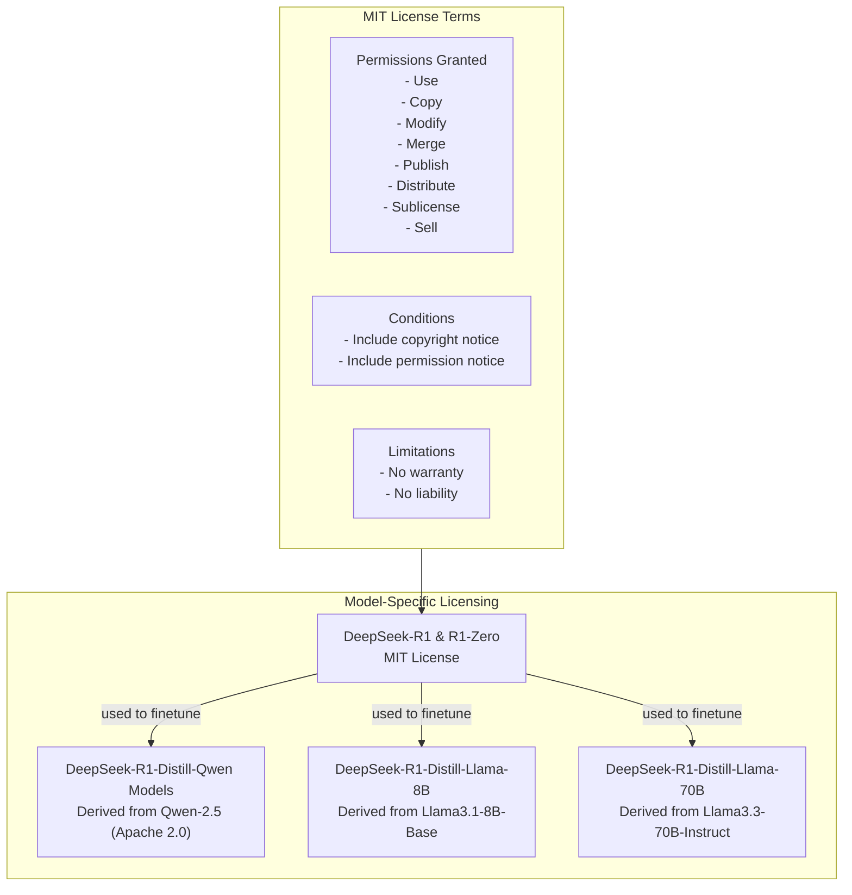
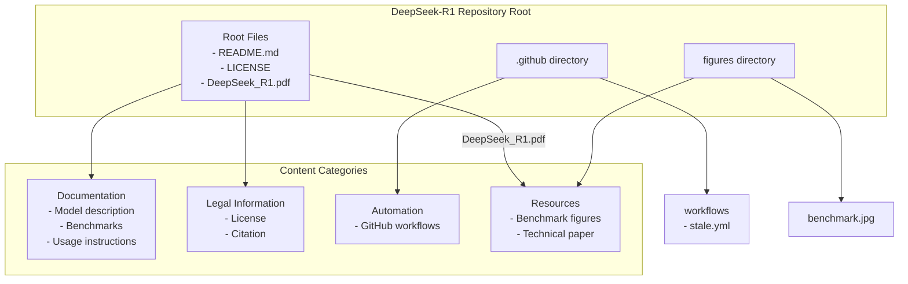

<!-- source: DeepWiki mcp.deepwiki.com · repo deepseek-ai/DeepSeek-R1 · page 5 Repository Information · fetched 2026-10-30 -->

# Repository Information

Relevant source files

The following files were used as context for generating this wiki page:

- [.github/workflows/stale.yml](.github/workflows/stale.yml)
- [LICENSE](LICENSE)
- [README.md](README.md)

This page provides detailed information about the DeepSeek-R1 repository structure, organization, license details, and contribution guidelines. It serves as a reference for understanding how the codebase is organized and managed. For information about the models themselves, see [Model Architecture](#2) and for usage details, see [Model Usage](#3).

## Repository Overview

The DeepSeek-R1 repository is primarily focused on providing access to a family of reasoning-specialized language models, including documentation, evaluation benchmarks, and deployment instructions. The repository does not contain the actual model code implementation, which is instead referenced through the DeepSeek-V3 repository for the base models.

**Repository Structure Diagram**

Sources: [README.md:1-29]()

## Main Repository Components

The repository consists of the following primary components:

| Component | Description | Purpose |
|-----------|-------------|---------|
| README.md | Main documentation file | Provides comprehensive information about models, usage, and benchmarks |
| LICENSE | MIT License file | Details the licensing terms for the repository and models |
| .github directory | GitHub-specific files | Contains workflows for repository management |
| figures directory | Image resources | Contains benchmark visualizations and other graphics |
| DeepSeek_R1.pdf | Technical paper | Provides in-depth technical details about model architecture and training |

Sources: [README.md:1-29]()

### Documentation Organization

The main documentation is contained in the README.md file, which is organized into the following sections:

1. Introduction
2. Model Summary
3. Model Downloads
4. Evaluation Results
5. Chat Website & API Platform
6. How to Run Locally
7. License
8. Citation
9. Contact

This structure provides a comprehensive guide for users to understand, download, and use the DeepSeek-R1 models.

Sources: [README.md:31-277]()

## Issue Management

The repository includes an automated system for managing GitHub issues to maintain an organized and responsive project.

**Issue Management Workflow Diagram**

Sources: [.github/workflows/stale.yml:1-31]()

### Stale Issue Management

The repository uses GitHub's stale action to automatically manage inactive issues:

- Issues are marked as stale after 30 days of inactivity
- Stale issues receive an automated comment notifying contributors
- Issues are closed after 14 additional days of inactivity
- Issues with "pinned" or "security" labels are exempt from the stale process
- Pull requests are not subject to the stale workflow (configured with -1 days)

This automation helps maintain a clean issue tracker by focusing attention on active issues.

Sources: [.github/workflows/stale.yml:12-30]()

## License Information

The DeepSeek-R1 repository is released under the MIT License, which provides generous permissions for use, modification, and distribution.

**License Terms Diagram**

Sources: [LICENSE:1-21](), [README.md:256-261]()

### License Details

The MIT License grants the following permissions:

- Freedom to use the software for any purpose
- Freedom to modify, distribute, and sell the software
- Permission to use the software in both private and commercial settings

The only requirements are to include the original copyright notice and permission notice in all copies or substantial portions of the software.

The license explicitly states that the software is provided "as is," without warranty of any kind, and the authors or copyright holders are not liable for any claims, damages, or liabilities.

Sources: [LICENSE:1-21]()

### Model-Specific Licensing

While the repository itself is under the MIT License, some of the distilled models have different base license considerations:

1. **DeepSeek-R1-Distill-Qwen Models** (1.5B, 7B, 14B, 32B):
   - Derived from Qwen-2.5 series
   - Original Qwen-2.5 models are licensed under Apache 2.0 License
   - Finetuned with 800k samples curated with DeepSeek-R1

2. **DeepSeek-R1-Distill-Llama Models**:
   - DeepSeek-R1-Distill-Llama-8B is derived from Llama3.1-8B-Base
   - DeepSeek-R1-Distill-Llama-70B is derived from Llama3.3-70B-Instruct
   - Subject to the respective Llama3.1 and Llama3.3 licenses

All models support commercial use and allow for modifications and derivative works, including distillation for training other LLMs.

Sources: [README.md:256-261]()

## Repository File Organization

The DeepSeek-R1 repository has a relatively simple structure with few directories:

Sources: [README.md:1-29]()

Note that the actual model code and implementation is not contained within this repository. Users seeking to run the DeepSeek-R1 models locally are directed to the DeepSeek-V3 repository for implementation details.

Sources: [README.md:78-79](), [README.md:166-168]()

---

