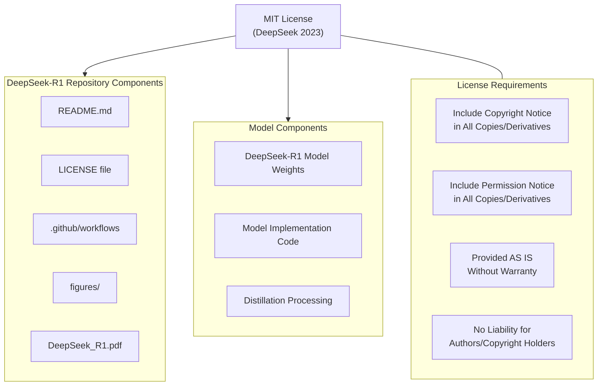
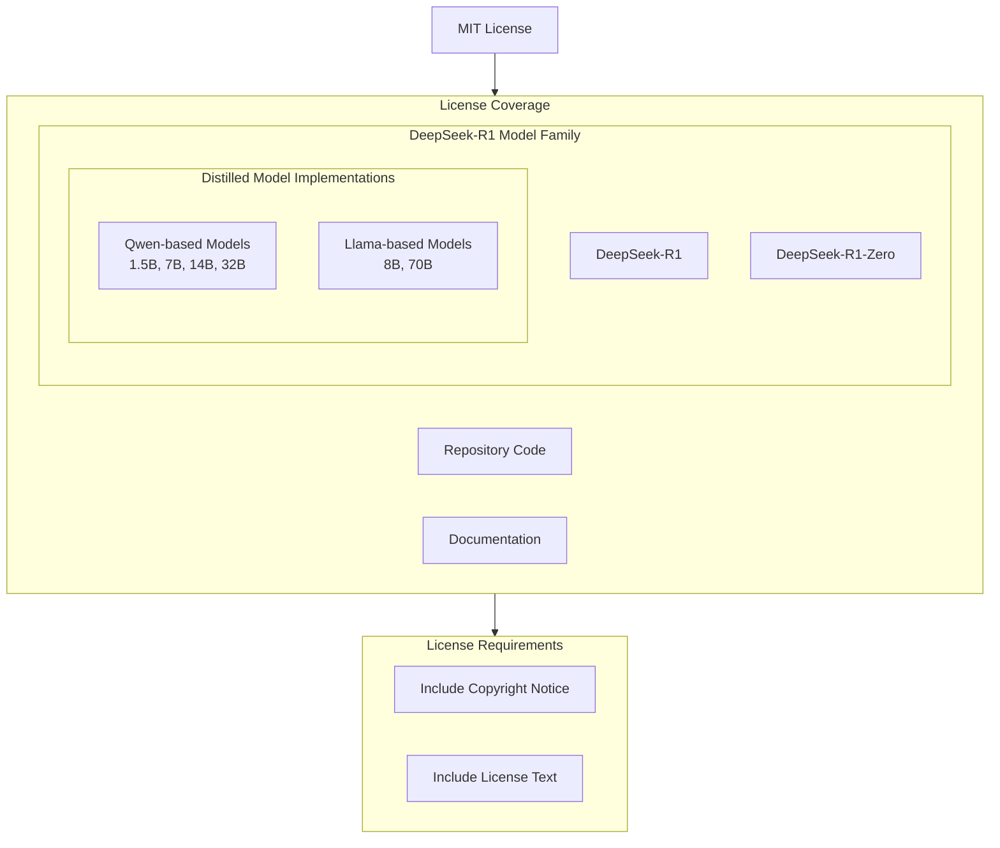

<!-- source: DeepWiki mcp.deepwiki.com · repo deepseek-ai/DeepSeek-R1 · page 5.1 License · fetched 2026-10-30 -->

# License

<details>
<summary>Relevant source files</summary>

The following files were used as context for generating this wiki page:

- [LICENSE](LICENSE)

</details>


This document explains the licensing terms that govern the DeepSeek-R1 repository and its associated models. Understanding these terms is essential for proper usage, modification, and distribution of the software and models in this repository.

## MIT License Overview

The DeepSeek-R1 repository is released under the MIT License, one of the most permissive and widely used open-source licenses. This license is characterized by its simplicity and minimal restrictions on usage.

Sources: [LICENSE:1-21]()

## License Details

The full text of the MIT License applied to the DeepSeek-R1 repository is as follows:

```
MIT License

Copyright (c) 2023 DeepSeek

Permission is hereby granted, free of charge, to any person obtaining a copy
of this software and associated documentation files (the "Software"), to deal
in the Software without restriction, including without limitation the rights
to use, copy, modify, merge, publish, distribute, sublicense, and/or sell
copies of the Software, and to permit persons to whom the Software is
furnished to do so, subject to the following conditions:

The above copyright notice and this permission notice shall be included in all
copies or substantial portions of the Software.

THE SOFTWARE IS PROVIDED "AS IS", WITHOUT WARRANTY OF ANY KIND, EXPRESS OR
IMPLIED, INCLUDING BUT NOT LIMITED TO THE WARRANTIES OF MERCHANTABILITY,
FITNESS FOR A PARTICULAR PURPOSE AND NONINFRINGEMENT. IN NO EVENT SHALL THE
AUTHORS OR COPYRIGHT HOLDERS BE LIABLE FOR ANY CLAIM, DAMAGES OR OTHER
LIABILITY, WHETHER IN AN ACTION OF CONTRACT, TORT OR OTHERWISE, ARISING FROM,
OUT OF OR IN CONNECTION WITH THE SOFTWARE OR THE USE OR OTHER DEALINGS IN THE
SOFTWARE.
```

Sources: [LICENSE:1-21]()

## Key Permissions

The MIT License grants users the following permissions for the DeepSeek-R1 repository:

| Permission | Description |
|------------|-------------|
| Use | Freedom to use the software for any purpose |
| Copy | Right to create copies of the original software |
| Modify | Permission to alter, adapt, or modify the codebase |
| Publish | Authority to publish modified or unmodified versions |
| Distribute | Right to distribute the original or modified software |
| Sublicense | Ability to apply different license terms to derivatives |
| Sell | Permission to sell the software or derivatives commercially |

Sources: [LICENSE:5-10]()

## License Diagram: Application to Repository Components



Sources: [LICENSE:1-21]()

## Obligations When Using DeepSeek-R1

When using, modifying, or distributing the DeepSeek-R1 repository or its derivatives, users must:

1. Include the original copyright notice: "Copyright (c) 2023 DeepSeek"
2. Include the full text of the MIT License permission notice

This requirement applies to all substantial portions of the software, including any modifications or derivative works.

Sources: [LICENSE:12-13]()

## Warranty Disclaimer and Liability Limitations

The MIT License explicitly states that the DeepSeek-R1 repository is provided "as is" without any warranties. Specifically:

- No warranty of merchantability
- No warranty of fitness for a particular purpose
- No warranty of non-infringement

Additionally, the license stipulates that the authors and copyright holders (DeepSeek) shall not be liable for any claims, damages, or other liabilities arising from the use of the software.

Sources: [LICENSE:15-21]()

## License Application to Model Implementations



Sources: [LICENSE:1-21]()

## Practical Implications

The MIT License's permissive nature means that users of the DeepSeek-R1 repository can:

1. Integrate the code into both open-source and proprietary applications
2. Modify the models for specific use cases
3. Create and distribute derivative works
4. Use the models for commercial purposes
5. Apply different licensing terms to derivative works (while maintaining the original MIT License notices for original components)

The only substantive requirement is maintaining the copyright and license notices in all copies or substantial portions of the software.

Sources: [LICENSE:5-13]()

---

