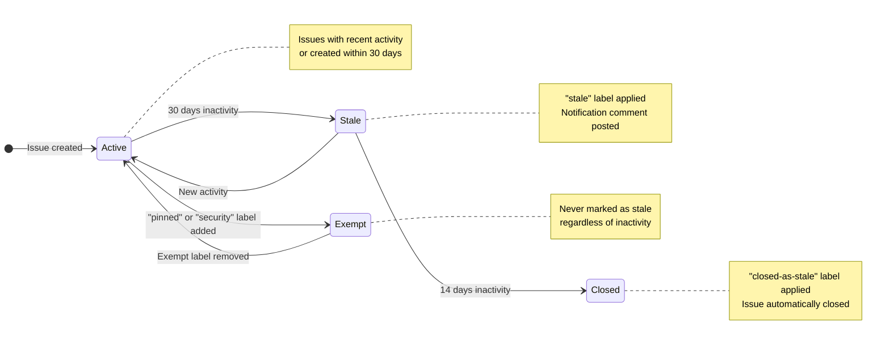

<!-- source: DeepWiki mcp.deepwiki.com · repo deepseek-ai/DeepSeek-R1 · page 5.2 Issue Management · fetched 2026-10-30 -->

# Issue Management

<details>
<summary>Relevant source files</summary>

The following files were used as context for generating this wiki page:

- [.github/workflows/stale.yml](.github/workflows/stale.yml)

</details>


This document describes the automated issue management system implemented in the DeepSeek-R1 repository. It focuses specifically on how GitHub issues are tracked, labeled, and eventually closed through automated workflows. For information about the general repository structure, see [Repository Information](#5).

## Automated Stale Issue Workflow

The DeepSeek-R1 repository implements an automated stale issue management system that helps maintain a clean issue tracker. This system automatically identifies and handles issues that have been inactive for extended periods, ensuring that the development team focuses on current, relevant issues.

The workflow is implemented as a GitHub Actions workflow that runs daily and processes issues based on their activity levels.

Sources: [.github/workflows/stale.yml:1-11]()

### Workflow Configuration

The stale issue workflow is configured with the following parameters:

| Parameter | Value | Description |
|-----------|-------|-------------|
| Runs on | Daily at midnight UTC | Scheduled with cron expression `0 0 * * *` |
| Stale threshold | 30 days | Issues become stale after 30 days of inactivity |
| Close threshold | 14 days | Stale issues are closed after 14 additional days of inactivity |
| Stale label | "stale" | Label applied to stale issues |
| Close label | "closed-as-stale" | Label applied when closing stale issues |
| Exempt labels | "pinned", "security" | Issues with these labels are never marked as stale |
| PR handling | Disabled | Pull requests are not managed by this workflow |

Sources: [.github/workflows/stale.yml:3-30]()

### Issue Lifecycle

The following diagram illustrates the lifecycle of an issue in the DeepSeek-R1 repository, focusing on the stale issue management process:



Sources: [.github/workflows/stale.yml:12-30]()

### Stale Issue Detection Process

This diagram illustrates the technical process used by the GitHub Actions workflow to detect and manage stale issues:

```mermaid
flowchart TD
    Start([Daily workflow trigger]) --> CheckRepo{Is deepseek-ai/DeepSeek-R1?}
    CheckRepo -- Yes --> ScanIssues[Scan all open issues]
    CheckRepo -- No --> End([End workflow])
    
    ScanIssues --> CheckActivity{Issue inactive\nfor 30+ days?}
    CheckActivity -- Yes --> CheckExempt{Has exempt\nlabels?}
    CheckActivity -- No --> KeepActive[Keep issue active]
    
    CheckExempt -- Yes --> KeepActive
    CheckExempt -- No --> CheckIfStale{Already\nmarked stale?}
    
    CheckIfStale -- Yes --> CheckStaleTime{Stale for\n14+ days?}
    CheckIfStale -- No --> MarkStale[Mark as stale\nAdd comment\nAdd "stale" label]
    
    CheckStaleTime -- Yes --> CloseIssue[Close issue\nAdd "closed-as-stale" label]
    CheckStaleTime -- No --> KeepStale[Keep issue stale]
    
    MarkStale --> End
    KeepActive --> End
    KeepStale --> End
    CloseIssue --> End
```

Sources: [.github/workflows/stale.yml:7-30]()

## Managing Your Issues

To prevent your issues from being automatically closed, consider the following guidelines:

### Keeping Issues Active

Issues remain active as long as they receive regular activity. Activity includes:

- Comments from users or maintainers
- Label changes
- Assignee changes
- Linking to pull requests

If an issue is marked as stale, you can reactivate it by adding a comment explaining why the issue is still relevant.

### Understanding Issue Labels

The stale issue workflow uses specific labels to track issue status:

| Label | Meaning |
|-------|---------|
| stale | Issue has been inactive for 30+ days and may be closed soon |
| closed-as-stale | Issue was closed automatically due to continued inactivity |
| pinned | Issue is exempt from the stale workflow (maintained by repository owners) |
| security | Security-related issues exempt from the stale workflow |

Sources: [.github/workflows/stale.yml:15-21]()

### Stale Issue Notifications

When an issue is marked as stale, the following notification message is posted:

```
This issue has been automatically marked as stale because it has not had
recent activity. It will be closed if no further activity occurs. If you
believe this issue is still relevant, please leave a comment to keep it open.
Thank you for your contributions!
```

This message serves as a warning that the issue will be closed after 14 more days of inactivity unless someone responds to keep it active.

Sources: [.github/workflows/stale.yml:22-27]()

## Technical Implementation

The stale issue workflow is implemented using the GitHub Actions framework and the official `actions/stale` action in version 9. The workflow only runs on the main DeepSeek-R1 repository and uses the standard GitHub API token for authentication.

The workflow is defined in the following file:
- [.github/workflows/stale.yml]() - Contains the complete workflow definition

Sources: [.github/workflows/stale.yml:1-31]()