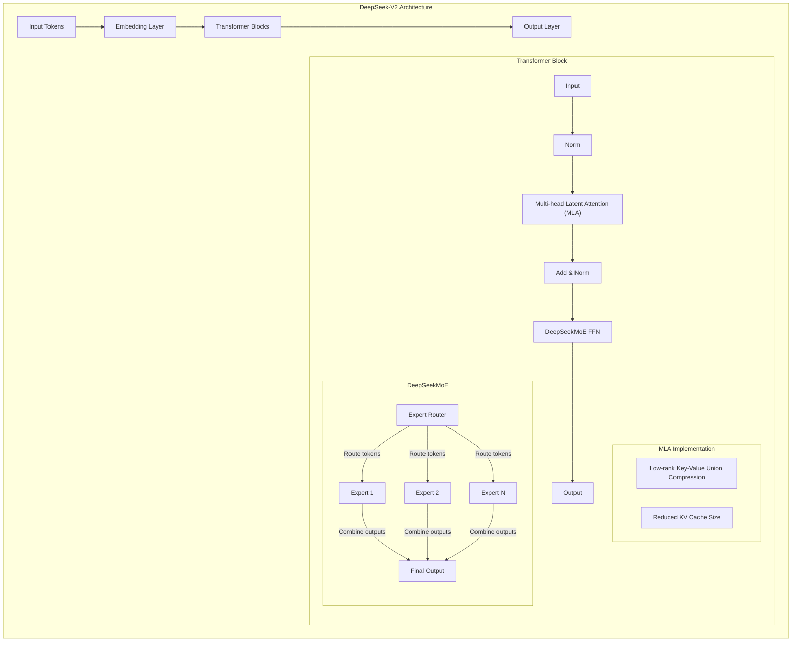
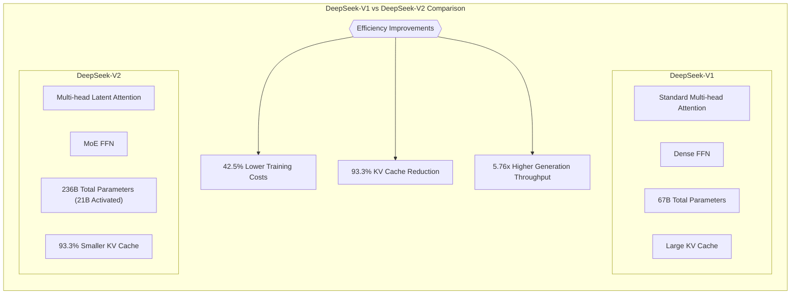
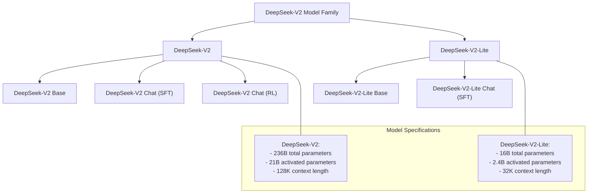
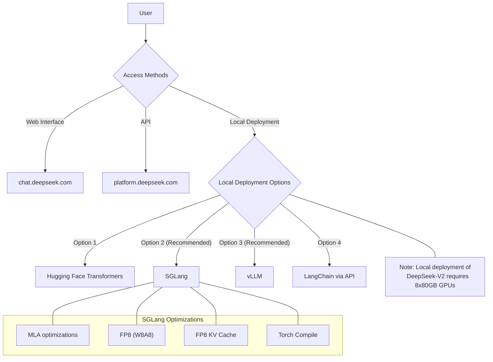

<!-- source: DeepWiki mcp.deepwiki.com · repo deepseek-ai/DeepSeek-V2 · page 1 Overview · fetched 2026-10-30 -->

# Overview

Relevant source files

The following files were used as context for generating this wiki page:

- [README.md](README.md)
- [deepseek-v2-tech-report.pdf](deepseek-v2-tech-report.pdf)

This document provides a comprehensive overview of DeepSeek-V2, a state-of-the-art Mixture-of-Experts (MoE) language model that balances strong performance with economical training and efficient inference capabilities. DeepSeek-V2 represents a significant advancement in large language model architecture, introducing innovative techniques that substantially improve efficiency while maintaining or enhancing performance across various benchmarks.

For detailed information about the model architecture specifics, see [Model Architecture](#1.1). For a breakdown of different model variants, see [Model Variants](#1.2).

Sources: [README.md:57-67]()

## Model Introduction

DeepSeek-V2 is a large language model comprising 236 billion total parameters, of which only 21 billion are activated for each token during operation. The model was pretrained on a diverse corpus of 8.1 trillion tokens, followed by supervised fine-tuning (SFT) and reinforcement learning (RL) to enhance its capabilities.

Compared to its predecessor, DeepSeek-V1 (67B dense model), DeepSeek-V2 achieves:
- 42.5% reduction in training costs
- 93.3% reduction in KV cache size
- 5.76x increase in maximum generation throughput
- Better performance on standard benchmarks

The DeepSeek-V2 family also includes a smaller variant called DeepSeek-V2-Lite with 16B total parameters and 2.4B activated parameters per token.

### DeepSeek-V2 System Architecture

Sources: [README.md:202-209]()

## Key Architectural Innovations

DeepSeek-V2 introduces two major architectural innovations that enable its efficiency and performance improvements:

1. **Multi-head Latent Attention (MLA)**: A novel attention mechanism that utilizes low-rank key-value union compression to dramatically reduce the memory requirements of the KV cache. This innovation eliminates a major bottleneck in inference-time memory usage, enabling efficient inference with long contexts up to 128K tokens.

2. **DeepSeekMoE Architecture**: A high-performance Mixture-of-Experts approach for Feed-Forward Networks (FFNs) that allows the model to have a large total parameter count while only activating a small subset for each token. This architecture enables training stronger models at lower costs.

Sources: [README.md:202-209](), [README.md:57-67]()

## Model Family and Variants

The DeepSeek-V2 system includes several model variants optimized for different use cases:

Sources: [README.md:74-85]()

| Model Variant | Total Parameters | Activated Parameters | Context Length |
|---------------|------------------|----------------------|----------------|
| DeepSeek-V2 | 236B | 21B | 128K |
| DeepSeek-V2-Chat (SFT/RL) | 236B | 21B | 128K |
| DeepSeek-V2-Lite | 16B | 2.4B | 32K |
| DeepSeek-V2-Lite-Chat (SFT) | 16B | 2.4B | 32K |

Sources: [README.md:74-85]()

## Performance Characteristics

DeepSeek-V2 demonstrates strong performance across a range of benchmarks, including English and Chinese language understanding, code generation, and mathematical reasoning.

The model's context window capabilities have been evaluated using the "Needle In A Haystack" (NIAH) test, confirming effective performance with contexts up to 128K tokens.

DeepSeek-V2-Chat (RL) performs particularly well on open-ended generation evaluations, showing competitive results on benchmarks like AlpacaEval 2.0, MTBench, and Alignbench.

Sources: [README.md:90-200]()

## Usage and Integration Options

DeepSeek-V2 can be accessed and used through multiple channels:

Sources: [README.md:211-370]()

### Local Deployment Requirements

Running DeepSeek-V2 locally requires significant computational resources:
- 8 GPUs with 80GB memory each for BF16 format inference
- For smaller deployments, DeepSeek-V2-Lite provides a more accessible option

Sources: [README.md:223-224]()

### Integration Examples

The repository provides code examples for integrating DeepSeek-V2 with various frameworks:

1. **Hugging Face Transformers**: Examples for both text completion and chat completion
2. **SGLang**: Commands for launching an OpenAI API-compatible server with various optimizations
3. **vLLM**: Code example for model inference
4. **LangChain**: Example of using DeepSeek-V2 via the API with the ChatOpenAI interface

The chat models implement a standard chat template format that supports system messages and multiple user-assistant interactions.

Sources: [README.md:224-370]()

## Licensing Information

DeepSeek-V2 is distributed under a dual-licensing model:
- The code repository is licensed under the MIT License
- The model weights are subject to a separate Model License that permits commercial use

For complete licensing details, see [Licensing Information](#5).

Sources: [README.md:371-373]()

---

