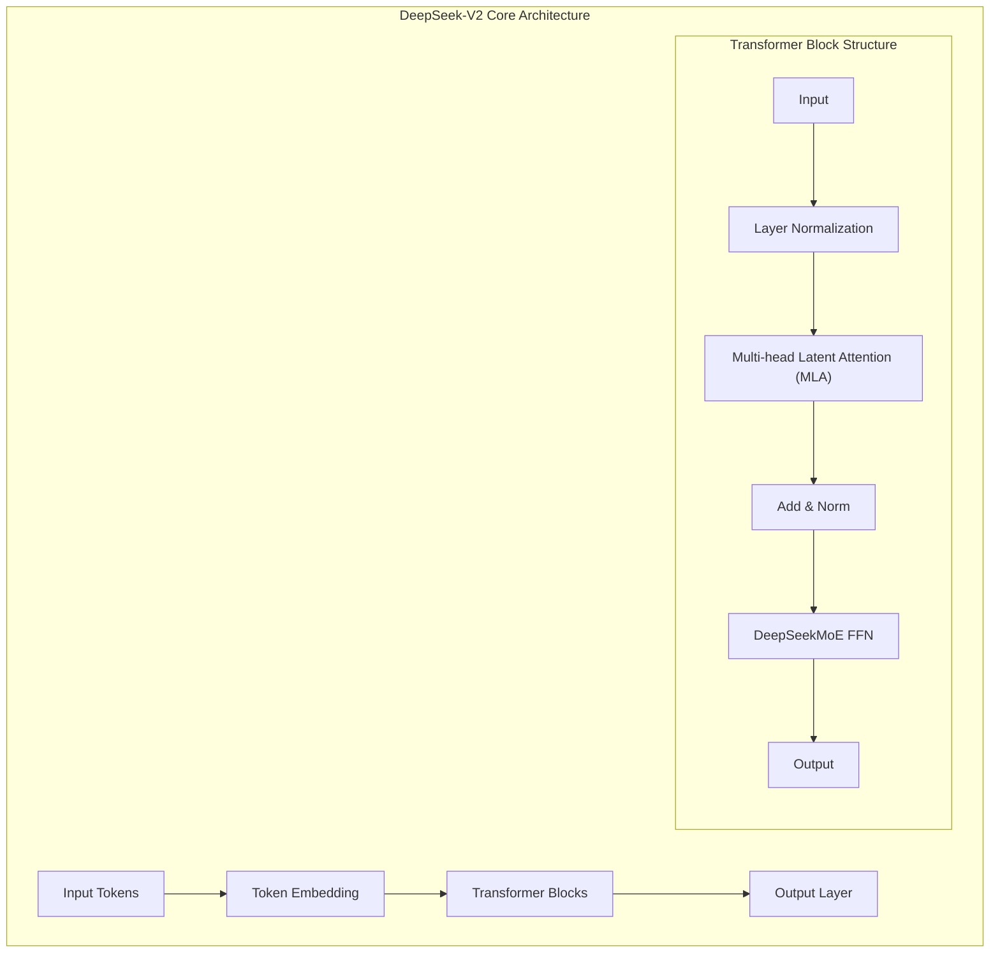
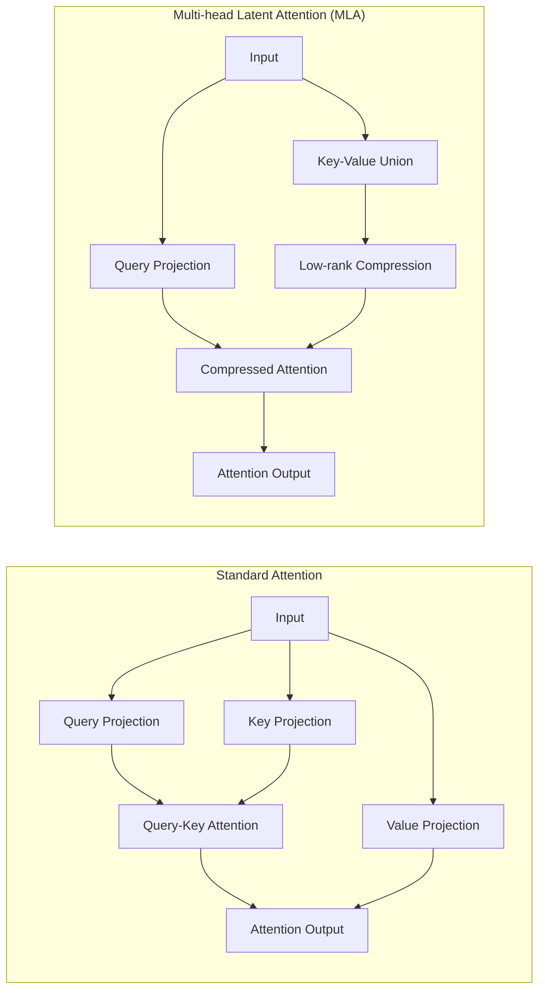
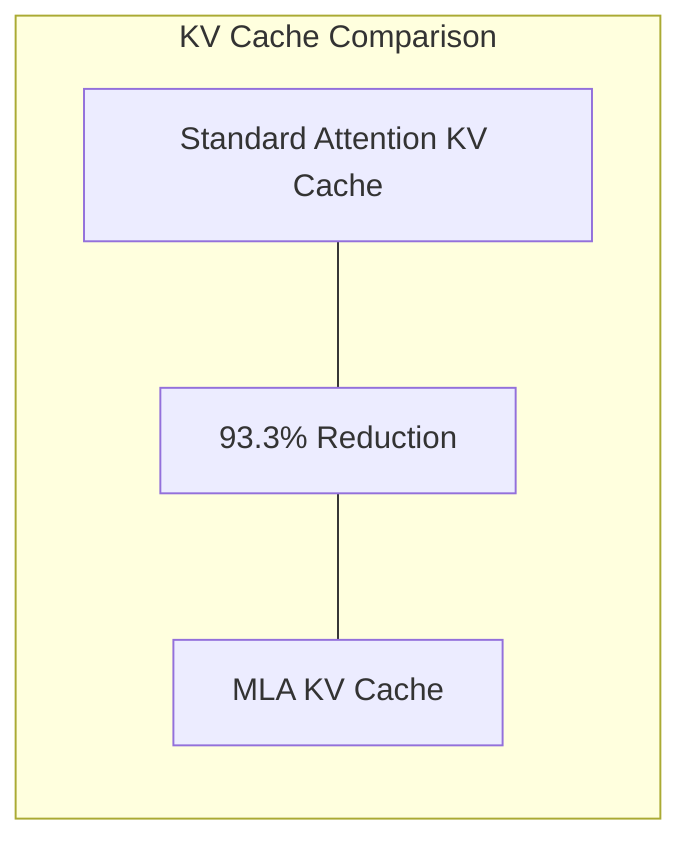
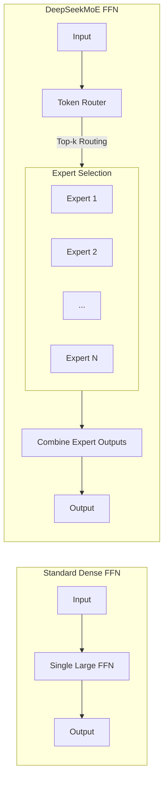
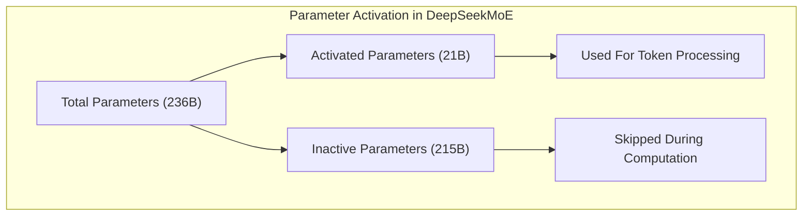
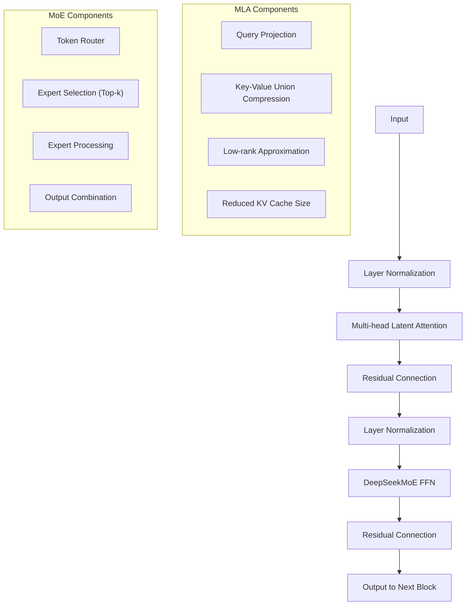

<!-- source: DeepWiki mcp.deepwiki.com · repo deepseek-ai/DeepSeek-V2 · page 1.1 Model Architecture · fetched 2026-10-30 -->

# Model Architecture

Relevant source files

The following files were used as context for generating this wiki page:

- [README.md](README.md)
- [deepseek-v2-tech-report.pdf](deepseek-v2-tech-report.pdf)
- [figures/activationparameters.png](figures/activationparameters.png)
- [figures/architecture.png](figures/architecture.png)

This document details the architecture of the DeepSeek-V2 model, focusing on its two main innovative components: Multi-head Latent Attention (MLA) and the DeepSeekMoE architecture. These innovations allow the model to achieve superior performance with more economical training and efficient inference compared to traditional dense transformer models. For information about different variants of the model, see [Model Variants](#1.2).

## Overview

DeepSeek-V2 introduces a novel architecture that enhances the standard transformer design with two significant innovations:

1. **Multi-head Latent Attention (MLA)**: A mechanism that utilizes low-rank key-value union compression to drastically reduce memory requirements of the key-value cache during inference.

2. **DeepSeekMoE Architecture**: A sophisticated Mixture-of-Experts approach that enables the model to have a large total parameter count while only activating a small subset for each token.

The primary advantages of this architecture include:
- 42.5% lower training costs compared to dense models
- 93.3% reduction in KV cache size
- 5.76x higher generation throughput
- Improved performance on various benchmarks
- Support for context lengths up to 128K tokens

### DeepSeek-V2 High-Level Architecture

Sources: [README.md:202-210]()

## Multi-head Latent Attention (MLA)

The Multi-head Latent Attention (MLA) mechanism is designed to address the memory bottleneck associated with key-value caches during inference, especially for long context processing.

### MLA Design and Implementation

MLA uses low-rank key-value union compression to reduce the memory footprint of the attention mechanism. This is accomplished by:

1. Projecting queries, keys, and values as in standard attention
2. Applying a compression step to the key-value pairs
3. Using a low-rank approximation technique to minimize information loss
4. Substantially reducing the KV cache size required during inference

### KV Cache Reduction

One of the most significant benefits of MLA is the dramatic reduction in key-value cache memory requirements:

The low-rank compression technique employed by MLA results in a 93.3% reduction in KV cache size compared to traditional attention mechanisms. This enables much more efficient handling of long contexts up to 128K tokens.

Sources: [README.md:202-210]()

## DeepSeekMoE Architecture

The DeepSeekMoE architecture implements a Mixture-of-Experts approach for the feed-forward network (FFN) component of the transformer blocks. This allows the model to have a much larger total parameter count while maintaining efficient computation by only activating a small subset of parameters for each token.

### MoE Design and Implementation

### Sparse Activation Mechanism

The router component determines which experts to activate for each token, typically selecting only a small subset (e.g., top-2 experts). This results in:

- Only about 9% of the total parameters being activated for each token
- For DeepSeek-V2 (236B total parameters), only about 21B parameters are activated per token
- For DeepSeek-V2-Lite (16B total parameters), only about 2.4B parameters are activated per token

Sources: [README.md:202-210]()

## Complete Transformer Block

The complete transformer block in DeepSeek-V2 integrates both the MLA and DeepSeekMoE components:

## Efficiency and Performance Comparison

The architectural innovations in DeepSeek-V2 result in significant efficiency and performance improvements compared to traditional dense transformer models:

| Metric | DeepSeek-V1 (Dense-67B) | DeepSeek-V2 (MoE-236B) | Improvement |
|--------|--------------------------|------------------------|-------------|
| KV Cache Size | 100% | 6.7% | 93.3% reduction |
| Training Cost | 100% | 57.5% | 42.5% reduction |
| Generation Throughput | 1x | 5.76x | 5.76x increase |
| Context Length | 32K | 128K | 4x increase |
| MMLU Score | 71.3 | 78.5 | 7.2 point increase |
| C-Eval Score | 66.1 | 81.7 | 15.6 point increase |

The DeepSeek-V2 architecture demonstrates that it's possible to achieve both better performance and greater efficiency through innovative design choices like MLA and MoE, rather than simply scaling up dense models.

Sources: [README.md:57-68](), [README.md:93-105]()

## Implementation Details

The architecture is implemented with careful optimizations to ensure efficient training and inference. The model supports various inference frameworks including Hugging Face Transformers, SGLang, and vLLM, with SGLang providing the best performance through specific optimizations:

- MLA optimizations
- FP8 W8A8 support
- FP8 KV Cache support
- Torch Compile integration

These optimizations further enhance the efficiency benefits of the architectural innovations in the model.

Sources: [README.md:296-303]()

## Technical Specifications

| Specification | DeepSeek-V2 | DeepSeek-V2-Lite |
|---------------|-------------|------------------|
| Total Parameters | 236B | 16B |
| Activated Parameters | 21B | 2.4B |
| Activation Percentage | ~9% | ~15% |
| Maximum Context Length | 128K | 32K |
| Attention Mechanism | MLA | MLA |
| FFN Architecture | MoE | MoE |
| Training Tokens | 8.1 trillion | 8.1 trillion |

Sources: [README.md:76-85]()

The DeepSeek-V2 architecture represents a significant advance in language model design by addressing key bottlenecks in traditional transformer architectures while improving both efficiency and performance. The combination of Multi-head Latent Attention and the DeepSeekMoE architecture enables better parameter efficiency and reduced computational requirements without sacrificing model capability.

---

