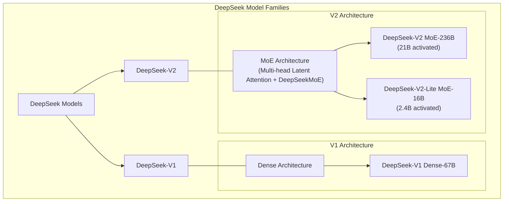
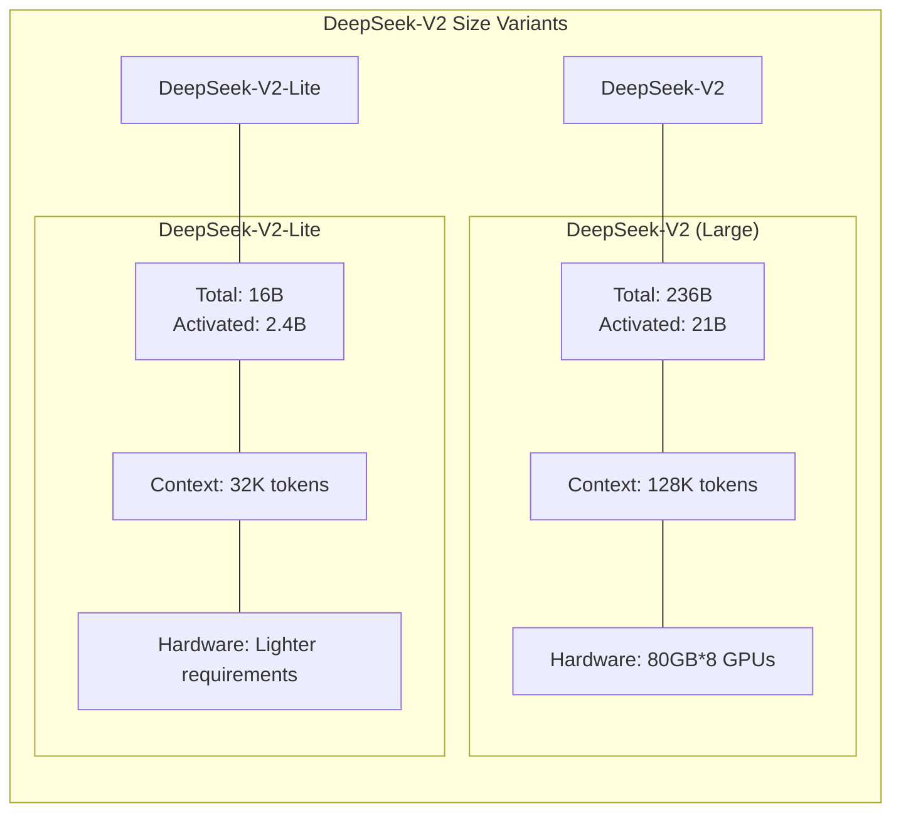
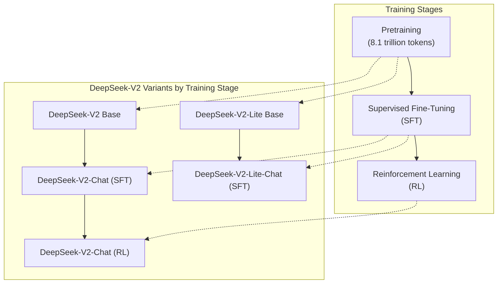
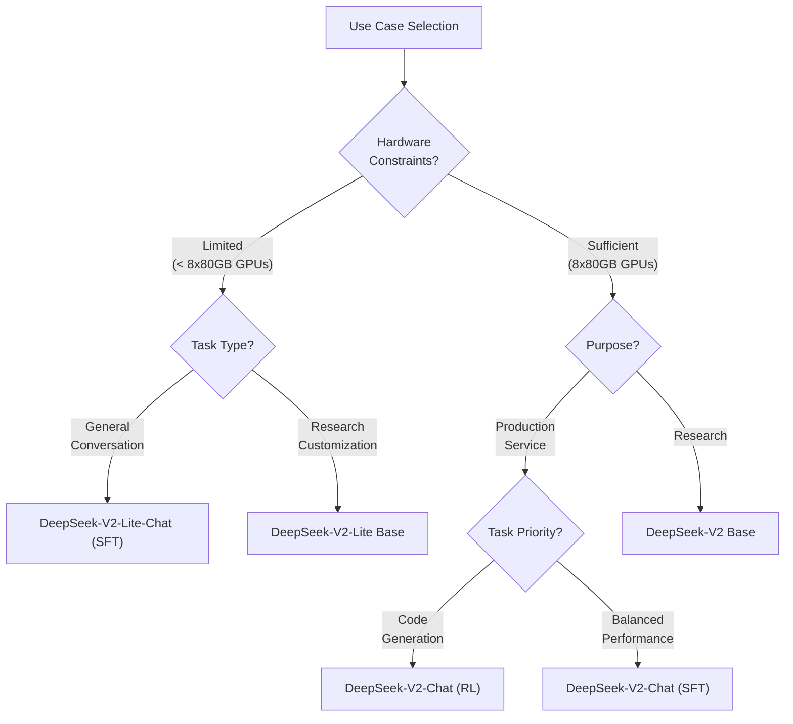

<!-- source: DeepWiki mcp.deepwiki.com · repo deepseek-ai/DeepSeek-V2 · page 1.2 Model Variants · fetched 2026-10-30 -->

# Model Variants

Relevant source files

The following files were used as context for generating this wiki page:

- [README.md](README.md)
- [deepseek-v2-tech-report.pdf](deepseek-v2-tech-report.pdf)

This document provides a detailed overview of the different model variants available in the DeepSeek-V2 family. It explains the architectural differences, parameter counts, capabilities, and appropriate use cases for each variant. For information about the core model architecture and technical innovations, see [Model Architecture](#1.1).

## 1. Overview of DeepSeek-V2 Model Family

DeepSeek-V2 represents a significant evolution from the previous DeepSeek-V1 (Dense-67B) model. The key distinction is that DeepSeek-V2 uses a Mixture-of-Experts (MoE) architecture rather than a dense architecture, resulting in models that are more efficient in both training and inference while delivering superior performance.

Sources: [README.md:55-65,203-209]()

## 2. Size Variants

DeepSeek-V2 comes in two size variants that differ significantly in their parameter count:

### 2.1 DeepSeek-V2 (Large)

- **Total Parameters**: 236 billion
- **Activated Parameters**: 21 billion per token (8.9% of total)
- **Context Length**: 128K tokens
- **Hardware Requirements**: 80GB*8 GPUs (for BF16 inference)

### 2.2 DeepSeek-V2-Lite

- **Total Parameters**: 16 billion
- **Activated Parameters**: 2.4 billion per token (15% of total)
- **Context Length**: 32K tokens
- **Hardware Requirements**: Less demanding than the large variant

Both variants use the same core architecture innovations: Multi-head Latent Attention (MLA) and DeepSeekMoE, but they differ in scale and capacity.

Sources: [README.md:76-84,223-224]()

## 3. Training Stage Variants

Each size variant of DeepSeek-V2 is available in different versions based on the training stage:

Sources: [README.md:65-68,70-72,76-84]()

### 3.1 Base Models

The Base models have been pretrained on a diverse corpus of 8.1 trillion tokens but have not undergone any fine-tuning for specific tasks. These models are best suited for:
- Research purposes
- Transfer learning to new domains
- Text completion tasks where instruction following is not required

### 3.2 Chat (SFT) Models

The Chat (SFT) models have undergone Supervised Fine-Tuning on high-quality conversational data. These models:
- Follow instructions more reliably
- Maintain a conversational tone
- Are suitable for most general-purpose chatbot applications

### 3.3 Chat (RL) Models

Currently, only the large DeepSeek-V2 has an RL-trained variant. The Chat (RL) model has undergone Reinforcement Learning after SFT to further align with human preferences. This model:
- Shows improved performance in open-ended generation
- Scores higher on human preference benchmarks like AlpacaEval and MTBench
- Is the most refined and production-ready variant

Sources: [README.md:65-68,76-84,134-147]()

## 4. Comparative Performance

The following table summarizes the key differences in capabilities between the model variants:

| Model Variant | Total Params | Activated Params | Context Length | Best For |
|---------------|--------------|------------------|---------------|---------|
| DeepSeek-V2 Base | 236B | 21B | 128K | Research, transfer learning |
| DeepSeek-V2-Chat (SFT) | 236B | 21B | 128K | General conversational AI |
| DeepSeek-V2-Chat (RL) | 236B | 21B | 128K | Production applications, highest quality responses |
| DeepSeek-V2-Lite Base | 16B | 2.4B | 32K | Resource-constrained research |
| DeepSeek-V2-Lite-Chat (SFT) | 16B | 2.4B | 32K | Efficient deployment on limited hardware |

### 4.1 Performance on Benchmarks

The DeepSeek-V2 variants show different performance profiles across various benchmarks:

- **DeepSeek-V2 (236B)**: Achieves state-of-the-art performance across most benchmarks, particularly excelling in Chinese benchmarks (C-Eval, CMMLU) where it scores above 80%.

- **DeepSeek-V2-Chat (RL)**: Demonstrates the best performance on coding tasks like HumanEval (81.1%) and LiveCodeBench (32.5%), as well as math-related problems.

- **DeepSeek-V2-Lite (16B)**: Despite its smaller size, shows competitive performance, especially in Chinese language understanding and mathematical reasoning compared to other models of similar size.

Sources: [README.md:90-123,134-166,168-175,195-200]()

## 5. Use Case Recommendations

Based on performance characteristics and resource requirements, here are recommendations for which variant to use for different use cases:

Sources: [README.md:76-84,90-123,134-166,223-224]()

## 6. Model Availability and Access

All DeepSeek-V2 model variants are available on Hugging Face. The models can be downloaded and used locally or accessed through the DeepSeek platform.

| Model Variant | Download | API Access |
|---------------|----------|------------|
| DeepSeek-V2 Base | [Hugging Face](https://huggingface.co/deepseek-ai/DeepSeek-V2) | Available on platform.deepseek.com |
| DeepSeek-V2-Chat (RL) | [Hugging Face](https://huggingface.co/deepseek-ai/DeepSeek-V2-Chat) | Available on platform.deepseek.com |
| DeepSeek-V2-Lite Base | [Hugging Face](https://huggingface.co/deepseek-ai/DeepSeek-V2-Lite) | Available on platform.deepseek.com |
| DeepSeek-V2-Lite-Chat (SFT) | [Hugging Face](https://huggingface.co/deepseek-ai/DeepSeek-V2-Lite-Chat) | Available on platform.deepseek.com |

### 6.1 Inference Options

The model variants can be run using different frameworks:

1. **Hugging Face Transformers**: Standard implementation, supports all variants but may not be optimal for performance
2. **SGLang**: Recommended for optimal performance, supports MLA optimizations, FP8 (W8A8), FP8 KV Cache, and Torch Compile
3. **vLLM**: Recommended after applying the specific PR (#4650), provides efficient inference
4. **LangChain**: Support through OpenAI-compatible API

For detailed usage instructions for these frameworks, see [Usage Guide](#3).

Sources: [README.md:76-84,211-370]()

## 7. Summary

DeepSeek-V2 offers a comprehensive range of model variants to suit different use cases, hardware constraints, and performance requirements. The key differences between variants lie in:

1. **Model Size**: DeepSeek-V2 (236B) vs. DeepSeek-V2-Lite (16B)
2. **Training Stage**: Base vs. Chat (SFT) vs. Chat (RL)
3. **Context Length**: 128K for DeepSeek-V2 vs. 32K for DeepSeek-V2-Lite

All variants leverage the same core architectural innovations (Multi-head Latent Attention and DeepSeekMoE) that make DeepSeek-V2 models more efficient than their predecessors while achieving superior performance across a wide range of tasks.

Sources: [README.md:55-209]()

---

