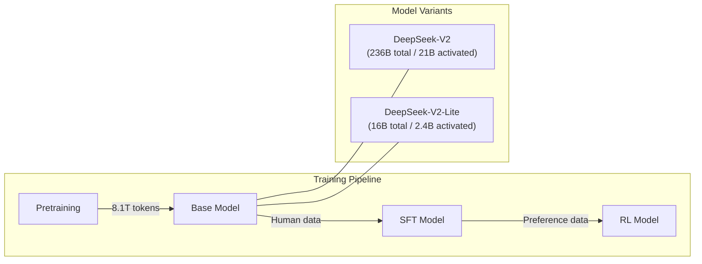
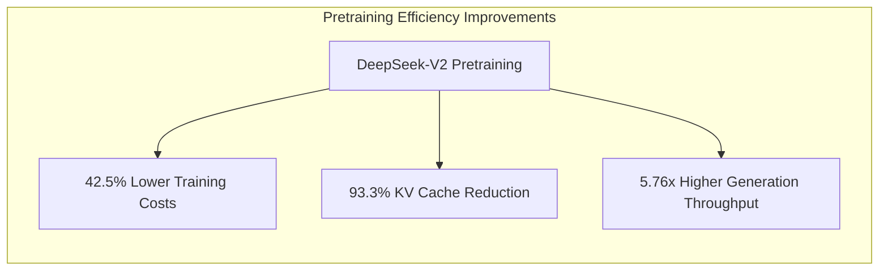
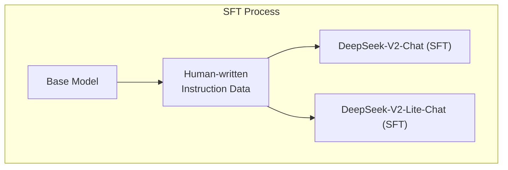
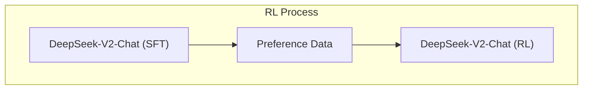
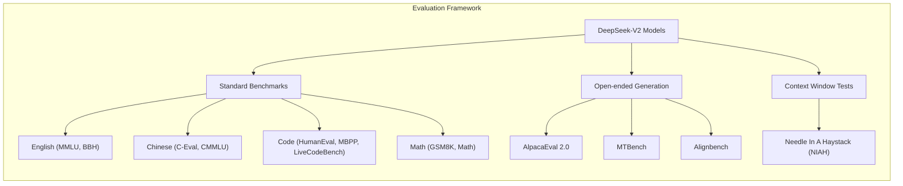
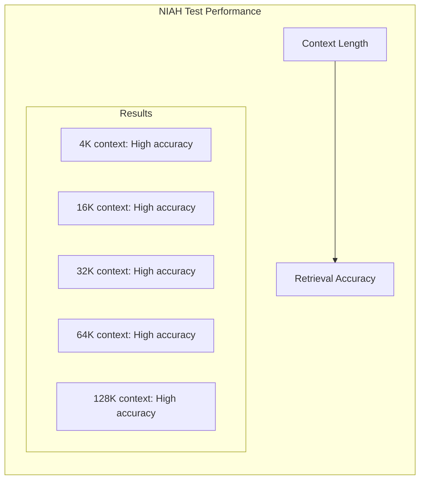
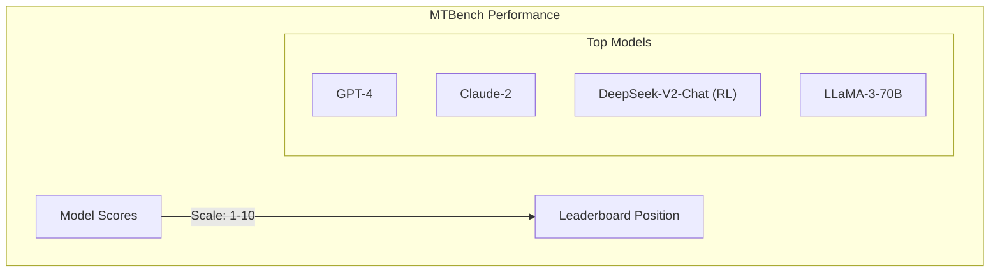
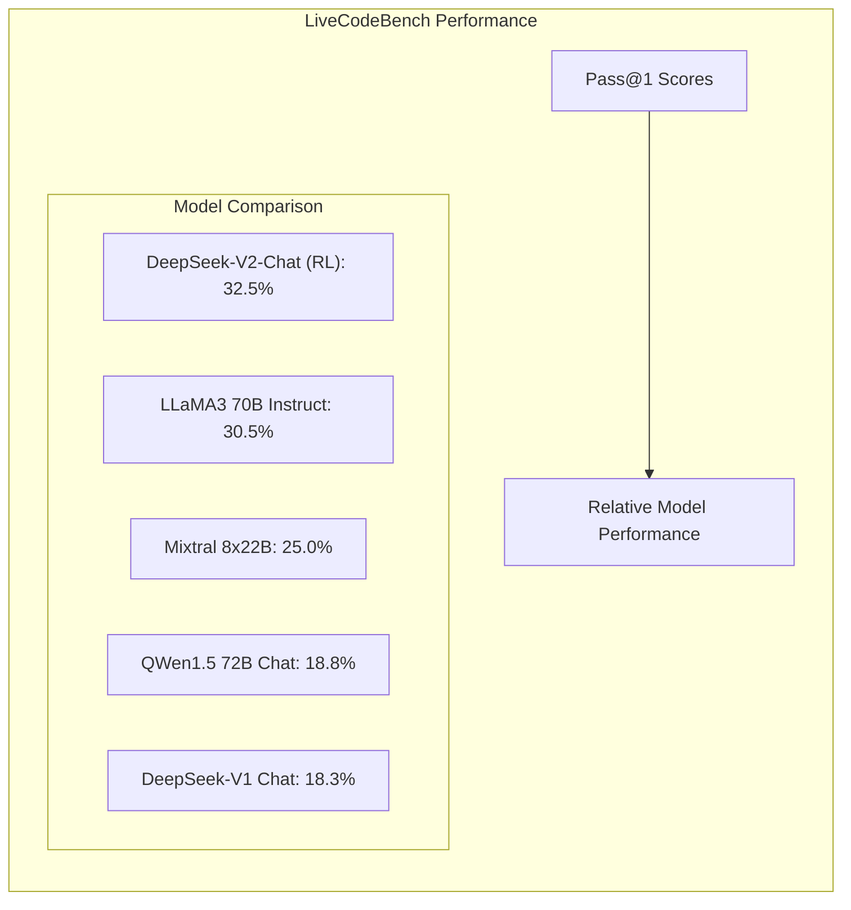
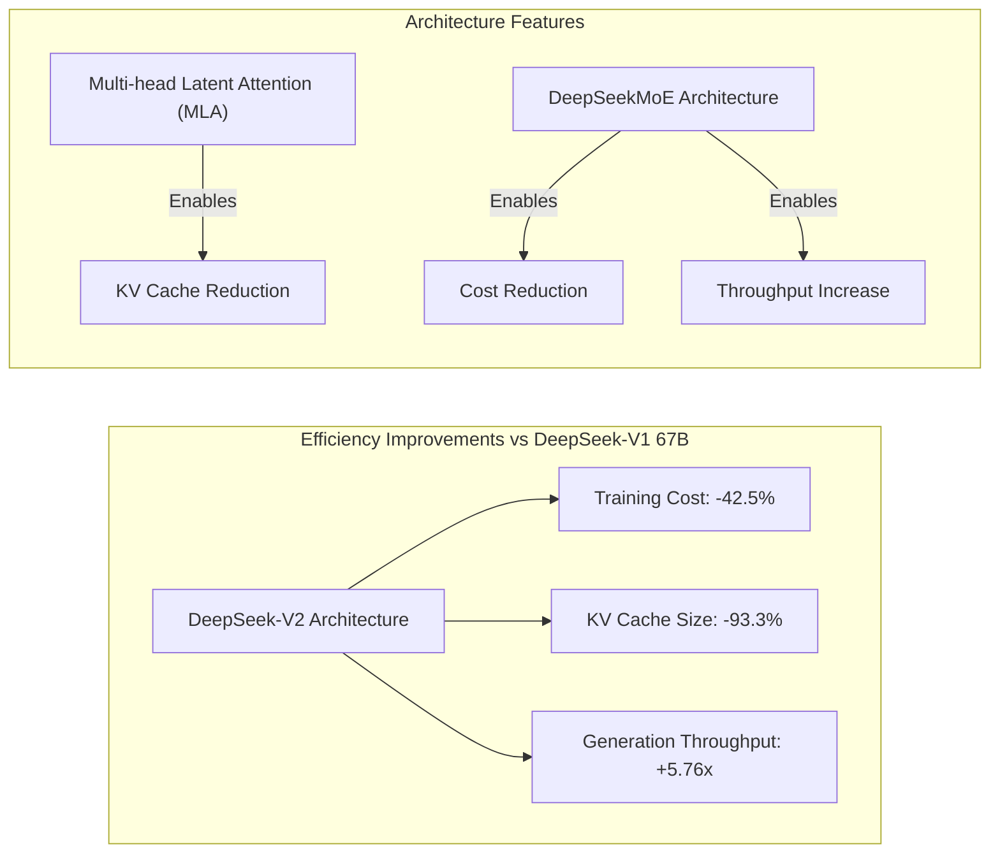

<!-- source: DeepWiki mcp.deepwiki.com · repo deepseek-ai/DeepSeek-V2 · page 2 Training and Evaluation · fetched 2026-10-30 -->

# Training and Evaluation

Relevant source files

The following files were used as context for generating this wiki page:

- [README.md](README.md)
- [deepseek-v2-tech-report.pdf](deepseek-v2-tech-report.pdf)
- [figures/alignbench_price.png](figures/alignbench_price.png)

This document provides a comprehensive overview of the training methodology and evaluation approaches used for DeepSeek-V2 models. It covers the pretraining pipeline, fine-tuning processes, evaluation methodologies, and detailed benchmark results. For information about model architecture and technical innovations, see [Model Architecture](#1.1).

## 1. Training Pipeline

DeepSeek-V2 follows a three-stage training process that starts with large-scale pretraining, followed by supervised fine-tuning, and concludes with reinforcement learning for the chat models.

Sources: [README.md:66-67]()

### 1.1 Pretraining

DeepSeek-V2 was pretrained on a diverse, high-quality corpus comprising 8.1 trillion tokens. The pretraining leverages the efficiency of the DeepSeek-V2 architecture innovations:

- **Multi-head Latent Attention (MLA)**: Reduces KV cache requirements by 93.3%
- **DeepSeekMoE Architecture**: Enables 42.5% lower training costs while maintaining model capability

Sources: [README.md:58-60](), [README.md:66-67]()

### 1.2 Supervised Fine-Tuning (SFT)

Following pretraining, the base models undergo supervised fine-tuning on high-quality human-generated data to create instruction-following models. This process produces the DeepSeek-V2-Chat (SFT) and DeepSeek-V2-Lite-Chat (SFT) variants.

Sources: [README.md:66-67]()

### 1.3 Reinforcement Learning (RL)

For the main DeepSeek-V2 model, an additional reinforcement learning stage is performed to further align the model with human preferences. This produces the DeepSeek-V2-Chat (RL) variant, which shows further improvements on benchmarks compared to the SFT version.

Sources: [README.md:66-67]()

## 2. Evaluation Methodology

DeepSeek-V2 models are evaluated through a comprehensive suite of benchmarks covering multiple domains and capabilities. The evaluation methodology includes both standard benchmarks with quantitative metrics and open-ended generation evaluations.

Sources: [README.md:92-106](), [README.md:107-123](), [README.md:127-131](), [README.md:134-147](), [README.md:152-165](), [README.md:168-173](), [README.md:175-193](), [README.md:195-200]()

## 3. Benchmark Results

### 3.1 Base Model Evaluation

The base models of DeepSeek-V2 are evaluated on standard benchmarks across multiple domains:

#### Large Models (>67B parameters)

| **Benchmark** | **Domain** | **LLaMA3 70B** | **Mixtral 8x22B** | **DeepSeek-V1 (Dense-67B)** | **DeepSeek-V2 (MoE-236B)** |
|:-------------:|:----------:|:--------------:|:-----------------:|:----------------------------:|:---------------------------:|
| **MMLU**      | English    | 78.9           | 77.6              | 71.3                         | 78.5                        |
| **BBH**       | English    | 81.0           | 78.9              | 68.7                         | 78.9                        |
| **C-Eval**    | Chinese    | 67.5           | 58.6              | 66.1                         | 81.7                        |
| **CMMLU**     | Chinese    | 69.3           | 60.0              | 70.8                         | 84.0                        |
| **HumanEval** | Code       | 48.2           | 53.1              | 45.1                         | 48.8                        |
| **MBPP**      | Code       | 68.6           | 64.2              | 57.4                         | 66.6                        |
| **GSM8K**     | Math       | 83.0           | 80.3              | 63.4                         | 79.2                        |
| **Math**      | Math       | 42.2           | 42.5              | 18.7                         | 43.6                        |

Sources: [README.md:92-106]()

#### Small Models (<16B parameters)

| **Benchmark** | **Domain** | **DeepSeek 7B (Dense)** | **DeepSeekMoE 16B** | **DeepSeek-V2-Lite (MoE-16B)** |
|:-------------:|:----------:|:-----------------------:|:-------------------:|:------------------------------:|
| **Architecture** | -       | MHA+Dense               | MHA+MoE             | MLA+MoE                        |
| **MMLU**      | English    | 48.2                    | 45.0                | 58.3                           |
| **BBH**       | English    | 39.5                    | 38.9                | 44.1                           |
| **C-Eval**    | Chinese    | 45.0                    | 40.6                | 60.3                           |
| **CMMLU**     | Chinese    | 47.2                    | 42.5                | 64.3                           |
| **HumanEval** | Code       | 26.2                    | 26.8                | 29.9                           |
| **MBPP**      | Code       | 39.0                    | 39.2                | 43.2                           |
| **GSM8K**     | Math       | 17.4                    | 18.8                | 41.1                           |
| **Math**      | Math       | 3.3                     | 4.3                 | 17.1                           |

Sources: [README.md:107-123]()

### 3.2 Context Window Evaluation

DeepSeek-V2 demonstrates strong performance on the Needle In A Haystack (NIAH) test, showing effective utilization of its 128K context window:

Sources: [README.md:127-131]()

### 3.3 Chat Model Evaluation

#### Standard Benchmarks (>67B parameters)

| Benchmark | Domain | QWen1.5 72B Chat | Mixtral 8x22B | LLaMA3 70B Instruct | DeepSeek-V1 Chat (SFT) | DeepSeek-V2 Chat (SFT) | DeepSeek-V2 Chat (RL) |
|:---------:|:------:|:----------------:|:-------------:|:-------------------:|:----------------------:|:----------------------:|:---------------------:|
| **MMLU**      | English | 76.2 | 77.8 | 80.3 | 71.1 | 78.4 | 77.8 |
| **BBH**       | English | 65.9 | 78.4 | 80.1 | 71.7 | 81.3 | 79.7 |
| **C-Eval**    | Chinese | 82.2 | 60.0 | 67.9 | 65.2 | 80.9 | 78.0 |
| **CMMLU**     | Chinese | 82.9 | 61.0 | 70.7 | 67.8 | 82.4 | 81.6 |
| **HumanEval** | Code    | 68.9 | 75.0 | 76.2 | 73.8 | 76.8 | 81.1 |
| **MBPP**      | Code    | 52.2 | 64.4 | 69.8 | 61.4 | 70.4 | 72.0 |
| **LiveCodeBench (0901-0401)** | Code | 18.8 | 25.0 | 30.5 | 18.3 | 28.7 | 32.5 |
| **GSM8K**     | Math    | 81.9 | 87.9 | 93.2 | 84.1 | 90.8 | 92.2 |
| **Math**      | Math    | 40.6 | 49.8 | 48.5 | 32.6 | 52.7 | 53.9 |

Sources: [README.md:134-147]()

#### Standard Benchmarks (<16B parameters)

| Benchmark | Domain | DeepSeek 7B Chat (SFT) | DeepSeekMoE 16B Chat (SFT) | DeepSeek-V2-Lite 16B Chat (SFT) |
|:---------:|:------:|:----------------------:|:---------------------------:|:-------------------------------:|
| **MMLU**      | English | 49.7 | 47.2 | 55.7 |
| **BBH**       | English | 43.1 | 42.2 | 48.1 |
| **C-Eval**    | Chinese | 44.7 | 40.0 | 60.1 |
| **CMMLU**     | Chinese | 51.2 | 49.3 | 62.5 |
| **HumanEval** | Code    | 45.1 | 45.7 | 57.3 |
| **MBPP**      | Code    | 39.0 | 46.2 | 45.8 |
| **GSM8K**     | Math    | 62.6 | 62.2 | 72.0 |
| **Math**      | Math    | 14.7 | 15.2 | 27.9 |

Sources: [README.md:152-165]()

### 3.4 Open-ended Generation Evaluation

#### English Generation (MTBench)

DeepSeek-V2-Chat-RL demonstrates competitive performance on MTBench, showing strong capabilities in English conversational generation.

Sources: [README.md:168-173]()

#### Chinese Generation (Alignbench)

DeepSeek-V2-Chat models demonstrate strong performance on Alignbench, a Chinese language benchmark:

| **Model** | **Source Type** | **Total Score** | **Chinese Reasoning** | **Chinese Language** |
|:---------:|:---------------:|:---------------:|:---------------------:|:--------------------:|
| gpt-4-1106-preview | Closed | 8.01 | 7.73 | 8.29 |
| DeepSeek-V2 Chat (RL) | Open | 7.91 | 7.45 | 8.36 |
| erniebot-4.0-202404 | Closed | 7.89 | 7.61 | 8.17 |
| DeepSeek-V2 Chat (SFT) | Open | 7.74 | 7.30 | 8.17 |
| gpt-4-0613 | Closed | 7.53 | 7.47 | 7.59 |
| DeepSeek-V2-Lite 16B Chat | Open | 6.01 | 4.71 | 7.32 |

Sources: [README.md:175-193]()

### 3.5 Coding Evaluation (LiveCodeBench)

LiveCodeBench (0901-0401) is used to evaluate the models' capabilities on practical coding tasks. DeepSeek-V2-Chat (RL) achieves a Pass@1 score of 32.5, surpassing many other advanced models, demonstrating its proficiency in live coding challenges.

Sources: [README.md:195-200]()

## 4. Training and Inference Efficiency

DeepSeek-V2's architectural innovations result in significant efficiency improvements during both training and inference.

These efficiency gains are achieved while maintaining or improving model performance across benchmarks, demonstrating the effectiveness of the architectural innovations in DeepSeek-V2.

Sources: [README.md:58-60](), [README.md:203-206]()

## 5. Model Variants and Configurations

DeepSeek-V2 is available in multiple variants to suit different deployment scenarios:

| **Model** | **Total Parameters** | **Activated Parameters** | **Context Length** | **Training Stages** |
|:---------:|:--------------------:|:------------------------:|:------------------:|:-------------------:|
| DeepSeek-V2-Lite | 16B | 2.4B | 32k | Base |
| DeepSeek-V2-Lite-Chat (SFT) | 16B | 2.4B | 32k | Base + SFT |
| DeepSeek-V2 | 236B | 21B | 128k | Base |
| DeepSeek-V2-Chat (SFT) | 236B | 21B | 128k | Base + SFT |
| DeepSeek-V2-Chat (RL) | 236B | 21B | 128k | Base + SFT + RL |

Sources: [README.md:76-84]()

The training and evaluation pipeline demonstrates the progression from pretraining through fine-tuning to achieve models with strong performance across a wide range of tasks while maintaining high efficiency. For information about using these models in practice, see [Usage Guide](#3).

---

