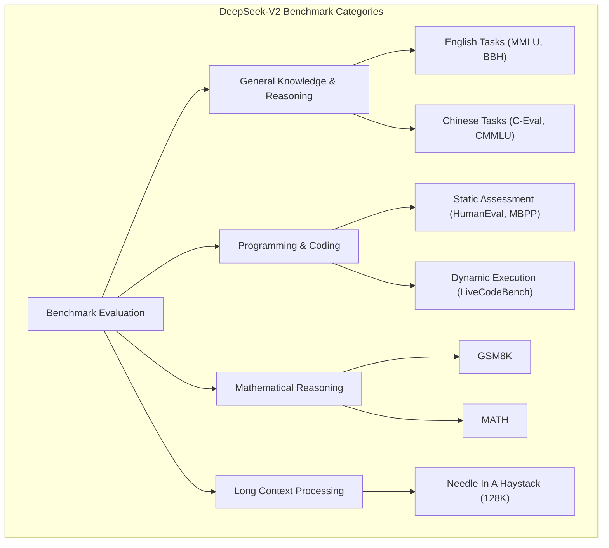
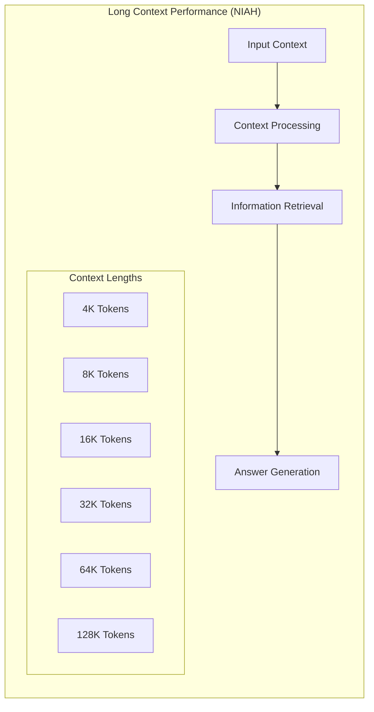
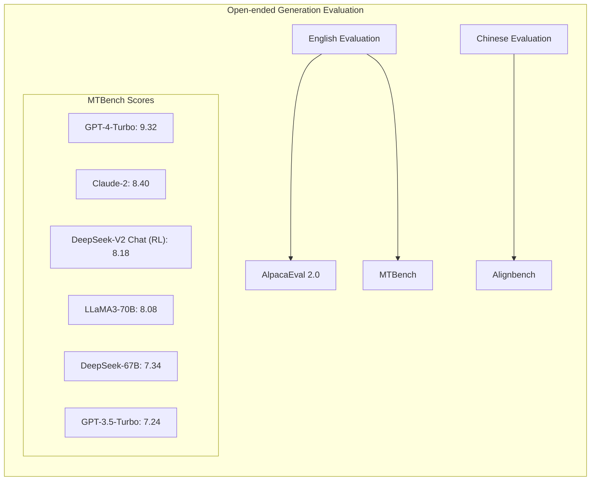
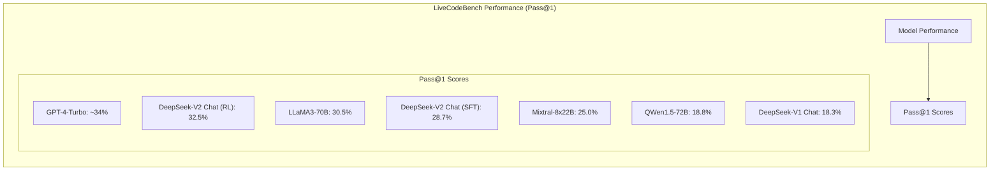

<!-- source: DeepWiki mcp.deepwiki.com · repo deepseek-ai/DeepSeek-V2 · page 2.1 Benchmark Results · fetched 2026-10-30 -->

# Benchmark Results

Relevant source files

The following files were used as context for generating this wiki page:

- [README.md](README.md)
- [deepseek-v2-tech-report.pdf](deepseek-v2-tech-report.pdf)
- [figures/code_benchmarks.png](figures/code_benchmarks.png)

This document provides a comprehensive overview of the benchmark performance of DeepSeek-V2 models across various tasks and domains. It details quantitative evaluations on standard benchmarks, comparing the DeepSeek-V2 family with other leading language models.

Sources: [README.md:89-200]()

## 1. Overview of Benchmark Categories

DeepSeek-V2 models are evaluated on four major categories of tasks:

1. **General Knowledge & Reasoning**
   - English language benchmarks (MMLU, BBH)
   - Chinese language benchmarks (C-Eval, CMMLU)

2. **Programming & Coding**
   - Static code assessments (HumanEval, MBPP)
   - Dynamic code execution (LiveCodeBench)

3. **Mathematical Reasoning**
   - GSM8K
   - MATH

4. **Long Context Processing**
   - Needle In A Haystack (NIAH)

Sources: [README.md:91-105](), [README.md:127-130]()

## 2. Base Model Results

### 2.1. Large Models Comparison (>67B Parameters)

This table compares the performance of DeepSeek-V2 base model (236B total parameters) with other large language models across standard benchmarks.

| **Benchmark** | **Domain** | **LLaMA3 70B** | **Mixtral 8x22B** | **DeepSeek-V1 (Dense-67B)** | **DeepSeek-V2 (MoE-236B)** |
|:-------------:|:----------:|:--------------:|:-----------------:|:---------------------------:|:--------------------------:|
| **MMLU** | English | 78.9 | 77.6 | 71.3 | 78.5 |
| **BBH** | English | 81.0 | 78.9 | 68.7 | 78.9 |
| **C-Eval** | Chinese | 67.5 | 58.6 | 66.1 | 81.7 |
| **CMMLU** | Chinese | 69.3 | 60.0 | 70.8 | 84.0 |
| **HumanEval** | Code | 48.2 | 53.1 | 45.1 | 48.8 |
| **MBPP** | Code | 68.6 | 64.2 | 57.4 | 66.6 |
| **GSM8K** | Math | 83.0 | 80.3 | 63.4 | 79.2 |
| **Math** | Math | 42.2 | 42.5 | 18.7 | 43.6 |

Key observations:
- DeepSeek-V2 demonstrates significant improvements over DeepSeek-V1 across all benchmarks
- Particularly strong performance on Chinese language tasks (C-Eval, CMMLU)
- Competitive with LLaMA3 70B and Mixtral 8x22B on English tasks
- Major improvement in mathematical reasoning capabilities compared to DeepSeek-V1

Sources: [README.md:93-105]()

### 2.2. Small Models Comparison (<16B Parameters)

The table below compares DeepSeek-V2-Lite with other smaller models.

| **Benchmark** | **Domain** | **DeepSeek 7B (Dense)** | **DeepSeekMoE 16B** | **DeepSeek-V2-Lite (MoE-16B)** |
|:-------------:|:----------:|:--------------:|:-----------------:|:--------------------------:|
| **Architecture** | - | MHA+Dense | MHA+MoE | MLA+MoE |
| **MMLU** | English | 48.2 | 45.0 | 58.3 |
| **BBH** | English | 39.5 | 38.9 | 44.1 |
| **C-Eval** | Chinese | 45.0 | 40.6 | 60.3 |
| **CMMLU** | Chinese | 47.2 | 42.5 | 64.3 |
| **HumanEval** | Code | 26.2 | 26.8 | 29.9 |
| **MBPP** | Code | 39.0 | 39.2 | 43.2 |
| **GSM8K** | Math | 17.4 | 18.8 | 41.1 |
| **Math** | Math | 3.3 | 4.3 | 17.1 |

Key observations:
- DeepSeek-V2-Lite significantly outperforms previous smaller models
- The MLA+MoE architecture shows substantial advantages over previous architectures
- Particularly impressive improvements in mathematical reasoning tasks

Sources: [README.md:108-122]()

### 2.3. Long Context Performance

DeepSeek-V2 has been evaluated on the "Needle In A Haystack" (NIAH) test to measure its ability to retrieve information from long contexts up to 128K tokens.

Results show that DeepSeek-V2 maintains consistent performance across all context lengths up to 128K tokens, demonstrating the effectiveness of the Multi-head Latent Attention (MLA) architecture in handling long documents.

Sources: [README.md:126-131]()

## 3. Chat Model Results

### 3.1. Large Chat Models Comparison (>67B Parameters)

This table compares the performance of DeepSeek-V2 Chat models (both SFT and RL versions) with other large chat models.

| **Benchmark** | **Domain** | **QWen1.5 72B Chat** | **Mixtral 8x22B** | **LLaMA3 70B Instruct** | **DeepSeek-V1 Chat (SFT)** | **DeepSeek-V2 Chat (SFT)** | **DeepSeek-V2 Chat (RL)** |
|:-----------:|:----------------:|:------------------:|:---------------:|:---------------------:|:-------------:|:-----------------------:|:----------------------:|
| **MMLU** | English | 76.2 | 77.8 | 80.3 | 71.1 | 78.4 | 77.8 |
| **BBH** | English | 65.9 | 78.4 | 80.1 | 71.7 | 81.3 | 79.7 |
| **C-Eval** | Chinese | 82.2 | 60.0 | 67.9 | 65.2 | 80.9 | 78.0 |
| **CMMLU** | Chinese | 82.9 | 61.0 | 70.7 | 67.8 | 82.4 | 81.6 |
| **HumanEval** | Code | 68.9 | 75.0 | 76.2 | 73.8 | 76.8 | 81.1 |
| **MBPP** | Code | 52.2 | 64.4 | 69.8 | 61.4 | 70.4 | 72.0 |
| **LiveCodeBench (0901-0401)** | Code | 18.8 | 25.0 | 30.5 | 18.3 | 28.7 | 32.5 |
| **GSM8K** | Math | 81.9 | 87.9 | 93.2 | 84.1 | 90.8 | 92.2 |
| **Math** | Math | 40.6 | 49.8 | 48.5 | 32.6 | 52.7 | 53.9 |

Key observations:
- DeepSeek-V2 Chat (RL) demonstrates superior performance in coding tasks, particularly in LiveCodeBench
- The RL-tuned version shows improvements over the SFT version across most benchmarks
- DeepSeek-V2 Chat models show significant improvements over DeepSeek-V1 Chat
- Strong performance in mathematical reasoning compared to competitors

Sources: [README.md:135-148]()

### 3.2. Small Chat Models Comparison (<16B Parameters)

| **Benchmark** | **Domain** | **DeepSeek 7B Chat (SFT)** | **DeepSeekMoE 16B Chat (SFT)** | **DeepSeek-V2-Lite 16B Chat (SFT)** |
|:-----------:|:----------------:|:------------------:|:---------------:|:---------------------:|
| **MMLU** | English | 49.7 | 47.2 | 55.7 |
| **BBH** | English | 43.1 | 42.2 | 48.1 |
| **C-Eval** | Chinese | 44.7 | 40.0 | 60.1 |
| **CMMLU** | Chinese | 51.2 | 49.3 | 62.5 |
| **HumanEval** | Code | 45.1 | 45.7 | 57.3 |
| **MBPP** | Code | 39.0 | 46.2 | 45.8 |
| **GSM8K** | Math | 62.6 | 62.2 | 72.0 |
| **Math** | Math | 14.7 | 15.2 | 27.9 |

Key observations:
- DeepSeek-V2-Lite Chat significantly outperforms previous smaller models
- Notable improvements in Chinese language tasks (C-Eval, CMMLU)
- Strong performance on coding tasks (HumanEval)
- Substantial improvements in mathematical reasoning capabilities

Sources: [README.md:152-166]()

## 4. Open-ended Generation Evaluation

### 4.1. English Open-ended Generation

DeepSeek-V2 Chat models have been evaluated on open-ended generation tasks using:

1. **AlpacaEval 2.0**: Measures the quality of responses compared to strong baselines
2. **MTBench**: Evaluates multi-turn conversation capabilities

The MTBench evaluation shows that DeepSeek-V2 Chat (RL) scores 8.18, placing it competitively among leading models like GPT-4-Turbo (9.32), Claude-2 (8.40), and LLaMA3-70B (8.08).

Sources: [README.md:168-172](), [figures/mtbench.png]()

### 4.2. Chinese Open-ended Generation (Alignbench)

Alignbench measures the quality of Chinese language responses across reasoning and language quality dimensions.

| **Model** | **Open/Closed** | **Total Score** | **Chinese Reasoning** | **Chinese Language** |
| :---: | :---: | :---: | :---: | :---: |
| gpt-4-1106-preview | Closed | 8.01 | 7.73 | 8.29 |
| DeepSeek-V2 Chat (RL) | Open | 7.91 | 7.45 | 8.36 |
| erniebot-4.0-202404 (文心一言) | Closed | 7.89 | 7.61 | 8.17 |
| DeepSeek-V2 Chat (SFT) | Open | 7.74 | 7.30 | 8.17 |
| gpt-4-0613 | Closed | 7.53 | 7.47 | 7.59 |
| erniebot-4.0-202312 (文心一言) | Closed | 7.36 | 6.84 | 7.88 |
| moonshot-v1-32k-202404 (月之暗面) | Closed | 7.22 | 6.42 | 8.02 |
| Qwen1.5-72B-Chat (通义千问) | Open | 7.19 | 6.45 | 7.93 |
| DeepSeek-67B-Chat | Open | 6.43 | 5.75 | 7.11 |
| Yi-34B-Chat (零一万物) | Open | 6.12 | 4.86 | 7.38 |
| gpt-3.5-turbo-0613 | Closed | 6.08 | 5.35 | 6.71 |
| DeepSeek-V2-Lite 16B Chat | Open | 6.01 | 4.71 | 7.32 |

Key observations:
- DeepSeek-V2 Chat (RL) achieves a near state-of-the-art total score of 7.91, close to GPT-4
- It excels particularly in Chinese language quality (8.36), surpassing GPT-4
- Significant improvement over DeepSeek-67B-Chat (6.43)
- DeepSeek-V2-Lite 16B Chat still shows competitive performance for its size

Sources: [README.md:175-192]()

## 5. Coding Benchmark Results

### 5.1. LiveCodeBench Evaluation

LiveCodeBench (0901-0401) is designed to evaluate models on live coding challenges, testing practical programming capabilities.

DeepSeek-V2 Chat (RL) achieves a Pass@1 score of 32.5% on LiveCodeBench, outperforming many other sophisticated models and demonstrating strong code generation capabilities in practical scenarios.

Sources: [README.md:195-200](), [figures/code_benchmarks.png]()

## 6. Benchmark Methodology and Interpretation

The benchmark evaluation for DeepSeek-V2 follows standard practices in the field:

1. **Standard Benchmarks**: These are evaluated using established protocols for each dataset, typically in few-shot settings as described in the DeepSeek-V2 paper.

2. **Open-ended Generation**:
   - AlpacaEval 2.0 and MTBench use human preference models to evaluate outputs
   - Alignbench evaluates both reasoning and language quality aspects in Chinese

3. **Code Evaluation**:
   - Static tests (HumanEval, MBPP) evaluate code correctness through test cases
   - LiveCodeBench tests models in more dynamic, practical coding scenarios

When interpreting these results, it's important to consider that:
- Different benchmarks test different aspects of model capabilities
- Performance can vary based on evaluation settings (zero-shot vs. few-shot)
- Some benchmarks may favor certain architectural designs
- Real-world performance may differ from benchmark results

Sources: [README.md:124-125]()

## 7. Summary

DeepSeek-V2 demonstrates strong performance across a wide range of benchmarks, showing:

1. **Strong multilingual capabilities**: Particularly excelling in Chinese language tasks while maintaining competitive performance on English benchmarks.

2. **Improved coding capabilities**: The RL-tuned version especially shows strong results on LiveCodeBench, demonstrating practical coding skills.

3. **Enhanced mathematical reasoning**: Significant improvements over previous DeepSeek models in mathematical tasks.

4. **Long context handling**: Consistent performance across context lengths up to 128K tokens.

5. **Efficient architecture**: These results are achieved with the MLA+MoE architecture that requires fewer activated parameters per token compared to dense models.

The comprehensive benchmark results indicate that DeepSeek-V2 represents a significant advancement in language model capabilities across multiple dimensions while maintaining efficiency.

Sources: [README.md:57-64]()

---

