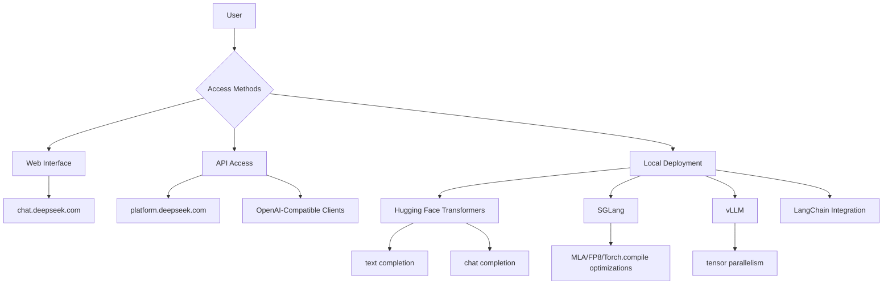
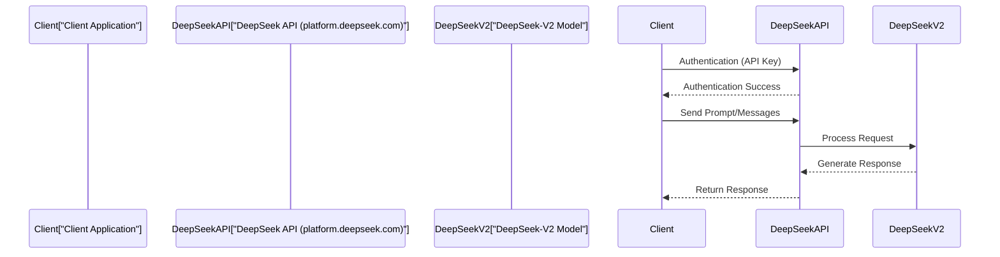

<!-- source: DeepWiki mcp.deepwiki.com · repo deepseek-ai/DeepSeek-V2 · page 3 Usage Guide · fetched 2026-10-30 -->

# Usage Guide

<details>
<summary>Relevant source files</summary>

The following files were used as context for generating this wiki page:

- [README.md](README.md)

</details>


This guide provides comprehensive instructions for accessing and utilizing DeepSeek-V2 models through various deployment methods, including web interface, API, and local deployment options. For information about model architecture specifics, see [Model Architecture](#1.1). For details on training methodology and evaluation results, see [Training and Evaluation](#2).

## Overview of Access Options

DeepSeek-V2 models can be accessed through multiple interfaces, each suited for different use cases and technical requirements.



Sources: [README.md:42-49](), [README.md:212-215](), [README.md:224-370]()

## Model Variants

DeepSeek-V2 is available in multiple variants with different parameter sizes and capabilities:

| **Model** | **Total Parameters** | **Activated Parameters** | **Context Length** | **Type** |
|------------|-----------------|-------------------|---------------|---------|
| DeepSeek-V2-Lite | 16B | 2.4B | 32K | Base |
| DeepSeek-V2-Lite-Chat | 16B | 2.4B | 32K | SFT |
| DeepSeek-V2 | 236B | 21B | 128K | Base |
| DeepSeek-V2-Chat | 236B | 21B | 128K | RL |

The "Base" models are pretrained language models, while "Chat" variants are fine-tuned for dialogue applications.

Sources: [README.md:75-85]()

## Web Interface

The simplest way to interact with DeepSeek-V2 is through the official web interface at [chat.deepseek.com](https://chat.deepseek.com). This requires no technical setup and provides immediate access to the model's capabilities.

Sources: [README.md:212-213]()

## API Access

DeepSeek provides an OpenAI-compatible API accessible at [platform.deepseek.com](https://platform.deepseek.com/). The API offers millions of free tokens upon signup with additional usage available on a pay-as-you-go basis.



Sources: [README.md:214-220]()

## Local Deployment

For users who require more control or have specific integration needs, DeepSeek-V2 can be deployed locally using several frameworks.

### Hardware Requirements

**Important**: To run the full DeepSeek-V2 (236B) model in BF16 format for inference, you need 8 GPUs with 80GB memory each. DeepSeek-V2-Lite models have lower but still substantial hardware requirements.

Sources: [README.md:223-224]()

### Deployment Options Comparison

| **Framework** | **Pros** | **Cons** | **Best For** |
|---------------|----------|----------|--------------|
| Hugging Face Transformers | Simple API, widely used | Slower performance | Quick prototyping, existing HF pipelines |
| SGLang | MLA optimizations, FP8 support, Torch Compile | Additional setup required | Production deployments requiring optimal performance |
| vLLM | Efficient serving, high throughput | Requires specific PR integration | Production deployments requiring scalability |
| LangChain | Simple integration with AI workflows | Requires API or local deployment | Building complex applications and chains |

Sources: [README.md:87-88](), [README.md:224-370]()

### Using Hugging Face Transformers

Hugging Face's Transformers library provides a straightforward way to use DeepSeek-V2 models:

#### Text Completion (Base Models)

```python
import torch
from transformers import AutoTokenizer, AutoModelForCausalLM, GenerationConfig

model_name = "deepseek-ai/DeepSeek-V2"
tokenizer = AutoTokenizer.from_pretrained(model_name, trust_remote_code=True)
# `max_memory` should be set based on your devices
max_memory = {i: "75GB" for i in range(8)}
# `device_map` cannot be set to `auto`
model = AutoModelForCausalLM.from_pretrained(model_name, trust_remote_code=True, 
                                             device_map="sequential", 
                                             torch_dtype=torch.bfloat16, 
                                             max_memory=max_memory, 
                                             attn_implementation="eager")
model.generation_config = GenerationConfig.from_pretrained(model_name)
model.generation_config.pad_token_id = model.generation_config.eos_token_id

text = "An attention function can be described as mapping a query and a set of key-value pairs to an output, where the query, keys, values, and output are all vectors. The output is"
inputs = tokenizer(text, return_tensors="pt")
outputs = model.generate(**inputs.to(model.device), max_new_tokens=100)

result = tokenizer.decode(outputs[0], skip_special_tokens=True)
print(result)
```

Sources: [README.md:228-246]()

#### Chat Completion (Chat Models)

```python
import torch
from transformers import AutoTokenizer, AutoModelForCausalLM, GenerationConfig

model_name = "deepseek-ai/DeepSeek-V2-Chat"
tokenizer = AutoTokenizer.from_pretrained(model_name, trust_remote_code=True)
# `max_memory` should be set based on your devices
max_memory = {i: "75GB" for i in range(8)}
# `device_map` cannot be set to `auto`
model = AutoModelForCausalLM.from_pretrained(model_name, trust_remote_code=True, 
                                             device_map="sequential", 
                                             torch_dtype=torch.bfloat16, 
                                             max_memory=max_memory, 
                                             attn_implementation="eager")
model.generation_config = GenerationConfig.from_pretrained(model_name)
model.generation_config.pad_token_id = model.generation_config.eos_token_id

messages = [
    {"role": "user", "content": "Write a piece of quicksort code in C++"}
]
input_tensor = tokenizer.apply_chat_template(messages, add_generation_prompt=True, return_tensors="pt")
outputs = model.generate(input_tensor.to(model.device), max_new_tokens=100)

result = tokenizer.decode(outputs[0][input_tensor.shape[1]:], skip_special_tokens=True)
print(result)
```

Sources: [README.md:250-270]()

#### Chat Template Format

DeepSeek-V2 Chat models use a specific template format found in the `tokenizer_config.json` file in the Hugging Face model repository:

Basic format:
```
<｜begin▁of▁sentence｜>User: {user_message_1}

---

