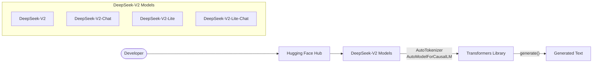
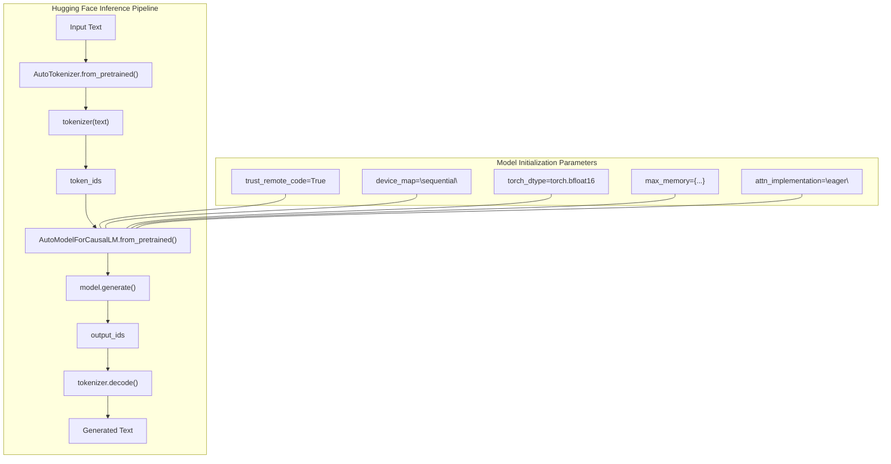
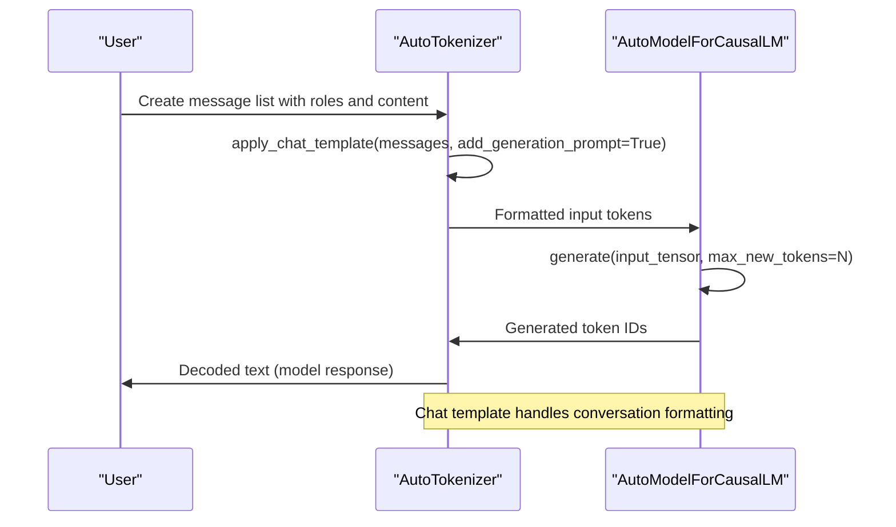
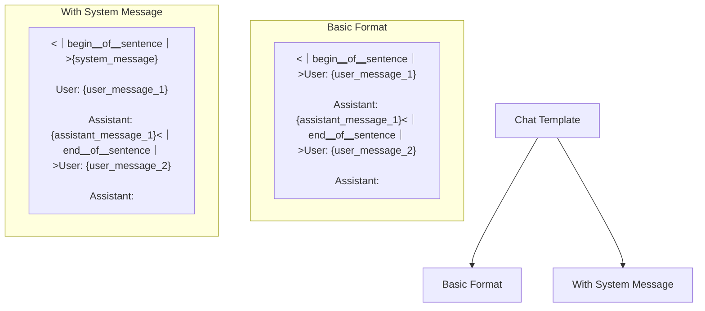

<!-- source: DeepWiki mcp.deepwiki.com · repo deepseek-ai/DeepSeek-V2 · page 3.1 Hugging Face Integration · fetched 2026-10-30 -->

# Hugging Face Integration

<details>
<summary>Relevant source files</summary>

The following files were used as context for generating this wiki page:

- [README.md](README.md)

</details>


This document provides detailed guidance on integrating and using DeepSeek-V2 models with the Hugging Face Transformers library. It covers model loading, text completion, chat completion, system requirements, and known limitations. For information about alternative inference options such as SGLang and vLLM, please see [SGLang and vLLM](#3.2).

## Overview

DeepSeek-V2 models are available on Hugging Face's model hub and can be used directly with the Transformers library. This integration allows users to leverage DeepSeek-V2's capabilities in their applications without requiring custom implementations.

The following diagram illustrates the high-level integration flow:



Sources: [README.md:225-226]()

## Available Models

DeepSeek-V2 offers several model variants on Hugging Face, each designed for different use cases and computational budgets:

| Model | Total Parameters | Activated Parameters | Context Length | Use Case |
|-------|-----------------|---------------------|---------------|----------|
| DeepSeek-V2 | 236B | 21B | 128K | General text generation |
| DeepSeek-V2-Chat | 236B | 21B | 128K | Conversational AI (RL) |
| DeepSeek-V2-Lite | 16B | 2.4B | 32K | Lightweight text generation |
| DeepSeek-V2-Lite-Chat | 16B | 2.4B | 32K | Lightweight conversational AI (SFT) |

Sources: [README.md:75-85]()

## System Requirements

To use DeepSeek-V2 models with Hugging Face, you need:

- **Large GPU Memory**: 8x 80GB GPUs are required for running DeepSeek-V2 (236B) models in BF16 format
- **Hardware-specific settings**: Special attention to memory allocation and device mapping is needed

Note that DeepSeek-V2-Lite models have lower memory requirements due to their smaller parameter count.

Sources: [README.md:223-224]()

## Inference Architecture

This diagram illustrates the technical components involved in the DeepSeek-V2 Hugging Face inference pipeline:



Sources: [README.md:227-239](), [README.md:252-261]()

## Text Completion

For basic text completion with DeepSeek-V2 base models, follow these steps:

1. **Install dependencies**: Ensure you have the Transformers library installed
2. **Load tokenizer and model**: Use the correct model name and required parameters
3. **Generate text**: Pass your input to the model and generate the completion

### Code Example

```python
import torch
from transformers import AutoTokenizer, AutoModelForCausalLM, GenerationConfig

model_name = "deepseek-ai/DeepSeek-V2"
tokenizer = AutoTokenizer.from_pretrained(model_name, trust_remote_code=True)
# `max_memory` should be set based on your devices
max_memory = {i: "75GB" for i in range(8)}
# `device_map` cannot be set to `auto`
model = AutoModelForCausalLM.from_pretrained(
    model_name, 
    trust_remote_code=True, 
    device_map="sequential", 
    torch_dtype=torch.bfloat16, 
    max_memory=max_memory, 
    attn_implementation="eager"
)
model.generation_config = GenerationConfig.from_pretrained(model_name)
model.generation_config.pad_token_id = model.generation_config.eos_token_id

text = "An attention function can be described as mapping a query and a set of key-value pairs to an output, where the query, keys, values, and output are all vectors. The output is"
inputs = tokenizer(text, return_tensors="pt")
outputs = model.generate(**inputs.to(model.device), max_new_tokens=100)

result = tokenizer.decode(outputs[0], skip_special_tokens=True)
print(result)
```

Sources: [README.md:228-246]()

## Chat Completion

For conversational use cases, DeepSeek-V2-Chat models provide optimized performance:

1. **Structure conversation**: Format your conversation as a list of message dictionaries
2. **Apply chat template**: Use the tokenizer's `apply_chat_template` method
3. **Generate response**: Pass the templated input to the model

### Chat Flow Architecture



Sources: [README.md:250-271]()

### Code Example

```python
import torch
from transformers import AutoTokenizer, AutoModelForCausalLM, GenerationConfig

model_name = "deepseek-ai/DeepSeek-V2-Chat"
tokenizer = AutoTokenizer.from_pretrained(model_name, trust_remote_code=True)
# `max_memory` should be set based on your devices
max_memory = {i: "75GB" for i in range(8)}
# `device_map` cannot be set to `auto`
model = AutoModelForCausalLM.from_pretrained(
    model_name, 
    trust_remote_code=True, 
    device_map="sequential", 
    torch_dtype=torch.bfloat16, 
    max_memory=max_memory, 
    attn_implementation="eager"
)
model.generation_config = GenerationConfig.from_pretrained(model_name)
model.generation_config.pad_token_id = model.generation_config.eos_token_id

messages = [
    {"role": "user", "content": "Write a piece of quicksort code in C++"}
]
input_tensor = tokenizer.apply_chat_template(messages, add_generation_prompt=True, return_tensors="pt")
outputs = model.generate(input_tensor.to(model.device), max_new_tokens=100)

result = tokenizer.decode(outputs[0][input_tensor.shape[1]:], skip_special_tokens=True)
print(result)
```

Sources: [README.md:252-270]()

## Chat Template Structure

DeepSeek-V2-Chat models use a specific template format for structuring conversations:



The chat template is stored in the `tokenizer_config.json` file in the Hugging Face model repository and is automatically used when calling `tokenizer.apply_chat_template()`.

Sources: [README.md:273-295]()

## Important Implementation Details

When using DeepSeek-V2 models with Hugging Face, pay attention to these critical requirements:

1. **Device Mapping**: Always use `device_map="sequential"`, not `"auto"`, due to model architecture requirements
2. **Tensor Parallelism**: The model needs to be split across multiple GPUs
3. **Memory Management**: Set appropriate `max_memory` values based on your hardware
4. **Data Type**: Use `torch_dtype=torch.bfloat16` for optimal performance
5. **Attention Implementation**: Specify `attn_implementation="eager"` as required by the model

Sources: [README.md:235-239](), [README.md:257-261]()

## Performance Considerations

While Hugging Face integration provides a straightforward way to use DeepSeek-V2 models, there are some performance limitations to be aware of:

- Hugging Face implementations may be slower than DeepSeek's internal codebase
- For production or performance-critical applications, consider using:
  - SGLang, which offers MLA optimizations, FP8 (W8A8), FP8 KV Cache, and Torch Compile
  - vLLM, which requires a specific PR to be merged (see [SGLang and vLLM](#3.2))

Sources: [README.md:87-88](), [README.md:296-298]()

## Troubleshooting

Common issues when using DeepSeek-V2 with Hugging Face:

| Issue | Solution |
|-------|----------|
| Out of memory errors | Ensure you have sufficient GPU memory (8x 80GB for DeepSeek-V2) and properly configured `max_memory` |
| Slow inference | Consider using SGLang or vLLM for better performance |
| Device mapping errors | Ensure you use `device_map="sequential"` instead of `"auto"` |
| Unable to load model | Verify you're using `trust_remote_code=True` |
| Generation quality issues | Check that you're using the correct model variant for your use case (base vs. chat) |

Sources: [README.md:223-224](), [README.md:237](), [README.md:87-88]()

## Summary

Hugging Face integration offers a straightforward way to use DeepSeek-V2 models for both text completion and conversational AI applications. While there are some performance trade-offs compared to specialized inference engines, the familiar API and extensive ecosystem make it an accessible option for many users.

For applications requiring maximum performance, consider the alternatives discussed in [SGLang and vLLM](#3.2).

---

