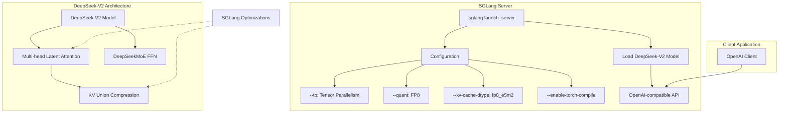
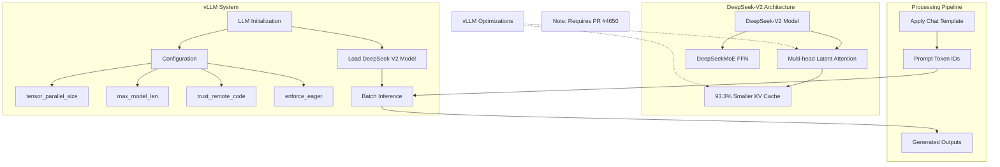
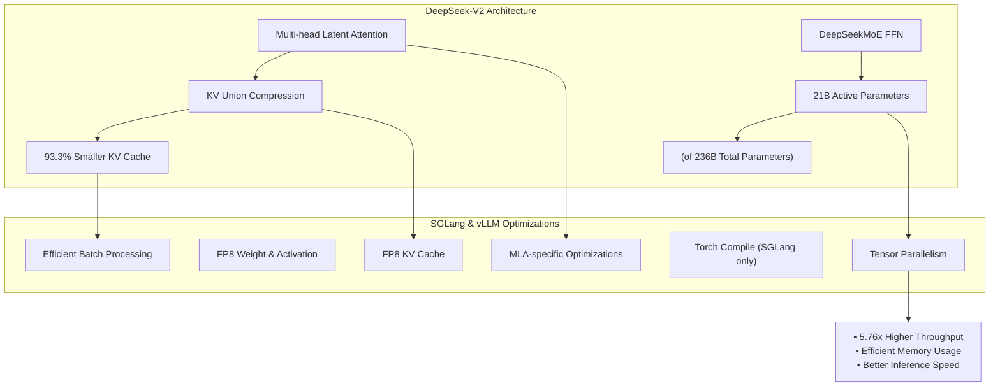

<!-- source: DeepWiki mcp.deepwiki.com · repo deepseek-ai/DeepSeek-V2 · page 3.2 SGLang and vLLM · fetched 2026-10-30 -->

# SGLang and vLLM

<details>
<summary>Relevant source files</summary>

The following files were used as context for generating this wiki page:

- [README.md](README.md)

</details>


## Purpose and Scope

This document provides detailed instructions for using DeepSeek-V2 models with SGLang and vLLM, two recommended inference frameworks that are optimized for DeepSeek-V2's architectural innovations. These frameworks offer significant performance improvements over standard Hugging Face Transformers inference. For information about using Hugging Face directly, see [Hugging Face Integration](#3.1). For API and LangChain integration, see [API and LangChain](#3.3).

## Overview

DeepSeek-V2 introduces two key architectural innovations: Multi-head Latent Attention (MLA) and DeepSeekMoE architecture. While standard inference methods can use these models, SGLang and vLLM provide specialized optimizations that fully leverage these innovations, resulting in better performance and efficiency.

### Why Use Specialized Inference Frameworks?

| Feature | Hugging Face Transformers | SGLang | vLLM |
|---------|---------------------------|--------|------|
| MLA Optimizations | Limited | ✓ Full support | ✓ Full support (with PR) |
| FP8 Quantization | ✗ | ✓ | Limited |
| FP8 KV Cache | ✗ | ✓ | Limited |
| Torch Compile | Partial | ✓ | ✗ |
| Tensor Parallelism | Limited | ✓ | ✓ |
| OpenAI API Compatibility | ✗ | ✓ | ✓ |
| Batch Processing | Limited | Advanced | Advanced |

Sources: [README.md:297-332]()

## SGLang Integration

SGLang currently offers the most comprehensive optimization support for DeepSeek-V2, implementing MLA optimizations, FP8 quantization, FP8 KV Cache, and Torch Compile.

### Integration Architecture



Sources: [README.md:297-309]()

### Setting Up SGLang Server

SGLang allows you to launch an OpenAI API-compatible server with various optimization options:

```bash
# BF16, tensor parallelism = 8
python3 -m sglang.launch_server --model deepseek-ai/DeepSeek-V2-Chat --tp 8 --trust-remote-code

# BF16, w/ torch.compile (compilation takes several minutes)
python3 -m sglang.launch_server --model deepseek-ai/DeepSeek-V2-Lite-Chat --trust-remote-code --enable-torch-compile

# FP8, tensor parallelism = 8, FP8 KV cache
python3 -m sglang.launch_server --model deepseek-ai/DeepSeek-V2-Chat --tp 8 --trust-remote-code --quant fp8 --kv-cache-dtype fp8_e5m2
```

Sources: [README.md:299-309]()

### Client Integration

Once the SGLang server is running, you can interact with it using the OpenAI Python client:

```python
import openai
client = openai.Client(
    base_url="http://127.0.0.1:30000/v1", api_key="EMPTY")

# Chat completion
response = client.chat.completions.create(
    model="default",
    messages=[
        {"role": "system", "content": "You are a helpful AI assistant"},
        {"role": "user", "content": "List 3 countries and their capitals."},
    ],
    temperature=0,
    max_tokens=64,
)
print(response)
```

Sources: [README.md:311-329]()

## vLLM Integration

vLLM is another high-performance inference framework that supports DeepSeek-V2 models, offering excellent throughput through paged attention and continuous batching.

### Integration Architecture



Sources: [README.md:332-356]()

### Prerequisites for vLLM

To use vLLM with DeepSeek-V2, you need to merge a specific Pull Request into your vLLM codebase:
https://github.com/vllm-project/vllm/pull/4650

Sources: [README.md:332-333]()

### Example Usage

```python
from transformers import AutoTokenizer
from vllm import LLM, SamplingParams

max_model_len, tp_size = 8192, 8
model_name = "deepseek-ai/DeepSeek-V2-Chat"
tokenizer = AutoTokenizer.from_pretrained(model_name)
llm = LLM(model=model_name, tensor_parallel_size=tp_size, max_model_len=max_model_len, 
          trust_remote_code=True, enforce_eager=True)
sampling_params = SamplingParams(temperature=0.3, max_tokens=256, 
                                stop_token_ids=[tokenizer.eos_token_id])

messages_list = [
    [{"role": "user", "content": "Who are you?"}],
    [{"role": "user", "content": "Translate the following content into Chinese directly: DeepSeek-V2 adopts innovative architectures to guarantee economical training and efficient inference."}],
    [{"role": "user", "content": "Write a piece of quicksort code in C++."}],
]

prompt_token_ids = [tokenizer.apply_chat_template(messages, add_generation_prompt=True) 
                   for messages in messages_list]

outputs = llm.generate(prompt_token_ids=prompt_token_ids, sampling_params=sampling_params)

generated_text = [output.outputs[0].text for output in outputs]
print(generated_text)
```

Sources: [README.md:335-356]()

## How Optimizations Leverage DeepSeek-V2 Architecture



Sources: [README.md:58-65](), [README.md:203-209]()

## Performance Considerations

### Hardware Requirements

- **DeepSeek-V2 (236B)**: 8 GPUs with 80GB memory each for BF16 inference
- **DeepSeek-V2-Lite (16B)**: Lower requirements, can run on fewer/smaller GPUs

Sources: [README.md:223-224]()

### Optimization Options Comparison

| Optimization | Memory Impact | Speed Impact | Quality Impact |
|--------------|--------------|--------------|----------------|
| Tensor Parallelism | Distributes across GPUs | Faster with more GPUs | No impact |
| FP8 Quantization | Significantly reduces memory | Faster | Slight precision loss |
| FP8 KV Cache | Reduces KV cache size | Faster | Minimal impact |
| Torch Compile | No memory change | Faster after compilation | No impact |

### Framework Selection Guide

- **SGLang**: Best for comprehensive optimizations and maximum performance
- **vLLM**: Excellent for batch processing and stable production deployment
- **For Lite models**: Either framework works well, with SGLang offering more optimization options

## Troubleshooting

### Common Issues and Solutions

| Issue | Possible Cause | Solution |
|-------|---------------|----------|
| Out of memory errors | Model too large for available GPUs | Increase tensor parallelism or use quantization |
| Slow first inference | Torch compile initialization | Wait for compilation to complete (can take several minutes) |
| PR #4650 not found | Using standard vLLM release | Manually apply the PR to your local vLLM codebase |
| API compatibility issues | Incorrect endpoint or format | Ensure correct endpoint structure and parameters |

Sources: [README.md:87-88](), [README.md:305-306]()

## Conclusion

SGLang and vLLM provide optimized inference solutions for DeepSeek-V2 models, leveraging the architectural innovations to achieve better performance than standard inference frameworks. SGLang currently offers the most complete support for DeepSeek-V2's architectural features, while vLLM (with PR #4650) provides excellent performance for batch inference scenarios.

The DeepSeek-V2 architecture, with its innovative MLA and DeepSeekMoE components, benefits significantly from these specialized inference frameworks, achieving up to 5.76x higher generation throughput compared to traditional approaches.

---

