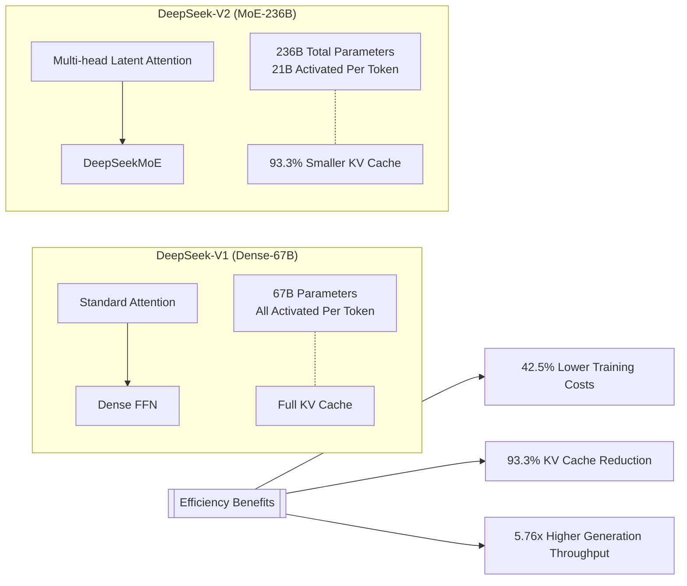
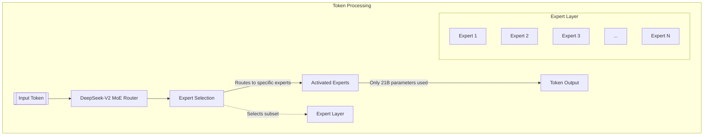
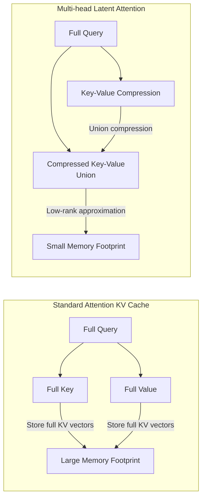
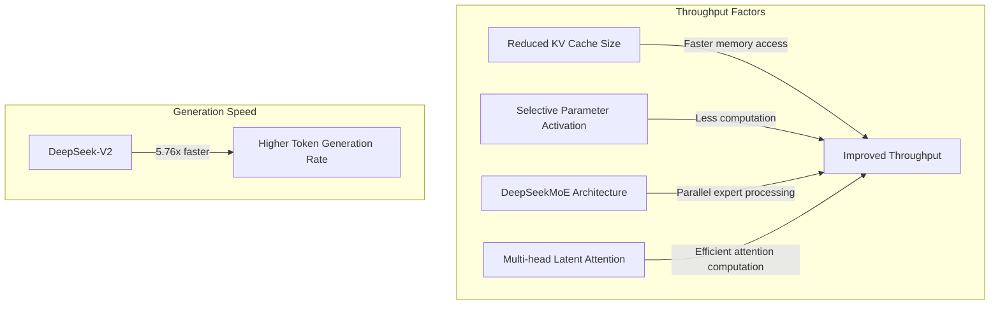
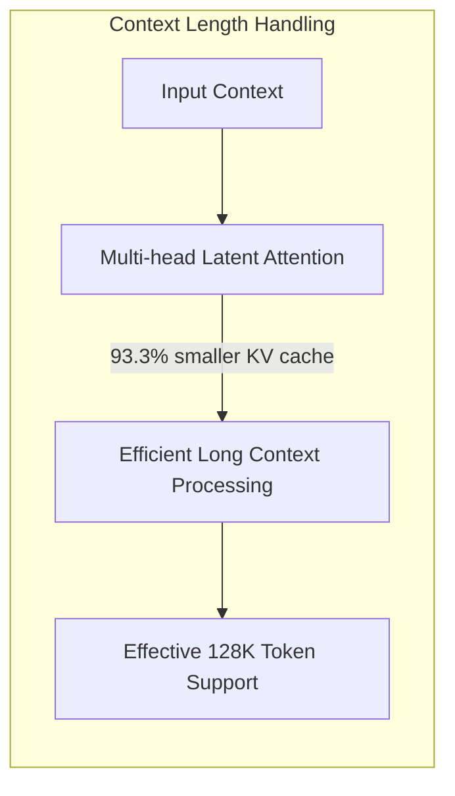
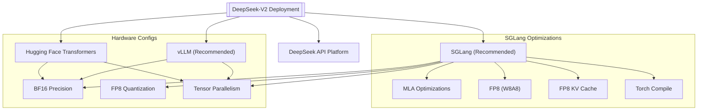

<!-- source: DeepWiki mcp.deepwiki.com · repo deepseek-ai/DeepSeek-V2 · page 4 Efficiency and Performance · fetched 2026-10-30 -->

# Efficiency and Performance

<details>
<summary>Relevant source files</summary>

The following files were used as context for generating this wiki page:

- [README.md](README.md)
- [deepseek-v2-tech-report.pdf](deepseek-v2-tech-report.pdf)

</details>


This document provides a detailed analysis of the efficiency and performance aspects of DeepSeek-V2, focusing on the architectural innovations that enable economical training, memory-efficient inference, and increased throughput. For information about the overall model architecture, see [Model Architecture](#1.1).

## 1. Efficiency Overview

DeepSeek-V2 represents a significant advancement in large language model efficiency through its innovative architecture. Compared to the previous DeepSeek-V1 model (Dense-67B), DeepSeek-V2 achieves:

- **42.5% reduction in training costs**
- **93.3% reduction in KV cache size**
- **5.76x higher generation throughput**
- **Stronger performance on benchmarks while using a more efficient architecture**

These improvements are achieved through two key architectural innovations: Multi-head Latent Attention (MLA) and DeepSeekMoE (Mixture-of-Experts).



Sources: [README.md:58-65]()

## 2. Parameter Efficiency with Mixture-of-Experts

DeepSeek-V2 employs a Mixture-of-Experts (MoE) approach that allows for significant parameter efficiency. While the model contains a total of 236B parameters, only 21B (approximately 8.9%) are activated during the processing of each token.

### 2.1 Parameter Activation Comparison



The MoE architecture selectively routes tokens to specific experts, resulting in only a fraction of the total parameters being used for each token. This approach enables:

1. **Larger model capacity** (236B total parameters) that effectively acts like a much smaller model (21B) during inference
2. **Reduced computational costs** for both training and inference
3. **Better parameter utilization** as experts can specialize in different aspects of language understanding

Sources: [README.md:58-65](), [README.md:203-209]()

## 3. Multi-head Latent Attention (MLA)

One of the major efficiency innovations in DeepSeek-V2 is the Multi-head Latent Attention (MLA) mechanism, which dramatically reduces the memory requirements for inference while maintaining model quality.

### 3.1 KV Cache Reduction



MLA uses a low-rank key-value union compression technique that:

- Reduces KV cache size by 93.3%
- Eliminates the memory bottleneck during inference
- Enables efficient handling of long context windows (up to 128K tokens)

The compression process maintains model quality while dramatically reducing memory requirements, which has significant implications for inference efficiency.

Sources: [README.md:204-205]()

## 4. Throughput and Generation Speed

DeepSeek-V2's architectural optimizations lead to substantial improvements in generation throughput, achieving up to 5.76x higher throughput compared to the previous DeepSeek-V1 model.

### 4.1 Throughput Comparison



The increased throughput results from several compounding factors:
- Smaller memory footprint from KV cache reduction
- Fewer active parameters needed for each token
- Efficient attention computation
- Parallelization of expert processing

These improvements are particularly significant for deployment scenarios where generation speed is critical.

Sources: [README.md:58-65]()

## 5. Context Window Efficiency

DeepSeek-V2 demonstrates strong performance with long contexts up to 128K tokens, as validated by the Needle In A Haystack (NIAH) tests.



The efficient handling of long contexts is a direct result of the MLA architecture's KV cache reduction. Traditional models struggle with long contexts due to:
1. Quadratic attention complexity
2. Large memory requirements for KV cache storage

DeepSeek-V2 addresses both issues through its MLA implementation, enabling efficient processing of very long documents.

Sources: [README.md:126-132]()

## 6. Hardware Requirements and Deployment Options

### 6.1 Base Hardware Requirements

The model requires significant hardware resources for optimal performance:

```
To utilize DeepSeek-V2 in BF16 format for inference, 80GB*8 GPUs are required.
```

This requirement applies to the full DeepSeek-V2 model (236B total parameters). The DeepSeek-V2-Lite variant (16B total parameters) has lower hardware requirements.

### 6.2 Deployment Options and Optimizations

DeepSeek-V2 can be deployed through multiple frameworks, each with different optimization capabilities:



#### SGLang Optimizations
SGLang currently provides the most comprehensive optimizations:
- MLA-specific optimizations
- FP8 (W8A8) quantization
- FP8 KV Cache
- Torch Compile support

These optimizations can significantly reduce memory requirements and increase inference speed beyond the base improvements of the model architecture.

Sources: [README.md:223-224](), [README.md:296-329]()

## 7. Performance Comparisons with Other Models

DeepSeek-V2 achieves competitive performance on standardized benchmarks while maintaining its efficiency advantages.

| Architecture | Activated Parameters | KV Cache Size | Training Cost | Generation Throughput |
|--------------|----------------------|---------------|---------------|------------------------|
| DeepSeek-V1 (Dense-67B) | 67B | 100% | 100% | 1x |
| DeepSeek-V2 (MoE-236B) | 21B | 6.7% | 57.5% | 5.76x |

These efficiency improvements do not come at the cost of model quality, as demonstrated by DeepSeek-V2's strong performance across various benchmarks including MMLU, C-Eval, HumanEval, and GSM8K.

Sources: [README.md:58-65](), [README.md:90-106]()

## 8. Quantization and Further Optimizations

For scenarios requiring even greater efficiency, DeepSeek-V2 supports various quantization options:

1. **FP8 Quantization**: Available through SGLang, reducing model size while maintaining performance
2. **FP8 KV Cache**: Further reduces memory requirements for the key-value cache
3. **Torch Compile**: Accelerates execution through compilation optimizations

Example SGLang command for FP8 quantization with KV cache optimization:

```
python3 -m sglang.launch_server --model deepseek-ai/DeepSeek-V2-Chat --tp 8 --trust-remote-code --quant fp8 --kv-cache-dtype fp8_e5m2
```

These optimizations can be particularly valuable for deployment scenarios with limited hardware resources or when maximizing throughput is critical.

Sources: [README.md:296-329]()

## Summary

DeepSeek-V2 represents a significant advancement in LLM efficiency through its innovative MLA and DeepSeekMoE architectures. The model achieves substantial improvements in training costs, memory efficiency, and generation throughput compared to previous models while maintaining strong performance across a wide range of benchmarks.

The key efficiency innovations include:
1. Selective parameter activation (21B of 236B total parameters)
2. KV cache reduction (93.3% smaller)
3. Increased generation throughput (5.76x)
4. Efficient long context handling (up to 128K tokens)

These improvements, combined with the various deployment options and optimizations available, make DeepSeek-V2 particularly well-suited for production scenarios where efficiency and performance are critical considerations.

Sources: [README.md:55-209]()

---

