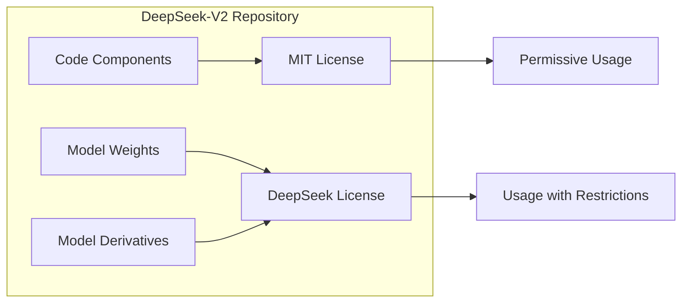
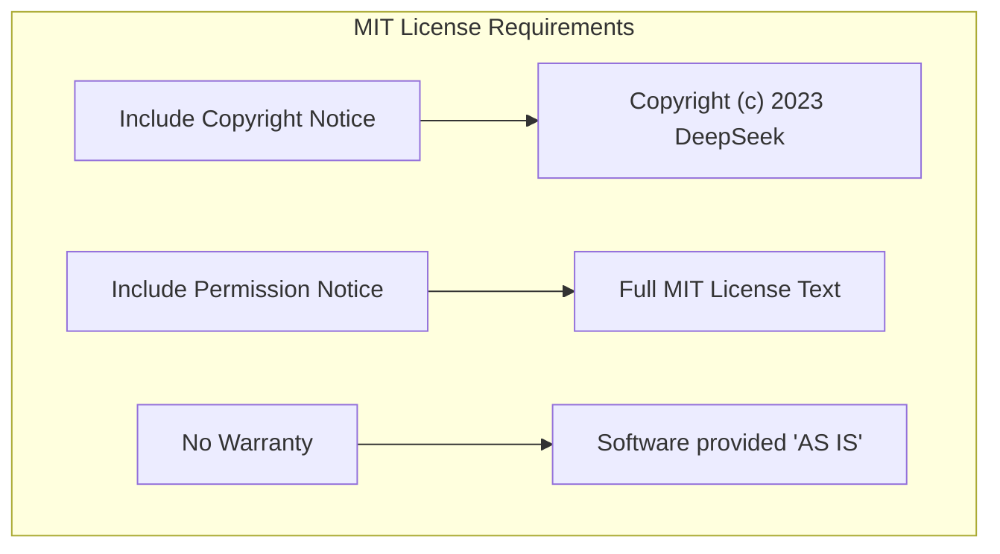
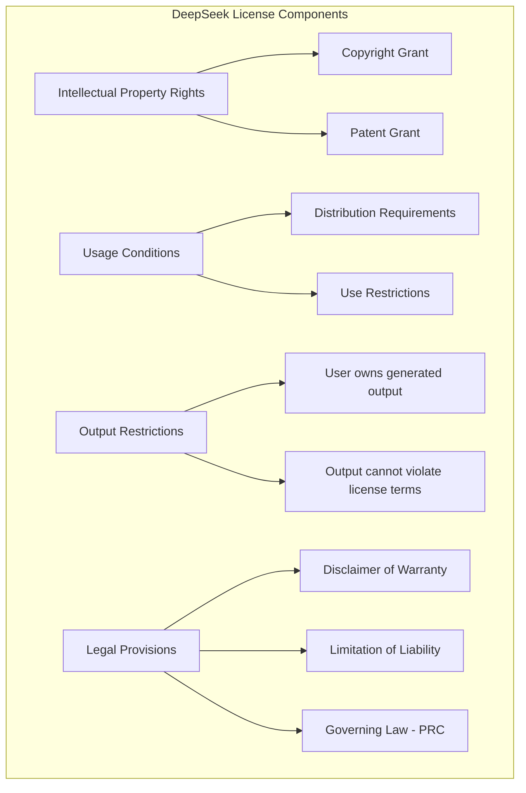
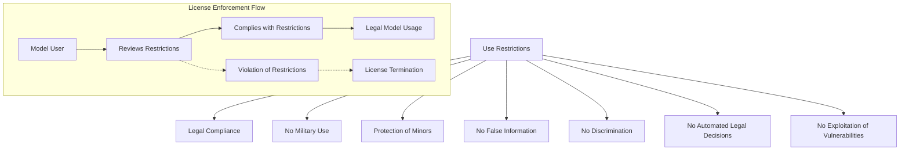
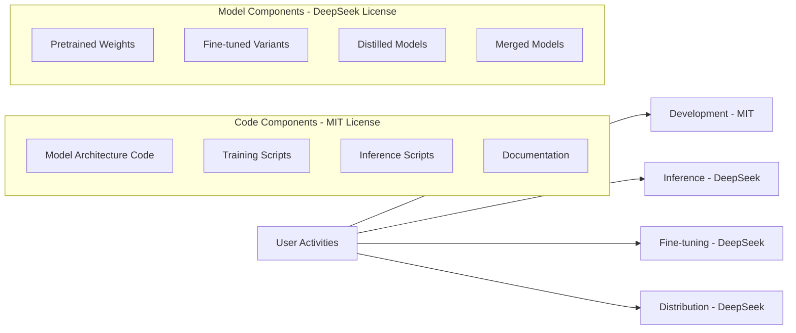
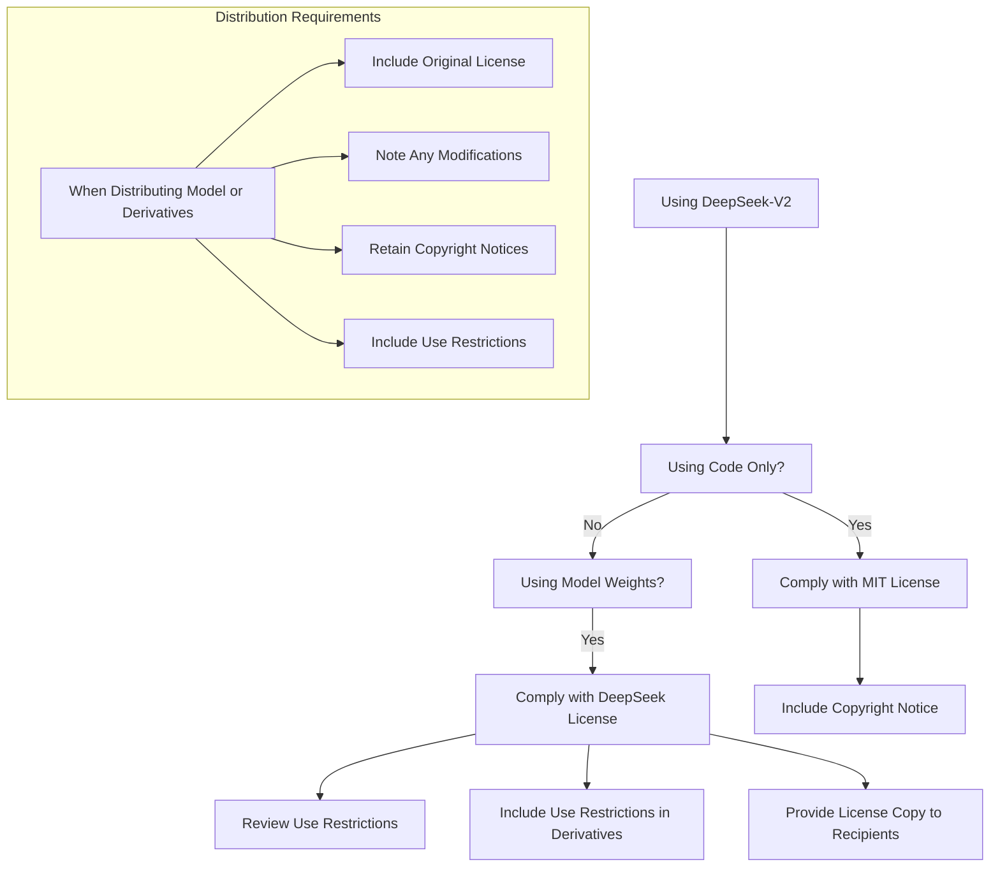

<!-- source: DeepWiki mcp.deepwiki.com · repo deepseek-ai/DeepSeek-V2 · page 5 Licensing Information · fetched 2026-10-30 -->

# Licensing Information

Relevant source files

The following files were used as context for generating this wiki page:

- [LICENSE-CODE](LICENSE-CODE)
- [LICENSE-MODEL](LICENSE-MODEL)

This page provides a comprehensive overview of the licensing structure used in the DeepSeek-V2 repository. DeepSeek-V2 employs a dual licensing approach, with separate licenses for the code and model weights. For detailed information about specific license elements, see [Code License](#5.1) and [Model License and Usage Restrictions](#5.2).

## Licensing Overview

DeepSeek-V2 uses two distinct licenses:

1. **Code License (MIT)**: Applies to all code, scripts, and documentation in the repository
2. **Model License (DeepSeek License)**: Governs the use and distribution of model weights and derivatives

This dual licensing approach is common in open-source AI projects, allowing for open development while ensuring responsible use of powerful models.

Sources: [LICENSE-CODE](). [LICENSE-MODEL]().

## Code License Summary

The code within the DeepSeek-V2 repository is licensed under the MIT License, a permissive open-source license that allows for extensive freedom of use while offering minimal liability to the original creators.

Key aspects of the MIT license include:

| Permission | Description |
|------------|-------------|
| Use | Free use for any purpose |
| Modify | Permission to change the code |
| Distribute | Right to share the original or modified code |
| Sublicense | Ability to apply different license terms to derivatives |
| Commercial Use | Permission to use commercially |

The only major condition is that the original copyright notice and permission notice must be included in all copies or substantial portions of the software.

Sources: [LICENSE-CODE]().

## Model License Summary

The DeepSeek-V2 model weights are governed by a custom license created by DeepSeek. This license is designed to balance open research with responsible use.

### Key License Provisions

Sources: [LICENSE-MODEL]().

### Use-Based Restrictions

The model license includes specific restrictions on how the model and its derivatives can be used. These restrictions are a crucial part of the license and must be included in any redistribution or derivative works.

Prohibited uses include:

- Violations of applicable laws or regulations
- Military applications
- Exploitation of minors
- Generating false information to harm others
- Automated decision-making with legal impact
- Discrimination against individuals or groups
- Exploitation of vulnerable groups

Sources: [LICENSE-MODEL:75-91]().

## License Application in Practice

The following diagram illustrates how the licenses apply to various DeepSeek-V2 components and activities:

Sources: [LICENSE-CODE](). [LICENSE-MODEL:17-32]().

## Compliance Requirements

When using the DeepSeek-V2 repository, users must comply with both licenses depending on which components they're using:

Sources: [LICENSE-CODE:9-13](). [LICENSE-MODEL:44-51]().

## Important Considerations

- The model license allows for commercial use but with restrictions
- Users own the outputs generated by the model
- No warranty is provided for either the code or model
- The model license is governed by PRC (Chinese) law
- Derivatives of the model must include the same use-based restrictions

These licensing provisions are designed to ensure that while the DeepSeek-V2 technology is openly available, it is used in a responsible manner that aligns with legal and ethical standards.

Sources: [LICENSE-MODEL:52-71]().

---

