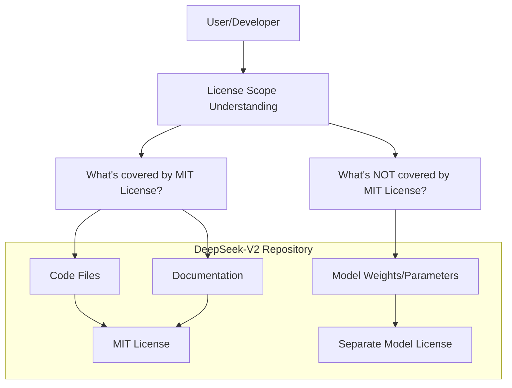
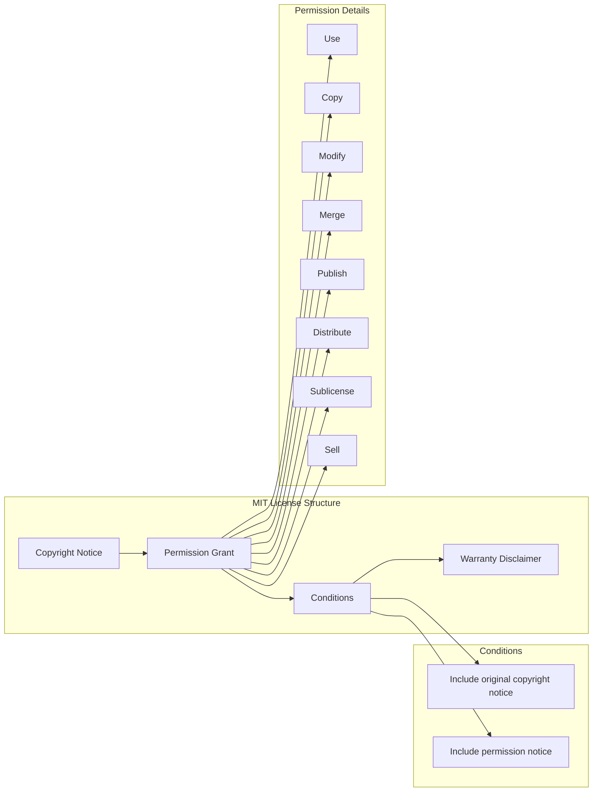
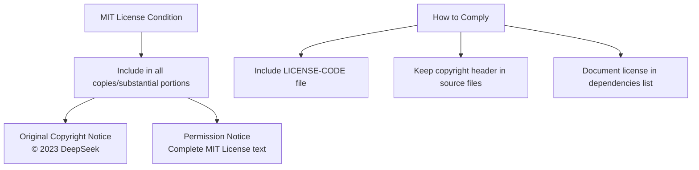
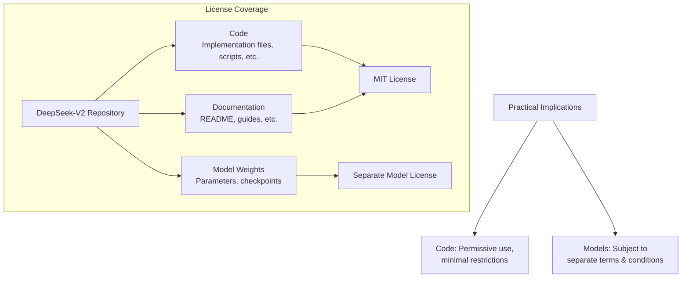

<!-- source: DeepWiki mcp.deepwiki.com · repo deepseek-ai/DeepSeek-V2 · page 5.1 Code License · fetched 2026-10-30 -->

# Code License

Relevant source files

The following files were used as context for generating this wiki page:

- [LICENSE-CODE](LICENSE-CODE)

This document provides a detailed explanation of the license that governs the code in the DeepSeek-V2 repository. For information about the license that covers the models themselves, see [Model License and Usage Restrictions](#5.2).

## Overview of the DeepSeek-V2 Code License

The DeepSeek-V2 codebase is released under the MIT License, one of the most permissive open-source licenses available. This license applies to all code and associated documentation files in the repository, but does not cover the model weights or parameters.

Sources: [LICENSE-CODE:1-21]()

## MIT License Terms

The DeepSeek-V2 code is licensed under the MIT License, Copyright (c) 2023 DeepSeek. The MIT License is known for its simplicity and permissiveness, allowing for extensive freedom in how the code can be used, modified, and distributed.

### Key Components of the MIT License

Sources: [LICENSE-CODE:1-21]()

## Rights Granted Under the MIT License

The MIT License grants the following rights to anyone who obtains a copy of the DeepSeek-V2 code:

| Right | Description |
|-------|-------------|
| Use | Can use the code for any purpose, including private and commercial |
| Copy | Can create copies of the original code |
| Modify | Can alter, adapt, or build upon the code |
| Merge | Can combine the code with other software |
| Publish | Can publish their own works that include the code |
| Distribute | Can distribute original or modified versions |
| Sublicense | Can apply a different license to derivatives |
| Sell | Can sell the original or modified code |

These rights apply to the software and associated documentation files that constitute the DeepSeek-V2 codebase.

Sources: [LICENSE-CODE:5-10]()

## License Conditions

While the MIT License is highly permissive, it does come with a single condition:

Sources: [LICENSE-CODE:11-13]()

## Warranty Disclaimer

An important aspect of the MIT License is the disclaimer of warranty, which is presented in the license in all capital letters to emphasize its importance:

The software is provided "AS IS" without warranty of any kind, whether express or implied, including but not limited to warranties of:
- Merchantability
- Fitness for a particular purpose
- Non-infringement

Additionally, the license states that the authors or copyright holders cannot be held liable for any claim, damages, or other liability arising from the use of the software.

Sources: [LICENSE-CODE:15-21]()

## Code License vs. Model License

It's critical to understand the distinction between the code license and the model license in the DeepSeek-V2 repository:

The MIT License applies only to the code and documentation in the repository. The actual DeepSeek-V2 model weights, parameters, and any outputs generated by the models are governed by a separate license with its own terms and restrictions. Users should refer to the [Model License and Usage Restrictions](#5.2) page for information about model usage.

Sources: [LICENSE-CODE:1-21]()

## Implementing License Compliance

When using the DeepSeek-V2 code in your projects, ensure compliance with the MIT License by:

1. Retaining the original copyright notice and license text in all copies of the code
2. Including the MIT License text in documentation or the license section of your project
3. Documenting the use of DeepSeek-V2 code in your project's dependency list or acknowledgments

Note that these requirements apply to the code only, not to outputs generated by the models.

Sources: [LICENSE-CODE:11-13]()

---

