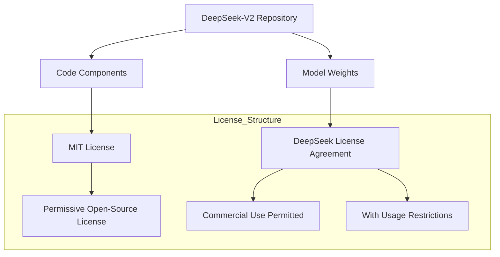
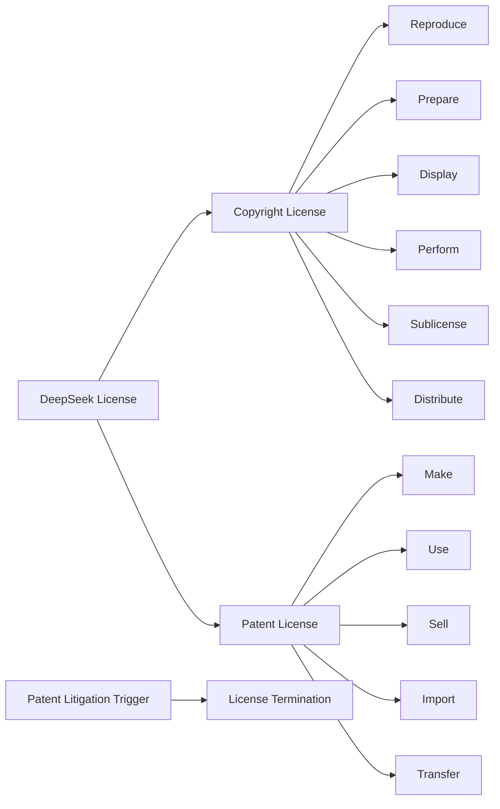
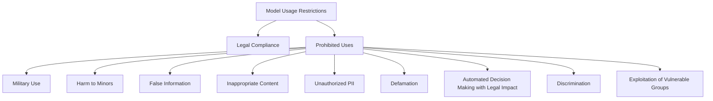
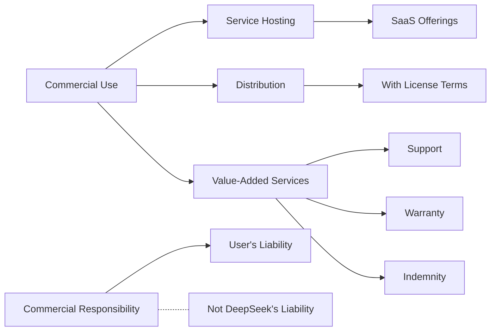

<!-- source: DeepWiki mcp.deepwiki.com · repo deepseek-ai/DeepSeek-V2 · page 5.2 Model License and Usage Restrictions · fetched 2026-10-30 -->

# Model License and Usage Restrictions

<details>
<summary>Relevant source files</summary>

The following files were used as context for generating this wiki page:

- [LICENSE-MODEL](LICENSE-MODEL)
- [README.md](README.md)

</details>


This document provides a comprehensive guide to the licensing terms and usage restrictions that govern the DeepSeek-V2 models. It covers the details of the DeepSeek License Agreement, including intellectual property rights, permitted uses, and specific restrictions on model usage. For information about the code license, see [Code License](#5.1).

## 1. License Overview

DeepSeek-V2 employs a dual licensing structure: the code repository is licensed under the MIT License, while the models themselves are subject to the DeepSeek License Agreement. This licensing structure allows for commercial use of the models while imposing certain restrictions to ensure responsible use.



Sources: [README.md:371-372](). [LICENSE-MODEL:1-6]()

## 2. DeepSeek License Agreement Details

The DeepSeek License Agreement (Version 1.0, dated October 23, 2023) is specifically designed to balance open research and responsible use of large generative models. It provides broad rights for using, modifying, and distributing the models while imposing specific restrictions on how they can be used.

### 2.1 Key Definitions

The license defines several important terms that are essential for understanding its scope and application:

| Term | Definition |
|------|------------|
| Model | Machine-learning based assemblies (including checkpoints) consisting of learned weights and parameters that have been trained on the Data |
| Derivatives of the Model | All modifications to the Model, works based on the Model, or models created by transfer of patterns from the Model (including distillation) |
| Complementary Material | Accompanying source code, scripts, documentation, and tutorials |
| Distribution | Any transmission, reproduction, publication, or sharing of the Model or its Derivatives with a third party |
| Output | The results of operating the Model as embodied in informational content |

Sources: [LICENSE-MODEL:21-31]()

### 2.2 Intellectual Property Rights



The license grants both copyright and patent rights to users:

1. **Copyright License**: A perpetual, worldwide, non-exclusive, royalty-free, irrevocable license to reproduce, prepare, publicly display, perform, sublicense, and distribute the Complementary Material, the Model, and Derivatives of the Model.

2. **Patent License**: A perpetual, worldwide, non-exclusive, royalty-free, irrevocable patent license covering patents necessarily infringed by DeepSeek's contribution. This license terminates if the user institutes patent litigation alleging that the Model or Complementary Material constitutes patent infringement.

Sources: [LICENSE-MODEL:33-39]()

## 3. Conditions of Usage and Distribution

### 3.1 Distribution Requirements

When distributing the Model or Derivatives of the Model, users must:

1. Include the use-based restrictions as an enforceable provision in any legal agreement
2. Provide a copy of the license to recipients
3. Indicate any modifications to files
4. Retain all copyright, patent, trademark, and attribution notices
5. May add their own copyright statement and additional license terms for their modifications, provided they comply with the original license conditions

Sources: [LICENSE-MODEL:42-49]()

### 3.2 Use-Based Restrictions



The license explicitly prohibits using the Model or Derivatives of the Model for:

1. Violating applicable laws or regulations
2. Military purposes
3. Exploiting or harming minors
4. Generating false information to harm others
5. Generating inappropriate content
6. Unauthorized use of personal identifiable information
7. Defaming or harassing others
8. Fully automated decision-making that adversely impacts legal rights
9. Discrimination against individuals or groups
10. Exploiting vulnerabilities of specific groups
11. Discrimination based on legally protected characteristics

Sources: [LICENSE-MODEL:79-91]()

### 3.3 Output Ownership

The license specifies that DeepSeek claims no rights to the output generated by users using the Model. However, users are accountable for the output they generate and its subsequent uses, and no use of the output can violate the license provisions.

Sources: [LICENSE-MODEL:53-54]()

## 4. Commercial Use Provisions

DeepSeek-V2 models support commercial use, as explicitly stated in the README. Users may:

1. Host the model for third-party remote access (e.g., as a service)
2. Reproduce and distribute copies of the Model or Derivatives
3. Charge fees for support, warranty, indemnity, or other services

When offering additional warranties or liability coverage, users act only on their own behalf and responsibility, not on behalf of DeepSeek.



Sources: [README.md:371-372](). [LICENSE-MODEL:44-49](). [LICENSE-MODEL:67-67]()

## 5. Disclaimer and Limitations

### 5.1 Disclaimer of Warranty

The Model and Complementary Material are provided "AS IS" without warranties of any kind, including but not limited to:
- Title
- Non-infringement
- Merchantability
- Fitness for a particular purpose

Users are solely responsible for determining the appropriateness of using or redistributing the Model and assume all associated risks.

### 5.2 Limitation of Liability

DeepSeek is not liable for any damages arising from the use or inability to use the Model and Complementary Material, including:
- Direct damages
- Indirect damages
- Special damages
- Incidental damages
- Consequential damages

Sources: [LICENSE-MODEL:63-65]()

## 6. Governing Law and Jurisdiction

The license agreement is governed by PRC (People's Republic of China) laws without regard to choice of law principles. The courts located in the domicile of Hangzhou DeepSeek Artificial Intelligence Fundamental Technology Research Co., Ltd. have exclusive jurisdiction over any disputes arising from the agreement.

Sources: [LICENSE-MODEL:71-71]()

## 7. Practical Implementation Guide

### 7.1 License Compliance Checklist

To ensure compliance with the DeepSeek license when using or distributing DeepSeek-V2 models:

| Requirement | Action |
|-------------|--------|
| Attribution | Retain all copyright, patent, trademark, and attribution notices |
| Modification Notice | Indicate any modifications made to the model |
| License Copy | Provide a copy of the license to recipients |
| Use Restrictions | Include use-based restrictions in any distribution agreement |
| Output Responsibility | Ensure generated outputs comply with license terms |
| Commercial Use | When offering commercial services, make clear you're acting on your own behalf |

### 7.2 License References in Code

When implementing DeepSeek-V2 models in your applications, you should include appropriate license notices. The repository contains badges that link to both the code and model licenses, which can be referenced in your projects:

```markdown
[](https://github.com/deepseek-ai/DeepSeek-V2/blob/main/LICENSE-MODEL)
```

Sources: [README.md:34-39]()

This badge can be included in your project documentation to properly acknowledge the license terms governing the DeepSeek-V2 model usage.