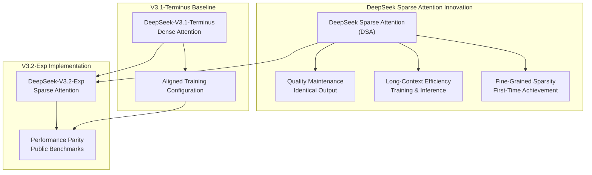
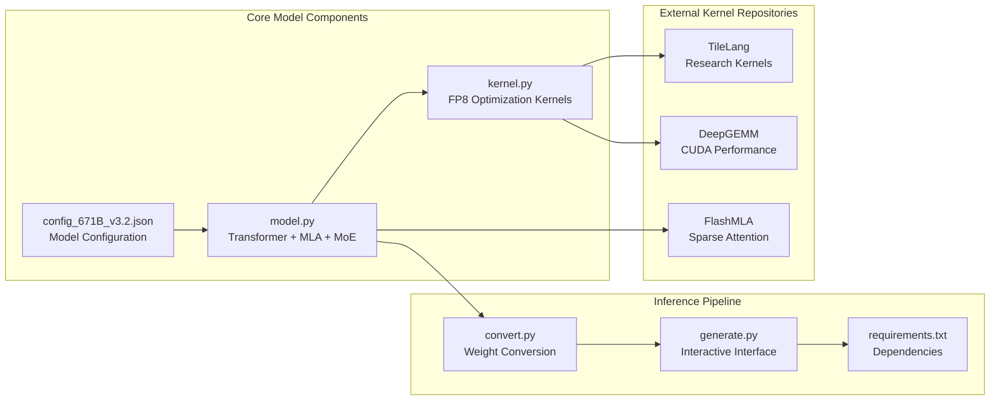
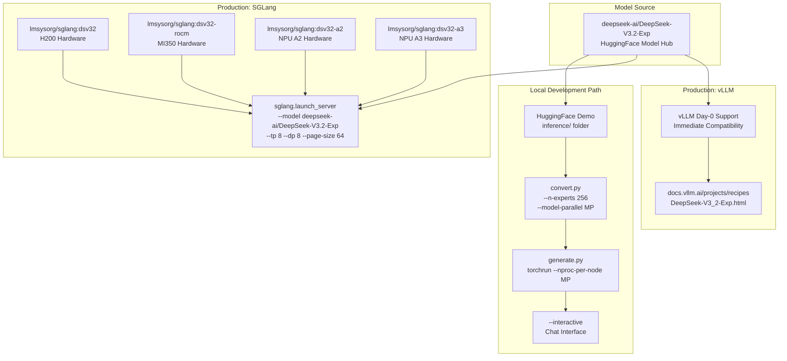

<!-- source: DeepWiki mcp.deepwiki.com · repo deepseek-ai/DeepSeek-V3.2-Exp · page 1 Overview · fetched 2026-10-30 -->

# Overview

Relevant source files

The following files were used as context for generating this wiki page:

- [LICENSE](LICENSE)
- [README.md](README.md)

This document provides a comprehensive introduction to DeepSeek-V3.2-Exp, a 671-billion parameter experimental language model that advances transformer architecture through the introduction of DeepSeek Sparse Attention (DSA). This page covers the system's core innovations, architectural design, and deployment ecosystem. For detailed implementation specifics, see [System Architecture](#1.1). For in-depth technical analysis of the sparse attention mechanism, see [DeepSeek Sparse Attention](#1.2).

## What is DeepSeek-V3.2-Exp

DeepSeek-V3.2-Exp represents an experimental advancement built upon the DeepSeek-V3.1-Terminus foundation, specifically designed to explore and validate optimizations for long-context training and inference efficiency. The model maintains the robust performance characteristics of its predecessor while introducing fine-grained sparse attention mechanisms that substantially improve computational efficiency in extended text processing scenarios.

### Model Specifications

| Specification | Value |
|---------------|-------|
| Total Parameters | 671 billion |
| Architecture Type | Mixture-of-Experts (MoE) |
| Expert Count | 256 experts |
| Core Innovation | DeepSeek Sparse Attention (DSA) |
| Training Tokens | 8.3 trillion |
| License | MIT License |

The model demonstrates performance parity with DeepSeek-V3.1-Terminus across standardized benchmarks while achieving significant efficiency gains in long-context operations through its sparse attention implementation.

**Sources:** [README.md:39-76]()

## Core Innovation: DeepSeek Sparse Attention

DeepSeek Sparse Attention (DSA) represents the primary technical advancement in V3.2-Exp, achieving fine-grained sparse attention for the first time in production-scale language models. This mechanism delivers substantial improvements in both training and inference efficiency for long-context scenarios while maintaining virtually identical model output quality compared to dense attention mechanisms.

The sparse attention mechanism enables the model to selectively focus computational resources on the most relevant portions of input sequences, dramatically reducing the quadratic complexity typically associated with transformer attention mechanisms in long-context scenarios.

**Sources:** [README.md:42-44](), [README.md:50-53]()

## System Architecture Overview

DeepSeek-V3.2-Exp implements a sophisticated MoE architecture with integrated sparse attention mechanisms. The system consists of core model components, optimization kernels, and deployment infrastructure designed for multi-hardware execution.

### Architecture Components

The system architecture consists of three primary component categories:

- **Core Model Components**: Fundamental model implementation including configuration, transformer architecture, and optimization kernels
- **Inference Pipeline**: User-facing components for model deployment and interaction
- **External Kernel Repositories**: Specialized performance kernels for different hardware targets

**Sources:** [README.md:77-82](), [README.md:85-101]()

## Deployment Ecosystem

DeepSeek-V3.2-Exp supports multiple deployment pathways optimized for different use cases and hardware configurations. The ecosystem spans from local development environments to production-scale serving infrastructure.

### Deployment Options

| Platform | Use Case | Configuration | Hardware Support |
|----------|----------|---------------|------------------|
| HuggingFace Demo | Local Development | `torchrun` with model parallelism | Multi-GPU |
| SGLang | Production Serving | Docker containers with tensor/data parallelism | H200, MI350, NPU A2/A3 |
| vLLM | Production Serving | Day-0 compatibility with recipes | Standard GPU configurations |

**Sources:** [README.md:85-127]()

## Performance Characteristics

DeepSeek-V3.2-Exp maintains performance parity with DeepSeek-V3.1-Terminus across diverse benchmarks while introducing efficiency improvements through sparse attention. The model demonstrates consistent performance across reasoning, coding, and agentic tool use scenarios.

### Benchmark Results Summary

The experimental model shows comparable or improved performance across key evaluation metrics:

- **Reasoning Mode**: Performance ranges from 74.1% (LiveCodeBench) to 89.3% (AIME 2025)
- **Agentic Tool Use**: Performance ranges from 37.7% (Terminal-bench) to 97.1% (SimpleQA)  
- **Coding Evaluation**: Codeforces rating of 2121, representing strong competitive programming capability

The aligned training configuration between V3.1-Terminus and V3.2-Exp enables direct performance comparison, validating that the introduction of sparse attention maintains model quality while improving computational efficiency.

**Sources:** [README.md:52-74]()

## Repository Structure

The codebase provides comprehensive implementation and deployment resources:

- **Core Implementation**: Model architecture, optimization kernels, and configuration files
- **Inference Demo**: Complete local inference pipeline with interactive capabilities  
- **Documentation**: Technical specifications and deployment guides
- **External Integration**: Links to specialized kernel repositories and deployment platforms

For detailed component documentation, see [Inference Pipeline](#2) for implementation specifics, [Deployment Guide](#3) for production setup, and [Technical Deep Dive](#4) for advanced architectural details.

**Sources:** [README.md:1-145]()

---

