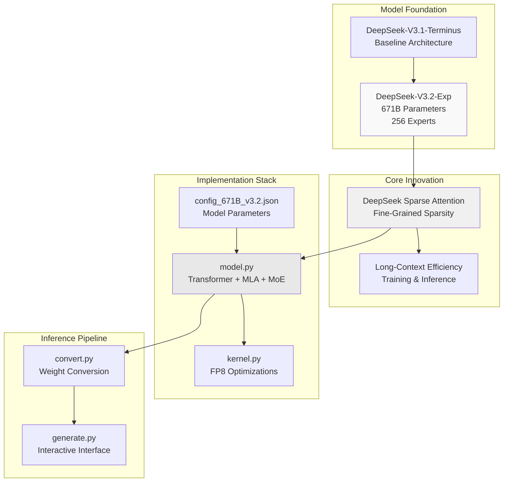
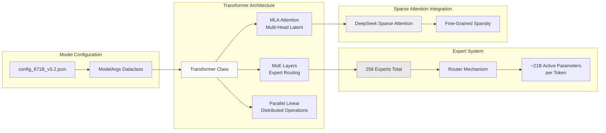
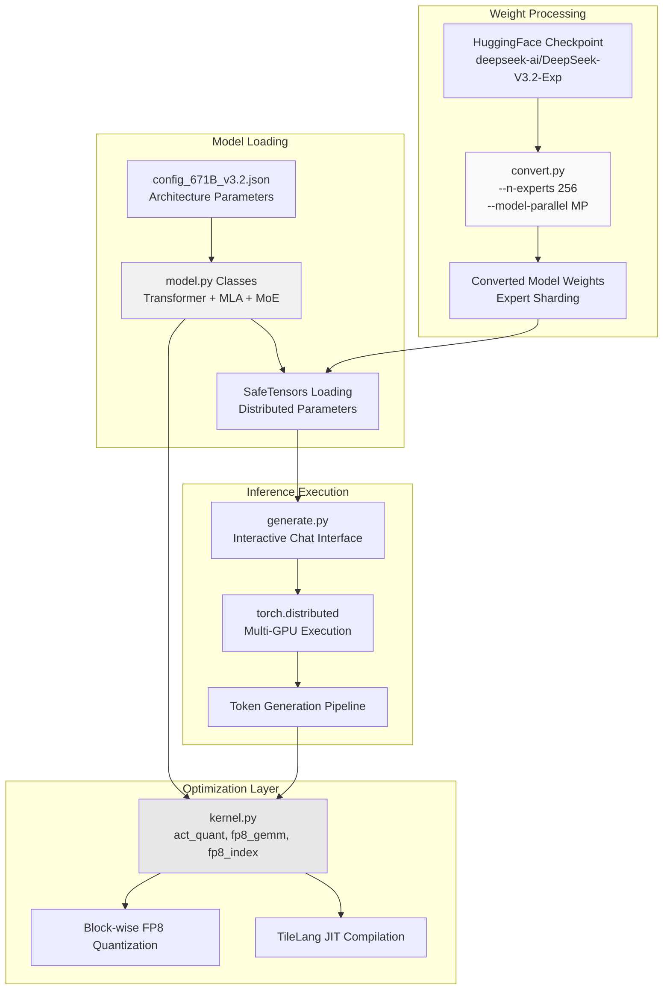
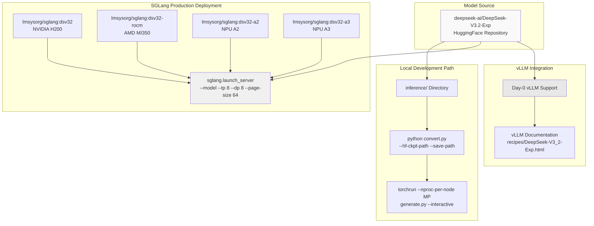

<!-- source: DeepWiki mcp.deepwiki.com · repo deepseek-ai/DeepSeek-V3.2-Exp · page 1.1 System Architecture · fetched 2026-10-30 -->

# System Architecture

Relevant source files

The following files were used as context for generating this wiki page:

- [DeepSeek_V3_2.pdf](DeepSeek_V3_2.pdf)
- [LICENSE](LICENSE)
- [README.md](README.md)
- [cost.jpg](cost.jpg)

## Purpose and Scope

This document provides a comprehensive technical overview of the DeepSeek-V3.2-Exp system architecture, covering the 671B parameter Mixture-of-Experts (MoE) model with DeepSeek Sparse Attention (DSA), the inference pipeline components, and deployment configurations. The document focuses on the structural relationships between core system components and their integration patterns.

For detailed implementation specifics of individual components, see [Core Components](#2.3). For deployment procedures and configuration details, see [Deployment Guide](#3).

## Overall Architecture Overview

DeepSeek-V3.2-Exp represents an experimental advancement built upon the V3.1-Terminus foundation, introducing DeepSeek Sparse Attention as its primary architectural innovation. The system implements a 671B parameter MoE model with 256 experts, designed for efficient long-context processing while maintaining performance parity with its predecessor.

**System Architecture Overview**
Sources: [README.md:1-145](), [DeepSeek_V3_2.pdf:1-end]()

The architecture implements a three-tier design: the foundational MoE transformer model, the sparse attention innovation layer, and the inference execution environment. This separation enables modular development and deployment flexibility across different hardware configurations.

## Core Model Architecture

The DeepSeek-V3.2-Exp model implements a 671B parameter Mixture-of-Experts architecture with 256 experts, where only a subset of experts are activated per token to maintain computational efficiency. The model configuration defines the structural parameters that govern both the transformer backbone and the sparse attention mechanisms.

**Core Model Architecture Components**
Sources: [README.md:93-94](), [model.py]() (inferred from config reference)

The MoE architecture achieves computational efficiency by activating only a subset of the 256 available experts for each token, resulting in approximately 21B active parameters from the total 671B parameter pool. This selective activation pattern, combined with the sparse attention mechanism, enables processing of longer contexts with reduced computational overhead.

## Inference Pipeline Architecture

The inference pipeline orchestrates model execution through a series of specialized components, each handling specific aspects of the inference workflow from weight conversion to token generation.

**Inference Pipeline Data Flow**
Sources: [README.md:90-101](), [convert.py]() (referenced), [generate.py]() (referenced), [model.py]() (referenced), [kernel.py]() (referenced)

The pipeline implements a four-stage process: weight conversion from HuggingFace format, model instantiation with distributed parameter loading, inference execution with multi-GPU coordination, and performance optimization through FP8 quantization kernels. The `torchrun` execution environment manages distributed inference across multiple GPUs specified by the model-parallel parameter.

## Deployment Architecture

The system supports multiple deployment pathways optimized for different use cases and hardware configurations, from local development to production serving environments.

**Multi-Platform Deployment Options**
Sources: [README.md:103-126]()

The deployment architecture provides three primary pathways: local development using the `inference/` directory with `convert.py` and `generate.py`, production deployment through SGLang with Docker containers for multiple hardware targets, and vLLM integration with day-0 support. Each pathway is optimized for specific hardware configurations and use case requirements.

## System Integration Points

The system architecture defines several critical integration points that enable interoperability between components and external systems.

| Integration Point | Component | Interface | Purpose |
|------------------|-----------|-----------|----------|
| Model Loading | `convert.py` | HuggingFace → Native | Weight format conversion |
| Distributed Execution | `generate.py` | `torch.distributed` | Multi-GPU coordination |
| Optimization Kernels | `kernel.py` | TileLang JIT | Performance acceleration |
| Configuration Management | `config_671B_v3.2.json` | JSON Schema | Architecture parameters |
| External Serving | SGLang/vLLM | API Endpoints | Production deployment |

**System Integration Architecture**
Sources: [README.md:77-82](), [README.md:88-126]()

The integration architecture leverages standardized interfaces for model conversion, distributed computation, and external serving. The `kernel.py` optimization layer integrates with external repositories (TileLang, DeepGEMM, FlashMLA) to provide specialized CUDA kernels for sparse attention and quantization operations. This modular approach enables independent development and optimization of performance-critical components while maintaining system cohesion.

The configuration-driven design allows runtime adaptation to different hardware environments and deployment scenarios through the `config_671B_v3.2.json` parameter specification, ensuring consistent behavior across local development and production deployment configurations.

---

