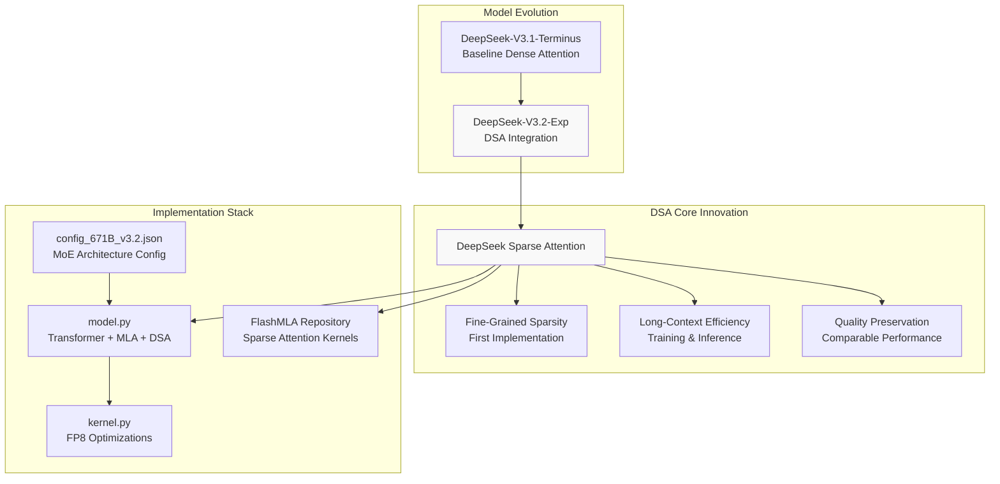
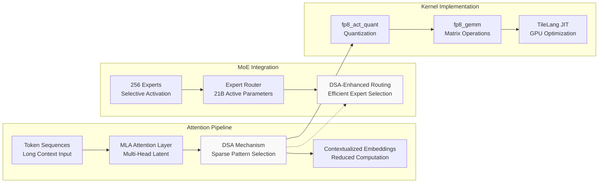
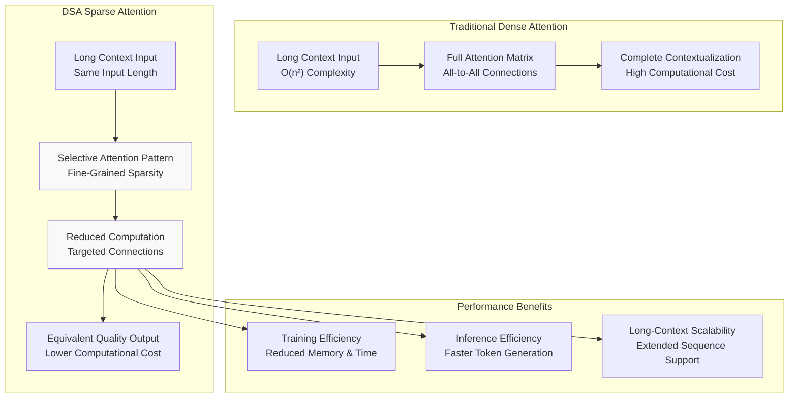
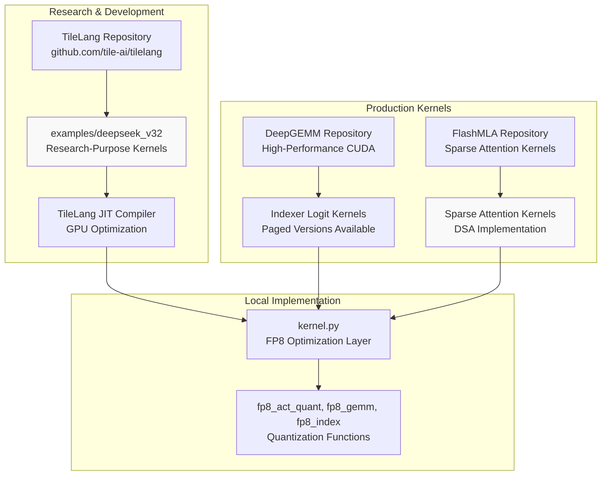

<!-- source: DeepWiki mcp.deepwiki.com · repo deepseek-ai/DeepSeek-V3.2-Exp · page 1.2 DeepSeek Sparse Attention · fetched 2026-10-30 -->

# DeepSeek Sparse Attention

Relevant source files

The following files were used as context for generating this wiki page:

- [DeepSeek_V3_2.pdf](DeepSeek_V3_2.pdf)
- [LICENSE](LICENSE)
- [README.md](README.md)
- [cost.jpg](cost.jpg)

## Purpose and Scope

This document provides a comprehensive technical analysis of DeepSeek Sparse Attention (DSA), the core innovation introduced in DeepSeek-V3.2-Exp. DSA represents a breakthrough in fine-grained sparse attention mechanisms, delivering substantial improvements in long-context training and inference efficiency while maintaining model quality comparable to dense attention approaches.

For information about the overall system architecture and model configuration, see [System Architecture](#1.1). For details about the specific implementation components and inference pipeline, see [Inference Pipeline](#2).

## Overview and Innovation

DeepSeek Sparse Attention (DSA) is the primary differentiator between DeepSeek-V3.2-Exp and its predecessor V3.1-Terminus. This sparse attention mechanism addresses the computational challenges of processing extended text sequences by selectively attending to relevant portions of the input while maintaining the quality of dense attention.

**Sources:** [README.md:42-54]()

## Technical Architecture

DSA operates within the 671B parameter Mixture-of-Experts architecture, integrating with the Multi-Head Latent Attention (MLA) mechanism. The implementation achieves sparsity through selective attention patterns that reduce computational complexity while preserving the model's representational capacity.

### Core Components Integration

**Sources:** [README.md:88-101](), [README.md:77-82]()

### Implementation in Codebase

The DSA mechanism is implemented across multiple components in the inference pipeline:

| Component | File Path | Function |
|-----------|-----------|----------|
| Model Configuration | `config_671B_v3.2.json` | Defines 671B MoE architecture parameters |
| Core Implementation | `model.py` | Transformer class with MLA + DSA integration |
| Optimization Kernels | `kernel.py` | FP8 quantization and sparse operations |
| External Kernels | FlashMLA repository | High-performance sparse attention kernels |
| Weight Conversion | `convert.py` | HuggingFace checkpoint transformation |
| Inference Engine | `generate.py` | Interactive inference with DSA optimization |

**Sources:** [README.md:92-95](), [README.md:77-82]()

## Performance Characteristics

DSA delivers substantial performance improvements in long-context scenarios while maintaining output quality comparable to dense attention mechanisms. The experimental validation was conducted with deliberately aligned training configurations between V3.2-Exp and V3.1-Terminus.

### Benchmark Performance Comparison

The following table demonstrates DSA's ability to maintain performance parity with dense attention:

| Benchmark Category | V3.1-Terminus | V3.2-Exp (DSA) | Variance |
|-------------------|---------------|-----------------|----------|
| **Reasoning (No Tools)** | | | |
| MMLU-Pro | 85.0 | 85.0 | 0.0% |
| GPQA-Diamond | 80.7 | 79.9 | -1.0% |
| LiveCodeBench | 74.9 | 74.1 | -1.1% |
| AIME 2025 | 88.4 | 89.3 | +1.0% |
| Codeforces | 2046 | 2121 | +3.7% |
| **Agentic Tool Use** | | | |
| BrowseComp | 38.5 | 40.1 | +4.2% |
| SimpleQA | 96.8 | 97.1 | +0.3% |
| SWE Verified | 68.4 | 67.8 | -0.9% |

**Sources:** [README.md:56-74]()

### Computational Efficiency

**Sources:** [README.md:42-54]()

## Integration with External Kernels

DSA leverages multiple specialized kernel implementations for optimal performance across different hardware platforms and research contexts:

### Kernel Repository Integration

**Sources:** [README.md:79-82]()

## Training and Validation Methodology

To ensure rigorous evaluation of DSA's impact, the training configurations between DeepSeek-V3.2-Exp and V3.1-Terminus were deliberately aligned. This methodological approach enables accurate assessment of the sparse attention mechanism's effects on model performance.

### Training Configuration Alignment

The experimental design maintains consistency across:
- **Training Data**: 8.3T high-quality tokens
- **Model Architecture**: 671B total parameters, 21B active per token
- **Expert Configuration**: 256 experts with identical routing mechanisms
- **Optimization Settings**: Aligned hyperparameters and training procedures

This rigorous experimental setup demonstrates that DSA achieves its efficiency gains without compromising model quality, validating the approach for production deployment in long-context applications.

**Sources:** [README.md:52-54]()

---

