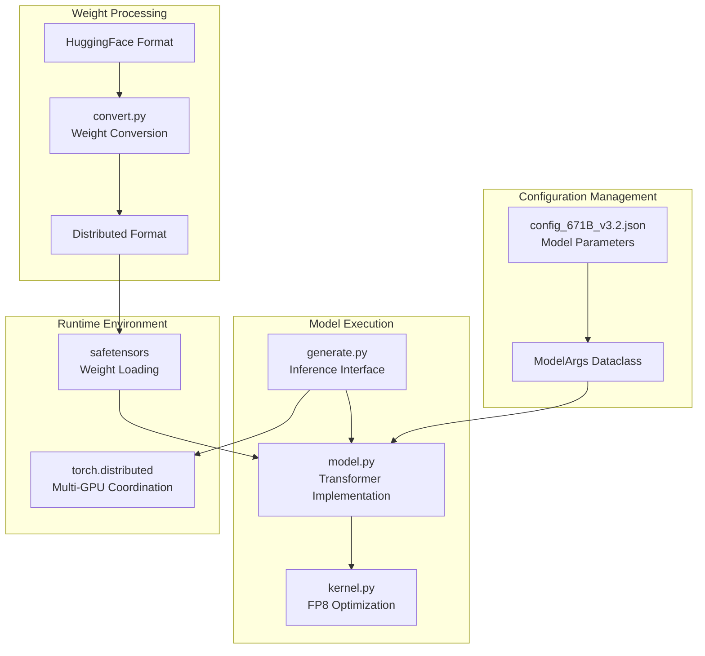
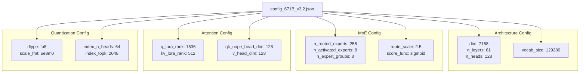

<!-- source: DeepWiki mcp.deepwiki.com · repo deepseek-ai/DeepSeek-V3.2-Exp · page 2 Inference Pipeline · fetched 2026-10-30 -->

# Inference Pipeline

<details>
<summary>Relevant source files</summary>

The following files were used as context for generating this wiki page:

- [inference/README.md](inference/README.md)
- [inference/config_671B_v3.2.json](inference/config_671B_v3.2.json)

</details>


## Purpose and Scope

The Inference Pipeline encompasses the complete system for running DeepSeek-V3.2-Exp model inference locally. This document covers the end-to-end process from model weight conversion to interactive text generation, including configuration management, distributed execution, and optimization components. 

For deployment in production environments, see [Production Deployment](#3.2). For detailed model architecture information, see [System Architecture](#1.1).

## Pipeline Overview

The inference pipeline transforms HuggingFace model checkpoints into a format optimized for distributed inference execution. The system supports multi-GPU deployment with FP8 quantization and specialized kernels for performance optimization.


**Inference Pipeline Flow**

Sources: [inference/README.md:3-13]()

## Inference Workflow

The inference process follows a two-stage workflow: weight conversion followed by interactive generation.

### Stage 1: Weight Conversion

The conversion stage transforms HuggingFace model weights for distributed inference:

```bash
export EXPERTS=256
python convert.py --hf-ckpt-path ${HF_CKPT_PATH} --save-path ${SAVE_PATH} --n-experts ${EXPERTS} --model-parallel ${MP}
```

### Stage 2: Interactive Generation

The generation stage launches distributed inference with the converted weights:

```bash
export CONFIG=config_671B_v3.2.json
torchrun --nproc-per-node ${MP} generate.py --ckpt-path ${SAVE_PATH} --config ${CONFIG} --interactive
```

Sources: [inference/README.md:4-13]()

## Key Components

The inference pipeline consists of four primary components that work together to enable distributed model execution:



**Core Inference Components**

Sources: [inference/README.md:3-13]()

## Configuration System

The model configuration defines the architecture parameters for the 671B MoE model. The `config_671B_v3.2.json` file specifies critical parameters for model instantiation and execution.

### Model Architecture Parameters

| Parameter | Value | Description |
|-----------|-------|-------------|
| `vocab_size` | 129280 | Vocabulary size for tokenization |
| `dim` | 7168 | Model dimension (hidden size) |
| `n_layers` | 61 | Total number of transformer layers |
| `n_heads` | 128 | Number of attention heads |
| `n_routed_experts` | 256 | Number of MoE experts available |
| `n_activated_experts` | 8 | Experts activated per token |

### MoE Configuration

| Parameter | Value | Description |
|-----------|-------|-------------|
| `moe_inter_dim` | 2048 | MoE expert intermediate dimension |
| `n_shared_experts` | 1 | Always-active shared experts |
| `n_expert_groups` | 8 | Expert grouping for routing |
| `route_scale` | 2.5 | Routing score scaling factor |
| `score_func` | "sigmoid" | Routing score activation function |

### Attention Mechanism Parameters

| Parameter | Value | Description |
|-----------|-------|-------------|
| `q_lora_rank` | 1536 | Query LoRA rank for efficiency |
| `kv_lora_rank` | 512 | Key-Value LoRA rank |
| `qk_nope_head_dim` | 128 | Query-Key head dimension (non-RoPE) |
| `qk_rope_head_dim` | 64 | Query-Key head dimension (RoPE) |
| `v_head_dim` | 128 | Value head dimension |

### Quantization Settings

| Parameter | Value | Description |
|-----------|-------|-------------|
| `dtype` | "fp8" | Primary data type for inference |
| `scale_fmt` | "ue8m0" | FP8 scaling format specification |
| `index_n_heads` | 64 | Number of heads for index computation |
| `index_topk` | 2048 | Top-k selection for sparse attention |



**Configuration Parameter Hierarchy**

Sources: [inference/config_671B_v3.2.json:1-26]()

The configuration system enables flexible model instantiation while maintaining compatibility with the distributed inference framework. These parameters directly map to the model implementation classes and determine runtime behavior for attention mechanisms, expert routing, and quantization strategies.

---

